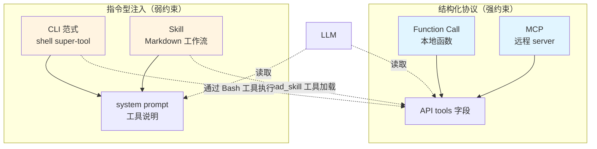
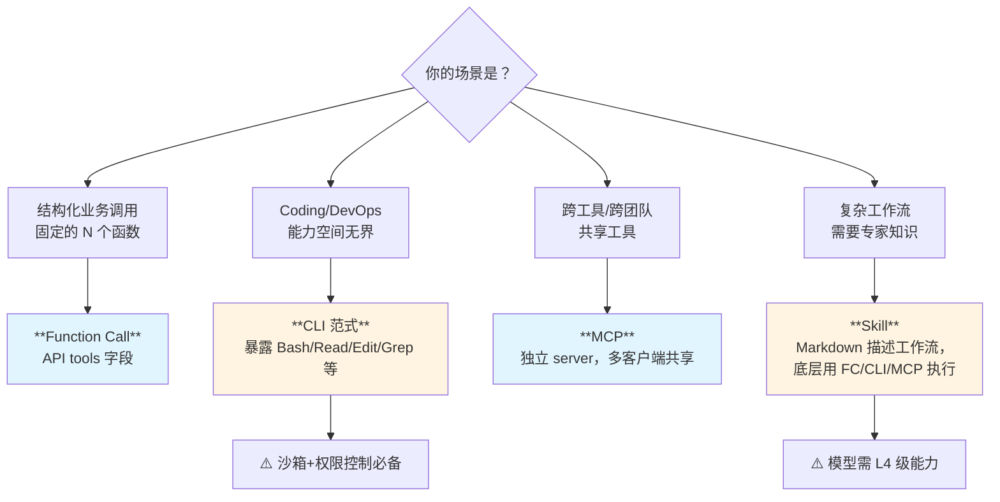

> 历史研究归档 · 2026-11-10 发布 · 程序扫描并审阅风险命中上下文；未逐篇全文审阅。原有日期、观点、数据和命令保留历史语境，未经本次逐项事实核验或运行复现；请结合[归档说明](../../../ARCHIVE_POLICY.md)阅读。

> **一句话概括**：Function Call / MCP / CLI / Skill 不是四种竞争方案，而是**同一根光谱的四个刻度**——按"耦合度↓ + 自由度↑"排开。理解它们的本质，需要看清三件事：(1) **能力是怎么注入到 LLM 上下文的**，(2) **执行边界是谁来守的**，(3) **对模型的指令遵循能力提了多高的要求**。
> 
> **本报告在以下报告基础上做增量**：Agent-Skills 与 LLM-Wiki 生态（原稿交叉引用，本归档未解析） 讲了 Skill 格式、[A2A协议入门学习指南](R50_A2A%E5%8D%8F%E8%AE%AE%E5%85%A5%E9%97%A8%E5%AD%A6%E4%B9%A0%E6%8C%87%E5%8D%97.md) 讲了 MCP 通信层、Hermes 报告讲了 function call 实战，但**四种范式的横向对比 + LLM 能力门槛 + 手搓四件套**是知识库空白，本报告填补。

---

## TL;DR 速查卡

- 🎯 **本质判断**：四种形式的**能力注入位置**不同——FC 进 `tools` 字段、MCP 进 `tools` 字段（但远程）、CLI 进 system prompt 字符串、Skill 进 system prompt 字符串（按需加载）。前两个是"结构化协议"，后两个是"自然语言指令"。
- 📐 **光谱定位**（耦合度从高到低）：`Function Call`（贴身）→ `MCP`（解耦）→ `Skill`（语义化）→ `CLI`（最松散）。
- 🧠 **LLM 能力要求**（递增）：FC 要"参数 schema 遵循"→ MCP 要"工具选择"→ Skill 要"程序性推理 + 工作流执行"→ CLI 要"自由形式语言→shell 命令翻译 + 错误恢复"。
- 🛠️ **手搓核心循环只有 30 行**：`while True → call_model → if tool_call: execute → append result → else: break`。四种形式的差异**不在循环**，而在"工具暴露给模型的格式"和"工具在哪执行"。
- 🚀 **发展趋势**：FC 走向**并行 + 流式**（Anthropic 已支持）；MCP 走向**资源/Prompt/Sampling 三件套**（不止 tools）；CLI 走向**Agent harness 标配**（Claude Code/Codex 引领）；Skill 走向**跨平台标准**（agentskills.io）。
- 💡 **学习路径**：先手搓 FC（理解循环本质）→ 再手搓 CLI 包装器（理解"prompt 即接口"）→ 然后手搓 MCP server（理解协议解耦）→ 最后写 Skill（理解"指令注入即能力扩展"）。

---

## 目录

- [一、定位透镜：四种形式在光谱上的位置](#一定位透镜四种形式在光谱上的位置)
- [二、Function Call：结构化的"我想调用 X"](#二function-call结构化的我想调用-x)
- [三、MCP：把 Function Call 拉远到独立进程](#三mcp把-function-call-拉远到独立进程)
- [四、CLI：让模型说人话调命令行](#四cli让模型说人话调命令行)
- [五、Skill：把"工作流知识"塞进上下文](#五skill把工作流知识塞进上下文)
- [六、横向对比矩阵](#六横向对比矩阵)
- [七、LLM 能力要求——为什么有些模型用不了 Skill？](#七llm-能力要求为什么有些模型用不了-skill)
- [八、手搓四件套——不用任何 Agent 框架](#八手搓四件套不用任何-agent-框架)
- [九、发展趋势与选型建议](#九发展趋势与选型建议)

---

## 一、定位透镜：四种形式在光谱上的位置

把四种形式按"**模型与工具之间的耦合度**"和"**协议结构化程度**"放到二维平面：

```
   结构化协议
      ▲
      │
  FC  ●─────● MCP
      │           
      │     (二者都是 OpenAI/Anthropic API 的 tools 字段)
      │     (差异：本地函数 vs 远程进程)
      │
   ───┼───────────────► 自由度↑
      │
      │   ● Skill   (Markdown 指令，按需加载)
      │
      │   ● CLI     (system prompt 中的命令使用说明)
      │
      ▼
   自然语言指令
```

**用 C++ 类比一次定位清楚**：

| 工具形式 | C++ 类比 | 接口契约 |
|---------|---------|---------|
| Function Call | **同一进程内的函数指针调用** | 强类型签名（JSON Schema） |
| MCP | **跨进程 RPC（gRPC/JSON-RPC）** | 强类型签名 + 网络协议 |
| CLI | **`system("command --arg")`** | 弱类型，通过 argv 字符串 |
| Skill | **`#include "manual.h"`，但是文档不是头文件** | 无契约，纯文档指引 |

**关键洞察**：FC 和 MCP **本质都是 tools 字段**，区别只在执行位置；Skill 和 CLI **本质都是 system prompt 字符串**，区别只在加载策略（按需 vs 常驻）。所以四种形式实际只有**两个真正的范式**：**结构化工具协议** vs **指令型能力注入**。

---

## 二、Function Call：结构化的"我想调用 X"

### 2.1 它到底是什么

**Function Call（FC）= 让 LLM 输出"我要调用工具 X，参数是 Y"的结构化 JSON 的能力**。

**关键澄清**（很多人弄错）：模型**不会真的执行函数**——它只是生成一段结构化的"调用意图"。真正的执行是你的程序在收到这段 JSON 后，自己去查表、调函数、把结果塞回对话历史。

### 2.2 协议长什么样

**请求**（你告诉模型有哪些工具可用）：

```json
{
  "model": "qwen-max",
  "messages": [
    {"role": "user", "content": "上海天气怎么样？"}
  ],
  "tools": [
    {
      "type": "function",
      "function": {
        "name": "get_weather",
        "description": "获取指定城市的当前天气",
        "parameters": {
          "type": "object",
          "properties": {
            "city": {"type": "string", "description": "城市名称"}
          },
          "required": ["city"]
        }
      }
    }
  ]
}
```

**响应**（模型决定调用工具）：

```json
{
  "choices": [{
    "message": {
      "role": "assistant",
      "tool_calls": [{
        "id": "call_abc123",
        "type": "function",
        "function": {
          "name": "get_weather",
          "arguments": "{\"city\": \"上海\"}"
        }
      }]
    }
  }]
}
```

**你的程序**：解析 `tool_calls` → 调用本地 `get_weather("上海")` → 把结果作为 `role=tool` 消息塞回 → 再调一次模型 → 模型基于结果生成最终回答。

### 2.3 模型内部是怎么"决定"调用工具的

这是学习者最容易困惑的地方。**模型并没有特殊的"决策模块"**——它只是被训练成：当看到 `tools` 字段时，会**倾向于在合适的时候输出工具调用 token**（OpenAI 用特殊的 `<|function_call|>` 标记，Anthropic 用 XML `<tool_use>`）。

底层机制其实是**两阶段训练的产物**：
1. **格式微调**：用大量"问题→tool_call JSON"的样本训练模型，让它学会语法
2. **RLHF 偏好学习**：让标注者评判"这个场景该不该调工具"，模型学到判断力

所以——**FC 不是技术魔法，是训练数据塑造的行为模式**。这也解释了为什么不同模型的 FC 能力差异巨大（见第七章）。

---

## 三、MCP：把 Function Call 拉远到独立进程

### 3.1 一句话定位

**MCP（Model Context Protocol）= 把 Function Call 的"工具实现"从你的应用进程里搬出去，放到独立的 Server 进程，通过 JSON-RPC 通信**。

**Anthropic 官方比喻**："USB-C for AI applications"——一个标准接口，工具开发者和应用开发者各做各的，互不知道对方实现。

### 3.2 与 FC 的关系（这是最常被弄错的）

**MCP 不替代 Function Call，它是 Function Call 的"远程版"**。

数据流对比：

```
Function Call:
  LLM ──tool_call──► Your App ──直接调用──► Python 函数
                          ◄────结果────┘

MCP:
  LLM ──tool_call──► Your App ──JSON-RPC──► MCP Server (独立进程)
                          ◄─────结果─────────┘ (可能是 Node.js / Rust / Go)
```

**App 在中间做翻译**：把 LLM 给的 `tool_calls` 翻译成 MCP 协议的 `tools/call` 请求，把 MCP Server 返回的结果翻译成 `role=tool` 消息塞回对话。

### 3.3 MCP 的三件套（不只是 tools）

很多人以为 MCP = 远程 tools，**这是片面的**。MCP 实际定义了三种能力暴露方式：

| 能力 | 定位 | 类比 |
|------|------|------|
| **Tools** | 模型可以调用的"动作" | function call |
| **Resources** | 模型可以读取的"数据"（文件、数据库行、API 响应） | 文件系统 read |
| **Prompts** | 用户可以触发的"模板"（slash command） | shell alias |
| **Sampling** | Server 反向请求 LLM 帮它做事 | callback |

**Sampling 最有意思**——Server 可以请求 Client 帮它调一次 LLM（比如让 LLM 帮 Server 总结一段文本），实现"工具反向使用 AI"。这是 FC 做不到的。

### 3.4 为什么发明 MCP

- **生态解耦**：你不用为每个 LLM 应用重新实现一遍 GitHub 工具——写一次 GitHub MCP Server，所有支持 MCP 的客户端（Claude Code/Cursor/Copilot）都能用
- **跨语言**：MCP Server 可以用任何语言写（只要能说 JSON-RPC），不强制和 LLM 应用同一语言
- **沙箱**：工具进程独立，崩溃不影响 LLM 主进程，权限可以独立配置

---

## 四、CLI：让模型说人话调命令行

### 4.1 这是个范式转移

CLI 工具（Claude Code / OpenAI Codex / Aider / Gemini CLI）兴起之前，工具暴露给 LLM 的方式都是**结构化协议**（FC/MCP）。CLI 范式的核心创新是：**把"运行 shell 命令"作为一个 super-tool 给模型，让模型自己用自然语言推理出命令**。

### 4.2 CLI 不是"加在 LLM 外面的命令行"

很多人误解 "Claude Code 是 CLI 工具" = "用命令行启动的 LLM 客户端"。**这是表面现象**。

**真正的 CLI 范式**指的是：**LLM 在内部"以为自己在用命令行"，它生成的"工具调用"本质就是 bash 命令字符串**。

举例 Claude Code 的核心工具集：

```
- Bash(command: string)        # 万能：能跑任何 shell 命令
- Read(file_path: string)      # 实际是封装的 cat
- Edit(file, old, new)         # 实际是封装的 sed
- Grep(pattern, path)          # 实际是封装的 ripgrep
- Glob(pattern)                # 实际是封装的 find
```

**这些工具都是 FC 形式注册的**——但它们暴露的"能力空间"是**整个操作系统**。模型不再调用预定义的 50 个业务函数，而是用 5 个底层工具组合出无穷可能。

### 4.3 CLI 范式对模型能力的隐式要求

这套设计能跑通的前提是模型**会写 shell**。它需要：
- 知道 `grep -r "pattern" .` 是递归搜索
- 知道 `git log --oneline -n 20` 怎么写
- 知道当 `find` 失败时改用 `fd`
- 知道 `&&` 和 `;` 的差异
- 看到 `command not found` 知道要换工具

这是**大量代码语料训练 + 后训练专门教学**的结果。早期 GPT-3.5 之所以做不了 Claude Code，不是因为不支持 FC，而是它**写的 shell 不够地道**——容易写出错误转义、漏 quote、误用 pipe。

### 4.4 为什么 CLI 范式爆发

- **能力空间大**：5 个工具覆盖文件系统 + 网络 + 进程 + 版本控制
- **学习成本低**：模型已经在训练数据里学过 shell，不需要新学 50 个业务工具
- **错误可恢复**：shell 的输出（stderr）天然是模型可读的反馈，比"工具返回 500"信息丰富得多
- **生态零接入**：任何已有的 CLI 工具（jq/curl/docker/kubectl）开箱即用，零集成

---

## 五、Skill：把"工作流知识"塞进上下文

### 5.1 Skill ≠ 工具，是"工具的使用说明书"

详见 Agent-Skills 与 LLM-Wiki 生态（原稿交叉引用，本归档未解析） 和 [Hermes-Agent记忆与Skill自迭代源码拆解报告](../06-%E5%B7%A5%E5%85%B7%E4%B8%8E%E7%94%9F%E6%80%81/R35_HermesAgent%E8%AE%B0%E5%BF%86%E4%B8%8ESkill%E8%87%AA%E8%BF%AD%E4%BB%A3%E6%BA%90%E7%A0%81%E6%8B%86%E8%A7%A3.md)，本节只做**与其他三种形式的对比**。

**Skill 的物理形态**：一个 Markdown 文件（Anthropic 官方用 `SKILL.md`），开头一段 YAML frontmatter 描述名字+触发场景，正文是自然语言写的工作流。

**关键差异**：FC/MCP/CLI 都在解决"**怎么调用工具**"的问题，Skill 解决"**什么场景下、按什么步骤、组合调用哪些工具**"的问题——它在工具之上多了一层。

### 5.2 Skill 是怎么"被调用"的

不像 FC 有 `tool_calls` 字段，Skill 没有标准协议。**Anthropic 的实现是**：

1. 在 system prompt 里塞一段说明："你可以使用以下 Skills，每个 Skill 是一段工作流指南..."
2. 列出 Skill 的 name + description（不是全文，**只有摘要**）
3. 模型判断当前任务命中某个 Skill 时，调用一个特殊工具 `read_skill(name)` 把全文加载进上下文
4. 然后按 Skill 描述的步骤执行（执行过程仍然依赖 FC/CLI/MCP）

**这是 Skill 被低估的精妙之处**：它实现了**按需加载**——不命中时只占 ~50 token（描述），命中时才把 ~2000 token（全文）加载进来。对长会话的 token 经济性帮助巨大。

### 5.3 Skill 与 CLI 范式的天然契合

Skill 用自然语言描述工作流，**最适合给 CLI 范式的 Agent 用**——因为 CLI Agent 本来就靠模型推理，Skill 就是给推理过程加一份"专家手册"。

如果你在用纯 FC 模式（业务函数调用），Skill 的价值打折——因为业务函数本身的 schema 和 description 已经承载了"怎么用"，Skill 容易冗余。

---

## 六、横向对比矩阵

| 维度 | Function Call | MCP | CLI | Skill |
|------|--------------|-----|-----|-------|
| **本质** | 结构化工具调用协议 | FC 的远程版 | shell 命令作为通用工具 | 工作流知识注入 |
| **传输位置** | API `tools` 字段 | API `tools` 字段（代理） | API `tools` 字段（少量底层工具） | system prompt 字符串 |
| **协议结构化** | 强（JSON Schema） | 强（JSON-RPC） | 弱（argv 字符串） | 无（自然语言） |
| **执行进程** | 应用内 | 独立 server | 子进程（shell） | 由其他工具执行 |
| **能力扩展方式** | 加新函数 | 加新 server | 装新 CLI 命令 | 加新 SKILL.md |
| **模型决策负担** | 低（schema 引导） | 低（同 FC） | 高（要写正确的 shell） | 高（要按步骤执行） |
| **Token 占用** | 中（每个工具 ~50-200 tok） | 中 | 低（少量底层工具） | 按需加载（描述 50 + 全文 ~2K） |
| **跨厂商可移植** | 低（OpenAI/Anthropic schema 略不同） | **高**（开放协议） | 高（shell 是通用） | **极高**（纯 Markdown） |
| **典型代表** | OpenAI tools / Anthropic tool_use | Claude Desktop / Cursor 的 MCP 集成 | Claude Code / Codex / Aider | Anthropic Skills / agentskills.io |
| **最大优势** | 类型安全、可验证 | 解耦、生态共享 | 能力空间巨大、学习成本低 | 跨平台、人类可读、版本可控 |
| **最大局限** | 厂商锁定、扩展笨重 | 多一跳延迟、协议早期 | 安全风险高、依赖模型 shell 能力 | 无强制执行、依赖模型遵循 |

### 关键关系图



**统一视角**：四种形式最终都通过 **API tools 字段** 或 **system prompt 字符串**这两个通道注入 LLM。差异在于：
- **谁来执行**（应用 / 远程 server / shell / 模型自己推理）
- **什么时候加载**（始终 / 按需）
- **结构化程度**（JSON / 字符串 / Markdown）

---

## 七、LLM 能力要求——为什么有些模型用不了 Skill？

这一章是**用户的核心问题之一**：每种工具形式对模型有什么底线要求？

### 7.1 能力四级阶梯

```
能力等级↑
    │
  L4│ 程序性推理（按文档步骤执行 + 错误恢复）
    │   └─ 解锁：Skill、复杂 CLI Agent
    │
  L3│ 自由形式生成 → 结构化命令翻译
    │   └─ 解锁：CLI 范式（shell 写得对）
    │
  L2│ 工具选择（多个工具中挑对的那个）
    │   └─ 解锁：MCP、多工具 FC
    │
  L1│ Schema 遵循（按 JSON Schema 生成参数）
    │   └─ 解锁：基础 Function Call
    │
   ─┴────────────────────────────────►
```

**关键理解**：上一级**包含**下一级。能用 Skill 的模型一定能用 FC，反之不一定。

### 7.2 各级的具体要求

| 等级 | 能力描述 | 失败案例 | 代表门槛模型 |
|------|---------|---------|------------|
| L1 | 给一个工具的 schema，模型能生成符合 schema 的参数 | 早期 GPT-3.5：参数名写错、漏 required 字段 | GPT-3.5-turbo-0613（首个原生支持 FC） |
| L2 | 给多个工具，模型能根据问题选对的那个 | Llama 2：经常调错工具，或本来该回答却调了工具 | GPT-4 / Claude 2 |
| L3 | 给一个 Bash 工具，模型能写出可执行且正确的 shell | 中等模型：忘转义引号、误用管道、命令选项写错 | Claude 3 Sonnet / GPT-4-turbo |
| L4 | 给一份 Markdown 工作流，模型能按步骤执行+反思+修正 | 大多数 7B 模型：跳步、忽略验证、错误后不回滚 | Claude 3.5 Sonnet+ / GPT-4o+ / Qwen-Max |

### 7.3 指令遵循度（Instruction Following）的具体含义

"指令遵循度"是个被滥用的词。在工具使用语境下，它实际包含**四个独立的子能力**：

1. **Format Adherence（格式遵循）**：能按 schema/template 输出
2. **Constraint Satisfaction（约束满足）**：能遵守"不要做 X"这种否定指令
3. **Multi-step Compliance（多步骤遵循）**：能按 1→2→3 的顺序执行，不跳步
4. **Self-correction on Violation（违规自纠）**：发现自己违反了指令后能回退重试

| 工具形式 | 主要依赖的子能力 |
|---------|----------------|
| Function Call | 1（格式遵循为主） |
| MCP | 1 + 2（远程工具失败时要按规则重试） |
| CLI | 1 + 2 + 3（shell 多步骤组合） |
| Skill | 全部四项（特别是 3 和 4） |

**实践建议**：选模型前，用一个简单的"按步骤创建文件夹+写文件+列目录"任务测试 L3-L4 能力，比看 benchmark 直观。

### 7.4 为什么 Skill 是"试金石"

Skill 同时考验四项能力，且**没有强制机制**——FC 至少有 schema 强约束，Skill 完全靠模型"自觉"按 Markdown 描述执行。所以**模型能不能用 Skill 是 L4 级能力的试金石**。

我们工作区的 Agent-Skills 与 LLM-Wiki 生态（原稿交叉引用，本归档未解析） 报告中提到的实测：Qwen2.5-72B 能用 Skill 但偶尔跳步，Qwen-Max 稳定执行，这就是 L3 → L4 的边界。

---

## 八、手搓四件套——不用任何 Agent 框架

> **学习路径建议**：按 8.1 → 8.2 → 8.3 → 8.4 的顺序。每一步都是上一步的扩展。每个示例都可独立运行（需要 `pip install openai` + 设置 `DASHSCOPE_API_KEY`，用 Qwen 兼容 OpenAI API）。

### 8.1 手搓 Function Call（30 行核心循环）

```python
"""手搓 FC：核心循环只有 30 行，理解了它就理解了所有 Agent 框架的本质。"""
import json
from openai import OpenAI

client = OpenAI(
    api_key="EXAMPLE_API_KEY",
    base_url="https://dashscope.aliyuncs.com/compatible-mode/v1",
)

# Step 1: 定义本地函数
def get_weather(city: str) -> str:
    return f"{city}今天晴，22-28°C"

TOOL_REGISTRY = {"get_weather": get_weather}

# Step 2: 给 LLM 看的 schema
TOOLS_SCHEMA = [{
    "type": "function",
    "function": {
        "name": "get_weather",
        "description": "查询城市天气",
        "parameters": {
            "type": "object",
            "properties": {"city": {"type": "string"}},
            "required": ["city"],
        },
    },
}]

# Step 3: 核心循环（这就是所有 Agent 框架的本质）
def run(user_message: str, max_iters: int = 5):
    messages = [{"role": "user", "content": user_message}]
    for _ in range(max_iters):
        resp = client.chat.completions.create(
            model="qwen-max", messages=messages, tools=TOOLS_SCHEMA,
        )
        msg = resp.choices[0].message
        messages.append(msg.model_dump(exclude_none=True))

        if not msg.tool_calls:           # 模型不再调用工具，结束
            return msg.content
        for tc in msg.tool_calls:        # 执行工具调用
            args = json.loads(tc.function.arguments)
            result = TOOL_REGISTRYtc.function.name（原稿引用文件未随本次归档发布）
            messages.append({
                "role": "tool",
                "tool_call_id": tc.id,
                "content": str(result),
            })
    return "达到最大轮数"

# Expected output: "上海今天的天气是晴，气温 22-28°C..."
print(run("上海天气怎么样？"))
```

**C# 类比**：`TOOL_REGISTRY` 就是 `Dictionary<string, Func<...>>`，`messages` 就是不可变的对话历史 List，`for` 循环就是消息驱动的状态机。

### 8.2 手搓 CLI Agent（让模型用 shell）

把 8.1 的 `get_weather` 换成万能的 `bash` 工具：

```python
import subprocess
def bash(command: str) -> str:
    """执行 shell 命令并返回输出（生产环境一定要加沙箱！）"""
    try:
        r = subprocess.run(
            command, shell=True, capture_output=True,
            text=True, timeout=30, encoding="utf-8",
        )
        return f"[exit={r.returncode}]\nSTDOUT:\n{r.stdout}\nSTDERR:\n{r.stderr}"
    except subprocess.TimeoutExpired:
        return "[ERROR] timeout"

TOOL_REGISTRY = {"bash": bash}
TOOLS_SCHEMA = [{
    "type": "function",
    "function": {
        "name": "bash",
        "description": "执行 shell 命令，返回 stdout+stderr+exit_code",
        "parameters": {
            "type": "object",
            "properties": {"command": {"type": "string"}},
            "required": ["command"],
        },
    },
}]
# 循环代码完全复用 8.1 的 run()

# 试试：print(run("帮我看看 reports/ 目录里有几个 .md 文件"))
# 模型会输出 tool_call: bash("ls reports/*.md | wc -l")
```

**安全警告（必读）**：上面这段 30 行代码在你的电脑上跑等于**给模型 root 权限**。生产用法必须：
- ✅ 跑在 Docker 容器里（参考 Claude Code 的 `--dangerously-skip-permissions` 警告设计）
- ✅ 工作目录限制在项目根，禁止 `cd /`
- ✅ 加白名单/黑名单（禁止 `rm -rf` / `curl ... | sh` / 等）
- ✅ 真要改文件时，先让模型 diff，人审后再 apply

### 8.3 手搓 MCP Server（让 LLM 通过协议调用远程工具）

完整实现需要 ~150 行，这里给最小骨架（用 `fastmcp` 库省事，纯手写见官方协议）：

```python
# server.py（独立进程跑，不是 LLM 应用）
from fastmcp import FastMCP
mcp = FastMCP("weather-server")

@mcp.tool()
def get_weather(city: str) -> str:
    """查询城市天气"""
    return f"{city}今天晴，22-28°C"

if __name__ == "__main__":
    mcp.run(transport="stdio")  # stdio 是 MCP 默认传输
```

```python
# client.py（LLM 应用端，把 MCP tools 翻译成 OpenAI tools）
import asyncio, json
from mcp import ClientSession, StdioServerParameters
from mcp.client.stdio import stdio_client
from openai import OpenAI

async def main():
    server = StdioServerParameters(command="python", args=["server.py"])
    async with stdio_client(server) as (read, write):
        async with ClientSession(read, write) as session:
            await session.initialize()

            # 1. 从 MCP server 拉取工具列表
            tools_resp = await session.list_tools()
            # 2. 翻译成 OpenAI tools schema
            openai_tools = [{
                "type": "function",
                "function": {
                    "name": t.name,
                    "description": t.description,
                    "parameters": t.inputSchema,
                },
            } for t in tools_resp.tools]

            client = OpenAI(api_key="...", base_url="...")
            messages = [{"role": "user", "content": "上海天气？"}]
            resp = client.chat.completions.create(
                model="qwen-max", messages=messages, tools=openai_tools,
            )
            msg = resp.choices[0].message
            if msg.tool_calls:
                tc = msg.tool_calls[0]
                # 3. 把 tool_call 翻译成 MCP 协议调用
                result = await session.call_tool(
                    tc.function.name,
                    arguments=json.loads(tc.function.arguments),
                )
                print("MCP 返回:", result.content[0].text)

asyncio.run(main())
```

**理解关键**：MCP Client 在你的应用里做**协议翻译**——把 LLM 的 `tool_calls`（OpenAI 格式）翻译成 MCP 的 `tools/call`（JSON-RPC），再把 MCP 响应翻译回 `role=tool` 消息。**LLM 完全不知道 MCP 的存在**。

### 8.4 手搓 Skill 加载机制

Skill 没有标准协议，下面是 Anthropic 风格的实现思路：

```python
import os, yaml
from pathlib import Path

# Step 1: 扫描 skills/ 目录，加载所有 SKILL.md 的描述
def load_skill_descriptions(skills_dir: str = "skills"):
    skills = {}
    for skill_path in Path(skills_dir).glob("*/SKILL.md"):
        text = skill_path.read_text(encoding="utf-8")
        # 解析 YAML frontmatter
        if text.startswith("---"):
            _, fm, body = text.split("---", 2)
            meta = yaml.safe_load(fm)
            skills[meta["name"]] = {
                "description": meta.get("description", ""),
                "full_text": body.strip(),
                "path": str(skill_path),
            }
    return skills

SKILLS = load_skill_descriptions()

# Step 2: 把"按需加载"做成一个工具暴露给 LLM
def read_skill(name: str) -> str:
    """模型决定需要某个 Skill 全文时调用"""
    if name not in SKILLS:
        return f"[ERROR] skill {name} not found. Available: {list(SKILLS)}"
    return SKILLS[name]["full_text"]

TOOL_REGISTRY["read_skill"] = read_skill
TOOLS_SCHEMA.append({
    "type": "function",
    "function": {
        "name": "read_skill",
        "description": "加载某个 Skill 的完整工作流指南",
        "parameters": {
            "type": "object",
            "properties": {"name": {"type": "string"}},
            "required": ["name"],
        },
    },
})

# Step 3: system prompt 里只放 Skill 的 name + description（节省 token）
system_prompt = "你可以使用以下 Skills，需要时调用 read_skill 加载全文：\n\n"
for name, info in SKILLS.items():
    system_prompt += f"- **{name}**: {info['description']}\n"

# 然后正常跑 8.1 的循环，把 system_prompt 加到 messages[0]
```

**理解关键**：Skill 不是新协议，**它是 system prompt + 一个特殊工具（`read_skill`）的组合**。这就是为什么 Skill 在所有支持 FC 的模型上都能跑——它没有引入任何新机制。

---

## 九、发展趋势与选型建议

### 9.1 各形式的演进方向

| 形式 | 当前状态 | 演进方向 | 时间窗口 |
|------|---------|---------|---------|
| **Function Call** | 各厂商方言（OpenAI/Anthropic 略不同） | 并行调用（已普及）+ 流式 tool args（部分支持）+ 跨厂商 schema 标准化 | 1-2 年 |
| **MCP** | 主要在 tools 上爆发 | Resources/Prompts/**Sampling** 三件套全面落地，从"工具协议"升级为"完整能力协议" | 2026 年 |
| **CLI 范式** | Claude Code 引领，OpenAI Codex/Aider 跟进 | 成为 **Coding Agent 的事实标准**；非编程领域（DevOps/数据分析）也在采纳 | 已发生 |
| **Skill** | Anthropic Skills + agentskills.io 双生态 | 跨平台标准化（Linux Foundation 介入可能）+ **错误级 Skill 自动累积**（参考 [外部资讯同步_2026-04-22_Agent持续学习三层范式](../06-%E5%B7%A5%E5%85%B7%E4%B8%8E%E7%94%9F%E6%80%81/R46_%E5%A4%96%E9%83%A8%E8%B5%84%E8%AE%AF%E5%90%8C%E6%AD%A5_Agent%E6%8C%81%E7%BB%AD%E5%AD%A6%E4%B9%A0%E4%B8%89%E5%B1%82%E8%8C%83%E5%BC%8F.md) 中的 Section 11 模式） | 2026-2027 |

### 9.2 选型决策树



**实践组合**：四种形式不是互斥的，**最强 Agent 通常是组合使用**：

```
Claude Code 实战配置：
  ├─ FC 协议层      ← API 通信基础
  ├─ CLI 工具集     ← Bash/Read/Edit/Grep 是核心工具
  ├─ MCP 集成       ← 接入 GitHub/Slack/数据库等外部 server
  └─ Skills 库      ← 项目特定的工作流（部署/调试/审查）
```

### 9.3 学习路径建议

**学习者按以下顺序最划算**：

1. **第 1 周**：手搓 8.1 的 FC 循环，搞懂"模型并不真的执行函数"
2. **第 2 周**：手搓 8.2 的 CLI Agent，体验"少数底层工具 vs 大量业务函数"的差异
3. **第 3 周**：手搓 8.3 的 MCP，理解协议解耦的好处与代价
4. **第 4 周**：手搓 8.4 的 Skill 加载，理解"指令即能力"
5. **第 5 周起**：基于以上自己组合，构建第一个生产级 Agent

**反模式**（学习者最容易掉的坑）：
- ❌ **直接学框架**（LangChain/AutoGen）→ 不知道框架在帮你做什么，遇到问题不会调试
- ❌ **跳过 FC 直接学 MCP** → MCP 是 FC 的扩展，不懂 FC 看不懂 MCP 的存在意义
- ❌ **认为 Skill 是新协议** → Skill 只是 system prompt + 一个工具的组合，本质是 prompt engineering

---

## 附录 A：本报告未覆盖但值得追踪

| 话题 | 推荐去看 |
|------|---------|
| MCP Resources/Prompts/Sampling 的实战 | MCP 官方文档 + Claude Desktop 配置范例 |
| CLI Agent 的安全沙箱方案 | Claude Code 源码（`tools/Bash/`），[从零构建Agent-基于Claude-Code源码的渐进式学习路线](../01-%E7%90%86%E8%AE%BA%E4%B8%8E%E6%9E%B6%E6%9E%84/R24_%E4%BB%8E%E9%9B%B6%E6%9E%84%E5%BB%BAAgent%E6%B8%90%E8%BF%9B%E5%BC%8F%E5%AD%A6%E4%B9%A0%E8%B7%AF%E7%BA%BF.md) |
| Skill 的自动生成与进化 | [Hermes-Agent记忆与Skill自迭代源码拆解报告](../06-%E5%B7%A5%E5%85%B7%E4%B8%8E%E7%94%9F%E6%80%81/R35_HermesAgent%E8%AE%B0%E5%BF%86%E4%B8%8ESkill%E8%87%AA%E8%BF%AD%E4%BB%A3%E6%BA%90%E7%A0%81%E6%8B%86%E8%A7%A3.md)、[Skill自迭代机制深度研究报告](../03-%E5%AE%9E%E9%AA%8C%E9%AA%8C%E8%AF%81/R28_Skill%E8%87%AA%E8%BF%AD%E4%BB%A3%E6%9C%BA%E5%88%B6%E6%B7%B1%E5%BA%A6%E7%A0%94%E7%A9%B6.md) |
| Function Call 的并行调用与流式参数 | OpenAI/Anthropic 官方更新日志 |
| AGENTS.md 标准化的进展 | [外部资讯同步_2026-04-22_Agent持续学习三层范式](../06-%E5%B7%A5%E5%85%B7%E4%B8%8E%E7%94%9F%E6%80%81/R46_%E5%A4%96%E9%83%A8%E8%B5%84%E8%AE%AF%E5%90%8C%E6%AD%A5_Agent%E6%8C%81%E7%BB%AD%E5%AD%A6%E4%B9%A0%E4%B8%89%E5%B1%82%E8%8C%83%E5%BC%8F.md) 持续追踪 |

---

## 元数据

- **token 估算**：~9.5K（报告本体），无联网消耗
- **节约策略**：模型语料对四种形式覆盖充分，不做联网验证；引用本工作区已有报告补全细节
- **核心增量**（vs 已有报告）：四种形式的横向对比矩阵 + LLM 能力四级阶梯 + 手搓四件套统一示例
- **下一步**：可基于本报告的 8.1-8.4 代码，在 `experiments/` 下加一组对照实验
