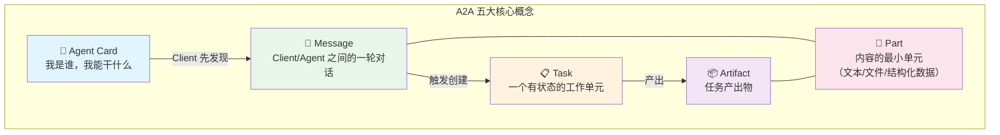
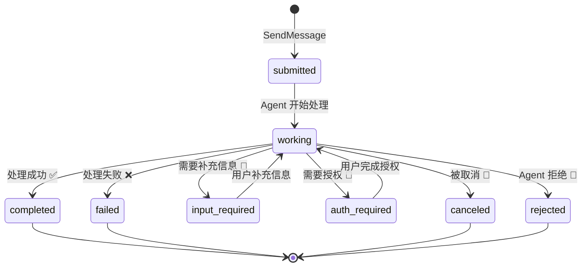
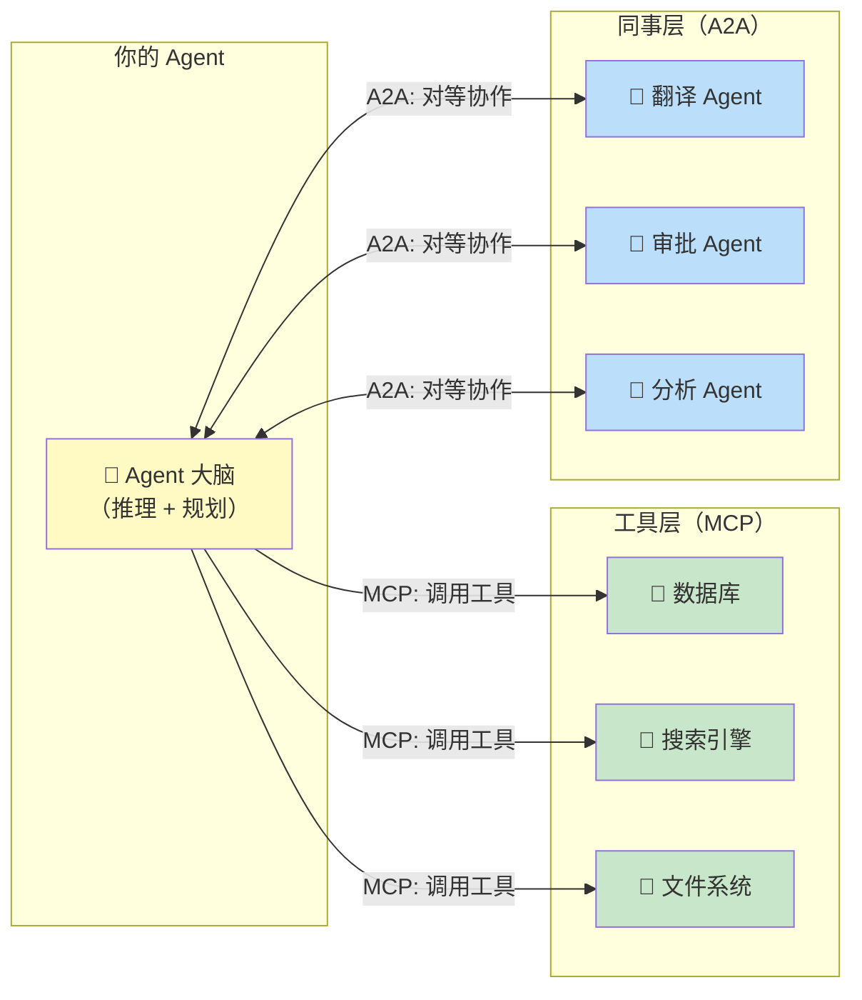
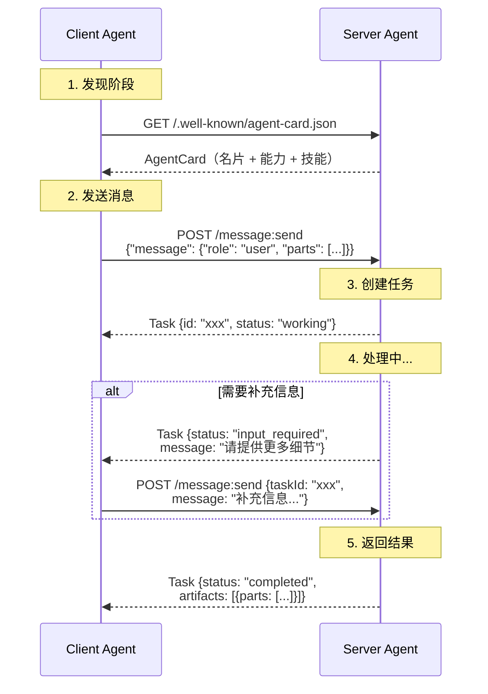
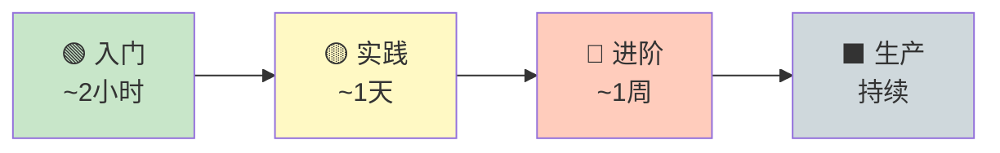

> 历史研究归档 · 2026-11-10 发布 · 发布审核状态：scan_only（发布前程序化隐私扫描）。原有日期、观点、数据和命令保留历史语境，未经本次逐项事实核验或运行复现；见[归档说明](../../../ARCHIVE_POLICY.md)。

# A2A 协议入门学习指南

> **一句话概括**：A2A（Agent-to-Agent）是 Google 贡献给 Linux Foundation 的开放协议，让不同框架、不同语言、不同厂商构建的 AI Agent **以对等身份互相对话和协作**——MCP 管"Agent 怎么用工具"，A2A 管"Agent 怎么找同事"。
> 研究日期：2026-04-16
> 关联报告：[现代智能体编排框架深度调研报告](../06-%E5%B7%A5%E5%85%B7%E4%B8%8E%E7%94%9F%E6%80%81/R45_%E7%8E%B0%E4%BB%A3%E6%99%BA%E8%83%BD%E4%BD%93%E7%BC%96%E6%8E%92%E6%A1%86%E6%9E%B6%E6%B7%B1%E5%BA%A6%E8%B0%83%E7%A0%94.md)、[Agent架构深度研究报告](../01-%E7%90%86%E8%AE%BA%E4%B8%8E%E6%9E%B6%E6%9E%84/R03_Agent%E6%9E%B6%E6%9E%84%E6%B7%B1%E5%BA%A6%E7%A0%94%E7%A9%B6.md)

---

## 目录

- [1. 为什么需要 A2A？——先搞清楚它解决什么问题](#1-为什么需要-a2a先搞清楚它解决什么问题)
- [2. A2A 是什么？——30 秒速通](#2-a2a-是什么30-秒速通)
- [3. 核心概念速通——五个积木块](#3-核心概念速通五个积木块)
- [4. A2A vs MCP——一张图说清关系](#4-a2a-vs-mcp一张图说清关系)
- [5. 一次完整交互的生命周期](#5-一次完整交互的生命周期)
- [6. Hello World：动手跑一个 A2A Agent](#6-hello-world动手跑一个-a2a-agent)
- [7. 进阶能力：流式、多轮、推送](#7-进阶能力流式多轮推送)
- [8. 生态与工具链](#8-生态与工具链)
- [9. 什么时候该用 / 不该用 A2A](#9-什么时候该用--不该用-a2a)
- [10. 学习路线图](#10-学习路线图)
- [11. 常见误区与避坑](#11-常见误区与避坑)

---

## 1. 为什么需要 A2A？——先搞清楚它解决什么问题

**现状痛点**：你用 LangGraph 写了一个"研究助手" Agent，你同事用 CrewAI 写了一个"数据分析" Agent，老板用 .NET + Microsoft Agent Framework 写了一个"审批" Agent。现在客户说："我想让研究助手找到数据后，自动交给数据分析Agent处理，处理完再提交给审批Agent。"

问题来了——**这三个 Agent 讲的是三种"方言"**，它们之间没有统一的通信协议。

你可能会说："用 API 调用不就行了？" 可以，但你要自己定义：
- Agent 怎么发现彼此的能力？
- 任务状态怎么同步？（提交了？处理中？需要补充信息？完成了？）
- 长时间运行的任务怎么追踪？
- 流式输出怎么处理？
- 安全认证怎么统一？

每次对接一对 Agent，就要重新实现一遍这些逻辑。这就是 A2A 要解决的问题——**给 Agent 之间的对话定一个"普通话"标准**。

> 💡 **类比锚定**：A2A 之于 Agent，就像 HTTP 之于 Web 应用——HTTP 定义了浏览器和服务器怎么对话，A2A 定义了 Agent 和 Agent 怎么对话。你不需要为每对 Agent 写一套通信协议，就像你不需要为每个网站写一套浏览器。

---

## 2. A2A 是什么？——30 秒速通

| 属性 | 值 |
|------|-----|
| 全名 | Agent-to-Agent Protocol |
| 发起者 | Google（2025 年 4 月首次发布） |
| 当前归属 | Linux Foundation（开放治理） |
| 最新版本 | **v1.0.0**（2026-03-13 发布） |
| GitHub | [a2aproject/A2A](https://github.com/a2aproject/A2A) — ⭐ 23.2K, 2.4K Forks |
| 协议基础 | JSON-RPC 2.0 / gRPC / HTTP+JSON REST（三种绑定可选） |
| SDK 支持 | Python、Go、JavaScript、Java、.NET（5 种语言官方 SDK）|
| 许可证 | Apache 2.0 |
| 学习资源 | [DeepLearning.AI 免费课程](https://goo.gle/dlai-a2a) ← 强烈推荐 |
| 官方文档 | [a2a-protocol.org](https://a2a-protocol.org/) |

**一句话定义**：A2A 是一个开放标准，允许独立的、**不透明的**（opaque）AI Agent 系统之间进行通信和协作。

"不透明"这个词很关键——Agent 之间协作**不需要暴露内部实现**（记忆、工具、推理链）。就像你和同事协作不需要公开各自的笔记本一样。

---

## 3. 核心概念速通——五个积木块



### 3.1 Agent Card（名片）

Agent Card 是一个 JSON 文件，描述 Agent 的身份、能力和联系方式。**类比：LinkedIn 个人主页**。

```json
{
  "name": "研究助手 Agent",
  "description": "帮用户搜集和分析技术资料",
  "version": "1.0.0",
  "supportedInterfaces": [
    {"url": "https://research.example.com/a2a/v1", "protocolBinding": "JSONRPC", "protocolVersion": "1.0"}
  ],
  "capabilities": {
    "streaming": true,
    "pushNotifications": false
  },
  "defaultInputModes": ["text/plain"],
  "defaultOutputModes": ["text/plain", "application/json"],
  "skills": [
    {
      "id": "tech-research",
      "name": "技术调研",
      "description": "深度技术调研并输出结构化报告",
      "tags": ["research", "analysis", "report"],
      "examples": ["调研一下 A2A 协议", "帮我对比 LangGraph 和 CrewAI"]
    }
  ]
}
```

**发现机制**：Agent 在 `https://{domain}/.well-known/agent-card.json` 发布自己的 Card，其他 Agent 可以通过这个标准 URL 发现它。

> 🛑 **停下来想一想**：为什么 A2A 要设计 Agent Card 而不是直接调 API？
> 
> 因为**先发现再调用**是分布式系统的基本原则。你不会直接打一个陌生人的电话，而是先看他的名片。Agent Card 让 Client 知道：这个 Agent 能干什么（skills）、接受什么格式的输入（inputModes）、支持什么协议（supportedInterfaces）、需要什么认证（securitySchemes）。这避免了"盲打 API"导致的兼容性问题。

### 3.2 Message（消息）

一次对话中的一轮发言。有角色（`ROLE_USER` 或 `ROLE_AGENT`），包含一个或多个 Part。

**类比：微信里的一条消息**——可以是纯文字，也可以带图片、文件。

### 3.3 Task（任务）

A2A 的核心工作单元。**类比：工单系统里的一张工单**——有唯一 ID、有状态流转、有产出物。



关键状态：
- **submitted** → 任务已提交
- **working** → Agent 正在处理
- **input_required** → Agent 需要你补充信息（多轮交互的核心）
- **auth_required** → Agent 需要你授权（比如访问第三方 API）
- **completed / failed / canceled / rejected** → 终态

### 3.4 Artifact（产出物）

Task 的输出结果。**类比：外卖订单里送来的餐品**。

一个 Task 可以产出多个 Artifact，每个 Artifact 包含一个或多个 Part（文本、文件、JSON 数据等）。

### 3.5 Part（内容块）

消息和产出物中的最小内容单元。四种类型：

| Part 类型 | 说明 | 典型场景 |
|-----------|------|---------|
| `text` | 纯文本 | 自然语言对话 |
| `raw` | 二进制（Base64） | 上传图片/PDF |
| `url` | 文件 URL 引用 | 大文件下载 |
| `data` | 结构化 JSON | API 响应、表格数据 |

---

## 4. A2A vs MCP——一张图说清关系

**这是最常见的困惑**："A2A 和 MCP 有什么区别？是竞争关系吗？"

不是。说白了：**MCP 管 Agent 的"手"（怎么操作工具），A2A 管 Agent 的"嘴"（怎么跟同事说话）**。



| 维度 | MCP | A2A |
|------|-----|-----|
| 定位 | Agent ↔ 工具 | Agent ↔ Agent |
| 交互模型 | 函数调用（同步、确定性） | 任务驱动（异步、有状态） |
| 透明度 | 工具的能力完全暴露 | Agent 内部实现不透明 |
| 发起者 | Anthropic | Google → Linux Foundation |
| 典型场景 | Agent 查数据库、操作文件 | Agent 委托另一个 Agent 做翻译 |
| 类比 | 操作系统系统调用 | 跨部门邮件/工单协作 |

**协同使用场景**：一个 A2A Client Agent 请求一个 A2A Server Agent 做复杂任务。Server Agent 内部用 MCP 调用各种工具来完成任务，然后通过 A2A 把结果返回。

---

## 5. 一次完整交互的生命周期



三种获取更新的方式：
1. **轮询（Polling）**：定期 `GET /tasks/{id}` 查状态——简单，但有延迟
2. **流式（Streaming）**：`POST /message:stream`，Server-Sent Events 实时推——低延迟
3. **推送（Push Notification）**：Agent 主动 POST 到你的 webhook——适合长时间运行的任务

---

## 6. Hello World：动手跑一个 A2A Agent

### 6.1 环境准备

```bash
# 前提：Python 3.10+
pip install a2a-sdk

# 克隆官方示例
git clone https://github.com/a2aproject/a2a-samples.git
cd a2a-samples
```

### 6.2 实现 Agent 逻辑（AgentExecutor）

A2A 的核心抽象是 `AgentExecutor`——你只需实现 `execute` 和 `cancel` 两个方法：

```python
from a2a.server.agent_execution import AgentExecutor
from a2a.server.events import EventQueue
from a2a.server.request_handlers import RequestContext
from a2a.types import (
    TaskStatus, TaskState,
    TaskStatusUpdateEvent, TaskArtifactUpdateEvent,
)
from a2a.utils import new_task, new_agent_text_message, new_text_artifact


class HelloWorldAgentExecutor(AgentExecutor):
    """最简 Agent：收到任何消息都回复 Hello World。"""

    async def execute(self, context: RequestContext, event_queue: EventQueue) -> None:
        # 1. 获取或创建 Task
        task = context.current_task or new_task(context.message)
        await event_queue.enqueue_event(task)

        # 2. 标记 "我开始干活了"
        await event_queue.enqueue_event(
            TaskStatusUpdateEvent(
                task_id=context.task_id,
                context_id=context.context_id,
                status=TaskStatus(
                    state=TaskState.TASK_STATE_WORKING,
                    message=new_agent_text_message("Processing..."),
                ),
            )
        )

        # 3. 执行你的业务逻辑（这里只是返回固定文本）
        result = "Hello, World!"

        # 4. 输出产出物
        await event_queue.enqueue_event(
            TaskArtifactUpdateEvent(
                task_id=context.task_id,
                context_id=context.context_id,
                artifact=new_text_artifact(name="result", text=result),
            )
        )

        # 5. 标记 "我干完了"
        await event_queue.enqueue_event(
            TaskStatusUpdateEvent(
                task_id=context.task_id,
                context_id=context.context_id,
                status=TaskStatus(state=TaskState.TASK_STATE_COMPLETED),
            )
        )

    async def cancel(self, context: RequestContext, event_queue: EventQueue) -> None:
        raise Exception("cancel not supported")
```

> 🔍 **关键设计**：注意这里用的是 `EventQueue`（事件队列），而不是直接 return。这是因为 A2A 是**异步优先**的——同一段代码既能处理同步请求（`message/send`），也能处理流式请求（`message/stream`）。事件队列统一了两种模式。

### 6.3 配置 Agent Card 并启动服务

```python
import uvicorn
from a2a.server.apps import A2AStarletteApplication
from a2a.server.request_handlers import DefaultRequestHandler
from a2a.server.tasks import InMemoryTaskStore
from a2a.types import AgentCard, AgentCapabilities, AgentInterface, AgentSkill

if __name__ == "__main__":
    # 定义 Agent 的技能
    skill = AgentSkill(
        id="hello_world",
        name="Hello World",
        description="收到任何消息都回复 Hello World",
        tags=["hello", "greeting"],
        examples=["hi", "hello"],
    )

    # 定义 Agent Card（名片）
    agent_card = AgentCard(
        name="Hello World Agent",
        description="一个最简示例 Agent",
        version="1.0.0",
        default_input_modes=["text"],
        default_output_modes=["text"],
        capabilities=AgentCapabilities(streaming=True),
        supported_interfaces=[
            AgentInterface(
                protocol_binding="JSONRPC",
                url="http://localhost:9999",
                protocol_version="1.0",
            )
        ],
        skills=[skill],
    )

    # 组装服务
    handler = DefaultRequestHandler(
        agent_executor=HelloWorldAgentExecutor(),
        task_store=InMemoryTaskStore(),
    )

    app = A2AStarletteApplication(
        agent_card=agent_card,
        http_handler=handler,
    )

    # 启动！
    uvicorn.run(app.build(), host="127.0.0.1", port=9999)
```

```bash
python server.py
# INFO: Uvicorn running on http://127.0.0.1:9999
```

### 6.4 与 Agent 交互

**发现 Agent Card**：

```bash
curl http://localhost:9999/.well-known/agent-card.json | python -m json.tool
```

**发送消息**：

```bash
curl -X POST http://localhost:9999 \
  -H "Content-Type: application/json" \
  -d '{
    "jsonrpc": "2.0",
    "id": 1,
    "method": "SendMessage",
    "params": {
      "message": {
        "messageId": "msg-001",
        "role": "ROLE_USER",
        "parts": [{"text": "你好呀"}]
      }
    }
  }'
```

返回：

```json
{
  "jsonrpc": "2.0",
  "id": 1,
  "result": {
    "task": {
      "id": "task-uuid",
      "status": {"state": "TASK_STATE_COMPLETED"},
      "artifacts": [{
        "artifactId": "artifact-uuid",
        "parts": [{"text": "Hello, World!"}]
      }]
    }
  }
}
```

> ✅ **阶段性验收**：如果你跑到这里能看到 `Hello, World!` 的响应，恭喜——你已经掌握了 A2A 的核心交互模式。

---

## 7. 进阶能力：流式、多轮、推送

### 7.1 流式响应（Streaming）

长时间运行的任务不必等到全部完成才返回，可以实时推送进度：

```bash
curl -X POST http://localhost:9999 \
  -H "Content-Type: application/json" \
  -d '{
    "jsonrpc": "2.0",
    "id": 1,
    "method": "SendStreamingMessage",
    "params": {
      "message": {
        "messageId": "msg-002",
        "role": "ROLE_USER",
        "parts": [{"text": "写一篇长报告"}]
      }
    }
  }'
```

响应是 SSE（Server-Sent Events）：

```
data: {"task": {"id": "task-123", "status": {"state": "TASK_STATE_WORKING"}}}
data: {"artifactUpdate": {"taskId": "task-123", "artifact": {"parts": [{"text": "第一段..."}]}}}
data: {"artifactUpdate": {"taskId": "task-123", "artifact": {"parts": [{"text": "第二段..."}]}}}
data: {"statusUpdate": {"taskId": "task-123", "status": {"state": "TASK_STATE_COMPLETED"}}}
```

### 7.2 多轮交互（Multi-Turn）

Agent 可以通过 `input_required` 状态请求更多信息：

```
Client → Agent: "帮我订机票"
Agent → Client: Task{status: input_required, message: "从哪飞到哪？"}
Client → Agent: "从北京到上海"  (携带 taskId 继续同一任务)
Agent → Client: Task{status: input_required, message: "什么时候？"}
Client → Agent: "明天上午"
Agent → Client: Task{status: completed, artifacts: [机票信息]}
```

关键：通过 `taskId` 和 `contextId` 维持会话连续性。

### 7.3 推送通知（Push Notification）

适合"任务提交后就不管了，完成了通知我"的场景：

```json
{
  "message": {"role": "ROLE_USER", "parts": [{"text": "生成 Q1 销售报告"}]},
  "configuration": {
    "pushNotificationConfig": {
      "url": "https://my-server.com/webhook/a2a",
      "authentication": {"scheme": "Bearer", "credentials": "my-token"}
    }
  }
}
```

Agent 处理完后会 POST 到你的 webhook URL。

---

## 8. 生态与工具链

### 8.1 官方 SDK

| 语言 | 包名 | 安装方式 |
|------|------|---------|
| Python | `a2a-sdk` | `pip install a2a-sdk` |
| Go | `a2a-go` | `go get github.com/a2aproject/a2a-go` |
| JavaScript | `@a2a-js/sdk` | `npm install @a2a-js/sdk` |
| Java | Maven | Maven Central |
| .NET | `A2A` | `dotnet add package A2A` |

### 8.2 已支持 A2A 的框架

| 框架 | A2A 支持方式 | 备注 |
|------|-------------|------|
| **Google ADK** | 原生内置 | Google 自家产品，一等公民支持 |
| **Microsoft Agent Framework** | 原生支持 | AutoGen 继任者 |
| **Pydantic AI** | 原生支持 | MCP + A2A + AG-UI 三协议全支持 |
| **LangGraph** | 可通过 A2A SDK 包装 | 官方 Tutorial 有 LangGraph 示例 |
| **CrewAI** | 社区适配 | 待验证 |

> 📌 来源：[现代智能体编排框架深度调研报告](../06-%E5%B7%A5%E5%85%B7%E4%B8%8E%E7%94%9F%E6%80%81/R45_%E7%8E%B0%E4%BB%A3%E6%99%BA%E8%83%BD%E4%BD%93%E7%BC%96%E6%8E%92%E6%A1%86%E6%9E%B6%E6%B7%B1%E5%BA%A6%E8%B0%83%E7%A0%94.md) 中的框架对比表，获取于 2026-04-14。

### 8.3 学习资源

| 资源 | 链接 | 推荐度 |
|------|------|--------|
| DeepLearning.AI 免费课程 | [goo.gle/dlai-a2a](https://goo.gle/dlai-a2a) | ⭐⭐⭐⭐⭐ |
| 官方 Python Tutorial（8 步） | [a2a-protocol.org/tutorials](https://a2a-protocol.org/latest/tutorials/) | ⭐⭐⭐⭐ |
| 官方 Samples 仓库 | [github.com/a2aproject/a2a-samples](https://github.com/a2aproject/a2a-samples) | ⭐⭐⭐⭐ |
| 完整协议规范 | [a2a-protocol.org/specification](https://a2a-protocol.org/latest/specification/) | 参考用 |

---

## 9. 什么时候该用 / 不该用 A2A

### ✅ 适合用 A2A 的场景

| 场景 | 为什么 |
|------|--------|
| **多个独立 Agent 需要协作** | A2A 的核心价值——跨框架、跨语言互操作 |
| **Agent 由不同团队/公司维护** | 不透明执行——不需要暴露内部实现 |
| **长时间运行的任务** | Task 生命周期管理 + 推送通知 |
| **需要 human-in-the-loop** | `input_required` / `auth_required` 状态原生支持 |
| **企业级部署** | 标准化安全认证（OAuth2, mTLS, API Key） |

### ❌ 不适合的场景

| 场景 | 为什么 | 替代方案 |
|------|--------|---------|
| 单个 Agent 调用工具 | A2A 是 Agent↔Agent，不是 Agent↔Tool | 用 MCP |
| 同一进程内的 Agent 编排 | A2A 是网络协议，同进程内太重 | 直接用框架内编排（如 LangGraph 的 SubGraph） |
| 实时、毫秒级延迟交互 | HTTP 协议开销 | 直接函数调用 |
| 简单的 pipeline（A→B→C） | 不需要协议级互操作 | 用编排框架的 Sequential Pattern |

### 决策树

```
你的 Agent 需要和外部 Agent 协作吗？
├── 否 → 不需要 A2A（MCP 或框架内编排足够）
└── 是 → 外部 Agent 是你能控制的吗？
    ├── 是，且同框架/同语言 → 优先用框架内编排，A2A 可选
    └── 否，或跨框架/跨组织 → ✅ A2A 是正确选择
```

---

## 10. 学习路线图



| 阶段 | 做什么 | 验收标准 |
|------|--------|---------|
| 🟢 **入门**（~2h） | 读本文 + 跑 Hello World + 看 DeepLearning.AI 课程前 2 节 | 能说清 Agent Card / Task / Message 是什么 |
| 🟡 **实践**（~1d） | 跑官方 [Python Tutorial](https://a2a-protocol.org/latest/tutorials/) 全 8 步 + 修改 Agent 逻辑 | 能写一个有真实业务逻辑的 A2A Agent |
| 🔴 **进阶**（~1w） | 用 LangGraph/ADK 实现一个 A2A Agent + 两个 Agent 互调 | 能实现跨框架 Agent 协作 |
| ⬛ **生产**（持续） | 安全认证、可观测性、错误处理、扩展（Extension） | 能部署到生产环境 |

**ROI 建议**：
- 如果你只是**想了解** A2A → 读本文 + 看课程 ≈ 2 小时足够
- 如果你要**用** A2A → 必须跑 Tutorial + 改代码 ≈ 1-2 天
- **暂缓学习的内容**：Agent Card 签名、自定义 Protocol Binding、gRPC Binding——等你真正需要时再看

---

## 11. 常见误区与避坑

### 误区 1："A2A 是 MCP 的竞争对手"

**错**。A2A 和 MCP 是互补的。MCP = Agent 调用工具（function call），A2A = Agent 与 Agent 协作（peer communication）。协议规范本身（Appendix B）明确说了 "A2A and MCP are complementary protocols"。

### 误区 2："我用了 LangGraph/CrewAI，就不需要 A2A"

**要看场景**。如果你的所有 Agent 都在同一个框架内，框架内编排就够了。但如果你需要与其他团队、其他框架的 Agent 互操作——比如你用的 LangGraph Agent 要调另一个团队用 .NET 写的 Agent——A2A 就是唯一的标准化方案。

### 误区 3："A2A 很复杂，需要学很多协议知识"

**不需要**。如果你用 Python SDK，`A2AStarletteApplication` + `AgentExecutor` 就够了，SDK 帮你处理了所有协议细节。你要做的只是：
1. 定义 Agent Card（JSON 配置）
2. 实现 `execute` 方法（你的业务逻辑）
3. `uvicorn.run`

三步搞定。

### 误区 4："v1.0 刚发布，不够成熟"

**值得关注但谨慎下注**。23K Stars + Linux Foundation 治理 + Google/Microsoft/IBM 背书 + DeepLearning.AI 课程 + 5 语言 SDK + 多个主流框架已支持——信号很强。但 v1.0 到广泛行业采纳仍需时间，建议**先学会、在新项目中试用，但不要对已有系统做大规模迁移**。

---

## 📌 来源清单

- [A2A GitHub](https://github.com/a2aproject/A2A) — 2026-04-16 — 23.2K⭐, v1.0.0
- [A2A 协议规范 v1.0](https://a2a-protocol.org/latest/specification/) — 2026-03-13
- [A2A Python Tutorial](https://a2a-protocol.org/latest/tutorials/python/1-introduction/) — 官方 8 步教程
- [DeepLearning.AI A2A 课程](https://goo.gle/dlai-a2a) — Google Cloud + IBM Research
- [现代智能体编排框架深度调研报告](../06-%E5%B7%A5%E5%85%B7%E4%B8%8E%E7%94%9F%E6%80%81/R45_%E7%8E%B0%E4%BB%A3%E6%99%BA%E8%83%BD%E4%BD%93%E7%BC%96%E6%8E%92%E6%A1%86%E6%9E%B6%E6%B7%B1%E5%BA%A6%E8%B0%83%E7%A0%94.md) — 2026-04-14 — A2A 在框架生态中的定位

⚖️ 来源一致性：多源一致，高置信
📅 时效性声明：以上信息获取于 2026-04-16
