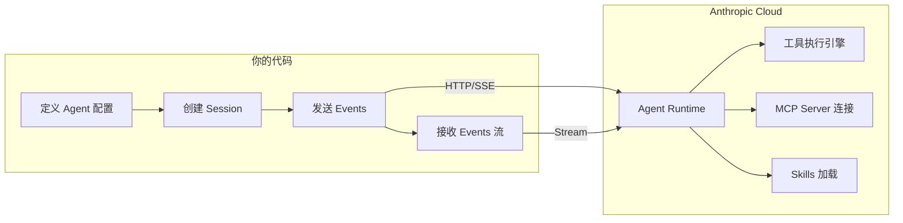
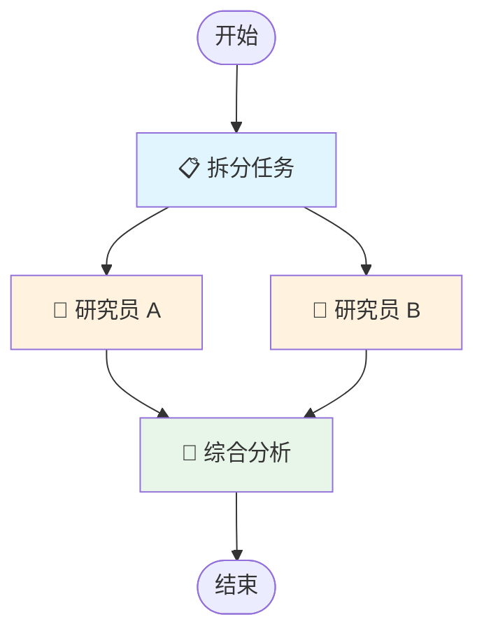
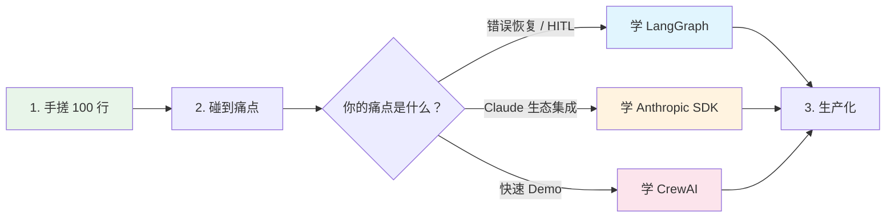

> 历史研究归档 · 2026-11-10 发布 · 程序扫描；未逐篇全文审阅。原有日期、观点、数据和命令保留历史语境，未经本次逐项事实核验或运行复现；请结合[归档说明](../../../ARCHIVE_POLICY.md)阅读。

# 多 Agent 编排：三种实现方式学习指南

> **一句话概括**：同一个"Orchestrator-Workers"多 Agent 任务，分别用手搓 Python、Anthropic Claude SDK 和 LangGraph 实现——让你在对比中真正理解"编排"到底在编排什么，以及不同抽象层次带来的 trade-off。
>
> **研究日期**：2026-04-16
>
> **增量价值**：在 [现代智能体编排框架深度调研报告](../06-%E5%B7%A5%E5%85%B7%E4%B8%8E%E7%94%9F%E6%80%81/R45_%E7%8E%B0%E4%BB%A3%E6%99%BA%E8%83%BD%E4%BD%93%E7%BC%96%E6%8E%92%E6%A1%86%E6%9E%B6%E6%B7%B1%E5%BA%A6%E8%B0%83%E7%A0%94.md)（9 框架横向对比）和 [LangChain与LangGraph从入门到实战完全指南](R26_LangChain%E4%B8%8ELangGraph%E5%85%A5%E9%97%A8%E5%88%B0%E5%AE%9E%E6%88%98.md)（LangGraph 纵向深挖）基础上，本报告做一件它们没做的事——**用同一个任务场景，三种实现并排展示**，让你在代码层面体感"框架帮你做了什么"和"你为此付出了什么"。
>
> **适合谁读**：理解 Agent 基本概念（推理+工具+记忆+规划），写过至少一个单 Agent（如 Ch04 的 agent_loop），想了解多 Agent 编排的学习者。

---

## 目录

- [第一章：多 Agent 编排到底在编排什么？](#第一章多-agent-编排到底在编排什么)
- [第二章：任务场景——三路复现的共同目标](#第二章任务场景三路复现的共同目标)
- [第三章：手搓实现——100 行 Python 搞定](#第三章手搓实现100-行-python-搞定)
- [第四章：Anthropic Claude SDK 实现——云端编排](#第四章anthropic-claude-sdk-实现云端编排)
- [第五章：LangGraph 实现——图编排范式](#第五章langgraph-实现图编排范式)
- [第六章：三种方式并排对比](#第六章三种方式并排对比)
- [第七章：进阶编排模式速查](#第七章进阶编排模式速查)
- [第八章：选型决策与学习路线图](#第八章选型决策与学习路线图)
- [结论与开放问题](#结论与开放问题)

---

## 第一章：多 Agent 编排到底在编排什么？

### 💭 你以为的多 Agent vs 实际的多 Agent

很多初学者对"多 Agent"的第一印象是：

> "搞几个 AI 角色，让它们互相对话，群聊出一个结果"

实际上，多 Agent 编排的本质是四件事：

```
多 Agent 编排 = 任务分解 + 上下文隔离 + 执行协调 + 结果综合
```

| 编排维度 | 对应的工程问题 | 类比 |
|---------|---------------|------|
| **任务分解** | 谁来决定任务拆成几块？拆法对不对？ | 项目经理拆需求 |
| **上下文隔离** | 每个 Agent 该看什么、不该看什么？ | 保密分级——R&D 不该看财务表 |
| **执行协调** | 并行还是串行？谁先谁后？出错了怎么办？ | 流水线调度 / 微服务编排 |
| **结果综合** | 多个 Agent 的输出怎么合成最终答案？ | 合并 PR、综合评审意见 |

**说白了**：编排 ≠ 聊天，编排 = 调度。你在写的不是对话系统，而是一个**分布式工作流引擎**——只不过每个工作节点是一个 LLM 而非一个微服务。

### Anthropic 的五大模式速查

| 模式 | 一句话 | 关键特征 |
|------|--------|---------|
| Prompt Chaining | A 的输出喂给 B | 串行，有 gate 检查 |
| Routing | 分类后走不同分支 | 条件选路 |
| Parallelization | 多个 Agent 同时干 | 并行合并 |
| **Orchestrator-Workers** | Boss 分任务，Workers 干活 | 本报告重点 |
| Evaluator-Optimizer | 做+审循环 | 迭代优化 |

> **来源**：Anthropic [Building Effective Agents](https://www.anthropic.com/engineering/building-effective-agents)（2024-12-19）；本工作区 [Agent架构深度研究报告](../01-%E7%90%86%E8%AE%BA%E4%B8%8E%E6%9E%B6%E6%9E%84/R03_Agent%E6%9E%B6%E6%9E%84%E6%B7%B1%E5%BA%A6%E7%A0%94%E7%A9%B6.md) §五。

本报告选 **Orchestrator-Workers** 模式作为演示场景，因为它是最常见的多 Agent 模式（Claude Code、Cursor、Deep Agents 都在用），且涉及所有四个编排维度。

---

## 第二章：任务场景——三路复现的共同目标

### 场景：技术调研助手

我们要构建一个**迷你技术调研系统**，它接收一个研究问题，由三个 Agent 分工完成：

```
用户: "对比 FastAPI 和 Flask 在生产环境中的选型"

    ┌────────────────────────────────┐
    │  📋 Orchestrator (Boss)        │
    │  - 理解任务                    │
    │  - 拆分成子问题                │
    │  - 综合最终报告                │
    └────────┬───────────┬──────────┘
             │           │
    ┌────────▼──┐   ┌────▼──────────┐
    │ Researcher │   │   Researcher  │
    │  Agent A   │   │   Agent B     │
    │ (FastAPI)  │   │  (Flask)      │
    └────────┬──┘   └────┬──────────┘
             │           │
    ┌────────▼───────────▼──────────┐
    │  📝 Synthesizer (综合者)       │
    │  - 合并两个研究结果            │
    │  - 输出结构化对比报告          │
    └───────────────────────────────┘
```

### 共同约定

三种实现方式都遵循以下约定，便于对比：

| 约定 | 说明 |
|------|------|
| **模型** | 使用 OpenAI 兼容 API（Qwen 或其他，通过 `OPENAI_BASE_URL` 切换） |
| **Agent 数量** | 3 个：Orchestrator + 2 个 Researcher（并行）+ Synthesizer |
| **核心挑战** | 任务拆分、并行执行、结果合并 |
| **输出** | 结构化的对比分析报告 |

> 💡 **为什么选这个场景**：它够简单让你看清编排机制，够复杂体现多 Agent 的价值（并行研究确实比串行快且质量更好），且贴近本工作区的实际使用场景。

---

## 第三章：手搓实现——100 行 Python 搞定

### 设计哲学：朴素即是力量

手搓（Hand-rolled）的核心理念来自 Anthropic 官方建议：

> "Start by using LLM APIs directly: many patterns can be implemented in a few lines of code."

不用框架，不用 SDK，纯 Python + LLM API 调用。这是**理解编排本质的最佳起点**——当你知道每一行代码在干什么，才知道框架帮你封装了什么。

### 3.1 完整可运行代码

```python
"""
手搓多 Agent 编排 — Orchestrator-Workers 模式
==============================================
纯 Python + OpenAI API，不依赖任何框架。

用法:
    pip install openai
    export OPENAI_API_KEY=your-key
    export OPENAI_BASE_URL=https://dashscope.aliyuncs.com/compatible-mode/v1  # 可选
    python 01_hand_rolled.py
"""

import json
import openai
from concurrent.futures import ThreadPoolExecutor, as_completed
from dataclasses import dataclass

# ====== 配置 ======
client = openai.OpenAI()  # 自动读取 OPENAI_API_KEY 和 OPENAI_BASE_URL
MODEL = "qwen-plus"       # 换成你的模型


# ====== 1. 基础设施：最小 Agent 抽象 ======

@dataclass
class AgentResult:
    """Agent 的执行结果"""
    agent_name: str
    content: str

def call_agent(name: str, system_prompt: str, user_message: str) -> AgentResult:
    """一个 Agent = 一次 LLM 调用（最小形态）"""
    response = client.chat.completions.create(
        model=MODEL,
        messages=[
            {"role": "system", "content": system_prompt},
            {"role": "user", "content": user_message},
        ],
        temperature=0.7,
    )
    return AgentResult(
        agent_name=name,
        content=response.choices[0].message.content,
    )


# ====== 2. 角色定义：三个 Agent 的 System Prompt ======

ORCHESTRATOR_PROMPT = """你是一个任务分解专家。
收到用户的研究请求后，将其拆分为 2-3 个可独立执行的子研究任务。

要求：
- 每个子任务聚焦一个具体方面
- 子任务之间不应有依赖关系（可并行执行）
- 输出 JSON 格式：{"tasks": [{"id": "R1", "focus": "聚焦主题", "instruction": "具体指令"}]}
- 仅输出 JSON，不要其他内容"""

RESEARCHER_PROMPT = """你是一位技术研究员，专注于 {focus} 领域。
请对给定的技术主题进行深度分析，输出包含：
1. 核心优势（3-5 点）
2. 主要局限（3-5 点）
3. 典型使用场景
4. 社区和生态现状"""

SYNTHESIZER_PROMPT = """你是一位技术分析总监。
收到多位研究员的独立调研结果后，综合输出一份结构化对比报告。

要求：
- 使用表格对比关键维度
- 给出明确的选型推荐及理由
- 标注信息的一致性和矛盾点"""


# ====== 3. 编排逻辑：手写工作流 ======

def run_orchestrated_research(question: str) -> str:
    """
    完整的 Orchestrator-Workers 工作流：
    Step 1: Orchestrator 拆分任务
    Step 2: Workers 并行研究
    Step 3: Synthesizer 综合结论
    """
    print(f"\n{'='*60}")
    print(f"📋 研究问题: {question}")
    print(f"{'='*60}")

    # === Step 1: 任务拆分 ===
    print("\n🧠 Step 1: Orchestrator 拆分任务...")
    orchestrator_result = call_agent(
        "Orchestrator", ORCHESTRATOR_PROMPT, question
    )

    # 解析 JSON（健壮处理）
    try:
        # 尝试从 markdown 代码块中提取 JSON
        content = orchestrator_result.content
        if "```json" in content:
            content = content.split("```json")[1].split("```")[0]
        elif "```" in content:
            content = content.split("```")[1].split("```")[0]
        plan = json.loads(content.strip())
        tasks = plan.get("tasks", [])
    except (json.JSONDecodeError, IndexError):
        # 降级：如果 LLM 没返回 JSON，手动拆分
        print("  ⚠️ Orchestrator 返回格式异常，降级为默认拆分")
        tasks = [
            {"id": "R1", "focus": "技术 A", "instruction": f"研究 {question} 中的第一个技术"},
            {"id": "R2", "focus": "技术 B", "instruction": f"研究 {question} 中的第二个技术"},
        ]

    for t in tasks:
        print(f"  📌 [{t['id']}] {t.get('focus', t.get('instruction', ''))}")

    # === Step 2: Workers 并行执行 ===
    print(f"\n🔬 Step 2: {len(tasks)} 个 Researcher 并行工作...")
    results = {}

    with ThreadPoolExecutor(max_workers=len(tasks)) as executor:
        futures = {}
        for task in tasks:
            prompt = RESEARCHER_PROMPT.format(focus=task.get("focus", "通用"))
            future = executor.submit(
                call_agent,
                f"Researcher-{task['id']}",
                prompt,
                task.get("instruction", task.get("focus", "")),
            )
            futures[future] = task["id"]

        for future in as_completed(futures):
            task_id = futures[future]
            result = future.result()
            results[task_id] = result
            print(f"  ✅ {result.agent_name} 完成")

    # === Step 3: 综合结论 ===
    print("\n📝 Step 3: Synthesizer 综合分析...")
    combined_input = f"原始研究问题: {question}\n\n"
    for task_id, result in sorted(results.items()):
        combined_input += f"--- {result.agent_name} 的调研结果 ---\n{result.content}\n\n"

    final = call_agent("Synthesizer", SYNTHESIZER_PROMPT, combined_input)

    print(f"\n{'='*60}")
    print(f"📊 最终报告:")
    print(f"{'='*60}")
    print(final.content)

    return final.content


# ====== 运行 ======
if __name__ == "__main__":
    run_orchestrated_research("对比 FastAPI 和 Flask 在生产环境中的选型")
```

### 3.2 逐块解读

> **停下来想一想** 🤔 在继续读之前，回顾一下上面的代码，找出它处理"四个编排维度"的位置：

| 编排维度 | 代码位置 | 实现方式 |
|---------|---------|---------|
| 任务分解 | Step 1: `call_agent("Orchestrator", ...)` | LLM 自主拆解 → JSON 输出 |
| 上下文隔离 | 每个 `call_agent()` 是独立调用 | 天然隔离——函数调用无共享状态 |
| 执行协调 | `ThreadPoolExecutor` + `as_completed()` | Python 标准库并发 |
| 结果综合 | Step 3: 拼接所有结果 → Synthesizer | 字符串拼接 + LLM 综合 |

### 3.3 手搓方案的优劣势

| ✅ 优势 | ❌ 代价 |
|---------|--------|
| **零依赖**——只需 `openai` 包 | **你自己就是框架**——所有调度、错误处理、重试逻辑都要自己写 |
| **完全透明**——每一步都在你掌控之中 | **难以扩展**——加检查点？加 HITL？加状态持久化？每加一个特性都是一堆代码 |
| **学习价值最高**——你真正理解了编排的本质 | **生产不够用**——没有可观测性、没有失败恢复、没有重放能力 |
| **最轻量**——100 行解决问题 | **协议缺失**——Agent 间通信靠字符串拼接，格式一不小心就崩 |

> **核心洞察**：手搓方案完美地证明了 P5 范式——**对于简单场景，你确实不需要框架**。但一旦你问自己"如果 Worker B 在中间失败了怎么办？"，你就开始理解框架存在的意义了。

---

## 第四章：Anthropic Claude SDK 实现——云端编排

### 设计哲学：Agent 即云端服务

Anthropic 走了一条与 LangGraph / OpenAI SDK 都不同的路——**Agent 运行在 Anthropic 的云端**，你的代码只负责定义 Agent、创建会话、发送事件和接收事件。

说白了，LangGraph 是"你造一辆车然后自己开"，Anthropic Cloud SDK 是"你在后台定义了一辆出租车的配置，然后通过电话调度它"。



### 4.1 核心概念速通

Anthropic 的 Agent SDK（2026 年发布，目前仍为 Beta）引入了一套独特的概念：

| 概念 | 作用 | 类比 |
|------|------|------|
| **Environment** | Agent 运行的隔离沙箱 | Docker 容器 |
| **Agent** | Agent 的定义（模型、指令、工具） | Dockerfile |
| **Session** | 一次有状态的交互会话 | 容器实例 |
| **Events** | Agent 与外界的通信单元 | HTTP Request/Response |
| **Vault** | 存储 MCP 凭证等敏感信息 | Secrets Manager |
| **Skills** | 可插拔的能力模块（SKILL.md） | 插件 |
| **Tools** | Agent 可调用的函数 | API Endpoint |

> 🔑 **关键区别**：在手搓方案中，Agent 只是一次 LLM 调用；在 Anthropic SDK 中，Agent 是一个**持久的云端实体**，有自己的版本管理、会话历史和工具配置。

### 4.2 多 Agent 编排：两种路径

Anthropic SDK 做多 Agent 有两种方式，对应不同的抽象层次：

#### 路径 A：Custom Tool 委派（推荐起步）

用 Anthropic SDK 的 `custom tool` 机制来实现 Agent 间调用——Orchestrator Agent 定义一个 `delegate_research` 工具，当它调用该工具时，你的代码拦截事件，调用另一个 Agent（或直接调 LLM），然后把结果返回。

```python
"""
Anthropic Claude SDK 多 Agent 编排 — Custom Tool 委派模式
=========================================================
利用 Agent 的 custom tool 机制实现编排：
  Orchestrator 调用 "delegate_research" 工具 → 你的代码拦截
  → 启动 Worker Agent 或直接调 LLM → 返回结果

前提: pip install anthropic
      export ANTHROPIC_API_KEY=your-key

注意: Anthropic Agent SDK 是 Beta 功能，API 可能变更。
"""

import os
import json
from anthropic import Anthropic

client = Anthropic()


# ====== 1. 创建基础设施 ======

def setup_environment():
    """创建 Environment（Agent 的运行沙箱）"""
    env = client.beta.environments.create(
        name="research-orchestrator-env"
    )
    return env


# ====== 2. 定义 Orchestrator Agent ======

def create_orchestrator_agent():
    """
    Orchestrator Agent 有一个 custom tool: delegate_research
    它会自主决定何时调用这个工具来委派子任务
    """
    agent = client.beta.agents.create(
        name="research-orchestrator",
        model="claude-sonnet-4-6",
        system="""你是一个技术调研编排者。收到研究请求后：
1. 将任务拆分为 2-3 个独立子课题
2. 对每个子课题调用 delegate_research 工具
3. 收到所有子研究结果后，综合输出结构化对比报告

重要：你必须使用 delegate_research 工具来获取各子课题的研究结果，不要自己编造。""",
        tools=[
            {
                "type": "custom",
                "name": "delegate_research",
                "description": "委派一个子研究任务给专业研究员。传入子课题描述，返回该课题的深度分析结果。",
                "input_schema": {
                    "type": "object",
                    "properties": {
                        "topic": {
                            "type": "string",
                            "description": "要研究的具体子课题"
                        },
                        "focus_area": {
                            "type": "string",
                            "description": "希望研究员聚焦的方面（优势/劣势/场景等）"
                        }
                    },
                    "required": ["topic"]
                }
            }
        ],
    )
    return agent


# ====== 3. Worker：执行子研究 ======

def execute_sub_research(topic: str, focus_area: str = "") -> str:
    """
    Worker 实现——这里直接用 Messages API 调 LLM
    （也可以创建另一个 Agent + Session 来做，但对简单任务没必要）
    """
    response = client.messages.create(
        model="claude-sonnet-4-6",
        max_tokens=2000,
        system=f"你是一位专注于 {focus_area or topic} 的技术研究员。请深度分析给定课题，输出：核心优势、主要局限、典型场景、生态现状。",
        messages=[{"role": "user", "content": f"请深度分析：{topic}"}],
    )
    return response.content[0].text


# ====== 4. 编排主循环：事件驱动 ======

def run_research(question: str):
    """
    事件驱动的编排循环：
    1. 创建 Session，发送用户问题
    2. 监听事件流
    3. 遇到 custom_tool_use → 拦截，执行 Worker，返回结果
    4. 遇到 end_turn → 输出最终报告
    """
    env = setup_environment()
    agent = create_orchestrator_agent()

    # 创建会话
    session = client.beta.sessions.create(
        environment_id=env.id,
        agent={"type": "agent", "id": agent.id, "version": agent.version},
    )

    # 发送用户问题
    client.beta.sessions.events.send(
        session.id,
        events=[{
            "type": "user.message",
            "content": [{"type": "text", "text": question}]
        }],
    )

    # 事件驱动主循环
    print(f"\n📋 研究问题: {question}")
    print(f"{'='*60}")

    while True:
        with client.beta.sessions.events.stream(session.id) as stream:
            for event in stream:
                # Agent 调用了 delegate_research 工具
                if event.type == "agent.custom_tool_use" and event.name == "delegate_research":
                    input_data = event.input  # {"topic": "...", "focus_area": "..."}
                    topic = input_data.get("topic", "")
                    focus = input_data.get("focus_area", "")

                    print(f"\n🔬 Worker 接受委派: {topic}")
                    result = execute_sub_research(topic, focus)
                    print(f"  ✅ 研究完成 ({len(result)} 字)")

                    # 把 Worker 结果返回给 Orchestrator
                    client.beta.sessions.events.send(
                        session.id,
                        events=[{
                            "type": "user.custom_tool_result",
                            "custom_tool_use_id": event.id,
                            "content": [{"type": "text", "text": result}]
                        }],
                    )

                # Agent 输出文本
                elif event.type == "agent.message.delta":
                    if hasattr(event, 'content') and event.content:
                        print(event.content, end="", flush=True)

                # Agent 停止——完成
                elif (event.type == "session.status_idle"
                      and hasattr(event, 'stop_reason')
                      and event.stop_reason
                      and event.stop_reason.type == "end_turn"):
                    print(f"\n\n{'='*60}")
                    print("🏁 研究完成")
                    return


if __name__ == "__main__":
    run_research("对比 FastAPI 和 Flask 在生产环境中的选型")
```

#### 路径 B：多 Agent + 多 Session（进阶）

对于更复杂的场景，可以为每个 Worker 也创建独立的 Agent 和 Session：

```python
# 进阶模式（伪代码，展示架构思路）：

# 1. 创建多个 Agent 定义
orchestrator = client.beta.agents.create(name="orchestrator", ...)
researcher_a = client.beta.agents.create(name="fastapi-expert", ...)
researcher_b = client.beta.agents.create(name="flask-expert", ...)
synthesizer = client.beta.agents.create(name="synthesizer", ...)

# 2. 每个 Agent 各自有独立 Session
session_orch = client.beta.sessions.create(agent=orchestrator, ...)
session_a = client.beta.sessions.create(agent=researcher_a, ...)
session_b = client.beta.sessions.create(agent=researcher_b, ...)
session_syn = client.beta.sessions.create(agent=synthesizer, ...)

# 3. 编排逻辑在你的代码中
# - 发消息给 orchestrator → 拿到任务拆分
# - 并行发消息给 researcher_a 和 researcher_b → 拿到研究结果
# - 把结果发给 synthesizer → 拿到最终报告

# 4. 每个 Session 天然有独立上下文（隔离）
# 5. 每个 Session 有完整历史（可追溯）
# 6. Agent 定义有版本管理（可回滚）
```

### 4.3 关键特性与局限

| ✅ 优势 | ❌ 代价 |
|---------|--------|
| **云端运行**——Agent 有独立的运行时，不吃你本地资源 | **仅限 Claude 模型**——不能用 Qwen、GPT 等 |
| **事件驱动**——天然支持异步和流式 | **Beta 状态**——API 随时可能变更 |
| **内置 MCP**——直接连接 MCP Server | **延迟**——每次 custom_tool_use 是一次网络往返 |
| **Skills 系统**——可以给 Agent 注入 SKILL.md | **成本**——每个 session 的维护有开销 |
| **版本管理**——Agent 定义可以 patch 和回滚 | **调试困难**——核心逻辑在云端，你看不到中间状态 |
| **Vault 凭证管理**——安全的 secrets 存储 | **锁定风险**——深度绑定 Anthropic 生态 |

> 🔑 **Anthropic 的独特之处**：它是唯一把 Agent 当作**云端一等公民**来设计的 SDK。其他框架（LangGraph、OpenAI SDK、CrewAI）都是本地运行的库，Agent 就是你代码中的一个对象。Anthropic 的 Agent 是一个有 ID、有版本、有会话历史的**持久实体**——更像是在管理一个微服务，而不是调用一个函数。

---

## 第五章：LangGraph 实现——图编排范式

### 设计哲学：一切皆状态图

LangGraph 的核心思想来自 Google Pregel 图计算模型：**把执行流程建模为一个有向图，节点是函数/Agent，边是数据流，状态在节点间传递。**

如果说手搓是"写命令式脚本"，Anthropic SDK 是"配置云端服务"，那 LangGraph 就是"画流程图然后让引擎执行"。



### 5.1 LangGraph 核心概念对照

先把 LangGraph 的术语映射到你已知的概念：

| LangGraph 术语 | 你已知的概念 | 一句话说明 |
|---------------|------------|-----------|
| **State** | 全局变量 / 共享黑板 | 图中所有节点共用的数据结构，`TypedDict` 定义 |
| **Node** | 函数 / Agent | 图中的执行单元，接收 State 返回 State 更新 |
| **Edge** | 连线 / goto | 节点间的执行顺序 |
| **Conditional Edge** | if-else / 路由 | 根据 State 内容动态选下一步 |
| **StateGraph** | 流程图 / DAG | 把以上元素组装成可执行的图 |
| **Checkpoint** | 存档点 | 图执行的快照，支持 time-travel |

### 5.2 完整可运行代码

```python
"""
LangGraph 多 Agent 编排 — Orchestrator-Workers 模式
====================================================
用 LangGraph 的 StateGraph 实现显式图编排。

用法:
    pip install langgraph langchain-openai
    export OPENAI_API_KEY=your-key
    export OPENAI_BASE_URL=https://dashscope.aliyuncs.com/compatible-mode/v1  # 可选
    python 03_langgraph_orchestrator.py
"""

import json
import operator
from typing import Annotated, TypedDict
from langchain_openai import ChatOpenAI
from langgraph.graph import StateGraph, START, END

# ====== 配置 ======
llm = ChatOpenAI(model="qwen-plus", temperature=0.7)


# ====== 1. 定义共享状态 ======

class ResearchState(TypedDict):
    """图中所有节点共享的状态——这就是 LangGraph 的核心"""
    question: str                                          # 用户原始问题
    tasks: list[dict]                                      # 拆分出的子任务
    # Annotated + operator.add = "追加模式"：每个节点的结果自动累加
    research_results: Annotated[list[dict], operator.add]   # 研究结果列表
    final_report: str                                       # 最终报告


# ====== 2. 定义节点（每个节点 = 一个 Agent 的逻辑）======

def orchestrate(state: ResearchState) -> dict:
    """
    节点 1: Orchestrator — 接收问题，输出任务列表
    注意：返回的 dict 会自动合并到 State 中
    """
    response = llm.invoke([
        {"role": "system", "content": """你是一个任务分解专家。
将研究请求拆分为 2-3 个可独立执行的子任务。
输出 JSON：{"tasks": [{"id": "R1", "focus": "...", "instruction": "..."}]}
仅输出 JSON。"""},
        {"role": "user", "content": state["question"]},
    ])

    try:
        content = response.content
        if "```json" in content:
            content = content.split("```json")[1].split("```")[0]
        elif "```" in content:
            content = content.split("```")[1].split("```")[0]
        plan = json.loads(content.strip())
        tasks = plan.get("tasks", [])
    except (json.JSONDecodeError, IndexError):
        tasks = [
            {"id": "R1", "focus": "技术A", "instruction": f"研究{state['question']}的第一个技术"},
            {"id": "R2", "focus": "技术B", "instruction": f"研究{state['question']}的第二个技术"},
        ]

    print(f"📋 Orchestrator 拆分了 {len(tasks)} 个子任务")
    for t in tasks:
        print(f"  📌 [{t['id']}] {t.get('focus', '')}")

    return {"tasks": tasks}


def research(state: ResearchState) -> dict:
    """
    节点 2: Researcher — 对每个子任务执行研究
    LangGraph 的 Send API 会为每个子任务创建一个并行实例
    """
    results = []
    for task in state["tasks"]:
        response = llm.invoke([
            {"role": "system", "content": f"你是一位专注于{task.get('focus', '通用')}的技术研究员。请深度分析给定课题，包含：核心优势、主要局限、典型场景、生态现状。"},
            {"role": "user", "content": task.get("instruction", task.get("focus", ""))},
        ])
        results.append({
            "task_id": task["id"],
            "focus": task.get("focus", ""),
            "content": response.content,
        })
        print(f"  ✅ Researcher-{task['id']} 完成")

    # Annotated[list, operator.add] 会自动追加
    return {"research_results": results}


def synthesize(state: ResearchState) -> dict:
    """
    节点 3: Synthesizer — 综合所有研究结果
    """
    combined = f"原始问题: {state['question']}\n\n"
    for r in state["research_results"]:
        combined += f"--- 研究员 {r['task_id']} ({r['focus']}) ---\n{r['content']}\n\n"

    response = llm.invoke([
        {"role": "system", "content": "你是技术分析总监。综合多位研究员的结果，输出结构化对比报告。用表格对比关键维度，给出明确选型推荐。"},
        {"role": "user", "content": combined},
    ])

    print(f"📝 Synthesizer 完成综合分析")
    return {"final_report": response.content}


# ====== 3. 构建图 ======

def build_research_graph():
    """
    构建状态图：
    START → orchestrate → research → synthesize → END
    """
    graph = StateGraph(ResearchState)

    # 添加节点
    graph.add_node("orchestrate", orchestrate)
    graph.add_node("research", research)
    graph.add_node("synthesize", synthesize)

    # 添加边（定义执行顺序）
    graph.add_edge(START, "orchestrate")
    graph.add_edge("orchestrate", "research")
    graph.add_edge("research", "synthesize")
    graph.add_edge("synthesize", END)

    return graph.compile()


# ====== 4. 运行 ======

def run_research(question: str):
    app = build_research_graph()

    print(f"\n{'='*60}")
    print(f"📋 研究问题: {question}")
    print(f"{'='*60}")

    result = app.invoke({
        "question": question,
        "tasks": [],
        "research_results": [],
        "final_report": "",
    })

    print(f"\n{'='*60}")
    print(f"📊 最终报告:")
    print(f"{'='*60}")
    print(result["final_report"])

    return result


if __name__ == "__main__":
    run_research("对比 FastAPI 和 Flask 在生产环境中的选型")
```

### 5.3 逐块解读 + 灵魂追问

> **停下来想一想** 🤔 LangGraph 版本比手搓版本**多了什么**？又**少了什么**？

#### 多了什么：显式的状态定义

```python
class ResearchState(TypedDict):
    question: str
    tasks: list[dict]
    research_results: Annotated[list[dict], operator.add]  # ← 这行很关键
    final_report: str
```

手搓版本中，数据在函数间靠**变量传递**——`results` 字典在 `run_orchestrated_research()` 里定义，Worker 往里写，Synthesizer 从里读。这是隐式的。

LangGraph 版本把状态**显式声明**为一个 TypedDict——每个节点只能读写预先定义的字段。这看起来多此一举，但在图变复杂时有巨大价值：

- **可追踪**：任何时刻你都知道 State 里有什么
- **可检查**：LangGraph 可以对每一步做 checkpoint
- **可类型检查**：IDE 会提示你 State 里有哪些字段

`Annotated[list, operator.add]` 的魔法：多个节点往同一个字段写入时，结果是**追加**而不是覆盖——这对并行执行至关重要。

#### 少了什么：并发代码

手搓版本需要自己管 `ThreadPoolExecutor`；LangGraph 版本不需要——当你用 `Send` API 时，图引擎自动并行化。（本例中 `research` 节点内部用了循环，但 LangGraph 也支持用 `Send` 将每个 task 分发到独立的并行节点。）

#### 多了什么：图的声明式描述

```python
graph.add_edge(START, "orchestrate")
graph.add_edge("orchestrate", "research")
graph.add_edge("research", "synthesize")
graph.add_edge("synthesize", END)
```

这四行代码就是你画的"流程图"。如果你想加一个"人工审批"步骤，只需：

```python
# 加一个 HITL 节点
graph.add_edge("orchestrate", "human_review")  # 拆分后先人工审
graph.add_edge("human_review", "research")      # 审批通过再研究
```

在手搓版本中做同样的事，你需要改整个 `run_orchestrated_research()` 的控制流。

### 5.4 进阶：用 Send 实现真正的并行

上面的代码是简化版（研究节点内部串行处理所有任务）。LangGraph 的 `Send` API 允许真正的并行——每个子任务是图中的一个独立执行流：

```python
from langgraph.types import Send

def route_to_researchers(state: ResearchState) -> list[Send]:
    """条件边：根据任务数量动态生成并行节点"""
    return [
        Send("research_single", {"task": task, "question": state["question"]})
        for task in state["tasks"]
    ]

def research_single(state: dict) -> dict:
    """单个研究任务——会被并行调用"""
    task = state["task"]
    response = llm.invoke([...])
    return {"research_results": [{"task_id": task["id"], "content": response.content}]}

# 用条件边替代固定边
graph.add_conditional_edges("orchestrate", route_to_researchers)
graph.add_edge("research_single", "synthesize")
```

> **类比**：Send 就像 `map-reduce` 中的 `map`——你定义一个映射规则，图引擎自动为每个输入创建一个并行的执行路径，所有结果自动汇聚到下游节点。

---

## 第六章：三种方式并排对比

### 6.1 代码结构对比

| 维度 | 手搓 Python | Anthropic Claude SDK | LangGraph |
|------|------------|---------------------|-----------|
| **依赖** | `openai` | `anthropic` | `langgraph` + `langchain-openai` |
| **代码量** | ~100 行 | ~120 行 | ~110 行 |
| **Agent 定义** | 一个字符串（system prompt） | 云端 Agent 对象（有 ID/版本） | 一个函数（Python callable） |
| **状态管理** | 局部变量 | Session 内部（不可见） | `TypedDict`（显式声明） |
| **并发** | 你自己写（ThreadPoolExecutor） | 自己写或云端自动 | 图引擎自动（Send API） |
| **Agent 间通信** | 字符串拼接 | Events 流 | State 共享 |
| **错误恢复** | try/except 自己写 | Session 有重试 | Checkpoint 回滚 |
| **HITL** | if input() 手写 | Event 暂停 | `interrupt_before` 一行搞定 |

### 6.2 四大编排维度对比

| 编排维度 | 手搓 | Anthropic SDK | LangGraph |
|---------|------|--------------|-----------|
| **任务分解** | JSON 输出 + 手动解析 | Agent 自主决定调 custom tool | 独立节点 + JSON 解析 |
| **上下文隔离** | 函数调用天然隔离 | Session 级隔离 | 节点间通过 State 显式共享 |
| **执行协调** | `ThreadPoolExecutor` | 事件驱动循环 | 图引擎调度（Send 并行） |
| **结果综合** | 字符串拼接 → LLM | 靠 Orchestrator Agent 自行综合 | State 累加 → Synthesizer 节点 |

### 6.3 思维模型对比

```
手搓:       你写的是一个 Python 脚本
            "先做这个，然后做那个，最后合起来"
            ← 命令式编程

Anthropic:  你配置的是一组云端服务
            "定义 Agent → 创建 Session → 发事件 → 听事件"
            ← 事件驱动 / 声明式

LangGraph:  你画的是一张流程图
            "节点 A → 节点 B → 节点 C，状态沿着边流动"
            ← 图编排 / 数据流驱动
```

### 6.4 各自的"杀手场景"

| 方式 | 杀手场景 | 不适合场景 |
|------|---------|-----------|
| **手搓** | 验证想法的快速原型、学习编排本质、自定义程度极高的特殊需求 | 需要持久化/HITL/可观测性的生产系统 |
| **Anthropic SDK** | Claude 深度绑定的企业应用、需要 Skills/MCP 集成、需要云端托管 Agent | 多模型混用、不能接受供应商锁定、需要本地运行 |
| **LangGraph** | 需要精细控制的复杂工作流、企业级生产系统（检查点/HITL/可观测）、多 Agent 编排 | 简单的单 Agent 场景（杀鸡用牛刀） |

---

## 第七章：进阶编排模式速查

掌握了 Orchestrator-Workers 后，下面是其他四种 Anthropic 模式在三种方式下的实现思路速查：

### 7.1 Prompt Chaining（串行链）

```
A → B → C
```

| 方式 | 实现 |
|------|------|
| 手搓 | `result_a = call_agent("A", ...); result_b = call_agent("B", result_a); ...` |
| Anthropic SDK | 一个 Agent 内部按步骤执行（无需多 Agent）；或多 Agent + 串行编排 |
| LangGraph | `graph.add_edge("A", "B"); graph.add_edge("B", "C")` |

### 7.2 Routing（条件路由）

```
         ┌→ Handler A
Input → Router
         └→ Handler B
```

| 方式 | 实现 |
|------|------|
| 手搓 | `if classify(input) == "A": call_agent("handler_a", ...) else: ...` |
| Anthropic SDK | Orchestrator Agent 自主选择调哪个 custom tool |
| LangGraph | `graph.add_conditional_edges("router", route_fn, {"A": "handler_a", "B": "handler_b"})` |

### 7.3 Parallelization（并行扇出）

```
         ┌→ Worker A ─┐
Input → Fan-out        ├→ Aggregate
         └→ Worker B ─┘
```

| 方式 | 实现 |
|------|------|
| 手搓 | `ThreadPoolExecutor` + `as_completed()` |
| Anthropic SDK | Orchestrator 连续调多个 custom tool（SDK 可能会并行化） |
| LangGraph | `Send` API — 自动并行，结果通过 `Annotated[list, operator.add]` 合并 |

### 7.4 Evaluator-Optimizer（迭代优化）

```
Generator ──→ Output ──→ Evaluator
    ↑                        │
    └── 改进建议 ─────────────┘
```

| 方式 | 实现 |
|------|------|
| 手搓 | `while not good_enough: output = generate(); feedback = evaluate(output)` |
| Anthropic SDK | 一个 Agent + 两个 custom tools（generate/evaluate），Agent 自主循环 |
| LangGraph | 循环图：`add_conditional_edges("evaluator", should_continue, {"continue": "generator", "done": END})` |

> 💡 **洞察**：LangGraph 的独特价值在**条件边** + **循环**——这是它比手搓和 Anthropic SDK 更自然表达复杂控制流的地方。而 Anthropic SDK 的独特价值在 Agent 的**自主决策能力**——你不需要画图，Agent 自己决定什么时候调什么工具。

---

## 第八章：选型决策与学习路线图

### 8.1 选型决策树

```
你要做什么？
│
├── 快速验证一个 idea / 学习编排原理
│   └── ✅ 手搓 Python（最快理解本质）
│
├── 构建 Claude 生态内的 Agent 产品
│   ├── 需要 Skills / MCP / Vault？
│   │   └── ✅ Anthropic Agent SDK（Beta）
│   └── 只需要 tool use 循环？
│       └── ✅ 手搓 + anthropic Python SDK（Messages API）
│
├── 构建生产级多 Agent 系统
│   ├── 需要 HITL / 检查点 / 状态持久化？
│   │   └── ✅ LangGraph（事实标准）
│   ├── 需要快速搭 Demo + 角色扮演？
│   │   └── ✅ CrewAI（最低门槛）
│   └── 需要精确类型安全 + Python 极致 DX？
│       └── ✅ Pydantic AI
│
└── 不确定？
    └── 先手搓 → 碰到痛点再选框架（P5 原则）
```

### 8.2 推荐学习路线



#### 阶段 1：手搓（1 天）

**目标**：从代码层面理解"编排"到底在做什么。

1. 运行本报告第三章的手搓代码
2. 尝试修改：把 Orchestrator-Workers 改成 Evaluator-Optimizer（循环）
3. 尝试给手搓方案加"如果 Worker 失败了就重试 3 次"——感受到痛了吗？

**验收标准**：能回答"编排的四个维度是什么？手搓方案在哪些维度上有缺陷？"

#### 阶段 2：选一个框架深入（3-5 天）

根据你的实际需求选择——不是每个都要学：

| 选择 | 学习路径 | 资源 |
|------|---------|------|
| LangGraph | [LangChain与LangGraph从入门到实战完全指南](R26_LangChain%E4%B8%8ELangGraph%E5%85%A5%E9%97%A8%E5%88%B0%E5%AE%9E%E6%88%98.md) → LangChain Academy 课程 | 本工作区已有完整指南 |
| Anthropic SDK | 官方 `examples/agents.py` → `agents_comprehensive.py` → 自己的 Agent | [GitHub examples](https://github.com/anthropics/anthropic-sdk-python/tree/main/examples) |
| CrewAI | `crewai create crew` → YAML 定义 → Flows 进阶 | [DeepLearning.AI 短课](https://www.deeplearning.ai/short-courses/multi-ai-agent-systems-with-crewai/) |

**验收标准**：用选择的框架重新实现本报告的调研助手场景，能说清楚"框架帮我做了什么、我为此付出了什么"。

#### 阶段 3：回归本质

用框架做了几个项目后，回头读 Anthropic 的 [Building Effective Agents](https://www.anthropic.com/engineering/building-effective-agents)。你会发现 Anthropic 写的每一句话你都深有感触了。

**终极验收标准**：在实际项目中，能根据场景约束（团队规模、预算、延迟要求、模型选择），自信地选择"手搓"、"轻量 SDK"还是"重型框架"——并说出为什么。

---

## 结论与开放问题

### 核心结论

1. **编排的本质是调度，不是聊天** — 任务分解 + 上下文隔离 + 执行协调 + 结果综合
2. **三种方式是抽象梯子的三个台阶**：手搓（命令式）→ Anthropic SDK（事件驱动）→ LangGraph（图编排），每上一级获得更多基础设施，也引入更多复杂度
3. **P5 范式修正**：不是"不用框架"，而是"用恰好够用的框架"——如果你的痛点不包括 HITL/检查点/持久化，手搓就够了
4. **Anthropic SDK 走了独特的"云端 Agent"路线** — 其他框架都是本地库，Anthropic 把 Agent 变成了云端实体。这意味着更好的托管体验，但也意味着更强的供应商绑定
5. **LangGraph 仍是编排框架的事实标准**（29.2K⭐、37.9K 下游依赖），但它的学习曲线是三种方式中最陡的

### 与已有知识的交叉引用

| 已有知识 | 本报告新增 |
|---------|-----------|
| [现代智能体编排框架深度调研报告](../06-%E5%B7%A5%E5%85%B7%E4%B8%8E%E7%94%9F%E6%80%81/R45_%E7%8E%B0%E4%BB%A3%E6%99%BA%E8%83%BD%E4%BD%93%E7%BC%96%E6%8E%92%E6%A1%86%E6%9E%B6%E6%B7%B1%E5%BA%A6%E8%B0%83%E7%A0%94.md) 的 9 框架横向对比 | 纵向深挖：同一任务三种实现的代码级对比 |
| [LangChain与LangGraph从入门到实战完全指南](R26_LangChain%E4%B8%8ELangGraph%E5%85%A5%E9%97%A8%E5%88%B0%E5%AE%9E%E6%88%98.md) | 新增手搓和 Anthropic SDK 对照，突显 LangGraph 的独特价值 |
| [Agent架构深度研究报告](../01-%E7%90%86%E8%AE%BA%E4%B8%8E%E6%9E%B6%E6%9E%84/R03_Agent%E6%9E%B6%E6%9E%84%E6%B7%B1%E5%BA%A6%E7%A0%94%E7%A9%B6.md) 的 Anthropic 五模式理论 | 五种模式在三种方式下的实现速查表 |
| [SDK-vs-IDE-vs-CLI三种Agent开发模式对比研究](R29_SDKvsIDEvsCLI%E4%B8%89%E7%A7%8DAgent%E5%BC%80%E5%8F%91%E6%A8%A1%E5%BC%8F.md) 的 Claude Agent SDK 概览 | 深入到多 Agent 编排的代码级示例 |
| P5"简单可组合 > 复杂框架" | 再次验证 + 细化边界："恰好够用"而非"不用" |
| P17 双角色分工 + P18 显式状态传递 | LangGraph 的 StateGraph 是 P18 的最佳工程化实现 |

### 开放问题

| # | 问题 | 优先级 |
|---|------|--------|
| 1 | Anthropic Agent SDK 的 Agent-to-Agent 委派模式（Beta 进化后） | 🟡 中 — 等 API 稳定后重新评估 |
| 2 | LangGraph Send API 的并行性能 benchmark（vs ThreadPoolExecutor） | 🟡 中 |
| 3 | 三种方式的成本对比（Token 消耗 / API 调用次数 / 延迟）实测 | 🔴 高 — 待补实验数据 |
| 4 | OpenAI Agents SDK 的 Handoff 模式加入对比 | 🟡 中 |

---

## 📌 来源清单

- Anthropic: [Building Effective Agents](https://www.anthropic.com/engineering/building-effective-agents) — 2024-12-19 — 五大 Workflow 模式的权威来源
- [anthropic-sdk-python/examples](https://github.com/anthropics/anthropic-sdk-python/tree/main/examples) — 2026-04-16 — 3.2K⭐, v0.95, agents.py + agents_comprehensive.py
- [LangGraph GitHub](https://github.com/langchain-ai/langgraph) — 2026-04-14 — 29.2K⭐, Pregel 图计算模型
- [现代智能体编排框架深度调研报告](../06-%E5%B7%A5%E5%85%B7%E4%B8%8E%E7%94%9F%E6%80%81/R45_%E7%8E%B0%E4%BB%A3%E6%99%BA%E8%83%BD%E4%BD%93%E7%BC%96%E6%8E%92%E6%A1%86%E6%9E%B6%E6%B7%B1%E5%BA%A6%E8%B0%83%E7%A0%94.md) — 2026-04-14 — 9 框架横向对比
- [LangChain与LangGraph从入门到实战完全指南](R26_LangChain%E4%B8%8ELangGraph%E5%85%A5%E9%97%A8%E5%88%B0%E5%AE%9E%E6%88%98.md) — 2026-04-14 — LangGraph 学习文档
- [Agent架构深度研究报告](../01-%E7%90%86%E8%AE%BA%E4%B8%8E%E6%9E%B6%E6%9E%84/R03_Agent%E6%9E%B6%E6%9E%84%E6%B7%B1%E5%BA%A6%E7%A0%94%E7%A9%B6.md) — Anthropic 五模式 + Claude Code 逆向
- 本工作区 `prototypes/multi-agent-demo/` — 已有手搓原型参考

⚖️ 来源一致性：Anthropic SDK 代码从 GitHub 原文件实时获取；LangGraph 信息与已有报告一致
📅 时效性声明：以上信息获取于 2026-04-16。Anthropic Agent SDK 仍为 Beta，API 可能变更
