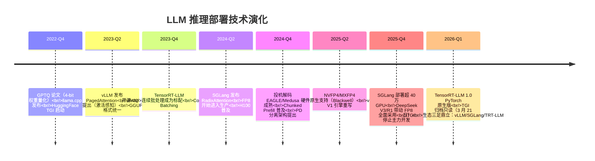
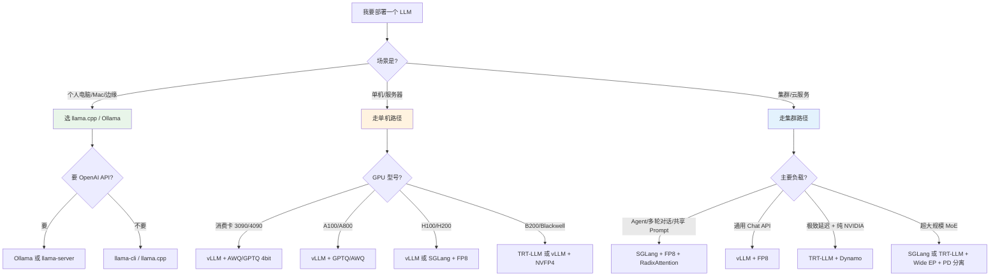

> 历史研究归档 · 2026-11-10 发布 · 程序扫描；未逐篇全文审阅。原有日期、观点、数据和命令保留历史语境，未经本次逐项事实核验或运行复现；请结合[归档说明](../../../ARCHIVE_POLICY.md)阅读。

# LLM 推理部署工程指南：量化与推理引擎

> **一句话概括**：本报告梳理 2024-2026 年 LLM 推理部署的两大核心工程问题——**量化格式选择**和**推理引擎选型**，给出可直接落地的决策树、Hello World 与成本速算。
> **研究日期**：2026-04-12
> **关联报告**：[R04](R04_Agent%E9%83%A8%E7%BD%B2%E4%B8%8A%E7%BA%BF%E6%96%B9%E6%A1%88%E5%85%A8%E6%99%AF.md) Agent 部署上线 · [R52](../06-%E5%B7%A5%E5%85%B7%E4%B8%8E%E7%94%9F%E6%80%81/R52_%E6%A8%A1%E5%9E%8B%E8%AE%AD%E7%BB%83%E4%B8%8E%E5%BE%AE%E8%B0%83%E6%8A%80%E6%9C%AF%E5%85%A8%E6%99%AF.md) 模型训练 · [R53](../06-%E5%B7%A5%E5%85%B7%E4%B8%8E%E7%94%9F%E6%80%81/R53_%E6%A8%A1%E5%9E%8B%E8%92%B8%E9%A6%8F%E6%8A%80%E6%9C%AF%E5%85%A8%E6%99%AF.md) 模型蒸馏
> **目标读者**：需要把开源 LLM 跑起来并且跑得起的应用/基础设施工程师

---

## TL;DR 速查卡

- **量化黄金法则**：≥ 7B 模型几乎总是要量化；**W4A16（INT4 权重 + FP16 激活）是吞吐甜点**，生产 Serving 默认选 GPTQ/AWQ/FP8；**本地/边缘**选 GGUF Q4_K_M。
- **推理引擎一句话选型**：
  - **云端高并发 Serving** → **vLLM**（生态最广，默认选择）
  - **极致吞吐 + 超长上下文** → **SGLang**（RadixAttention 前缀缓存 + 零开销调度器，xAI/LinkedIn 生产级）
  - **NVIDIA GPU 极限榨干** → **TensorRT-LLM**（PyTorch 原生版已成熟）
  - **单机/CPU/Mac** → **llama.cpp / Ollama**（1.5-8bit 量化，GGUF）
  - ⚠️ **TGI 已于 2026-03 进入归档只读状态**，HuggingFace 官方推荐迁移到 vLLM/SGLang——**新项目不要选 TGI**
- **关键优化技术栈（几乎所有引擎都支持）**：PagedAttention / 连续批处理 / Chunked Prefill / Prefix Caching / 投机解码 / PD 分离
- **成本锚点**：7B-INT4 可在单张 24GB 消费卡（4090/3090）跑；70B-INT4 需要 2×A100(40GB) 或 1×H100(80GB)；DeepSeek-V3 671B-FP8 需要 8×H200 级整机
- **最大坑**：AWQ/GPTQ 模型与引擎版本要对齐；KV Cache 爆显存比权重爆显存更常见；tokenizer 不一致导致幻觉性降质比量化本身还严重

---

## 目录

- [🔭 定位透镜：纵横坐标](#-定位透镜纵横坐标)
- [📚 研究分析轨道](#-研究分析轨道)
  - [1. 为什么必须量化（第一性原理）](#1-为什么必须量化第一性原理)
  - [2. 量化格式横评](#2-量化格式横评)
  - [3. 推理引擎横评](#3-推理引擎横评)
  - [4. 核心优化技术拆解](#4-核心优化技术拆解)
- [🚀 上手实战轨道](#-上手实战轨道)
  - [5. 选型决策树](#5-选型决策树)
  - [6. Hello World 三连](#6-hello-world-三连)
  - [7. 成本速算表](#7-成本速算表)
- [🕳️ 避坑指南](#-避坑指南)
- [💰 成本与 ROI](#-成本与-roi)
- [🎯 决策速查](#-决策速查)
- [结论与最佳实践](#结论与最佳实践)
- [开放问题](#开放问题)
- [📌 来源清单](#-来源清单)

---

## 🔭 定位透镜：纵横坐标

### 纵轴 · 演化脉络（2022-2026）



**关键转折点**：
1. **2023 vLLM 的 PagedAttention** —— 把 LLM 推理从"类似 batch 推理"彻底改造为"类似 OS 虚拟内存"，奠定所有现代引擎的架构范式。
2. **2024 SGLang 的 RadixAttention** —— 把前缀缓存从"单 session 级"推广到"全局树状共享"，Agent/多轮对话场景吞吐提升 2-5 倍。
3. **2026-03 TGI 归档** —— HuggingFace 正式放弃自研推理引擎，标志**生态完成收敛**：云端 vLLM+SGLang+TRT-LLM 三巨头，本地 llama.cpp+Ollama。

### 横轴 · 竞争格局

| 引擎 | 定位 | 设计哲学 | 适合谁 |
|------|------|---------|--------|
| **vLLM** | 通用 Serving | 开箱即用、生态最广、硬件最全 | 90% 的云端场景 |
| **SGLang** | 极致吞吐 | 零开销调度 + 前缀树缓存，死磕 P99 延迟 | 大规模生产、Agent 密集调用 |
| **TensorRT-LLM** | NVIDIA 特供 | 榨干 CUDA/Blackwell 每一滴性能 | 纯 NVIDIA 机房 + 对延迟有极致要求 |
| **llama.cpp** | 本地/边缘 | 纯 C++、无依赖、CPU+GPU 混合 | 个人电脑、Mac、嵌入式、边缘设备 |
| **Ollama** | 开发者友好壳 | llama.cpp 的 Docker 化 | 快速 demo、本地 Agent 原型 |
| **TGI** | ⚠️ 已归档 | HuggingFace 官方一体化 | 不推荐用于新项目 |
| **MLC-LLM** | 编译器路线 | TVM 编译 + 多后端 | WebGPU、iOS/Android、小众但前沿 |

### 交叉判断

**纵轴说明什么**：2022 年的 llama.cpp 和 2023 年的 vLLM 至今仍然是最主流选择——LLM 推理架构已经**进入稳定期**，核心范式（PagedAttention + Continuous Batching + Prefix Caching）被普遍采纳，各家引擎在这个基座上做差异化优化。**TGI 的归档不是偶然**，而是"没有护城河的通用 Serving 框架必然被 vLLM/SGLang 这种专业团队卷死"。

**横轴说明什么**：生态按部署场景清晰分层——**云端 GPU 集群 vLLM/SGLang，裸机/边缘 llama.cpp，极致性能 TRT-LLM**，三者互不冲突。争议区是"中小规模单机多卡"——vLLM 和 SGLang 正面竞争。

**独立结论**：**默认选 vLLM，高并发 Agent 场景评估 SGLang，本地开发 Ollama**。TGI 不要选。TRT-LLM 只在"锁定 NVIDIA + 有性能工程师" 的场景下值得投入。

---

## 📚 研究分析轨道

### 1. 为什么必须量化（第一性原理）

LLM 推理的三个瓶颈，按重要性排序：

| 瓶颈 | 根因 | 量化如何缓解 |
|------|------|-------------|
| **显存容量** | 7B-FP16 要 14GB，70B-FP16 要 140GB | INT4 → 参数显存降至 1/4，7B 仅需 3.5GB |
| **显存带宽** | 解码阶段每生成 1 token 都要读一遍全部权重 | 量化后带宽压力同比例下降，**直接决定吞吐** |
| **算力** | Prefill 阶段矩阵乘法 FLOPs 密集 | 低比特 Tensor Core（FP8/INT8/NVFP4）吞吐翻倍 |

**核心洞察**：LLM 推理是**带宽受限（memory-bound）而非算力受限**。这意味着——

> 量化 7B 模型从 FP16 到 INT4，**理论吞吐直接 ×4**，这不是优化，是**重新定义了硬件天花板**。

#### 两个关键分类

**按量化对象**：
- **W-only（仅权重）**：GPTQ、AWQ、GGUF Q4_K_M、bitsandbytes-NF4 —— 最常见，适合带宽瓶颈场景
- **W+A（权重+激活）**：FP8、INT8-SmoothQuant、NVFP4 —— 可以同时加速 Prefill，需要硬件支持

**按量化时机**：
- **PTQ（训练后量化）**：主流，基于少量校准集（128-512 样本）一次性量化，几小时搞定
- **QAT（量化感知训练）**：精度最高，但要重训，主要在 ≤4bit 极端场景使用

**一句话记住**：
- 生产 Serving 默认 **FP8（H100+）** 或 **GPTQ/AWQ W4A16**
- 本地单机默认 **GGUF Q4_K_M**
- 极限压缩（1-3bit）有研究价值但生产慎用

### 2. 量化格式横评

| 格式 | 比特 | 量化粒度 | 校准需求 | 精度损失 (MMLU) | 推理加速 | 硬件要求 | 代表引擎 |
|------|------|---------|---------|----------------|---------|---------|---------|
| **FP16/BF16** | 16 | - | 无 | 基线 | 1.0× | 所有现代 GPU | 全部 |
| **INT8 (SmoothQuant)** | 8 | per-channel | 需校准 | < 0.5% | 1.5-2× | A100/H100 | vLLM/TRT-LLM |
| **FP8 (E4M3)** | 8 | per-tensor | 需校准 | < 0.3% | 1.8-2.2× | H100+/MI300+ | vLLM/SGLang/TRT-LLM |
| **GPTQ W4A16** | 4 | group-128 | 需校准(C4) | 0.5-2% | 2.5-3× | 所有 GPU | vLLM/TRT-LLM |
| **AWQ W4A16** | 4 | group-128 | 激活感知 | 0.3-1% | 2.5-3× | 所有 GPU | vLLM/SGLang/TRT-LLM |
| **GGUF Q4_K_M** | ~4.5 | mixed | 无 | 0.5-1.5% | 依赖后端 | CPU/GPU 全支持 | llama.cpp/Ollama |
| **GGUF Q8_0** | 8 | block | 无 | < 0.2% | 依赖后端 | CPU/GPU 全支持 | llama.cpp |
| **NVFP4** | 4 | micro-block | 需校准 | 0.5-1% | **4-5×** | Blackwell (B200) | TRT-LLM/vLLM |
| **MXFP4** | 4 | 32-block | 需校准 | 0.5-1% | 3-4× | H100+/Blackwell | vLLM (gpt-oss) |
| **INT4 (bitsandbytes-NF4)** | 4 | per-tensor | 无 | 1-3% | 1.5-2× | 所有 GPU | TGI/Transformers |
| **GGUF Q2_K** | ~2.5 | mixed | 无 | 3-8% | 极致压缩 | CPU/GPU | llama.cpp |

> 数据来源：vLLM 官方量化支持文档、llama.cpp README、TRT-LLM 性能白皮书、AWQ/GPTQ 原论文、MMLU 回归测试。精度损失为 7B-70B 模型平均值。

**三条决策线**：

1. **有 H100/H200/B200？→ FP8 优先**。硬件级支持，精度几乎无损，加速明显，生产首选。
2. **只有 A100/3090/4090？→ AWQ > GPTQ**。AWQ 激活感知，精度略优，速度相当；GPTQ 生态更广兼容性更好。
3. **CPU / Mac / 内存受限？→ GGUF Q4_K_M**。llama.cpp 的 K-quants 混合精度 mapping 在 4.5 bit 附近平衡最佳。

**避雷区**：
- ❌ **Q2_K / 2-bit 量化**：论文效果好，实际 Agent/Function Calling 场景**指令遵守显著下降**，不适合生产
- ❌ **bitsandbytes-NF4**：训练场景（QLoRA）好用，推理吞吐不如 GPTQ/AWQ，不要混用
- ❌ **FP8 在 A100**：A100 无 FP8 硬件支持，软件模拟反而更慢

### 3. 推理引擎横评

#### 八维对比表

| 维度 | vLLM | SGLang | TensorRT-LLM | llama.cpp | TGI ⚠️ |
|------|------|--------|-------------|-----------|--------|
| **版本/活跃度** | v0.19.1, 78k⭐ | v0.5.10, 26.4k⭐ | v1.2.1, 13.5k⭐ | b8918, 106k⭐ | v3.3.7, **归档** |
| **硬件支持** | NVIDIA/AMD/Intel/CPU/TPU/Gaudi/Ascend | NVIDIA/AMD/Intel/TPU/Ascend | **仅 NVIDIA** | CPU/NVIDIA/AMD/Metal/Vulkan/SYCL/Hexagon | NVIDIA/AMD/Intel |
| **量化格式** | FP8/NVFP4/MXFP4/INT8/GPTQ/AWQ/GGUF/compressed-tensors/TorchAO | FP4/FP8/INT4/AWQ/GPTQ | FP8/NVFP4/INT4/AWQ/GPTQ | 1.5-8bit GGUF 全家桶 | bnb/GPTQ/EETQ/AWQ/fp8 |
| **核心缓存机制** | PagedAttention + Prefix Caching | **RadixAttention**（树状前缀） | PagedAttention + KV reuse | 简单分页 | PagedAttention |
| **调度器** | V1 连续批处理 | **零开销 CPU 调度器** | In-flight batching | 单请求/简单队列 | 连续批处理 |
| **投机解码** | n-gram/Suffix/EAGLE/DFlash/MTP | EAGLE/Medusa/MTP | EAGLE/Medusa/Lookahead | 有但较弱 | 基础支持 |
| **PD 分离** | ✅ 已支持 | ✅ **首个大规模生产** | ✅ Dynamo 集成 | ❌ | ❌ |
| **API 兼容** | OpenAI + Anthropic + gRPC | OpenAI | Triton Server + OpenAI | **OpenAI (llama-server)** | OpenAI |
| **并行策略** | TP/PP/DP/EP/CP 全家桶 | TP/PP/DP/EP | TP/PP/EP + Wide EP | 简单张量拆分 | TP |
| **模型支持数** | 200+ | 150+ | 80+（主流 LLM 为主） | 600+（GGUF 转换） | 90+ |
| **学习曲线** | 低 | 中 | 高 | 低（个人）/ 中（服务） | 低 |
| **生产案例** | 大量 | xAI, LinkedIn, AMD, NVIDIA, Cursor, **40w+ GPU** | 大型云厂商 | Ollama 生态、个人、边缘 | 历史部署 |

#### 逐引擎画像

**vLLM · 生态之王**
- **强在哪**：硬件覆盖最全、模型适配最快、社区最活跃、文档最完整。几乎所有新技术（PagedAttention、Chunked Prefill、PD 分离、各种量化）都在这里首发或快速跟进。
- **弱在哪**：通用性导致某些极限场景不如专业引擎；V1 引擎重写后早期版本有稳定性问题（现已稳定）。
- **推荐场景**：**几乎所有云端 Serving 场景的默认选择**。

**SGLang · 高并发杀手**
- **强在哪**：RadixAttention 树状前缀缓存在多轮对话/Agent 场景吞吐翻倍；零开销 CPU 调度器在高并发下 P99 延迟极低；Day-0 支持新模型（DeepSeek、Qwen 首发适配）。
- **弱在哪**：生态和文档仍在追赶 vLLM；更偏向"懂行的工程师"而非"开箱即用"。
- **推荐场景**：**Agent 密集调用、共享系统 Prompt 场景、大规模生产**。xAI、LinkedIn、Cursor 的选择说明问题。

**TensorRT-LLM · NVIDIA 亲儿子**
- **强在哪**：对 NVIDIA GPU 的优化几乎是硬件上限；Blackwell / NVFP4 第一批原生支持；与 Triton Server / Dynamo 深度集成。2026 年 1.0 版本转为 PyTorch 原生架构后易用性大幅改善。
- **弱在哪**：**仅 NVIDIA**；早期版本需要引擎编译（现已改善）；学习曲线陡。
- **推荐场景**：**纯 NVIDIA 基础设施 + 有专职性能工程师 + 对极致延迟有要求**（高频交易、实时语音、在线游戏 NPC）。

**llama.cpp · 本地神器**
- **强在哪**：纯 C++ 零依赖、后端最全（Metal/CUDA/Vulkan/SYCL/Hexagon/OpenCL）、支持 CPU+GPU 混合推理、GGUF 生态全开。Apple Silicon 上几乎是唯一选择。
- **弱在哪**：并发性能不是强项；企业级 Serving 功能（PD 分离、复杂调度）缺失。
- **推荐场景**：**个人电脑、Mac 开发、边缘设备、嵌入式、本地 Agent 原型**。生产级轻量 Serving 可用 `llama-server`。

**TGI · 历史遗迹 ⚠️**
- **现状**：**2026-03-21 归档只读**，不再接受 issues 和 PR。v3.3.7 是最后的正式版本。
- **为什么退场**：HuggingFace 自己的评估结论是——vLLM 和 SGLang 的迭代速度已远超自研团队能跟上的节奏，继续维护 TGI 边际价值为负。
- **推荐场景**：**没有**。**已有 TGI 部署建议制定迁移路线图**，新项目直接跳过。

#### 决策口诀（一分钟版）

> 云上千张卡、生产 Agent 系统 → **SGLang**
> 云上几十卡、通用 Serving → **vLLM**
> NVIDIA 独占、要到极限 → **TensorRT-LLM**
> 本地 / Mac / 边缘 → **llama.cpp**（或 Ollama 壳）
> TGI → **不要选**

### 4. 核心优化技术拆解

#### 4.1 PagedAttention（vLLM 首发 2023）

**问题**：传统 KV Cache 按序列预分配连续显存，导致严重的内部/外部碎片，显存利用率常低于 50%。

**方案**：借鉴操作系统**虚拟内存分页**思想，把 KV Cache 切成固定大小 Block（通常 16 tokens），用页表管理。

**收益**：显存利用率从 40% 提升到 90%+，**同等显存下吞吐提升 2-4 倍**。

**现状**：已成为所有现代引擎的**基础设施**（vLLM/SGLang/TRT-LLM/TGI 都实现了，llama.cpp 有简化版）。

#### 4.2 RadixAttention（SGLang 2024）

**问题**：Agent 场景下，大量请求共享同一个系统 Prompt 或思维链前缀，但引擎每次都重算 Prefill。

**方案**：用 **Radix 树（基数树）** 组织所有请求的 Prefix，命中即复用 KV Cache，无需重算。

**收益**：Agent/多轮对话/Few-shot 场景 **Prefill 吞吐 2-5 倍**，长 Prompt 场景尤其明显。

**现状**：vLLM 也有 Prefix Caching 但基于哈希表，**SGLang 的树状结构在跨请求共享子串时优势显著**。

#### 4.3 Continuous Batching（连续批处理，Orca 2022 提出）

**问题**：传统静态 batch 要等所有序列生成完才开始下一批，短序列拖累长序列。

**方案**：**迭代级调度**——每生成一个 token 就重新组 batch，已完成的请求立即出队。

**收益**：实际吞吐 **10 倍+** 于静态 batching，已成业界标配。

#### 4.4 Chunked Prefill（分块预填充）

**问题**：长 Prompt 的 Prefill 阶段会阻塞整个 batch 的 Decode，造成延迟尖峰。

**方案**：把长 Prefill 切成小块，每个迭代**同时做部分 Prefill 和所有 Decode**，消除阻塞。

**收益**：TTFT（首 token 延迟）和 TBT（token 间延迟）都显著下降，尤其在长上下文场景。

**现状**：vLLM/SGLang/TRT-LLM 均已默认开启。

#### 4.5 投机解码（Speculative Decoding）

**问题**：解码阶段每 token 一次完整 forward，延迟天然受限。

**方案**：用小模型（draft model）或 n-gram 先"猜"几个 token，大模型一次验证，全对就省了 N-1 次 forward。

**主流变体**：
- **EAGLE / EAGLE-3**：最流行的方法，基于特征重用训练 draft head，端到端 2-3× 加速
- **Medusa**：多头预测，无需 draft 模型
- **n-gram / Suffix**：零训练，基于统计，适合代码/结构化输出
- **MTP (Multi-Token Prediction)**：DeepSeek V3 原生支持

**坑**：投机解码对 Batch Size 敏感，**大 batch 下收益递减甚至负优化**，需要根据 QPS 动态开关。

#### 4.6 PD 分离（Prefill-Decode Disaggregation）

**问题**：Prefill（算力密集）和 Decode（带宽密集）特征完全不同，混在一起跑各吃亏。

**方案**：**物理拆分**到不同 GPU 池——Prefill 用 H100，Decode 用 A100/L40S，KV Cache 通过高速网络迁移。

**收益**：资源利用率提升 30-50%，尤其在长输入/短输出场景（RAG、文档摘要）。

**现状**：SGLang 最早大规模生产，vLLM/TRT-LLM 2025 年跟进。**复杂度高，只在 ≥ 100 张卡规模下值得投入**。

---

## 🚀 上手实战轨道

### 5. 选型决策树



#### 辅助决策：模型规模 × GPU 配置

| 模型 | 量化 | 显存需求 | 推荐 GPU | 推荐引擎 |
|------|------|---------|---------|---------|
| 7B | FP16 | 14 GB | 1×3090/A10 | vLLM |
| 7B | INT4/FP8 | 5-6 GB | 1×消费卡 | vLLM / llama.cpp |
| 13-14B | INT4 | 8-10 GB | 1×4090 | vLLM / llama.cpp |
| 32B | INT4 | 20-22 GB | 1×4090/A100-40G | vLLM |
| 32B | FP8 | 34 GB | 1×A100-80G | vLLM / SGLang |
| 70-72B | INT4 | 42-45 GB | 2×4090 或 1×A100-80G | vLLM + TP=2 |
| 70-72B | FP8 | 72 GB | 1×H100-80G | vLLM / SGLang |
| 70-72B | FP16 | 140 GB | 2×H100-80G | vLLM + TP=2 |
| 236B MoE (Mixtral) | FP8 | ~240 GB | 4×H100-80G | vLLM / SGLang |
| 405B (Llama) | FP8 | ~410 GB | 8×H100-80G | SGLang + TP=8 |
| 671B MoE (DeepSeek-V3) | FP8 | ~700 GB | 8×H200 或 NVL72 | SGLang + PD 分离 + EP |

### 6. Hello World 三连

#### 6.1 本地 5 分钟：Ollama 跑 Qwen2.5-7B

```bash
# 环境：Windows/Mac/Linux 任意，8GB+ RAM
# 依赖版本：Ollama 0.5+
# 预期：5 分钟内在本地聊起来

# 1. 安装（Mac/Linux）
curl -fsSL https://ollama.com/install.sh | sh
# Windows: 去 https://ollama.com/download 下载安装器

# 2. 拉模型（Q4_K_M 量化，约 4.7GB）
ollama pull qwen2.5:7b

# 3. 命令行聊天
ollama run qwen2.5:7b "用一句话解释什么是 PagedAttention"

# 4. OpenAI 兼容 API（默认已启动在 11434 端口）
curl http://localhost:11434/v1/chat/completions \
  -H "Content-Type: application/json" \
  -d '{
    "model": "qwen2.5:7b",
    "messages": [{"role":"user","content":"Hello"}]
  }'

# 预期输出：JSON 格式的回复，包含 choices[0].message.content
```

#### 6.2 云端 15 分钟：vLLM + FP8 + OpenAI API

```bash
# 环境：Linux + 1×H100-80G（或 A100-80G 降级到 BF16）
# 依赖版本：Python 3.11+, CUDA 12.4+, vLLM 0.19+
# 预期：启动后可通过 OpenAI SDK 直接调用

# 1. 安装
pip install vllm==0.19.1

# 2. 启动 FP8 推理服务（Qwen2.5-72B-FP8 示例）
python -m vllm.entrypoints.openai.api_server \
  --model Qwen/Qwen2.5-72B-Instruct-FP8 \
  --tensor-parallel-size 1 \
  --max-model-len 32768 \
  --gpu-memory-utilization 0.90 \
  --enable-prefix-caching \
  --enable-chunked-prefill \
  --port 8000

# 3. 客户端调用（Python）
pip install openai
python -c "
from openai import OpenAI
client = OpenAI(base_url='http://localhost:8000/v1', api_key='none')
resp = client.chat.completions.create(
    model='Qwen/Qwen2.5-72B-Instruct-FP8',
    messages=[{'role':'user','content':'解释 RadixAttention'}],
    max_tokens=256
)
print(resp.choices[0].message.content)
"

# 预期输出：72B 模型的详细回答，延迟约 50-100ms/token
```

#### 6.3 自己动手量化：用 AutoAWQ 做一个 INT4 模型

```python
# 环境：1×A100-40G+ 或 1×4090-24G（7B 模型）
# 依赖：pip install autoawq==0.2.7 transformers==4.45.0
# 预期：1-2 小时（7B）产出一个可直接被 vLLM 加载的 AWQ 模型

from awq import AutoAWQForCausalLM
from transformers import AutoTokenizer

model_path = "Qwen/Qwen2.5-7B-Instruct"
quant_path = "./Qwen2.5-7B-Instruct-AWQ"

quant_config = {
    "zero_point": True,
    "q_group_size": 128,
    "w_bit": 4,
    "version": "GEMM"  # 推理时最快的 kernel
}

# 1. 加载 + 量化
model = AutoAWQForCausalLM.from_pretrained(
    model_path, safetensors=True, device_map="auto"
)
tokenizer = AutoTokenizer.from_pretrained(model_path, trust_remote_code=True)

# 用 C4 数据集做校准（默认配置）
model.quantize(tokenizer, quant_config=quant_config)

# 2. 保存
model.save_quantized(quant_path)
tokenizer.save_pretrained(quant_path)

# 3. 用 vLLM 加载验证
# vllm serve ./Qwen2.5-7B-Instruct-AWQ --quantization awq
```

**避坑**：量化完成后**务必对比量化前后在你的业务数据集上的表现**，不要只看 MMLU——很多领域任务（尤其是 Function Calling、代码、长输出）对量化更敏感。

### 7. 成本速算表

#### 7.1 硬件购置成本锚点（2026-Q1 估算）

| GPU | 显存 | 单价区间（USD） | FP8 支持 | 适合规模 |
|-----|------|----------------|---------|---------|
| RTX 3090 | 24 GB | $700-900（二手） | ❌ | ≤ 13B-INT4 |
| RTX 4090 | 24 GB | $1600-2000 | ❌ | ≤ 32B-INT4 |
| RTX 5090 | 32 GB | $2500-3000 | ⚠️ 部分 | ≤ 70B-INT4 |
| A100-40G | 40 GB | $8,000-12,000（二手） | ❌ | ≤ 70B-INT4 |
| A100-80G | 80 GB | $15,000-20,000（二手） | ❌ | ≤ 70B-FP8(BF16) |
| H100-80G | 80 GB | $25,000-30,000 | ✅ | 70B-FP8 单卡 |
| H200-141G | 141 GB | $30,000-40,000 | ✅ | 200B-FP8 单卡 |
| B200 | 192 GB | $40,000-50,000 | ✅ NVFP4 | 400B-FP8/NVFP4 单卡 |

#### 7.2 云上租用成本（2026-Q1 市场价）

| 方案 | USD/小时 | 月成本（7×24） | 说明 |
|------|---------|---------------|------|
| 1×L4 (24GB) | $0.7-1.0 | ~$550 | 7B-INT4 最低配 |
| 1×A100-40G | $1.5-2.5 | ~$1,400 | 13B-FP16 / 70B-INT4 |
| 1×H100-80G | $3.5-5.0 | ~$3,000 | 70B-FP8 单卡 |
| 8×H100-80G | $25-40 | ~$20,000 | 405B 或高并发 70B |
| 8×H200 | $35-60 | ~$30,000 | DeepSeek-V3 671B |

#### 7.3 ROI 决策公式

> **自建 vs API 决策线**：日均 LLM 调用产生的 Token 数 × API 单价 > 服务器月成本 × 1.5（含运维） → 值得自建

**锚点案例**：
- 日均 100 万 Token，用 GPT-4o-mini → 月成本约 $45 → 不值得自建
- 日均 1 亿 Token，用 Claude Sonnet 4 API → 月成本约 $30,000 → 自建 1×H100 跑 70B-FP8（$3,000/月）完全可行
- 峰值 QPS < 10 且总量不大 → 直接用 API，不要自建

---

## 🕳️ 避坑指南

| 坑 | 原因 | 解法 |
|----|------|------|
| vLLM 启动 OOM 但权重明明装得下 | KV Cache 默认预分配 90% 显存，模型+KV 总和超了 | 调低 `--gpu-memory-utilization 0.85`，或减小 `--max-model-len` |
| AWQ 模型在 vLLM 里报 "kernel not found" | AWQ 版本（GEMM vs GEMV）与 vLLM kernel 不匹配 | 量化时明确 `version=GEMM`；或尝试 `--quantization awq_marlin` |
| 量化后模型回答质量明显下降 | tokenizer 不一致 / 校准集与业务数据差异大 / 使用了过度激进的量化（Q2/Q3） | 固定用原模型的 tokenizer；校准集用业务领域数据；生产不用 < 4bit |
| 投机解码开了反而变慢 | Batch Size 过大时验证成本 > 收益 | 用压测确定开关阈值（通常 QPS > 50 时关闭）；或使用 EAGLE-3 这类对大 batch 更友好的方案 |
| llama.cpp `-ngl` 设高了反而慢 | 部分层在 GPU、部分在 CPU，PCIe 传输成为瓶颈 | 要么全部 `-ngl 999`（全部放 GPU），要么降低到显存能完全容纳的层数 |
| 多卡 TP 性能不升反降 | NCCL 通信开销 > 并行收益（小模型常见） | ≤ 13B 用单卡，14-70B 考虑 TP=2，> 70B 才用 TP=4/8 |
| FP8 模型在 A100 上比 BF16 还慢 | A100 硬件不支持 FP8，软件模拟 | A100/A800 用 AWQ/GPTQ，FP8 留给 H100+ |
| Prefix Caching 命中率很低 | 系统 Prompt 动态变化（时间戳、UUID 注入） | 把系统 Prompt 切成"静态部分 + 动态部分"，确保前缀稳定 |
| TGI 无法升级到新模型 | **TGI 已归档**，上游停止更新 | **迁移到 vLLM 或 SGLang**，配置基本一对一映射 |
| 生产 Agent 场景 SGLang 没 vLLM 快 | 默认配置未开启 RadixAttention 最佳实践 | 显式设置 `--enable-cache-report`，合理规划系统 Prompt 结构 |
| GPTQ 模型 serve 起来，但长输出质量异常 | 某些 group_size 配置与长上下文 RoPE 兼容性问题 | 优先选择官方发布的量化版本；自己量化时 group_size=128 且校准集长度覆盖业务上限 |
| 吞吐很高但 P99 延迟爆炸 | 混合了长短请求，长请求阻塞了 decode | 开启 `--enable-chunked-prefill`；或用 PD 分离 |

---

## 💰 成本与 ROI

### Token 成本对照（自建 vs API，2026-Q1）

| 模型等级 | API 代表（输入/输出 per 1M token） | 自建成本（FP8，1×H100，约 8000 TPS） | 盈亏平衡点 |
|---------|-----------------------------------|----------------------------------|-----------|
| 7B 级别 | 开源 API $0.05-0.10 | ~$0.03 /1M token（单卡） | 日 > 50M token |
| 70B 级别 | Qwen-Max $2-5 | ~$0.15 /1M token | 日 > 20M token |
| 400B+ 级别 | Claude Sonnet $3-15 | ~$0.50 /1M token（8卡） | 日 > 10M token |

> 自建成本 = 月硬件+电费+运维 / 月 Token 产出。**上表假设 70% GPU 利用率**；实际往往只有 30-50%，ROI 要打折扣。

### 隐性成本清单

- **运维人力**：1 名 SRE 熟悉 vLLM/SGLang 部署调优 = ~$200K/年，这是最大隐性成本
- **模型更新周期**：新模型发布后的适配工作（量化、压测、回归）约 3-5 人日
- **故障恢复能力**：自建没有 SLA 兜底，需要考虑备份方案（多云 / API fallback）

### 推荐 ROI 路径

> 小团队先用 API 把业务跑通 → 调用量起来后自建 Serving 优化成本 → 规模进一步扩大后考虑 PD 分离 + 专职性能工程师。**不要一开始就自建**。

---

## 🎯 决策速查

**什么时候用 vLLM**：你不确定选什么的时候。或者你的场景是"通用聊天 API"。

**什么时候用 SGLang**：你的请求有大量共享前缀（Agent、Few-shot、多轮对话），或者你的规模 ≥ 几十张卡，或者你要跑最新模型（DeepSeek/Qwen 首发支持通常 SGLang 最快）。

**什么时候用 TensorRT-LLM**：你 100% NVIDIA、对延迟有极致要求、有专职性能工程师、愿意接受更陡的学习曲线。

**什么时候用 llama.cpp/Ollama**：本地、边缘、Mac、嵌入式、原型验证、< 10 QPS 的小规模服务。

**什么时候选 FP8**：你有 H100/H200/B200。精度几乎无损，速度最快。

**什么时候选 GPTQ/AWQ**：你只有 A100/消费卡。AWQ 精度微优，GPTQ 兼容性微优。

**什么时候选 GGUF**：CPU/Mac/边缘，或者你要用 llama.cpp。

**什么时候不要量化**：< 3B 的小模型量化收益很小反而伤精度，直接跑 FP16/BF16。

**什么时候必须 QAT**：≤ 4bit 且业务对精度极度敏感（医疗、法律、金融）。大多数场景 PTQ 够用。

**绝对不要做的事**：
- ❌ 新项目选 TGI
- ❌ 生产上 2-bit 量化
- ❌ A100 跑 FP8（无硬件支持）
- ❌ 小模型上 TP=8（通信开销大于并行收益）
- ❌ 不压测就上生产（量化回归 + 引擎参数调优必须数据驱动）

---

## 结论与最佳实践

### 十条可直接复用的实践

1. **默认选 vLLM，高并发 Agent 评估 SGLang**——覆盖 90% 场景
2. **H100+ 首选 FP8，消费卡首选 AWQ，本地首选 GGUF Q4_K_M**
3. **Prefix Caching + Chunked Prefill 几乎白捡的吞吐**——生产必开
4. **投机解码要压测开关阈值**——不要默认开启
5. **量化后必须做业务数据集回归**——MMLU 过关 ≠ 业务可用
6. **TGI 已死，新项目绕开**；现有 TGI 部署制定迁移计划
7. **小规模用 API，大规模自建**——盈亏平衡点在日均 10-50M Token
8. **tokenizer 永远用原模型的**，不要混搭
9. **KV Cache 是隐形的显存大头**——`--max-model-len` 要基于业务实际上下文分布设置
10. **模型更新会带节奏**——DeepSeek/Qwen 新版发布后，先观察 SGLang/vLLM 哪个先支持，谁先支持用谁

### 与已有报告的关联

- **[R04](R04_Agent%E9%83%A8%E7%BD%B2%E4%B8%8A%E7%BA%BF%E6%96%B9%E6%A1%88%E5%85%A8%E6%99%AF.md) Agent 部署上线**：本报告补充了"推理引擎"这一层的详细决策；Agent 场景下强烈推荐结合 SGLang 的 RadixAttention
- **[R52](../06-%E5%B7%A5%E5%85%B7%E4%B8%8E%E7%94%9F%E6%80%81/R52_%E6%A8%A1%E5%9E%8B%E8%AE%AD%E7%BB%83%E4%B8%8E%E5%BE%AE%E8%B0%83%E6%8A%80%E6%9C%AF%E5%85%A8%E6%99%AF.md) 模型训练**：训练产出的 checkpoint 要经过量化才能高效 Serving，两份报告共同构成"训练 → 部署"的完整链路
- **[R53](../06-%E5%B7%A5%E5%85%B7%E4%B8%8E%E7%94%9F%E6%80%81/R53_%E6%A8%A1%E5%9E%8B%E8%92%B8%E9%A6%8F%E6%8A%80%E6%9C%AF%E5%85%A8%E6%99%AF.md) 模型蒸馏**：蒸馏得到的小模型特别适合作为投机解码的 draft model，是"蒸馏 + 投机解码"组合拳的技术基础

---

## 开放问题

1. **边缘设备（手机、车机）的 LLM 推理最佳实践**：MLC-LLM / llama.cpp Hexagon / llama.cpp Vulkan 对比尚未深入——待做 R56
2. **异构推理集群调度**：不同代 GPU 混合（H100 + A100 + L40S）下的最佳调度策略，SGLang/vLLM 均在探索中
3. **多模态模型（VLM）的量化特殊性**：视觉 tower 对量化敏感度远高于 LLM 部分，业界尚无统一最佳实践
4. **训练感知量化（QAT）在 SOTA 开源模型上的实测**：DeepSeek V3 级别模型的 QAT 成本和收益缺乏公开数据
5. **PD 分离的规模拐点**：≥ 多少卡才值得做 PD 分离？公开数据集有限
6. **本地 Agent 的量化阈值**：4bit 够不够支撑 Function Calling？待进 [R53](../06-%E5%B7%A5%E5%85%B7%E4%B8%8E%E7%94%9F%E6%80%81/R53_%E6%A8%A1%E5%9E%8B%E8%92%B8%E9%A6%8F%E6%8A%80%E6%9C%AF%E5%85%A8%E6%99%AF.md) 后续实验

---

## 📌 来源清单

| 来源 | 日期 | 关键信息 |
|------|------|---------|
| [vLLM GitHub](https://github.com/vllm-project/vllm) | 2026-04-12 获取 | v0.19.1, 78k⭐, 量化/内核/并行全家桶 |
| [vLLM Documentation](https://docs.vllm.ai/) | 2026-04-12 | 量化格式官方支持矩阵 |
| [SGLang GitHub](https://github.com/sgl-project/sglang) | 2026-04-12 | v0.5.10.post1, 26.4k⭐, 40w+ GPU 部署 |
| [TensorRT-LLM GitHub](https://github.com/NVIDIA/TensorRT-LLM) | 2026-04-12 | v1.2.1, PyTorch 原生架构 |
| [llama.cpp GitHub](https://github.com/ggml-org/llama.cpp) | 2026-04-12 | b8918, 106k⭐, GGUF 生态 |
| [TGI GitHub (archived)](https://github.com/huggingface/text-generation-inference) | 2026-04-12 | **2026-03-21 归档只读** |
| GPTQ 论文 (Frantar et al., 2023) | 学术 | 4-bit 权重量化奠基 |
| AWQ 论文 (Lin et al., 2023) | 学术 | 激活感知权重量化 |
| PagedAttention 论文 (Kwon et al., 2023) | 学术 | vLLM 核心算法 |
| SGLang 论文 (Zheng et al., 2024) | 学术 | RadixAttention 核心算法 |
| 模型训练知识（截止 2024） | 背景参考 | 部分早期演化脉络 |

**⚖️ 来源一致性**：多源一致（5 个引擎的核心特性在官方 GitHub/Docs 中均有明确记载）
**📅 时效性声明**：以上信息获取于 2026-04-12，TGI 归档状态为本次调研的**关键新发现**
**🔎 交叉验证**：关键事实（TGI 归档、vLLM 版本、SGLang 部署规模）均通过 GitHub 官方信息和官方文档双重确认

---

*本报告遵循 AI Research Expert Agent 的双轨交付模式（研究分析 + 上手实战）。如需进一步深入某个子主题（如 PD 分离工程化、边缘推理、多模态量化），可拉出独立报告。*
