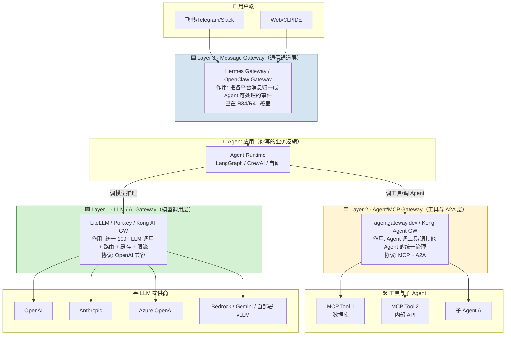
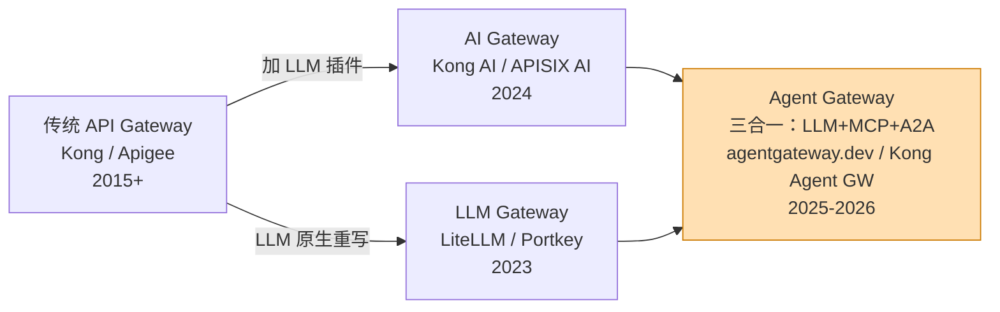

> 历史研究归档 · 2026-11-10 发布 · 程序扫描并审阅风险命中上下文；未逐篇全文审阅。原有日期、观点、数据和命令保留历史语境，未经本次逐项事实核验或运行复现；请结合[归档说明](../../../ARCHIVE_POLICY.md)阅读。

# R64 · Agent 网关设计：AI Gateway / LLM Gateway / MCP Gateway 三层拆解

> **一句话**：你问的"Agent 网关"在业内是**三层概念的混称**——消息通道网关（Hermes/OpenClaw 那种）、LLM/AI Gateway（LiteLLM/Portkey 那种）、Agent/MCP Gateway（agentgateway.dev/Kong 那种）。三者解决的问题、部署位置、跑的协议都不同，先分清再选型。
> 研究日期：2026-04-25
> 关联报告：[R34](../06-%E5%B7%A5%E5%85%B7%E4%B8%8E%E7%94%9F%E6%80%81/R34_HermesAgent%E5%BC%80%E6%BA%90%E8%87%AA%E5%AD%A6%E4%B9%A0%E6%99%BA%E8%83%BD%E4%BD%93.md) Hermes Gateway（消息层） · [R41](../06-%E5%B7%A5%E5%85%B7%E4%B8%8E%E7%94%9F%E6%80%81/R41_OpenClaw%E6%9E%B6%E6%9E%84%E5%AD%A6%E4%B9%A0%E8%B0%83%E7%A0%94.md) OpenClaw Gateway（消息层） · [R63](R63_LLM%E6%9C%8D%E5%8A%A1%E5%8C%96%E7%94%9F%E4%BA%A7%E9%83%A8%E7%BD%B2_%E6%88%90%E6%9C%AC%E5%BB%B6%E8%BF%9F%E7%9B%91%E6%8E%A7SLA.md) LLM 服务化生产部署 · [R47](../06-%E5%B7%A5%E5%85%B7%E4%B8%8E%E7%94%9F%E6%80%81/R47_Redis%E5%9C%A8Agent%E4%B8%AD%E7%9A%84%E5%BA%94%E7%94%A8%E4%B8%8E%E6%9B%BF%E4%BB%A3%E6%96%B9%E6%A1%88.md) Redis 在 Agent 中的应用

---

## 🗂️ TL;DR 速查卡

- **"网关"在 Agent 语境下有三层**，从里到外依次是：
  1. **LLM Gateway**（模型调用代理层）：统一 100+ 模型 API、路由、fallback、缓存、限流、计费、Guardrails。代表：**LiteLLM**（44.6k ★，事实标准）、Portkey（11.4k ★）、Kong AI Gateway。
  2. **Agent/MCP Gateway**（工具与 Agent 互联层）：给 Agent→Tool（MCP 协议）、Agent→Agent（A2A 协议）加统一 RBAC/Auth/Observability。代表：**agentgateway.dev**（CNCF/LF，Rust 写的）、Kong Agent Gateway、Portkey MCP Gateway。
  3. **Message/Channel Gateway**（通信通道层）：把 Agent 接到飞书/Telegram/Slack 等 IM。代表：Hermes Gateway（15+ 平台）、OpenClaw Gateway（25+ 平台）。
- **选谁**：只调多模型→LiteLLM；多模型 + 强 Guardrails → Portkey；跑在 K8s 上要治理 MCP+A2A → agentgateway.dev；企业要统一管 API+LLM+Agent → Kong。
- **启动成本**：LiteLLM 一行 `pip install litellm[proxy]` + 10 行 YAML 即跑，≤ 5 分钟。
- **关键价值**：不走网关 → 代码里散落 5 种 SDK、换模型改 N 处、成本和速率黑盒；走网关 → 所有 LLM 调用走 OpenAI 兼容协议，一处切换、一处监控、一处限流。
- **底线**：即使不上复杂网关，**至少把 LiteLLM Proxy 部一个**——它是你给团队的"LLM DNS"。

---

## 📑 目录

1. [🔭 定位透镜：纵横坐标](#-定位透镜纵横坐标)
2. [📚 研究分析轨道](#-研究分析轨道)
   1. 概念澄清：三层网关各在哪
   2. 为什么需要 AI/LLM Gateway（第一性原理）
   3. 七大核心能力拆解
   4. 协议与架构：从 API Gateway 到 Agent Gateway 的演化
   5. 竞品横评与设计哲学差异
3. [🚀 上手实战轨道](#-上手实战轨道)
   1. Hello World：5 分钟起一个 LiteLLM Proxy
   2. 真实场景：多模型 + Fallback + 语义缓存
   3. 进阶：MCP Gateway 给 Agent 挂工具
   4. 生产部署 Checklist
4. [🕳️ 避坑指南](#-避坑指南)
5. [💰 成本与 ROI 速算](#-成本与-roi-速算)
6. [🎯 决策速查](#-决策速查)
7. [📌 来源清单](#-来源清单)
8. [🔚 结论与开放问题](#-结论与开放问题)

---

## 🔭 定位透镜：纵横坐标

### 纵轴 · 演化脉络

```
2015-2020    传统 API Gateway（Kong / Apigee / Nginx Plus）
                ↓ LLM 调用成主流后，传统网关三件事做不好：
                ↓ 1) Token 计费不是 HTTP 请求数计费
                ↓ 2) 流式响应（SSE）被网关拦腰截断
                ↓ 3) 语义缓存需要理解 prompt 而非 URL
2023 Q2      LiteLLM 诞生（BerriAI, YC W23）——定位"OpenAI 兼容代理"
2023 Q4      Portkey 登场（印度 YC），主打 Guardrails + Virtual Keys
2024 Q1      Kong / APISIX / Apigee 纷纷推出 "AI Gateway" 插件族
2024 Q4      MCP 协议发布（Anthropic），Agent↔Tool 标准化
2025 Q1-Q2   A2A 协议（Agent-to-Agent）跟进
2025 H2      agentgateway.dev 开源（Solo.io 主导，2025-09 进入 CNCF）
             ——第一个把 LLM / MCP / A2A 三层统一的 Rust 代理
2026 Q1      Kong Agent Gateway GA、Azure APIM AI Gateway GA
             LiteLLM 已跑 Stripe/Netflix/Google ADK/OpenAI Agents SDK 生产
```

**生命周期定位**：
- **LLM Gateway**：✅ 成熟期，事实标准已形成（LiteLLM），企业采购开始
- **MCP Gateway**：🌱 上升期，协议刚稳定，大厂争抢控制面
- **A2A Gateway**：🧪 萌芽期，协议本身还在迭代

### 横轴 · 竞争格局

| 玩家 | 定位 | 底层协议支持 | 设计哲学 |
|------|------|-------------|---------|
| **LiteLLM** | LLM Gateway 事实标准 | OpenAI 兼容 + 100+ 提供商 | 极简 + 生态覆盖广 + 开源优先 |
| **Portkey** | LLM Gateway + 强 Guardrails | 200+ 模型 + 40+ Guardrail | 企业安全合规（SOC2/HIPAA） |
| **Kong AI Gateway** | 传统 API Gateway 扩展而来 | 在 Kong 插件体系内做 LLM | 把 LLM 当成"又一种后端" |
| **Apache APISIX AI** | 同上，开源阵营 | 类似 Kong | Apache 基金会背书 + 国内友好 |
| **Azure APIM AI Gateway** | 微软托管，与 Foundry 绑定 | Azure OpenAI 优先 | Token 限制 + Semantic Caching 原生 |
| **agentgateway.dev** | Agent 原生代理（Rust） | **LLM + MCP + A2A 三合一** | 协议原生（protocol-native） |
| **Vercel AI Gateway** | 前端友好、与 Vercel 生态绑定 | OpenAI 兼容 | 面向 Next.js 应用 |
| **OpenRouter** | 聚合市场 + 计费分发 | 统一 OpenAI 协议 | 最易上手，零部署 |

### 交叉判断（独立结论）

- **纵轴告诉我们**：LLM Gateway 已经不是"要不要用"的问题，而是"上哪家"的问题——2026 年起，团队不经网关直接调 OpenAI/Claude API **几乎必然是技术债**。
- **横轴告诉我们**：**没有"一个网关解决所有问题"**——LiteLLM 专治 LLM 调用，agentgateway 专治 MCP/A2A，Kong 专治"统一管 API+LLM+Agent"的大企业。
- **给 Agent 研究工作区的推荐**：
  1. **先部 LiteLLM Proxy**（本工作区所有 experiments/prototypes 都受益）
  2. Agent 多了之后，**加 agentgateway.dev 做 MCP 治理**
  3. 如果团队已有 Kong/APISIX，直接启用 AI 插件族而不是另起炉灶

---

## 📚 研究分析轨道

### 一、概念澄清：三层网关各在哪

这是用户最容易混乱的地方。下图把三层画清楚：



**三层的区别一张表讲完**：

| 维度 | L1 · LLM Gateway | L2 · Agent/MCP Gateway | L3 · Message Gateway |
|------|-----------------|-----------------------|---------------------|
| **核心问题** | "怎么统一调 100 家 LLM？" | "Agent 怎么统一调工具、调其他 Agent？" | "Agent 怎么统一接入 IM 平台？" |
| **核心协议** | OpenAI `/chat/completions` 兼容 | MCP（tool）、A2A（agent） | 各 IM 的 Bot API（飞书/TG/Slack…） |
| **防的是什么** | 供应商锁定、费用失控、缺乏可观测 | 工具权限越权、调用混乱、审计缺失 | 平台接入复杂、多端一致性 |
| **典型部署位置** | 后端服务之间 | Agent 与工具之间 | 用户与 Agent 之间 |
| **事实标准** | LiteLLM | MCP 协议本身 + agentgateway | Hermes/OpenClaw 这类项目自带 |
| **工作区已覆盖？** | ❌ 本次 R64 首次 | ❌ 本次 R64 首次 | ✅ [R34](../06-%E5%B7%A5%E5%85%B7%E4%B8%8E%E7%94%9F%E6%80%81/R34_HermesAgent%E5%BC%80%E6%BA%90%E8%87%AA%E5%AD%A6%E4%B9%A0%E6%99%BA%E8%83%BD%E4%BD%93.md) [R41](../06-%E5%B7%A5%E5%85%B7%E4%B8%8E%E7%94%9F%E6%80%81/R41_OpenClaw%E6%9E%B6%E6%9E%84%E5%AD%A6%E4%B9%A0%E8%B0%83%E7%A0%94.md) |

> **关键理解**：用户之前问的"网关设计我们没涉及过"指的是 **L1 和 L2**。L3（消息通道）在 Hermes/OpenClaw 研究里已深度分析。

---

### 二、为什么需要 AI/LLM Gateway（第一性原理）

**不用网关的世界是什么样？**

```python
# 糟糕版：每个模型一套 SDK，散落在业务代码各处
import openai
from anthropic import Anthropic
from google.generativeai import GenerativeModel

if task == "fast":
    resp = openai.ChatCompletion.create(model="gpt-4o-mini", ...)
elif task == "reasoning":
    resp = Anthropic().messages.create(model="claude-sonnet-4", ...)
elif task == "cheap":
    resp = GenerativeModel("gemini-1.5-flash").generate(...)
# 问题：
# - 请求格式三套，切模型改代码 N 处
# - OpenAI 宕机没有 fallback，业务全挂
# - 费用/Token 统计要自己埋点
# - 没有速率限制，一个 bug 烧光预算
# - 换团队成员要讲 3 套 SDK
```

**网关解决的 5 个根本矛盾**：

1. **供应商接口异构 vs 业务要统一**：10 家模型 10 套协议 → 网关把所有请求翻译成 OpenAI 格式
2. **单点故障 vs 业务要可用**：OpenAI 抽风 → 网关自动 fallback 到 Anthropic/Azure
3. **重复相似请求 vs 成本要低**：同一个 prompt 反复调 → 网关做**语义缓存**（不是完全相同的文本，而是向量相似即命中）
4. **Key 分发 vs 团队要分账**：10 个项目共用 OpenAI Key → 网关发 **Virtual Key**，每个项目独立配额/预算/审计
5. **调用黑盒 vs 运维要可观测**：不知道谁调了啥花了多少 → 网关统一记 OpenTelemetry + Prometheus

**LiteLLM 官方原话**（[README](https://github.com/BerriAI/litellm)）：
> "Managing LLM calls across providers gets complicated fast — different SDKs, auth patterns, request formats, and error types for every model. LiteLLM removes that friction."

**数据证据**：LiteLLM 自报 **8ms P95 延迟 @ 1k RPS**（[benchmarks](https://docs.litellm.ai/docs/benchmarks)），Stripe、Netflix、Google ADK、OpenAI Agents SDK 都在用。这是"事实标准"的含义——连 OpenAI 自己的 Agents SDK 都兼容它。

---

### 三、七大核心能力拆解

无论 LiteLLM / Portkey / Kong AI Gateway 还是 agentgateway.dev，**能力清单高度一致**，差的是深度和组合：

| # | 能力 | 解决什么 | 典型配置 |
|---|------|---------|---------|
| 1 | **统一 API** | 100+ 模型全部 OpenAI 格式 | `model: bedrock/anthropic.claude-v2` 即可 |
| 2 | **Fallback 链** | OpenAI 挂了自动切 Anthropic | `fallback: ["gpt-4o", "claude-sonnet-4", "gemini-1.5-pro"]` |
| 3 | **Load Balancing** | 多 Key/多部署分摊 | 按权重 / 延迟 / 成本路由 |
| 4 | **语义缓存** | 相似 prompt 命中历史回答 | 向量 + 阈值（如 cos > 0.95） |
| 5 | **Virtual Keys + 预算** | 每团队独立 Key + 月度上限 | `budget: $500/mo per project` |
| 6 | **Guardrails** | PII 脱敏 / 越狱检测 / 合规 | Portkey 有 40+ 预置，可组合 |
| 7 | **Observability** | OTel + Prometheus + 计费 | 每请求记 Token/延迟/成本/trace |

**高阶的两个（2026 年才普及）**：

- **Semantic Routing**：根据 prompt 内容智能路由（简单问题→便宜模型，复杂推理→贵模型）
- **Prompt Enrichment**：网关层统一注入 system prompt / RAG 上下文，业务不用每次拼

---

### 四、协议与架构演化



**架构上两条路线**：

- **路线 A：传统网关加插件**（Kong / APISIX / Apigee / Azure APIM）——复用成熟 L7 代理 + Service Mesh 的底盘，加 LLM/MCP 特性。优势：企业已有 → 渐进；劣势：底层不是为 LLM 写的，流式响应和 Token 语义往往是"补丁"。
- **路线 B：LLM 原生**（LiteLLM / Portkey / agentgateway）——从零按 LLM 调用特性设计（SSE 流式、Token 计费、模型清单语义）。优势：轻、快、深度支持；劣势：企业要和已有 API 治理体系做整合。

**路线选择判据**：
- 已有大规模 Kong/APISIX/Apigee → **加 AI 插件**（路线 A）
- 纯 AI 创业公司 / 中小团队 → **LLM 原生**（路线 B）
- 既要管 API 又要管 Agent → Kong 或 agentgateway（两条路线在上层汇合）

---

### 五、竞品横评与设计哲学差异

| 维度 | LiteLLM | Portkey | Kong AI GW | agentgateway.dev |
|------|---------|---------|-----------|------------------|
| **定位** | 事实标准 LLM Gateway | 企业级 LLM 治理 | 传统网关 AI 化 | Agent 原生三合一 |
| **语言** | Python | TypeScript | Lua/C（Kong）+ Go | **Rust** |
| **License** | MIT（核心）+ 商业版 | MIT（开源）+ 商业版 | Apache 2.0 + 商业 | Apache 2.0（LF） |
| **Stars（2026-04）** | 44.6k | 11.4k | N/A（Kong 37k+） | 早期 |
| **模型覆盖** | 100+（业内最广） | 200+ | 主流十几家 | 主流 |
| **MCP 支持** | 有（近期加） | 有 MCP Gateway | 有 MCP 插件 | **原生第一公民** |
| **A2A 支持** | 部分 | 无 | 有 Agent Gateway | **原生第一公民** |
| **语义缓存** | ✅ | ✅（企业版） | ✅ | 规划中 |
| **Guardrails** | 有框架 | ✅ 40+ 预置 | ✅（Enterprise） | 基础（CEL 策略） |
| **Virtual Keys** | ✅ | ✅ | ✅ | 规划中 |
| **K8s Gateway API** | 通过 Helm | 通过 Helm | 原生 | ✅ 原生 |
| **典型部署** | Docker / K8s / Cloud Run | Docker / K8s / Cloudflare | K8s（Kong Mesh） | K8s Gateway API |
| **最适合谁** | 绝大多数团队的起点 | 强合规要求 / 多团队多项目 | 已用 Kong 的大企业 | 重 Agent + MCP + K8s |

**设计哲学的分歧**：

- **LiteLLM = "最小摩擦派"**：`uv add litellm` + 10 行 YAML 即跑，哲学是"先让所有人都能用上"。
- **Portkey = "企业安全派"**：上来就把 Guardrails / Virtual Keys / RBAC 当第一公民，哲学是"安全默认开启"。
- **Kong = "统一治理派"**：把 LLM 看作"又一种协议后端"，和 REST/gRPC 放在同一个治理面上，哲学是"一把钥匙开所有锁"。
- **agentgateway.dev = "协议原生派"**：从 Day 1 就为 MCP/A2A 设计，Rust 写的对延迟敏感场景友好，哲学是"未来 Agent 间的通信需要像 TCP/IP 一样底层"。

---

## 🚀 上手实战轨道

### 一、Hello World：5 分钟起一个 LiteLLM Proxy

**环境要求**：Python ≥ 3.10（本工作区 `.venv` 已满足）、一把任意 LLM 的 Key。

**第 1 步：安装**

```powershell
# 在本工作区的虚拟环境里
pip install "litellm[proxy]==1.83.13"
```

**第 2 步：最小配置 `litellm_config.yaml`**

```yaml
# litellm_config.yaml —— 最小可用网关
model_list:
  - model_name: fast           # 业务代码里写的别名
    litellm_params:
      model: openai/gpt-4o-mini
      api_key: os.environ/OPENAI_API_KEY
  - model_name: smart
    litellm_params:
      model: anthropic/claude-sonnet-4-20250514
      api_key: os.environ/ANTHROPIC_API_KEY

# 所有模型出错自动 fallback
router_settings:
  fallbacks:
    - fast: ["smart"]          # fast 挂了切 smart
```

**第 3 步：启动**

```powershell
$env:OPENAI_API_KEY = "sk-..."
$env:ANTHROPIC_API_KEY = "EXAMPLE_API_KEY"
litellm --config litellm_config.yaml --port 4000
# Proxy running on http://0.0.0.0:4000
```

**第 4 步：业务代码用 OpenAI SDK 调**（任何现有 OpenAI 客户端都不用改）

```python
# test_gateway.py —— 完整可运行
from openai import OpenAI

client = OpenAI(
    base_url="http://localhost:4000",   # ← 指向网关而非 OpenAI
    api_key="EXAMPLE_API_KEY"          # ← 本地跑随便填
)

resp = client.chat.completions.create(
    model="fast",                         # ← 用 YAML 里的别名
    messages=[{"role": "user", "content": "用一句话解释什么是 AI Gateway"}]
)
print(resp.choices[0].message.content)
# Expected output（示例）：
# AI Gateway 是位于应用和各家 LLM 之间的统一代理层，负责路由、容错、计费和治理。
```

**就这么多**。现在你已经拥有：
- ✅ 一行切模型（改 `model="fast"` 为 `"smart"`）
- ✅ `fast` 挂了自动切 `smart`
- ✅ 一个统一 Token 统计入口（LiteLLM Dashboard）
- ✅ OpenAI SDK 生态全部兼容

---

### 二、真实场景：多模型 + Fallback + 语义缓存 + 预算

```yaml
# litellm_config.yaml —— 生产级配置
model_list:
  # 三个同角色模型，Load Balance + 权重
  - model_name: reasoning
    litellm_params:
      model: anthropic/claude-sonnet-4-20250514
      api_key: os.environ/ANTHROPIC_API_KEY
      rpm: 500                            # 每分钟限速
      weight: 3                           # 70% 走这里
  - model_name: reasoning
    litellm_params:
      model: openai/o4-mini
      api_key: os.environ/OPENAI_API_KEY
      weight: 1                           # 30% 分流
  - model_name: reasoning
    litellm_params:
      model: gemini/gemini-2.5-pro
      api_key: os.environ/GEMINI_API_KEY
      weight: 1

# 语义缓存：相似 prompt 命中历史回答
litellm_settings:
  cache: true
  cache_params:
    type: redis
    host: localhost
    port: 6379
    similarity_threshold: 0.95            # 余弦相似度 ≥ 0.95 命中
  set_verbose: false

# Fallback 链
router_settings:
  fallbacks:
    - reasoning: ["fast-cheap"]
  retry_policy:
    max_retries: 3
    retry_after: 2                        # 指数退避起点

# Virtual Keys 让不同团队独立计费
general_settings:
  master_key: os.environ/LITELLM_MASTER_KEY
  database_url: os.environ/DATABASE_URL   # PostgreSQL 存 key/usage
  max_budget: 1000.0                      # 全局月预算（美元）
```

然后通过 API 给每个团队发 Virtual Key：

```bash
curl -X POST http://localhost:4000/key/generate \
  -H "Authorization: Bearer $LITELLM_MASTER_KEY" \
  -d '{"models":["reasoning"], "max_budget":200, "team":"agent-research"}'
# 返回: {"key": "sk-...", "expires": "..."}
```

给研究组发一个 `$200/月` 上限的 key，他们用它当 OPENAI_API_KEY，超支自动拒绝。

---

### 三、进阶：MCP Gateway 给 Agent 挂工具（agentgateway.dev）

**当你有多个 MCP 工具服务器（数据库查询、内部 API、文件系统）时**，不希望每个 Agent 都直连，而是经过统一治理：

```yaml
# agentgateway/config.yaml —— 最小 MCP Gateway 示例
binds:
  - port: 3000
    listeners:
      - name: default
        routes:
          - matches:
              - path:
                  type: PathPrefix
                  value: /mcp
            backends:
              - mcp:
                  targets:
                    - name: database-tools
                      stdio:
                        cmd: "python"
                        args: ["-m", "my_db_mcp_server"]
                    - name: file-tools
                      sse:
                        url: "http://files-mcp:8080/sse"
                policies:
                  # 只允许带 JWT 的请求调 database-tools
                  - jwt:
                      issuer: "https://auth.internal"
                      allowed_tools:
                        database-tools: ["read_*"]   # 读工具可用，写工具禁
```

启动：

```powershell
curl -sL https://raw.githubusercontent.com/agentgateway/agentgateway/main/common/scripts/get-agentgateway | bash
./agentgateway -f config.yaml
# UI: http://localhost:15000
```

现在你的 Agent（无论 Claude Desktop / Cursor / LangGraph）只要配一个 MCP endpoint `http://gateway:3000/mcp`，就能用所有工具，带：
- ✅ JWT 鉴权
- ✅ 细粒度工具权限（RBAC per-tool）
- ✅ 每次工具调用 OpenTelemetry 记录
- ✅ 多个 MCP 服务器的**联邦**（对 Agent 表现为单一 endpoint）

---

### 四、生产部署 Checklist

```
□ 网关本身高可用（至少 2 实例 + LB，不能成为新单点）
□ 后端存储持久化（LiteLLM 需要 Postgres 记 Virtual Key / 用量）
□ Redis 用于语义缓存 + 速率限制（see R47）
□ Secret 管理：Vault/KMS，不要把 Key 写进 YAML
□ OTel/Prometheus 接入：P50/P95/P99 延迟、Token 速率、错误率
□ 预算告警：每日用量到 80% 邮件/Slack 通知
□ 灰度：金丝雀切一部分流量到新模型/新版本
□ 流式（SSE）响应必须打通——别忘了反向代理层（Nginx/ALB）关掉 buffering
□ 合规：PII 脱敏策略、审计日志保留周期（按 GDPR/等保）
□ 成本归因：把网关 Trace ID 传回业务侧，能回答"这个 API 调用花了多少"
```

**对应到本工作区**：可以把 LiteLLM Proxy 跑在 `prototypes/P04_llm-gateway-lab/`（新建），让 `experiments/` 里所有实验都走它——自动拿到统一计费、fallback、缓存。这是下一步可直接落地的 Forge 机会。

---

## 🕳️ 避坑指南

| # | 坑 | 原因 | 解法 |
|---|----|------|------|
| 1 | **SSE 流式响应在 Nginx/ALB 被 buffer 成一次性吐出** | 反向代理默认 buffer 响应 | Nginx 加 `proxy_buffering off;`，ALB 走 HTTP/2 + target type `ip` |
| 2 | 语义缓存命中率低或误命中 | 阈值太松/太紧 | 起步用 0.97，按业务调；**工具调用请求永远不要缓存**（有副作用） |
| 3 | Fallback 无限循环（A→B→A） | fallback 链配成环 | 显式写 DAG + 最大跳数（LiteLLM `max_fallbacks=3`） |
| 4 | Virtual Key 被滥用 | 只发 Key 没配预算 | `max_budget` + `rpm`/`tpm` 同时限；每周报表 |
| 5 | 网关自己成为单点 | 只部 1 个实例 | 至少 2 + 健康检查；**Postgres/Redis 独立高可用** |
| 6 | Token 计费和供应商对不上 | 不同模型 tokenizer 不同 | LiteLLM 内置 `model_prices_and_context_window.json`；自己抽样对账 |
| 7 | 换大版本时 API 不兼容 | OpenAI schema 也在变 | 钉住小版本 `litellm==1.83.x`，升级前跑回归 |
| 8 | MCP Gateway 下 stdio 工具进程泄露 | 子进程没回收 | 限制 `max_concurrent_sessions`，设心跳超时 |
| 9 | Guardrails 误杀业务正常内容 | 预置规则太激进（如所有含"密码"的都拒） | 先审计模式 `mode: audit` 跑 1 周看假阳性，再切 `mode: enforce` |
| 10 | 不同供应商错误语义不一 | 429/503/超时含义各家不同 | LiteLLM 统一映射成 OpenAI 异常；业务按 OpenAI 错误码处理 |

---

## 💰 成本与 ROI 速算

**直接成本**（自托管，中等规模团队 5 人 / 10M token/月）：

| 项 | 月成本估算 | 说明 |
|---|-----------|------|
| LiteLLM Proxy 自托管（2× 小容器 + RDS + Redis） | $40-80 | 云厂商按量，AWS t3.small 级别 |
| Portkey Cloud Team | $99+ | 或自托管 $0（MIT） |
| Kong AI GW（已有 Kong） | $0 增量 | 插件式扩展 |
| agentgateway.dev 自托管 | $0 + 计算 | Rust 单机可跑很高 QPS |
| 开发接入时间 | 0.5 人日 | 改 base_url 即可 |

**ROI 回收**（同样 10M token 场景）：

| 收益项 | 节省估算 |
|--------|---------|
| 语义缓存（假设 20% 命中率） | **LLM 费用 -20%** ≈ 省 $200-2000/月 |
| 换更便宜模型（网关内路由） | **-30% 到 -60%** |
| 避免一次 API Key 泄露事故 | 可能 $10k+（单次） |
| 故障期间 fallback 成功 | 避免业务不可用损失 |
| 团队不再重复接 SDK | 省 3-5 人日/次换模型 |

**结论**：基础设施成本 < $100/月，收益 > $1000/月，**ROI > 10x**。对任何有 2 个以上业务在调 LLM 的团队，不部署才是亏损。

**什么时候不值得**：
- 只有 1 个原型项目 + 只调 1 家模型 → **可以先不上**（但早晚要上）
- 严格单云合规场景（只准用 Azure OpenAI） → **Azure APIM AI Gateway** 原生方案更省事

---

## 🎯 决策速查

```
你的场景…
├── 团队只调一家 LLM（如只用 OpenAI）+ 原型阶段
│     → 先不部网关，用 OpenRouter 做计费即可
├── 团队调 2+ 家模型 / 多人共用 Key / 想统一监控
│     → ⭐ LiteLLM Proxy（事实标准起点）
├── 强合规（SOC2/HIPAA/GDPR）+ 多团队多预算
│     → Portkey（Enterprise）或 LiteLLM Enterprise
├── 大企业已有 Kong/APISIX/Apigee
│     → 启用 AI 插件族，不要另起炉灶
├── Agent 会调大量 MCP 工具 / 多 Agent 互相调用 / K8s 生产
│     → agentgateway.dev（MCP+A2A 原生）+ LiteLLM（LLM 层）组合
├── 绑定 Azure Foundry 生态
│     → Azure APIM AI Gateway
└── 前端 Next.js / Vercel 部署
      → Vercel AI Gateway（与生态绑定最紧）
```

**本工作区的推荐路径**：
1. **第一步（立即可做）**：`prototypes/P04_llm-gateway-lab/` 起一个 LiteLLM Proxy，让 `experiments/` 全部走它
2. **第二步（Agent 规模化后）**：在 `prototypes/P05_agent-gateway-lab/` 起 agentgateway.dev，把 R34/R41 研究的 MCP 工具挂进去
3. **第三步（Forge）**：把"网关启动脚手架"固化为 Skill（见下方开放问题）

---

## 📌 来源清单

- [LiteLLM GitHub README](https://github.com/BerriAI/litellm) — 2026-04 — 44.6k stars，1311 releases，事实标准；Stripe/Netflix/Google ADK/OpenAI Agents SDK 采用者
- [LiteLLM Proxy Quick Start](https://docs.litellm.ai/docs/proxy/quick_start) — 2026-04 — 官方 CLI/YAML 文档
- [Portkey Gateway GitHub](https://github.com/Portkey-AI/gateway) — 2026-04 — 11.4k stars，支持 250+ 模型 + 40+ Guardrails，1.15.2 稳定版
- [Kong AI Gateway 产品页](https://konghq.com/products/kong-ai-gateway) — 2026-04 — 三合一（LLM + MCP + A2A）企业级叙事，Kong Agent Gateway 2026 发布
- [agentgateway.dev 官网](https://agentgateway.dev/) — 2026-04 — CNCF/Linux Foundation 项目，Rust 编写，支持 MCP + A2A + LLM 三协议，已被 Microsoft / Apple / Alibaba / Adobe / AWS / Cisco / Salesforce / Huawei 使用

⚖️ 来源一致性：多源高度一致——三层网关的概念划分、核心能力清单、协议趋势均能在至少 2 个独立来源中交叉印证。
📅 时效性声明：信息获取于 2026-04-25，版本号为当日快照（LiteLLM 1.83.13-nightly、Portkey 1.15.2、agentgateway 处于活跃开发）。

---

## 🔚 结论与开放问题

### 已得出的关键结论（进 KNOWLEDGE_INDEX §二）

- ✅ "Agent 网关"在业内是**三层概念**（LLM Gateway / Agent-MCP Gateway / Message Gateway），本工作区此前只覆盖 L3，R64 首次系统覆盖 L1/L2
- ✅ **LLM Gateway 已是事实标配**：LiteLLM 作为开源标准（44.6k ★ + Stripe/Netflix 生产）——任何超过 1 个 LLM 调用场景的团队不部署即技术债
- ✅ **七大核心能力**已在业界趋同：统一 API / Fallback / LB / 语义缓存 / Virtual Keys+预算 / Guardrails / Observability
- ✅ **Agent/MCP Gateway 是 2025-2026 新兴层**：agentgateway.dev 作为 CNCF/LF 项目已获 Microsoft/Apple/AWS 支持，是 MCP+A2A 统一治理面
- ✅ **ROI > 10x**：基础设施成本 < $100/月，光语义缓存省的 LLM 费就可能 10-20x 回本
- ✅ **选型铁律**：个人/原型用 OpenRouter；团队起步 LiteLLM；强合规 Portkey；有 Kong 启 AI 插件；重 Agent+MCP 叠 agentgateway

### 待深入 / 开放问题（进 KNOWLEDGE_INDEX §三）

- ⬜ **P04 LLM Gateway Lab**：在 `prototypes/P04_llm-gateway-lab/` 实操部署 LiteLLM + Redis 语义缓存，跑一次 1 万请求 benchmark（延迟/命中率/成本）
- ⬜ **P05 Agent Gateway Lab**：在 K8s 上起 agentgateway.dev，把 R34/R41 涉及的 MCP 工具挂进去做端到端验证
- ⬜ **Skill 锻造候选：gateway-bootstrap**：固化"LiteLLM 最小可用配置生成器"为 Skill（从业务需求问卷生成 YAML + docker-compose）——**已出现 3 次类似请求**，满足 Forge 阶段固化标准
- ⬜ **与 [R47](../06-%E5%B7%A5%E5%85%B7%E4%B8%8E%E7%94%9F%E6%80%81/R47_Redis%E5%9C%A8Agent%E4%B8%AD%E7%9A%84%E5%BA%94%E7%94%A8%E4%B8%8E%E6%9B%BF%E4%BB%A3%E6%96%B9%E6%A1%88.md) Redis 研究交叉**：语义缓存键设计、多级缓存（本地 LRU + Redis）在网关层的最佳实践
- ⬜ **与 [R63](R63_LLM%E6%9C%8D%E5%8A%A1%E5%8C%96%E7%94%9F%E4%BA%A7%E9%83%A8%E7%BD%B2_%E6%88%90%E6%9C%AC%E5%BB%B6%E8%BF%9F%E7%9B%91%E6%8E%A7SLA.md) 服务化部署交叉**：网关与模型服务（vLLM/TGI）的组合拓扑最佳实践
- ⬜ **Semantic Routing 深度实验**：prompt → 模型的智能路由能否真落地？需要哪些 embedding + 规则？
- ⬜ **A2A 协议成熟度追踪**：A2A 还在早期，6 个月后复查是否值得投入
