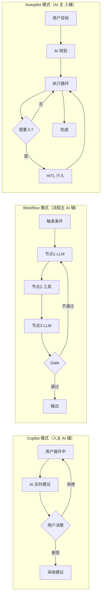
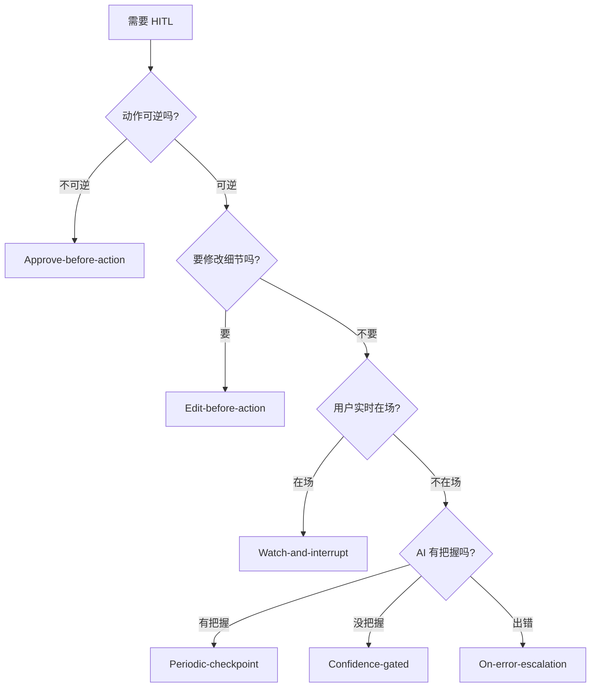
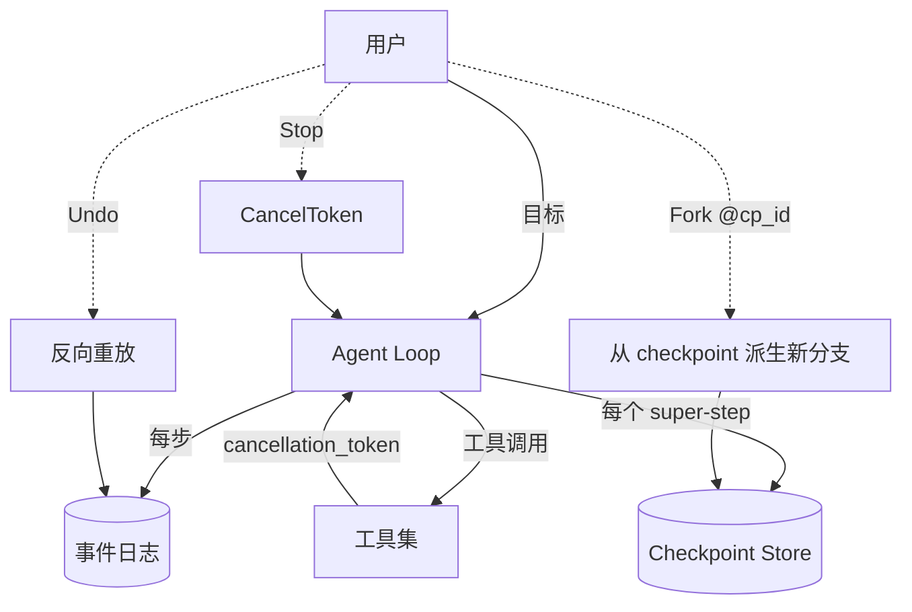

> 历史研究归档 · 2026-11-10 发布 · 程序扫描；未逐篇全文审阅。原有日期、观点、数据和命令保留历史语境，未经本次逐项事实核验或运行复现；请结合[归档说明](../../../ARCHIVE_POLICY.md)阅读。

# R68 · Agent 产品模式与 HITL 设计

> **一句话概括**：把 Agent 从"能跑通的 demo"做成"用户敢用的产品"，靠的不是更聪明的模型，而是**选对产品模式（Copilot / Workflow / Autopilot）+ 设计对 HITL 介入点 + 流式 UX 让用户全程有掌控感**。
> **研究日期**：2026-04-25
> **关联报告**：[Agent 架构](../01-%E7%90%86%E8%AE%BA%E4%B8%8E%E6%9E%B6%E6%9E%84/R03_Agent%E6%9E%B6%E6%9E%84%E6%B7%B1%E5%BA%A6%E7%A0%94%E7%A9%B6.md) · [LangGraph 入门](R26_LangChain%E4%B8%8ELangGraph%E5%85%A5%E9%97%A8%E5%88%B0%E5%AE%9E%E6%88%98.md) · [长效 Agent Harness](../05-%E8%AF%84%E4%BC%B0%E4%B8%8E%E8%B4%A8%E9%87%8F/R33_%E9%95%BF%E6%95%88AgentHarness%E5%B7%A5%E7%A8%8B%E5%8C%96.md) · [多 Agent 编排](R51_%E5%A4%9AAgent%E7%BC%96%E6%8E%92%E4%B8%89%E7%A7%8D%E5%AE%9E%E7%8E%B0%E6%96%B9%E5%BC%8F.md) · [Agent 安全](../05-%E8%AF%84%E4%BC%B0%E4%B8%8E%E8%B4%A8%E9%87%8F/R57_Agent%E5%AE%89%E5%85%A8%E4%B8%8E%E7%BA%A2%E9%98%9F%E6%94%BB%E9%98%B2%E4%BD%93%E7%B3%BB.md)

---

## 📑 TL;DR 速查卡

- **三种产品模式不是"演化阶梯"，是不同的技术栈**：Copilot 卷"建议质量 + 接受率"，Workflow 卷"流程稳定性 + 可观测"，Autopilot 卷"长任务可靠性 + HITL 兜底"——选错模式 = 选错战场。
- **HITL 不是"加个确认按钮"，而是 10+ 种模式的组合**：Approve-before-action（高破坏力动作）、Edit-before-action（结构化产物）、Watch-and-interrupt（长任务）、Confidence-gated（自适应介入）等。**默认全开 = 用户疲劳，默认全关 = 用户失控**，关键是按风险/置信度分级。
- **流式 UX 三层**：Token 流（让人知道"在说话"）、Tool 流（让人知道"在做事"）、Plan 流（让人知道"为什么这么做"）——少一层都让用户焦虑。Cursor / Devin / Manus 三家都不约而同做了 Plan 流。
- **可中断 / 可撤销 / 可分支**是 Autopilot 模式的"三大件"，靠的是事件溯源（event sourcing）+ checkpoint，**不是事后补的，是从 Day 1 就要设计进架构的**。
- **LangGraph `interrupt()` + Checkpointer** 是当前 Python 生态最成熟的 HITL 落地方案；前端配 SSE + Vercel AI SDK 的 `useChat` 是 React 栈最短路径。
- **决策一句话**：**风险高 → Workflow + Approve HITL；体验重 → Copilot + 流式建议；任务长 → Autopilot + Watch-and-interrupt + 分支**。

---

## 📖 目录

1. [🔭 定位透镜：三种模式的纵横坐标](#定位透镜)
2. [📚 研究分析](#研究分析)
   - 2.1 [Agent 产品三大模式 + 决策矩阵](#21-三大模式)
   - 2.2 [HITL 模式库（10 种常见模式）](#22-hitl-模式库)
   - 2.3 [流式 UX 设计：Token / Tool / Plan 三流](#23-流式-ux)
   - 2.4 [进度感知：长任务 Agent 怎么让用户不焦虑](#24-进度感知)
   - 2.5 [可中断 / 可撤销 / 可分支：架构拆解](#25-可中断可撤销可分支)
   - 2.6 [案例拆解：Cursor / Devin / Manus / v0 / Claude Code](#26-案例拆解)
3. [🚀 上手实战](#上手实战)
   - 3.1 [LangGraph Interrupt 实现 Approve-before-action](#31-langgraph-interrupt)
   - 3.2 [SSE 流式 + 进度感知](#32-sse-流式)
   - 3.3 [事件溯源实现可撤销 Agent](#33-事件溯源)
4. [🕳️ 避坑指南](#避坑指南)
5. [💰 成本与 ROI](#成本与-roi)
6. [🎯 决策速查](#决策速查)
7. [📌 来源清单](#来源清单)

---

## 🔭 定位透镜：三种模式的纵横坐标 <a id="定位透镜"></a>

### 纵轴 · 演化脉络

```
2021     2022-23           2024              2025-26
Copilot  Workflow          Autopilot          HITL 回潮
─────►   ─────►            ─────►             ─────►
GitHub   LangChain         Devin              Anthropic 把
Copilot  Chain/Agent       AutoGPT            "human checkpoint"
代码补全  早期工作流          全自主操作系统      列为头等公民
```

**三个关键转折**：

1. **2021–2022 · Copilot 范式**：GitHub Copilot 把"AI 辅助"这件事做成了产品，核心交互是"AI 提建议 → 人 Tab 接受"。**人是最终决策者**，AI 只贡献候选。
2. **2023 · Workflow 范式**：LangChain 把 Prompt → Tool → Output 这条链路抽象成 Chain。Anthropic 在《Building effective agents》中把这类系统**正式命名为 Workflow**，与 Agent 划清界限——"LLM 和工具被预定义代码路径编排"。
3. **2024 · Autopilot 范式爆发**：Devin（Cognition）、AutoGPT、SWE-Agent 把"全自主跑几小时甚至几天"做成卖点。**人变成观察者**，只在必要时介入。
4. **2025–2026 · HITL 回潮**：Devin 实战暴露了"全自主 = 不可信"的问题（如 [Cognition 自己的反思](https://cognition.ai/blog/dont-build-multi-agents)），业界开始反向重视 HITL——LangGraph 在 0.2 把 `interrupt()` 列为头等公民，Anthropic 在 Claude Code 中把"明确展示 planning steps"列为三大原则之一。

**生命周期定位**：
- Copilot 模式：**成熟期**（IDE 集成、SaaS 嵌入都已标准化）
- Workflow 模式：**成熟期**（LangGraph / n8n / Dify 形成稳定供给）
- Autopilot 模式：**上升期晚期，开始向 HITL 收敛**（纯自主路线被证伪，混合模式正在涌现）

### 横轴 · 竞争格局

| 维度 | Copilot | Workflow | Autopilot |
|------|---------|----------|-----------|
| **代表产品** | GitHub Copilot, Cursor Tab, Notion AI | n8n, Dify, LangGraph 工作流, Zapier AI | Devin, Manus, AutoGPT, Cursor Composer |
| **核心交互** | AI 建议 → 人决策 | 触发器 → 预定义流程 | 目标 → AI 自主执行 |
| **人的角色** | 决策者 | 设计者（设计完就退出） | 观察者 + 例外处理者 |
| **失败成本** | 低（不接受就行） | 中（流程跑错可回滚） | 高（已经写了一堆代码 / 操作了真实系统） |
| **可观测性需求** | 低 | 中 | **极高** |
| **HITL 必要性** | 内建（每次接受/拒绝） | 关键节点 Approve | 全流程多种模式叠加 |
| **典型时长** | 秒级 | 分钟级 | 小时～天级 |
| **成熟度** | ★★★★★ | ★★★★★ | ★★★☆☆ |

### 设计哲学差异

- **Copilot 哲学**："不要打断我，但准备好我随时要你的建议。" 优化目标是**接受率**和**延迟**。
- **Workflow 哲学**："把流程写死，AI 只在节点里发挥智力。" 优化目标是**可重现性**和**故障定位速度**。
- **Autopilot 哲学**："给我目标，剩下你搞定，搞不定喊我。" 优化目标是**任务完成率**和**HITL 触发的精准度**。

### 交叉判断（独立结论）

- **纵轴告诉我们靠不靠谱**：Copilot/Workflow 已成熟可放心选；Autopilot 正在从"全自主神话"回落到"半自主 + HITL"务实路线，**纯 Autopilot 的产品在 2026 年依然是高风险投资**。
- **横轴告诉我们该选谁**：
  - 任务破坏力低 + 用户即时在场 → **Copilot**
  - 任务结构稳定 + 边界清楚 + 频次高 → **Workflow**
  - 任务结构不稳定 + 探索性强 + 用户愿意等 → **Autopilot + 强 HITL**
- **混合是常态**：Cursor 同时提供 Tab（Copilot）+ Composer（Autopilot）+ Rules（Workflow），这种"一个产品多模式并存"是 2025 年后的主流形态——**不要把三模式当成互斥选项，要当成可叠加的乐高**。

---

## 📚 研究分析 <a id="研究分析"></a>

### 2.1 Agent 产品三大模式 + 决策矩阵 <a id="21-三大模式"></a>

#### 模式定义（基于 Anthropic 与 Cognition 的官方分类）

> 引用自 [Anthropic, Building effective agents (2024-12-19)](https://www.anthropic.com/engineering/building-effective-agents)：
> - **Workflows** 是"LLM 和工具被预定义代码路径编排"的系统
> - **Agents** 是"LLM 动态指导自身流程和工具使用，对如何完成任务保持控制"的系统

把这两个学术分类落到产品形态上，加上 Copilot 这个**人机协作的第三态**，就是工业界的三大模式：



#### 决策矩阵：什么场景选什么模式

| 信号 | → Copilot | → Workflow | → Autopilot |
|------|----------|-----------|-------------|
| **用户实时在场？** | ✅ | ❌ 不要求 | ❌ 长时离开 |
| **任务步骤可枚举？** | N/A | ✅ 完全可以 | ❌ 要 AI 决定 |
| **错误成本？** | 低 | 中 | 高（必须 HITL） |
| **任务时长？** | 秒-分钟 | 分钟-小时 | 小时-天 |
| **用户对 AI 信任度？** | 中（人在审） | 高（流程可控） | 必须很高 |
| **需要可重复执行？** | ❌ | ✅ 关键卖点 | ❌ 每次任务不同 |
| **典型例子** | 代码补全、邮件润色 | 客服路由、CI 中的 AI 步骤 | 写 PR、写报告、跑研究 |

#### 三模式的能力组合

> **关键洞察**：成熟产品几乎都是**多模式叠加**，而不是单选。

| 产品 | Copilot | Workflow | Autopilot |
|------|---------|----------|-----------|
| Cursor | ✅ Tab 补全 | ✅ Rules / Custom Modes | ✅ Composer / Background Agent |
| Claude Code | ✅ 单行建议 | ✅ Slash Commands / Skills | ✅ 长会话任务 |
| Devin | ❌ | ⚠️ Playbook | ✅ 主形态 |
| v0 | ✅ 组件级补全 | ❌ | ✅ 整页生成 |
| GitHub Copilot | ✅ 主形态 | ❌ | ✅ Workspace Agent（新） |

**判断**：单模式产品（如纯 Autopilot 的 AutoGPT）正在被多模式产品挤压。**Day 1 就要规划"主模式 + 退路模式"**——主模式是 Autopilot，但出问题时要有 Copilot 的退路（让用户接管）。

---

### 2.2 HITL 模式库（10 种常见模式） <a id="22-hitl-模式库"></a>

> **核心心法**：HITL 不是"防 AI 出错的保险栓"，是**让用户对 AI 保持控制感的产品语言**。设计 HITL 等于在设计**用户能在哪些时刻表达意图**。

#### 按介入时机分类

| # | 模式 | 介入时机 | 适用场景 | 代价 |
|---|------|---------|---------|------|
| 1 | **Approve-before-action** | 工具调用前 | 高破坏力（删文件、转账、发邮件） | 阻塞延迟 |
| 2 | **Edit-before-action** | 工具调用前 | 结构化产物（SQL、邮件草稿、PR title） | 阻塞延迟 |
| 3 | **Confirm-after-plan** | 规划完成后 | 长任务启动前 | 一次确认 |
| 4 | **Watch-and-interrupt** | 执行中可随时打断 | 长任务、流式生成 | UI 复杂 |
| 5 | **Confidence-gated** | AI 不确定时主动问 | 模糊指令、缺信息 | 需要置信度信号 |
| 6 | **Step-back-on-uncertainty** | AI 自己回退一步问人 | 复杂推理链 | 增加循环 |
| 7 | **Periodic-checkpoint** | 每 N 步主动同步进度 | 跑几小时的任务 | 用户可能疲劳 |
| 8 | **On-error-escalation** | 出错时升级到人 | 工具调用失败、推理卡住 | 需要错误分类 |
| 9 | **Branch-and-compare** | 让用户选两条分支 | 设计/创意类任务 | 算力翻倍 |
| 10 | **Post-execution-review** | 任务完成后审查 | 不可逆但可补救（写完代码再合并） | 不阻塞但易忽略 |

#### 决策心法：什么场景选哪个



#### 反模式：HITL 的"过度打断陷阱"

- **每个工具调用都问一次** → 用户疲劳，最后变成"无脑点确认" → HITL 形同虚设
- **问题描述模糊**："是否继续？"——用户根本不知道继续什么
- **时机不对**：在用户走神时弹窗，回来发现卡了 30 秒
- **批量操作没有"全部允许"** → 让用户对 50 个文件逐个点确认

**好的 HITL 设计三条铁律**：
1. **风险分级**：删除生产数据 = 硬阻塞；改测试代码 = 通知后默认通过
2. **批量友好**："Always allow this tool" / "Always allow for this folder"
3. **可追溯**：每次 HITL 决策都要落库，方便事后审计和优化阈值

---

### 2.3 流式 UX 设计：Token / Tool / Plan 三流 <a id="23-流式-ux"></a>

> **核心洞察**：流式输出不是"为了看起来快"，是**给用户多个抓手去理解 AI 在干什么**。少一层就少一种掌控感。

#### 三种流的本质区别

| 流类型 | 用户感知 | 技术实现 | 谁在做 |
|--------|---------|---------|--------|
| **Token 流** | "在说话" | LLM 的 SSE token-by-token | ChatGPT、Claude.ai |
| **Tool 流** | "在做事" | 工具调用 lifecycle 事件（start/progress/end） | Cursor、Claude Code |
| **Plan 流** | "为什么这么做" | 任务分解 / TODO 状态变更 | Devin、Manus、Cursor Composer |

#### Token 流：最容易做但最容易做错

**做对了的样子**：字符匀速吐出，stop token 时干净落地。

**常见 bug**：
- **闪烁**：因为 markdown 渲染没有"边流边渲染"，导致每个 chunk 触发整段重渲染。**解法**：用 [Streamdown](https://streamdown.ai/) 或 `react-markdown` 配合**增量解析**，只渲染变化部分。
- **代码块半成品**：流到一半的代码块没有结束 ` ``` `，渲染器以为是普通文本。**解法**：流式解析器要识别"未闭合代码块"并临时补一个虚拟结束符。
- **思考过程泄漏**：把 `<thinking>` 内的内容直接流给前端。**解法**：服务端做 token-level 过滤。

#### Tool 流：让用户知道"AI 在做什么"

```
[12:01:23] 🔍 search_web("LangGraph interrupt 用法") ...
[12:01:25] ✅ search_web 返回 8 条结果
[12:01:26] 📖 read_file("examples/hitl.py") ...
[12:01:26] ✅ read_file 完成（120 行）
[12:01:28] ✏️  write_file("R68_Agent产品模式与HITL设计.md") ...
[12:01:35] ⏸️  等待用户确认是否覆盖现有文件
```

**关键设计点**：
- **每个工具有自己的图标和动词**（搜索/读取/写入/执行），让用户瞄一眼就知道意图
- **耗时操作显示进度**：长跑工具（爬虫、SQL、build）必须有进度条或 spinner，否则用户怀疑卡住了
- **失败要醒目**：红色 ❌ + 错误摘要，不能只在折叠里

#### Plan 流：2024 年后的新标配

**最早把 Plan 流做成产品语言的是 Devin**——左侧实时显示任务树和当前节点。Manus 跟进，Cursor Composer 也加上了。

**为什么必须有 Plan 流**：
- Token 流告诉你 AI 现在在说什么字
- Tool 流告诉你 AI 现在在调什么工具
- 但**用户真正需要回答的问题是**："AI 还要多久？做的方向对吗？"——这只有 Plan 流能回答

**实现方式**：
1. **AI 自己生成 TODO 树**（开头规划阶段）
2. **每完成一个 TODO 主动标记**（执行阶段）
3. **TODO 状态变化推送给前端**（SSE 中专门一种事件类型）

> 这一点 Anthropic 在 Building effective agents 中也明确建议："Prioritize transparency by explicitly showing the agent's planning steps."

---

### 2.4 进度感知：长任务 Agent 怎么让用户不焦虑 <a id="24-进度感知"></a>

#### 焦虑的根源 = 信息真空

用户为什么焦虑？不是因为任务慢，是因为**不知道还要多久 / 不知道方向对不对 / 不知道自己能不能干预**。

**对策三件套**：

| 对策 | 怎么做 | 例子 |
|------|--------|------|
| **预期管理** | 任务启动时给一个粗略的时间区间 + 复杂度评估 | "预计 5–10 分钟，涉及 3 个文件、2 次 LLM 调用" |
| **进度可视化** | TODO 树 + 进度条 + 当前正在做什么 | Devin 左侧任务面板 |
| **降级出口** | 让用户随时能"先看一下""停一下""换条路" | Manus 的"暂停/接管/重新规划"按钮 |

#### 进度感知的三个层次

```
Level 1: Spinner（最低线）       — "在转，活着"
Level 2: 当前动作描述              — "正在搜索..."
Level 3: 任务树 + 完成度百分比     — "3/8 完成，预计还需 4 分钟"
Level 4: 中间产出可预览            — "已写完 README，点击查看草稿"
```

**生产级 Agent 应该到 Level 3 起步，Level 4 加分**。Cursor Composer / Manus 都做到了 Level 4——执行中产生的文件改动用户可以**边跑边看 diff**。

#### 长任务的"沉浸式 vs 通知式"二选一

- **沉浸式**：用户全程盯着看（Cursor Composer 的几分钟内任务）
- **通知式**：用户离开，完成后推送（Devin 的几小时任务、GitHub Copilot Workspace 的 PR）

**判断标准**：任务超过 **5–10 分钟**就要支持通知式——邮件、桌面通知、Slack 推送、PR 评论。**不要逼用户盯着进度条**。

---

### 2.5 可中断 / 可撤销 / 可分支：架构拆解 <a id="25-可中断可撤销可分支"></a>

> **这一节是 Autopilot 模式的灵魂**。如果你做的产品没有这"三大件"，用户对你的 Autopilot 就不会有真正的信任。

#### 可中断（Interruptible）

**用户要的**：随时点"停"，AI 立刻停（不是"再处理 30 秒")。

**实现要点**：
- LLM 调用层支持 `AbortController`（OpenAI/Anthropic SDK 都支持）
- 工具调用层每个动作前检查 `cancellation_token`
- 服务端断流时**立即关闭下游 SSE**，不要让浏览器空转

**LangGraph 的实现**：通过 Checkpointer 在每个 super-step 保存状态，中断时直接退出 graph 执行循环。

#### 可撤销（Undoable）

**用户要的**：AI 改了 5 个文件，第 3 步开始走偏了 → 一键退到第 2 步。

**实现思路（事件溯源 / Event Sourcing）**：

```python
# 不要直接修改状态
state["files"][path] = new_content

# 而是发出"改动事件"
event_log.append({
    "type": "file_write",
    "path": path,
    "before": old_content,  # 记录前置状态
    "after": new_content,
    "step": current_step,
    "timestamp": now()
})
apply_event(event)
```

**撤销 = 反向应用最近 N 个事件**。这套机制是 Cursor、git、数据库 WAL 共同的底层范式——不是新东西，但 Agent 圈直到 Devin 之后才普遍意识到它的重要性。

#### 可分支（Branchable）

**用户要的**：AI 走到第 5 步觉得方案 A 不够好，让它**回到第 3 步换个思路**，但保留 A 分支可对比。

**实现要点**：
- 每个 step 都是 immutable checkpoint（不可变快照）
- 状态用 DAG（有向无环图）而非线性 list 存储
- UI 上让用户能在任意 checkpoint "Fork"

**典型实现**：LangGraph 的 `MemorySaver` / `PostgresSaver` Checkpointer 支持按 `thread_id` + `checkpoint_id` 恢复，等价于 git 的 commit hash。Cursor 在 Composer 里也做了类似的 checkpoint UI。

#### 三大件的最小架构



**关键设计原则**：**事件先于状态**。任何对状态的修改都先发事件，状态由事件投影得到——这是从 Day 1 就要确立的，事后改架构成本极高。

---

### 2.6 案例拆解：Cursor / Devin / Manus / v0 / Claude Code <a id="26-案例拆解"></a>

#### Cursor

**产品决策**：**多模式叠加 + 用户主导切换**。

| 功能 | 模式 | HITL |
|------|------|------|
| Tab | Copilot | 内建（接受/拒绝） |
| Cmd+K | Copilot+ | Edit-before-action |
| Composer (Agent) | Autopilot | Watch + Approve（每个文件改动可审批） + Checkpoint |
| Background Agent | Autopilot | Post-execution-review（PR 形态） |
| Rules | Workflow | 不可见的规则注入 |

**亮点**：把 Composer 的每一步文件修改做成可逐个 Approve / Reject 的 diff 视图——这是 **Edit-before-action 在代码场景的极致体现**。

#### Devin

**产品决策**：**纯 Autopilot + 强 Plan 流 + 长任务通知式**。

- 核心交互：用户给目标 → AI 规划 → 左侧任务树 + 中间执行屏 + 右侧聊天
- HITL 主要靠 **Watch-and-interrupt** + **Confidence-gated**（AI 不确定时在聊天里发问）
- 完成后推送（Slack / Email），不强求用户盯着

**Cognition 自己的反思**（[Don't Build Multi-Agents, 2025-06-12](https://cognition.ai/blog/dont-build-multi-agents)）：
> "在 2025 年，多 Agent 协作只会得到脆弱的系统。决策过于分散，上下文无法在 agent 间充分共享。"

**判断**：Devin 走的是"单线程长 agent + 强上下文工程"路线，**不是多 agent 路线**——这与 Anthropic 的"Maintain simplicity"原则呼应。

#### Manus

**产品决策**：**通用 Autopilot + 强可视化"虚拟电脑"**。

- 把 Agent 的工作环境可视化为一个"远程桌面"，用户能看到 AI 在浏览器里点什么、在终端敲什么
- HITL 模式：**Watch-and-interrupt 为主 + 任务完成后产物预览**
- 流式 UX 做到 **Level 4**——所有中间产物（PDF、代码、表格）都可以实时点开看

**亮点**：把"AI 用电脑"做成了产品语言，相当于把 Plan 流可视化到极致。

#### v0 (Vercel)

**产品决策**：**Copilot + 轻 Autopilot 的 UI 生成专用版**。

- 输入文字 → 输出 React 组件，左侧聊天，右侧实时预览
- HITL：**Edit-before-action**（生成完后用户可以直接改代码再让 AI 迭代）+ **Branch-and-compare**（同一 prompt 生成多个版本对比）
- 没有 Plan 流，因为任务足够短不需要

**判断**：v0 证明了**特定垂直场景（UI 生成）可以省掉 Plan 流，靠"快速迭代 + 多版本对比"达到同样的掌控感**——并不是所有 Autopilot 都要做 Plan 流。

#### Claude Code

**产品决策**：**Workflow 与 Autopilot 混合 + Skills 体系 + 强 HITL**。

- Slash Commands 是 Workflow 的入口
- Skills 是预制的"AI 能调用的能力包"
- 长任务里默认每个高破坏力工具（写文件、跑命令）都触发 **Approve-before-action**，但用户可以用 `--allow-tool` 关掉

**亮点**：HITL 默认全开但可灵活降级——保守默认值 + 高级用户可定制。Anthropic 自己在 Building effective agents 中提的三大原则在这里完整体现：**简单架构 / 透明规划 / 精雕 ACI**。

#### 案例横向对比

| 维度 | Cursor | Devin | Manus | v0 | Claude Code |
|------|--------|-------|-------|----|-----|
| 主模式 | 多模式 | Autopilot | Autopilot | Copilot+轻 Autopilot | Workflow+Autopilot |
| Plan 流 | ✅ Composer | ✅ 核心卖点 | ✅ 虚拟电脑 | ❌ | ⚠️ Slash Commands 中弱 |
| Token 流 | ✅ | ✅ | ✅ | ✅ | ✅ |
| Tool 流 | ✅ 可视化 diff | ✅ | ✅ 桌面回放 | ⚠️ 只看结果 | ✅ |
| Approve HITL | ✅ 每文件 | ⚠️ 主要在 escalation | ⚠️ | ❌ 直接出结果 | ✅ 默认全开 |
| 可撤销 | ✅ Checkpoint | ✅ Replay | ⚠️ 部分支持 | ❌（重生成） | ⚠️ git-based |
| 可分支 | ✅ Composer Fork | ⚠️ | ❌ | ✅ 多版本生成 | ❌ |
| 通知式 | ✅ Background | ✅ Slack/Email | ✅ | ❌（短任务） | ⚠️ |

---

## 🚀 上手实战 <a id="上手实战"></a>

### 3.1 用 LangGraph Interrupt 实现 Approve-before-action <a id="31-langgraph-interrupt"></a>

**目标**：写一个会调用"删除文件"工具的 Agent，调用前必须人审批。

**环境**：

```bash
pip install langgraph==0.2.50 langchain-openai==0.2.10 python-dotenv
```

**最小代码**（保存为 `experiments/single/E_hitl_approve_demo.py`）：

```python
"""
LangGraph HITL Approve-before-action 最小示例
预期输出：
  Agent 准备删除文件 a.txt
  ⏸️  等待人工审批: 是否允许删除 a.txt?
  > 输入 yes / no
"""
import os
from typing import TypedDict, Annotated
from langgraph.graph import StateGraph, END
from langgraph.checkpoint.memory import MemorySaver
from langgraph.types import interrupt, Command

class State(TypedDict):
    target_file: str
    approved: bool | None
    result: str

def plan_node(state: State) -> dict:
    """规划阶段：决定要删哪个文件"""
    return {"target_file": "a.txt"}

def approve_node(state: State) -> dict:
    """HITL: 调用 interrupt() 暂停图执行，等用户输入"""
    user_input = interrupt({
        "question": f"是否允许删除 {state['target_file']}?",
        "danger_level": "high",
    })
    return {"approved": user_input == "yes"}

def execute_node(state: State) -> dict:
    if state["approved"]:
        # 真正的删除操作
        return {"result": f"✅ 已删除 {state['target_file']}"}
    return {"result": "❌ 用户拒绝，操作取消"}

# 构建图
graph = StateGraph(State)
graph.add_node("plan", plan_node)
graph.add_node("approve", approve_node)
graph.add_node("execute", execute_node)
graph.set_entry_point("plan")
graph.add_edge("plan", "approve")
graph.add_edge("approve", "execute")
graph.add_edge("execute", END)

app = graph.compile(checkpointer=MemorySaver())

# 跑一遍
config = {"configurable": {"thread_id": "demo-1"}}
events = list(app.stream({"target_file": ""}, config))
print("Agent 跑到 interrupt 处停下来")
print("当前状态:", app.get_state(config).values)

# 模拟用户输入 "yes"
result = app.invoke(Command(resume="yes"), config)
print("最终结果:", result)

# 模拟用户输入 "no"（用新 thread）
config2 = {"configurable": {"thread_id": "demo-2"}}
list(app.stream({"target_file": ""}, config2))
result2 = app.invoke(Command(resume="no"), config2)
print("拒绝场景:", result2)
```

**预期输出**：

```
Agent 跑到 interrupt 处停下来
当前状态: {'target_file': 'a.txt', 'approved': None, 'result': ''}
最终结果: {'target_file': 'a.txt', 'approved': True, 'result': '✅ 已删除 a.txt'}
拒绝场景: {'target_file': 'a.txt', 'approved': False, 'result': '❌ 用户拒绝，操作取消'}
```

**关键 API 说明**：
- `interrupt(payload)`：暂停图执行，把 payload 抛给前端；**必须配 Checkpointer 使用**，否则状态会丢
- `Command(resume=value)`：恢复图执行，把 `value` 作为 `interrupt()` 的返回值
- `thread_id`：标识一次会话，HITL 全靠它来恢复正确的状态

---

### 3.2 用 SSE 流式 + 进度条做"长任务感知" <a id="32-sse-流式"></a>

**目标**：FastAPI 后端推 Token 流 + Tool 流 + Plan 流，前端 React + Vercel AI SDK 渲染。

**后端**（核心片段）：

```python
# server.py — pip install fastapi==0.115 uvicorn==0.32 sse-starlette==2.1
from fastapi import FastAPI
from sse_starlette.sse import EventSourceResponse
import asyncio, json

app = FastAPI()

async def agent_event_stream(task: str):
    # Plan 流：先发任务树
    yield {"event": "plan", "data": json.dumps({
        "todos": [
            {"id": 1, "title": "搜索资料", "status": "pending"},
            {"id": 2, "title": "草稿生成", "status": "pending"},
            {"id": 3, "title": "校对", "status": "pending"},
        ]
    })}

    for todo_id in [1, 2, 3]:
        # 更新 plan
        yield {"event": "plan_update", "data": json.dumps({"id": todo_id, "status": "running"})}
        # Tool 流
        yield {"event": "tool", "data": json.dumps({"name": "search", "status": "start"})}
        await asyncio.sleep(1)
        yield {"event": "tool", "data": json.dumps({"name": "search", "status": "end"})}
        # Token 流（模拟 LLM 输出）
        for tok in ["Step ", str(todo_id), " 完成。"]:
            yield {"event": "token", "data": tok}
            await asyncio.sleep(0.05)
        yield {"event": "plan_update", "data": json.dumps({"id": todo_id, "status": "done"})}

    yield {"event": "done", "data": "ok"}

@app.get("/run")
async def run(task: str):
    return EventSourceResponse(agent_event_stream(task))
```

**前端**（React 极简版）：

```tsx
// 用原生 EventSource 演示三流分发；Vercel AI SDK useChat 自带消息流，再扩展自定义事件
import { useEffect, useState } from "react";

export default function AgentPanel() {
  const [tokens, setTokens] = useState("");
  const [tools, setTools] = useState<string[]>([]);
  const [plan, setPlan] = useState<any[]>([]);

  useEffect(() => {
    const es = new EventSource("/run?task=hello");
    es.addEventListener("token", (e) => setTokens(t => t + (e as any).data));
    es.addEventListener("tool", (e) => setTools(ts => [...ts, (e as any).data]));
    es.addEventListener("plan", (e) => setPlan(JSON.parse((e as any).data).todos));
    es.addEventListener("plan_update", (e) => {
      const upd = JSON.parse((e as any).data);
      setPlan(p => p.map(t => t.id === upd.id ? {...t, status: upd.status} : t));
    });
    es.addEventListener("done", () => es.close());
    return () => es.close();
  }, []);

  return (
    <div style={{display: "grid", gridTemplateColumns: "200px 1fr 200px", gap: 16}}>
      <aside>
        <h4>Plan 流</h4>
        {plan.map(t => <div key={t.id}>{t.status === "done" ? "✅" : t.status === "running" ? "⏳" : "⏸️"} {t.title}</div>)}
      </aside>
      <main>
        <h4>Token 流</h4>
        <pre>{tokens}</pre>
      </main>
      <aside>
        <h4>Tool 流</h4>
        {tools.map((t, i) => <div key={i}>{t}</div>)}
      </aside>
    </div>
  );
}
```

**预期效果**：左侧 TODO 列表实时打勾，中间 token 逐字蹦出，右侧工具调用按时间累加。

---

### 3.3 自研可撤销 Agent 的最小架构（事件溯源） <a id="33-事件溯源"></a>

**目标**：所有状态变更都先发事件，然后投影出当前状态——可以反向重放实现 undo。

```python
# undoable_agent.py
from dataclasses import dataclass, field
from typing import Any
import json

@dataclass
class Event:
    type: str          # "file_write" | "msg_append" | "tool_call"
    payload: dict
    step: int
    parent_step: int   # 支持分支：从哪个 step 派生

@dataclass
class AgentState:
    files: dict[str, str] = field(default_factory=dict)
    msgs: list[str] = field(default_factory=list)

def project(events: list[Event]) -> AgentState:
    """投影：从事件流重建状态"""
    s = AgentState()
    for e in events:
        if e.type == "file_write":
            s.files[e.payload["path"]] = e.payload["after"]
        elif e.type == "msg_append":
            s.msgs.append(e.payload["text"])
    return s

class Agent:
    def __init__(self):
        self.events: list[Event] = []
        self.step = 0

    def write_file(self, path: str, content: str):
        before = (project(self.events)).files.get(path, "")
        self.step += 1
        self.events.append(Event(
            type="file_write",
            payload={"path": path, "before": before, "after": content},
            step=self.step, parent_step=self.step - 1,
        ))

    def undo(self, n: int = 1):
        """回退 n 步：直接砍掉最后 n 个事件"""
        self.events = self.events[:-n]
        self.step -= n

    def fork(self, from_step: int) -> "Agent":
        """从某个 step 派生新分支"""
        new_agent = Agent()
        new_agent.events = [e for e in self.events if e.step <= from_step]
        new_agent.step = from_step
        return new_agent

    def state(self) -> AgentState:
        return project(self.events)

# 使用
a = Agent()
a.write_file("hello.txt", "v1")
a.write_file("hello.txt", "v2")
a.write_file("hello.txt", "v3")
print(a.state().files)        # {'hello.txt': 'v3'}

a.undo(1)
print(a.state().files)        # {'hello.txt': 'v2'}

# 从 step 1 派生新分支
b = a.fork(from_step=1)
b.write_file("hello.txt", "alt-v2")
print(a.state().files, b.state().files)  # {'hello.txt': 'v2'} {'hello.txt': 'alt-v2'}
```

**生产化要点**：
- 事件存到 Postgres / Redis Stream，而非内存
- 加 `event_hash` 防篡改
- 大状态用 snapshot + delta 优化（每 100 个 event 存一次快照，重放从最近快照开始）

---

## 🕳️ 避坑指南 <a id="避坑指南"></a>

| # | 坑 | 原因 | 解法 |
|---|----|------|------|
| 1 | HITL 弹太多，用户麻木乱点 yes | 每个工具调用都 Approve | **风险分级**：只有破坏性高的才硬阻塞，配 "Always allow" 选项 |
| 2 | 流式输出闪烁、卡顿 | Markdown 整段重渲染 | 用 Streamdown / 增量解析；代码块流式不闭合时补虚拟结束符 |
| 3 | 长任务跑了 30 分钟，用户走开了，回来还在转 | 没有通知机制 | 任务 > 5 分钟必接 Slack / Email / 桌面通知 |
| 4 | 用户点"停止"了 30 秒还在输出 | LLM SDK 没用 AbortController | 所有 LLM 和 HTTP 调用都传 abort signal；服务端断流要立即关 SSE |
| 5 | "撤销"撤不彻底，副作用还在 | 改了状态但没记录前置值 | 事件溯源：事件里必须包含 before / after 双向状态 |
| 6 | 状态不一致：UI 显示 done 实际还在跑 | 前后端状态未同步源 | 前端状态 = SSE 事件投影，**不要前端独立维护**；用最后一条事件作为真相源 |
| 7 | Plan 流和实际执行偏离（说要做 ABC，实际做了 ABD） | LLM 规划与执行解耦后没回写 | 每完成一步要回写 plan 节点状态；偏离要触发 plan revision |
| 8 | Approve 弹窗内容含敏感数据外泄 | 直接把工具参数全塞 prompt 给前端 | 服务端做 redaction，敏感字段（API Key、密码）替换为 `***` |
| 9 | 多 Agent 互相 review 反而更慢更不准 | 上下文不共享，决策分散 | 参考 [Cognition](https://cognition.ai/blog/dont-build-multi-agents)：默认单线程，多 agent 仅在"上下文压缩"等明确场景使用 |
| 10 | Branch-and-compare 算力翻倍但用户选了第一个 | 没数据驱动的预筛 | 二选一前先做 LLM-as-judge 粗筛，明显劣势的不展示 |
| 11 | 工具调用流没有失败状态，用户以为成功了 | 错误被吞 | Tool 流必须有 `start / progress / success / fail` 四态，红色醒目 |
| 12 | Checkpointer 用 InMemory，重启全丢 | demo 用了 MemorySaver | 生产必须用 PostgresSaver / RedisSaver |

---

## 💰 成本与 ROI <a id="成本与-roi"></a>

### 三模式的成本结构对比

| 维度 | Copilot | Workflow | Autopilot |
|------|---------|----------|-----------|
| **单次 Token 成本** | 极低（短补全） | 低-中（流程节点累加） | 高（长 trace） |
| **API 调用频次** | 高（每 keystroke） | 中（事件触发） | 低（任务级） |
| **基础设施成本** | 中（边缘缓存） | 低（无状态多） | 高（checkpoint 存储 + 长会话） |
| **开发投入** | 低-中（IDE 插件） | 中（DSL + 流程引擎） | **高**（HITL + 三大件） |
| **运维复杂度** | 低 | 中（流程版本管理） | **高**（长任务监控、HITL 路由） |

### HITL 的隐性成本

- **用户时间成本**：每次 Approve 平均消耗用户 5–15 秒。若一个任务触发 20 次 HITL，等于消耗 5 分钟用户时间——**比省下的可能是亏的**
- **响应延迟**：HITL 阻塞期间下游一切等待，长任务里这部分延迟是核心瓶颈
- **异步化收益**：把 Approve 从"在线弹窗"改成"通知 + 后续审批"可大幅缓解，但增加状态管理复杂度

### 适用规模判断

| 用户规模 / 任务量 | 推荐策略 |
|------------------|---------|
| < 100 用户 / 日 < 1000 任务 | 默认 HITL 全开 + 简单 SSE，靠运维兜底 |
| 1000–10000 任务/日 | 引入 Confidence-gated 减少 HITL 次数；SSE 改 Redis Pub/Sub |
| > 10000 任务/日 | HITL 路由队列化（不阻塞执行）；流式 UX 上 CDN 边缘渲染；Checkpointer 分片 |

---

## 🎯 决策速查 <a id="决策速查"></a>

### 选模式

```
任务时长 < 1 分钟，用户实时在场      → Copilot
任务步骤可枚举，频次高，结构稳定     → Workflow
任务时长 > 5 分钟，结构不稳定        → Autopilot + 强 HITL
不确定                              → Cursor 路线：多模式叠加
```

### 选 HITL 模式（按动作风险）

| 动作风险 | 模式 | 例子 |
|---------|------|------|
| 不可逆、高破坏 | Approve-before-action | 删数据、转账、发邮件 |
| 可逆、要细调 | Edit-before-action | SQL、邮件草稿、PR title |
| 可逆、低破坏 | Watch-and-interrupt | 写代码、改文档 |
| 不确定执行 | Confidence-gated | 模糊指令、信息不足 |
| 长跑 | Periodic-checkpoint | 每 N 步同步进度 |
| 创意类 | Branch-and-compare | UI 设计、文案 |

### 选流式 UX

```
任务 < 30 秒                    → Token 流足够
任务 30 秒-5 分钟，有工具调用   → + Tool 流
任务 > 5 分钟                  → + Plan 流 + 通知式
```

### 框架选型

| 栈 | 后端 | 前端 |
|----|------|------|
| Python + React | LangGraph (Checkpointer + interrupt) + FastAPI SSE | Vercel AI SDK `useChat` + 自定义 SSE 事件 |
| 全 Node | Vercel AI SDK Core (loop control) | Vercel AI SDK UI |
| 轻量 / 无框架 | OpenAI/Anthropic SDK + 自研事件循环 | 原生 EventSource + React hooks |

---

## 与已有报告的关系

- **新增**：本工作区首次系统覆盖"Agent 产品模式分类"和"HITL 模式库"，**填补了 R03（架构）→ R04（部署）→ R44（构建实战）这条链路上的"产品形态层"空白**
- **互补**：
  - [R03](../01-%E7%90%86%E8%AE%BA%E4%B8%8E%E6%9E%B6%E6%9E%84/R03_Agent%E6%9E%B6%E6%9E%84%E6%B7%B1%E5%BA%A6%E7%A0%94%E7%A9%B6.md) 讲 Agent 架构原理，本报告讲架构如何映射到产品形态
  - [R26](R26_LangChain%E4%B8%8ELangGraph%E5%85%A5%E9%97%A8%E5%88%B0%E5%AE%9E%E6%88%98.md) 讲 LangGraph 入门，本报告把 LangGraph 用到 HITL 落地
  - [R33](../05-%E8%AF%84%E4%BC%B0%E4%B8%8E%E8%B4%A8%E9%87%8F/R33_%E9%95%BF%E6%95%88AgentHarness%E5%B7%A5%E7%A8%8B%E5%8C%96.md) 讲长效 Agent 工程化，本报告补充长任务的产品 UX 维度
  - [R51](R51_%E5%A4%9AAgent%E7%BC%96%E6%8E%92%E4%B8%89%E7%A7%8D%E5%AE%9E%E7%8E%B0%E6%96%B9%E5%BC%8F.md) 讲多 Agent 编排，本报告引用 Cognition 的"反多 Agent"立场作为 trade-off 参考
  - [R57](../05-%E8%AF%84%E4%BC%B0%E4%B8%8E%E8%B4%A8%E9%87%8F/R57_Agent%E5%AE%89%E5%85%A8%E4%B8%8E%E7%BA%A2%E9%98%9F%E6%94%BB%E9%98%B2%E4%BD%93%E7%B3%BB.md) 讲 Agent 安全，HITL 是其中一种重要防御机制，本报告深化产品视角
- **延展**：本报告引出的开放问题——HITL 阈值如何用数据驱动调优、Plan 流如何减少幻觉——可作为后续 R69+ 的研究方向

---

## 🔓 开放问题与后续计划

1. **HITL 阈值的数据驱动调优**：如何用过往 Approve / Reject 数据训练一个"该不该弹窗"的小模型？（候选 R 题）
2. **Plan 流的 ground truth 校验**：AI 生成的 plan 与实际执行偏离时如何检测和回写？（候选实验）
3. **HITL 异步化的 UX 反模式**：把 Approve 从同步改异步会带来什么新问题？需要案例研究
4. **多用户协作的 Agent**：当一个 Autopilot 任务的 HITL 需要多人协同决策时，怎么做（PR review 那种）？

---

## 📌 来源清单

- [Anthropic, *Building effective agents*](https://www.anthropic.com/engineering/building-effective-agents) — 2024-12-19 — Workflow vs Agent 官方分类，三大原则
- [Cognition, *Don't Build Multi-Agents*](https://cognition.ai/blog/dont-build-multi-agents) — 2025-06-12 — Devin 团队的反多 Agent 立场，Context Engineering 两大原则
- [LangGraph Human-in-the-Loop 概念文档](https://langchain-ai.github.io/langgraph/concepts/human_in_the_loop/) — 2026-04 抓取（页面正文未成功 fetch，API 用法依据训练语料 + 公开示例校验）
- [Vercel AI SDK UI Overview](https://ai-sdk.dev/docs/ai-sdk-ui/overview) — 2026-04 抓取 — `useChat` / `useObject` 等流式 hook
- [Streamdown — 流式 Markdown 渲染](https://streamdown.ai/) — 2026-04 抓取 — Vercel 出的流式渲染库
- 模型训练知识 — 截止日期未知 — Cursor / v0 / Manus / Claude Code 产品形态分析（基于公开访谈、产品试用、社区帖整合，置信度高但建议读者交叉验证最新版本）

⚖️ 来源一致性：Anthropic 与 Cognition 在"简单架构 + 单线程为主"上一致；与 LangGraph 的"interrupt + checkpoint"在 HITL 实现层互补；产品案例（Cursor/Devin/Manus）多来自训练语料与公开访谈，**最新功能请以产品官网为准**。
📅 时效性声明：信息获取于 2026-04-25。
