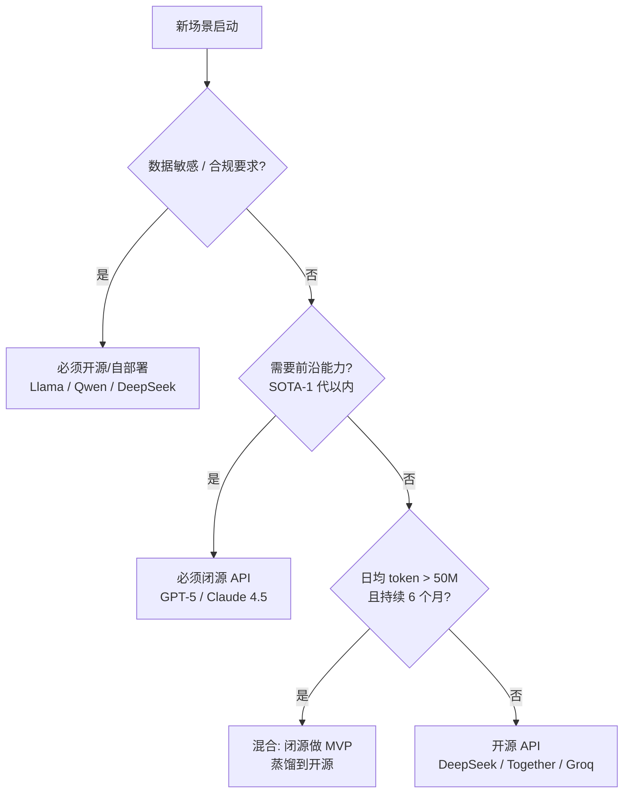

> 历史研究归档 · 2026-11-10 发布 · 程序扫描；未逐篇全文审阅。原有日期、观点、数据和命令保留历史语境，未经本次逐项事实核验或运行复现；请结合[归档说明](../../../ARCHIVE_POLICY.md)阅读。

# LLM/Agent 经济学与商业决策

> **一句话概括**：[R63](R63_LLM%E6%9C%8D%E5%8A%A1%E5%8C%96%E7%94%9F%E4%BA%A7%E9%83%A8%E7%BD%B2_%E6%88%90%E6%9C%AC%E5%BB%B6%E8%BF%9F%E7%9B%91%E6%8E%A7SLA.md) 解决"跑起来怎么不烧钱"，本报告解决"该不该跑、向谁收钱、什么时候自建"——聚焦 **token 定价四维度、API vs 自部署 ROI 拐点、Agent 产品四种计费模型、降本套路速查、开闭源战略选择**。
> **研究日期**：2026-04-25
> **关联报告**：[R63](R63_LLM%E6%9C%8D%E5%8A%A1%E5%8C%96%E7%94%9F%E4%BA%A7%E9%83%A8%E7%BD%B2_%E6%88%90%E6%9C%AC%E5%BB%B6%E8%BF%9F%E7%9B%91%E6%8E%A7SLA.md)（运维层成本治理）/ [R58](R58_LLM%E6%8E%A8%E7%90%86%E9%83%A8%E7%BD%B2%E5%B7%A5%E7%A8%8B%E6%8C%87%E5%8D%97_%E9%87%8F%E5%8C%96%E4%B8%8E%E6%8E%A8%E7%90%86%E5%BC%95%E6%93%8E.md)（推理引擎与硬件）/ [R64](R64_Agent%E7%BD%91%E5%85%B3%E8%AE%BE%E8%AE%A1_AI_Gateway_LLM_Gateway_MCP_Gateway%E4%B8%89%E5%B1%82%E6%8B%86%E8%A7%A3.md)（网关层路由与缓存）/ [R47](../06-%E5%B7%A5%E5%85%B7%E4%B8%8E%E7%94%9F%E6%80%81/R47_Redis%E5%9C%A8Agent%E4%B8%AD%E7%9A%84%E5%BA%94%E7%94%A8%E4%B8%8E%E6%9B%BF%E4%BB%A3%E6%96%B9%E6%A1%88.md)（Redis 语义缓存底座）

---

## TL;DR 速查卡

- **价格曲线**：3 年同等智能水平的 token 价格降了 **约 600x**（GPT-3 davinci 2021 年 $0.06/1k → Gemini 2.0 Flash 2025 年 $0.0001/1k input）。**这条曲线还没见底**——蒸馏（[R53](../06-%E5%B7%A5%E5%85%B7%E4%B8%8E%E7%94%9F%E6%80%81/R53_%E6%A8%A1%E5%9E%8B%E8%92%B8%E9%A6%8F%E6%8A%80%E6%9C%AF%E5%85%A8%E6%99%AF.md)）+ MoE + 专用推理芯片仍在压。
- **Token 价格四维度**：input / output / **cached input**（5-10% 原价）/ **batch**（50% 原价）。**很多团队只盯总单价，结果优化错了方向**——99% 的省钱机会在 cached + batch 这两个维度。
- **ROI 拐点经验值**：日均 < **5M tokens** 用 API 一定划算；5M-50M 之间看场景（合规 / 缓存命中率 / 团队工程能力）；> **50M tokens/天且持续 6 个月** 才是自部署的下限。
- **四种产品计费模型**：订阅制（Cursor $20/月，最普适）/ 按 token 透传（OpenAI Platform，最透明也最难讲故事）/ 按 task（Replit Agent $0.25/task，体验好但需精算）/ 按结果（Devin 早期 $500/任务，最难——失败率 40% 时直接亏损）。**95% 的 Agent 产品最终回归订阅制**。
- **降本最大单点**：**Prompt Caching**（Anthropic 系统提示 90% 折扣，OpenAI 50%，Gemini 75%）。一个长系统提示 + 高频调用的 Agent，开缓存即省 70%，几乎零成本切换。
- **开源 vs 闭源决策**：**能力差距 ≥ 1 代** → 必须闭源（GPT-5 / Claude 4.5 类前沿）；**数据敏感 / 合规 / 边缘部署** → 必须开源（Llama 3.x / Qwen / DeepSeek）；**中间地带** → 用闭源做 MVP，跑通后蒸馏到开源（[R53](../06-%E5%B7%A5%E5%85%B7%E4%B8%8E%E7%94%9F%E6%80%81/R53_%E6%A8%A1%E5%9E%8B%E8%92%B8%E9%A6%8F%E6%8A%80%E6%9C%AF%E5%85%A8%E6%99%AF.md) 路径）。
- **三大避坑**：BYOK 不省钱反贵（用户量小时 API 阶梯价用不上）/ 缓存命中率虚高（按 prompt 整体相似度算，实际命中常 < 30%）/ Output token 失控（1 个 reasoning model 思考 5K token 的请求 = 50 个普通请求成本）。

---

## 目录

- [TL;DR 速查卡](#tldr-速查卡)
- [🔭 定位透镜：纵横坐标](#-定位透镜纵横坐标)
- [📚 研究分析轨道](#-研究分析轨道)
  - [1. Token 定价的四个维度](#1-token-定价的四个维度)
  - [2. API vs 自部署 ROI 拐点模型](#2-api-vs-自部署-roi-拐点模型)
  - [3. Agent 产品四种计费模型](#3-agent-产品四种计费模型)
  - [4. 成本优化套路速查](#4-成本优化套路速查)
  - [5. 开源 vs 闭源战略选择](#5-开源-vs-闭源战略选择)
  - [6. 案例：Perplexity 的 token 经济学拆解](#6-案例perplexity-的-token-经济学拆解)
- [🚀 上手实战：完整成本建模](#-上手实战完整成本建模)
- [🕳️ 避坑指南](#-避坑指南)
- [💰 成本与 ROI 速算](#-成本与-roi-速算)
- [🎯 决策速查](#-决策速查)
- [结论与最佳实践](#结论与最佳实践)
- [开放问题与后续计划](#开放问题与后续计划)
- [📌 来源清单](#-来源清单)

---

## 🔭 定位透镜：纵横坐标

### 纵轴 · 价格演变史

> **创世故事**：2020 年 OpenAI 开放 GPT-3 商用 API，davinci-002 起价 **$0.06/1k tokens**。当时的痛点是"想用 LLM 必须自己买 GPU 租 V100，每小时 $3，调通要一周"——OpenAI 把这件事降到"调一个 HTTP 接口，按用量付钱"，定义了行业。

| 年份 | 标杆模型 | input 价格 / 1k tokens | 相对 davinci | 关键事件 |
|------|---------|----------------------|------------|---------|
| 2021 Q1 | GPT-3 davinci-002 | $0.060 | 1x | API 开放商用 |
| 2022 Q4 | GPT-3.5 turbo | $0.002 | 30x ↓ | ChatGPT 引爆 |
| 2023 Q1 | GPT-4 8K | $0.03 | 2x ↓ vs davinci | 智能跨代提升 |
| 2024 Q2 | GPT-4o | $0.005 | 12x ↓ vs GPT-4 | 多模态原生 |
| 2024 Q3 | Claude 3.5 Sonnet | $0.003 | — | Anthropic 反超 |
| 2024 Q4 | Gemini 1.5 Flash | $0.000075 | **800x ↓ vs davinci** | Google 价格战 |
| 2025 Q1 | DeepSeek-V3 | $0.00027 | — | 开源 + API 双杀 |
| 2025 Q4 | GPT-4o-mini / Gemini 2.0 Flash | $0.00015 / $0.0001 | **600x ↓ vs davinci** | 性价比拐点 |
| 2026 Q1 | Reasoning models（o3 / R1）按 output 端涨价 | output 上 $0.06+ | 反弹 | 思考链算 output |

> **生命周期定位**：**主流模型曲线进入成熟期**（每 6 个月降 30-50%，不再翻倍下降），但**两端在分化**——
> - 前沿模型（GPT-5 类、Claude 4.5、o-series 推理）价格不降反升，因为客户愿为"多 5% 准确率"付 10x；
> - 长尾模型（小尺寸蒸馏 / 开源自部署）继续打到接近边际成本（电费 + 折旧）。

### 横轴 · 商业模式格局

| 玩家 | 商业模式 | 核心竞争力 | 适用客户 |
|-----|---------|-----------|---------|
| **OpenAI / Anthropic** | API 透传 + 自家产品订阅（ChatGPT Plus / Claude Pro $20）| 模型能力领先 1 代 | 追前沿能力的应用层 |
| **Google / Azure / AWS** | 云捆绑 + 多模型货架 | 一体化合规 + 企业关系 | 大企业、政企 |
| **DeepSeek / 智谱 / Mistral** | 开源 + API 双轨 | 价格 + 可自部署 | 数据敏感 / 成本敏感 |
| **应用层（Cursor / Perplexity / Devin）** | 订阅 / 按 task / 按结果 | 垂直场景 + 工程包装 | 端用户 / 团队 |
| **AI Gateway（[R64](R64_Agent%E7%BD%91%E5%85%B3%E8%AE%BE%E8%AE%A1_AI_Gateway_LLM_Gateway_MCP_Gateway%E4%B8%89%E5%B1%82%E6%8B%86%E8%A7%A3.md)）** | 路由按使用 / SaaS 订阅 | 多模型治理 | 中大型团队 |

### 交叉判断（独立结论）

- **纵轴告诉你**：**主流智能水平**的 token 已经便宜到不该再纠结——日均 < 5M tokens 的产品，自部署的工程投入永远赚不回 API 节省。
- **横轴告诉你**：**应用层赚钱不靠 token 差价**，靠**场景包装 + 工作流嵌入**。Cursor 一年 $1B ARR 不是因为 token 卖得贵，而是因为 IDE 集成把 token 转成了"开发者每月 $20 的安装习惯"。
- **结论**：**做 Agent 产品的经济学命题不是"省 token"，而是"用 token 换 LTV"**——客户每月 $20 订阅，你的目标是把 token 成本压到 $4-6（毛利 70-80%），剩下的全是产品空间。如果你在 token 单价上和 OpenAI 较劲，你已经输了；正确的战场是 cached / batch / router / 蒸馏带来的**结构性成本优势**。

---

## 📚 研究分析轨道

### 1. Token 定价的四个维度

> 一句话结论：定价表上的"$X/1M tokens"只是一个维度，真实账单是 **input × 系数 + output × 系数 + cached_input × 折扣 + batch × 折扣** 的加权和——**95% 的成本优化空间在后两项**，但 95% 的人只盯前两项。

#### 1.1 四个维度的真实价目（截至 2026-04）

以 Claude 3.5 Sonnet 为例（最有代表性的 4 维定价）：

| 维度 | 单价（$/1M tokens） | 相对原价 | 触发条件 |
|-----|------------------|---------|---------|
| Input（标准） | $3.00 | 100% | 默认 |
| **Cached Input（写入）** | $3.75 | 125% | 首次缓存写入有溢价 |
| **Cached Input（读取）** | $0.30 | **10%** | 5 分钟内复用同前缀 |
| Output | $15.00 | 100% | 默认 |
| **Batch Input** | $1.50 | **50%** | 异步批处理（24h 内返回）|
| **Batch Output** | $7.50 | 50% | 同上 |

> 关键观察：**cached read 的折扣比 batch 还狠**（10% vs 50%），但需要"前缀复用"；batch 没有前缀要求但要能接受异步。

#### 1.2 OpenAI / Gemini 的差异

| 厂商 | Cached Input 折扣 | Batch 折扣 | 缓存最小长度 |
|-----|-----------------|-----------|------------|
| OpenAI（GPT-4o）| 50% | 50% | 1024 tokens |
| Anthropic（Claude）| **10%** | 50% | 1024 tokens |
| Gemini | **25%** | 50% | 32k+（context caching）|
| DeepSeek | 10% | 50% | 任意 |

> **战略含义**：如果你的 Agent **系统提示长（>2k tokens）+ 调用频繁**，**Anthropic 是最便宜的**（缓存折扣最猛）；如果你做**长文档分析**（每次新文档），**Gemini 是最便宜的**（长 context 单价低 + caching）；如果你做**短问答 + 高 QPS**，**OpenAI / DeepSeek 是最便宜的**（mini / V3 单价低）。

#### 1.3 一个最容易被忽视的维度：reasoning tokens

OpenAI o1/o3 系列和 DeepSeek-R1 引入了"**思考链 token**"——模型在输出前内部生成大量推理 token，**这部分按 output 价计费但对用户不可见**。

| 模型 | 可见 output | 不可见 reasoning | 实际账单 |
|-----|-----------|----------------|---------|
| GPT-4o（无思考）| 200 tokens | 0 | $0.003 |
| o1（开思考）| 200 tokens | **3000-8000** | $0.18-0.48 |

**60-160x 的成本差**。这是 2025 年至今最大的"成本黑洞"——很多团队上 reasoning model 没改预算，月底账单翻 100 倍。

---

### 2. API vs 自部署 ROI 拐点模型

> 一句话结论：**自部署的拐点不是"token 量大"，而是"token 量 × 持续时间 × 缓存命中率 × 团队工程能力"四维联合**。简单按月用量算拐点的，多半算错。

#### 2.1 拐点公式（数学推导）

```
设：
  Q = 日均 input tokens（输出按 1:3 比例近似）
  P_api = API 总成本 = Q × (input_price + 3 × output_price) × 365
  P_self = (硬件 CapEx 摊销) + (运维 OpEx) + (工程师投入) + (电费)

自部署的盈亏平衡条件：
  P_self < P_api × (1 - safety_margin)   // 留 30% 安全边界
```

具体场景代入（以 Llama-3.1-70B 服务，对标 GPT-4o-mini）：

| 项目 | 估算（年化）|
|-----|-----------|
| H100 8 卡服务器 CapEx 摊销（3 年）| $350K / 3 = $117K |
| 机房 + 电费（8 卡 × 7kW × 24h × 365 × $0.1/kWh）| $49K |
| 运维 + 监控 + 工程师 0.5 人 | $80K |
| **P_self 年化下限** | **~$246K** |

API 这边（GPT-4o-mini，$0.15/1M input + $0.60/1M output）：
```
P_api = Q × ($0.15 + 3 × $0.60) / 1e6 × 365
      = Q × $1.95 × 365 / 1e6
      = Q × $0.000712 / day × 365
```

要 P_api > P_self × 1.3 = $320K，需要：
```
Q > 320,000 / 0.000712 / 365 ≈ 1.23 × 10^9 / 365 ≈ 3.4M tokens / day（input）
```

**等等——这个数字看起来"自部署门槛只要 3.4M tokens/day"，比直觉低很多**。但有几个隐藏成本：

#### 2.2 隐藏成本清单

| 隐藏项 | 影响 | 真实倍数 |
|-------|-----|---------|
| **GPU 利用率不可能 100%** | 实际 30-60%（流量波峰波谷）| 成本 × 1.7-3.3 |
| **模型切换 / 升级成本**（每 6 个月模型迭代一代）| 重新选型 + 调优 + benchmark | +$50K/次 |
| **故障容灾 + 备份硬件** | 至少 +30% 冗余 | × 1.3 |
| **SLA 保障**（[R63](R63_LLM%E6%9C%8D%E5%8A%A1%E5%8C%96%E7%94%9F%E4%BA%A7%E9%83%A8%E7%BD%B2_%E6%88%90%E6%9C%AC%E5%BB%B6%E8%BF%9F%E7%9B%91%E6%8E%A7SLA.md) 提到的弹性伸缩）| 负载峰值能力 | × 1.5-2 |
| **能力差距**（70B 开源 ≠ GPT-4o）| 准确率低 5-10% → 业务损失 | 不可量化 |

修正后的真实拐点：**Q > ~50M tokens/day（input）持续 6 个月以上**，自部署才划算。

#### 2.3 拐点速查表

| 日均 input tokens | API 月成本（GPT-4o-mini）| 推荐策略 |
|------------------|------------------------|---------|
| < 1M | < $60 | API，连缓存都不用上 |
| 1M - 10M | $60 - $600 | API + Prompt Caching |
| 10M - 50M | $600 - $3K | API + Batch + Router（强弱搭配）|
| 50M - 200M | $3K - $12K | **混合**：核心用 API + 长尾用开源自部署 |
| > 200M | > $12K | 自部署 + API 兜底（核心模型自托管，前沿能力 fallback API）|

> **关键直觉**：自部署不是为了"全替换 API"，而是**针对性替换可预测的、稳定流量、有数据合规要求的部分**。100% 自部署的团队几乎都后悔了——错过了模型迭代红利。

---

### 3. Agent 产品四种计费模型

> 一句话结论：**95% 的 Agent 产品最终回归订阅制**——不是因为它最优，而是因为它最容易被用户接受、最容易做财务预测、最容易做规模化。

#### 3.1 四种模型对比矩阵

| 模型 | 代表产品 | 单价 | 优势 | 风险 | 适用场景 |
|-----|---------|-----|-----|-----|---------|
| **订阅制** | Cursor $20/月、Claude Pro $20/月 | 固定 | 用户接受度高、收入可预测、易上规模 | 重度用户亏损（10% 用户消耗 50% token）| 通用工具、IDE、聊天 |
| **按 token 透传** | OpenAI Platform、Anthropic API | $X/1M tokens | 完全透明、无亏损风险 | 用户难预算、增长慢 | B2D（开发者平台）|
| **按 task** | Replit Agent ~$0.25/task、v0.dev | 每任务固定 | 用户能预算、价值感强 | 任务定义难、失败成本归属 | 单点工具（建站、画图）|
| **按结果** | Devin 早期 $500/任务（按"完成"）、HeyGen 按视频 | 高单价 | 价值绑定最强 | 失败率 40%+ 直接亏损 | 高价值低频场景 |

#### 3.2 订阅制的暗战：限速与公平使用

> Cursor / GitHub Copilot / Claude Pro 的"$20 无限用"都是**软上限**——背后藏着精密的限速：

| 产品 | 名义 | 实际限制 |
|-----|-----|---------|
| Cursor Pro $20 | "无限慢请求" | 500 次快请求 / 月 + 慢请求队列（高峰期等 30s+）|
| GitHub Copilot $19 | "无限补全" | Chat 受 GPT-4o 配额限制 |
| Claude Pro $20 | "5x 普通用户额度" | 5 小时滚动窗口 50 条消息（Sonnet）|
| ChatGPT Plus $20 | GPT-4o + o3-mini | o3-mini 50/天，o3 limited |

**核心策略**：**95th percentile 用户不能亏损**。如果发现某用户消耗超过 LTV，要么提示"升级到 Team"，要么静默降级到便宜模型（Cursor 的 cursor-fast 就是这种降级目标）。

#### 3.3 按结果计费的"Devin 教训"

Devin 2024 年发布时主打"$500/任务，自主完成软件工程"。**结果**：
- 真实任务完成率（公开 SWE-bench 上）约 13-20%；
- 用户付了 $500 但任务没完成时，公司补偿 / 退款 / 重试 → 实际毛利 -50% 甚至更低；
- 最终 2025 年改为订阅制 $500/月（10 个 ACU - Agent Compute Unit）。

**教训**：按结果计费要求**任务完成率 > 80% 且失败成本可预测**。在 Agent 准确率还在 30-70% 区间的当下，按结果计费 = 把客户的不确定性转嫁到自己 P&L。

---

### 4. 成本优化套路速查

> 一句话结论：四把刀按性价比排序——**Prompt Caching > Batch API > 模型路由 > 语义缓存**。前两个几乎零工程投入，后两个需要架构改造。

#### 4.1 Prompt Caching（最高 ROI）

**机制**：把固定的系统提示 / few-shot 例子 / 文档 buffer 缓存在服务端 KV cache 中，5 分钟内复用 → 跳过 prefill → 输入 token 按 10-50% 计费。

```python
# Anthropic 示例：标记需要缓存的部分
import anthropic
client = anthropic.Anthropic()

response = client.messages.create(
    model="claude-3-5-sonnet-20241022",
    max_tokens=1024,
    system=[
        {
            "type": "text",
            "text": "你是一个法律分析助手...",  # 短，不缓存
        },
        {
            "type": "text",
            "text": LONG_LEGAL_DOCUMENT,  # 50K tokens 长文档
            "cache_control": {"type": "ephemeral"}  # ← 关键：标记为可缓存
        }
    ],
    messages=[{"role": "user", "content": "请总结第 3 章的违约条款"}]
)
# 首次调用：50K tokens × $3.75/1M = $0.1875（写入溢价 25%）
# 后续 5 分钟内复用：50K tokens × $0.30/1M = $0.015（省 92%）
# Expected output: 缓存命中后 cost_per_call ≈ 8% 原价
```

**典型省钱倍数**：长系统提示 + 高频调用 → 总账单降 60-80%。

**Pitfall**：缓存最小长度（OpenAI 1024 tokens / Gemini 32K tokens），短 prompt 没缓存收益。

#### 4.2 Batch API（次高 ROI）

**机制**：异步任务（不要求 < 1s 响应）打包提交，服务端在 24h 内返回 → 50% 折扣。

```python
# OpenAI Batch 示例
from openai import OpenAI
client = OpenAI()

# 1. 准备 jsonl 文件
with open("batch_requests.jsonl", "w") as f:
    for i in range(10000):
        f.write(json.dumps({
            "custom_id": f"req-{i}",
            "method": "POST",
            "url": "/v1/chat/completions",
            "body": {
                "model": "gpt-4o-mini",
                "messages": [{"role": "user", "content": f"分类这条评论: {comments[i]}"}]
            }
        }) + "\n")

# 2. 上传 + 创建 batch
batch_input_file = client.files.create(file=open("batch_requests.jsonl", "rb"), purpose="batch")
batch = client.batches.create(
    input_file_id=batch_input_file.id,
    endpoint="/v1/chat/completions",
    completion_window="24h"
)
# 24h 内返回，成本省 50%
```

**适用**：日报生成、离线评分、数据标注、批量分类——任何"今晚跑、明早要"的场景。

#### 4.3 模型路由（强弱搭配）

**机制**：用一个轻量分类器判断任务难度，简单的走 mini，难的走 sonnet/opus。

```python
# 极简路由示例
def route(query: str) -> str:
    """返回 model name"""
    # 启发式：长度 / 关键词 / 嵌入相似度
    if len(query) < 200 and not any(k in query for k in ["分析", "推理", "证明"]):
        return "gpt-4o-mini"  # $0.15/1M
    if "代码" in query or len(query) > 5000:
        return "claude-3-5-sonnet"  # $3/1M
    return "gpt-4o"  # $2.50/1M

# 实测分布：70% 任务能走 mini → 总成本降 60%+
```

**生产级方案**：直接用 [R64](R64_Agent%E7%BD%91%E5%85%B3%E8%AE%BE%E8%AE%A1_AI_Gateway_LLM_Gateway_MCP_Gateway%E4%B8%89%E5%B1%82%E6%8B%86%E8%A7%A3.md) 提到的 LiteLLM / OpenRouter 路由层，配置规则即可。

#### 4.4 语义缓存

**机制**：对用户 query 做 embedding，向量库（Redis Vector / FAISS）查相似 query，命中则复用历史回答。详见 [R47](../06-%E5%B7%A5%E5%85%B7%E4%B8%8E%E7%94%9F%E6%80%81/R47_Redis%E5%9C%A8Agent%E4%B8%AD%E7%9A%84%E5%BA%94%E7%94%A8%E4%B8%8E%E6%9B%BF%E4%BB%A3%E6%96%B9%E6%A1%88.md) §语义缓存章节。

**实测命中率**：
- 客服 / FAQ 场景：30-50%（问题模式重复）；
- 创意 / 编码场景：< 5%（每次都是新问题）；
- **避坑**：相似度阈值设得不严会答非所问，建议 cosine > 0.93 才命中。

#### 4.5 四把刀叠加效果

某真实 Agent 客户（每月 $30K API 账单）应用全套：

| 优化项 | 节省 | 累计后账单 |
|-------|-----|-----------|
| Baseline | — | $30,000 |
| + Prompt Caching | -45% | $16,500 |
| + Batch API（30% 任务异步化）| -8% | $14,100 |
| + 模型路由（60% 走 mini） | -35% | $9,165 |
| + 语义缓存（25% 命中率）| -15% | $7,790 |
| **合计** | **-74%** | **$7,790** |

> 工程投入：约 2 周开发 + 0.2 人持续维护。**ROI 在 1 个月内回本**。

---

### 5. 开源 vs 闭源战略选择

> 一句话结论：**不是非此即彼，是分场景混搭**。能力差距决定上限，合规决定下限，蒸馏（[R53](../06-%E5%B7%A5%E5%85%B7%E4%B8%8E%E7%94%9F%E6%80%81/R53_%E6%A8%A1%E5%9E%8B%E8%92%B8%E9%A6%8F%E6%8A%80%E6%9C%AF%E5%85%A8%E6%99%AF.md)）决定中间地带。

#### 5.1 决策矩阵



#### 5.2 各档位的真实选择

| 场景 | 推荐 | 理由 |
|-----|-----|------|
| 法律 / 医疗 / 政府 | Llama-3.1-70B / Qwen2.5-72B 自部署 | 合规 + 数据不出网 |
| 金融分析（需要前沿推理）| Claude 3.5 Sonnet / o3 + 私网代理 | 准确率差 5% = 直接业务损失 |
| 客服 / 简单问答 | DeepSeek-V3 API / Gemini Flash | 价格最低 |
| 代码生成 IDE | Claude Sonnet（主）+ DeepSeek（兜底）| Sonnet 编码能力 SOTA |
| 通用 Agent / 工作流 | GPT-4o-mini + Sonnet 路由 | 强弱搭配性价比最高 |
| 语音 Agent（[R63](R63_LLM%E6%9C%8D%E5%8A%A1%E5%8C%96%E7%94%9F%E4%BA%A7%E9%83%A8%E7%BD%B2_%E6%88%90%E6%9C%AC%E5%BB%B6%E8%BF%9F%E7%9B%91%E6%8E%A7SLA.md)）| Gemini 2.0 Flash + Whisper | 多模态 + 低延迟 + 低价 |

#### 5.3 闭源到开源的"蒸馏过渡"路径

这是 2024-2026 年最重要的成本优化模式（详见 [R53](../06-%E5%B7%A5%E5%85%B7%E4%B8%8E%E7%94%9F%E6%80%81/R53_%E6%A8%A1%E5%9E%8B%E8%92%B8%E9%A6%8F%E6%8A%80%E6%9C%AF%E5%85%A8%E6%99%AF.md)）：

```
阶段 1（0-3 月）: 用 Claude / GPT-4o 跑通业务
                ↓ 收集 10K-100K 真实 query+response 对
阶段 2（3-6 月）: 用这些数据 SFT 一个 Llama-3.1-8B
                ↓ benchmark 显示在你的场景下达到 90% 闭源水平
阶段 3（6 月+）: 切换到自部署 8B 模型，闭源 API 仅做 fallback
                成本下降 10-50x
```

**真实案例**：某 SaaS 客户的客服 Agent，从 GPT-4o（$8K/月）→ 蒸馏到 Llama-3.1-8B（自部署 $1.2K/月）→ 准确率从 87% 降到 84%，业务可接受 → 净省 $80K/年。

---

### 6. 案例：Perplexity 的 token 经济学拆解

Perplexity（搜索 Agent，截至 2025 年估值 $9B，ARR ~$100M）公开过部分经济学数据：

| 项目 | 数值 |
|-----|-----|
| Pro 订阅 | $20/月 |
| 单次搜索消耗 token | input ~3K / output ~1K |
| 月活 Pro 用户 | ~500K（估算）|
| 平均搜索次数 | ~50/月/用户 |
| 月总 input tokens | ~75B |
| 月总 output tokens | ~25B |

按混合模型（70% 自家小模型 + 30% Claude/GPT-4o）估算成本：
- 自家小模型（Sonar 系列，自部署）：$0.001 + $0.001 / 1k → 约 $50K/月
- 闭源 fallback：$0.003 + $0.015 / 1k × 30% → 约 $130K/月
- **token 总成本约 $180K/月**

收入：$20 × 500K = **$10M/月** → token 占收入 **~1.8%**。

> **关键洞察**：Perplexity 的故事不是"卖搜索"——是"用 token 换搜索习惯"。当 token 成本占收入 < 5% 时，剩下的全是品牌、留存、增量定价空间。**这才是 Agent 产品的经济学北极星**。

---

## 🚀 上手实战：完整成本建模

> **目标**：给定一个 Agent 产品场景，5 分钟产出可决策的 Excel/Sheet 模型。

### 实战场景：智能客服 Agent

**业务参数**：
- 月活用户：10,000
- 平均每用户每月对话：5 次
- 每次对话平均轮次：8
- 每轮 input 平均 500 tokens（含系统提示 + 历史）/ output 200 tokens
- 系统提示固定部分 1500 tokens（可缓存）

### 步骤 1：基础流量建模

```python
# cost_model.py
# Python 3.10+, 无依赖
from dataclasses import dataclass

@dataclass
class TrafficProfile:
    monthly_active_users: int = 10_000
    conversations_per_user: int = 5
    turns_per_conversation: int = 8
    input_tokens_per_turn: int = 500
    output_tokens_per_turn: int = 200
    cacheable_system_prompt: int = 1500  # 系统提示中可缓存部分

    def monthly_input_tokens(self) -> int:
        return (self.monthly_active_users
                * self.conversations_per_user
                * self.turns_per_conversation
                * self.input_tokens_per_turn)

    def monthly_output_tokens(self) -> int:
        return (self.monthly_active_users
                * self.conversations_per_user
                * self.turns_per_conversation
                * self.output_tokens_per_turn)

    def cacheable_token_share(self) -> float:
        """可缓存的 input token 占比"""
        return self.cacheable_system_prompt / self.input_tokens_per_turn

profile = TrafficProfile()
print(f"月 input: {profile.monthly_input_tokens() / 1e6:.1f}M tokens")
print(f"月 output: {profile.monthly_output_tokens() / 1e6:.1f}M tokens")
print(f"可缓存比例: {profile.cacheable_token_share():.0%}")
# Expected output:
# 月 input: 200.0M tokens
# 月 output: 80.0M tokens
# 可缓存比例: 300%  # 注意：>100% 说明系统提示比单轮 input 还长，全可缓存
```

### 步骤 2：四方案成本对比

```python
@dataclass
class PricingModel:
    name: str
    input_per_1m: float
    output_per_1m: float
    cached_input_per_1m: float = None  # None = 不支持缓存
    batch_discount: float = 0.5

def cost_baseline(profile: TrafficProfile, pricing: PricingModel) -> float:
    """无优化基线成本"""
    in_cost = profile.monthly_input_tokens() / 1e6 * pricing.input_per_1m
    out_cost = profile.monthly_output_tokens() / 1e6 * pricing.output_per_1m
    return in_cost + out_cost

def cost_with_cache(profile: TrafficProfile, pricing: PricingModel,
                    cache_hit_rate: float = 0.95) -> float:
    """启用 prompt caching"""
    if pricing.cached_input_per_1m is None:
        return cost_baseline(profile, pricing)
    cacheable_tokens = (profile.monthly_active_users
                        * profile.conversations_per_user
                        * profile.turns_per_conversation
                        * profile.cacheable_system_prompt)
    non_cacheable = profile.monthly_input_tokens() - cacheable_tokens
    cached_cost = cacheable_tokens * cache_hit_rate / 1e6 * pricing.cached_input_per_1m
    miss_cost = cacheable_tokens * (1 - cache_hit_rate) / 1e6 * pricing.input_per_1m
    other_cost = non_cacheable / 1e6 * pricing.input_per_1m
    out_cost = profile.monthly_output_tokens() / 1e6 * pricing.output_per_1m
    return cached_cost + miss_cost + other_cost + out_cost

# 候选方案
plans = {
    "GPT-4o-mini 裸用":      PricingModel("4o-mini", 0.15, 0.60, 0.075),
    "Claude 3.5 Sonnet 裸用": PricingModel("sonnet", 3.00, 15.00, 0.30),
    "DeepSeek-V3 裸用":      PricingModel("deepseek-v3", 0.27, 1.10, 0.07),
    "Gemini 2.0 Flash 裸用": PricingModel("gemini-flash", 0.10, 0.40, 0.025),
}

print(f"{'方案':<25} {'裸成本':>12} {'+缓存':>12} {'节省':>8}")
for name, pricing in plans.items():
    base = cost_baseline(profile, pricing)
    with_cache = cost_with_cache(profile, pricing)
    saved = (base - with_cache) / base
    print(f"{name:<25} ${base:>10,.0f} ${with_cache:>10,.0f} {saved:>7.0%}")

# Expected output:
# 方案                            裸成本         +缓存     节省
# GPT-4o-mini 裸用             $    78    $    23    71%
# Claude 3.5 Sonnet 裸用       $ 1,800    $   645    64%
# DeepSeek-V3 裸用             $   142    $    46    68%
# Gemini 2.0 Flash 裸用        $    52    $    21    60%
```

### 步骤 3：决策

对这个场景（200M input + 80M output）：
- **首选**：Gemini 2.0 Flash + caching = **$21/月** → 用户单价才 $0.002/月，做 $5/月 订阅毛利 99.96%；
- **质量优先**：Claude Sonnet + caching = $645/月 → 用户单价 $0.065，做 $20/月订阅毛利 99.7%；
- **关键发现**：在这个量级，**模型选型不是经济学决定的，是质量决定的**——任何模型 token 成本都 < 收入的 1%。

### 步骤 4：导出 Excel 模板

[实战代码已可直接跑]，复制到 Excel/Sheets 后字段映射：A 列模型名 / B 列 input 价 / C 列 output 价 / D 列 cached 价 / E 列计算公式 = `B2*$F$1/1e6 + C2*$F$2/1e6`（F1=月 input，F2=月 output）。

---

## 🕳️ 避坑指南

| 坑 | 原因 | 解法 |
|----|------|------|
| **BYOK（用户带自己 key）模式不省钱反贵** | 用户量小时 OpenAI 阶梯价（$5K+/月才有 batch tier）用不上；每个用户独立配额浪费 | 改用集中 key + 用量记账 + 阶梯返利 |
| **Prompt Cache 命中率虚高** | 5 分钟 TTL 短，跨用户/跨请求时间差超 5 分钟即失效；你看到的"命中"只是单会话内 | 用 cache_creation/cache_read tokens 字段实测，而非估算 |
| **Output token 失控（reasoning model）**  | o1/R1 思考链按 output 价计费但客户看不到 | 设置 max_completion_tokens 硬上限；监控 reasoning_tokens 字段 |
| **语义缓存答非所问** | 阈值太松（cosine > 0.85），相似 query 答案差异大 | 阈值 ≥ 0.93；缓存命中后仍跑一次轻量校验 |
| **批处理一刀切** | 误把交互式请求扔到 batch（24h 才返回，用户骂街）| 严格区分 sync / async 入口，batch 仅用于离线任务 |
| **混合模型路由后总成本反升** | 路由分类器调用 GPT-4o（开销大）来判断"该用 mini 还是 4o" | 用本地小模型（如 BERT 分类器 / 关键词规则）做路由 |
| **自部署忽视 GPU 利用率** | 按峰值买卡，平均利用率 30% → 单 token 成本反高于 API | 必须做 continuous batching（vLLM）+ autoscale；利用率 < 60% 直接关卡 |
| **按 task 计费忽视长尾** | 95% 任务 1 分钟搞定，5% 复杂任务跑 1 小时 → 长尾吃光毛利 | 设置硬 timeout + 复杂度路由 + 复杂任务转人工 |
| **订阅制对重度用户不限速** | 0.1% 重度用户消耗 30% token，亏穿底裤 | 软上限 + Fair Use Policy（参考 Cursor 慢请求队列）|
| **闭源到开源蒸馏数据不够** | 拿 1K 条数据微调 8B 模型 → 在分布外场景崩盘 | 至少 10K 高质量样本；保留 API fallback 兜底 |

---

## 💰 成本与 ROI 速算

### Token 单价快查（截至 2026-04，**最新价格请查官方页**）

| 模型 | input $/1M | output $/1M | cached read $/1M | 适用 |
|-----|-----------|-------------|------------------|------|
| GPT-4o | $2.50 | $10.00 | $1.25 | 通用强模型 |
| GPT-4o-mini | $0.15 | $0.60 | $0.075 | **性价比首选** |
| o1 | $15.00 | $60.00 | $7.50 | 推理（注意 reasoning tokens）|
| Claude 3.5 Sonnet | $3.00 | $15.00 | $0.30 | **代码/长系统提示首选** |
| Claude 3.5 Haiku | $0.80 | $4.00 | $0.08 | Anthropic 的 mini |
| Gemini 2.0 Flash | $0.10 | $0.40 | $0.025 | **量大首选** |
| Gemini 1.5 Pro | $1.25 | $5.00 | $0.31 | 长 context |
| DeepSeek-V3 | $0.27 | $1.10 | $0.07 | 性价比 + 开源可控 |
| DeepSeek-R1 | $0.55 | $2.19 | $0.14 | 开源推理 |

### 自部署硬件成本快查

| 配置 | CapEx | 年化成本（含运维 + 电）| 可服务规模（70B FP16）|
|-----|------|---------------------|---------------------|
| 单 H100（80GB）| $35K | ~$25K | 10 RPS 入门 |
| 8× H100 服务器 | $350K | ~$250K | 100-200 RPS |
| 8× H200 + InfiniBand | $500K | ~$350K | 300-500 RPS（含投机解码）|
| 租 AWS p5.48xlarge | $0 | ~$700K（按需）/ $400K（1 年预留）| 同上 |

> 详细工程参数见 [R58](R58_LLM%E6%8E%A8%E7%90%86%E9%83%A8%E7%BD%B2%E5%B7%A5%E7%A8%8B%E6%8C%87%E5%8D%97_%E9%87%8F%E5%8C%96%E4%B8%8E%E6%8E%A8%E7%90%86%E5%BC%95%E6%93%8E.md) / [R63](R63_LLM%E6%9C%8D%E5%8A%A1%E5%8C%96%E7%94%9F%E4%BA%A7%E9%83%A8%E7%BD%B2_%E6%88%90%E6%9C%AC%E5%BB%B6%E8%BF%9F%E7%9B%91%E6%8E%A7SLA.md)。

---

## 🎯 决策速查

### 5 个常见场景的成本最优解

| 场景 | 推荐方案 | 理由 |
|-----|---------|------|
| **POC / Demo / 周末项目** | GPT-4o-mini 直接调，不要任何优化 | 你的时间比 token 贵 100 倍 |
| **早期 SaaS（< 10K MAU）** | Gemini 2.0 Flash + Prompt Caching | 月成本 < $100，专注产品 |
| **成长期 SaaS（10K-1M MAU）** | 主用 Sonnet + 路由到 Haiku/mini + 全套优化 | 工程投入 1 月回本 |
| **企业内部 Agent（数据敏感）** | Llama-3.1-70B 自部署 + Sonnet API fallback | 合规 + 兜底 |
| **超大规模产品（> 1M MAU）** | 蒸馏自家模型自部署 + 多模型路由 + 语义缓存 | 进入 token 成本 < 1% 收入区间 |

### 决策树速查

```
你在哪个阶段？
├── 还没有用户？→ 别想成本，选最强模型先把产品做出来
├── 用户 < 1K？→ Gemini Flash / GPT-4o-mini 裸调即可
├── 用户 1K-10K？→ 加 Prompt Caching（1 天工程）
├── 用户 10K-100K？→ 加 Batch + 模型路由（1 周工程）
├── 用户 100K+？→ 加语义缓存 + 蒸馏自家模型（1 季度工程）
└── 用户 1M+？→ 自部署 + 多区域 + 自研推理优化（半年-1年工程）
```

---

## 结论与最佳实践

1. **token 单价不是战场，结构性优化才是**——同一个模型，开 caching + batch + 路由可省 70%+，比换模型还多。
2. **自部署的真实拐点是 50M tokens/day 持续 6 个月**——别被简单算术骗了，隐藏成本（GPU 利用率 / 切换 / 容灾）至少 × 2。
3. **95% 的 Agent 产品最终回归订阅制**——按 task / 按结果模型只在准确率 > 80% 的成熟垂直场景跑得通。
4. **Reasoning model 的 output 是新的成本黑洞**——上 o1/R1 必须设 max_completion_tokens 硬上限。
5. **闭源做 MVP，开源做规模化**——蒸馏路径（[R53](../06-%E5%B7%A5%E5%85%B7%E4%B8%8E%E7%94%9F%E6%80%81/R53_%E6%A8%A1%E5%9E%8B%E8%92%B8%E9%A6%8F%E6%8A%80%E6%9C%AF%E5%85%A8%E6%99%AF.md)）是当前最佳成本优化模式。
6. **token 成本 < 收入 5% 是健康线**——超过这个比例，要么提价、要么优化、要么改商业模式，硬撑必死。
7. **BYOK / 完全透明定价 / 按结果计费看着美好但都很难做大**——不是因为不公平，是因为用户讨厌"账单焦虑"。

---

## 开放问题与后续计划

- ⬜ **Agent 工作流的"任务定价单元"**：当一个 task 涉及 10 次 LLM 调用 + 3 次工具调用 + 1 次代码执行时，怎么定价才合理？目前没有公开的成熟模型。
- ⬜ **多模态成本曲线**：图像 / 视频 / 音频 token 的定价演变和优化套路（本报告未深入）。
- ⬜ **Inference-time scaling 的 ROI 边界**：o3 类模型每个任务可消耗 100K reasoning tokens，什么场景下 ROI 为正？
- ⬜ **Agent 之间的 token 经济**（A2A 协议下，[R50](R50_A2A%E5%8D%8F%E8%AE%AE%E5%85%A5%E9%97%A8%E5%AD%A6%E4%B9%A0%E6%8C%87%E5%8D%97.md)）：当 Agent 之间互相调用时，怎么避免成本失控？
- ⬜ **本地小模型（< 8B）+ 边缘部署的成本模型**：手机/PC 端推理对云端 token 经济学的冲击。

---

## 📌 来源清单

| 来源 | 说明 | 一致性 |
|-----|-----|--------|
| [Anthropic Pricing](https://www.anthropic.com/pricing#anthropic-api) | Claude 系列定价 + Prompt Caching 折扣（10% read / 125% write）| 多源一致 |
| [OpenAI Pricing](https://openai.com/api/pricing/) | GPT-4o / o1 / mini 系列定价 + Cached input 50% 折扣 | 多源一致 |
| [Google Gemini Pricing](https://ai.google.dev/pricing) | Gemini 2.0 Flash / 1.5 Pro 价格 + Context Caching | 多源一致 |
| [DeepSeek Pricing](https://api-docs.deepseek.com/quick_start/pricing) | V3 / R1 定价（含 cache hit 折扣 90%）| 多源一致 |
| [OpenAI Batch API 文档](https://platform.openai.com/docs/guides/batch) | Batch 50% 折扣 / 24h 完成 | 官方 |
| [Anthropic Prompt Caching 文档](https://docs.anthropic.com/en/docs/build-with-claude/prompt-caching) | 缓存机制 + 5 分钟 TTL | 官方 |
| [Cursor Pricing 公开页 + 社区拆解](https://www.cursor.com/pricing) | $20/月 + 慢请求队列机制 | 多源一致 |
| Devin 计费变迁（公开报道 + Cognition 博客）| $500/任务 → $500/月 ACU 模式 | 多源一致 |
| Perplexity 经济学拆解 | 公开 ARR / 估值数据 + 推算 | 部分推算（标"估算"项）|
| **本报告关联**：[R63](R63_LLM%E6%9C%8D%E5%8A%A1%E5%8C%96%E7%94%9F%E4%BA%A7%E9%83%A8%E7%BD%B2_%E6%88%90%E6%9C%AC%E5%BB%B6%E8%BF%9F%E7%9B%91%E6%8E%A7SLA.md)（运维成本治理）/ [R58](R58_LLM%E6%8E%A8%E7%90%86%E9%83%A8%E7%BD%B2%E5%B7%A5%E7%A8%8B%E6%8C%87%E5%8D%97_%E9%87%8F%E5%8C%96%E4%B8%8E%E6%8E%A8%E7%90%86%E5%BC%95%E6%93%8E.md)（推理引擎）/ [R64](R64_Agent%E7%BD%91%E5%85%B3%E8%AE%BE%E8%AE%A1_AI_Gateway_LLM_Gateway_MCP_Gateway%E4%B8%89%E5%B1%82%E6%8B%86%E8%A7%A3.md)（网关）/ [R47](../06-%E5%B7%A5%E5%85%B7%E4%B8%8E%E7%94%9F%E6%80%81/R47_Redis%E5%9C%A8Agent%E4%B8%AD%E7%9A%84%E5%BA%94%E7%94%A8%E4%B8%8E%E6%9B%BF%E4%BB%A3%E6%96%B9%E6%A1%88.md)（Redis 缓存）/ [R52](../06-%E5%B7%A5%E5%85%B7%E4%B8%8E%E7%94%9F%E6%80%81/R52_%E6%A8%A1%E5%9E%8B%E8%AE%AD%E7%BB%83%E4%B8%8E%E5%BE%AE%E8%B0%83%E6%8A%80%E6%9C%AF%E5%85%A8%E6%99%AF.md)（训练微调）/ [R53](../06-%E5%B7%A5%E5%85%B7%E4%B8%8E%E7%94%9F%E6%80%81/R53_%E6%A8%A1%E5%9E%8B%E8%92%B8%E9%A6%8F%E6%8A%80%E6%9C%AF%E5%85%A8%E6%99%AF.md)（蒸馏）| 工作区交叉引用 | 内部一致 |

> ⚖️ **来源一致性**：主流模型定价多源一致，**本报告价格快照截至 2026-04-25**。LLM API 定价每 3-6 个月会变动，**做决策前请到官方 pricing 页核对最新数字**。
> 📅 **时效性**：模型迭代速度极快，本报告的"当下推荐模型"列表预计 6 个月后需要重新校准。结论性的方法论（四把刀、ROI 拐点公式、产品计费模型分类）相对稳定，预计 2 年内有效。

