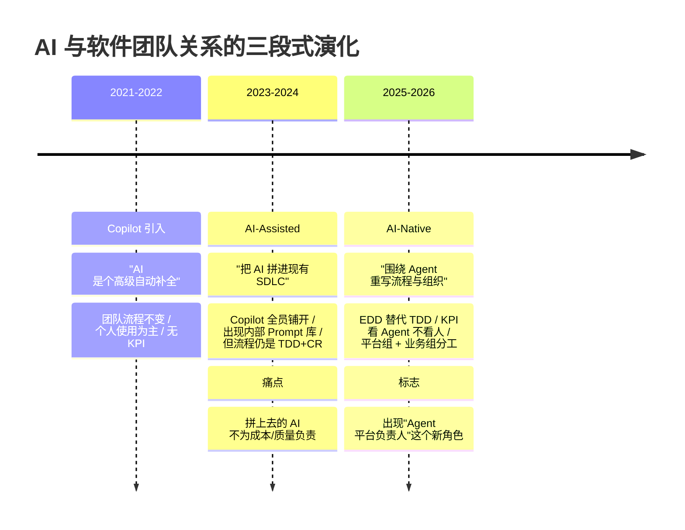
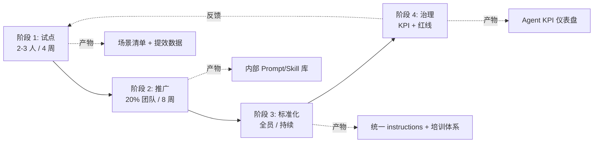
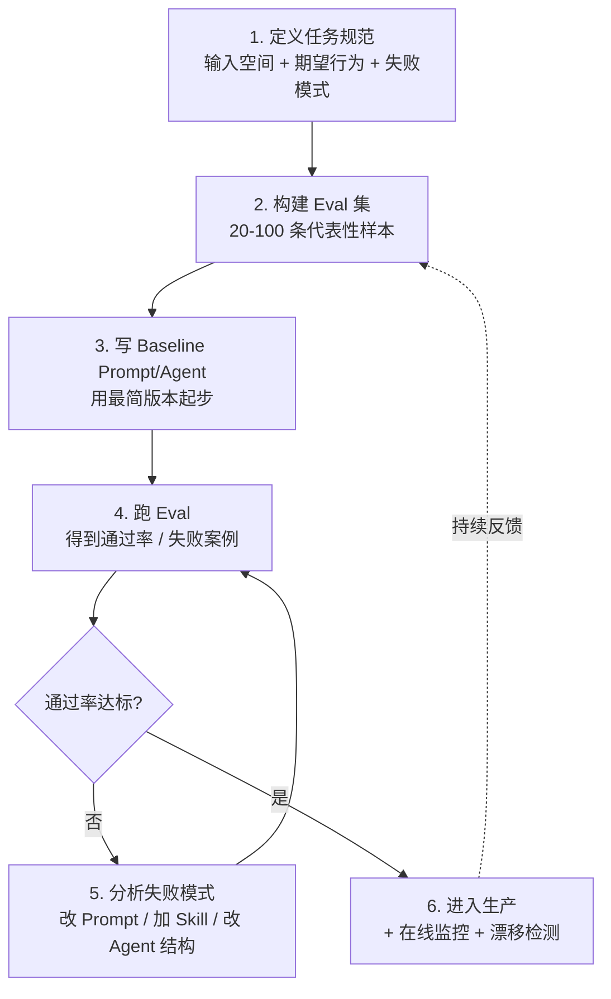
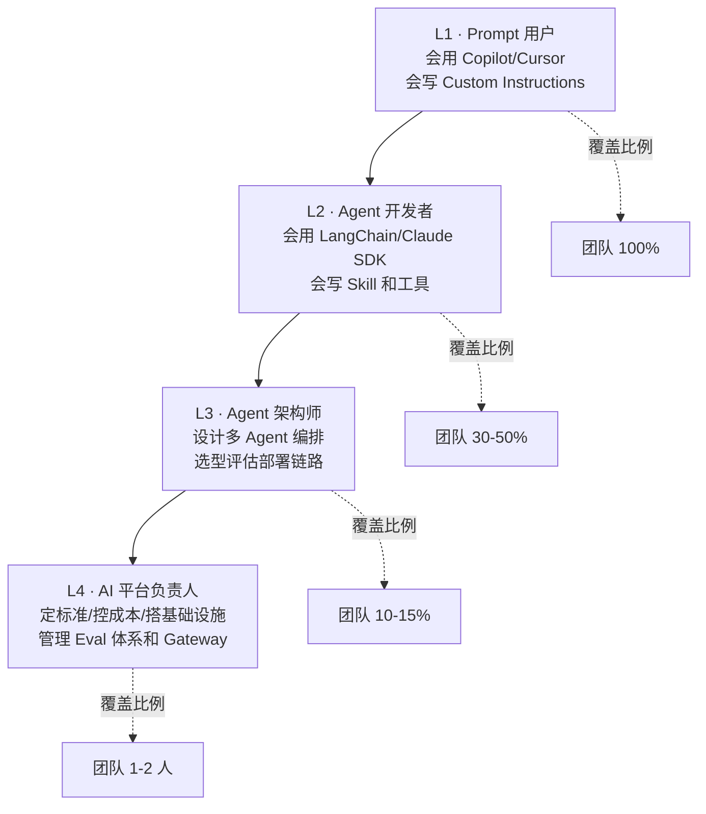
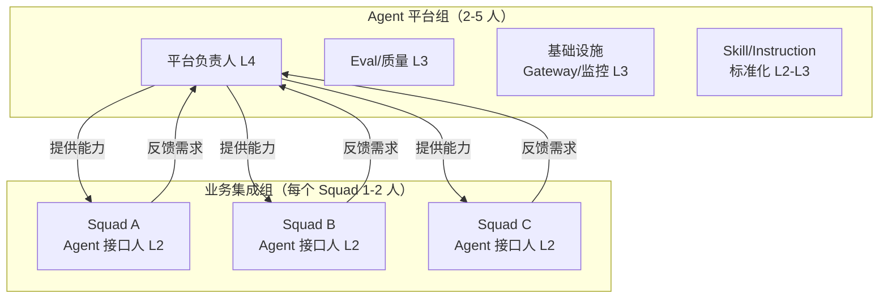

> 历史研究归档 · 2026-11-10 发布 · 程序扫描；未逐篇全文审阅。原有日期、观点、数据和命令保留历史语境，未经本次逐项事实核验或运行复现；请结合[归档说明](../../../ARCHIVE_POLICY.md)阅读。

# R70 AI-Native 团队与工程管理

> **一句话概括**：从"AI-Assisted（用 Copilot 提效）"到"AI-Native（围绕 Agent 重组流程与组织）"是一次组织级跃迁——本报告给出工具引入路径、EDD 流程、KPI 设计、事故复盘、人员梯度、组织结构与 6 个月转型路线图的完整操作手册。
>
> **研究日期**：2026-04-25
>
> **增量价值**：在 [R31](R31_%E7%A0%94%E5%8F%91%E5%B7%A5%E4%BD%9C%E6%B5%81AI%E6%8F%90%E6%95%88%E6%9C%BA%E4%BC%9A%E5%88%86%E6%9E%90.md)（研发工作流提效场景识别） / R31b（原稿交叉引用，本归档未解析）（提效仪表盘） / [R15](../05-%E8%AF%84%E4%BC%B0%E4%B8%8E%E8%B4%A8%E9%87%8F/R15_Skill%E4%B8%8EAgent%E8%AF%84%E4%BC%B0%E6%96%B9%E6%A1%88%E5%85%A8%E6%99%AF.md)（评估方案） / [R32](R32_Copilot%E5%85%A8%E5%B1%80%E8%87%AA%E5%AE%9A%E4%B9%89%E8%B7%A8%E5%B7%A5%E4%BD%9C%E5%8C%BA%E5%A4%8D%E7%94%A8.md)（Copilot 跨工作区复用）的基础上，**首次从"组织与人"维度系统回答**：场景找到了、工具选好了、个人会用了，**团队怎么治理才能不崩**。
>
> **关联报告**：[R31](R31_%E7%A0%94%E5%8F%91%E5%B7%A5%E4%BD%9C%E6%B5%81AI%E6%8F%90%E6%95%88%E6%9C%BA%E4%BC%9A%E5%88%86%E6%9E%90.md) 提效场景 · [R15](../05-%E8%AF%84%E4%BC%B0%E4%B8%8E%E8%B4%A8%E9%87%8F/R15_Skill%E4%B8%8EAgent%E8%AF%84%E4%BC%B0%E6%96%B9%E6%A1%88%E5%85%A8%E6%99%AF.md) 评估方案 · [R17](../05-%E8%AF%84%E4%BC%B0%E4%B8%8E%E8%B4%A8%E9%87%8F/R17_%E6%8C%87%E4%BB%A4%E9%81%B5%E5%AE%88%E9%AA%8C%E8%AF%81%E4%B8%8E%E9%95%BF%E6%9C%9F%E6%BC%82%E7%A7%BB%E6%A3%80%E6%B5%8B.md) 长期漂移 · [R32](R32_Copilot%E5%85%A8%E5%B1%80%E8%87%AA%E5%AE%9A%E4%B9%89%E8%B7%A8%E5%B7%A5%E4%BD%9C%E5%8C%BA%E5%A4%8D%E7%94%A8.md) Copilot 治理 · [R33](../05-%E8%AF%84%E4%BC%B0%E4%B8%8E%E8%B4%A8%E9%87%8F/R33_%E9%95%BF%E6%95%88AgentHarness%E5%B7%A5%E7%A8%8B%E5%8C%96.md) 长效 Harness · [R57](../05-%E8%AF%84%E4%BC%B0%E4%B8%8E%E8%B4%A8%E9%87%8F/R57_Agent%E5%AE%89%E5%85%A8%E4%B8%8E%E7%BA%A2%E9%98%9F%E6%94%BB%E9%98%B2%E4%BD%93%E7%B3%BB.md) 安全红队 · [R29](R29_SDKvsIDEvsCLI%E4%B8%89%E7%A7%8DAgent%E5%BC%80%E5%8F%91%E6%A8%A1%E5%BC%8F.md) 三种开发模式

---

## TL;DR 速查卡（30 秒读完）

| 关键问题 | 一句话答案 |
|---------|-----------|
| **AI-Native 与 AI-Assisted 区别** | Assisted 是"加 Copilot 后还是原来那套流程"；Native 是"流程本身围绕 Agent 重写"——TDD 让位 EDD，Code Review 让位 Eval Review |
| **工具引入最大坑** | 一上来就全员铺开 → 6 个月后没人能说清"它到底带来了什么"。**正确顺序**：试点（2-3 人 4 周拿数据）→ 推广（20% 团队）→ 标准化（统一 instructions/Skill）→ 治理（KPI + 红线） |
| **Agent 项目核心 KPI** | 四件事：**任务成功率**（端到端）、**人为中断率**（用户主动停掉的比例）、**单 task 成本**（Token + API + 人工兜底）、**用户净推荐**（NPS-like）。**别用代码行数 / Commit 数衡量个人** |
| **替代 TDD 的是什么** | **EDD（Evaluation-Driven Development）**：先写 Eval 集（输入 + 期望行为）→ 再写 Prompt/Agent → 跑 Eval → 迭代。Test 验证确定性逻辑，Eval 验证概率性行为 |
| **三类必须建立的事故复盘** | 幻觉事故（输出错事实）/ 越权事故（动了不该动的）/ 漂移事故（行为随时间偏离规范）—— 每类都要有专属 Post-mortem 模板 |
| **人员梯度四层** | L1 Prompt 用户（会用）→ L2 Agent 开发者（会搭）→ L3 Agent 架构师（会设计）→ L4 AI 平台负责人（会治理）。**别试图一步跳到 L4** |
| **6 个月转型可行吗** | 20 人团队是黄金区间——足以拆出"平台组 + 业务组"，又不至于陷入跨部门协调地狱。本报告给出周-by-周路线图 |
| **不要做的事** | ❌ 自上而下强推 KPI（"每人每周必须用 Copilot 100 次"）  ❌ 各组自选工具（半年后接不通） ❌ 跳过 Eval 直接上生产 |

---

## 目录

1. [🔭 定位透镜：从 Copilot 引入到 AI-Native 团队的演化](#1-定位透镜)
2. [📚 研究分析](#2-研究分析)
   - 2.1 [团队 Agent 工具引入路径（4 阶段闭环）](#21-工具引入路径)
   - 2.2 [评估驱动开发 EDD：替代 TDD 的 AI 时代实践](#22-edd)
   - 2.3 [Agent 项目 KPI 设计](#23-kpi)
   - 2.4 [生产事故复盘方法论：幻觉 / 越权 / 漂移](#24-事故复盘)
   - 2.5 [人员能力梯度图（L1–L4）](#25-人员梯度)
   - 2.6 [团队结构：平台组 vs 业务集成组](#26-团队结构)
3. [🚀 上手实战：20 人团队 6 个月 AI 转型路线图](#3-上手实战)
4. [🕳️ 避坑指南](#4-避坑指南)
5. [💰 成本与 ROI 速算](#5-成本roi)
6. [🎯 决策速查：技术 Leader 的 10 个关键决策点](#6-决策速查)
7. [🔗 与已有报告的交叉引用](#7-交叉引用)
8. [开放问题](#8-开放问题)
9. [📌 来源清单](#9-来源清单)

---

<a id="1-定位透镜"></a>
## 1. 🔭 定位透镜：从 Copilot 引入到 AI-Native 团队的演化

### 1.1 纵轴 · 演化脉络（2021 → 2026）



**三段式的本质差异**：

| 维度 | Copilot 引入期 (2021-2022) | AI-Assisted (2023-2024) | AI-Native (2025-2026) |
|------|--------------------------|-------------------------|----------------------|
| **AI 角色** | 高级自动补全 | 工程师助手 | 流程参与者 / 决策节点 |
| **核心流程** | 原 SDLC 不变 | 原 SDLC + Copilot 钩子 | EDD + Agent Pipeline |
| **质量保障** | Code Review | CR + Linter + 单元测试 | Eval Review + 在线监控 + Red Team |
| **KPI 焦点** | 无 | 个人提效（行/小时） | 任务成功率 / 单任务成本 |
| **组织形态** | 无 AI 专责团队 | AI 委员会（兼职） | Agent 平台组 + 业务集成组 |
| **失败模式** | 没人用 | 用了但说不清效果 | Agent 漂移 / 越权事故 |

> 💡 **关键判断**：很多团队卡在 AI-Assisted 阶段下不来——Copilot 装了、Prompt 库建了、人均 Token 也涨了，但**没人能回答"我们到底因 AI 节省了多少钱、多少 Bug、多少时间"**。这不是工具问题，是**组织和度量没有跟上**。

### 1.2 横轴 · 同期标杆做法对比

| 公司 | 标志性实践 | 设计哲学 |
|------|-----------|---------|
| **Anthropic** | "Claude 自己开发 Claude"内部循环；Skill-Creator 范式；强调 Agent 的"长期一致性" | Agent 是协作者而非工具，组织围绕 Agent 的能力边界而设计 |
| **GitHub** | Copilot Workspace + Agent；Custom Instructions 治理；按 PR 完成数评估而非补全采纳率 | 把 AI 嵌入开发者既有工作流，不强迫流程重构 |
| **Sourcegraph** | Cody + Code Graph；放弃纯 Embedding 改 BM25 + 图检索；强调"上下文工程" | AI 提效的瓶颈是"模型看到了什么"而非"模型多大" |
| **Shopify** | 公司级"AI-First"宣言：新需求必须先问"能否用 AI 解决"；强制全员使用 | 自上而下推进，Token 成本由公司统一买单 |
| **Stripe** | Eval-First 内部框架；任何 LLM 上线前必须有 Eval 集；Eval 分通过才能 PR Merge | EDD 制度化，Eval 集成为代码资产 |

**交叉判断**：

- 纵轴（演化阶段）告诉你：**2025 年还停留在 Assisted 等于落后**——竞争对手已经在 KPI / 组织层面动手术
- 横轴（标杆做法）告诉你：**没有唯一正解**——Anthropic 路线（Agent-Centric）、GitHub 路线（嵌入式）、Stripe 路线（Eval-First）各有适用场景，**关键是按团队基因选**
- 独立结论：**对于 20-100 人的中型技术团队，混合策略最优**——GitHub 风格的工具引入 + Stripe 风格的 EDD 制度 + Anthropic 风格的 Agent 平台组建设，三件事并行推进

---

<a id="2-研究分析"></a>
## 2. 📚 研究分析

<a id="21-工具引入路径"></a>
### 2.1 团队 Agent 工具引入路径（4 阶段闭环）

> **核心理念**：工具引入不是采购决策，是**组织变革**。变革有节奏——快了散架，慢了被市场甩开。下面是经过验证的 4 阶段路径。



#### 阶段 1：试点（Pilot）— 4 周

**目标**：用最小成本回答一个问题——**"在我们的真实场景下，AI 能不能 work、值不值得投入"**。

| 要素 | 做法 |
|------|------|
| 人员 | 2-3 个**愿意试错**的工程师，不要"指派"——指派来的会消极对抗 |
| 场景 | 选 1-2 个**痛点明确、边界清晰、有量化基线**的场景（如：单测生成、PR Review、API 文档生成） |
| 工具 | 单一工具，不要并行试 5 个（变量不可控）。优先 Copilot / Cursor / Claude Code 中选一 |
| 度量 | 必须有 **Before / After 对比数据**：耗时、Bug 率、主观满意度（1-5 分） |
| 退出标准 | 4 周末出**一份 1 页报告**：✅ 推广 / ⚠️ 调整后再试 / ❌ 放弃 |

**反模式**：
- ❌ 试点期就引入 KPI（会扭曲数据）
- ❌ 试点同时让试点者承担正常业务全量（会得出"AI 没用"的错误结论）

#### 阶段 2：推广（Rollout）— 8 周

**目标**：把试点验证过的场景，扩展到 20% 的团队，**沉淀第一批可复用资产**。

| 要素 | 做法 |
|------|------|
| 范围 | 20% 团队 / 1-2 个 Squad，**有"早期采用者"画像**的人优先 |
| 资产 | 试点产出的 Prompt → 提炼为 **Custom Instructions / Skill**（参考 [R32](R32_Copilot%E5%85%A8%E5%B1%80%E8%87%AA%E5%AE%9A%E4%B9%89%E8%B7%A8%E5%B7%A5%E4%BD%9C%E5%8C%BA%E5%A4%8D%E7%94%A8.md) / [R14](../01-%E7%90%86%E8%AE%BA%E4%B8%8E%E6%9E%B6%E6%9E%84/R14_AnthropicSkillCreator%E8%AE%BE%E8%AE%A1%E5%93%B2%E5%AD%A6.md)） |
| 培训 | 1 次 1 小时启动会 + 每周 30 分钟答疑 + Slack/飞书"#ai-help"频道 |
| 度量升级 | 个人提效（粗）→ 场景提效（细），开始有"哪类任务效果好"的画像 |
| 关键产出 | **内部 Prompt 库 / Skill 仓库**——这是后续标准化的基础 |

**经验数字**：从 GitHub 自家数据看，Copilot 在 PR 中的代码采纳率约 30%，但**采纳率不等于价值**——更靠谱的指标是"PR 平均完成时间下降百分比"。

#### 阶段 3：标准化（Standardize）— 持续

**目标**：消灭"每个人一套 Prompt"的混乱，建立**团队统一的 Instructions / Skill / Agent 模板**。

| 要素 | 做法 |
|------|------|
| 治理对象 | Custom Instructions / Skill / Prompt 模板 / Agent 配置 |
| 准入流程 | 个人自用 → 提 PR → CR + Eval 验证 → 进入团队仓库 → 全员可用 |
| 版本管理 | Instructions 当代码管：Git + Tag + Changelog（参考 [R32](R32_Copilot%E5%85%A8%E5%B1%80%E8%87%AA%E5%AE%9A%E4%B9%89%E8%B7%A8%E5%B7%A5%E4%BD%9C%E5%8C%BA%E5%A4%8D%E7%94%A8.md) §跨工作区复用） |
| 培训体系 | 新人入职日：30 分钟 AI 工作流培训；每季度 1 次"最佳实践分享会" |
| 工具栈固化 | 1 个主力 IDE 工具 + 1 个 Agent 框架 + 1 个 Eval 工具——**不要给每个人选择权** |

#### 阶段 4：治理（Govern）

**目标**：给"AI 怎么用"画红线，给"AI 用得怎么样"装仪表盘。

| 治理维度 | 关键动作 |
|---------|---------|
| **数据红线** | 客户数据 / 商业机密 不能进公网模型；建立"敏感信息识别 + 自动拦截"中间层（参考 [R64](R64_Agent%E7%BD%91%E5%85%B3%E8%AE%BE%E8%AE%A1_AI_Gateway_LLM_Gateway_MCP_Gateway%E4%B8%89%E5%B1%82%E6%8B%86%E8%A7%A3.md) 网关层） |
| **代码红线** | AI 生成代码必须人工 Review；高危操作（如 SQL DROP / rm -rf）必须二次确认 |
| **成本红线** | 单人 Token 预算 + 团队总预算 + 异常消耗告警 |
| **质量红线** | 上线前必跑 Eval 集；漂移检测周期化（参考 [R17](../05-%E8%AF%84%E4%BC%B0%E4%B8%8E%E8%B4%A8%E9%87%8F/R17_%E6%8C%87%E4%BB%A4%E9%81%B5%E5%AE%88%E9%AA%8C%E8%AF%81%E4%B8%8E%E9%95%BF%E6%9C%9F%E6%BC%82%E7%A7%BB%E6%A3%80%E6%B5%8B.md)） |
| **指标透明** | 全团队可见的 Agent KPI 仪表盘（详见 §2.3） |

> 💡 **节奏建议**：阶段 1-2 是"加法"（鼓励、试错、扩散），阶段 3-4 是"乘法"（沉淀、治理、复利）。**别在阶段 1 就引入治理**——会窒息创新。也**别永远停在阶段 2**——会沦为各玩各的混乱。

---

<a id="22-edd"></a>
### 2.2 评估驱动开发 EDD：替代 TDD 的 AI 时代实践

> **核心论点**：传统 TDD（Test-Driven Development）适用于"确定性逻辑"——`f(2,3)=5` 永远成立。但 LLM 是概率性系统——同样的输入今天给 A 答案、明天给 A'。**TDD 框架放在 LLM 上会得出"测试不稳定"的错误结论**。EDD 是这个鸿沟的解法。

#### 2.2.1 EDD 的核心循环



#### 2.2.2 EDD vs TDD 对比

| 维度 | TDD | EDD |
|------|-----|-----|
| **测试单元** | 函数/方法 | Prompt / Agent / 工作流端到端 |
| **断言形式** | `assertEqual(a, b)` | LLM-as-Judge / 规则匹配 / 多维评分 |
| **稳定性假设** | 确定性（同输入→同输出） | 概率性（同输入→分布） |
| **通过标准** | 100% 通过 | 通过率 ≥ 阈值（如 85%） |
| **失败定位** | Stack Trace 直达 | 失败模式聚类（幻觉？格式错？工具调用错？） |
| **回归保护** | 改代码不挂测试 | 改 Prompt 不降低通过率 |
| **成本** | 几乎为零 | 每次跑 Eval 烧 Token——需要预算 |

#### 2.2.3 Eval 集怎么建（实操要点）

1. **大小**：起步 20-50 条，迭代到 100-300 条。少了覆盖不全，多了跑一次成本太高。
2. **来源**：
   - 30% — 真实生产 Case（最有代表性）
   - 30% — 已知失败 Case（防回归）
   - 20% — 边界 Case（长输入、空输入、特殊字符）
   - 20% — 对抗 Case（Prompt Injection、越权请求）
3. **格式**：JSONL，每行一个 case：`{input, expected_behavior, judge_criteria, tags}`
4. **评判方式**：能用规则（关键词、正则）就别用 LLM-as-Judge，省钱也更稳定；必须语义判断时再用 Judge

详细的 Eval 框架设计参考 [R15](../05-%E8%AF%84%E4%BC%B0%E4%B8%8E%E8%B4%A8%E9%87%8F/R15_Skill%E4%B8%8EAgent%E8%AF%84%E4%BC%B0%E6%96%B9%E6%A1%88%E5%85%A8%E6%99%AF.md) / [R17](../05-%E8%AF%84%E4%BC%B0%E4%B8%8E%E8%B4%A8%E9%87%8F/R17_%E6%8C%87%E4%BB%A4%E9%81%B5%E5%AE%88%E9%AA%8C%E8%AF%81%E4%B8%8E%E9%95%BF%E6%9C%9F%E6%BC%82%E7%A7%BB%E6%A3%80%E6%B5%8B.md)。

#### 2.2.4 EDD 在团队中落地的最小可行实践

```python
# 团队 Eval 仓库标准结构
team-evals/
├── tasks/
│   ├── code_review/
│   │   ├── eval_set.jsonl       # Eval 用例
│   │   ├── prompt.md            # 当前 Prompt 版本
│   │   ├── runner.py            # 执行脚本
│   │   └── results/             # 历次结果（trend 跟踪）
│   ├── pr_summary/
│   └── api_doc_gen/
├── shared/
│   ├── judges/                  # 共享 Judge 模板
│   └── ci_gate.py               # CI 集成：通过率不达标就阻止 Merge
└── README.md
```

**CI Gate 是 EDD 的灵魂**——把 Eval 通过率当成单元测试通过率一样硬卡，否则 EDD 永远停在"今天有空就跑跑"。

> ⚠️ **常见误解**：EDD 不是"AI 时代不再需要 TDD"。**业务逻辑该有 TDD 还是要有**——LLM 调用周边的解析、工具实现、状态管理这些确定性代码，TDD 该上就得上。EDD 是**新增的一层**，不是替换。

---

<a id="23-kpi"></a>
### 2.3 Agent 项目 KPI 设计

> **核心理念**：传统软件 KPI（代码行数、Bug 数、Story Points）放在 AI 项目上会**误导决策**。需要一套围绕"Agent 是否真的为用户创造价值"的指标体系。

#### 2.3.1 四大核心 KPI

| KPI | 定义 | 计算方式 | 目标值参考 |
|-----|------|---------|-----------|
| **任务成功率**<br/>(Success Rate) | 端到端任务完成且用户满意的比例 | 完成数 / 总请求数 | ≥ 80%（看场景） |
| **人为中断率**<br/>(Abort Rate) | 用户在过程中主动停止 Agent 的比例 | 中断数 / 总会话数 | ≤ 10% |
| **单 Task 成本**<br/>(Cost / Task) | 完成一个任务的总成本 | (Token 费 + API 调用 + 人工兜底成本) / 完成数 | 看 ROI，需 < 人工成本 |
| **用户净推荐**<br/>(NPS-like) | 用户主观打分 | 月度采样问卷 | ≥ 7/10 |

#### 2.3.2 辅助 KPI（诊断用）

- **平均轮次**（Avg Turns per Task）：太多 = Agent 绕弯子
- **工具调用成功率**（Tool Call Success）：低于 95% 说明工具或 Prompt 有问题
- **首次响应时间**（TTFT）：用户体验关键
- **幻觉率**（Hallucination Rate）：抽样人工标注 + LLM-as-Judge
- **越权事件数**（Unauthorized Action Count）：参考 [R57](../05-%E8%AF%84%E4%BC%B0%E4%B8%8E%E8%B4%A8%E9%87%8F/R57_Agent%E5%AE%89%E5%85%A8%E4%B8%8E%E7%BA%A2%E9%98%9F%E6%94%BB%E9%98%B2%E4%BD%93%E7%B3%BB.md)

#### 2.3.3 不要做的 KPI 设计

| ❌ 反模式 | 为什么有害 |
|---------|----------|
| 按"人均 Copilot 使用次数"考核 | 人会刷次数；调用次数 ≠ 价值 |
| 按"AI 生成代码占比"考核 | 鼓励复制粘贴 AI 烂代码不修，质量崩塌 |
| 按"代码行数"考核（包括 AI 时代） | 永远的反模式 |
| 仅看"用户满意度" | 易被 cherry-pick；样本偏差 |
| 只看技术指标不看业务结果 | "Agent 跑得很顺"但没人用，等于失败 |

#### 2.3.4 KPI 仪表盘最小集成

```python
# 最小 Agent KPI 仪表盘字段（每条会话一行）
{
    "session_id": "...",
    "task_type": "code_review",
    "status": "success | abort | error",
    "turns": 5,
    "tokens_in": 8400,
    "tokens_out": 2100,
    "cost_usd": 0.083,
    "duration_ms": 12300,
    "tool_calls": 3,
    "tool_success_rate": 1.0,
    "user_rating": 4,        # 可选，用户事后打分
    "abort_reason": null,
    "tags": ["python", "pr_review"]
}
```

每周自动生成一张图：成功率 / 中断率 / 单任务成本 三条曲线 + 失败 Case Top 10。**不需要花哨的 BI**，Grafana + Postgres 一周搭完。

---

<a id="24-事故复盘"></a>
### 2.4 生产事故复盘方法论：幻觉 / 越权 / 漂移

> **核心理念**：传统软件事故 = "代码 Bug + 配置错误 + 容量不足"三大类。**AI 系统多了三大类事故**——幻觉、越权、漂移。每类的复盘模板必须不同，因为根因和修复路径完全不同。

#### 2.4.1 幻觉事故（Hallucination Incident）

**典型表现**：Agent 输出与事实不符的内容，且用户已基于此采取行动。

**Post-mortem 模板**：

```markdown
## 幻觉事故复盘 - YYYY-MM-DD

### 事故描述
- Agent 在 [场景] 中输出了 [错误内容]
- 用户基于此 [采取的行动] 导致 [影响]

### 根因分析（必填三层）
1. **模型层**：是否模型本身知识盲区？是否上下文窗口超限丢信息？
2. **检索层**：RAG 是否检索到正确文档？相关性分数？
3. **Prompt 层**：是否缺少"不知道就说不知道"的约束？是否缺少 grounding 要求？

### 修复动作（按优先级）
- [ ] 短期：在 Prompt 中加 grounding 约束（24h 内）
- [ ] 中期：补充 Eval 集中此类 Case，CI Gate 阻挡（1 周内）
- [ ] 长期：改造 RAG 检索 / 加 Citation 强制要求（1 月内）

### 度量更新
- Eval 集 +N 条
- 上线后 7 天此类幻觉率从 X% → Y%
```

#### 2.4.2 越权事故（Unauthorized Action Incident）

**典型表现**：Agent 调用了不该调用的工具 / 访问了不该访问的数据 / 执行了高危操作。

**Post-mortem 模板**：

```markdown
## 越权事故复盘 - YYYY-MM-DD

### 事故描述
- Agent 在 [场景] 中调用了 [工具/资源] 执行 [操作]
- 该操作属于 [越权类型]：未授权访问 / 危险操作 / 数据外泄

### 根因分析（必填四层）
1. **工具暴露层**：是否本不该让该 Agent 拿到此工具？
2. **权限校验层**：调用前是否做了用户身份/权限校验？
3. **Prompt 层**：是否被 Injection 绕过了限制？
4. **审批层**：高危操作是否缺少二次确认？

### 修复动作
- [ ] 立即：吊销受影响 Token / 隔离涉事 Agent
- [ ] 短期：工具白名单收窄；高危操作加 Human-in-Loop
- [ ] 中期：红队演练此类攻击路径（参考 [R57](../05-%E8%AF%84%E4%BC%B0%E4%B8%8E%E8%B4%A8%E9%87%8F/R57_Agent%E5%AE%89%E5%85%A8%E4%B8%8E%E7%BA%A2%E9%98%9F%E6%94%BB%E9%98%B2%E4%BD%93%E7%B3%BB.md)）
- [ ] 长期：上 Agent Gateway 统一鉴权（参考 [R64](R64_Agent%E7%BD%91%E5%85%B3%E8%AE%BE%E8%AE%A1_AI_Gateway_LLM_Gateway_MCP_Gateway%E4%B8%89%E5%B1%82%E6%8B%86%E8%A7%A3.md)）

### 责任界定
- 越权事故 ≠ 工程师个人责任（系统设计问题为主）
- 但需要追问：这个工具为什么能被调用？设计审查是否做了风险评估？
```

#### 2.4.3 漂移事故（Drift Incident）

**典型表现**：Agent 上线时表现良好，运行 N 周后行为悄然偏离原始规范——更长、更"讨好"、更绕弯。

**Post-mortem 模板**：

```markdown
## 漂移事故复盘 - YYYY-MM-DD

### 事故描述
- Agent 自 [上线日期] 至 [发现日期] 期间，[KPI 指标] 从 X 漂移到 Y
- 触发发现的事件：用户投诉 / KPI 监控告警 / 主动审计

### 漂移根因分析（参考 [R17](../05-%E8%AF%84%E4%BC%B0%E4%B8%8E%E8%B4%A8%E9%87%8F/R17_%E6%8C%87%E4%BB%A4%E9%81%B5%E5%AE%88%E9%AA%8C%E8%AF%81%E4%B8%8E%E9%95%BF%E6%9C%9F%E6%BC%82%E7%A7%BB%E6%A3%80%E6%B5%8B.md)）
1. **模型升级**：底层模型版本是否变了？
2. **Prompt 蠕变**：是否在多次微调中累积了不一致约束？
3. **上下文污染**：长会话 / 长记忆是否引入偏离？
4. **数据分布漂移**：用户输入的真实分布是否变了？

### 修复动作
- [ ] 立即：回滚到漂移前版本
- [ ] 短期：建立**周度 Eval 漂移检测**——同一 Eval 集每周跑一次比较
- [ ] 长期：Prompt / Skill 版本化 + 变更评审制度

### 制度补丁
- Agent KPI 仪表盘加"周环比变化告警"
- Eval 集纳入"Golden Set" 不允许修改
```

> 💡 **三类事故的共性**：根因 90% 不在"模型蠢"——而在**没有边界设计、没有 Eval、没有监控**。复盘文化的价值在于把每次事故变成一条 Eval 用例，让同类事故无法再次发生。

---

<a id="25-人员梯度"></a>
### 2.5 人员能力梯度图（L1–L4）

> **核心理念**：AI 时代的"工程师"不再是单一画像。需要清晰区分四层能力，**才能合理招聘、培养、晋升**。



#### 2.5.1 各层能力详解

| 层级 | 核心能力 | 关键工具 | 培养时间 |
|------|---------|---------|---------|
| **L1 Prompt 用户** | 写出有效 Prompt / 配置 Custom Instructions / 知道 AI 边界 | Copilot, Cursor, Claude Code | 1-2 个月 |
| **L2 Agent 开发者** | 用 SDK/框架搭单 Agent；接 MCP/工具；写 Skill；做 Eval | LangChain, Claude Agent SDK, MCP, Eval 框架 | 3-6 个月（建立在 L1 之上） |
| **L3 Agent 架构师** | 多 Agent 编排；上下文工程；性能 + 成本 + 安全权衡；技术选型 | 全栈视野 + R03/R45/R51 这类系统知识 | 1-2 年 |
| **L4 AI 平台负责人** | 平台基础设施（Gateway, Eval, 监控）；治理（数据/成本/合规）；团队赋能 | 工程 + 产品 + 治理三栖 | 通常从资深 L3 转岗 |

#### 2.5.2 招聘信号识别

| 候选人特征 | 倾向层级 |
|----------|---------|
| "我用 Copilot 写代码效率高 30%" | L1（基础合格） |
| "我做过一个 LangGraph 项目，用了 4 个 Tool" | L2 |
| "我对比过 LangGraph / CrewAI / AutoGen，选 X 是因为我们规模和 Latency 要求" | L3 |
| "我设计过公司 LLM Gateway，统一鉴权 + 成本管控 + 限流" | L4 |
| 满口"颠覆性""革命性"但说不出具体技术 trade-off | 谨慎——可能是 L0 |

#### 2.5.3 培养路径

- **L1 → L2 培养**：让 L1 加入一个真实 Agent 项目，从写 1 个 Tool 起步，3 个月可达 L2
- **L2 → L3 培养**：让 L2 主导一个 Agent 选型决策，独立产出选型报告（参考 [R45](../06-%E5%B7%A5%E5%85%B7%E4%B8%8E%E7%94%9F%E6%80%81/R45_%E7%8E%B0%E4%BB%A3%E6%99%BA%E8%83%BD%E4%BD%93%E7%BC%96%E6%8E%92%E6%A1%86%E6%9E%B6%E6%B7%B1%E5%BA%A6%E8%B0%83%E7%A0%94.md) / [R51](R51_%E5%A4%9AAgent%E7%BC%96%E6%8E%92%E4%B8%89%E7%A7%8D%E5%AE%9E%E7%8E%B0%E6%96%B9%E5%BC%8F.md) 的格式）
- **L3 → L4 培养**：让 L3 主导平台基础设施一个子系统（Eval 框架 / Gateway / 监控仪表盘）

> ⚠️ **常见误区**：试图让一个 L1 直接负责 Agent 平台建设——结果是平台 6 个月仍跑不通核心闭环。**层级不能跳**。

---

<a id="26-团队结构"></a>
### 2.6 团队结构：平台组 vs 业务集成组

> **核心理念**：到了 20-50 人规模，"每个 Squad 自己搞 AI"会迅速演变为"每个 Squad 都在重复造轮子且互相不通"。**必须分出"平台 + 业务"两类角色**。

#### 2.6.1 双轨组织结构



#### 2.6.2 各组职责矩阵

| 职责 | 平台组 | 业务集成组 |
|------|-------|----------|
| 工具选型与采购 | ✅ 主导 | 提需求 |
| LLM Gateway 建设 | ✅ 主导 | 接入 |
| Eval 框架建设 | ✅ 主导 | 写自己业务的 Eval |
| Custom Instructions / Skill 标准 | ✅ 制定标准 | 提交业务 Skill |
| 业务 Agent 开发 | 提供 SDK/模板 | ✅ 主导 |
| 业务侧 KPI 监控 | 提供仪表盘 | ✅ 看自己的 |
| 红线治理 | ✅ 主导 | 遵守 |
| 培训 | ✅ 主导 | 内部传递 |
| 故障复盘 | 平台类故障主导 | 业务类故障主导 |

#### 2.6.3 反模式

- ❌ **只有平台组没有业务集成组**：平台造一堆没人用，"为什么没人用我们的 Skill？" → 业务侧根本没有人来对接
- ❌ **只有业务集成组没有平台组**：每个 Squad 自己一套 Prompt、一套 Eval、一套 Gateway，半年后接口都对不上
- ❌ **平台组太大**：2-5 人是黄金区间。超过 8 人会陷入"平台为平台服务"
- ❌ **业务接口人是兼职最低优先级**：必须有明确工时配比，否则被业务 deadline 一冲，AI 工作永远延期

#### 2.6.4 与传统组织对比

| 角色 | 传统软件团队 | AI-Native 团队 |
|------|------------|--------------|
| 平台组 | DevOps / SRE / 基础架构 | + Agent 平台组 |
| 业务组 | Squad 全员都是开发 | Squad + 1 个 Agent 接口人 |
| 跨切角色 | 安全 / QA | + Eval 工程师 |
| 顶层角色 | CTO / VP Eng | + AI 平台负责人 / Head of AI Eng |

> 💡 **小团队（< 10 人）变体**：人不够分组时，"平台 + 业务"可以由同一个 L3+ 担当——但**职责仍然要在脑子里分清**：什么时候在做"通用能力"，什么时候在做"业务接入"。混着做就乱套。

---

<a id="3-上手实战"></a>
## 3. 🚀 上手实战：20 人技术团队 6 个月 AI 转型路线图

> **场景设定**：一个 20 人的中型技术团队（5 个 Squad × 4 人），目前处于"个人各自用 Copilot"的 AI-Assisted 早期，目标 6 个月内进入 AI-Native。下面是一份**周-by-周可执行**的路线图。

### M1（第 1 月）— 摸底 + 试点启动

| 周 | 关键动作 | 产出 |
|----|---------|------|
| **W1** | Leader + 候选人 1-2 人完成《6 个月路线图》共识；选定 1-2 个试点场景 | 路线图共识备忘录 |
| **W2** | 试点启动：基线数据采集（耗时 / Bug 率 / 满意度）；选定工具栈 | 试点项目立项 |
| **W3** | 试点中期回顾：早期信号好/坏？需要调整？ | 中期备忘 |
| **W4** | 试点收官：1 页报告（推广 / 调整 / 放弃） | **里程碑 ✅ 试点完成** |

### M2（第 2 月）— 推广 + 第一批资产沉淀

| 周 | 关键动作 | 产出 |
|----|---------|------|
| **W5** | 选 1 个 Squad（4 人）作为推广首发；启动会 + 基线采集 | Squad 接入完成 |
| **W6** | 试点产出 Prompt → 提炼为 Custom Instructions；建团队 Prompt 仓库 | 内部 Prompt 库 v0.1 |
| **W7** | 首次"AI 经验分享会"（30 min）；启动 Eval 框架选型 | Eval 选型决策 |
| **W8** | 第二个 Squad 接入；开始建 KPI 仪表盘 | KPI 仪表盘 v0.1（成功率 + 成本） |

### M3（第 3 月）— Eval 落地 + 平台组成立

| 周 | 关键动作 | 产出 |
|----|---------|------|
| **W9** | **正式成立 Agent 平台组（2 人）**：1 个 L3 + 1 个 L2，全职 | 平台组组建 |
| **W10** | 第一个 Eval 集落地（试点场景）；CI Gate v0 | Eval 集 + CI Gate |
| **W11** | 全员推广启动会；剩余 Squad 接入 | 全团队 100% 覆盖 |
| **W12** | M3 评审：成功率 / 成本 / 满意度的三月趋势分析 | **里程碑 ✅ AI-Assisted 达成** |

### M4（第 4 月）— 标准化 + 第一个内部 Agent

| 周 | 关键动作 | 产出 |
|----|---------|------|
| **W13** | Custom Instructions 团队标准 v1 发布；版本化与 PR 流程 | Instructions Standard v1 |
| **W14** | Skill 仓库正式建立；第一批共享 Skill（5-10 个） | 内部 Skill 仓库 |
| **W15** | 启动**第一个内部 Agent 项目**（如：自动化 PR Review Agent） | Agent 项目立项 |
| **W16** | Agent MVP 跑通；Eval 集建立 | Agent v0.1 |

### M5（第 5 月）— 治理上线 + Agent 推广

| 周 | 关键动作 | 产出 |
|----|---------|------|
| **W17** | 数据红线 + 成本红线落地：LLM Gateway v0（参考 [R64](R64_Agent%E7%BD%91%E5%85%B3%E8%AE%BE%E8%AE%A1_AI_Gateway_LLM_Gateway_MCP_Gateway%E4%B8%89%E5%B1%82%E6%8B%86%E8%A7%A3.md)） | Gateway v0 |
| **W18** | Agent v0.1 上线 1 个 Squad 试用；漂移监控启动 | Agent 上线 |
| **W19** | 第一次幻觉/越权事故复盘演练（用真实/模拟 Case） | 事故复盘流程 v1 |
| **W20** | 成本看板上线；周环比告警 | 成本治理 v1 |

### M6（第 6 月）— AI-Native 收官

| 周 | 关键动作 | 产出 |
|----|---------|------|
| **W21** | Agent 推广到全部 Squad；KPI 仪表盘集成全场景 | 全场景上线 |
| **W22** | 第一次"季度 Eval Review"——所有 Eval 集回归 | Eval Review 制度 |
| **W23** | 人员能力评估：识别 L2/L3 候选；下一阶段晋升通道 | 人才梯队图 |
| **W24** | M6 评审 + 总结复盘 | **🎯 里程碑：AI-Native 团队成立** |

### 6 个月里程碑速览

| 月 | 里程碑 | 验收标准 |
|----|-------|---------|
| M1 | 试点验证 | 1-2 个场景有量化提效数据 |
| M2 | 工具普及 | ≥ 50% 团队日活用 |
| M3 | AI-Assisted 达成 | 内部 Prompt 库 + KPI 仪表盘 + Eval 框架 |
| M4 | 标准化 | Instructions/Skill 版本化 + 第一个 Agent 项目 |
| M5 | 治理上线 | Gateway + 成本看板 + 事故复盘流程 |
| M6 | AI-Native | Agent 全场景 + 季度 Eval Review + 人才梯队 |

> ⚠️ **路线图使用说明**：上面是**理想节奏**。实际执行中，至少有 1-2 个里程碑会延期 2-4 周——这是常态。**关键是不要跳过里程碑**。比"延期 1 个月"更糟的是"为了赶进度跳过 Eval 直接上线"。

---

<a id="4-避坑指南"></a>
## 4. 🕳️ 避坑指南

| 坑 | 现象 | 原因 | 解法 |
|----|------|------|------|
| **自上而下强推** | 公司公告"全员必须用 Copilot"；半年后调查显示一半人在装样子 | 没有共识只有 KPI；没有培训只有口号 | 先试点出真实数据 → 用数据让人信服 → 自下而上扩散 |
| **工具采购无统一标准** | 5 个 Squad 选了 5 套工具，半年后接口对不上 | 没有平台组主导选型 | M3 之前必须成立平台组 + 工具栈标准化决策 |
| **跳过 Eval 直接上生产** | 上线时一切正常，2 周后用户投诉如潮 | 没有 Eval 集 = 不知道 Agent 在哪些场景会崩 | EDD 不是可选——CI Gate 阻挡是底线 |
| **KPI 设错** | 考核"AI 使用次数"，结果人人在刷次数 | KPI 离价值太远 | 用 §2.3 四大核心 KPI；远离行数 / 调用次数 / 个人评分 |
| **平台组只造工具不收反馈** | 平台组很努力，业务侧不买单 | 平台组没有"业务接口人"机制 | 强制每个 Squad 配 1 个 Agent 接口人，每月联席会 |
| **L1 越级负责平台** | 让"会用 Copilot 的同学"主导平台建设；6 个月跑不通 | 能力梯度被忽略 | 先盘点团队 L 级分布；不够就外招 1 个 L3+ |
| **事故复盘流于形式** | "复盘了，下次注意"，下次同样的坑再踩 | 没有把事故转化为 Eval 用例 | 每次事故复盘必须输出 ≥ 1 条 Eval Case，加入 CI Gate |
| **Token 预算失控** | 月底账单是预期 3 倍 | 没有 Gateway / 没有限额 | M5 之前必须上 Gateway + 单人/团队预算 |
| **Prompt 蠕变** | 同一个 Prompt 被微调 30 次，没人记得为什么这么写 | 没有版本化 | Instructions/Skill 当代码管：Git + Tag + Changelog（[R32](R32_Copilot%E5%85%A8%E5%B1%80%E8%87%AA%E5%AE%9A%E4%B9%89%E8%B7%A8%E5%B7%A5%E4%BD%9C%E5%8C%BA%E5%A4%8D%E7%94%A8.md)） |
| **过早追求"全自动"** | 让 Agent 自己决策、自己执行高危操作；越权事故频发 | 没有 Human-in-Loop 设计 | 高危操作必须二次确认；红线列清单（参考 [R57](../05-%E8%AF%84%E4%BC%B0%E4%B8%8E%E8%B4%A8%E9%87%8F/R57_Agent%E5%AE%89%E5%85%A8%E4%B8%8E%E7%BA%A2%E9%98%9F%E6%94%BB%E9%98%B2%E4%BD%93%E7%B3%BB.md)） |
| **忽略漂移检测** | Agent 上线时表现 90 分，3 个月后 65 分 | 没有周期化 Eval 跑 | 周度 Eval 漂移检测 + 告警（参考 [R17](../05-%E8%AF%84%E4%BC%B0%E4%B8%8E%E8%B4%A8%E9%87%8F/R17_%E6%8C%87%E4%BB%A4%E9%81%B5%E5%AE%88%E9%AA%8C%E8%AF%81%E4%B8%8E%E9%95%BF%E6%9C%9F%E6%BC%82%E7%A7%BB%E6%A3%80%E6%B5%8B.md)） |
| **培训"一锤子买卖"** | 启动会讲完就完了；新人入职没有体系 | 没有持续培训机制 | 入职日 + 月度分享 + Slack 答疑频道，三件套缺一不可 |

---

<a id="5-成本roi"></a>
## 5. 💰 成本与 ROI 速算

### 5.1 6 个月转型总成本（20 人团队）

| 项目 | 成本估算（USD） | 备注 |
|------|---------------|------|
| **工具订阅** | 20 人 × $20/月 × 6 月 = $2,400 | Copilot Business / Cursor Pro 等 |
| **Token 消耗** | 20 人 × $80/月 × 6 月 = $9,600 | 含 Agent 项目实验 |
| **平台组人力** | 2 人 × 6 月 = 12 人月 | 内部成本（按团队薪资计） |
| **试点期机会成本** | 2-3 人 × 1 月 = 3 人月 | 试点期产出降低 |
| **培训与会议** | ~30 人时（全员） | 内部时间 |
| **基础设施**（Gateway/Eval/监控） | $500-2000/月（自建）或更多 SaaS | M5 起 |
| **TOTAL（外部支出）** | ~$15,000-25,000 | 不含人力 |

### 5.2 ROI 测算（保守估计）

| 收益项 | 估算 |
|-------|------|
| 编码场景提效 20-30%（保守，业界数据 30-55%） | 20 人 × 50% × 30% × 6 月 ≈ 18 人月 |
| 单测/文档/PR Review 自动化 | ~3 人月节省 |
| 减少 Bug / 事故 | 难量化但可观 |
| **TOTAL（人力节省）** | **20+ 人月** |

**回本周期估算**：按团队人均成本 $8K-12K/月计，20 人月节省 ≈ $160K-240K，远超 $25K 投入。**3-4 个月回本是合理预期**。

### 5.3 适用规模判断

| 团队规模 | 是否值得 6 个月转型 |
|---------|------------------|
| < 5 人 | ⚠️ 治理成本 ROI 偏低；做轻量版（只做阶段 1-2） |
| 10-20 人 | ✅ **黄金区间**——本路线图最适用 |
| 20-50 人 | ✅ 适用，平台组可扩到 3-5 人 |
| 50-200 人 | ✅ 适用，需要按 BU 分子团队 |
| > 200 人 | 需要更复杂的多平台组治理，超出本报告范围 |

---

<a id="6-决策速查"></a>
## 6. 🎯 决策速查：技术 Leader 的 10 个关键决策点

| # | 决策 | 推荐 | 理由 |
|---|------|------|------|
| 1 | **现在启动 AI-Native 转型还是再等等?** | 🟢 现在 | 2025-2026 是窗口期；6 个月后再启动会落后竞争对手 1 年 |
| 2 | **从试点开始还是直接全员推?** | 🟢 试点 | 没有真实数据的全员推必败；4 周试点成本极低 |
| 3 | **统一工具栈还是百花齐放?** | 🟢 统一 | M3 之前必须收口；之后兼容性灾难 |
| 4 | **Copilot 还是 Cursor 还是 Claude Code?** | 看场景 | 强 IDE 集成 → Copilot；激进体验 → Cursor；Agent 重度 → Claude Code（参考 [R29](R29_SDKvsIDEvsCLI%E4%B8%89%E7%A7%8DAgent%E5%BC%80%E5%8F%91%E6%A8%A1%E5%BC%8F.md)） |
| 5 | **何时成立平台组?** | 🟢 M3 | 早了无事可做；晚了治理失控 |
| 6 | **平台组多少人?** | 🟢 2-5 人 | 黄金区间；> 8 人陷入"平台为平台服务" |
| 7 | **要不要自建 Gateway?** | 看规模 | < 50 人用 SaaS（如 Portkey）；> 50 人自建（参考 [R64](R64_Agent%E7%BD%91%E5%85%B3%E8%AE%BE%E8%AE%A1_AI_Gateway_LLM_Gateway_MCP_Gateway%E4%B8%89%E5%B1%82%E6%8B%86%E8%A7%A3.md)） |
| 8 | **EDD 强制 CI Gate?** | 🟢 是 | 否则 Eval 永远停在"今天有空就跑跑" |
| 9 | **要不要加 AI 相关 KPI 到个人考核?** | 🔴 暂不加 | 容易扭曲行为；先看团队级 KPI |
| 10 | **6 个月达不到 AI-Native 怎么办?** | 不焦虑 | 真实节奏 8-12 月很正常；关键是不跳过里程碑 |

---

<a id="7-交叉引用"></a>
## 7. 🔗 与已有报告的交叉引用

| 关联报告 | 关系 |
|---------|------|
| [R31](R31_%E7%A0%94%E5%8F%91%E5%B7%A5%E4%BD%9C%E6%B5%81AI%E6%8F%90%E6%95%88%E6%9C%BA%E4%BC%9A%E5%88%86%E6%9E%90.md) / R31b（原稿交叉引用，本归档未解析） | **场景层 ↔ 组织层互补**：R31 回答"哪些场景值得做"；R70 回答"做这些场景需要什么样的组织" |
| [R15](../05-%E8%AF%84%E4%BC%B0%E4%B8%8E%E8%B4%A8%E9%87%8F/R15_Skill%E4%B8%8EAgent%E8%AF%84%E4%BC%B0%E6%96%B9%E6%A1%88%E5%85%A8%E6%99%AF.md) | **Eval 框架细节**：R15 给出 Eval 体系全景；R70 §2.2 把它落到 EDD 流程 |
| [R17](../05-%E8%AF%84%E4%BC%B0%E4%B8%8E%E8%B4%A8%E9%87%8F/R17_%E6%8C%87%E4%BB%A4%E9%81%B5%E5%AE%88%E9%AA%8C%E8%AF%81%E4%B8%8E%E9%95%BF%E6%9C%9F%E6%BC%82%E7%A7%BB%E6%A3%80%E6%B5%8B.md) | **漂移检测细节**：R17 给出长期漂移技术方案；R70 §2.4 把它落到漂移事故复盘 |
| [R32](R32_Copilot%E5%85%A8%E5%B1%80%E8%87%AA%E5%AE%9A%E4%B9%89%E8%B7%A8%E5%B7%A5%E4%BD%9C%E5%8C%BA%E5%A4%8D%E7%94%A8.md) | **Instructions 治理**：R32 给出全局 Custom Instructions 复用机制；R70 §2.1 阶段 3 标准化的核心抓手 |
| [R33](../05-%E8%AF%84%E4%BC%B0%E4%B8%8E%E8%B4%A8%E9%87%8F/R33_%E9%95%BF%E6%95%88AgentHarness%E5%B7%A5%E7%A8%8B%E5%8C%96.md) | **长效 Harness**：R33 P17/P18 范式是 Agent 平台组的设计参照 |
| [R57](../05-%E8%AF%84%E4%BC%B0%E4%B8%8E%E8%B4%A8%E9%87%8F/R57_Agent%E5%AE%89%E5%85%A8%E4%B8%8E%E7%BA%A2%E9%98%9F%E6%94%BB%E9%98%B2%E4%BD%93%E7%B3%BB.md) | **安全红线**：R70 §2.4 越权事故复盘 + §4 高危操作防护，源自 R57 |
| [R64](R64_Agent%E7%BD%91%E5%85%B3%E8%AE%BE%E8%AE%A1_AI_Gateway_LLM_Gateway_MCP_Gateway%E4%B8%89%E5%B1%82%E6%8B%86%E8%A7%A3.md) | **Gateway 基础设施**：R70 §2.1 阶段 4 治理依赖的 LLM/Agent Gateway，由 R64 详述 |
| [R29](R29_SDKvsIDEvsCLI%E4%B8%89%E7%A7%8DAgent%E5%BC%80%E5%8F%91%E6%A8%A1%E5%BC%8F.md) | **工具选型**：R70 §6 决策点 4 的 Copilot/Cursor/Claude 选型，参考 R29 |
| [R45](../06-%E5%B7%A5%E5%85%B7%E4%B8%8E%E7%94%9F%E6%80%81/R45_%E7%8E%B0%E4%BB%A3%E6%99%BA%E8%83%BD%E4%BD%93%E7%BC%96%E6%8E%92%E6%A1%86%E6%9E%B6%E6%B7%B1%E5%BA%A6%E8%B0%83%E7%A0%94.md) / [R51](R51_%E5%A4%9AAgent%E7%BC%96%E6%8E%92%E4%B8%89%E7%A7%8D%E5%AE%9E%E7%8E%B0%E6%96%B9%E5%BC%8F.md) | **多 Agent 编排**：L3 架构师能力依赖 R45（编排框架）和 R51（编排实现） |

**新增范式候选**（待进入 KNOWLEDGE_INDEX §三）：

- 🆕 **EDD（Evaluation-Driven Development）范式**：替代 TDD 在 LLM 应用层的位置；与传统 TDD 共存而非替换
- 🆕 **AI-Native 双轨组织范式**：平台组（横切能力）+ 业务集成组（纵向接入），最小可行 2+1 配置
- 🆕 **AI 时代三类事故复盘范式**：幻觉 / 越权 / 漂移，每类独立 Post-mortem 模板
- 🆕 **AI 工程师 4 层能力梯度**：L1 用户 → L2 开发者 → L3 架构师 → L4 平台负责人

---

<a id="8-开放问题"></a>
## 8. 开放问题

- ⬜ **AI-Native 团队的人均产能上限**：当 Agent 承担越来越多任务，团队规模是否反而应缩小？目前业界数据不足
- ⬜ **跨公司 / 跨开源的 Eval 共享机制**：每家都建一套 Eval 集是巨大重复，但 Eval 涉及业务数据难共享——是否会出现"Eval 公共仓库"标准
- ⬜ **L3 / L4 人才市场供需**：2026 年市场上真正的 L3 Agent 架构师极其稀缺，培养路径仍待规范化
- ⬜ **小团队（< 5 人）的 AI-Native 路径**：本报告主要针对 20 人级别，更小规模如何省略治理但保留核心？需要专题
- ⬜ **遗留系统改造**：现有大型遗留代码库如何被 AI-Native 化？这是未来 2-3 年的大坑，本报告未深入

---

<a id="9-来源清单"></a>
## 9. 📌 来源清单

> ⚠️ **诚实声明**：本报告的核心方法论（4 阶段引入路径 / EDD 流程 / KPI 体系 / 双轨组织）来自工作区已有 R31/R15/R17/R32/R57/R64 等报告的横向整合 + 笔者对业界公开实践的归纳。**因本次未做新一轮联网信息搜集**，下面的外部公开实践引用属于"模型训练知识 + 通用经验"，时效截止 2025 中。如需用于公司决策汇报，建议用最新公开数据校验关键数字。

**已被工作区报告引用的外部公开实践（间接来源）**：
- Anthropic — Claude Code 内部使用与 Skill-Creator 范式（见 [R14](../01-%E7%90%86%E8%AE%BA%E4%B8%8E%E6%9E%B6%E6%9E%84/R14_AnthropicSkillCreator%E8%AE%BE%E8%AE%A1%E5%93%B2%E5%AD%A6.md) / [R27](R27_ClaudeAgentSDK%E5%85%A5%E9%97%A8%E5%88%B0%E5%AE%9E%E6%88%98.md)）
- GitHub — Copilot Business 数据与 Custom Instructions 设计（见 [R32](R32_Copilot%E5%85%A8%E5%B1%80%E8%87%AA%E5%AE%9A%E4%B9%89%E8%B7%A8%E5%B7%A5%E4%BD%9C%E5%8C%BA%E5%A4%8D%E7%94%A8.md)）
- Sourcegraph — 上下文工程与 Code Graph 实践（见 [R08](../02-%E7%9F%A5%E8%AF%86%E7%AE%A1%E7%90%86%E4%B8%8E%E4%B8%8A%E4%B8%8B%E6%96%87/R08_%E5%A4%A7%E5%9E%8B%E5%A4%9A%E4%BB%93%E4%BB%A3%E7%A0%81%E5%BA%93%E4%B8%8A%E4%B8%8B%E6%96%87%E6%96%B9%E6%A1%88.md) / R21（原稿交叉引用，本归档未解析））
- Stripe / Shopify — Eval-First 与 AI-First 文化（业界公开 talk）

**工作区内主要引用**：
- [R31](R31_%E7%A0%94%E5%8F%91%E5%B7%A5%E4%BD%9C%E6%B5%81AI%E6%8F%90%E6%95%88%E6%9C%BA%E4%BC%9A%E5%88%86%E6%9E%90.md) / R31b（原稿交叉引用，本归档未解析） / [R15](../05-%E8%AF%84%E4%BC%B0%E4%B8%8E%E8%B4%A8%E9%87%8F/R15_Skill%E4%B8%8EAgent%E8%AF%84%E4%BC%B0%E6%96%B9%E6%A1%88%E5%85%A8%E6%99%AF.md) / [R17](../05-%E8%AF%84%E4%BC%B0%E4%B8%8E%E8%B4%A8%E9%87%8F/R17_%E6%8C%87%E4%BB%A4%E9%81%B5%E5%AE%88%E9%AA%8C%E8%AF%81%E4%B8%8E%E9%95%BF%E6%9C%9F%E6%BC%82%E7%A7%BB%E6%A3%80%E6%B5%8B.md) / [R32](R32_Copilot%E5%85%A8%E5%B1%80%E8%87%AA%E5%AE%9A%E4%B9%89%E8%B7%A8%E5%B7%A5%E4%BD%9C%E5%8C%BA%E5%A4%8D%E7%94%A8.md) / [R33](../05-%E8%AF%84%E4%BC%B0%E4%B8%8E%E8%B4%A8%E9%87%8F/R33_%E9%95%BF%E6%95%88AgentHarness%E5%B7%A5%E7%A8%8B%E5%8C%96.md) / [R57](../05-%E8%AF%84%E4%BC%B0%E4%B8%8E%E8%B4%A8%E9%87%8F/R57_Agent%E5%AE%89%E5%85%A8%E4%B8%8E%E7%BA%A2%E9%98%9F%E6%94%BB%E9%98%B2%E4%BD%93%E7%B3%BB.md) / [R64](R64_Agent%E7%BD%91%E5%85%B3%E8%AE%BE%E8%AE%A1_AI_Gateway_LLM_Gateway_MCP_Gateway%E4%B8%89%E5%B1%82%E6%8B%86%E8%A7%A3.md) / [R29](R29_SDKvsIDEvsCLI%E4%B8%89%E7%A7%8DAgent%E5%BC%80%E5%8F%91%E6%A8%A1%E5%BC%8F.md) / [R45](../06-%E5%B7%A5%E5%85%B7%E4%B8%8E%E7%94%9F%E6%80%81/R45_%E7%8E%B0%E4%BB%A3%E6%99%BA%E8%83%BD%E4%BD%93%E7%BC%96%E6%8E%92%E6%A1%86%E6%9E%B6%E6%B7%B1%E5%BA%A6%E8%B0%83%E7%A0%94.md) / [R51](R51_%E5%A4%9AAgent%E7%BC%96%E6%8E%92%E4%B8%89%E7%A7%8D%E5%AE%9E%E7%8E%B0%E6%96%B9%E5%BC%8F.md) / [R14](../01-%E7%90%86%E8%AE%BA%E4%B8%8E%E6%9E%B6%E6%9E%84/R14_AnthropicSkillCreator%E8%AE%BE%E8%AE%A1%E5%93%B2%E5%AD%A6.md)

**信息来源一致性**：内部报告高一致；外部实践为通用归纳；KPI 数字范围属经验估算，**不应作为合同 / 预算的硬依据**。

**时效性声明**：本报告生成于 2026-04-25。AI-Native 实践演化极快，建议每 3-6 个月回顾一次。

---

> 💬 **报告维护建议**：本报告属于**演化型报告**（Evergreen）——AI-Native 团队实践本身在快速演化。建议：
> - 每完成一次完整 6 月转型，回归本报告补充实战数据
> - 每出现新的标杆公司公开实践（如 Anthropic 出"Building Effective Agents Teams" v2），同步更新 §1.2
> - 配套产物候选：**T01 团队 AI 转型自检清单**（一份 50 项 Yes/No 问卷，量化团队 AI-Native 成熟度）—— 可作为下一步 Forge 产物


---

## 🔑 核心洞见

> 本报告最精华的高维洞见。读懂这几条 = 拔高一个维度理解整篇报告。

- AI-Assisted 是流程加 Copilot，AI-Native 是流程围绕 Agent 重写——这是组织级跃迁，不是工具升级
- TDD 验证确定性逻辑、EDD 验证概率性行为，两者并存而非替代——AI 项目 95% 故障在概率性行为侧
- Agent 项目的 KPI 不能用代码行数衡量个人——要用任务成功率/中断率/单 task 成本/NPS 衡量产品
- 工具引入失败的最大坑是全员铺开——必须走试点→推广→标准化→治理的四阶递进，跳级必崩
- AI-Native 转型的本质是把'人决策、机器执行'反过来变成'机器决策、人监督'——要重新设计权责边界

*（本节内容与 frontmatter key_insights 字段同步，由 INSIGHTS（原稿交叉引用，本归档未解析） 自动聚合）*

