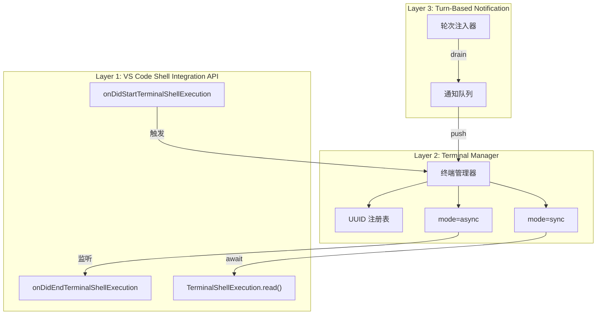
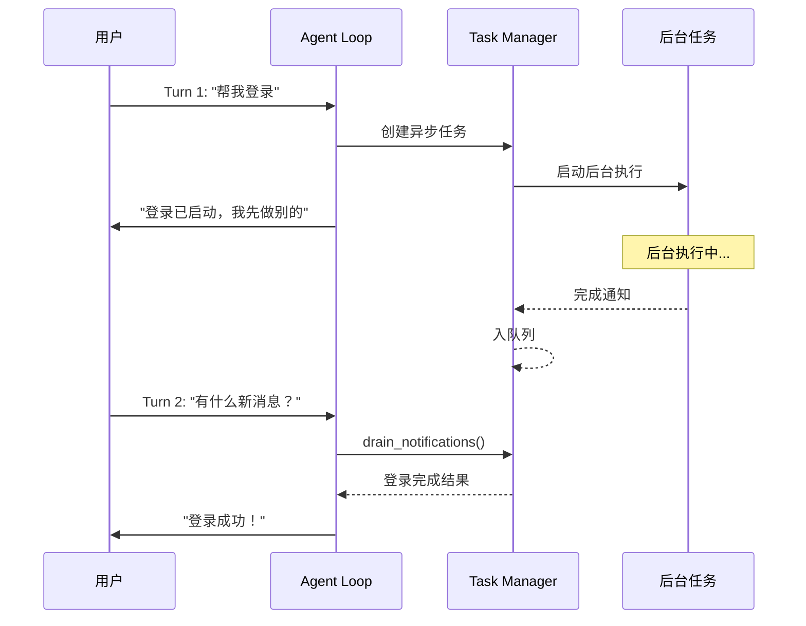
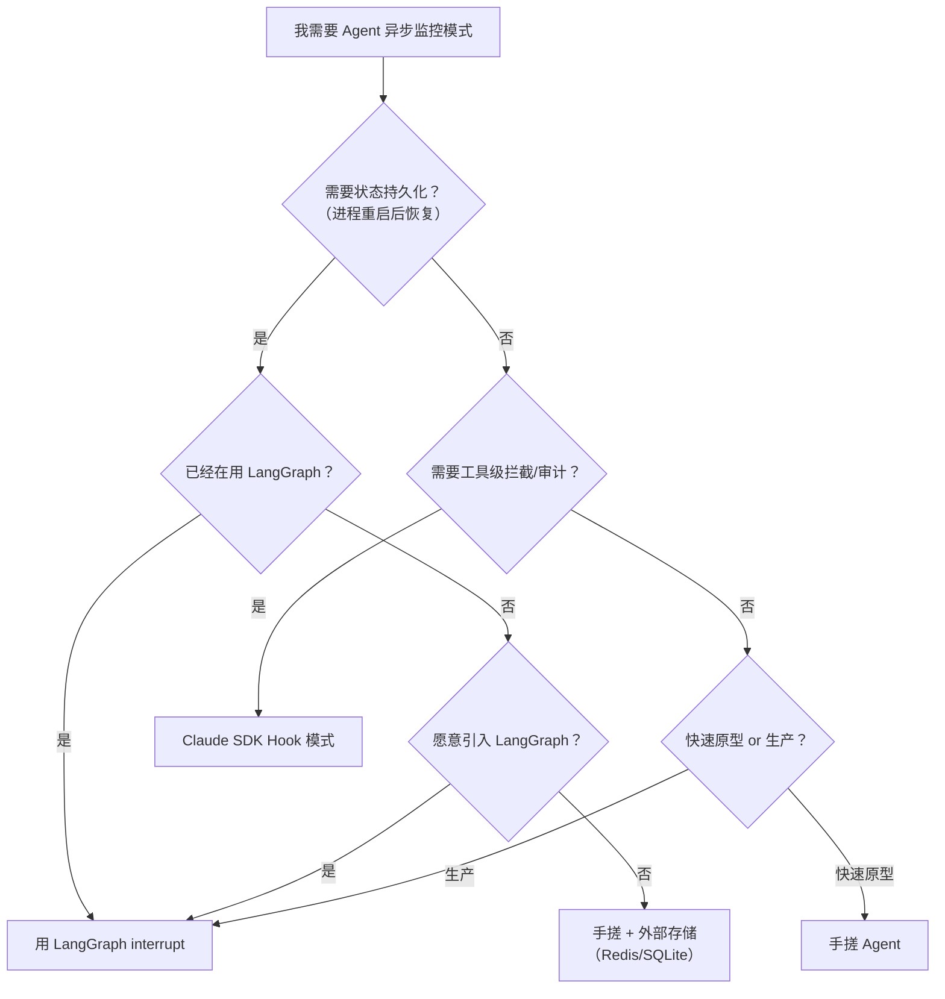

> 历史研究归档 · 2026-11-10 发布 · 程序扫描；未逐篇全文审阅。原有日期、观点、数据和命令保留历史语境，未经本次逐项事实核验或运行复现；请结合[归档说明](../../../ARCHIVE_POLICY.md)阅读。

# R82 · Agent 异步监控回调模式：从 Copilot 机制到三种实现

> **一句话概括**：拆解 VS Code Copilot 的终端异步监控机制，然后用手搓 Agent、LangGraph、Claude Agent SDK 三种方式复现这个模式，每种都给了可运行的代码。
> **研究日期**：2026-05-29
> **关联报告**：R26（LangGraph 入门到实战）、R27（Claude Agent SDK 入门到实战）、R29（SDK vs IDE vs CLI 三种开发模式）、R73（VS Code Copilot 多 Agent 编排实践）

---

## 目录

- [定位透镜：纵横坐标](#定位透镜纵横坐标)
- [一、Copilot 的异步终端监控机制拆解](#一copilot-的异步终端监控机制拆解)
- [二、核心模式提炼：Async Monitor-Callback Pattern](#二核心模式提炼async-monitor-callback-pattern)
- [三、实现一：手搓 Agent（纯 Python asyncio）](#三实现一手搓-agent纯-python-asyncio)
- [四、实现二：LangGraph（interrupt + Checkpointer）](#四实现二langgraphinterrupt--checkpointer)
- [五、实现三：Claude Agent SDK Hooks](#五实现三claude-agent-sdk-hooks)
- [六、三种实现对比](#六三种实现对比)
- [七、选型建议](#七选型建议)
- [八、结论与最佳实践](#八结论与最佳实践)
- [九、开放问题与后续计划](#九开放问题与后续计划)

---

## 定位透镜：纵横坐标

### 纵轴 · 演化脉络

**问题背景**：Agent 不可避免地需要执行"慢操作"——等用户在浏览器里完成 OAuth 授权、等构建任务跑完、等文件下载完成。最原始的做法是**同步阻塞**：Agent 停在那里干等。这在单任务 CLI 里勉强可以，但在 IDE 场景（VS Code Copilot）或多任务 Agent 里完全不可接受——用户没法和 Agent 交互了。

**关键转折**：VS Code 1.93（2024 年 9 月）引入 Shell Integration API（`onDidEndTerminalShellExecution`），给终端命令提供了结构化的事件流。Copilot 在此基础上构建了完整的异步终端监控系统——终端命令可以后台运行，Agent 在下一个对话轮次开始时自动收到完成通知。

**生命周期定位**：这个模式正处于**上升期**。LangGraph 的 `interrupt()` 是框架层的官方支持（2024 Q4 引入），Claude Agent SDK 的 Hooks 系统也在快速迭代。但还没有形成统一的跨框架标准——每个框架各搞一套。

### 横轴 · 竞争格局

三种实现路线覆盖了不同的设计哲学：

| 路线 | 设计哲学 | 核心机制 |
|------|---------|---------|
| 手搓 Agent | 完全控制 + 透明可调 | asyncio + 通知队列 + 轮次轮询 |
| LangGraph | 声明式图 + 状态持久化 | `interrupt()` + Checkpointer + `Command(resume=)` |
| Claude SDK Hooks | 事件驱动 + 工具拦截 | PreToolUse / PostToolUse / Notification 钩子 |

**理念差异的核心**：手搓方案把异步控制流当作应用代码的一部分，开发者对每个字节负责；LangGraph 把"暂停/恢复"抽象为图的一等公民，由框架管理状态序列化；Claude SDK 走的是"AOP（面向切面编程）"路线，通过钩子在工具调用前后插入逻辑。

### 交叉判断

这个模式已经被 Copilot 验证过了，不是纸上谈兵。三种实现方式都是可行的，区别在于适用场景：
- **快速原型/学习** → 手搓最直接
- **需要状态持久化和人机协作** → LangGraph 是正解
- **在 Claude 生态内做工具拦截** → SDK Hooks 最自然
- **生产系统** → 选哪个取决于你已经用了什么框架。如果从零开始，LangGraph 的 interrupt 机制最成熟

---

## 一、Copilot 的异步终端监控机制拆解

VS Code Copilot 的终端异步监控不是一个简单的 API 调用，而是一个三层架构：



### Layer 1: VS Code Shell Integration API

VS Code 1.93+ 提供了终端命令的结构化事件：

```typescript
// 终端命令开始执行
window.onDidStartTerminalShellExecution(event => {
    console.log(`命令开始: ${event.execution.commandLine}`);
});

// 终端命令结束
window.onDidEndTerminalShellExecution(event => {
    console.log(`命令结束: exit code ${event.exitCode}`);
});

// 流式读取输出
for await (const data of execution.read()) {
    console.log(`输出: ${data}`);
}
```

### Layer 2: Terminal Manager

Copilot 在 API 之上构建了一个管理层：
- **UUID 注册表**：每个终端命令分配唯一 ID，用于追踪
- **sync 模式**：等待命令完成，返回输出（`run_in_terminal` 默认行为）
- **async 模式**：启动命令后立即返回 ID，后台监控

### Layer 3: Turn-Based Notification

这是最关键的设计决策——**不是真正的回调，是轮次间注入**。

Copilot 的 LLM 是"轮次驱动"的（每次用户说话触发一个轮次），无法在轮次之间主动执行。所以异步通知的实现方式是：
1. 异步命令完成 → 事件推入通知队列
2. 下一个轮次开始 → Agent 检查通知队列 → 将通知注入到上下文中
3. Agent 根据通知内容决定下一步

说白了，不是 Agent 被"回调"了，而是 Agent 在下一次醒来时**发现有新消息**。这跟手机推送通知的模式一样——消息先到达手机，等你点亮屏幕才看到。

---

## 二、核心模式提炼：Async Monitor-Callback Pattern

从 Copilot 的实现中提炼出通用模式：



**四个核心组件**：

1. **Task Manager**：管理异步任务的生命周期（创建→运行→完成/失败）
2. **Notification Queue**：存放完成通知，等 Agent 来取
3. **Agent Loop**：每个轮次开始时检查通知队列
4. **Background Executor**：实际执行异步操作（asyncio.create_task / Thread）

---

## 三、实现一：手搓 Agent（纯 Python asyncio）

**文件**：`experiments/async_agent_pattern/01_handcrafted.py`（~270 行，纯 Python，无外部依赖）

### 核心设计

```python
class TaskManager:
    """管理异步任务的生命周期"""
    
    async def submit(self, name: str, coro: Coroutine) -> str:
        """提交一个异步任务，立即返回 task_id"""
        task = AsyncTask(id=str(uuid.uuid4())[:8], name=name)
        asyncio.create_task(self._run(task, coro))  # 后台执行，不阻塞
        return task.id
    
    def drain_notifications(self) -> list[dict]:
        """取出所有待处理通知（非阻塞）"""
        notifications = list(self._notification_queue)
        self._notification_queue.clear()
        return notifications


class SimpleAgent:
    """基于轮次的 Agent"""
    
    async def turn(self, user_input: str):
        # 每个轮次开头：检查异步通知
        notifications = self.task_manager.drain_notifications()
        for n in notifications:
            print(f"✅ [{n['name']}] 完成: {n['result']}")
        
        # 处理用户请求...
```

### 亮点

- **零依赖**：只用 Python 标准库的 `asyncio`，没有外部包
- **完全透明**：每一行控制流都看得见，适合理解原理
- **支持并行任务**：可以同时启动多个异步任务，互不干扰
- **通知队列解耦**：后台任务和 Agent Loop 完全解耦，通过队列通信

### 局限

- **无状态持久化**：进程重启后所有任务状态丢失
- **无跨进程协作**：只在单个 Python 进程内工作
- **手动管理一切**：错误处理、超时、重试都得自己写

---

## 四、实现二：LangGraph（interrupt + Checkpointer）

**文件**：`experiments/async_agent_pattern/02_langgraph.py`（~250 行，需要 `langgraph` + `langchain-core`）

### 核心设计

LangGraph 的 `interrupt()` 天然就是为"暂停等待外部事件"设计的：

```python
def start_async_task(state: AgentState) -> dict:
    # interrupt() 暂停图执行，序列化状态到 Checkpointer
    # 返回值就是后续 Command(resume=xxx) 传入的 xxx
    auth_result = interrupt({
        "type": "oauth_login",
        "message": "请在浏览器中完成授权",
    })
    # 恢复后继续执行
    return {"completed_results": [auth_result]}


# 主程序：暂停 → 做其他事 → 恢复
result = agent.invoke({"messages": [...]}, config)  # 触发 interrupt，图暂停
# ... 做其他工作 ...
result = agent.invoke(Command(resume=auth_result), config)  # 恢复执行
```

### 亮点

- **状态持久化**：`MemorySaver`（内存）或 `SqliteSaver`（磁盘）自动保存图状态
- **暂停/恢复是一等公民**：`interrupt()` + `Command(resume=)` 是框架级原语
- **线程隔离**：每个 `thread_id` 独立状态，天然支持多用户/多会话
- **声明式图**：任务流程用图描述，清晰可视化

### 局限

- **图结构约束**：所有逻辑必须适配"节点 + 边"的图模型，有些复杂流程不好表达
- **框架绑定**：一旦选了 LangGraph，整个 Agent 架构都被框架约束
- **学习成本**：`StateGraph` + `add_messages` + `interrupt` + `Command` + `Checkpointer` 概念链较长

---

## 五、实现三：Claude Agent SDK Hooks

**文件**：`experiments/async_agent_pattern/03_claude_sdk.py`（~300 行，无需 API key，模拟运行）

### 核心设计

Claude SDK 的 Hooks 走的是 AOP（面向切面）路线——在工具调用的前后插入拦截逻辑：

```python
class HookEngine:
    """事件钩子引擎"""
    
    async def fire(self, event: HookEvent) -> dict:
        """触发事件，执行所有注册的回调"""
        for callback in self._hooks.get(type(event).__name__, []):
            result = await callback(event)
            if result and result.get("deny"):
                return result  # 拦截！
        return {}


class ToolExecutor:
    """带 Hook 拦截的工具执行器"""
    
    async def execute(self, tool_name, tool_input, tool_use_id):
        # 1. 触发 PreToolUse → 可以拦截、审计、修改
        pre_result = await self.hooks.fire(PreToolUse(tool_name, tool_input, tool_use_id))
        if pre_result.get("deny"):
            return f"[BLOCKED] {pre_result['reason']}"
        
        # 2. 执行工具
        result = await self._run_tool(tool_name, tool_input)
        
        # 3. 触发 PostToolUse → 计时、审计、触发后续
        await self.hooks.fire(PostToolUse(tool_name, tool_input, result, duration))
        return result
```

### 异步监控实现

工具内部启动后台任务，完成后通过 `AsyncTaskNotification` 通知 Agent：

```python
async def _start_oauth(self, input):
    task_id = f"auth-{int(time.time())}"
    self.hooks.register_async_task(task_id, "OAuth")
    
    async def _auth_flow():
        await asyncio.sleep(3.0)  # 模拟用户操作
        await self.hooks.complete_async_task(task_id, {"status": "authorized"})
    
    asyncio.create_task(_auth_flow())  # 后台执行
    return f"OAuth 已启动 (task_id={task_id})"
```

### 亮点

- **关注点分离**：审计、拦截、通知逻辑与业务逻辑完全分离
- **可组合**：Hook 之间互不干扰，可以叠加多个（审计 + 限流 + 拦截）
- **工具级粒度**：每个工具调用都经过拦截链，天然支持安全审计
- **无框架绑定**：Hook 模式本身很轻，可以嵌入任何 Agent Loop

### 局限

- **不管控制流**：Hook 只管"拦截"，不管"暂停整个 Agent 等待恢复"
- **需要手搓 Agent Loop**：Claude SDK 本身不提供完整的 Agent 循环（截至 2026 年 5 月）
- **异步通知仍需轮询**：和手搓方案一样，Agent 在每个轮次检查通知

---

## 六、三种实现对比

| 维度 | 手搓 Agent | LangGraph | Claude SDK Hooks |
|------|-----------|-----------|-----------------|
| **外部依赖** | 无（纯 Python） | `langgraph` + `langchain-core` | `anthropic`（可选） |
| **异步暂停机制** | `asyncio.create_task` + 通知队列 | `interrupt()` + `Checkpointer` | `asyncio.create_task` + Hook 通知 |
| **状态持久化** | ❌ 无（进程内） | ✅ 内置（Memory/SQLite/Postgres） | ❌ 需自行实现 |
| **恢复方式** | 轮询通知队列 | `Command(resume=result)` | 轮询通知队列 |
| **多任务并行** | ✅ 原生支持 | ⚠️ 需要多线程/多图 | ✅ 原生支持 |
| **工具拦截** | 需自行实现 | 需自行实现 | ✅ 内置 Hook 链 |
| **可视化/调试** | 需自行实现 | ✅ LangSmith 集成 | 需自行实现 |
| **学习成本** | 低（纯 asyncio） | 中（图概念 + 多个原语） | 中（Hook 模式 + 事件系统） |
| **代码量** | ~270 行 | ~250 行 | ~300 行 |
| **灵活性** | ★★★★★ | ★★★☆☆ | ★★★★☆ |
| **生产就绪度** | ★★☆☆☆ | ★★★★☆ | ★★★☆☆ |

---

## 七、选型建议



**简版决策表**：

| 你的场景 | 推荐方案 | 理由 |
|---------|---------|------|
| 快速原型 / 学习理解 | 手搓 Agent | 零依赖，代码透明 |
| 需要暂停/恢复 + 持久化 | LangGraph | `interrupt()` 是专门为此设计的 |
| 需要工具调用审计/拦截 | Claude SDK Hooks | Hook 链天然适合 AOP |
| 已有 LangGraph 项目 | LangGraph interrupt | 框架内最自然的扩展 |
| 从零构建生产系统 | LangGraph | 成熟度最高，社区最大 |

---

## 八、结论与最佳实践

### 核心结论

1. **VS Code Copilot 的异步终端监控 = 轮次间通知注入**。不是真回调，是"醒来时检查邮箱"。这个模式简单、可靠、不依赖复杂的中断恢复机制。

2. **三种实现方式对应三种设计哲学**：
   - 手搓 = 过程式（你控制一切）
   - LangGraph = 声明式（图描述流程，框架管理状态）
   - Claude SDK = 切面式（钩子拦截，关注点分离）

3. **选框架还是手搓，核心问题是"状态持久化"**。如果你的 Agent 需要跨进程/跨会话保持异步任务状态，LangGraph 的 Checkpointer 能省大量样板代码。如果只是进程内的异步编排，手搓 asyncio 足够了。

### 可复用的最佳实践

- **通知队列模式**：无论用什么框架，"后台任务完成 → 入队列 → Agent 下一轮次取"这个模式是通用的
- **Task ID 追踪**：每个异步任务分配唯一 ID，用于状态查询和日志关联
- **超时兜底**：异步任务必须有超时，防止永久挂起
- **幂等恢复**：如果支持持久化，恢复时要处理"任务已经完成但通知还没发"的边界情况
- **Hook 链的短路规则**：PreToolUse hook 如果返回 `deny`，必须立即短路，不执行后续 hook 和工具

---

## 九、开放问题与后续计划

| 问题 | 状态 | 备注 |
|------|------|------|
| LangGraph 的 interrupt 在分布式场景下的行为 | 待深入 | 需要测试 PostgresSaver + 多实例 |
| Claude Agent SDK 官方 Agent Loop 的发展方向 | 持续跟踪 | 2026 年 5 月 SDK 仍以工具调用 API 为主 |
| 三种方案的性能基准对比 | 未做 | 需要设计标准化 benchmark |
| 与 A2A 协议的结合 | 待研究 | 异步任务是否可以通过 A2A 跨 Agent 传递？ |
| Hook 模式的安全性分析 | 未做 | PreToolUse hook 的拦截链是否有绕过风险？ |

---

## 来源清单

| 来源 | 日期 | 关键摘要 |
|------|------|---------|
| [VS Code API — Terminal Shell Integration](https://code.visualstudio.com/api/references/vscode-api#window.onDidEndTerminalShellExecution) | 2024-09 | Shell Integration API 文档 |
| R26（本工作区）| 2026 | LangGraph interrupt/checkpoint 详细文档 |
| R27（本工作区）| 2026 | Claude Agent SDK Hooks 系统文档 |
| [LangGraph — Human-in-the-Loop](https://langchain-ai.github.io/langgraph/concepts/human_in_the_loop/) | 2025 | interrupt + Command 官方文档 |
| 模型训练知识 | — | 异步编程模式、事件驱动架构 |

⚖️ 来源一致性：一致（三种实现方式的机制描述与官方文档吻合）
📅 时效性声明：以上信息获取于 2026-05-29

---

## 实验代码索引

| 文件 | 说明 | 依赖 |
|------|------|------|
| `experiments/async_agent_pattern/01_handcrafted.py` | 手搓 Agent，纯 asyncio | 无 |
| `experiments/async_agent_pattern/02_langgraph.py` | LangGraph interrupt 模式 | `langgraph`, `langchain-core` |
| `experiments/async_agent_pattern/03_claude_sdk.py` | Claude SDK Hook 模式 | 无（模拟运行） |
| `experiments/async_agent_pattern/README.md` | 实验目录索引 | — |
