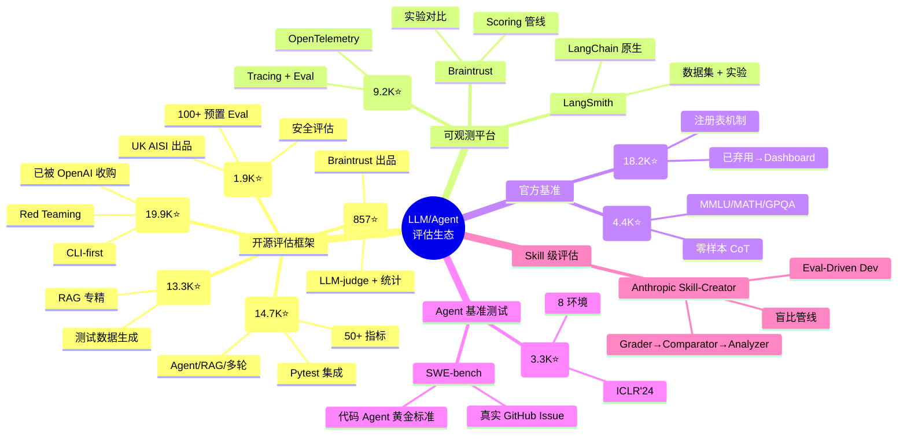
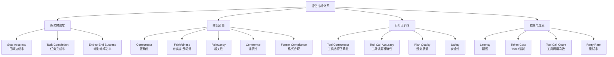
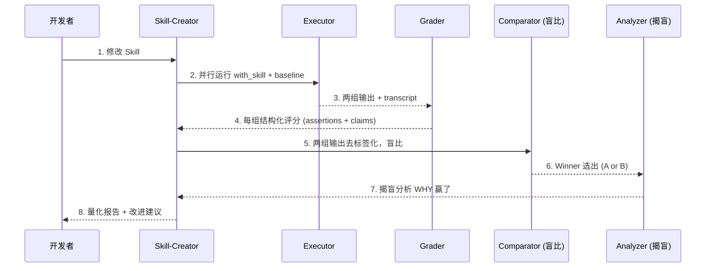
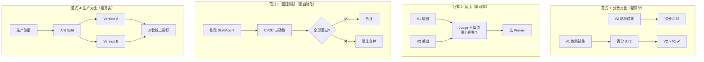
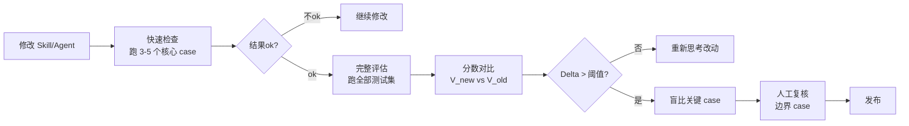

> 历史研究归档 · 2026-11-10 发布 · 发布审核状态：scan_only（发布前程序化隐私扫描）。原有日期、观点、数据和命令保留历史语境，未经本次逐项事实核验或运行复现；见[归档说明](../../../ARCHIVE_POLICY.md)。

# Skill 与 Agent 评估方案全景调研报告

> **一句话概括**：评估一个 Skill/Agent 的好坏——尤其是"修改后是变好了还是变差了"——本质上需要三层能力的组合：**量化指标（Metrics）** 告诉你"分数是多少"，**对比方法（Methods）** 告诉你"比之前好还是差"，**评估工作流（Workflow）** 确保你"持续、可靠、自动化地知道"。当前生态中 DeepEval、Promptfoo、Ragas 是三大开源评估框架，Anthropic Skill-Creator 的盲比管线是 Skill 级评估的最佳参考实现。
> **研究日期**：2026-04-11
> **关联报告**：[Anthropic官方Skill-Creator设计哲学研究报告](../01-%E7%90%86%E8%AE%BA%E4%B8%8E%E6%9E%B6%E6%9E%84/R14_AnthropicSkillCreator%E8%AE%BE%E8%AE%A1%E5%93%B2%E5%AD%A6.md)（§四 Eval-Driven Development）、[端到端Agent测试报告](../03-%E5%AE%9E%E9%AA%8C%E9%AA%8C%E8%AF%81/R11_%E7%AB%AF%E5%88%B0%E7%AB%AFAgent%E6%B5%8B%E8%AF%95.md)（实验验证）、[Agent架构深度研究报告](../01-%E7%90%86%E8%AE%BA%E4%B8%8E%E6%9E%B6%E6%9E%84/R03_Agent%E6%9E%B6%E6%9E%84%E6%B7%B1%E5%BA%A6%E7%A0%94%E7%A9%B6.md)（Agent 能力模型）
> **增量价值**：本报告在已有 #13 报告（Skill-Creator 的 Eval 管线分析）基础上，**系统调研了全球主流 LLM/Agent 评估方案**，形成从"用什么指标"到"怎么做 A/B"到"怎么接进 CI/CD"的完整决策框架，直接回答"我改了个 Skill/Agent，怎么知道改好了还是改坏了"这个核心问题。

---

## 目录

- [一、问题定义：我们到底在评估什么？](#一问题定义我们到底在评估什么)
- [二、全球主流评估方案全景](#二全球主流评估方案全景)
- [三、核心评估指标体系](#三核心评估指标体系)
- [四、关键评估方法论](#四关键评估方法论)
- [五、重点方案深度拆解](#五重点方案深度拆解)
- [六、"改了之后是变好还是变差"：A/B 对比范式](#六改了之后是变好还是变差ab-对比范式)
- [七、选型决策树](#七选型决策树)
- [八、最佳实践与落地建议](#八最佳实践与落地建议)
- [九、开放问题与后续计划](#九开放问题与后续计划)

---

## 一、问题定义：我们到底在评估什么？

在讨论方案之前，先厘清问题空间。"评估 Skill/Agent 的好坏"其实包含三个层次不同的问题：

```
[层次 1] 绝对质量：这个 Skill/Agent 输出的好不好？
    └─ 需要：指标（Metrics）+ 评判方法（LLM-as-judge / 人工 / 确定性规则）

[层次 2] 相对变化：改了之后，比之前好还是差？
    └─ 需要：A/B 对比（盲比 / 双轨对照）+ 统计显著性检验

[层次 3] 持续保障：怎么确保每次修改不引入回归？
    └─ 需要：评估工作流（CI/CD 集成 / 回归测试套件 / 生产监控）
```

| 层次 | 核心问题 | 典型场景 | 难度 |
|------|---------|---------|------|
| 绝对质量 | "这个输出准不准？" | 初版评估、基线建立 | ⭐⭐ |
| 相对变化 | "改了 prompt，效果好了还是差了？" | 迭代优化、版本比较 | ⭐⭐⭐ |
| 持续保障 | "怎么防止偷偷变差？" | 生产部署、团队协作 | ⭐⭐⭐⭐ |

说白了：**层次 1 是"考试打分"，层次 2 是"两次考试成绩对比"，层次 3 是"建立持续考试制度"。** 多数团队卡在层次 1 觉得够了，但真正解决问题的是层次 2 和 3。

---

## 二、全球主流评估方案全景

### 2.1 全景地图



### 2.2 方案对比总表

| 方案 | Stars | 定位 | 语言 | 核心特色 | Agent 评估能力 | 适合场景 |
|------|-------|------|------|---------|---------------|---------|
| **DeepEval** | 14.7K | 通用 LLM 评估 | Python | 50+ 指标、Pytest 集成、G-Eval/DAG | ✅ Tool Correctness, Task Completion, Goal Accuracy | 团队级 CI/CD 集成 |
| **Promptfoo** | 19.9K | Eval + Red Teaming | TS/Node | 声明式 YAML、隐私本地运行、红队安全 | ✅ Agent 流程测试 | 安全审计、快速 A/B |
| **Ragas** | 13.3K | RAG 评估专精 | Python | 测试数据自动生成、客观指标 | ⚠️ Agent eval 开发中 | RAG 管线优化 |
| **Arize Phoenix** | 9.2K | 可观测 + 评估 | Py/TS | OpenTelemetry Tracing、实验管理 | ✅ Agent Tracing + Eval | 生产监控 + 离线评估 |
| **Inspect AI** | 1.9K | 安全评估框架 | Python | 100+ 预置 Eval、沙箱执行 | ✅ 多轮 Agent 评估 | 安全/对齐评估 |
| **Braintrust/Autoevals** | 857 | 评估 Scorer 库 | Py/TS | Factuality/Battle 评估、代理友好 | ⚠️ 指标层 | 快速原型评估 |
| **OpenAI Evals** | 18.2K | 基准注册表 | Python | 社区贡献 Evals、model-graded | ⚠️ 基准层 | 模型能力基线 |
| **AgentBench** | 3.3K | Agent 基准测试 | Python | 8 真实环境、Function Calling | ✅ 专业 Agent Benchmark | 论文/模型对比 |
| **SWE-bench** | 3K+ | 代码 Agent 基准 | Python | 真实 GitHub Issue 修复 | ✅ 编码 Agent 标杆 | 代码 Agent 开发 |
| **Anthropic Skill-Creator** | - | Skill 工程化评估 | Python | 盲比管线、Eval-Driven Dev | ✅ Skill 级专业评估 | Skill/Prompt 迭代 |
| **LangSmith** | - | 平台型 | Py/TS | 数据集+实验+Tracing | ✅ 全流程 | LangChain 生态 |

---

## 三、核心评估指标体系

评估 Skill/Agent 需要一套多维度的指标体系。根据调研，指标可以分为四大类：

### 3.1 指标分类体系



### 3.2 按场景的推荐指标组合

| 评估对象 | 推荐指标（2-3 通用 + 1-2 定制） | 来源 |
|---------|-------------------------------|------|
| **RAG 管线** | Faithfulness + Answer Relevancy + Contextual Precision | DeepEval, Ragas |
| **工具调用 Agent** | Tool Correctness + Task Completion + Goal Accuracy | DeepEval |
| **对话型 Agent** | Conversation Completeness + Multi-turn Relevancy | DeepEval |
| **代码生成 Agent** | Code Pass Rate (exec) + Style Compliance (judge) | SWE-bench, HumanEval |
| **Skill/Prompt** | With-skill vs Baseline Delta + Assertion Pass Rate | Anthropic Skill-Creator |
| **安全评估** | Jailbreak Resistance + Toxicity + Bias Detection | Promptfoo, Inspect AI |

### 3.3 DeepEval 的指标全景（最全面的开源实现）

DeepEval 提供了当前最完整的开源指标库，覆盖六大类 50+ 指标：

| 类别 | 代表指标 | 评估方法 | 是否需要标注 |
|------|---------|---------|------------|
| **自定义** | G-Eval（任意标准）、DAG（决策树） | LLM-as-judge | 可选 |
| **Agent** | Tool Correctness, Task Completion, Goal Accuracy | LLM-as-judge | 部分需要 |
| **RAG** | Answer Relevancy, Faithfulness, Contextual Recall/Precision | LLM-as-judge | 部分需要 |
| **多轮对话** | Conversation Completeness, Knowledge Retention | LLM-as-judge | 否 |
| **安全** | Bias, Toxicity, Hallucination | LLM-as-judge + 分类器 | 否 |
| **多模态** | Image Coherence, Multimodal Relevancy | LLM-as-judge | 可选 |

> **关键洞察**：DeepEval 建议每个项目用不超过 5 个指标：2-3 个通用系统指标 + 1-2 个定制用例指标。指标太多反而失去焦点——你需要清楚自己**最关心什么**。

---

## 四、关键评估方法论

"用什么指标"只回答了一半问题，另一半是"怎么评判"。当前主流的评判方法有四种：

### 4.1 四种评判方法对比

| 方法 | 原理 | 优势 | 劣势 | 代表工具 |
|------|------|------|------|---------|
| **LLM-as-a-Judge** | 用另一个 LLM 给输出打分 | 可扩展、处理主观任务、有推理能力 | 有偏见、成本高、不稳定 | DeepEval G-Eval, Autoevals |
| **确定性规则** | 精确匹配、正则、代码执行 | 100% 可复现、零成本 | 只能评"硬指标" | Promptfoo assertions, pytest |
| **统计/NLP 方法** | BLEU、ROUGE、Levenshtein、Embedding 相似度 | 不需要 LLM、快速 | 与人类判断相关性低 | Autoevals, NLTK |
| **人工评估** | 领域专家打分 | 最准确的主观判断 | 不可扩展、昂贵、慢 | Anthropic Eval Viewer |

### 4.2 LLM-as-a-Judge 的流派

LLM-as-a-Judge 是当前最主流的方法，但实现方式有显著差异：

| 流派 | 原理 | 代表 | 可靠性 |
|------|------|------|-------|
| **G-Eval** | 先生成评估步骤，再按步骤打分 (0-1) | DeepEval | ⭐⭐⭐⭐ |
| **DAG（Deep Acyclic Graph）** | 决策树式 LLM 评估，路径确定性 | DeepEval | ⭐⭐⭐⭐⭐ |
| **QAG（Question-Answer Generation）** | 从输出生成问题再回答验证 | DeepEval Faithfulness | ⭐⭐⭐⭐ |
| **Pairwise/Battle** | 两个输出对比选优 | Autoevals Battle | ⭐⭐⭐ |
| **Rubric-based** | 预定义评分量纲打分 | Anthropic Comparator | ⭐⭐⭐⭐ |
| **Classification** | LLM 做多选分类 | Autoevals LLMClassifier | ⭐⭐⭐ |

> **选择建议**：
> - 要客观、可复现 → 用 DAG（决策树确定性路径）
> - 要灵活、自定义标准 → 用 G-Eval（自然语言描述评估标准即可）
> - 要对比两个版本 → 用 Pairwise/Battle
> - 关键路径上 → 组合使用（LLM-judge 初筛 + 人工复核关键 case）

---

## 五、重点方案深度拆解

### 5.1 DeepEval：最完整的开源评估框架

**定位**：LLM 评估领域的 "Pytest"——你写测试用例、定义指标、跑评估、看报告。

**核心架构**：

```python
# DeepEval 核心抽象
from deepeval.test_case import LLMTestCase
from deepeval.metrics import GEval, ToolCorrectnessMetric
from deepeval import evaluate

# 1. 定义测试用例
test_case = LLMTestCase(
    input="帮我查一下北京的天气",
    actual_output="北京今天晴，25°C",     # Agent 实际输出
    expected_output="北京今天天气晴朗",     # 期望输出（可选）
    tools_called=[...],                     # Agent 调用的工具链
    expected_tools=[...],                   # 期望的工具链（Agent 评估）
)

# 2. 选择指标
correctness = GEval(
    name="Correctness",
    criteria="输出是否正确回答了用户的问题",
    threshold=0.7
)

# 3. 运行评估
evaluate(test_cases=[test_case], metrics=[correctness])
```

**Agent 专属指标**（DeepEval 的独特优势）：
- **Tool Correctness**：Agent 是否选择了正确的工具？
- **Task Completion**：端到端任务是否完成？
- **Goal Accuracy**：Agent 的最终输出是否达成用户目标？

**为什么 DeepEval 值得关注**：
1. **指标最全**：50+ 指标覆盖几乎所有 LLM 应用场景
2. **工程友好**：原生 Pytest 集成，`deepeval test run` 一行命令进 CI/CD
3. **Agent 原生支持**：专门的 Agent 指标，不是 RAG 指标的简单迁移
4. **可定制 Judge**：支持任何 LLM 做 Judge（OpenAI、Claude、Ollama 本地模型）
5. **指标 Prompt 可定制**：如果不认同"什么算 relevant"的定义，可以覆盖默认 Prompt

**局限**：
- 商业平台 Confident AI 是变现路径，部分高级功能需付费
- 对主观输出（创意写作、风格）的评估仍然依赖 LLM Judge 的不稳定性

### 5.2 Promptfoo：Eval + 安全红队

**定位**：声明式 LLM 评估 + 安全漏洞扫描。2025 年底被 OpenAI 收购，现仍开源。

**核心特色**：
```yaml
# promptfoo 的声明式评估配置
prompts:
  - "你是一个天气助手。用户问：{{query}}"
  - "你是一个精确的天气播报员。用户问：{{query}}"  # 对比两个 Prompt

providers:
  - openai:gpt-4o
  - anthropic:claude-3.5-sonnet  # 同时对比多个模型

tests:
  - vars:
      query: "北京天气怎么样？"
    assert:
      - type: contains
        value: "北京"
      - type: llm-rubric
        value: "回答包含温度信息"
      - type: cost
        threshold: 0.01
```

**Promptfoo vs DeepEval**：

| 维度 | DeepEval | Promptfoo |
|------|----------|-----------|
| 配置方式 | Python 代码 | YAML 声明式 |
| 上手速度 | 需要写代码 | 改 YAML 即可 |
| 指标丰富度 | ⭐⭐⭐⭐⭐（50+） | ⭐⭐⭐（assertion 为主） |
| Agent 指标 | 专业（Tool/Task/Goal） | 通用（assertion-based） |
| 安全评估 | 基础 | ⭐⭐⭐⭐⭐（红队扫描） |
| 模型对比 | 单模型为主 | 矩阵对比（多 prompt × 多模型） |
| 收购方 | 独立 | OpenAI |

**何时选 Promptfoo**：需要快速对比多个 Prompt/模型变体、需要安全红队测试、团队偏好声明式配置。

### 5.3 Ragas：RAG 评估的标杆

**定位**：RAG（检索增强生成）管线的专业评估库。Agent 评估模块仍在开发中（"Coming Soon"）。

**核心指标**已经成为行业事实标准：
- **Faithfulness**：生成内容是否忠于检索上下文？（反幻觉）
- **Answer Relevancy**：回答是否切题？
- **Context Precision/Recall**：检索到的上下文是否精确、完整？

**局限**：Agent 评估尚未正式发布。如果你评估的是 RAG 管线，Ragas 是最佳选择；如果是 Agent/Skill，更推荐 DeepEval。

### 5.4 Anthropic Skill-Creator 评估管线：Skill 级评估的参考实现

（详见本工作区 [#13 报告](../01-%E7%90%86%E8%AE%BA%E4%B8%8E%E6%9E%B6%E6%9E%84/R14_AnthropicSkillCreator%E8%AE%BE%E8%AE%A1%E5%93%B2%E5%AD%A6.md) §四，此处聚焦其评估方法论的可借鉴性）

Anthropic 的方案是目前唯一一个**专门为 Skill/Prompt 迭代设计**的评估系统：



**核心设计决策**：

| 决策 | 为什么 |
|------|--------|
| **双轨对照（with-skill vs baseline）** | 量化 Skill 的增量价值，而非绝对分数 |
| **盲比（Blind Comparison）** | 防止"新版本偏见"——如果知道哪个是改进版，评分会系统性偏向它 |
| **揭盲分析（Post-hoc Analysis）** | 仅在选出 Winner 后才知道版本号，分析真正的优势来源 |
| **对 Eval 本身的批判** | Grader 会指出"太弱的 assertion"，防止虚假安全感 |
| **60/40 train/test 分割** | 防止 Description 对训练样本过拟合 |

**这套方案的独特价值不在于技术复杂度，而在于它解决了一个被普遍忽视的问题：大多数团队评估 Prompt/Skill 的方式是"看几个例子觉得不错就行了"——这本质上是没有评估。**

### 5.5 Inspect AI：安全导向的评估框架

由英国 AI 安全研究所（AISI）开发，提供 100+ 预置评估，特别擅长**安全对齐和多轮 Agent 交互**评估。如果你的 Agent 涉及敏感场景（医疗、金融、法律），Inspect AI 值得认真考虑。

### 5.6 AgentBench & SWE-bench：Agent 能力基准

这两个是学术基准（Benchmark），不是日常评估工具，但它们定义了**评估 Agent 能力的标尺**：

- **AgentBench**（ICLR'24）：8 种真实环境（OS 操作、数据库查询、知识图谱、Web 交互等），评估 LLM 作为 Agent 的综合能力
- **SWE-bench**：给 Agent 真实的 GitHub Issue，看它能不能生成正确的 PR——已成为代码 Agent 的事实标准 benchmark

---

## 六、"改了之后是变好还是变差"：A/B 对比范式

这是本报告的核心关切。调研发现，业界对"版本对比"有四种实践模式：

### 6.1 四种 A/B 对比范式



| 范式 | 适用阶段 | 成本 | 可靠性 | 工具支持 |
|------|---------|------|--------|---------|
| **分数对比** | 开发期快速迭代 | 低 | ⭐⭐（分数波动大） | DeepEval, Ragas |
| **盲比** | 关键版本升级 | 中 | ⭐⭐⭐⭐⭐ | Anthropic Skill-Creator |
| **回归测试** | 持续集成 | 低（自动化后） | ⭐⭐⭐⭐ | DeepEval+Pytest, Promptfoo |
| **生产对比** | 上线前/后 | 高 | ⭐⭐⭐⭐⭐ | Arize Phoenix, LangSmith |

### 6.2 推荐的"改了之后怎么知道好不好"流程



**最小可行评估流程**（我为我们的工作区推荐）：

1. **准备测试集**：3-5 个核心 case + 2-3 个边界 case
2. **建立基线**：记录当前版本的输出和分数
3. **修改后对比**：同样的 case 跑新版本，对比分数
4. **关键变化盲比**：分数差异大的 case 做盲比确认
5. **记录决策**：为什么觉得新版本更好？依据是什么？

---

## 七、选型决策树

```
你的评估需求是什么？
│
├─ "我刚开始，先跑通再说"
│   └─ 推荐：DeepEval + G-Eval 自定义指标
│       └─ 理由：上手最快，`pip install deepeval` 即可
│
├─ "我在迭代 Skill/Prompt，要对比新旧版本"
│   └─ 推荐：Anthropic Skill-Creator 盲比范式 + DeepEval 指标
│       └─ 理由：盲比是对比版本的最可靠方法
│
├─ "我在优化 RAG 管线"
│   └─ 推荐：Ragas（RAG 指标） + DeepEval（端到端）
│       └─ 理由：Ragas 的 RAG 指标是行业标准
│
├─ "我需要安全/红队评估"
│   └─ 推荐：Promptfoo（红队扫描） + Inspect AI（安全 eval）
│       └─ 理由：专精安全领域
│
├─ "我要接进 CI/CD 持续评估"
│   └─ 推荐：DeepEval + Pytest + GitHub Actions
│       └─ 理由：原生 Pytest 集成，最适合 CI/CD
│
├─ "我需要生产环境监控"
│   └─ 推荐：Arize Phoenix（开源）或 LangSmith（如果用 LangChain）
│       └─ 理由：Tracing + 在线评估
│
└─ "我在做学术研究/模型对比"
    └─ 推荐：AgentBench / SWE-bench（Agent）、MMLU/GPQA（通用）
        └─ 理由：标准化 benchmark，可比较
```

---

## 八、最佳实践与落地建议

### 实践 1：指标要少而精，不要贪多

> DeepEval 官方建议：不超过 5 个指标——2-3 个系统指标 + 1-2 个定制指标。

指标太多会导致：
- 优化方向互相冲突（提高安全性可能降低乐于助人度）
- 每个指标的权重不清，综合判断困难
- 维护成本高

### 实践 2：先有 Eval，再改 Prompt（Eval-Driven Development）

这是从 Anthropic Skill-Creator（[#13 报告](../01-%E7%90%86%E8%AE%BA%E4%B8%8E%E6%9E%B6%E6%9E%84/R14_AnthropicSkillCreator%E8%AE%BE%E8%AE%A1%E5%93%B2%E5%AD%A6.md)）提炼的核心范式：

```
❌ 反模式：改 Prompt → 看几个例子 → "感觉不错" → 上线
✅ 正确姿势：设计 Eval → 跑基线 → 改 Prompt → 跑 Eval → 对比数据 → 决策
```

### 实践 3：测试用例的质量 > 测试用例的数量

来自 Anthropic 的洞察：

> "A passing grade on a weak assertion is worse than useless — it creates false confidence."

好的测试用例应该：
- 像真实用户一样（口语化、有上下文、有不确定性）
- 包含已知的**困难 case**（边界条件、容易出错的场景）
- 包含 **should-not-trigger** 的反例（近似但不应该触发的输入）

### 实践 4：每次评估都保存结果，形成历史趋势

单次评估分数的意义有限。真正有价值的是**趋势**：
- 连续 5 个版本分数稳步上升 → 迭代方向正确
- 某次大改后分数暴跌 → 需要回滚或深入分析
- 分数长期不动 → 可能需要换策略

### 实践 5：LLM-as-Judge 的可靠性提升技巧

| 技巧 | 效果 |
|------|------|
| 使用 DAG 而非自由打分 | 决策路径确定，减少随机性 |
| 明确评估标准（criteria）| 避免 Judge 自由发挥 |
| 多次运行取均值 | 减少单次随机性（Skill-Creator 跑 3 次） |
| 定制 Judge Prompt | 调整"什么算好"的定义与你的场景匹配 |
| 选强模型做 Judge | GPT-4o/Claude Sonnet 比小模型当 Judge 可靠得多 |

### 实践 6：可借鉴的最小评估系统设计

对于我们的工作区级别的 Skill/Agent 迭代，不需要搭建完整的 DeepEval 管线。一个最小可行的评估系统如下：

```
最小评估系统
├── evals/
│   ├── test_cases.json          # 测试用例集（input + expected_behavior）
│   ├── baseline_results.json    # 当前版本的基线输出
│   └── run_eval.py              # 运行评估的脚本
├── eval 流程：
│   1. python run_eval.py --version current   → baseline_results.json
│   2. 修改 Skill/Agent
│   3. python run_eval.py --version new       → new_results.json
│   4. python run_eval.py --compare baseline new  → delta_report.md
└── 核心指标：
    - Assertion Pass Rate（确定性规则通过率）
    - LLM-Judge Score（G-Eval 综合评分）
    - Human Review（关键 case 人工判断）
```

---

## 九、开放问题与后续计划

### 开放问题

| # | 问题 | 为什么重要 | 当前状态 |
|---|------|----------|---------|
| O1 | LLM-as-Judge 的可靠性上界在哪？ | Judge 自身的偏见和随机性是根本局限 | 学界有讨论（judge-bench），尚无定论 |
| O2 | 主观输出（创意写作、风格）如何量化？ | 并非所有 Skill 输出都有"正确答案" | Anthropic 承认此类 Skill 不适合自动 eval |
| O3 | 评估成本与评估质量的平衡点在哪？ | 每次 eval 都调 LLM-Judge 有成本 | 可用 Prompt Caching 和小模型降本 |
| O4 | 多 Agent 协作系统怎么评估？ | 单 Agent 指标无法覆盖协作动态 | 仅 AgentBench 有初步探索 |
| O5 | 如何评估 Agent 的"拒绝能力"？ | 好 Agent 不只是能做事，还要知道什么不该做 | 我们 #11 端到端测试报告发现此能力 |

### 后续计划

1. **🔴 高优先级**：为本工作区设计 Skill 和 agent.md 的最小评估流程（对应 KNOWLEDGE_INDEX G8）
2. **🟡 中优先级**：基于 DeepEval 搭建 Agent 评估管线的 POC 实验
3. **🟡 中优先级**：复现 Anthropic Skill-Creator 的盲比管线（简化版）
4. **🟢 低优先级**：在 AgentBench 上评估不同架构的 Agent 效果

---

## 附录：术语表

| 术语 | 英文 | 含义 |
|------|------|------|
| LLM-as-a-Judge | LLM-as-a-Judge | 用一个 LLM 来评判另一个 LLM 的输出质量 |
| G-Eval | G-Eval | 先生成评估步骤再按步骤打分的 LLM-judge 方法（Google 2023 论文） |
| DAG | Deep Acyclic Graph | DeepEval 的决策树式 LLM 评估方法，路径确定 |
| QAG | Question-Answer Generation | 从输出生成问题再回答来验证一致性 |
| Blind Comparison | 盲比 | 评判者不知道两个输出分别来自哪个版本 |
| Assertion | 断言 | 可确定性验证的输出条件（如"包含某关键词"） |
| Eval-Driven Development | 评估驱动开发 | 先设计评估标准再写/改 Prompt，类似 TDD |
| Red Teaming | 红队测试 | 模拟对抗性攻击来发现 AI 系统的安全漏洞 |


---

## 🔑 核心洞见

> 本报告最精华的高维洞见。读懂这几条 = 拔高一个维度理解整篇报告。

- 评估三层架构缺一不可：Metrics（分数是多少）+ Methods（变好还是变差）+ Workflow（持续可靠地知道）
- '改了之后是变好还是变差'比'分数多少'更重要——盲比管线（pairwise）胜过绝对分数评估
- Eval 集是 AI 项目的需求规范——没有 Eval 集就无法定义'完成'，等于没有验收标准的工程合同
- LLM-as-Judge 的位置偏见和长度偏见是已知问题不是未解决问题——有标准缓解方案（双向交换、长度归一）
- 硬断言（must_contain）+ 软评分（LLM judge）必须组合——只有硬断言漏软质量，只有软评分没下限

*（本节内容与 frontmatter key_insights 字段同步，由 INSIGHTS（原稿交叉引用，本归档未解析） 自动聚合）*

