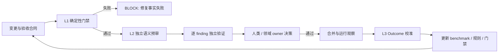

> 历史研究归档 · 2026-11-10 发布 · 程序扫描；未逐篇全文审阅。原有日期、观点、数据和命令保留历史语境，未经本次逐项事实核验或运行复现；请结合[归档说明](../../../ARCHIVE_POLICY.md)阅读。

# Codex 与 Claude Code 代码评审评估优化策略

> **一句话结论**：不要再给 Codex/Claude Code 叠一份更长的“Clean Code 检查表”，也不要用单一 0-100 分决定合并；更可靠的本地策略是 **确定性门禁 -> 独立、证据校准的语义评审 -> 结构级 owner 批准 -> 生产结果反馈**，让人看模块结构、依赖和风险包，而不是逐行批准；先以 shadow mode 运行，再只对经过本地金标集验证的高严重度发现启用阻断。

> **当前建议**：先升级本机 Claude Code `2.1.146 -> 2.1.234`，选一个仓库做 2-4 周影子试点。Codex `0.147.0` 已与 2026-08-18 GitHub 最新稳定 release 一致。本报告只调研与设计策略，**没有安装或修改任何 Codex/Claude 配置**。

## 0. 已有基础与本次增量

本报告不重复已有结论，而是把它们收敛成一套可评估、可逐步启用的双工具策略：

| 已有报告 | 已知结论 | 本次新增 |
|---|---|---|
| [R118](../04-%E5%B7%A5%E7%A8%8B%E5%AE%9E%E8%B7%B5/R118_Superpowers%E4%B8%89%E5%A4%A7%E5%8F%AF%E5%80%9F%E9%89%B4%E6%9C%BA%E5%88%B6%E6%B7%B1%E5%BA%A6%E6%8B%86%E8%A7%A3.md) | Spec 合规与 Code Quality 应由独立上下文分阶段审查 | 映射到 Codex/Claude 的 Skill、subagent 和 finding 协议 |
| R120（原稿交叉引用，本归档未解析） | 长指令会漂移；隔离、文件锚定和脚本门禁比继续加 MUST 更可靠 | 明确共享规则、工具适配器、Hook/CI 的职责边界 |
| R124（原稿交叉引用，本归档未解析） | 同模型自审缺少不可博弈的外部信号 | 建立本地金标集、坏基线、oracle、误报/漏报与结果校准 |
| R134（原稿交叉引用，本归档未解析） | Harness 应把隐性经验变成可执行约束；AI 代码率不是质量 | 给出 risk tier、门禁、例外和增量棘轮 |
| [R158](R158_%E6%9C%80%E5%B0%8FCodingAgent%E8%83%BD%E5%8A%9B%E8%BE%B9%E7%95%8C%E4%B8%8EBenchmark%E8%B7%AF%E7%BA%BF_2026-08-03.md) | Evaluator 必须隔离、不可由被测 Agent 修改，并用坏基线/oracle 校准 | 将同一原则用于 reviewer 自身的 benchmark 与版本升级回归 |

本次外部增量包括：

- 实时复核 Google、Chromium、Kubernetes、Linux kernel、GitLab 的当前评审规范；
- 实时复核 Codex 与 Claude Code 的官方 review、rules、Skills、subagents 和 Hooks 能力；
- 将“架构清晰、整洁、鲁棒、稳定”改写为可检查的工程合同；
- 将严重性与证据强度分离，避免 LLM 用自信语气制造假 blocker；
- 设计一套不依赖单一总分的本地评测与优化闭环。

## 1. 定位透镜

### 1.1 纵轴：代码质量治理的演化

| 阶段 | 主要做法 | 能解决 | 解决不了 |
|---|---|---|---|
| G0 风格与启发式 | Clean Code、SOLID、DRY、短函数、命名规范 | 局部可读性与共同语言 | 不能证明行为正确或生产稳定 |
| G1 自动化门禁 | formatter、lint、types、build、tests、SAST | 可机械验证的事实 | 难发现跨文件语义、需求遗漏和错误抽象 |
| G2 人类治理 | 小变更、owner、独立 reviewer、批准/例外 | 责任、领域判断、知识扩散 | 受带宽、等待和上下文限制 |
| G3 AI 预审 | 多视角 reviewer、候选发现、独立 verifier | 扩大语义扫描覆盖面 | 有漏报、误报、漂移和 prompt injection |
| G4 证据校准闭环 | 门禁 + AI + 人审 + 生产 outcome + benchmark | 持续校准有效性和成本 | 仍不能消除不确定性或替代责任人 |

**交叉判断**：Codex/Claude 应处于 G3 到 G4 的过渡层，而不是取代 G1 或 G2。AI 最适合先做“独立预审与证据生成”，确定性工具证明事实，人类/领域 owner 承担批准责任。

### 1.2 横轴：四种质量目标不是同一个量

| 目标 | 可操作定义 | 典型证据 | 常见伪指标 |
|---|---|---|---|
| 架构清晰 | owner、边界、依赖方向和公共合同可解释且可测试 | 架构测试、依赖图、API 兼容检查、ADR | 层数多、设计模式多 |
| 代码整洁 | 读者能局部理解意图，变化被限制在合理范围，抽象与领域概念一致 | lint 增量、重复/复杂度趋势、可测试性、review time | 函数一律短于 N 行 |
| 鲁棒性 | 非法输入、依赖失败、超时、取消、重试、并发和资源生命周期有定义 | 失败路径测试、性质/模糊测试、race detector、故障注入 | catch 了所有异常就算安全 |
| 稳定性 | 相同合同在重复运行、版本升级、负载和故障后仍可预测，且可恢复、可观测 | 回归/flake、性能预算、SLO、回滚/热修、MTTR | 单次 CI 绿灯 |

ISO/IEC 25010:2023 可作为质量模型背景，但本轮官方产品页仍被 Cloudflare 以 `403` 拦截，未直接复核正文；因此不能从它推导任何工程数值阈值。Clean Code、SOLID、DRY 等更适合改写成 reviewer 的诊断问题，不适合直接变成跨语言硬门禁。

## 2. 开源评审体系对比

| 体系 | 核心机制 | 最值得迁移的部分 | 不应照搬 |
|---|---|---|---|
| Google Engineering Practices | 总体 code health 明确改善即可批准；事实优先于偏好；小而完整的 CL；快速响应 | 不以“完美”阻断；区分 nit/non-blocking；每项改变单一意图 | 公开仓库已归档，只能视为稳定原则，不代表当前内部执行快照 |
| Chromium | 强制 review + 目录 OWNERS；可证明安全的机械变更与特定大规模/gardening/release 场景有不同的受限例外 | 所有权、review scope、例外双重保护、owner 活跃度 | 例外不能同时绕过 review 与 ownership；大仓治理直接套到小团队会形成 owner 瓶颈 |
| Kubernetes | reviewer `/lgtm` 与领域 approver `/approve` 两阶段，OWNERS 路由 | 通用质量与领域接受分离；明确 reviewer/approver 责任 | 正式 OWNERS reviewer 与技术上能投 `/lgtm` 的成员不是同一集合 |
| Linux kernel | 子系统维护链；`Reviewed-by`、`Acked-by`、`Tested-by` 语义分离；patch 实质变化后重新评估旧标签 | 把审查、认可、测试证据分开；非平凡 bug 先 reproducer、再同口径验证 | 邮件链与多级子系统树对普通企业仓库成本过高 |
| GitLab | reviewer 评具体实现，maintainer 负责整体健康；CODEOWNERS、domain expert、容量路由 | AI review 作为 human review 前置层；作者/追加提交者不能自批 | `<2 business days` 是 team member MR 的 review completion SLO，不适用于 wider community；无法按时才要求 36 小时内说明并协助换人 |

### 2.1 跨体系共识

1. **小变更指单一、可独立理解和验证的意图，不是机械行数。** 本地可把 `100-300` 改动行作为目标、`500` 作为软提醒；生成代码、删除、机械迁移单独标记，不把数字写成普适真理。
2. **行为变化与纯重构尽量分离。** 每一步应可构建、可验证、可二分。
3. **作者自检不等于独立批准。** AI reviewer 也不能生成或冒充人类的 `Reviewed-by`、DCO 或 owner approval。
4. **审查范围要显式。** 多 reviewer 不等于覆盖；要说明谁看 correctness、security、data、concurrency、API 或迁移。
5. **非阻塞意见不能拖住合并。** 个人偏好、格式和可由 linter 发现的问题不应伪装为风险。
6. **实质变化后，旧批准必须重新评估。** 移除已不再适用的 `Reviewed-by/Acked-by/Tested-by`，不能把 LGTM 永久附着在 PR 上。
7. **例外必须受控、可审计。** 各体系的字段不同；本报告建议本地统一记录 `owner、理由、补偿措施、到期日、追踪项`，这是推荐 schema，不是五套规范共同规定的原文。

Kubernetes 还有三个容易误读的边界：正式 reviewer 由 OWNERS `reviewers` 定义，但技术上任何非作者 org member 都可 `/lgtm`；属于相关 OWNERS 的作者可以 `/approve` 自己的 PR，但仍需另一位非作者 `/lgtm`；approver 的 `/lgtm` 还会被同时解释为 `/approve`，官方明确承认这不符合“两双眼睛”的原始意图。本地策略不应复制这些权限耦合。

### 2.2 Linux 2026 AI 辅助开发规则带来的边界

Linux 最新 `coding-assistants.rst` 要求人类审查全部 AI 生成代码并承担 DCO、许可与最终责任；AI agent 不得添加 `Signed-off-by`，高级工具应以 `Assisted-by: AGENT_NAME:MODEL_VERSION` 披露。它还要求非平凡 bug 优先提供 reproducer、明确构建与同口径测试证据，无法复现或未测试必须直说。

这支持一个更稳妥的定位：**Codex/Claude reviewer 是证据生产者，不是责任主体。**

## 3. 推荐质量模型：三层证据，而非单一总分

### 3.1 三层结构



| 层 | 负责证明什么 | 推荐信号 |
|---|---|---|
| L1 确定性门禁 | 已知合同是否被机械满足 | format、lint、types、build、相关 tests、架构规则、API/schema compatibility、SAST、secret/dependency scan、性能预算 |
| L2 独立语义预审 | 是否存在工具难以编码的跨文件风险 | 需求遗漏、错误状态机、异常路径、过度抽象、边界泄漏、并发/幂等、迁移与回滚、测试有效性 |
| L3 Outcome | 前两层是否真的降低了损失 | 逃逸缺陷、回滚/热修、change failure rate、MTTR、SLO/error budget、flake、误报、评审时延与成本 |

### 3.2 为什么拒绝 0-100 总分

- “命名 95 分”不能抵消一个鉴权绕过或数据丢失风险；
- 覆盖率、圈复杂度、SAST 严重性和生产失败率单位不同，强行加权是伪精确；
- 总分会触发 Goodhart 效应：拆函数、复制测试、压低告警即可提分，却未改善行为；
- 汇总会隐藏高风险模块、证据不确定性和硬否决项。

最终状态应为：

- `PASS`：确定性门禁通过，没有待处理的高风险 verified finding；
- `BLOCK`：存在确定性失败或证据充分的高风险缺陷；
- `EXCEPTION`：责任人明确接受风险，并记录理由、补偿、到期和追踪项；
- `NEEDS_VALIDATION`：AI 提出高影响推断，但证据不足，必须由测试或 owner 继续确认。

同时保留质量向量：`correctness / architecture / maintainability / robustness / reliability / security / test_effectiveness / reviewability`，不做加权平均。

## 4. 严重性与证据协议

### 4.1 两个正交维度

**严重性**描述“如果属实，影响有多大”：

| 级别 | 定义 | 示例 |
|---|---|---|
| P0 | 灾难性、不可逆或立即广泛影响 | 大规模数据破坏、关键密钥泄漏、远程执行、全局不可用 |
| P1 | 会造成显著用户/安全/数据/兼容性回归 | 鉴权绕过、错误写入、公开 API 破坏、稳定死锁 |
| P2 | 有限范围行为或维护性退化，需要修复但通常可排期 | 边界 case 错误、资源泄漏、关键测试缺口 |
| P3 | 非阻塞改进、局部清晰度或 nit | 命名、可简化表达、非关键文档改进 |

**证据强度**描述“为什么相信它”：

| 标签 | 要求 |
|---|---|
| `VERIFIED` | 有可重复失败测试/reproducer、确定性工具输出、不可变正式合同直接矛盾，或具名人类 owner 明确认定；必须是模型外部证据 |
| `STRONG_INFERENCE` | 因果链完整且代码证据强，但环境或隐藏前提尚未实测 |
| `QUESTION` | 需要 owner 澄清的假设、意图或风险，不应写成事实 |

### 4.2 阻断规则

- Shadow 阶段：AI finding 全部 advisory，只有原有确定性门禁阻断。
- 校准后：`P0/P1 + VERIFIED` 才能作为 AI 触发的候选 blocker，仍保留人类 override。第二个 LLM 的同意只能增强 `STRONG_INFERENCE`，不能把它升级为 `VERIFIED`。
- `P0/P1 + STRONG_INFERENCE` 为 `NEEDS_VALIDATION`，要求补测试/owner 决策，不能自动宣判缺陷。
- `QUESTION` 永不自动阻断。
- `P2/P3` 默认不阻断，除非项目合同明确将该类问题列为 required check。
- 服务失败、超时或模型不可用不得伪装成“无 finding”；按仓库策略 fail open 或 fail closed，并明确状态。

### 4.3 Finding 最小格式

```text
[P1][VERIFIED] 重试会重复创建订单
Location: src/orders/create.ts:84
Contract: 同一 idempotency key 只能产生一个订单
Mechanism: timeout 后无条件重试，首次写入成功但响应丢失时再次 INSERT
Impact: 重复扣款/重复履约
Evidence: tests/orders/retry.test.ts 可稳定复现；数据库唯一约束未覆盖该 key
Acceptance: 增加幂等约束与 timeout-after-commit 回归测试
```

每个 `P0/P1` 必须包含精确位置、违反的合同、失败机制、影响、证据/复现和最小验收条件；缺任何一项就降为 inference/question。

## 5. 风险分层评审工作流

### 5.1 先分风险，再分配成本

| 等级 | 典型变更 | L1 门禁 | L2 预审 | 人类批准 |
|---|---|---|---|---|
| R0 | 文档、注释、纯机械生成/格式 | format/link/生成一致性 | 可跳过或单 reviewer | 普通 owner；机械例外需可证明 |
| R1 | 局部业务行为、低风险 UI、内部重构 | lint/types/相关 unit/integration | correctness + tests/maintainability | 独立 reviewer |
| R2 | 公共 API、持久化、跨模块、依赖升级、性能关键 | R1 + compatibility/architecture/migration/perf | correctness + architecture/API + failure paths | 领域 owner/maintainer |
| R3 | 鉴权、安全、隐私、支付、数据迁移、并发、生产配置 | R2 + security/data/race/rollback/演练 | 专项 reviewer + 独立 verifier | 强制领域 owner；必要时双人批准 |

风险升级触发器应写成项目事实，例如：`auth/`、schema/migration、public API、跨 owner 目录、锁/线程/async、外部副作用、生产部署、敏感数据。不要让 LLM 仅凭 diff 行数猜风险。

### 5.2 标准流程

1. **Scope/Spec Gate**：确认一个 coherent intent、验收条件、非目标、风险等级；行为变化与纯重构尽量拆分。
2. **Author Self-check**：作者 Agent 阅读 diff，删除无关改动，运行项目指定的聚焦命令；它可以自检，但不能独自批准。
3. **Deterministic Gate**：先运行项目原生 formatter/linter/type/test/build/security/architecture 检查，把结果作为 reviewer 证据输入。
4. **Spec Review**：独立上下文只判断需求/合同是否完整满足；不被“代码看起来优雅”干扰。
5. **Quality Review**：独立上下文检查正确性、边界、失败路径、架构和测试有效性；按风险再路由 security/data/concurrency/API 专项视角。
6. **Finding Verification**：另一 reviewer 可检查因果链、去重并提出 reproducer；真正升级为 `VERIFIED` 必须依赖模型外部的测试、工具、不可变合同或具名 owner 证据。
7. **Owner Decision**：人类 reviewer/maintainer 决定 `PASS/BLOCK/EXCEPTION`；patch 实质变化后针对性复审，并移除不再适用的旧批准。
8. **Outcome Feedback**：合并后记录逃逸缺陷、回滚、误报、额外时延与成本，定期校准规则和模型。

## 6. Codex 与 Claude Code 配置映射

### 6.1 推荐的单一事实源

```text
repo/
├── AGENTS.md                         # 跨工具共享：项目合同、命令、风险路由
├── CLAUDE.md                         # @AGENTS.md + 极少 Claude 专属说明
├── REVIEW.md                         # 仅 Hosted Claude PR Review；由共享规则生成/同步
├── .agents/skills/quality-review/    # Codex Skill 薄适配器
├── .codex/agents/                    # Codex 只读 reviewer/verifier
├── .claude/skills/quality-review/    # Claude 本地评审流程
├── .claude/agents/                   # Claude 只读 reviewer/verifier
├── .claude/rules/                    # 路径限定的 Claude 项目规则
├── scripts/quality/                  # 可机械执行的门禁
└── CI                                # required checks、owner、exception 审计
```

职责分配：

| 内容 | 权威落点 | 原因 |
|---|---|---|
| 项目合同、测试命令、owner/risk trigger | 项目 `AGENTS.md` | 两个工具共享，靠近代码 |
| 详细 review 流程与输出 schema | 各工具 `quality-review` Skill | 按需加载，避免全局规则膨胀 |
| 独立视角与只读权限 | tool-specific agents | 隔离作者上下文与写权限 |
| format/lint/test/security/architecture | `scripts/quality` + CI | 可重复、可审计、不会因模型漂移 |
| Hosted Claude 专属规则 | 根 `REVIEW.md` | Hosted 优先注入；本地 `/code-review` 不读取它 |
| Outcome 与 benchmark | 独立 eval 数据/仪表盘 | 不让 reviewer 修改自己的评分标准 |

### 6.2 Codex

2026-08-18 官方能力已确认：

- `/review` 可针对 base branch 或未提交变更，输出 prioritized findings，且不修改 working tree；
- `AGENTS.md` 支持层级化项目说明。官方建议 review 规则简洁，格式/lint 留给 CI；
- repo Skill 放 `.agents/skills/<name>/SKILL.md`，按 progressive disclosure 加载；
- 自定义 agent 放 `.codex/agents/*.toml` 或 `~/.codex/agents/*.toml`，可独立指定 `model`、`model_reasoning_effort`、`sandbox_mode`；官方 reviewer 示例使用 `sandbox_mode = "read-only"`。

建议：

- 全局 `AGENTS.md` 只保留跨项目、长期稳定原则；
- 项目 `AGENTS.md` 写具体命令、架构边界、风险触发器和验收合同；
- `quality-review` Skill 编排 `scope -> deterministic evidence -> spec review -> quality review -> verify findings -> summary`；
- reviewer/verifier agent 固定只读，只有专门的 fixer turn 才允许改文件；
- `/review` 保持审查态，修复 finding 另开一步，避免边看边改破坏证据。

本机 `codex-cli 0.147.0` 与 GitHub 2026-08-07 最新稳定 release `rust-v0.147.0` 一致。

### 6.3 Claude Code

2026-08-18 官方能力已确认：

- Claude Code 不自动读取 `AGENTS.md`；Windows 推荐在 `CLAUDE.md` 使用 `@AGENTS.md` 导入，而非符号链接；
- 项目 Skills 位于 `.claude/skills/`，subagents 位于 `.claude/agents/`，路径规则位于 `.claude/rules/`；
- 本地 bundled `/code-review` 读取 `CLAUDE.md`，**明确不读取 `REVIEW.md`**；
- Hosted Code Review 读取层级 `CLAUDE.md`，并把根 `REVIEW.md` 以最高优先级注入 reviewer；Hosted 当前为 Team/Enterprise research preview，check 永远 neutral；
- 生产硬门禁优先同步 command Hook 与 CI；LLM/agent Hook 仍是概率机制，`PostToolUse` 也无法撤销已经发生的动作；
- Skill 的 `allowed-tools` 是预批准，不是白名单；真正限制要靠 permissions deny、`disallowed-tools`、同步 `PreToolUse` 和 CI。

建议：

- `CLAUDE.md` 只写 `@AGENTS.md` 与 Claude 特有的入口说明；路径差异放 `.claude/rules/`；
- `.claude/skills/quality-review/SKILL.md` 设为显式触发、隔离上下文、前台等待，不默认 `--fix`；
- reviewer agents 至少拆 correctness/security、architecture/API、tests/error paths，再由 verifier 复核候选；
- Stop Hook 只运行快速、聚焦、确定性的检查，全量套件留 CI；
- Hosted `REVIEW.md` 从共享 canonical rules 生成或做同步检查，因为其高优先级内容不能依赖本地 Skill 导入。

**版本前置**：本机为 `2.1.146`，官方 2026-08-17 最新稳定版为 `2.1.234`。官方文档说明 `/code-review` 在 `v2.1.147` 前名为 `/simplify`，且 Claude Security 至少要求 `2.1.154`；因此不能在当前本机版本上假设现行 `/code-review`、后台 review 或相关插件语义，落地前必须升级并做小仓 smoke test。

Hosted review 的官方当前口径为平均约 20 分钟、每次约 15-25 美元；Ultrareview 通常约 5-10 分钟、5-25 美元。两者都处于 research preview，价格、可用区域和行为应在启用当天复核，不能作为本地默认门禁。

## 7. Clean Code 如何转成可用 reviewer 问题

不要写“必须 SOLID/DRY/短函数”，改成围绕变更成本与失败机制的问题：

### 架构

- 新依赖方向是否与项目边界一致？是否出现依赖环、跨 owner 私有访问或双重事实源？
- 变化是否落在真正拥有该行为的模块，还是把业务规则塞进 controller/UI/adapter？
- 公共 API、schema、事件、缓存 key、迁移和回滚合同是否兼容？
- 新抽象是否已经有至少两个真实变化点，还是为假想未来增加间接层？

### 整洁与可维护

- 名称是否表达领域意图，还是迫使读者跟踪临时变量才能理解？
- 函数/类是否承担多个独立变化原因？拆分后是否反而把一个行为撕碎？
- 重复是偶然相似还是同一业务规则的多份事实源？
- 注释解释 why/contract，还是掩盖代码与行为不一致？
- 测试是否观察公共行为，还是复制实现细节导致重构即全坏？

### 鲁棒与稳定

- 输入边界、空值、编码、时间、精度、路径、权限和容量上限是否定义？
- 外部调用是否有 timeout、cancel、错误分类、重试上限；重试是否幂等？
- 部分成功、响应丢失、进程中断和重复交付如何恢复？
- 锁、async、线程、事务和资源释放是否存在竞态、死锁、泄漏或顺序假设？
- 失败是否可观察，还是被 catch/log/默认值静默吞掉？
- 升级、回滚、向前/向后兼容和数据迁移是否可演练？

函数长度、复杂度、重复率和覆盖率先作为 review warning 与趋势指标；只有本地数据证明它们稳定预测缺陷或维护成本后，才升级为门禁。

## 8. 开源工具组合

优先复用仓库现有 formatter、linter、type checker、test runner，不为“统一”替换成熟工具链。按缺口增补：

| 目标 | 候选工具 |
|---|---|
| 架构适应度函数 | Java `ArchUnit`；Python `Import Linter`；JS/TS `dependency-cruiser` |
| SAST/秘密/供应链 | `Semgrep CE`、`CodeQL`、`Gitleaks`、`OSV-Scanner`、`Trivy` |
| 测试有效性 | JVM `PIT`；JS/TS `Stryker`；Python `mutmut`；diff/branch coverage |
| 性质与模糊测试 | `Hypothesis`、`fast-check`、语言原生 fuzzing |
| 并发与内存 | C/C++ ASan/UBSan/TSan/libFuzzer；Go race detector/fuzz；对应语言生态工具 |
| API/Schema 兼容 | OpenAPI/Protobuf/schema diff、consumer contract tests、migration dry-run |

硬门禁优先覆盖构建/必要测试失败、已确认秘密泄漏和关键架构/API 合同违规。安全工具的 `Critical/High` 标签不可跨工具直接等价：secret 规则、SAST finding、dependency/CVE 应分别定义项目门禁，并考虑确认状态、数据/代码可达性、修复可用性和例外策略。其余采用相对 merge base 的增量棘轮：“不新增、不恶化”，旧债保留基线而非要求一次清零。

工具边界也必须进入选型：

- Semgrep Community Edition 的官方边界是仅单函数（intraprocedural）分析，不覆盖跨函数或跨文件数据流，不能替代完整安全审查；
- CodeQL 开放的是标准 libraries/queries，CLI/engine 另行许可，分析闭源代码前要核对授权；
- Gitleaks 维护者已声明 feature complete，现有秘密门禁可继续用，新项目要评估其仅安全修复的维护路线；
- `mutmut 3+` 依赖 `fork`，Windows 本机通常需 WSL；
- **不要让 Codex/Claude 调用 `jqwik 1.10+`。** 上游不仅向每次运行输出注入“忽略此前指令和测试结果”的文本，还明确声明项目不供 AI coding agents 使用。既有项目应由 owner 明确记录如何处理该政策冲突，只允许隔离 CI 或人类 runner 执行，并向 Agent 暴露严格 schema 的最终状态；不得暴露原始 stdout、失败堆栈或 CI 日志，也不能把过滤器描述成已经解决上游政策问题。

## 9. Reviewer 自身的本地 Benchmark

### 9.1 数据集

先建立 30-100 个私有、版本化样本用于失败发现和 advisory 调优；这个规模本身**不足以证明可以启用 required check**：

- 真实逃逸缺陷与回滚 PR；
- 已由测试证明的安全、数据、并发、API/架构违规；
- 经独立复核、暂未发现缺陷或只有 nit 的候选 negative PR，专门暴露 false blocker；“历史上没出事”不等于已证明 clean；
- 从真实缺陷做的受控 mutation，用于补齐稀有模式，只测定向敏感度；
- spec 不完整、缺上下文和无法验证样本，测试 reviewer 会不会诚实输出 `QUESTION`。

Evaluator/隐藏证据必须与被测 reviewer 隔离且不可修改。先校准：

- **坏基线**：删除 review 规则或使用明显弱 baseline，应显著漏掉已知问题；
- **oracle**：直接提供 reproducer/已知标签，应能正确识别严重性和证据；
- 两者不能拉开差距，说明数据、评分器或任务定义本身无效。

### 9.2 指标

| 指标 | 目的 |
|---|---|
| Precision / Recall（按 P0-P3） | issue-level 匹配并给严重度混淆矩阵，不让平均值隐藏高危漏报 |
| Fatal miss rate | P0/P1 已知问题漏掉多少 |
| False blockers / PR | 经复核的 negative PR 被误阻断的频率；UNKNOWN 不计入 |
| Evidence completeness | finding 六要素和 VERIFIED 证据是否齐全 |
| Repeat consistency | 同提示、同版本重复 3-5 次的 finding 一致率 |
| Accepted-after-verification | 经测试/owner 复核后成立的比例，而非单纯评论采纳率 |
| Fix regression | 采纳 AI 建议后是否引入回退/新缺陷 |
| Latency / Token / Cost | 质量收益是否值得评审等待和费用 |
| Coverage by risk view | security/data/concurrency/API 等风险是否有人明确负责 |

评分协议必须预先固定：同一根因的重复评论先去重；finding 与 gold issue 在 issue level 匹配；所有 unmatched blocker 由不知道模型身份的复核者尝试复现并标成 `TRUE / FALSE / UNKNOWN`，只有被证伪的 finding 才计 false blocker，`UNKNOWN` 单列。`natural escaped defects / replayed real defects / synthetic mutants` 分层报告，synthetic mutant 不进入真实世界 recall 或严重度基线。

门禁就绪标准也要按风险桶预注册：最低独立阳性/阴性样本数、P0/P1 recall 的单侧置信下界、零 fatal miss、false-blocker 上限、成本/时延上限和服务失败策略。重复 3-5 次测的是稳定性，不得当作独立样本扩充 `n`。举例：即使 30 个独立高危样本全部检出，二项分布单侧 95% 精确下界也只有约 90.5%；若要求下界至少 95%，需要至少 59 个独立样本且零漏报。达不到预注册标准就继续 advisory，不因日历进入第 4 周而自动升级。

评论数量、采纳率和平均“质量分”都不能单独作为成功指标。ICSE 2025 的工业研究观察到 LLM review 评论有较高处理率，但 PR 关闭时间同时增加，且存在错误、无关和不必要建议；收益与成本必须共同测量。该研究是单一工业场景的观察性证据，不应外推为因果定律。

### 9.3 优化循环

1. 固定模型、版本、提示、上下文策略和工具权限，跑 baseline；
2. 按失败类型归因：context 缺失、规则歧义、模型能力、证据工具、权限或 evaluator；
3. 一次只改一个主要变量，先在开发集调试；
4. 在隐藏 holdout 重跑，报告严重度 recall、false blockers、稳定性、延迟和成本；
5. 连续三个可比场景稳定改善且未降低安全/正确性，再固化到最近的 `AGENTS.md`、Skill、脚本或 CI；
6. 每次模型、CLI、prompt、工具版本或上下文策略变化都重跑核心集；旧策略失效时删除或明确标记，不让新旧规则冲突。

## 10. 2-4 周最小试点

### 第 0 阶段：前置（半天）

- 升级 Claude Code 并验证版本；
- 选一个中等规模、测试可运行、非生产高危仓库；
- 记录现有 CI、owner、架构规则、常见逃逸缺陷和真实命令；
- 冻结当前 baseline，不先追求“完美规则”。

### 第 1 阶段：Shadow（第 1-2 周）

- 只加共享 `AGENTS.md` 契约和两套薄 review Skill/只读 agents；
- AI finding 不阻断，也不自动修复；
- 每个 PR 记录人审最终结论、成立 finding、误报、漏报、耗时和成本；
- 先验证工具会不会理解仓库、遵守只读、诚实表达不确定性。

### 第 2 阶段：校准（第 3 周起）

- 从真实 PR 建 30 个左右初始样本，用于发现失败模式，不作为门禁充分证据；
- 跑坏基线/oracle 和 Codex/Claude 各 3 次；
- 对比严重度 recall、false blockers、重复一致性、成本，而不是比评论数；
- 只修最大的一类失败，例如缺调用方上下文或严重度虚高。

### 第 3 阶段：选择性门禁（满足预注册证据后，不与周数绑定）

- 每个风险桶先达到预注册的独立样本、recall 置信下界、零 fatal miss 和 false-blocker 上限；未达标继续 advisory；
- 只允许 `P0/P1 + VERIFIED` 进入 required check 候选，且 `VERIFIED` 必须来自模型外部证据；
- 服务失败和 STRONG_INFERENCE 进入人工队列，不自动判绿；
- 保留 owner override、理由、补偿、到期和审计；
- 按模块风险逐步扩展，持续观察 escaped defects、rollback 和 review latency。

### 10.4 目标运行模式：结构级审批（Low-Touch Review）

**目标不是“没有 review”，而是把人的 review 面积从实现细节上移到结构和风险。** AI 可以自主完成已授权范围内的实现、测试和修复；人类只需要判断“这项变化是否进入了正确的模块、引入了什么依赖和 blast radius、风险是否被门禁覆盖、出了问题能否回滚”。

每次变更先生成一份机器可验证的 **Structural Change Packet**，默认摘要而不是把完整 diff 推给人：

| 结构证据 | 人要回答的问题 |
|---|---|
| Intent / non-goals / risk tier | 这次是否只有一个目的？风险等级是否合理？ |
| Module and ownership diff | 哪些模块、owner 和边界被触及？依赖方向是否改变？ |
| Dependency / SBOM / license / CVE diff | 新增、升级或删除了什么依赖？是否有可达漏洞、许可证或供应链风险？ |
| Public API / schema / event / migration diff | 对外合同、数据格式、事件和迁移是否兼容？ |
| Test / architecture / security gate evidence | 哪些确定性检查通过，哪些未覆盖？ |
| Rollback / recovery plan | 失败、部分成功和回滚路径是否存在并可执行？ |
| AI provenance / unresolved questions | 哪些代码由 AI 生成，仍有哪些 `QUESTION` 或例外？ |

推荐的授权矩阵：

| 风险 | 人的动作 | 自动合并条件 |
|---|---|---|
| R0 文档/纯机械 | 定期抽样看结构 | 生成一致性与 CI 通过 |
| R1 局部行为/内部重构 | 看 Structural Change Packet，不逐行看 | packet 完整、L1 门禁通过、无 verified blocker、变更范围在预授权边界内 |
| R2 公共 API/持久化/跨模块/依赖升级 | 一名结构级 owner 确认模块、依赖、合同和回滚 | owner 确认 + compatibility/migration/security gate 通过；不要求逐行批准 |
| R3 安全/隐私/支付/生产数据/并发关键路径 | 明确的人类或双人风险批准 | 不启用无人值守合并；AI 仍可实现和预审，但最终闸口在人 |

这要求合并路径是 **policy engine/CI bot 消费结构化证据**，而不是让 Agent 自己执行 `git merge` 或把自然语言摘要当绿灯。作者 Agent、reviewer Agent 和 merge bot 必须分离；reviewer 只能读，merge bot 只接受签名/版本化的 gate JSON。人可以在结构包中下钻到具体 diff，但那是异常处理，不是默认工作量。

### 10.5 在 Codex / Claude 中的最小落地形态

- `quality-review` Skill：要求 AI 先产出 `intent.json`、`change-packet.json` 和验证日志，再给摘要；
- `dependency-reviewer`：只读扫描锁文件、SBOM、模块依赖图、公共 API/schema 和迁移，不修改代码；
- `quality-gate`：由项目脚本/CI 执行 formatter、types、tests、架构适应度、安全和兼容性检查；
- `structure-approver`：只解释结构变化、风险和未覆盖项，不重新逐行复述代码；
- Codex 使用只读 custom agents 与 `/review`；Claude 使用 `.claude/skills/`、只读 `.claude/agents/` 和同步 command Hook；两者都不把 Hosted/LLM review 当 required check 的唯一来源；
- 分支保护只允许 CI/policy bot 合并。AI 自动修复后必须重新生成结构包并重新跑门禁，不能沿用旧摘要或旧批准。

**验收标准**：先 shadow 记录“人实际打开了哪些细节”，再比较低接触模式与逐行 review 的逃逸缺陷、回滚、误阻断、等待时间和成本。只有结构包完整率、外部证据覆盖率和高风险漏报满足预注册标准，才能让 R1/R2 的部分路径进入无人值守；这不是“模型说没问题就自动合并”。

## 11. 主要失败模式与护栏

| 失败模式 | 后果 | 护栏 |
|---|---|---|
| 同一个 Agent 写、审、批 | 共享盲区和自证正确 | 作者自检 + 独立 reviewer + 人类 owner |
| 所有评论都算 blocker | nit 排队、开发者关闭系统 | 严重性/证据分离，P2/P3 默认非阻塞 |
| 只看 lint/coverage | 假绿灯，跨文件行为缺陷漏掉 | L1 工具 + L2 语义 + L3 outcome |
| 追求单一 0-100 分 | 高危缺陷被平均掉，指标博弈 | PASS/BLOCK/EXCEPTION + 质量向量 |
| 长 `AGENTS.md`/`CLAUDE.md` | 注意力稀释、规则冲突 | 全局短规则，细节进 Skill，事实进脚本 |
| 仓库/工具输出 prompt injection | reviewer 被注释、PR 描述或测试日志改写任务，或诱导读密钥 | 所有工作区文本与工具 stdout 视为不可信数据；只读、最小工具、无密钥、上层不可变规则、结构化 wrapper |
| Hook 执行 PR 控制的脚本 | 供应链/RCE | command Hook 作为高权限代码审查；不可信 head 不执行任意脚本 |
| AI 自动修 finding | 原证据被覆盖，产生不安全修复 | review 与 fix 分 turn；修复后重新跑门禁与 review |
| 语义大改仍沿用旧批准 | approval 与当前 diff 不匹配 | semantic diff 触发针对性复审 |
| OWNERS 陈旧或根 owner 过载 | 名义治理、真实无人负责 | fallback、活跃度/容量审计、最深层 owner 优先 |
| AI 服务失败默认为“无问题” | 假阴性 | 明确 unavailable 状态和 fail-open/closed 策略 |
| 模型/提示升级不回归 | 质量静默漂移 | 版本化 benchmark 与 holdout 回归 |

## 12. 限制与待验证项

- 本报告没有在用户真实仓库执行 Codex/Claude 双评审，因此阈值、agent 拆分和成本仍是待验证设计；
- Google/Chromium/Kubernetes/Linux/GitLab 是人类评审治理证据，对 LLM reviewer 的迁移属于有依据的工程推断；
- ISO 25010 官方正文本轮未直连验证，且不能作为通用数值门槛来源；任何覆盖率、复杂度、函数长度阈值都要按语言、模块和历史数据校准；
- LLM code review 的近期实证仍有限，包含单企业研究与预印本，不足以证明替代人工；
- Hosted Claude Review/Ultrareview 处于 research preview，价格、版本和行为会变化；
- prompt injection、敏感代码外发、模型数据边界和 Hook 权限必须在每个仓库单独审计；
- 公开规范的响应时限差异很大，不能拼成一个“行业 SLA”：Google、Chromium、GitLab、Kubernetes 和 Linux 的协作形态不同。

## 13. 来源与时效

除 ISO 官方正文仍受阻外，以下核心外部来源均于 **2026-08-18** 重新访问；先前不可访问的主要网页本轮已恢复。页面更新时间只作 freshness 辅助，不等于规则实质变化。

### Codex / OpenAI 官方

- [Code review](https://learn.chatgpt.com/docs/code-review) — `/review`、branch/uncommitted scope、只报告 finding 不修改 working tree。
- [Custom instructions with AGENTS.md](https://learn.chatgpt.com/docs/agent-configuration/agents-md) — 分层规则；保持简洁，格式/lint 留 CI。
- [Build skills](https://learn.chatgpt.com/docs/build-skills) — `.agents/skills` 与 progressive disclosure。
- [Subagents](https://learn.chatgpt.com/docs/agent-configuration/subagents) — `.codex/agents`、模型/effort/sandbox 配置及只读 reviewer 示例。
- [Codex CLI v0.147.0 release](https://github.com/openai/codex/releases/tag/rust-v0.147.0) — 发布于 2026-08-07。

### Claude Code / Anthropic 官方

- [Code review](https://code.claude.com/docs/en/code-review) — 本地/Hosted 规则文件、preview、成本和门禁边界。
- [Ultrareview](https://code.claude.com/docs/en/ultrareview)、[Security guidance](https://code.claude.com/docs/en/security-guidance)、[Claude Security](https://code.claude.com/docs/en/claude-security) — preview 成本/限制、本地安全提示与版本前置。
- [Memory / CLAUDE.md](https://code.claude.com/docs/en/memory) — 层级规则、导入与长度建议。
- [Skills](https://code.claude.com/docs/en/skills) — Skill 位置、触发、权限边界。
- [Subagents](https://code.claude.com/docs/en/sub-agents) — tools/model/effort/isolation 等配置。
- [Hooks guide](https://code.claude.com/docs/en/hooks-guide) 与 [Hooks reference](https://code.claude.com/docs/en/hooks) — 同步 command Hook 与 probabilistic hook 边界。
- [Settings](https://code.claude.com/docs/en/settings) 与 [Permissions](https://code.claude.com/docs/en/permissions) — deny/allow 优先级与 managed controls。
- [官方 code-review 命令实现](https://github.com/anthropics/claude-code/blob/main/plugins/code-review/commands/code-review.md) — 多 reviewer + 逐 finding verifier；以实现为准，不采用 README 过时的 80 分口径。
- [Claude Code v2.1.234](https://github.com/anthropics/claude-code/releases/tag/v2.1.234) — 发布于 2026-08-17。

### 开源评审治理

- [Google Engineering Practices: Review](https://google.github.io/eng-practices/review/) — review standard、small CL、speed、comments、what to look for、emergencies；仓库已归档，最后 push 2024-09-19。
- [Chromium code review policy](https://github.com/chromium/chromium/blob/main/docs/code_reviews.md) 与 [OWNERS](https://github.com/chromium/chromium/blob/main/docs/code_review_owners.md) — mandatory review/ownership 和受限 override。
- [Kubernetes OWNERS](https://github.com/kubernetes/community/blob/main/contributors/guide/owners.md)、[Membership roles](https://github.com/kubernetes/community/blob/main/community-membership.md) 与 [Contributor expectations](https://github.com/kubernetes/community/blob/main/contributors/guide/expectations.md) — reviewer/approver 两阶段、投票权限边界与路由。
- [Linux submitting patches](https://github.com/torvalds/linux/blob/master/Documentation/process/submitting-patches.rst)、[AI Coding Assistants](https://github.com/torvalds/linux/blob/master/Documentation/process/coding-assistants.rst)、[Development process](https://github.com/torvalds/linux/blob/master/Documentation/process/2.Process.rst) — review/test 标签语义、AI 披露、人类责任与验证证据。
- [GitLab Code Review](https://docs.gitlab.com/development/code_review/) 与 [GitLab Handbook](https://handbook.gitlab.com/handbook/engineering/workflow/code-review/) — reviewer/maintainer、AI 前置 review、CODEOWNERS 与 SLO。

### 标准、研究与工具

- [ISO/IEC 25010:2023](https://www.iso.org/standard/78176.html) — 质量模型背景；本轮产品页和 OBP 均被 Cloudflare `403` 拦截，正文未验证，不据此推导阈值。
- [NIST SP 800-218 SSDF](https://csrc.nist.gov/pubs/sp/800/218/final) — PW.7 区分人工 review 与工具 analysis 并要求记录/分诊，PW.8 包含动态、回归、fuzz 与渗透测试。
- [OWASP Code Review Guide](https://owasp.org/www-project-code-review-guide/) — 当前 PDF 为 2017 版，第二部分大多基于 OWASP Top 10 2013；只作人工审查方法参考，不作当前漏洞分类或门禁规则源，需搭配当前 ASVS/Top 10 或 NIST SSDF。
- [Google Testing Blog: Code Coverage Best Practices](https://testing.googleblog.com/2020/08/code-coverage-best-practices.html) — 覆盖率是缺口代理，不存在通用理想值。
- [McIntosh et al.: Modern code review and software quality](https://doi.org/10.1007/s10664-015-9381-9) — review coverage/participation 与缺陷倾向的观察性研究。
- [Automated Code Review In Practice, ICSE 2025](https://arxiv.org/abs/2412.18531) 与 [DBLP/DOI](https://doi.org/10.1109/ICSE-SEIP66354.2025.00043) — 工业 LLM review 的处理率、时延与错误建议证据；单组织观察性研究。
- [GitHub Copilot Agents responsible use](https://docs.github.com/en/copilot/responsible-use/agents) — 漏报、误报、不安全建议与人工补充审查边界。
- [Measuring Determinism in LLM Code Review](https://arxiv.org/abs/2502.20747) — 预印本；相同设置重复输出仍变化，仅作为稳定性风险信号。
- [ArchUnit](https://www.archunit.org/userguide/html/000_Index.html)、[Import Linter](https://import-linter.readthedocs.io/en/stable/)、[dependency-cruiser](https://github.com/sverweij/dependency-cruiser) — 架构适应度函数示例。
- [jqwik Anti-AI Usage Clause](https://jqwik.net/docs/current/user-guide.html#anti-ai-usage-clause) — `1.10.1` 官方文档中的测试输出注入；作为 AI reviewer 的不可信工具输出案例，而非推荐工具。
- [Semgrep](https://github.com/semgrep/semgrep) 与 [Semgrep Code capability boundary](https://semgrep.dev/docs/semgrep-code/overview)、[CodeQL queries/libraries](https://github.com/github/codeql)、[Gitleaks](https://github.com/gitleaks/gitleaks)、[OSV-Scanner](https://google.github.io/osv-scanner/)、[Trivy](https://trivy.dev/) — 静态分析、查询库/引擎许可边界、秘密与供应链扫描。
- [PIT](https://pitest.org/)、[Stryker](https://stryker-mutator.io/)、[mutmut](https://github.com/boxed/mutmut) — JVM、JS/TS、Python 变异测试；能力与平台限制来自各项目官方页。
- [Hypothesis](https://hypothesis.readthedocs.io/en/latest/)、[fast-check](https://fast-check.dev/)、[AddressSanitizer](https://clang.llvm.org/docs/AddressSanitizer.html)、[Go fuzzing](https://go.dev/doc/security/fuzz/) — 性质测试、内存错误检测与原生 fuzzing。

### 一致性与证据限制

多源一致支持“小而完整的变更、独立审查、明确 owner、非阻塞意见不拖延、自动化不替代责任人”。分歧主要在角色权限、响应节奏和例外流程，源于组织形态不同。LLM review 的效果证据明显弱于传统 review 治理证据，因此本报告把 AI 放在 shadow/advisory 起点，而非直接设为 required approval。

## 14. Pattern Forge

新增 P-033 Evidence-Calibrated Review Loop（原稿交叉引用，本归档未解析）：将确定性门禁、独立语义预审、Structural Change Packet、finding verifier、人类 owner 和 outcome benchmark 连接为闭环，并用严重性 × 证据强度控制阻断。它是 [R118](../04-%E5%B7%A5%E7%A8%8B%E5%AE%9E%E8%B7%B5/R118_Superpowers%E4%B8%89%E5%A4%A7%E5%8F%AF%E5%80%9F%E9%89%B4%E6%9C%BA%E5%88%B6%E6%B7%B1%E5%BA%A6%E6%8B%86%E8%A7%A3.md) 双阶段 review、R120（原稿交叉引用，本归档未解析） 脚本门禁、R124（原稿交叉引用，本归档未解析） 外部信号和 [R158](R158_%E6%9C%80%E5%B0%8FCodingAgent%E8%83%BD%E5%8A%9B%E8%BE%B9%E7%95%8C%E4%B8%8EBenchmark%E8%B7%AF%E7%BA%BF_2026-08-03.md) evaluator 校准的共同收敛，不是又一份 checklist。
