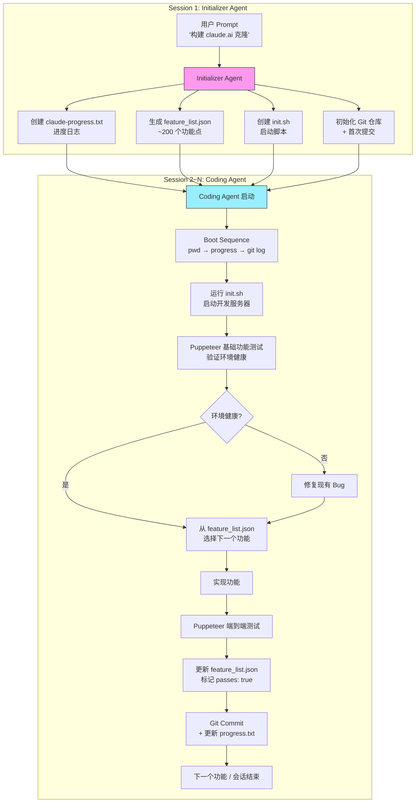
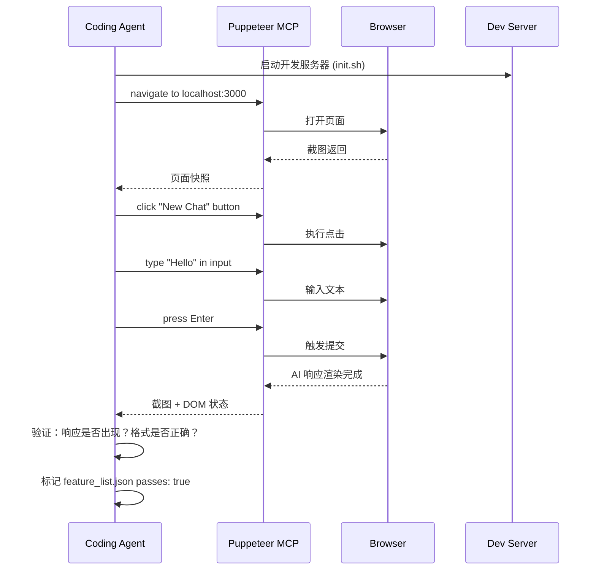
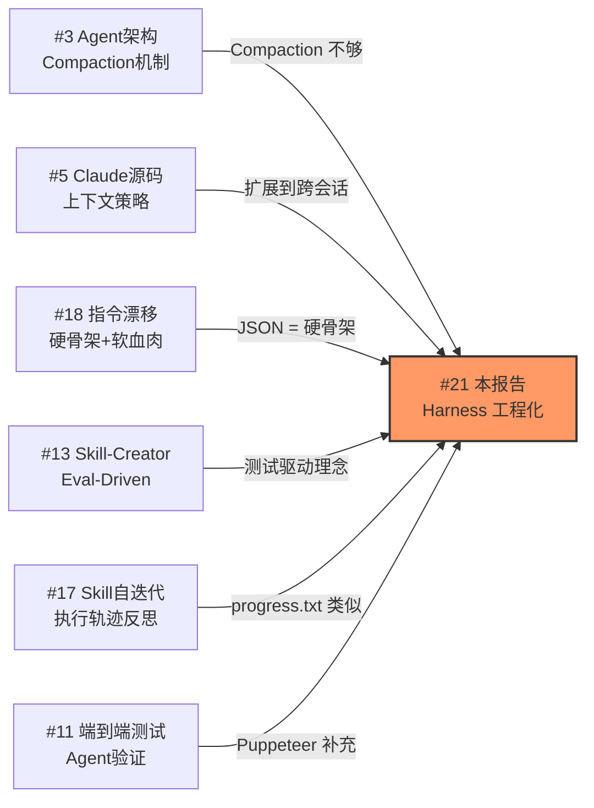

> 历史研究归档 · 2026-11-10 发布 · 程序扫描；未逐篇全文审阅。原有日期、观点、数据和命令保留历史语境，未经本次逐项事实核验或运行复现；请结合[归档说明](../../../ARCHIVE_POLICY.md)阅读。

# 长效 Agent Harness 工程化研究报告

> **一句话概括**：当 Agent 需要跨越多个上下文窗口完成大型任务时，单靠 Compaction 远远不够——Anthropic 提出的"Initializer + Coding Agent"双角色 Harness 模式，通过四大工程模块（Feature List / Incremental Git / Visual Testing / Boot Sequence）系统性解决了长效 Agent 的五大失败模式，本文深度拆解其设计哲学、工程细节，并给出可直接落地的最佳实践与代码实例。
>
> 研究日期：2026-04-12
> 本报告在 [Agent架构深度研究报告](../01-%E7%90%86%E8%AE%BA%E4%B8%8E%E6%9E%B6%E6%9E%84/R03_Agent%E6%9E%B6%E6%9E%84%E6%B7%B1%E5%BA%A6%E7%A0%94%E7%A9%B6.md)（Compaction 机制）和 Claude-Code源码上下文策略实验报告（原稿交叉引用，本归档未解析）（上下文策略）基础上，新增了**跨上下文窗口的 Harness 工程化方案**这一维度。

---

## 目录

- [一、问题定义：为什么 Compaction 不够](#一问题定义为什么-compaction-不够)
- [二、Anthropic 的解法：双 Agent Harness 架构](#二anthropic-的解法双-agent-harness-架构)
- [三、四大核心工程模块深度拆解](#三四大核心工程模块深度拆解)
- [四、失败模式与防御矩阵](#四失败模式与防御矩阵)
- [五、落地最佳实践](#五落地最佳实践)
- [六、可直接使用的 Prompt 模板与代码实例](#六可直接使用的-prompt-模板与代码实例)
- [七、与现有知识体系的交叉映射](#七与现有知识体系的交叉映射)
- [八、开放问题与后续计划](#八开放问题与后续计划)

---

## 一、问题定义：为什么 Compaction 不够

**核心结论**：Compaction 解决的是"上下文装不下"的物理问题，但长效 Agent 面对的是"跨会话协作"的工程问题——后者需要显式的状态传递机制，而非仅靠摘要压缩。

### 1.1 长效 Agent 的本质困境

想象一个"轮班工程师"场景：每个新工程师（Agent 实例）到岗时，对前一班做了什么一无所知。即使有交接文档（Compaction 摘要），信息也是有损的。当项目复杂度超过单次上下文窗口能承载的范围时，这个问题就不可回避。

Anthropic 在实验中发现，即便使用 Opus 4.5 + Claude Agent SDK + Compaction 循环，让 Agent 从高层 Prompt（如"克隆一个 claude.ai"）出发构建生产级 Web 应用，仍然**系统性地失败**。

### 1.2 两种核心失败模式

| # | 失败模式 | 表现 | 根因 |
|---|---------|------|------|
| F1 | **一次性尝试过多（One-shotting）** | Agent 试图一口气实现整个应用，上下文耗尽后留下半完成的代码 | 缺乏任务分解和进度追踪机制 |
| F2 | **过早宣布胜利（Premature completion）** | Agent 看到已有一些进展，就宣称任务完成 | 缺乏全局目标清单和完成度度量 |

说白了：F1 是"不知道该做哪一块"，F2 是"不知道还剩多少没做"。两者的共同根因是——**Agent 没有一个持久化的、结构化的"项目状态"来锚定自己的行为**。

这与 [指令遵守验证与长期漂移检测研究报告](R17_%E6%8C%87%E4%BB%A4%E9%81%B5%E5%AE%88%E9%AA%8C%E8%AF%81%E4%B8%8E%E9%95%BF%E6%9C%9F%E6%BC%82%E7%A7%BB%E6%A3%80%E6%B5%8B.md) 发现的"任务聚焦效应"高度一致：Agent 在执行具体任务时容易丢失全局视野。

---

## 二、Anthropic 的解法：双 Agent Harness 架构

**核心结论**：用"Initializer Agent（搭环境）+ Coding Agent（做增量）"的双角色分工，配合四大持久化工件（Feature List / Progress File / Git / Init Script），让每个新 Agent 实例都能在 30 秒内"接班上手"。

### 2.1 架构总览



### 2.2 设计哲学："像有经验的软件工程师一样工作"

这套方案的灵感来源不是什么高深的 AI 理论，而是**好的软件工程实践**：

| 工程实践 | Agent 对应物 | 类比 |
|---------|------------|------|
| Sprint Planning（冲刺规划） | Feature List（功能清单） | 产品经理的需求拆解 |
| Git Workflow | 每个功能一次提交 | 开发者的代码管理 |
| CI/CD Pipeline | Puppeteer 端到端测试 | QA 的自动化测试 |
| Onboarding Doc | progress.txt + git log | 新人入职文档 |
| Dev Environment Setup | init.sh | 一键搭开发环境 |

> **关键洞察**：长效 Agent 的工程问题，本质上是"团队协作"问题——只不过团队成员恰好都是同一个模型的不同实例。人类团队用来协作的工具（需求文档、版本控制、CI、交接日志），对 Agent 同样有效。

---

## 三、四大核心工程模块深度拆解

### 3.1 模块一：Feature List（功能清单）— 全局目标锚点

**解决的问题**：F1（一次性做太多）+ F2（过早宣布完成）

**设计决策与 Trade-off**：

**为什么用 JSON 而不是 Markdown？** Anthropic 经过实验发现，模型更不容易"不恰当地修改或覆盖" JSON 文件，相比 Markdown 文件的"创造性编辑"倾向更低。这是一个反直觉但数据驱动的选择——JSON 的格式约束本身就是一种防御机制。

```json
{
    "category": "functional",
    "description": "New chat button creates a fresh conversation",
    "steps": [
      "Navigate to main interface",
      "Click the 'New Chat' button",
      "Verify a new conversation is created",
      "Check that chat area shows welcome state",
      "Verify conversation appears in sidebar"
    ],
    "passes": false
}
```

**关键规则**：

1. Initializer Agent 根据用户 Prompt **展开**为 200+ 个细粒度功能点（而非让 Coding Agent 临场发挥）
2. Coding Agent **只能修改 `passes` 字段**，不得增删或修改功能描述
3. 使用强措辞保护清单完整性："It is unacceptable to remove or edit tests because this could lead to missing or buggy functionality"

**与 [指令遵守验证与长期漂移检测研究报告](R17_%E6%8C%87%E4%BB%A4%E9%81%B5%E5%AE%88%E9%AA%8C%E8%AF%81%E4%B8%8E%E9%95%BF%E6%9C%9F%E6%BC%82%E7%A7%BB%E6%A3%80%E6%B5%8B.md) 的映射**：Feature List 本质上是一种"硬骨架"——用结构化数据（JSON）约束 Agent 行为，比用自然语言指令要可靠得多。这正是 P15（硬骨架+软血肉）范式的工程实例。

### 3.2 模块二：Incremental Progress（增量进度）— Git 作为状态机

**解决的问题**：跨会话状态传递 + 错误回滚

**设计要点**：

1. **每个功能一次 Git Commit**：描述性提交信息成为下一个 Agent 实例的"交接日志"
2. **progress.txt 日志**：自由文本记录每次会话的进展、遇到的问题、下一步计划
3. **Git 回滚能力**：当代码改坏时，Agent 可以用 `git revert` 恢复到工作状态

```
Session 3 Progress (2026-04-12):
- Implemented: chat sidebar navigation, theme switching
- Fixed: dark mode CSS inconsistency from session 2
- Next priority: file upload feature (#47 in feature_list)
- Known issue: WebSocket reconnection flaky under slow network
```

**为什么 Git > 数据库 > 文件快照？**

| 方案 | 优点 | 缺点 |
|------|------|------|
| Git | Agent 天然理解 git 命令；支持 diff/revert/log；零额外基础设施 | 大二进制文件不适合 |
| SQLite/DB | 结构化查询 | Agent 需要额外学习 schema；增加复杂度 |
| 文件快照 | 极简 | 无法做增量对比；回滚困难 |

**关键洞察**：Git 的杀手级特性不在于版本控制本身，而在于 `git log --oneline -20` 给了新 Agent 实例一个**时间线视图**——"最近发生了什么"一目了然。这是 Compaction 摘要做不到的（摘要是扁平的，而 git log 保留了时序结构）。

### 3.3 模块三：Visual Testing（视觉测试）— 端到端验证闭环

**解决的问题**：功能"标记完成"但实际不可用

**方案**：集成 [Puppeteer MCP Server](https://github.com/anthropics/claude-quickstarts/tree/main/autonomous-coding)，让 Agent 能像人类用户一样"打开浏览器、点击按钮、验证结果"。



**局限性**（Anthropic 坦承）：
- **浏览器原生弹窗（alert/confirm）**：Puppeteer MCP 无法捕获，导致依赖这些弹窗的功能测试不准确
- **视觉回归**：模型的视觉理解能力有限，微妙的 CSS 问题可能漏检
- **动态内容**：WebSocket 实时通信、动画等难以通过截图验证

**与现有工具生态的映射**：
- `browser-use`（87K⭐）是开源社区的类似工具，但偏向通用浏览器自动化
- Playwright MCP 是另一个选择（Claude 4 Best Practices 中也推荐）
- 对于非 Web 应用（CLI、API），需要替换为对应的集成测试方案

### 3.4 模块四：Boot Sequence（启动序列）— 30 秒接班协议

**解决的问题**：新 Agent 实例的"冷启动"浪费

每个 Coding Agent 启动时执行固定的"接班流程"：

```bash
# Boot Sequence（每个 Agent 实例的前 30 秒）
1. pwd                           # 确认工作目录
2. cat claude-progress.txt       # 读进度日志
3. cat feature_list.json         # 读功能清单
4. git log --oneline -20         # 看最近提交
5. bash init.sh                  # 启动开发服务器
6. [Puppeteer] 基础功能烟测       # 验证环境健康
```

**init.sh 的设计要点**：
- 由 Initializer Agent 在第一次会话中生成
- 包含：安装依赖、启动开发服务器、运行基础环境检查
- 必须是**幂等的**（多次执行不出错）
- 避免 Agent 每次从头猜测"怎么启动这个项目"

**为什么先做烟测再实现新功能？**

这是对 F1 失败模式的关键防御。如果上一个 Agent 留下了破损的环境，新 Agent 直接开始实现新功能只会让问题更严重。先验证 → 先修复 → 再新增，这是人类 CR/CI 流程的直觉。

---

## 四、失败模式与防御矩阵

来自 Anthropic 原文的完整映射：

| 失败模式 | Initializer Agent 的防御 | Coding Agent 的防御 |
|---------|------------------------|-------------------|
| **过早宣布整个项目完成** | 生成结构化的 Feature List JSON，200+ 个功能点全部标记为 failing | 会话开始时读取 Feature List，每次只选一个功能实现 |
| **环境残留 Bug / 未记录进展** | 初始化 Git 仓库 + progress.txt | 开始时读 progress + git log + 跑烟测；结束时 commit + 更新 progress |
| **功能标记为完成但实际有 Bug** | 生成 Feature List，每个功能有明确测试步骤 | 用 Puppeteer 做端到端验证，通过后才标记 passes: true |
| **不知道怎么启动项目** | 编写 init.sh 脚本 | 开始时读取并执行 init.sh |

---

## 五、落地最佳实践

### 5.1 何时需要 Harness？决策树

```mermaid
graph TD
    A[任务能否在单次上下文窗口内完成?] -->|是| B[无需 Harness<br>标准 Agent 循环即可]
    A -->|否| C[任务是否有明确的<br>可拆分子目标?]
    C -->|是| D[✅ 使用 Harness 模式<br>Feature List + Incremental]
    C -->|否| E[任务是否是开放式研究<br>如"调研 X"?]
    E -->|是| F[轻量 Harness<br>Progress File + Git 即可]
    E -->|否| G[需要先做任务分解<br>再决定是否 Harness]

    style D fill:#9f9,stroke:#333
    style F fill:#ff9,stroke:#333
```

### 5.2 核心原则清单

| # | 原则 | 说明 | 适用场景 |
|---|------|------|---------|
| H1 | **结构化 > 自然语言** | 用 JSON 定义目标和状态，不用 Markdown | 功能清单、测试结果、配置 |
| H2 | **每次只做一件事** | 每个 Agent 会话只实现一个功能 | 所有增量工作 |
| H3 | **先验证再新增** | Boot Sequence 必须包含已有功能的烟测 | 每个新会话的开头 |
| H4 | **显式状态传递** | 不依赖 Compaction，用文件系统 + Git 传递状态 | 跨会话协作 |
| H5 | **幂等性** | init.sh 多次执行不出错 | 启动脚本 |
| H6 | **不可变目标** | Agent 不得修改功能定义，只能标记完成 | Feature List |
| H7 | **回滚能力** | Git 提供错误恢复的安全网 | 代码变更 |
| H8 | **分角色 Prompt** | 第一次会话和后续会话使用不同 Prompt | 初始化 vs 增量 |

### 5.3 从 Web 应用推广到其他场景

Anthropic 的示例聚焦全栈 Web 开发，但核心模式可以推广：

| 场景 | Feature List 变体 | Testing 变体 | 状态持久化 |
|------|------------------|-------------|-----------|
| Web 应用开发 | JSON 功能清单（原始方案） | Puppeteer/Playwright | Git + progress.txt |
| API 开发 | OpenAPI spec → 端点清单 | curl/httpie 自动测试 | Git + progress.txt |
| 数据管线 | 管线阶段清单 + 数据质量断言 | dbt test / Great Expectations | Git + 数据版本（DVC） |
| 文档编写 | 章节大纲 + 完成度标记 | 格式检查（lint）+ 链接验证 | Git + progress.txt |
| 研究报告 | 研究问题清单 + 覆盖度 | 来源验证 + 结论一致性检查 | Git + progress.txt |
| 代码重构 | 重构任务清单 + 影响范围 | 现有测试套件 | Git + progress.txt |

---

## 六、可直接使用的 Prompt 模板与代码实例

### 6.1 Initializer Prompt 模板

```markdown
# Initializer Agent Prompt

你是一个项目初始化 Agent。你的任务是为后续的 Coding Agent 搭建完整的工作环境。

## 输入
- 用户需求：{USER_SPEC}

## 你必须完成以下工作：

### 1. 功能清单（feature_list.json）
根据用户需求，生成一个详尽的功能清单。每个功能包含：
- `category`: functional | ui | integration | edge-case
- `description`: 一句话描述（从用户视角）
- `steps`: 端到端验证步骤列表
- `passes`: false（初始值）
- `priority`: high | medium | low

目标：覆盖所有用户可感知的功能，最少 50 个功能点。

### 2. 启动脚本（init.sh）
编写一个**幂等的**启动脚本：
- 安装依赖（npm install / pip install）
- 启动开发服务器（后台运行）
- 等待服务器就绪
- 输出启动成功信息

### 3. Git 初始化
- `git init` + 初始提交
- .gitignore 配置

### 4. 进度日志（claude-progress.txt）
- 记录本次会话的工作内容
- 列出下一步优先事项

## 约束
- 不要开始实现功能——你的工作仅限于搭环境
- feature_list.json 必须使用 JSON 格式（不是 Markdown）
- init.sh 必须是幂等的
```

### 6.2 Coding Agent Prompt 模板

```markdown
# Coding Agent Prompt

你是一个增量编码 Agent。你的任务是在已有项目基础上**实现一个功能**。

## Boot Sequence（必须按顺序执行）
1. `pwd` — 确认工作目录
2. 读取 `claude-progress.txt` — 了解最近进展
3. 读取 `feature_list.json` — 了解全局目标和当前状态
4. `git log --oneline -20` — 查看近期提交
5. 执行 `init.sh` — 启动开发环境
6. 运行基础功能测试 — 确认环境健康

## 工作流程
1. 从 feature_list.json 中选择最高优先级的未完成功能
2. 实现该功能
3. 用端到端测试（如 Puppeteer）验证功能正常
4. **只有测试通过后**，才把 `passes` 改为 `true`
5. Git commit，写描述性提交信息
6. 更新 claude-progress.txt

## 铁律
- **每次会话只实现一个功能**。做完一个再开始下一个。
- **不得修改或删除** feature_list.json 中的功能描述和测试步骤。
  "It is unacceptable to remove or edit tests because this could lead to missing or buggy functionality."
- **不得跳过基础功能测试**。如果发现已有功能坏了，先修复再新增。
- 会话结束时，确保代码处于可合并的干净状态。
```

### 6.3 Python 参考实现：Minimal Harness

以下是基于 Claude Agent SDK 的最小 Harness 实现框架（参考 [anthropics/claude-quickstarts/autonomous-coding](https://github.com/anthropics/claude-quickstarts/tree/main/autonomous-coding)）：

```python
"""
Minimal Long-Running Agent Harness
基于 Anthropic 'Effective Harnesses for Long-Running Agents' 博文的最小实现

依赖：pip install claude-code-sdk
"""
import json
import subprocess
from pathlib import Path
from claude_code_sdk import ClaudeCode

# === 配置 ===
PROJECT_DIR = Path("./my_project")
FEATURE_LIST = PROJECT_DIR / "feature_list.json"
PROGRESS_FILE = PROJECT_DIR / "claude-progress.txt"
INIT_SCRIPT = PROJECT_DIR / "init.sh"
MAX_SESSIONS = 50

# === Prompt 加载 ===
INITIALIZER_PROMPT = """
你是初始化 Agent。根据以下需求规格，在 {project_dir} 中：
1. 生成 feature_list.json（至少 50 个功能点，JSON 格式）
2. 创建 init.sh（幂等启动脚本）
3. 初始化 Git 仓库
4. 创建 claude-progress.txt

需求规格：
{spec}

注意：不要实现任何功能，只搭建环境。
"""

CODING_PROMPT = """
你是增量编码 Agent。请按顺序执行：

1. Boot Sequence：
   - pwd
   - 读取 claude-progress.txt
   - 读取 feature_list.json
   - git log --oneline -20
   - 执行 init.sh
   - 运行基础烟测

2. 从 feature_list.json 选择最高优先级的未完成功能，实现它

3. 端到端测试通过后，标记 passes: true

4. Git commit + 更新 claude-progress.txt

铁律：每次只做一个功能。不得修改功能描述。先修 Bug 再加功能。
"""


def count_remaining_features() -> int:
    """统计未完成的功能数量"""
    if not FEATURE_LIST.exists():
        return -1
    features = json.loads(FEATURE_LIST.read_text(encoding="utf-8"))
    return sum(1 for f in features if not f.get("passes", False))


def run_session(prompt: str, session_label: str) -> str:
    """运行一个 Agent 会话"""
    client = ClaudeCode(
        project_dir=str(PROJECT_DIR),
        allowed_tools=["bash", "read", "write", "puppeteer_*"],
        # 安全：限制文件操作范围
        sandbox=True,
    )
    result = client.run(prompt)
    print(f"[{session_label}] 完成，消耗 tokens: {result.usage.total_tokens}")
    return result.output


def main(spec_file: str):
    spec = Path(spec_file).read_text(encoding="utf-8")

    # Session 1: 初始化
    print("=" * 60)
    print("Session 1: Initializer Agent")
    print("=" * 60)
    run_session(
        INITIALIZER_PROMPT.format(project_dir=PROJECT_DIR, spec=spec),
        "Initializer"
    )

    # Session 2~N: 增量编码
    session = 2
    while session <= MAX_SESSIONS:
        remaining = count_remaining_features()
        if remaining == 0:
            print(f"\n🎉 所有功能已完成！共 {session - 1} 个会话。")
            break

        print(f"\n{'=' * 60}")
        print(f"Session {session}: Coding Agent (剩余 {remaining} 个功能)")
        print(f"{'=' * 60}")

        run_session(CODING_PROMPT, f"Coding-{session}")
        session += 1

    if session > MAX_SESSIONS:
        remaining = count_remaining_features()
        print(f"\n⚠️ 达到最大会话数 {MAX_SESSIONS}，剩余 {remaining} 个功能未完成")


if __name__ == "__main__":
    import sys
    main(sys.argv[1] if len(sys.argv) > 1 else "app_spec.txt")
```

### 6.4 不依赖 Claude Agent SDK 的通用实现思路

如果你使用其他 LLM 或框架，核心模式可以复用：

```python
"""
通用 Harness 模式 —— 框架无关的伪代码
"""

class LongRunningHarness:
    """适用于任何 LLM Agent 的长效 Harness"""

    def __init__(self, project_dir: str, llm_client):
        self.project_dir = Path(project_dir)
        self.llm = llm_client
        self.feature_list_path = self.project_dir / "feature_list.json"
        self.progress_path = self.project_dir / "progress.txt"

    def initialize(self, user_spec: str):
        """Session 1: 初始化环境"""
        prompt = self._build_initializer_prompt(user_spec)
        self.llm.run(prompt, tools=["bash", "file_write"])

        # 验证四大工件已生成
        assert self.feature_list_path.exists(), "feature_list.json 未生成"
        assert self.progress_path.exists(), "progress.txt 未生成"
        assert (self.project_dir / "init.sh").exists(), "init.sh 未生成"

    def run_iteration(self) -> bool:
        """Session 2~N: 增量编码，返回 True 表示还有剩余工作"""
        remaining = self._count_remaining()
        if remaining == 0:
            return False

        prompt = self._build_coding_prompt()
        self.llm.run(prompt, tools=["bash", "file_read", "file_write", "browser"])

        new_remaining = self._count_remaining()
        if new_remaining >= remaining:
            print("⚠️ 本次会话未完成任何新功能，可能卡住了")

        return new_remaining > 0

    def run_all(self, user_spec: str, max_sessions: int = 50):
        """完整执行"""
        self.initialize(user_spec)
        for i in range(max_sessions):
            if not self.run_iteration():
                print(f"✅ 完成！共 {i + 2} 个会话")
                return
        print(f"⚠️ 达到上限 {max_sessions} 个会话")

    def _count_remaining(self) -> int:
        features = json.loads(self.feature_list_path.read_text())
        return sum(1 for f in features if not f.get("passes"))
```

---

## 七、与现有知识体系的交叉映射

### 7.1 范式映射

| 本研究发现 | 已有范式 | 关系 |
|-----------|---------|------|
| JSON Feature List 约束 Agent 行为 | P15 硬骨架+软血肉 | ✅ **工程实例**：JSON 是"硬骨架"，Agent 的具体实现是"软血肉" |
| 每次会话只做一件事 | P5 简单可组合 > 复杂框架 | ✅ **一致**：增量组合优于一次性尝试 |
| Git log 替代 Compaction 摘要 | P3 分层上下文 | 🔄 **补充**：增加了"跨会话"维度，Git log 是长期记忆层 |
| Boot Sequence 固定流程 | P9 Anti-rationalization | ✅ **一致**：固定流程防止 Agent 偷懒跳过检查 |
| 视觉测试闭环 | P11 Eval-Driven | ✅ **一致**：测试驱动，通过才标记完成 |
| "不得修改功能描述"的强措辞 | P10 解释 Why > 堆砌 MUST | 🤔 **有张力**：此处确实用了 MUST 级别的强约束，但理由是充分的——功能清单是"不可变规范"，修改它等于移动目标 |

### 7.2 与已有报告的关系



### 7.3 新发现的范式

| # | 范式 | 来源 | 状态 |
|---|------|------|------|
| P17 | 双角色分工：Initializer（搭环境）+ Worker（做增量） | #21 本报告 | ✅ Anthropic 实证 + Demo |
| P18 | 显式状态传递 > 隐式摘要：用文件系统+Git 替代 Compaction 传递跨会话状态 | #21 本报告 | ✅ Anthropic 实证 |

---

## 八、开放问题与后续计划

### 8.1 Anthropic 原文提出的开放问题

1. **单 Agent vs 多 Agent**：是否应该用专门的 Test Agent / QA Agent / Cleanup Agent 分别处理子任务？Anthropic 认为"seems reasonable"但尚未验证
2. **泛化性**：当前方案针对 Web 开发优化，能否推广到科研、金融建模等领域？

### 8.2 我们的研究延伸方向

| 方向 | 描述 | 优先级 | 关联 |
|------|------|--------|------|
| Harness 本地实验 | 用 Claude Agent SDK 实际跑一次 autonomous-coding Demo，记录真实数据 | 🔴 高 | G1 多 Agent 协作 |
| 轻量 Harness 模板 | 为非 Web 场景（研究报告、数据管线）设计简化版 Harness 模板 | 🟡 中 | 本研究 §5.3 |
| 与 Skill 自迭代融合 | 将 Harness 模式与 07_skill_self_iteration.py 结合：每轮迭代是一个"会话" | 🟡 中 | #17 Skill自迭代 |
| 多角色 Agent 实验 | 验证 Initializer / Coder / Tester / Reviewer 四角色分工的效果 | 🟢 可选 | G1 |

---

## 📌 来源清单

- [Effective Harnesses for Long-Running Agents](https://www.anthropic.com/engineering/effective-harnesses-for-long-running-agents) — 2025-11-26 — Anthropic 官方工程博客，本研究的主要来源
- [autonomous-coding quickstart](https://github.com/anthropics/claude-quickstarts/tree/main/autonomous-coding) — anthropics/claude-quickstarts — 官方 Demo 代码实现
- [Claude 4 Best Practices: Multi-context window workflows](https://platform.claude.com/docs/en/build-with-claude/prompt-engineering/claude-4-best-practices) — Anthropic — 多上下文窗口工作流的 Prompt 工程最佳实践
- [Raising the bar on SWE-bench](https://www.anthropic.com/engineering/swe-bench-sonnet) — 2025-01-06 — SWE-bench Agent Scaffold 设计参考

⚖️ 来源一致性：多源高度一致（博客 + 官方文档 + Demo 代码三方互证）
📅 时效性声明：以上信息获取于 2026-04-12
