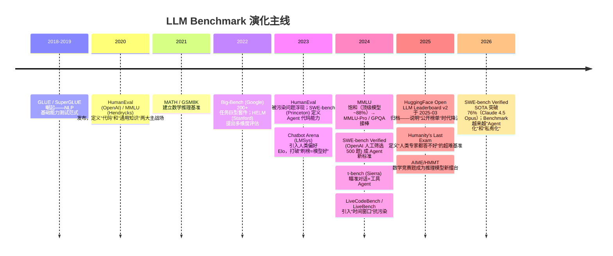

> 历史研究归档 · 2026-11-10 发布 · 发布审核状态：scan_only（发布前程序化隐私扫描）。原有日期、观点、数据和命令保留历史语境，未经本次逐项事实核验或运行复现；见[归档说明](../../../ARCHIVE_POLICY.md)。

# LLM Benchmark 速查手册

> **一句话概括**：公开 benchmark 分数是模型能力的**坐标系**而非**成绩单**——MMLU 已饱和且 6.5% 含错、HumanEval 被污染到失真、SWE-bench Verified 已成为 Agent 代码能力的新黄金标准。记住三条铁律：**(1)** 通用能力看 MMLU-Pro / GPQA Diamond / Humanity's Last Exam，不要再看 MMLU；**(2)** 公开分数高 ≠ 你的场景好用，私有 Eval 不可替代（见 [R15](R15_Skill%E4%B8%8EAgent%E8%AF%84%E4%BC%B0%E6%96%B9%E6%A1%88%E5%85%A8%E6%99%AF.md)）；**(3)** Chatbot Arena Elo 看人类偏好，公开 benchmark 看能力上限，二者交叉看才不会被骗。本手册提供 7 大类 30+ 基准的卡片式速查、排行榜索引、以及避开六大常见陷阱。
>
> **研究日期**：2026-04-24 ｜ **定位**：工具性手册（非深度研究）｜ **篇幅**：~9K tokens  
> **关联报告**：[R15](R15_Skill%E4%B8%8EAgent%E8%AF%84%E4%BC%B0%E6%96%B9%E6%A1%88%E5%85%A8%E6%99%AF.md) 评估全景（方法论母报告）｜[R30](../04-%E5%B7%A5%E7%A8%8B%E5%AE%9E%E8%B7%B5/R30_RAG%E4%BB%8E%E5%85%A5%E9%97%A8%E5%88%B0%E7%94%9F%E4%BA%A7%E8%90%BD%E5%9C%B0.md) RAG 评估（领域专项）｜[R57](R57_Agent%E5%AE%89%E5%85%A8%E4%B8%8E%E7%BA%A2%E9%98%9F%E6%94%BB%E9%98%B2%E4%BD%93%E7%B3%BB.md) 安全红队（安全专项）｜[R54](../04-%E5%B7%A5%E7%A8%8B%E5%AE%9E%E8%B7%B5/R54_LLM%E4%BB%8E%E4%B8%9A%E8%80%85%E5%AD%A6%E4%B9%A0%E8%B7%AF%E7%BA%BF%E6%80%BB%E8%A7%88.md) 学习路线 G11 补全

---

## TL;DR 速查卡

- **7 大类基准**：通用能力 / 推理 / 代码 / Agent / 长上下文 / 中文 / 安全。每类有 1-2 个 "当前首选"，其他多为历史参照
- **饱和警告**：MMLU / HumanEval / GSM8K 已被顶级模型打到 88%+，鉴别力丧失。2026 年首选换成 MMLU-Pro / LiveCodeBench / AIME
- **Agent 能力黄金标准**：SWE-bench Verified（代码修复）+ τ-bench（对话+工具）+ WebArena（浏览器）三件套。2026-02 SOTA：Claude 4.5 Opus 在 SWE-bench Verified 上 76.8%
- **排行榜三件套**：Chatbot Arena（人类偏好 Elo）+ HuggingFace Open LLM Leaderboard（已于 2025-03 归档，看历史可用）+ Artificial Analysis（综合成本/速度/质量）
- **最大陷阱**：数据污染（训练数据里就含测试题）、Few-shot vs Zero-shot 对比不公、CoT 启用差异、Prompt 敏感性可导致 ±10% 波动
- **关键心态**：**benchmark 是筛选工具，不是选型决定权**。两个模型公开分数差 2-3 分不足以决定选型——建一套私有 Eval（哪怕只有 30 条）比追榜更有价值

### 决策速查：我应该看哪个榜？

| 场景 | 首选基准 | 最低要求 |
|------|---------|---------|
| 通用聊天机器人 | Chatbot Arena Elo + MMLU-Pro | Elo 相差 < 30 视为同档 |
| 代码助手 | LiveCodeBench + SWE-bench Verified | SWE-bench Verified > 50% 才算"能用" |
| 数学/推理密集 | AIME 2024/2025 + MATH-500 | GSM8K 已饱和，别再看 |
| 企业 RAG | 私有 Eval + Needle-in-Haystack + RULER | 公开 benchmark 仅作"不至于太差"的底线 |
| 中文场景 | C-Eval + CMMLU + AlignBench + 私有中文 Eval | 只看英文榜会选错模型 |
| 面向 Agent | SWE-bench Verified + τ-bench + AgentBench | 工具调用成功率 > 90% 才能上生产 |
| 安全可靠 | HarmBench + JailbreakBench + 私有红队测试 | 见 [R57](R57_Agent%E5%AE%89%E5%85%A8%E4%B8%8E%E7%BA%A2%E9%98%9F%E6%94%BB%E9%98%B2%E4%BD%93%E7%B3%BB.md) |

---

## 目录

1. [🔭 定位透镜：benchmark 江湖简史](#定位透镜)
2. [📚 研究分析轨道：七大类基准卡片](#基准卡片)
3. [🚀 上手实战轨道：跑一套评估](#上手实战)
4. [🏆 排行榜速查索引](#排行榜索引)
5. [🕳️ 六大避坑指南](#避坑指南)
6. [💰 公开 Eval vs 私有 Eval 成本对比](#成本对比)
7. [🎯 决策速查与最佳实践](#决策速查)
8. [📌 来源清单](#来源清单)

---

<a id="定位透镜"></a>

## 🔭 定位透镜：benchmark 江湖简史

### 纵轴 · 演化脉络（为什么今天是这副格局）



**关键转折点**：
1. **2023 污染危机**：研究发现 HumanEval、MMLU 等被大量模型训练时"看过"，分数失真。社区开始关注 LiveBench / LiveCodeBench 这类**时间窗口滚动**的基准
2. **2024 饱和与接棒**：MMLU 88%+、HumanEval 95%+、GSM8K 95%+ 三大基准集体失去鉴别力。MMLU-Pro（10 选项 + 重新出题）、GPQA Diamond（博士级）、AIME（竞赛题）接棒
3. **2025 榜单降温**：Open LLM Leaderboard 归档意味着"一个分数排序所有模型"的幻想破灭——**多维度 + 人类偏好 + 场景私有 Eval** 成为新范式

### 横轴 · 竞争格局（benchmark 三大派系）

| 派系 | 代表 | 理念 | 优势 | 局限 |
|------|------|------|------|------|
| **公开标准化基准** | MMLU、HumanEval、SWE-bench | 可复现、可排序、学术标准 | 社区共识、便于横向对比 | 饱和快、易污染、过拟合 |
| **人类偏好评估** | Chatbot Arena Elo | 真人对比投票 | 贴近真实体验、抗污染 | 速度慢、偏向"答得好看"而非"答得对"、易被话术胜出 |
| **时间窗口/动态基准** | LiveCodeBench、LiveBench、GAIA | 持续更新题库、避开训练截止 | 抗污染、反映"真能力" | 基线不稳定、历史对比困难 |

**交叉判断**：
- 任何一个榜都是**偏颇的**。Chatbot Arena 奖励长答案和"看起来自信"的风格；静态基准奖励"刷过题"的模型；动态基准样本量小波动大
- 正确做法：**三条轴交叉看**（公开基准定能力上限 + Arena 定人类偏好 + 私有 Eval 定场景胜出）
- 学术界重视 MMLU/GPQA；产品团队重视 Arena；工程团队重视 SWE-bench Verified 和 τ-bench

---

<a id="基准卡片"></a>

## 📚 研究分析轨道：七大类基准卡片

> **卡片格式**：基准名｜测什么｜规模｜SOTA（2026-02）｜污染程度｜现状判定

### 一、通用能力类

#### MMLU（Massive Multitask Language Understanding）
- **测什么**：57 个学科（STEM + 法律 + 历史 + 医学等）的 15,908 道 4 选 1 题
- **规模**：~14K 测试题（1.5K 用于校准）
- **SOTA（2024 年中）**：Claude 3.5 Sonnet / GPT-4o / Llama 3.1 405B 均 ~88%；人类专家 ~89.8%
- **污染程度**：🔴 高。2024-06 论文《Are We Done with MMLU?》发现 6.5% 题目有错误（Virology 子集高达 57% 有错）
- **现状判定**：**已饱和，2026 年不建议再作为主要指标**。仅作为"模型至少不能太差"的底线

#### MMLU-Pro
- **测什么**：MMLU 升级版——10 选 1（原 4 选）+ 过滤掉模糊题 + 加入更多推理题
- **规模**：~12K 题
- **SOTA（2025-2026）**：顶级模型 ~75-80%（比 MMLU 低 10-15 分）
- **污染程度**：🟡 中（部分题沿用 MMLU）
- **现状判定**：**2026 年通用能力首选**。10 选 1 使随机猜测基线降到 10%，且四选一的偶然对的运气因素被大幅压缩

#### GPQA（Graduate-Level Google-Proof Q&A）
- **测什么**：物理/化学/生物博士水平问题，"Google-proof"（搜索引擎搜不到答案）
- **规模**：Diamond 子集 198 题（最难）
- **SOTA（2026-02）**：Claude 4.5 Opus / GPT-5 / Gemini 3 Pro 均 > 80%；人类博士 ~65%（自己领域内）
- **污染程度**：🟢 低（设计时就考虑了抗搜索）
- **现状判定**：**推理能力硬核测试**。推理模型的新试金石

#### Big-Bench Hard（BBH）
- **测什么**：Big-Bench 套件中 23 个对 LLM 最难的任务
- **规模**：~6.5K 样本
- **污染程度**：🟡 中
- **现状判定**：学术对比仍在用，但不如 MMLU-Pro 常用

#### Humanity's Last Exam（HLE）
- **测什么**：1000 题，人类专家都答不好（生物化学/数学/哲学等深度学科）
- **规模**：~3K 题（2025 年）
- **SOTA（2026）**：顶级模型仅 ~20-30%（意味着 benchmark 还有巨大空间）
- **污染程度**：🟢 低（新）
- **现状判定**：**2026-2027 年的"北极星"基准**。目前远未饱和

---

### 二、推理类

#### GSM8K（Grade School Math 8K）
- **测什么**：8500 道小学应用题
- **规模**：1.3K 测试题
- **SOTA**：顶级模型 95%+
- **污染程度**：🔴 高
- **现状判定**：**已饱和，2026 年不建议再看**

#### MATH（MATH-500）
- **测什么**：高中/竞赛数学题（含 LaTeX 公式、证明步骤）
- **规模**：5K（500 子集最常用）
- **SOTA（2026-02）**：推理模型 > 95%；非推理 ~70%
- **污染程度**：🟡 中
- **现状判定**：**准饱和**，仍可用于比较推理模型

#### AIME（American Invitational Mathematics Examination）
- **测什么**：美国数学邀请赛原题（2024/2025）
- **规模**：每年 15 题（两卷）
- **SOTA（2026）**：OpenAI o-series / Claude 4.5 / DeepSeek R2 > 80%；非推理模型 ~10-20%
- **污染程度**：🟡 中（网络上有答案但推理链复杂）
- **现状判定**：**推理模型的核心擂台**。2024-2025 年的题未饱和

#### ARC-AGI（Abstract Reasoning Corpus for AGI）
- **测什么**：视觉推理谜题（网格变换规律）
- **规模**：公开 800 题 + 私有评测集
- **SOTA（2026-02）**：OpenAI o3（2024 末）在 ARC-AGI-1 上突破 85%（人类 ~85%）
- **污染程度**：🟢 低
- **现状判定**：**通用智能"北极星"基准之一**，不过被批评"符号谜题 ≠ AGI"

---

### 三、代码类

#### HumanEval
- **测什么**：164 道 Python 函数补全题
- **规模**：极小
- **SOTA**：顶级模型 95%+
- **污染程度**：🔴🔴 极高（训练数据里几乎必含）
- **现状判定**：**已完全失效，2026 年看到它要警惕**——有团队仍用它是因为便宜便于快速测

#### MBPP（Mostly Basic Python Problems）
- **规模**：974 题
- **污染程度**：🔴 高
- **现状判定**：同 HumanEval，仅作历史参照

#### LiveCodeBench
- **测什么**：LeetCode / AtCoder / CodeForces 每周新题（时间窗口滚动）
- **规模**：500+ 题且持续增长
- **关键特性**：**时间窗口抗污染**——可筛选"模型训练截止日期之后"的新题
- **SOTA（2026-02）**：顶级模型 ~55-65%（窗口 2024-08 至 2025-05）
- **污染程度**：🟢 低
- **现状判定**：**2026 年代码能力首选基准之一**

#### SWE-bench（原始版 / Verified / Lite / Multilingual / Multimodal）
- **测什么**：GitHub 真实仓库的 issue → PR 修复（Python、Django/Flask 等）
- **规模**：
  - Full: 2294 题
  - **Verified**: 500 题（OpenAI 人工筛选，最常用）
  - Lite: 300 题（便宜版）
  - Multilingual: 300 题（9 种语言）
  - Multimodal: 517 题（含截图）
- **SOTA（2026-02 Verified）**：
  - Claude 4.5 Opus (high reasoning): **76.8%**
  - Gemini 3 Flash / MiniMax M2.5: 75.8%
  - Claude Opus 4.6: 75.6%
  - GPT-5.2 Codex: 72.8%
  - DeepSeek V3.2 (high reasoning): 70.0%
  - Kimi K2.5: 70.8%
- **污染程度**：🟡 中（issue 本身公开，但真正修复需要理解整个仓库）
- **现状判定**：**Agent 代码能力金标准**。mini-SWE-agent 用 100 行 Python 就打到 65% 展示了工具调用和推理的威力
- **重要**：报告 SWE-bench 分数必须注明 harness（mini-SWE-agent / SWE-agent / 自研）和评估日期

---

### 四、Agent 类

#### AgentBench
- **测什么**：8 个环境（OS / 数据库 / 知识图谱 / 卡牌游戏 / 居家任务 / Web 购物 / Web 浏览 / 侧线任务）
- **规模**：~2K 任务
- **SOTA**：GPT-4 系列 ~4.5/10；开源最好 ~3.5/10
- **现状判定**：**学术研究常用**，工业选型不直接采信但可作参考

#### τ-bench（Tau-bench / Sierra 出品）
- **测什么**：对话式 Agent 的**端到端任务**（航空/零售等场景下"用户+Agent+API+规则"四方交互）
- **规模**：Retail 115 题 + Airline 50 题
- **SOTA（2026-02）**：顶级模型 ~60-75%（Airline 更难）
- **关键特性**：**强调一致性**——同一任务跑 k 次，全部成功才算 pass^k（极度严格）
- **现状判定**：**对话+工具 Agent 黄金标准**。客服/订票类业务选型必看

#### WebArena / VisualWebArena
- **测什么**：真实网页环境（Reddit/GitLab/购物/地图）下的任务执行
- **规模**：812 任务
- **SOTA**：~40-50%（人类 ~80%）
- **现状判定**：**浏览器 Agent 主要基准**，RPA / Auto-GUI 类产品必看

#### GAIA（General AI Assistants）
- **测什么**：466 题，真实助理任务（Excel / 网络搜索 / 阅读 PDF）
- **分三档**：Level 1（~9% 人类可解）/ Level 2 / Level 3
- **SOTA**：GPT-4 with tools ~15-30%；人类 92%
- **现状判定**：**HuggingFace 主推**，Agent 实用能力参考

---

### 五、长上下文类

#### Needle-in-a-Haystack（NIAH）
- **测什么**：在 1K-1M tokens 的长文档里埋一个"针"（随机事实），让模型找出来
- **SOTA**：GPT-4 Turbo / Claude 3 / Gemini 1.5 Pro 在 128K-1M 范围近乎 100%
- **现状判定**：**基础测试，已饱和**。说明"能找到针"但不代表"能用上整个上下文"

#### RULER
- **测什么**：13 个长上下文任务——包括多针、变量追踪、聚合统计、频率统计等
- **规模**：从 4K 到 128K+ 多个长度
- **SOTA（2025）**：GPT-4 / Claude 在 128K 上 ~85%；更长的上下文（> 200K）所有模型普遍崩
- **现状判定**：**长上下文真实能力的首选基准**（NIAH 已经不够）

#### LongBench / LongBench v2
- **测什么**：中英双语长文档 QA、摘要、代码仓库理解
- **规模**：v2 共 503 题
- **现状判定**：**中文长上下文常用**

---

### 六、中文类

| 基准 | 测什么 | 规模 | SOTA（2026） | 备注 |
|------|--------|------|-------------|------|
| **C-Eval** | 52 学科多选（从高中到博士） | 14K | 顶级 ~90% | 已准饱和 |
| **CMMLU** | 67 中文学科多选 | 11.5K | 顶级 ~85% | MMLU 中文对应物 |
| **AlignBench** | 中文开放对话评估（GPT-4 as Judge） | 683 题 | DeepSeek/Qwen ~7.5/10 | 贴近中文真实场景 |
| **GaoKao Bench** | 中国高考题 | ~2.8K | Top 模型 > 80% | 有明显中文偏好 |
| **CIF-Bench** | 中文指令跟随 | 150 指令 | 评估中文指令遵从 | 相对冷门但专业 |

**重要提示**：**只看英文榜会选错中文模型**——Qwen / DeepSeek / GLM / MiniMax 系列在中文场景下常优于同级 GPT/Claude（成本和中文压缩率两个维度）。

---

### 七、安全类

| 基准 | 测什么 | 规模 | 用法 | 关联 |
|------|--------|------|------|------|
| **HarmBench** | 400 种有害请求（化武/生物武器/恶意代码等） | 各维度数十题 | 测拒答率 | [R57](R57_Agent%E5%AE%89%E5%85%A8%E4%B8%8E%E7%BA%A2%E9%98%9F%E6%94%BB%E9%98%B2%E4%BD%93%E7%B3%BB.md) |
| **JailbreakBench** | 越狱成功率评估 | 100 场景 | 测安全边界 | [R57](R57_Agent%E5%AE%89%E5%85%A8%E4%B8%8E%E7%BA%A2%E9%98%9F%E6%94%BB%E9%98%B2%E4%BD%93%E7%B3%BB.md) |
| **HH-RLHF** | Helpful + Harmless 平衡 | 大规模 | 研究对齐 trade-off | 历史基准 |
| **AdvBench** | 对抗攻击样本 | 520 题 | 红队测试 | [R57](R57_Agent%E5%AE%89%E5%85%A8%E4%B8%8E%E7%BA%A2%E9%98%9F%E6%94%BB%E9%98%B2%E4%BD%93%E7%B3%BB.md) |

---

<a id="上手实战"></a>

## 🚀 上手实战轨道：跑一套评估

### Hello World（5 分钟）：用 `lm-evaluation-harness` 跑 MMLU

```bash
# 环境要求：Python 3.10+、PyTorch、GPU（可选但推荐）
pip install lm-eval==0.4.7

# 单卡 HuggingFace 模型跑 MMLU（约 30 分钟，24GB GPU）
lm_eval --model hf \
  --model_args pretrained=meta-llama/Llama-3.1-8B-Instruct \
  --tasks mmlu \
  --device cuda:0 \
  --batch_size 8 \
  --output_path ./results/llama3_mmlu.json

# 预期输出（约）：
# mmlu: 0.684 (68.4%)
# 执行时间：~30 min on RTX 4090
```

### 生产级：用 `promptfoo` 自定义 Eval（对 API 模型）

```bash
npm install -g promptfoo@0.x

# 创建 promptfooconfig.yaml
cat > promptfooconfig.yaml << 'EOF'
providers:
  - openai:gpt-4o-mini
  - anthropic:claude-3-5-haiku-20241022

prompts:
  - "用一句话回答：{{question}}"

tests:
  - vars:
      question: "Python 的 GIL 是什么？"
    assert:
      - type: contains
        value: "全局解释器锁"
      - type: llm-rubric
        value: "答案准确且简洁（<50字）"
EOF

promptfoo eval -c promptfooconfig.yaml
promptfoo view  # 可视化对比
```

**预期输出**：浏览器打开对比面板，可看每个模型对每道题的响应+打分。

### 代码能力：跑 LiveCodeBench（抗污染）

```bash
git clone https://github.com/LiveCodeBench/LiveCodeBench
cd LiveCodeBench
pip install -r requirements.txt

# 仅跑 "2024-08 之后" 的新题（模型训练截止日期之后）
python -m lcb_runner.runner.main \
  --model gpt-4o \
  --scenario codegeneration \
  --release_version release_v5 \
  --start_date 2024-08-01 \
  --end_date 2025-05-01

# 预期输出：
# Pass@1: 0.52 (52% 一次通过率)
```

### Agent 能力：SWE-bench Verified 快速试跑

```bash
# 最便宜的方式：mini-SWE-agent（100 行 Python）
pip install mini-swe-agent
mini-swe --model claude-4-5-sonnet --dataset swe-bench-verified --limit 10
# 跑 10 题看看基线（约 $0.5-1.0）
```

### 私有 Eval Hello World（最重要的一步）

```python
# 文件：my_eval.py — 30 行代码建你自己的评估
import json
from openai import OpenAI

client = OpenAI()

# 你的 30 条真实业务样本（按你场景改）
cases = [
    {"input": "客户说想退货，订单号 12345", "expected_keywords": ["退货流程", "订单", "12345"]},
    {"input": "订单一周还没发货怎么办", "expected_keywords": ["发货", "物流", "客服"]},
    # ... 再加 28 条
]

def evaluate(model):
    passed = 0
    for c in cases:
        resp = client.chat.completions.create(
            model=model,
            messages=[{"role": "user", "content": c["input"]}]
        ).choices[0].message.content
        hits = sum(1 for kw in c["expected_keywords"] if kw in resp)
        if hits >= len(c["expected_keywords"]) * 0.7:  # 70% 关键词命中
            passed += 1
    return passed / len(cases)

for model in ["gpt-4o-mini", "gpt-4o", "claude-3-5-sonnet"]:
    print(f"{model}: {evaluate(model):.1%}")

# 预期输出（示例）：
# gpt-4o-mini: 73.3%
# gpt-4o: 86.7%
# claude-3-5-sonnet: 83.3%
```

**关键洞察**：30 条真实业务样本比 14K 道 MMLU 更能告诉你该选谁。详见 [R15](R15_Skill%E4%B8%8EAgent%E8%AF%84%E4%BC%B0%E6%96%B9%E6%A1%88%E5%85%A8%E6%99%AF.md)。

---

<a id="排行榜索引"></a>

## 🏆 排行榜速查索引

| 排行榜 | URL | 测什么 | 更新频率 | 可信度 |
|--------|-----|--------|---------|--------|
| **Chatbot Arena（LMArena）** | https://lmarena.ai/leaderboard | 人类偏好 Elo | 实时 | ⭐⭐⭐⭐ 偏向"看起来自信" |
| **Artificial Analysis** | https://artificialanalysis.ai | 综合（成本/速度/质量） | 周 | ⭐⭐⭐⭐ 产品选型最实用 |
| **SWE-bench 官方** | https://www.swebench.com | 代码修复 Agent | 滚动 | ⭐⭐⭐⭐⭐ Agent 金标准 |
| **LiveCodeBench** | https://livecodebench.github.io/leaderboard.html | 代码生成（抗污染） | 周 | ⭐⭐⭐⭐⭐ 抗污染首选 |
| **LiveBench** | https://livebench.ai | 综合（6 类别，抗污染） | 月 | ⭐⭐⭐⭐ 综合抗污染 |
| **HuggingFace Open LLM Leaderboard v2** | https://huggingface.co/spaces/open-llm-leaderboard | 开源模型综合 | **已于 2025-03 归档** | 历史参考 |
| **OpenCompass（中国）** | https://opencompass.org.cn | 中英综合 | 月 | ⭐⭐⭐⭐ 中文场景首选 |
| **SuperCLUE（中文）** | https://www.superclueai.com | 中文综合 | 月 | ⭐⭐⭐ 中文产品选型 |
| **τ-bench 官方** | https://github.com/sierra-research/tau-bench | 对话+工具 Agent | 季度 | ⭐⭐⭐⭐ 客服 Agent 必看 |
| **GAIA** | https://huggingface.co/gaia-benchmark/leaderboard | 实用助理 | 月 | ⭐⭐⭐ Agent 实用性 |

**为什么 Open LLM Leaderboard 归档了？** 官方公告理由：顶级模型已饱和，分数差距小于随机波动；社区资源应转向**Agent benchmark 和私有 Eval**。这件事本身就是信号——**"一个分数排序所有模型"的时代结束了**。

---

<a id="避坑指南"></a>

## 🕳️ 六大避坑指南

| # | 坑 | 原因 | 解法 |
|---|----|------|------|
| 1 | **数据污染（Contamination）** | 模型训练数据含 benchmark 测试题，分数虚高 | (a) 优先选 LiveCodeBench / LiveBench 等**时间窗口基准**；(b) 用 PaCoST 等工具做污染检测；(c) 自己出私有 Eval |
| 2 | **Few-shot vs Zero-shot 对比不公** | A 模型报告 5-shot 结果，B 报告 0-shot，直接比分数毫无意义 | 严格核对报告条件；优先用 `lm-eval-harness` 等统一 harness 复现 |
| 3 | **CoT 启用差异** | 有的报告启用了 CoT（Chain-of-Thought），有的没启用；CoT 能带来 10-20 分提升 | 注明 `with CoT / without CoT`；Claude 4/o1 等推理模型自带 thinking 要单独归类 |
| 4 | **Prompt 敏感性** | 同一模型、同一题，Prompt 微调可导致 ±10% 波动 | 用 Promptfoo 等做 Prompt robustness 测试；多 Prompt 取平均 |
| 5 | **SWE-bench 分数要配 harness** | 同一模型在 mini-SWE-agent vs 自研 harness 上分数差 20+ | 报告 SWE-bench 必须写明 harness、date、max_steps |
| 6 | **只看一个榜就决策** | 公开 benchmark 强调能力上限，但你的场景可能对成本/延迟/中文更敏感 | **三维交叉**：公开基准 + 人类偏好（Arena）+ 私有 Eval。缺一不可 |

### 附加陷阱：一些模型厂商的常见话术

- **"我们在 XX benchmark 上超过 GPT-4"**：看清是哪个版本的 GPT-4（老版本 vs 最新版），是哪个子集，用了什么 harness
- **"MMLU 95%"**：2024 年起这种数字基本没有参考价值，问他们 MMLU-Pro 或 GPQA 多少
- **"SWE-bench 50%"**：要问是 Full / Verified / Lite？用的什么 agent？评估日期？
- **"我们在中文场景领先"**：拿 C-Eval + CMMLU + AlignBench 三件套去问

---

<a id="成本对比"></a>

## 💰 公开 Eval vs 私有 Eval 成本对比

| 维度 | 公开 Benchmark | 私有 Eval |
|------|---------------|-----------|
| **一次性成本** | 0（题库免费） | 构建 30 题约 1-2 人日 |
| **运行成本（单次）** | MMLU ~14K 题 × $0.0001 ≈ **$1.4** | 30 题 × $0.001 ≈ **$0.03** |
| **迭代速度** | 慢（跑完 30 分钟） | 快（30 秒-3 分钟） |
| **抗污染能力** | 🔴 差（多数已污染） | ✅ 完美（你自己出的题） |
| **场景契合度** | 🟡 中（通用题目） | ✅ 高（你的业务真题） |
| **可作宣传** | ✅ 有（"MMLU 75%"） | ❌ 无（不可横向对比） |
| **决策价值** | 低（信号弱） | **高**（直接指导选型） |

**结论**：**公开 Benchmark 作为"筛选层"，私有 Eval 作为"决策层"**。先用 Artificial Analysis 选出前 5 名候选模型，然后用 30-100 条私有 Eval 做最终决策。

### 私有 Eval 最低配置（30 题快速版）

- **10 条 Happy Path**（最常见场景）
- **10 条 Edge Case**（罕见但重要场景）
- **5 条 Adversarial**（可能触发幻觉/越狱的测试）
- **5 条回归样本**（已知模型曾经答错过的题）

完整方法论见 [R15](R15_Skill%E4%B8%8EAgent%E8%AF%84%E4%BC%B0%E6%96%B9%E6%A1%88%E5%85%A8%E6%99%AF.md) §评估体系设计。

---

<a id="决策速查"></a>

## 🎯 决策速查与最佳实践

### Benchmark 选择决策树

```
你要评估什么？
├── 模型综合能力
│   ├── 需要快速横向对比 → Chatbot Arena + Artificial Analysis
│   ├── 需要学术严谨对比 → MMLU-Pro + GPQA Diamond + HLE
│   └── 需要抗污染 → LiveBench
├── 代码能力
│   ├── 短函数补全 → LiveCodeBench（别用 HumanEval）
│   ├── 真实仓库修复 → SWE-bench Verified
│   └── 多语言代码 → SWE-bench Multilingual
├── 推理能力
│   ├── 数学 → AIME + MATH-500（别用 GSM8K）
│   └── 逻辑 → GPQA Diamond + ARC-AGI
├── Agent 能力
│   ├── 对话+工具 → τ-bench
│   ├── 浏览器操作 → WebArena
│   └── 代码 Agent → SWE-bench Verified
├── 长上下文
│   └── RULER + LongBench v2（别只看 NIAH）
├── 中文场景
│   └── C-Eval + CMMLU + AlignBench + OpenCompass/SuperCLUE 榜单
└── 安全性
    └── HarmBench + JailbreakBench + 私有红队（详见 [R57](R57_Agent%E5%AE%89%E5%85%A8%E4%B8%8E%E7%BA%A2%E9%98%9F%E6%94%BB%E9%98%B2%E4%BD%93%E7%B3%BB.md)）
```

### 最佳实践（三句话）

1. **三维交叉看**：公开 benchmark + Chatbot Arena Elo + 私有 Eval。缺一个都容易选错
2. **抗污染优先**：2026 年新建评估，优先选 LiveBench / LiveCodeBench / GPQA 这类抗污染基准
3. **私有 Eval 不可替代**：30 条真题胜过 14K 道 MMLU。见 [R15](R15_Skill%E4%B8%8EAgent%E8%AF%84%E4%BC%B0%E6%96%B9%E6%A1%88%E5%85%A8%E6%99%AF.md) 方法论

### 开放问题

- **Benchmark 的"上限魔咒"**：绝大多数公开基准在 12-18 个月内就会饱和，建立一套"持续演化"的基准体系可能比追求单点完美更重要
- **Agent Benchmark 的样本量不足**：τ-bench Airline 仅 50 题，统计显著性弱。需要更大规模的真实业务数据集
- **评估评估者（Meta-Eval）**：LLM-as-Judge 的准确性本身也需要 benchmark，目前工具有限

---

<a id="来源清单"></a>

## 📌 来源清单

> ⚖️ **来源一致性**：多源一致（SWE-bench 官方 / Wikipedia MMLU 条目 / HuggingFace Leaderboard 归档公告）
> 📅 **时效性声明**：以上信息获取于 2026-04-24

- [SWE-bench 官方 Leaderboard](https://www.swebench.com/) — 2026-04-24 — Claude 4.5 Opus 76.8%、Gemini 3 Flash 75.8% 等 SOTA 数据
- [LiveCodeBench Leaderboard](https://livecodebench.github.io/leaderboard.html) — 2026-04-24 — 时间窗口 2024-08 至 2025-05 共 454 题
- [Wikipedia: MMLU](https://en.wikipedia.org/wiki/MMLU) — 2025-07-28 更新 — 6.5% 错误率、57 科目、2025 年部分淘汰
- [Are We Done with MMLU? (arXiv 2406.04127)](https://arxiv.org/abs/2406.04127) — 2024-06-07 — MMLU 错误率分析原始论文
- [MMLU-Pro (arXiv 2406.01574)](https://arxiv.org/abs/2406.01574) — 2024-06-03 — MMLU-Pro 论文
- [HuggingFace Open LLM Leaderboard 组织页](https://huggingface.co/open-llm-leaderboard) — 2025-03-20 最后更新 — Leaderboard v2 归档说明
- [Anthropic SWE-bench Verified 博客](https://openai.com/index/introducing-swe-bench-verified/) — 2024-08 — Verified 子集由来
- [SWE-bench CodeClash 公告](https://codeclash.ai/) — 2025-11 — 新 Agent 基准方向
- [LMArena Leaderboard](https://lmarena.ai/leaderboard) — 2026-04-24（访问时已迁移到 arena.ai）— 人类偏好 Elo
- 本工作区 [R15](R15_Skill%E4%B8%8EAgent%E8%AF%84%E4%BC%B0%E6%96%B9%E6%A1%88%E5%85%A8%E6%99%AF.md) 评估全景、[R57](R57_Agent%E5%AE%89%E5%85%A8%E4%B8%8E%E7%BA%A2%E9%98%9F%E6%94%BB%E9%98%B2%E4%BD%93%E7%B3%BB.md) 安全红队 — 方法论引用
- 模型训练知识 — 作背景参考（实时数据均以上述来源为准）

---

> **给读者的一句话**：Benchmark 是地图不是领土。它告诉你**山在哪**，但没告诉你**走哪条路最适合你**。真正的选型决策永远在"公开榜单 → Artificial Analysis 筛选 → 私有 Eval 验证"这条链路的最后一步。
