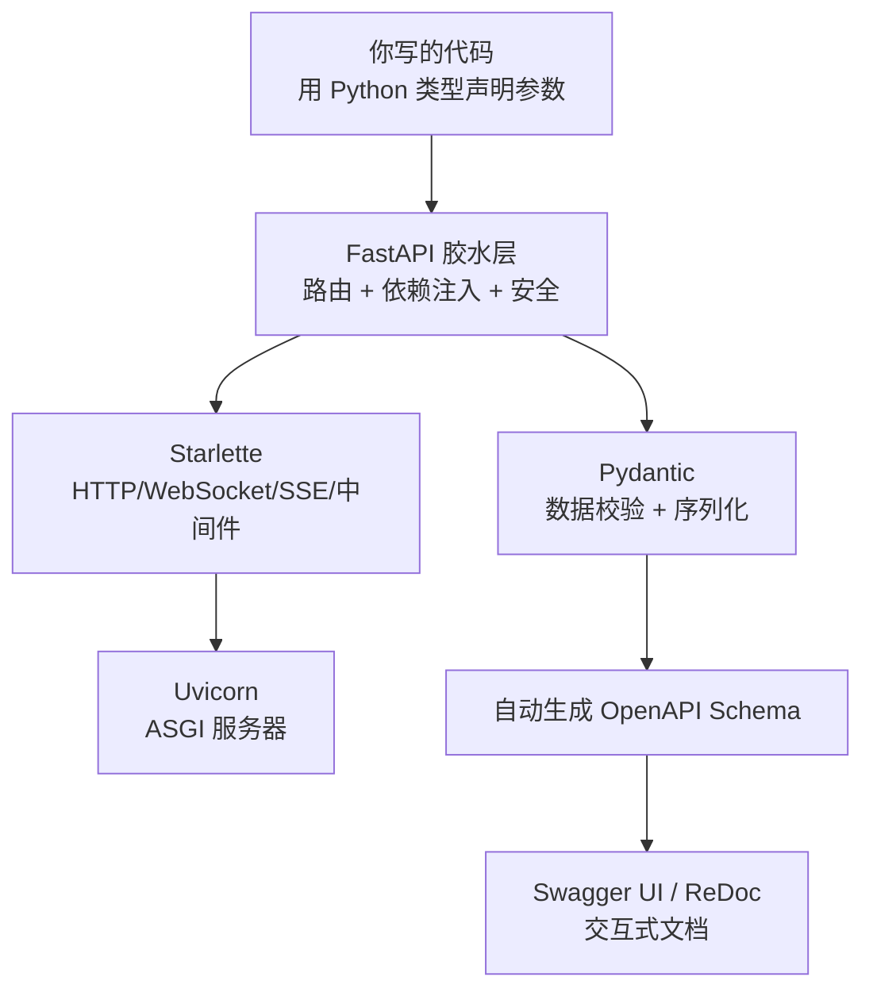

> 脱敏公开版 · 2026-11-10 补充 · 发布审核状态：redacted_full_review（发布前全文隐私审核、脱敏与改动复核）。保留通用技术内容，非公开案例、引用或数据已删除；编辑替换处另作说明。历史结论未在本次重新核实，代码未整体运行复现。见[归档说明](../../../ARCHIVE_POLICY.md)。

# FastAPI：从零认知到实战 Demo

> 一句话概括：FastAPI 是 Python 生态中性能最强、开发体验最好的 API 框架，凭借类型提示驱动的自动校验+自动文档+原生异步，成为 AI/Agent 后端的事实标准
> 研究日期：2026-05-14
> 关联报告：R81（Agent 框架选型中作为 L4 基础设施层）、R04（Agent 部署上线方案中的后端选型）

---

## 目录

- [定位透镜](#定位透镜)
- [FastAPI 是什么](#fastapi-是什么)
- [核心能力全景](#核心能力全景)
- [为什么 Agent 开发都用它](#为什么-agent-开发都用它)
- [六个实战 Demo](#六个实战-demo)
- [适用边界与局限](#适用边界与局限)
- [结论与学习路径](#结论与学习路径)
- [来源清单](#来源清单)
- [开放问题](#开放问题)

---

## 定位透镜

### 纵轴 · 演化脉络

**创世故事**：Sebastián Ramírez（网名 tiangolo）在 2018 年 12 月发布 FastAPI。他之前深度使用 Flask + Flask-apispec + Marshmallow 的组合来构建 API，但一直不满意——数据校验、序列化、文档生成需要在三个不同的地方分别定义，改了一处忘了另一处就出 bug。Python 3.6 引入的 type hints 让他看到了希望：**用一份类型声明，同时搞定校验、序列化和文档**。

**关键转折点**：

- 2018：Python 3.6+ type hints 成熟 + Pydantic v1 发布 + Tom Christie 从 APIStar 转向创建 Starlette → 三块基石凑齐
- 2019-2020：FastAPI 凭借"5 分钟写出带自动文档的 API"在 Reddit/HN 引爆传播，GitHub Stars 火箭式增长
- 2021-2022：Microsoft、Netflix、Uber 等大厂公开采用，从"网红框架"变成"生产框架"
- 2023-2024：LLM/Agent 浪潮中，FastAPI 成为 AI 后端默认选择（OpenAI、LangServe、Agno 等均基于 FastAPI）
- 2025-2026：98.2K Stars，推出 FastAPI Cloud 托管服务，首届 FastAPI Conf '26 将于 10 月在阿姆斯特丹举办

**生命周期定位**：**成熟期（上升阶段后期）**。社区活跃、企业大规模采用、生态完善，但尚未出现更好的替代范式，增长势头仍在持续。

### 横轴 · 竞争格局

| 维度 | Django + DRF | Flask | FastAPI |
|------|-------------|-------|---------|
| **设计哲学** | "电池全包"全栈框架 | "微框架"极简主义 | "类型驱动"现代 API |
| **性能** | 慢（WSGI 同步） | 慢（WSGI 同步） | 快（ASGI 异步，接近 Go/Node） |
| **数据校验** | Serializer 手写 | 无内置，需三方库 | Pydantic 自动，写类型就行 |
| **API 文档** | DRF 内置但配置多 | 需插件拼凑 | 自动生成 Swagger UI + ReDoc |
| **学习曲线** | 陡峭（概念多） | 平缓（太简单反而后期复杂） | 平缓（会 Python 类型就会用） |
| **异步支持** | Django 4.1+ 部分支持 | 2.0+ 部分支持 | 原生异步，天生就是 |
| **WebSocket** | 需 Channels 额外装 | 需 Flask-SocketIO | 原生支持 |
| **适合场景** | 管理后台、CMS、传统 Web | 小工具、简单服务 | API 服务、AI 后端、微服务 |
| **GitHub Stars** | Django 83K / DRF 29K | 69K | 98.2K |

### 交叉判断

FastAPI 处于成熟上升期 + Python API 框架性能与 DX（Developer Experience）的帕累托前沿。在 AI/Agent 后端场景下，它是当前最佳选择，原因不是"大家都用所以我也用"，而是三个结构性优势：

1. **异步原生**——LLM 调用动辄 2-30 秒，同步框架会阻塞所有请求，FastAPI 天生异步不怕
2. **Pydantic 一体化**——LLM 生态（OpenAI SDK、LangChain、Agno）全线使用 Pydantic，零摩擦对接
3. **流式响应原生支持**——SSE/WebSocket 都是一等公民，LLM 流式输出直接对接

---

## FastAPI 是什么

说白了：**FastAPI = Starlette（高性能异步 Web 引擎）+ Pydantic（数据校验引擎）+ 一层精心设计的胶水**。



**核心理念**：**声明一次，收获四份**。你用 Python 类型标注写一次函数参数，FastAPI 自动帮你做四件事：

1. **数据校验**——参数类型不对？自动返回清晰的 422 错误
2. **数据转换**——字符串 `"42"` 自动转成 `int` 42
3. **API 文档**——自动生成可交互的 Swagger UI，浏览器打开就能测
4. **编辑器支持**——类型标注让 VS Code / PyCharm 补全爽到飞起

一个最小的 FastAPI 应用就 4 行代码：

```python
from fastapi import FastAPI
app = FastAPI()

@app.get("/")
def hello():
    return {"message": "Hello World"}
```

运行 `fastapi dev main.py`，打开 `http://127.0.0.1:8000/docs` 就能看到带交互界面的 API 文档——**不需要写任何额外配置**。

---

## 核心能力全景

FastAPI 不只是"写 API"的框架。以下是它的完整能力图谱，按你可能会用到的顺序排列：

### 第一梯队：写 API 就会用到的

| 能力 | 一句话说明 | 对应 Demo |
|------|-----------|----------|
| **路径参数 & 查询参数** | `@app.get("/users/{user_id}")` 自动解析 | Demo 1 |
| **请求体校验** | 用 Pydantic Model 声明 JSON Body，自动校验 | Demo 2 |
| **响应模型** | 控制返回数据的结构，自动过滤敏感字段 | Demo 2 |
| **自动文档** | Swagger UI (`/docs`) + ReDoc (`/redoc`) | Demo 1 |
| **错误处理** | `HTTPException` + 自定义异常处理器 | Demo 2 |

### 第二梯队：中大型项目必备

| 能力 | 一句话说明 | 对应 Demo |
|------|-----------|----------|
| **依赖注入 (DI)** | `Depends()` 实现数据库连接、认证、限流等可复用逻辑 | Demo 5 |
| **安全认证** | OAuth2、JWT、API Key，内置完整方案 | Demo 5 |
| **中间件** | CORS、GZip、请求日志、自定义中间件链 | — |
| **路由拆分** | `APIRouter` 实现模块化，大项目多文件组织 | — |
| **后台任务** | `BackgroundTasks` 异步执行邮件发送等耗时操作 | — |
| **数据库集成** | SQLAlchemy / Tortoise ORM + 依赖注入管理连接 | — |

### 第三梯队：AI/实时场景刚需

| 能力 | 一句话说明 | 对应 Demo |
|------|-----------|----------|
| **SSE 流式响应** | Server-Sent Events，LLM 逐字输出的标准方案 | Demo 3 |
| **WebSocket** | 双向实时通信，语音 Agent / 聊天室的基础 | Demo 4 |
| **StreamingResponse** | 大文件下载、视频流、任何需要流式传输的场景 | Demo 3 |
| **异步 async/await** | 原生支持，不阻塞事件循环 | Demo 6 |
| **Lifespan 事件** | 应用启动/关闭时加载模型、初始化连接池 | Demo 6 |

### 第四梯队：生产部署

| 能力 | 一句话说明 |
|------|-----------|
| **Docker 部署** | 官方提供优化过的 Dockerfile 模板 |
| **Uvicorn Workers** | 多进程部署，充分利用多核 CPU |
| **反向代理** | 原生支持 Nginx/Traefik 代理后的路径重写 |
| **测试** | 基于 HTTPX 的 TestClient，pytest 一键集成 |
| **OpenAPI 导出** | 导出 JSON Schema，可自动生成前端 SDK |

---

## 为什么 Agent 开发都用它

这不是从众，是有结构性原因的。用一张表说清楚：

| Agent 开发需求 | FastAPI 怎么满足 | Flask 怎么满足 |
|---------------|-----------------|---------------|
| LLM API 调用耗时长（2-30s） | `async/await` 原生异步，一个请求等 LLM 回复时其他请求照常处理 | WSGI 同步，一个请求阻塞一个线程，需要开大量线程/进程 |
| LLM 流式输出（token-by-token） | `StreamingResponse` + SSE 原生支持 | 需要额外库 + 复杂配置 |
| Agent 实时对话（语音/文字） | WebSocket 一等公民 | 需要 Flask-SocketIO 额外装 |
| 请求/响应数据校验 | Pydantic 自动校验，和 OpenAI SDK 的 Pydantic 模型无缝互通 | 手动校验或装 Marshmallow |
| 多个 Agent/Tool 的依赖管理 | `Depends()` 依赖注入，优雅管理数据库、向量库、LLM 客户端 | 全局变量或手动传递 |
| 模型加载一次，后续复用 | `lifespan` 事件在启动时加载 | `before_first_request`（已废弃） |

**说白了**：AI 后端的核心操作是"发一个请求给 LLM，等它慢慢回复，把结果流式推给前端"——FastAPI 的异步+流式+WebSocket 三件套就是为这种场景量身定制的。


---

## 六个实战 Demo

> 可将以下通用教学 Demo 分别保存到示例目录 `playground/fastapi-demos/`。
> 运行前先安装依赖：`pip install "fastapi[standard]" httpx`

### Demo 1：Hello World + 自动文档

**学习目标**：感受"写 4 行代码就有交互式 API 文档"的体验

```python
# playground/fastapi-demos/demo1_hello.py
from fastapi import FastAPI

app = FastAPI(title="我的第一个 API", description="Hello World 演示")

@app.get("/")
def root():
    """根路径，返回欢迎信息"""
    return {"message": "Hello FastAPI!"}

@app.get("/greet/{name}")
def greet(name: str, times: int = 1):
    """
    打招呼接口
    - name: 路径参数，必填
    - times: 查询参数，可选，默认1
    """
    return {"greeting": f"Hello {name}!" * times}
```

**运行**：`fastapi dev playground/fastapi-demos/demo1_hello.py`

**观察要点**：
1. 打开 `http://127.0.0.1:8000/docs` — 看到 Swagger UI，可以直接在浏览器里填参数测试
2. 试试 `http://127.0.0.1:8000/greet/张三?times=3` — 注意 `times` 自动从字符串转成了 int
3. 试试 `http://127.0.0.1:8000/greet/张三?times=abc` — 看看自动校验返回的错误信息

---

### Demo 2：CRUD API + Pydantic 数据校验

**学习目标**：体会"定义一个 Pydantic Model = 同时搞定校验、文档、序列化"

```python
# playground/fastapi-demos/demo2_crud.py
from fastapi import FastAPI, HTTPException
from pydantic import BaseModel, Field

app = FastAPI(title="待办事项 API")

# ---- 数据模型 ----
class TodoCreate(BaseModel):
    """创建待办事项的请求体"""
    title: str = Field(..., min_length=1, max_length=100, examples=["买牛奶"])
    priority: int = Field(default=3, ge=1, le=5, description="优先级 1-5")

class TodoResponse(BaseModel):
    """返回给前端的待办事项"""
    id: int
    title: str
    priority: int
    done: bool

# ---- 内存数据库 ----
db: dict[int, dict] = {}
counter = 0

# ---- 接口 ----
@app.post("/todos", response_model=TodoResponse, status_code=201)
def create_todo(todo: TodoCreate):
    """创建一个待办事项"""
    global counter
    counter += 1
    item = {"id": counter, "title": todo.title, "priority": todo.priority, "done": False}
    db[counter] = item
    return item

@app.get("/todos", response_model=list[TodoResponse])
def list_todos():
    """列出所有待办事项"""
    return list(db.values())

@app.get("/todos/{todo_id}", response_model=TodoResponse)
def get_todo(todo_id: int):
    """获取单个待办事项"""
    if todo_id not in db:
        raise HTTPException(status_code=404, detail=f"Todo {todo_id} not found")
    return db[todo_id]

@app.patch("/todos/{todo_id}/done", response_model=TodoResponse)
def mark_done(todo_id: int):
    """标记待办事项为已完成"""
    if todo_id not in db:
        raise HTTPException(status_code=404, detail=f"Todo {todo_id} not found")
    db[todo_id]["done"] = True
    return db[todo_id]

@app.delete("/todos/{todo_id}", status_code=204)
def delete_todo(todo_id: int):
    """删除待办事项"""
    if todo_id not in db:
        raise HTTPException(status_code=404, detail=f"Todo {todo_id} not found")
    del db[todo_id]
```

**运行**：`fastapi dev playground/fastapi-demos/demo2_crud.py`

**观察要点**：
1. 在 Swagger UI 里创建一个 todo，看看 `priority` 传 0 或 6 会怎样（校验报错）
2. 看 `TodoCreate` 和 `TodoResponse` 在文档里的 Schema 展示——**你没写任何文档配置，这些全是自动的**
3. 注意 `response_model=TodoResponse` 的作用——即使内部数据有多余字段，返回给前端的只有 Model 定义的字段

---

### Demo 3：SSE 流式响应（模拟 LLM 逐字输出）

**学习目标**：这是 Agent 开发最常用的模式——LLM 生成的文字逐字推送到前端

```python
# playground/fastapi-demos/demo3_sse.py
import asyncio
import json
from fastapi import FastAPI
from fastapi.responses import StreamingResponse, HTMLResponse

app = FastAPI(title="SSE 流式响应演示")

# 模拟 LLM 逐字生成
async def fake_llm_stream(prompt: str):
    """模拟大模型逐 token 输出"""
    response = f"你问的是「{prompt}」，这是一个很好的问题。让我逐步为你分析……首先需要理解背景，然后才能给出准确答案。"
    for char in response:
        yield char
        await asyncio.sleep(0.05)  # 模拟 token 生成延迟

# SSE 格式要求每条消息以 "data: " 开头，以两个换行结尾
async def sse_generator(prompt: str):
    async for token in fake_llm_stream(prompt):
        yield f"data: {json.dumps({'token': token}, ensure_ascii=False)}\n\n"
    yield "data: [DONE]\n\n"

@app.get("/chat/stream")
async def chat_stream(prompt: str = "什么是 FastAPI"):
    """SSE 流式聊天接口 — 这就是 ChatGPT 网页版背后的技术原理"""
    return StreamingResponse(
        sse_generator(prompt),
        media_type="text/event-stream",
        headers={"Cache-Control": "no-cache", "X-Accel-Buffering": "no"},
    )

# 提供一个简单的前端页面来测试 SSE
@app.get("/", response_class=HTMLResponse)
async def index():
    return """
    <!DOCTYPE html>
    <html><head><meta charset="utf-8"><title>SSE Demo</title></head>
    <body style="font-family: sans-serif; max-width: 600px; margin: 40px auto;">
        <h2>🤖 SSE 流式输出演示</h2>
        <input id="prompt" value="什么是 FastAPI" style="width:70%; padding:8px;">
        <button onclick="startStream()" style="padding:8px 16px;">发送</button>
        <div id="output" style="margin-top:20px; padding:16px; background:#f5f5f5;
             border-radius:8px; min-height:100px; white-space:pre-wrap;"></div>
        <script>
        function startStream() {
            const output = document.getElementById('output');
            const prompt = document.getElementById('prompt').value;
            output.textContent = '';
            const source = new EventSource('/chat/stream?prompt=' + encodeURIComponent(prompt));
            source.onmessage = (e) => {
                if (e.data === '[DONE]') { source.close(); return; }
                const data = JSON.parse(e.data);
                output.textContent += data.token;
            };
            source.onerror = () => source.close();
        }
        </script>
    </body></html>
    """
```

**运行**：`fastapi dev playground/fastapi-demos/demo3_sse.py`

**观察要点**：
1. 打开 `http://127.0.0.1:8000` — 看到前端页面，点"发送"看文字逐字出现
2. **这就是 ChatGPT 网页版的技术原理**：后端用 SSE 把每个 token 推给前端，前端逐字渲染
3. 把 `fake_llm_stream` 替换成真正的 OpenAI API 调用，就是一个完整的 AI 对话后端

---

### Demo 4：WebSocket 实时双向通信

**学习目标**：WebSocket 适合需要双向实时通信的场景（语音 Agent、实时协作）

```python
# playground/fastapi-demos/demo4_websocket.py
from fastapi import FastAPI, WebSocket, WebSocketDisconnect
from fastapi.responses import HTMLResponse

app = FastAPI(title="WebSocket 聊天室演示")

# 连接管理器
class ConnectionManager:
    def __init__(self):
        self.active: list[WebSocket] = []

    async def connect(self, ws: WebSocket):
        await ws.accept()
        self.active.append(ws)

    def disconnect(self, ws: WebSocket):
        self.active.remove(ws)

    async def broadcast(self, message: str):
        for ws in self.active:
            await ws.send_text(message)

manager = ConnectionManager()

@app.websocket("/ws/{username}")
async def websocket_endpoint(ws: WebSocket, username: str):
    await manager.connect(ws)
    await manager.broadcast(f"📢 {username} 加入了聊天室")
    try:
        while True:
            data = await ws.receive_text()
            await manager.broadcast(f"💬 {username}: {data}")
    except WebSocketDisconnect:
        manager.disconnect(ws)
        await manager.broadcast(f"👋 {username} 离开了聊天室")

@app.get("/", response_class=HTMLResponse)
async def index():
    return """
    <!DOCTYPE html>
    <html><head><meta charset="utf-8"><title>WebSocket Chat</title></head>
    <body style="font-family: sans-serif; max-width: 600px; margin: 40px auto;">
        <h2>💬 WebSocket 聊天室</h2>
        <div id="login">
            <input id="name" placeholder="输入你的昵称" style="padding:8px;">
            <button onclick="connect()" style="padding:8px 16px;">进入聊天室</button>
        </div>
        <div id="chat" style="display:none;">
            <div id="messages" style="height:300px; overflow-y:auto; background:#f5f5f5;
                 padding:12px; border-radius:8px; margin-bottom:12px;"></div>
            <input id="msg" placeholder="输入消息..." style="width:70%; padding:8px;"
                   onkeydown="if(event.key==='Enter')send()">
            <button onclick="send()" style="padding:8px 16px;">发送</button>
        </div>
        <script>
        let ws;
        function connect() {
            const name = document.getElementById('name').value || 'Anonymous';
            ws = new WebSocket(`ws://localhost:8000/ws/${name}`);
            ws.onmessage = (e) => {
                const div = document.getElementById('messages');
                div.innerHTML += '<p>' + e.data + '</p>';
                div.scrollTop = div.scrollHeight;
            };
            document.getElementById('login').style.display = 'none';
            document.getElementById('chat').style.display = 'block';
        }
        function send() {
            const input = document.getElementById('msg');
            ws.send(input.value);
            input.value = '';
        }
        </script>
    </body></html>
    """
```

**运行**：`fastapi dev playground/fastapi-demos/demo4_websocket.py`

**观察要点**：
1. 打开两个浏览器标签，分别输入不同昵称进入聊天室
2. 在一个标签发消息，另一个标签实时收到——**这就是 WebSocket 的双向实时通信**

---

### Demo 5：依赖注入（认证 + 数据库模式）

**学习目标**：FastAPI 的依赖注入是它最强大但最被低估的特性——理解后你会觉得 Flask 回不去了

```python
# playground/fastapi-demos/demo5_depends.py
from fastapi import FastAPI, Depends, HTTPException, Header

app = FastAPI(title="依赖注入演示")

# ---- 模拟数据库连接 ----
class FakeDB:
    """模拟数据库连接（实际项目中这里是 SQLAlchemy session）"""
    def __init__(self):
        self.data = {"user1": "Alice", "user2": "Bob"}

    def get_user(self, user_id: str) -> str | None:
        return self.data.get(user_id)

# 依赖：获取数据库连接（每个请求独立）
def get_db():
    db = FakeDB()
    try:
        yield db  # yield 让 FastAPI 在请求结束后自动清理资源
    finally:
        pass  # 实际项目中这里 db.close()

# ---- 模拟认证：编辑替换的虚构演示值，不是真实凭据 ----
VALID_TOKENS = {"DEMO_ONLY_ADMIN_TOKEN": "admin", "DEMO_ONLY_VIEWER_TOKEN": "viewer"}

# 依赖：验证 API Token
def verify_token(x_token: str = Header(..., description="API 认证 Token")):
    """从请求头中提取并验证 Token"""
    if x_token not in VALID_TOKENS:
        raise HTTPException(status_code=401, detail="Invalid token")
    return VALID_TOKENS[x_token]

# 依赖：要求管理员权限（依赖链：verify_token → require_admin）
def require_admin(role: str = Depends(verify_token)):
    """在 verify_token 基础上进一步要求管理员角色"""
    if role != "admin":
        raise HTTPException(status_code=403, detail="Admin access required")
    return role

# ---- 接口 ----
@app.get("/public")
def public_endpoint():
    """不需要认证的公开接口"""
    return {"message": "这是公开接口，任何人都能访问"}

@app.get("/users/{user_id}")
def get_user(user_id: str, role: str = Depends(verify_token), db: FakeDB = Depends(get_db)):
    """需要认证的接口 — 注意 Depends 把认证和数据库注入都搞定了"""
    user = db.get_user(user_id)
    if not user:
        raise HTTPException(status_code=404, detail="User not found")
    return {"user_id": user_id, "name": user, "accessed_by": role}

@app.delete("/users/{user_id}")
def delete_user(user_id: str, _: str = Depends(require_admin)):
    """需要管理员权限的接口 — 依赖链自动执行：先验 token，再验角色"""
    return {"message": f"User {user_id} deleted (not really)"}
```

**运行**：`fastapi dev playground/fastapi-demos/demo5_depends.py`

**观察要点**：
1. 在 Swagger UI 里测试 `/users/user1`，不填 `x-token` 头 → 401 错误
2. 填 `x-token: DEMO_ONLY_ADMIN_TOKEN` → 成功返回数据
3. 用 `DEMO_ONLY_VIEWER_TOKEN` 调 `DELETE /users/user1` → 403（viewer 没权限）
4. **核心理解**：`Depends()` 让你把认证、数据库、限流等横切关注点"注入"到任何接口，不用每个接口重复写。这就是为什么大项目都用 DI

---

### Demo 6：LLM 代理 API（Agent 后端完整模式）

**学习目标**：把前面学的全部组合起来，搭一个完整的 LLM API 代理后端

```python
# playground/fastapi-demos/demo6_llm_proxy.py
"""
完整的 LLM 代理后端 — 组合了前五个 Demo 的所有知识点：
- Pydantic 模型定义请求/响应
- SSE 流式响应
- 依赖注入管理 LLM 客户端
- Lifespan 管理应用生命周期
- 后台任务记录日志
"""
import asyncio
import json
import time
from contextlib import asynccontextmanager
from fastapi import FastAPI, Depends, BackgroundTasks
from fastapi.responses import StreamingResponse
from pydantic import BaseModel, Field

# ---- 数据模型 ----
class ChatRequest(BaseModel):
    message: str = Field(..., min_length=1, max_length=2000, examples=["解释一下什么是 RAG"])
    model: str = Field(default="fake-gpt-4", examples=["fake-gpt-4"])
    stream: bool = Field(default=False, description="是否流式输出")

class ChatResponse(BaseModel):
    reply: str
    model: str
    latency_ms: float

# ---- 模拟 LLM 客户端 ----
class FakeLLMClient:
    """模拟 LLM 客户端（实际项目中替换为 openai.AsyncOpenAI）"""
    def __init__(self):
        self.call_count = 0

    async def chat(self, message: str) -> str:
        await asyncio.sleep(0.5)  # 模拟网络延迟
        self.call_count += 1
        return f"[FakeLLM] 收到问题：{message}。这是第 {self.call_count} 次调用。答案是 42。"

    async def chat_stream(self, message: str):
        reply = await self.chat(message)
        for char in reply:
            yield char
            await asyncio.sleep(0.03)

# ---- 应用生命周期 ----
@asynccontextmanager
async def lifespan(app: FastAPI):
    """应用启动时初始化 LLM 客户端，关闭时清理资源"""
    print("🚀 正在初始化 LLM 客户端...")
    app.state.llm = FakeLLMClient()
    yield
    print("👋 正在清理资源...")

app = FastAPI(title="LLM 代理 API", lifespan=lifespan)

# ---- 依赖注入 ----
def get_llm(background_tasks: BackgroundTasks) -> FakeLLMClient:
    return app.state.llm

# ---- 后台任务 ----
def log_request(message: str, latency: float):
    """后台记录请求日志（不阻塞响应）"""
    print(f"📝 [LOG] message={message[:50]}... latency={latency:.0f}ms")

# ---- 接口 ----
@app.post("/chat", response_model=ChatResponse)
async def chat(req: ChatRequest, llm: FakeLLMClient = Depends(get_llm),
               bg: BackgroundTasks = BackgroundTasks()):
    """非流式聊天 — 等 LLM 完整回复后一次返回"""
    start = time.time()
    reply = await llm.chat(req.message)
    latency = (time.time() - start) * 1000
    bg.add_task(log_request, req.message, latency)
    return ChatResponse(reply=reply, model=req.model, latency_ms=round(latency, 1))

@app.post("/chat/stream")
async def chat_stream(req: ChatRequest, llm: FakeLLMClient = Depends(get_llm)):
    """流式聊天 — SSE 逐字推送（ChatGPT 同款协议）"""
    async def generate():
        async for token in llm.chat_stream(req.message):
            chunk = {"choices": [{"delta": {"content": token}}]}
            yield f"data: {json.dumps(chunk, ensure_ascii=False)}\n\n"
        yield "data: [DONE]\n\n"

    return StreamingResponse(generate(), media_type="text/event-stream")

@app.get("/health")
async def health(llm: FakeLLMClient = Depends(get_llm)):
    """健康检查 — 含 LLM 客户端状态"""
    return {"status": "ok", "llm_calls": llm.call_count}
```

**运行**：`fastapi dev playground/fastapi-demos/demo6_llm_proxy.py`

**观察要点**：
1. 在 Swagger UI 测试 `POST /chat`，看完整响应（含延迟统计）
2. 用 curl 测试流式：`curl -X POST http://127.0.0.1:8000/chat/stream -H "Content-Type: application/json" -d "{\"message\":\"hello\",\"stream\":true}"`
3. 调几次后访问 `/health`，看 `llm_calls` 计数器在增长——说明 lifespan 里初始化的客户端在整个应用生命周期中是共享的
4. **这个 Demo 的结构就是生产级 AI 后端的骨架**——把 `FakeLLMClient` 换成 `openai.AsyncOpenAI`，就是一个真正能用的 LLM 代理服务

---

## 适用边界与局限

公平起见，说清楚 FastAPI **不适合**什么：

| 场景 | FastAPI 不是最佳选择 | 更好的选择 |
|------|---------------------|-----------|
| **全栈 Web 应用**（含管理后台、用户系统、ORM） | FastAPI 只管 API 层，其他全要自己拼 | Django |
| **简单的脚本级小工具** | 杀鸡用牛刀 | Flask 或直接 http.server |
| **纯静态网站** | 不是 FastAPI 的菜 | Nginx / Hugo |
| **需要极致性能（每秒百万请求）** | Python 的 GIL 是天花板 | Go / Rust |
| **CPU 密集型计算**（训练模型、图像处理） | 异步框架不解决 CPU 瓶颈 | Celery 异步任务队列 + FastAPI 只做接口层 |

**一句话总结适用边界**：FastAPI 是 **I/O 密集型 API 服务** 的最佳选择。恰好 LLM/Agent 应用的核心操作（调 API、等回复、推流）全是 I/O 密集型的。

---

## 结论与学习路径

### 核心结论

1. **FastAPI 是 Python API 框架的当前最优解**，没有"之一"——在性能、DX、生态三个维度上同时领先
2. **Agent 开发用它不是跟风而是刚需**——异步原生、Pydantic 一体化、流式响应三个结构性优势恰好匹配 AI 后端的核心需求
3. **入门门槛极低**——会 Python 类型标注就能上手，4 行代码就有带文档的 API

### 建议学习路径

```
阶段 1（30 分钟）：跑通 Demo 1-3，体会"声明一次收获四份"的核心理念
    ↓
阶段 2（1 小时）：跑通 Demo 4-6，理解依赖注入和应用生命周期管理
    ↓
阶段 3（按需）：读官方 Tutorial（https://fastapi.tiangolo.com/tutorial/）前 10 章
    ↓
阶段 4（实战）：把 Demo 6 的 FakeLLMClient 替换成真实的 OpenAI API，搭一个自己的 AI 后端
```

---

## 来源清单

📌 来源清单
- [FastAPI 官方文档](https://fastapi.tiangolo.com/) — 2026-05-14 获取 — 版本 0.136.1，98.2K Stars
- [FastAPI Features](https://fastapi.tiangolo.com/features/) — 2026-05-14 — 完整特性列表
- [FastAPI Alternatives](https://fastapi.tiangolo.com/alternatives/) — 2026-05-14 — 作者亲述设计灵感与竞品对比
- R81 2026 Agent 框架最新格局 — 本工作区 — FastAPI 在 Agent 基础设施层的定位

⚖️ 来源范围：官方文档与相关技术综述。
📅 时效性声明：以上信息获取于 2026-05-14

---

## 开放问题

1. **FastAPI Cloud 的定价和能力**：2026 年初推出的托管服务，目前仍在 waiting list，待正式上线后评估是否适合我们的部署场景
2. **与 Agno/LangServe 的协作模式**：这些 Agent 框架内置了 FastAPI 集成，直接用它们的封装还是自己搭 FastAPI 骨架更灵活？需要在具体项目中实测
3. **多 Worker 部署下的状态共享**：Demo 6 的 `app.state` 在单 Worker 下没问题，多 Worker 部署时需要 Redis 等外部状态存储——这在生产部署时是一个必须解决的问题
