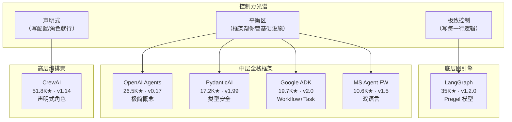

> 历史研究归档 · 2026-11-10 发布 · 发布审核状态：scan_only（发布前程序化隐私扫描）。原有日期、观点、数据和命令保留历史语境，未经本次逐项事实核验或运行复现；见[归档说明](../../../ARCHIVE_POLICY.md)。

# Agent SDK 选型指南（2026 Q2）

> 一句话概括：七大主流 Agent SDK 已形成三层分化格局——底层图引擎（LangGraph）、中层全栈框架（OpenAI/PydanticAI/ADK/MAF）、高层编排壳（CrewAI）；AutoGen 退出竞争进入维护模式，Google ADK 刚发布 2.0 重大架构变更。选型核心不是"谁最强"，而是"你的团队在控制力-生产力光谱上站哪个位置"。
> 研究日期：2026-05-21
> 关联报告：无（本次为独立重复调研，测试 agent.md 修改效果）

---

## 目录

- [定位透镜：纵横坐标](#定位透镜纵横坐标)
- [数据快照：七大 SDK 实时状态](#数据快照七大-sdk-实时状态)
- [甜区深度拆解](#甜区深度拆解)
- [竞争格局图：控制力 × 语言栈](#竞争格局图控制力--语言栈)
- [六场景决策树](#六场景决策树)
- [最佳实践与反模式](#最佳实践与反模式)
- [结论与推荐路径](#结论与推荐路径)
- [信息来源清单](#信息来源清单)
- [开放问题与后续计划](#开放问题与后续计划)

---

## 定位透镜：纵横坐标

### 纵轴 · 演化脉络

Agent SDK 的演化经历了三个明确阶段：

**第一阶段：对话链时代（2023H1）**
LangChain 率先将"LLM + 工具调用"封装为 Agent 抽象。但早期实现本质是线性 Chain，无法表达分支、循环和持久化。痛点：一旦出错只能从头来，无法 human-in-the-loop。

**第二阶段：图引擎觉醒（2023H2—2024H2）**
LangGraph 引入有状态图（StateGraph）解决了持久化和循环问题。AutoGen 推广了多 Agent 对话模式。CrewAI 降低了多 Agent 门槛。这一阶段的关键转折是 OpenAI 发布 Function Calling 标准化了工具调用协议。

**第三阶段：厂商官方入场 + 标准化浪潮（2025—至今）**
OpenAI（Agents SDK）、Google（ADK）、Microsoft（Agent Framework）相继推出官方 SDK。标志性事件：
- 2025-03：OpenAI Agents SDK 发布，轻量+强 tracing
- 2025-04：Google ADK 1.0 发布，深度绑定 Gemini 生态
- 2025-06：Microsoft 宣布 AutoGen 维护模式，推 Agent Framework
- 2025-11：PydanticAI 爆发性增长，主打类型安全
- **2026-05-20（昨天）**：Google ADK 2.0 发布，引入 Workflow Runtime 和 Task API，**breaking changes**

**生命周期定位**：

| SDK | 阶段 | 判断依据 |
|-----|------|---------|
| LangGraph | 成熟期 | v1.2.0，企业级客户（Klarna/Replit），API 稳定 |
| CrewAI | 上升→成熟 | 51.8K Stars，v1.14.5，但核心架构未大变 |
| OpenAI Agents SDK | 快速上升期 | v0.17.3（0.x = API 未锁定），100 releases in ~14 months |
| Google ADK | **动荡期** | v2.0.0 刚发 breaking changes，1.x session 不兼容 |
| PydanticAI | 快速上升期 | v1.99.0（暗示 v2.0 在即），461 contributors，极活跃 |
| MS Agent Framework | 早期上升 | v1.5.0，从 Semantic Kernel 演化而来，但社区尚小 |
| AutoGen | **衰退期** | 官方标注 Maintenance Mode，不再接受新功能 |

### 横轴 · 竞争格局

七个产品看似同场竞技，实际在做**不同层次的事情**。核心分歧是**设计哲学**：

| 设计哲学 | 代表 | 核心信条 |
|---------|------|---------|
| **"给你积木，自己搭"** | LangGraph | 不做抽象，图就是一切，你对每个节点负全责 |
| **"最少概念，最快跑通"** | OpenAI Agents SDK | Agent + Tool + Handoff 三个概念走天下 |
| **"类型即文档"** | PydanticAI | 如果 IDE 能推断出来，你就不可能写错 |
| **"声明式角色协作"** | CrewAI | 像写剧本一样定义 Agent 的角色、目标、任务 |
| **"谷歌全家桶入口"** | Google ADK | 深度绑定 Gemini + Vertex + Cloud Run |
| **"企业级全栈"** | MS Agent Framework | 图编排 + 持久化 + A2A + 可观测 + 多语言 |

### 交叉判断

纵轴告诉我们：**官方 SDK 正在挤压社区框架的生存空间**。当 OpenAI 自己出了 Agents SDK 并且迭代飞快（100 releases/14 months），纯封装 OpenAI API 的第三方框架的护城河在消失。

横轴告诉我们：能活下来的第三方框架必须有**不可替代的差异化**——LangGraph 的差异是极致的控制力和持久化能力，PydanticAI 的差异是类型系统和 Logfire 生态，CrewAI 的差异是最低上手门槛。

两轴交叉的结论：**2026 年选 Agent SDK 不应该问"哪个最好"，而是问"我的团队对控制力的需求在哪个位置"**。

---

## 数据快照：七大 SDK 实时状态

> 📅 数据获取日期：2026-05-21

| SDK | Stars | Version | 语言 | License | 最近 Release | Contributors | Forks |
|-----|-------|---------|------|---------|-------------|--------------|-------|
| AutoGen ⚠️ | 58.2K | v0.7.5 | Py/C#/TS | MIT | 2025-09-30 | 558 | 8.8K |
| CrewAI | 51.8K | 1.14.5 | Python | MIT | Yesterday | 318 | 7.2K |
| LangGraph | ~35K | 1.2.0 | Py/JS | MIT | 2026-05-12 | ~200 | 5.5K |
| OpenAI Agents SDK | 26.5K | 0.17.3 | Python | MIT | Yesterday | 292 | 4.1K |
| Google ADK | 19.7K | 2.0.0 | Python | Apache-2.0 | 14h ago | 279 | 3.4K |
| PydanticAI | 17.2K | 1.99.0 | Python | MIT | 5h ago | 461 | 2.1K |
| MS Agent Framework | 10.6K | 1.5.0 | Py/.NET | MIT | Yesterday | 144 | 1.7K |

**注意**：AutoGen 标注 Maintenance Mode，官方引导迁移至 MS Agent Framework。Stars 高是历史积累，不代表当前活跃度。

---

## 甜区深度拆解

### 1. LangGraph · 底层图引擎之王

**甜区**：需要极致控制力的复杂 Agent 系统——长时运行、需要 checkpoint/resume、自定义状态机、非标准控制流。

**核心优势**：
- Durable Execution：故障自动恢复，从精确断点继续
- 状态粒度控制：你定义 State TypedDict，框架负责持久化和传递
- Human-in-the-loop 是一等公民（interrupt → 修改 state → resume）
- 与 LangSmith 深度集成的可视化调试

**致命短板**：
- **学习曲线陡峭**：一个"Hello World"级 Agent 也需要理解 StateGraph/Node/Edge/Compile/Invoke 五个概念
- **样板代码多**：每个节点要手写状态读写逻辑
- **LangChain 生态耦合**：虽然声称可独立使用，但最佳体验需要 LangSmith 付费服务
- **部署依赖 LangSmith Deployment**：自托管持久化需要额外工程投入

**适合谁**：有 3-5 人 Agent 专项团队、需要生产级可靠性、愿意投入学习成本换取长期回报的工程团队。

**不适合谁**：快速原型验证、1-2 人小团队、简单的单 Agent 工具调用场景。

---

### 2. OpenAI Agents SDK · 极简主义标杆

**甜区**：以 OpenAI 模型为主力、追求最小概念集、快速从零到产品的开发者。

**核心优势**：
- **概念极少**：Agent（指令+工具+handoff）→ Runner.run() → 完事。三个概念覆盖 80% 场景
- 内置 Tracing UI，开箱即用的可观测性
- Guardrails（输入输出校验）是一等公民
- Session 管理（含 Redis 支持）解决了多轮对话持久化
- **Sandbox Agent（v0.14+）**：预配环境的长时间运行 Agent，可操作文件系统
- Provider-agnostic：支持 100+ LLM（通过 LiteLLM/any-llm）

**致命短板**：
- **v0.x 版本**：API 未锁定，14 个月 100 个 release = 破坏性变更频率高
- 多 Agent 编排能力有限：Handoff 是扁平的，不支持图级别的分支/循环/并行
- 无内建持久化/checkpoint：Sandbox Agent 是朝这方向走但能力有限
- **OpenAI 第一优先**：虽然声称 provider-agnostic，但 Realtime Agent 等高级特性仍绑定 OpenAI

**适合谁**：80%+ 调用走 OpenAI、追求最快 time-to-first-value、接受"先跑通再说"的团队。

**不适合谁**：需要复杂多 Agent DAG、需要 API 稳定性保证（v0.x 是硬伤）、或者模型供应商必须多元化的场景。

---

### 3. CrewAI · 声明式编排甜蜜圈

**甜区**：非深度技术背景的 AI 应用开发者、快速搭建"角色扮演"式多 Agent 协作的原型。

**核心优势**：
- **最低上手门槛**：YAML 定义 Agent 角色/目标/任务，无需理解图/状态机
- Crews（自主协作）+ Flows（事件驱动）双模式覆盖广
- CLI 脚手架 `crewai create crew` 30 秒出项目
- 100K+ 认证开发者社区，教程生态丰富
- 完全独立于 LangChain（从零自研）

**致命短板**：
- **黑盒问题**：Agent 间的交互逻辑对开发者不透明，出错难定位
- 执行效率存疑：框架层开销大（自称比 LangGraph 快 5.76x，但仅在特定 benchmark）
- **过度依赖 LLM 推理**做编排：当 LLM 判断错误时，任务链可能走偏且无法干预
- 生产级能力弱：缺少原生 checkpoint、durable execution、细粒度错误恢复
- 控制粒度粗：想定制内部 prompt 或执行逻辑时，很快触碰框架天花板

**适合谁**：快速验证"多 Agent 能不能解这个问题"的 PoC 阶段、非工程主导的 AI 项目探索。

**不适合谁**：需要精确控制每一步的生产系统、对延迟/成本敏感的场景、SLA 要求高的企业应用。

---

### 4. Google ADK 2.0 · 谷歌生态深度绑定

**甜区**：已在 Google Cloud 上、以 Gemini 为主力模型、需要 Workflow + Task API 的团队。

**核心优势**：
- **Workflow Runtime（2.0 新）**：图级执行引擎，支持路由/fan-out/fan-in/循环/重试/状态管理
- **Task API（2.0 新）**：结构化 Agent 间委托，支持多轮 task mode
- `adk web` 一键启动开发 UI
- 与 Vertex AI、Cloud Run 原生集成
- 代码优先（code-first），不搞 YAML magic

**致命短板**：
- **2.0 刚发布（昨天！）**：Breaking changes，1.x session 不兼容，API 尚需稳定期
- **Gemini 优先**：`model="gemini-2.5-flash"` 是默认体验，其他模型支持是"能用"而非"好用"
- Issues 487 / PRs 337 积压——新框架的典型成长痛
- 相比 LangGraph 的 StateGraph 成熟度，ADK 的 Workflow 还需要更多实战验证
- **Python 3.11+** 要求偏高（其他框架 3.10+）

**适合谁**：Google Cloud 原住民、Gemini 重度用户、愿意承担 2.0 早期不稳定性换取未来生态红利的团队。

**不适合谁**：需要立刻稳定生产的项目（等 2.1-2.2 再入坑）、多云/多模型是刚需的场景。

---

### 5. PydanticAI · 类型安全主义的极致

**甜区**：重视代码质量和可维护性、有 FastAPI 经验、需要强类型保障的 Python 工程团队。

**核心优势**：
- **全链路类型安全**：`Agent[SupportDependencies, SupportOutput]` — IDE 自动补全覆盖 deps/output/tools
- 依赖注入（DI）是一等公民：`RunContext[T]` 让工具函数天然可测试
- Model-agnostic 做得最彻底：OpenAI/Anthropic/Gemini/DeepSeek/本地 Ollama 一视同仁
- Pydantic Logfire 集成（OpenTelemetry 标准）
- **Capabilities 系统**：Thinking、WebSearch、MCP 作为可组合的能力包
- Evals 内置（`pydantic_evals` 包）
- Graph 支持（`pydantic_graph` 包）弥补了复杂流程需求
- A2A 协议支持

**致命短板**：
- **v1.99.0 = v2.0 前夕**：意味着即将有 breaking changes（正在准备 v2）
- 非"开箱多 Agent"：需要自己组合 Graph + Agent，不如 CrewAI/ADK 那样"写个 YAML 就多 Agent"
- Logfire 是 Pydantic 公司的商业产品——最佳可观测体验绑定付费
- 社区生态（教程、示例）不如 CrewAI/LangGraph 丰富
- **多 Agent 编排不如 LangGraph 成熟**：pydantic_graph 相对年轻

**适合谁**：FastAPI 背景团队、类型安全是团队文化、需要模型灵活切换、重视测试和代码质量的工程团队。

**不适合谁**：追求"最快跑通 demo"、不习惯类型标注的 Python 使用者、需要开箱即用的多 Agent 模式。

---

### 6. Microsoft Agent Framework · 企业全栈继任者

**甜区**：Azure 生态企业、需要 Python + .NET 双语言支持、已有 Semantic Kernel 投资的团队。

**核心优势**：
- **双语言一致 API**：Python 和 .NET 共享相同的架构概念
- 图级工作流：sequential/concurrent/handoff/group 四种编排模式
- Foundry Hosted Agents：两行代码部署到 Azure
- Declarative Agents（YAML 定义 Agent）
- A2A 协议支持
- OpenTelemetry 原生集成
- 来自 Semantic Kernel + AutoGen 的成熟经验

**致命短板**：
- **社区尚小**：10.6K Stars、144 contributors，生态不成熟
- **Azure 倾斜严重**：`FoundryChatClient` + `AzureCliCredential` 是默认体验，非 Azure 用户摩擦大
- 文档和示例质量参差不齐（框架太新）
- **心智负担重**：Core API + AgentChat + Extensions + Workflows + Hosting 五层概念
- 继承了 AutoGen/Semantic Kernel 的历史包袱——迁移指南本身就说明了复杂性

**适合谁**：Azure 企业客户、需要 .NET 支持（这是唯一的非纯 Python 一线选手）、已有 Semantic Kernel 或 AutoGen 投资的团队。

**不适合谁**：非微软生态、小团队快速原型、Python 单语言团队。

---

### 7. AutoGen · 退出历史舞台

**状态**：⚠️ **Maintenance Mode**。不再接受新功能，仅社区维护 bug fix。官方明确引导迁移至 MS Agent Framework。

**遗产价值**：消息传递模型（pub-sub agent 通信）、分层 API 设计（Core/AgentChat/Extensions）、Magentic-One 多模态 Agent 团队。

**建议**：新项目不应选用。已有 AutoGen 项目按[迁移指南](https://learn.microsoft.com/en-us/agent-framework/migration-guide/from-autogen/)迁移至 MAF。

---

## 竞争格局图：控制力 × 语言栈



---

## 六场景决策树

### 场景 1：快速 PoC / Hackathon（1-3 天出 demo）

**推荐**：OpenAI Agents SDK 或 CrewAI

- 用 OpenAI 模型 → **OpenAI Agents SDK**（最少概念，最快跑通）
- 需要多 Agent "角色扮演" → **CrewAI**（30 秒脚手架）
- 不确定用什么模型 → **PydanticAI**（model-agnostic 做得最好）

### 场景 2：生产级单 Agent 系统（工具调用 + 对话 + 结构化输出）

**推荐**：PydanticAI

理由：类型安全让你在编写时就发现错误，DI 让工具函数天然可测试，Logfire/OTel 提供生产可观测。OpenAI Agents SDK 是备选但 v0.x 的 API 不稳定是减分项。

### 场景 3：复杂多 Agent DAG（分支/循环/持久化/长时运行）

**推荐**：LangGraph

理由：这是 LangGraph 的绝对甜区。Durable Execution + Checkpoint + 精确状态控制是其他框架无法匹敌的。代价是学习曲线和样板代码，但在这个场景下值得。

### 场景 4：Azure 企业 + .NET 团队

**推荐**：Microsoft Agent Framework

理由：这是唯一提供 Python/.NET 一致 API 的框架。如果你的后端是 C# + Azure，没有第二选择。

### 场景 5：Google Cloud + Gemini 为主力

**推荐**：Google ADK（但等 2.1 再用于生产）

理由：生态集成是实打实的优势。但 v2.0.0 刚发布（**昨天**），breaking changes 尚未被社区充分测试。建议：用 ADK 做新项目实验，但生产系统暂时用 LangGraph 或 PydanticAI 过渡。

### 场景 6：模型供应商必须灵活切换 / 避免 vendor lock-in

**推荐**：PydanticAI > LangGraph > OpenAI Agents SDK

理由：PydanticAI 对多 provider 的支持最均匀（无任何一家优先）。LangGraph 本身 model-agnostic 但最佳体验依赖 LangSmith（LangChain 的付费服务）。OpenAI Agents SDK 虽然支持 100+ LLM 但高级特性（Realtime Agent）仍 OpenAI-only。

---

## 最佳实践与反模式

### 最佳实践

**1. 先验证核心假设，再选框架**

```python
# ✅ 正确：先用原始 API 验证 LLM 能不能解决你的问题
from openai import OpenAI
client = OpenAI()
response = client.responses.create(
    model="gpt-4.1",
    input="Analyze this contract for risks: ...",
    tools=[{"type": "function", "function": {...}}]
)
# 确认 LLM 能力足够后，再引入框架处理编排/持久化/可观测
```

```python
# ❌ 错误：还没验证 LLM 能力就先花一周搭框架
from langgraph.graph import StateGraph
# ... 200 行图定义 ...
# 结果发现 LLM 根本不能准确完成核心任务
```

**2. 可观测性从 Day 1 开始，不是 Day N**

```python
# ✅ PydanticAI + Logfire 示例
import logfire
logfire.configure()  # 一行代码，所有 Agent 调用自动 tracing

agent = Agent('openai:gpt-4.1', instructions='...')
result = await agent.run('...')
# Logfire 自动记录：input/output/latency/token_count/tool_calls
```

```python
# ✅ OpenAI Agents SDK 自带 tracing
from agents import Agent, Runner, trace
with trace("my_workflow"):
    result = await Runner.run(agent, "...")
# 内置 UI 可视化 trace
```

```python
# ❌ 反例：生产上线了才发现不知道 Agent 为什么返回错误结果
# 补 tracing 时发现需要改大量代码
```

**3. 把 Agent 当微服务设计：单一职责 + 明确接口**

```python
# ✅ 正确：每个 Agent 有清晰的输入输出类型
from pydantic_ai import Agent
from pydantic import BaseModel

class RiskReport(BaseModel):
    risk_level: int  # 0-10
    findings: list[str]
    recommendation: str

risk_agent = Agent(
    'anthropic:claude-sonnet-4-6',
    output_type=RiskReport,  # 结构化输出，Pydantic 自动验证
    instructions="分析合同风险..."
)
```

```python
# ❌ 错误：一个 God Agent 做所有事情
agent = Agent(instructions="你是全能助手，能分析合同、写代码、做翻译、算数学...")
# 结果：每个任务都做得平庸，出错时无法定位是哪个能力出了问题
```

**4. Handoff/委托优于单 Agent 塞满工具**

```python
# ✅ OpenAI Agents SDK 的 Handoff 模式
from agents import Agent

math_agent = Agent(name="math", instructions="你是数学专家")
code_agent = Agent(name="code", instructions="你是代码专家")
router = Agent(
    name="router",
    instructions="根据问题类型委托给专家",
    handoffs=[math_agent, code_agent]
)
```

```python
# ❌ 反例：给一个 Agent 挂 30 个工具
agent = Agent(tools=[tool1, tool2, ..., tool30])
# 工具越多，LLM 选错工具的概率越高，延迟越大
```

**5. 成本控制：Token 预算 + 早停机制**

```python
# ✅ 设置 max iterations 防止 Agent 死循环
from agents import Agent, Runner
result = await Runner.run(
    agent, "...",
    max_turns=10  # 硬性上限，防止无限循环烧钱
)
```

```python
# ✅ CrewAI 的 max_iter 控制
from crewai import Agent
agent = Agent(
    role="researcher",
    max_iter=5,  # 最多 5 轮工具调用
    max_rpm=10   # 速率限制
)
```

**6. 测试策略：Mock 模型层，测试逻辑层**

```python
# ✅ PydanticAI 的 TestModel 支持
from pydantic_ai import Agent
from pydantic_ai.models.test import TestModel

agent = Agent('openai:gpt-4.1', output_type=MyOutput)

# 单元测试时 mock LLM，只测工具逻辑和编排
with agent.override(model=TestModel()):
    result = await agent.run("test input")
    assert result.output.field == expected_value
```

```python
# ❌ 反例：每次测试都真实调用 LLM
# 结果：测试慢、不确定性高、CI 成本爆炸
```

**7. 渐进式采纳：先单 Agent，再多 Agent**

正确的演进路径：
1. 原始 API 验证 LLM 能力 → 确认可行
2. 单 Agent + 工具调用（PydanticAI/OpenAI SDK）→ 解决 80% 问题
3. 发现单 Agent 不够时，引入 Handoff 或简单 DAG
4. 真正需要复杂编排时，才上 LangGraph 级别的图引擎

大多数项目**永远不需要走到第 4 步**。

---

### 反模式清单

| 反模式 | 症状 | 根因 | 修正 |
|--------|------|------|------|
| **框架先行** | 花一周搭框架，核心 LLM 能力未验证 | 技术兴奋驱动而非问题驱动 | 先 API 验证，确认可行再引入框架 |
| **God Agent** | 一个 Agent 挂 20+ 工具，经常选错 | 低估了 LLM 工具选择的错误率 | 拆分为专责 Agent + Router |
| **过度编排** | 3 个节点的任务用了 50 行 StateGraph | 被 LangGraph 的能力吸引而非需求驱动 | 简单流程用 if/else，复杂流程才用图 |
| **忽视成本** | Agent 循环 50 轮才得到答案 | 无 max_turns/early_stop 控制 | 设置硬性上限 + 成本监控告警 |
| **裸跑无 trace** | "Agent 为什么返回这个结果？"——不知道 | Day 1 没上可观测 | Logfire/LangSmith/OpenTelemetry 从第一行代码就接入 |
| **Lock-in 不自知** | 发现要换模型时，改动遍及全代码库 | 业务逻辑与模型调用耦合 | 用框架的 model-agnostic 接口隔离 |
| **追星选型** | "它 Stars 最多所以最好" | Stars ≠ 适合你的场景 | Stars 看社区健康度，选型看约束匹配度 |

---

## 结论与推荐路径

### 明确推荐（按场景）

| 你的情况 | 第一选择 | 第二选择 | 不要选 |
|---------|---------|---------|--------|
| Python 团队，要快 | OpenAI Agents SDK | PydanticAI | LangGraph（杀鸡牛刀） |
| Python 团队，要稳 | PydanticAI | LangGraph | Google ADK 2.0（太新） |
| 复杂 DAG，要控制 | LangGraph | — | CrewAI（控制力不足） |
| Azure + .NET | MS Agent Framework | — | 纯 Python 方案 |
| Google Cloud | Google ADK（实验）| PydanticAI（生产过渡）| — |
| 最快出 demo | CrewAI | OpenAI Agents SDK | LangGraph |
| 避免 vendor lock | PydanticAI | LangGraph | OpenAI/ADK/MAF |

### 2026 Q2 的趋势判断

1. **PydanticAI 是当前综合性价比最高的选择**——类型安全、model-agnostic、DI 可测试性、即将到来的 v2.0。如果你是 Python 工程团队且不确定选什么，从这里开始错不了。

2. **OpenAI Agents SDK 在快速收敛**——从 v0.1 到 v0.17 只用了 14 个月，Session/Sandbox/Guardrails 都加上了。一旦到 v1.0 锁定 API，它可能成为默认选择。但现在还是 0.x = 等等党合理。

3. **LangGraph 地位稳固但天花板清晰**——它解决的问题（有状态图编排 + 持久化）是刚需，但护城河越来越薄：Google ADK 2.0 和 PydanticAI 的 pydantic_graph 都在侵蚀这个位置。

4. **CrewAI 的风险在于天花板低**——在"快速出 demo"这个甜区它很强，但用户一旦需要定制/debug，很快撞墙。Stars 多但 repeat user 的技术深度存疑。

5. **Google ADK 2.0 是 dark horse**——如果 Google 认真投入（看起来是的，19.7K Stars + 大量 IC 投入），半年后它可能是 Gemini 用户的不二之选。但**现在不要用于生产**。

---

## 信息来源清单

📌 来源清单
- [CrewAI GitHub](https://github.com/crewAIInc/crewAI) — 2026-05-21 — 51.8K Stars, v1.14.5, MIT, 独立于 LangChain
- [OpenAI Agents SDK GitHub](https://github.com/openai/openai-agents-python) — 2026-05-21 — 26.5K Stars, v0.17.3, MIT, provider-agnostic
- [Google ADK GitHub](https://github.com/google/adk-python) — 2026-05-21 — 19.7K Stars, v2.0.0（14h ago!）, Apache-2.0
- [AutoGen GitHub](https://github.com/microsoft/autogen) — 2026-05-21 — 58.2K Stars, MAINTENANCE MODE, 引导至 MAF
- [MS Agent Framework GitHub](https://github.com/microsoft/agent-framework) — 2026-05-21 — 10.6K Stars, v1.5.0, Python/.NET
- [PydanticAI GitHub](https://github.com/pydantic/pydantic-ai) — 2026-05-21 — 17.2K Stars, v1.99.0, 461 contributors
- [LangGraph PyPI](https://pypi.org/project/langgraph/) — 2026-05-21 — v1.2.0, MIT
- [LangGraph GitHub README](https://github.com/langchain-ai/langgraph/blob/main/README.md) — 2026-05-21 — 5.5K Forks, Klarna/Replit/Elastic 企业用户

⚖️ 来源一致性：多源一致（所有数据来自 GitHub 官方页面实时抓取）
📅 时效性声明：以上信息获取于 2026-05-21，其中 Google ADK 2.0 和 PydanticAI v1.99.0 发布于采集当天

---

## 开放问题与后续计划

1. **LangGraph Stars 精确数未获取**——GitHub stargazers 页面未正确返回，估计 30-40K 区间（基于 5.5K forks 推算）
2. **PydanticAI v2.0 的 breaking changes 范围**——v1.99.0 暗示 v2.0 在即，具体变更内容待跟踪
3. **Google ADK 2.0 的 Workflow Runtime 实战表现**——刚发布不到 24 小时，无社区反馈数据
4. **A2A 协议（Agent-to-Agent）的生态收敛度**——PydanticAI/MAF/ADK 都声称支持，但互通性未验证
5. **Anthropic 的 Agent 层策略**——Anthropic 目前没有官方 Agent SDK（仅 tool use API），这是否是有意为之？如果出 SDK 会如何改变格局？
