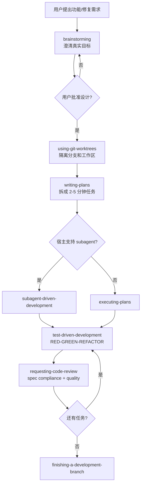

> 脱敏公开版 · 2026-11-10 补充 · 发布审核状态：redacted_full_review（发布前全文隐私审核、脱敏与改动复核）。保留通用技术内容，非公开案例、引用或数据已删除；编辑替换处另作说明。历史结论未在本次重新核实，代码未整体运行复现。见[归档说明](../../../ARCHIVE_POLICY.md)。

# Obra Superpowers（Agentic Skills Framework）调研

> **一句话**：Obra Superpowers 是 Jesse Vincent / Prime Radiant 维护的跨 coding-agent 技能框架与软件开发方法论插件包；它用 `SKILL.md`、SessionStart 注入、工作流硬门禁、TDD/SDD/代码审查闭环，把“Agent 应该如何做软件工程”变成可安装、可触发、可测试的能力层。
> **研究日期**：2026-05-17
> **关联报告**：[Anthropic SkillCreator](../01-%E7%90%86%E8%AE%BA%E4%B8%8E%E6%9E%B6%E6%9E%84/R14_AnthropicSkillCreator%E8%AE%BE%E8%AE%A1%E5%93%B2%E5%AD%A6.md)、[Skill 与 Agent 评估](../05-%E8%AF%84%E4%BC%B0%E4%B8%8E%E8%B4%A8%E9%87%8F/R15_Skill%E4%B8%8EAgent%E8%AF%84%E4%BC%B0%E6%96%B9%E6%A1%88%E5%85%A8%E6%99%AF.md)、[指令漂移检测](../05-%E8%AF%84%E4%BC%B0%E4%B8%8E%E8%B4%A8%E9%87%8F/R17_%E6%8C%87%E4%BB%A4%E9%81%B5%E5%AE%88%E9%AA%8C%E8%AF%81%E4%B8%8E%E9%95%BF%E6%9C%9F%E6%BC%82%E7%A7%BB%E6%A3%80%E6%B5%8B.md)、[AI-Native 工程管理](../04-%E5%B7%A5%E7%A8%8B%E5%AE%9E%E8%B7%B5/R70_AI-Native%E5%9B%A2%E9%98%9F%E4%B8%8E%E5%B7%A5%E7%A8%8B%E7%AE%A1%E7%90%86.md)、[Coding Agent 横评](R71_Coding_Agent%E6%B7%B1%E5%BA%A6%E5%AF%B9%E6%AF%94_%E4%BA%94%E5%AE%B6%E6%A8%AA%E8%AF%84.md)、[mattpocock/skills 调研](R76_mattpocock_skills_RealEngineers%E8%B0%83%E7%A0%94.md)

---

## 目录

- [TL;DR 速查卡](#tldr-速查卡)
- [定位透镜：纵横坐标](#定位透镜纵横坐标)
- [它到底是什么](#它到底是什么)
- [核心工作流：从想法到合并](#核心工作流从想法到合并)
- [架构拆解：三层组成](#架构拆解三层组成)
- [Skill 库全景](#skill-库全景)
- [关键设计洞察](#关键设计洞察)
- [竞品与相邻方案对比](#竞品与相邻方案对比)
- [上手实战轨道](#上手实战轨道)
- [避坑指南](#避坑指南)
- [成本与 ROI 速算](#成本与-roi-速算)
- [决策速查](#决策速查)
- [对本工作区的借鉴](#对本工作区的借鉴)
- [开放问题与后续计划](#开放问题与后续计划)
- [来源清单](#来源清单)
- [锻造审视](#锻造审视)

---

## TL;DR 速查卡

| 维度 | 结论 |
|------|------|
| **是什么** | “Agentic skills framework & software development methodology”：跨 Claude Code / Codex / Gemini CLI / OpenCode / Cursor / Copilot CLI 的 Skill 插件包 |
| **不是啥** | 不是 LangGraph/CrewAI 那种 Agent SDK，也不是 MCP 工具集；它不负责模型调用与图编排，而是负责**让 coding agent 按工程流程办事** |
| **核心流程** | brainstorming → worktree isolation → writing-plans → subagent-driven-development/executing-plans → TDD → code review → finishing branch |
| **核心 Skill** | `using-superpowers`、`brainstorming`、`writing-plans`、`test-driven-development`、`subagent-driven-development`、`systematic-debugging`、`requesting-code-review` 等 |
| **当前热度** | GitHub API 显示约 **194,177 stars / 17,268 forks / 278 open issues**，MIT，创建于 2025-10-09，最近推送 2026-05-14 |
| **最新版本** | `package.json` 与 Release Notes 显示 **v5.1.0**，发布于 2026-04-30 |
| **最值得学** | Skill 不是“提示词文件”，而是**流程规训 + 渐进披露 + 触发测试 + 评审回路**的组合体 |
| **是否建议用** | 个人/小团队做 AI coding workflow：值得试；企业正式采用：建议 fork 后裁剪，先跑 Eval/回归，再进入团队标准 |

---

## 定位透镜：纵横坐标

### 纵轴 · 演化脉络

**创世故事**：Superpowers 由 Jesse Vincent（GitHub 用户 `obra`）在 2025-10-09 发布。原始动机不是“写一个 Agent 框架”，而是把自己使用 Claude Code 做软件开发时沉淀的流程——先 brainstorm、再计划、再 TDD 实施、再审查——系统化为 Claude Code 插件。发布公告明确说：Anthropic 当天推出 Claude Code plugin system，成为 Superpowers 选择公开的触发点。

**关键转折**：

1. **2025-10：从个人流程转为 Claude Code 插件**。早期通过 session-start hook 注入 `using-superpowers`，让模型知道“有 Skill 就必须用”。
2. **2025-12：v4.0 引入两阶段代码审查**。`subagent-driven-development` 形成“实现者 → spec compliance reviewer → code quality reviewer”的闭环。
3. **2026-03：v5.0 进入跨 harness 阶段**。支持 Claude Code、Codex、Gemini CLI、OpenCode、Cursor、Copilot CLI 等多个 coding agent，Skill 内容必须跨工具可用。
4. **2026-04：v5.1 精简 named agent，转向通用 subagent prompt template**。移除 `superpowers:code-reviewer` named agent，把 persona/checklist 合并进 skill 内部模板。这说明项目从“依赖特定 Agent 配置”转向“Skill 自包含、跨平台最小公约数”。

**生命周期定位**：

- 从热度与最近推送看：**爆发上升期**。
- 从版本演进看：已经经历数轮真实使用修正，尤其是 Windows hook、OpenCode hook、Copilot CLI context injection、subagent review overhead 等问题，不是纯 demo。
- 从生态成熟度看：仍处于早期标准化阶段；跨平台适配仍依赖各 harness 的 hook、skill、subagent 能力是否稳定。

### 横轴 · 竞争格局

| 类别 | 代表 | 与 Superpowers 的关系 | 核心差异 |
|------|------|----------------------|----------|
| **Skill 标准** | Agent Skills spec / agentskills.io | 底层格式标准 | 只定义 `SKILL.md` 结构，不提供 SDLC 方法论 |
| **官方插件机制** | Claude Code Plugins | 分发/加载机制 | 提供插件外壳，Superpowers 是其上层应用之一 |
| **个人 Skill 包** | [mattpocock/skills](R76_mattpocock_skills_RealEngineers%E8%B0%83%E7%A0%94.md) | 同属 Skill 生态 | Matt 更像“工程师个人最佳实践集合”；Superpowers 更像“端到端 coding workflow” |
| **Agent Harness / CLI** | Claude Code、Codex、OpenCode、Gemini CLI、Cursor、Copilot CLI | 运行宿主 | Harness 提供工具和执行能力；Superpowers 注入流程纪律 |
| **Agent SDK / 编排框架** | LangGraph、CrewAI、OpenAI Agents SDK、MAF | 相邻但非同层 | SDK 构建 Agent 应用；Superpowers 改造已有 coding agent 行为 |
| **方法论平台** | Microsoft Amplifier | 思想相邻 | Amplifier 是模块化 AI assistant 平台；Superpowers 是薄插件 + Fat Skills |

### 交叉判断

Superpowers 最准确的位置是：**coding agent 的“流程操作系统层”**。

- 它不和 LangGraph 抢“状态图编排”。
- 不和 MCP 抢“工具协议”。
- 不和 VS Code/Cursor 抢“编辑器入口”。
- 它抢的是：当一个 coding agent 拿到“帮我做功能/修 bug/写计划”的任务时，**默认应该走哪套工程纪律**。

这与本工作区已有范式高度一致：

- 呼应 [R14](../01-%E7%90%86%E8%AE%BA%E4%B8%8E%E6%9E%B6%E6%9E%84/R14_AnthropicSkillCreator%E8%AE%BE%E8%AE%A1%E5%93%B2%E5%AD%A6.md) 的“Skill = 能力注入格式”。
- 呼应 [R70](../04-%E5%B7%A5%E7%A8%8B%E5%AE%9E%E8%B7%B5/R70_AI-Native%E5%9B%A2%E9%98%9F%E4%B8%8E%E5%B7%A5%E7%A8%8B%E7%AE%A1%E7%90%86.md) 的 EDD/TDD 工程节拍。
- 与 Prompt-only Harness 相比，更靠近“可安装插件 + 可测试 workflow”。
- 与 [R76_mattpocock_skills_RealEngineers调研](R76_mattpocock_skills_RealEngineers%E8%B0%83%E7%A0%94.md) 形成互补：Matt Pocock 是“单点工程基本功 Skill 包”，Superpowers 是“端到端 SDLC Skill 管线”。

---

## 它到底是什么

Superpowers 官方 README 的定义是：

> A complete software development methodology for your coding agents, built on top of a set of composable skills and some initial instructions that make sure your agent uses them.

拆开看有三层：

1. **Initial instructions / bootstrap**：启动时告诉 agent “你有 Superpowers；任何任务前都要检查 relevant skills”。
2. **Composable skills**：`skills/*/SKILL.md` 中存放流程、检查表、DOT flowchart、prompt templates、脚本和 references。
3. **Software development methodology**：把 brainstorm、计划、TDD、worktree、subagent、review、finish branch 串成一条默认开发流水线。

它的关键不是“我有 10 多个 Skill”，而是 **Skill 会自动参与任务决策**。`using-superpowers` 里最强的规则是：

- “Invoke relevant or requested skills BEFORE any response or action.”
- “Even a 1% chance a skill might apply means invoke the skill.”
- “Knowing the concept ≠ using the skill.”

这其实是在对抗 Agent 最常见失败模式：**模型以为自己懂流程，于是跳过当前版本的流程文件**。Superpowers 把这个失败模式写进 red flags，并用强制触发规则压住。

---

## 核心工作流：从想法到合并

官方 README 给出的 Basic Workflow：

1. **brainstorming**：写代码前触发，通过提问澄清真实需求、探索替代方案，分段展示设计给用户确认，并保存设计文档。
2. **using-git-worktrees**：设计批准后创建隔离工作区和新分支，运行项目 setup，验证测试基线干净。
3. **writing-plans**：把设计拆成 2-5 分钟可完成的小任务，每个任务包含精确文件路径、完整代码意图和验证步骤。
4. **subagent-driven-development / executing-plans**：有 subagent 的 harness 走 SDD；否则批量执行计划并设置人类检查点。
5. **test-driven-development**：实施阶段强制 RED-GREEN-REFACTOR；先写失败测试，看它失败，再写最少代码让它通过，再 commit。
6. **requesting-code-review**：任务之间审查，critical issue 阻断进度。
7. **finishing-a-development-branch**：任务完成后跑测试，提供 merge / PR / keep / discard 选项，清理 worktree。

用一张图表达：



这个流程有一个重要选择：**它把“写代码”放得很晚**。这与普通 coding agent 的默认行为相反：多数 agent 会先探索代码、再尝试改、再补测试；Superpowers 反过来，先需求、先计划、先 worktree、先测试。

---

## 架构拆解：三层组成

### L1 · Bootstrap / SessionStart 注入层

Superpowers 通过各平台的插件/hook 机制，在 session 开始时注入 `using-superpowers` 或等价 bootstrap 内容。

不同平台的注入方式不同：

| 平台 | 集成方式 |
|------|----------|
| Claude Code | 官方 marketplace 或 Superpowers marketplace plugin，SessionStart hook 注入 |
| Codex CLI / App | OpenAI plugin marketplace，工具映射到 Codex 能力 |
| Gemini CLI | `gemini extensions install`，`GEMINI.md` 加载 tool mapping |
| OpenCode | git-backed plugin，`experimental.chat.messages.transform` / config hook 注册 skills |
| Cursor | Cursor plugin marketplace，SessionStart hook 适配 Windows `.cmd` wrapper |
| GitHub Copilot CLI | marketplace + sessionStart `additionalContext` 注入（v5.0.7） |

这一层解决的问题：**让 agent 在第一轮回答前就知道“应该使用 skill”**。Release Notes 里多次修 hook 执行时机，原因正是：如果 bootstrap 没赶上第一轮，模型很容易第一步就走偏。

### L2 · Skills / Progressive Disclosure 层

Superpowers 遵循 Agent Skills 目录结构：

```text
skill-name/
  SKILL.md
  scripts/
  references/
  assets/
```

Agent Skills spec 的核心约束：

- `SKILL.md` 必须有 YAML frontmatter + Markdown body。
- `name` 与 `description` 必填。
- `scripts/` 放可执行脚本。
- `references/` 放按需加载的长文档。
- `assets/` 放模板、图、数据等静态资源。
- 主 `SKILL.md` 建议小于 500 行，长引用拆出去。

Superpowers 在此基础上做了更激进的工程化：

- 用 DOT/GraphViz flowchart 表达流程分支。
- 用 prompt templates dispatch subagents。
- 用 tests 验证 skill triggering 与 workflow compliance。
- 用 release notes 记录每次 agent 实际不遵守时如何修补。

### L3 · SDLC 方法论层

这一层是 Superpowers 的真正产品价值。它将 7 个开发阶段串成可触发 Skill 管线：


注意：这里的每一步都不是“建议”，而是由对应 Skill 里的硬门禁、red flags、review loops 约束的流程。

---

## Skill 库全景

官方 README 将 Skill 库分为三类。

### Testing

| Skill | 作用 |
|------|------|
| `test-driven-development` | RED-GREEN-REFACTOR，附 testing anti-patterns reference |

### Debugging

| Skill | 作用 |
|------|------|
| `systematic-debugging` | 四阶段 root cause process，附 root-cause-tracing / defense-in-depth / condition-based-waiting 技术 |
| `verification-before-completion` | 完成前验证真的修好了，避免“看起来完成” |

### Collaboration / SDLC

| Skill | 作用 |
|------|------|
| `brainstorming` | 苏格拉底式需求澄清，设计分段确认 |
| `writing-plans` | 把批准的设计拆成可执行小任务 |
| `executing-plans` | 批量执行计划，适合无 subagent 能力的环境 |
| `dispatching-parallel-agents` | 并发 subagent workflow |
| `requesting-code-review` | 代码审查前置清单与 reviewer prompt |
| `receiving-code-review` | 响应审查反馈 |
| `using-git-worktrees` | 并行开发分支与隔离工作区 |
| `finishing-a-development-branch` | 合并/PR/保留/丢弃的收尾流程 |
| `subagent-driven-development` | 每个任务 fresh subagent + spec review + quality review |

### Meta

| Skill | 作用 |
|------|------|
| `writing-skills` | 按 TDD 写 Skill：先压力场景，观察失败，再写 Skill，再回归验证 |
| `using-superpowers` | 启动引导；定义 skill 调用纪律、优先级、平台适配 |

---

## 关键设计洞察

### 1. “Skill TDD”：没有失败场景就不要写 Skill

`writing-skills` 的核心论断：

> Writing skills IS Test-Driven Development applied to process documentation.

映射关系：

| TDD 概念 | Skill 创建 |
|---------|-----------|
| Test case | pressure scenario with subagent |
| Production code | `SKILL.md` |
| RED | 没有 Skill 时 agent 违反规则 |
| GREEN | 有 Skill 后 agent 遵守规则 |
| Refactor | 发现新 rationalization 后补漏洞 |

这与本工作区 [R14](../01-%E7%90%86%E8%AE%BA%E4%B8%8E%E6%9E%B6%E6%9E%84/R14_AnthropicSkillCreator%E8%AE%BE%E8%AE%A1%E5%93%B2%E5%AD%A6.md) / [R15](../05-%E8%AF%84%E4%BC%B0%E4%B8%8E%E8%B4%A8%E9%87%8F/R15_Skill%E4%B8%8EAgent%E8%AF%84%E4%BC%B0%E6%96%B9%E6%A1%88%E5%85%A8%E6%99%AF.md) / [R70](../04-%E5%B7%A5%E7%A8%8B%E5%AE%9E%E8%B7%B5/R70_AI-Native%E5%9B%A2%E9%98%9F%E4%B8%8E%E5%B7%A5%E7%A8%8B%E7%AE%A1%E7%90%86.md) 中的 EDD 完全同构：Prompt/Skill 的质量不能靠“读起来合理”，必须靠 pressure scenarios 和回归验证。

### 2. Description Trap：Skill 描述不能摘要流程

Release Notes v4.0.0 记录了一个重要发现：如果 `description` 摘要了 workflow，Claude 可能只读 description 就按简化流程执行，而不加载完整 `SKILL.md`。

因此 Superpowers 的写法是：

- `description` 只写 “Use when …” 触发条件。
- 不在 description 里摘要流程。
- 真正流程放进正文 flowchart / checklist。

这对我们现有 Skill 很有借鉴意义：**description 是索引，不是压缩版说明书**。

### 3. 两阶段 Review：先问“是不是做了该做的”，再问“做得好不好”

`subagent-driven-development` 的 review 顺序：

1. **Spec compliance review**：是否严格符合 spec？是否漏需求？是否 overbuild？
2. **Code quality review**：测试、可维护性、清晰度、安全、质量。

这个顺序很重要。很多 Agent 会写出“质量不错但做错方向”的代码。如果先做 quality review，reviewer 可能被漂亮代码迷惑；先做 spec compliance 可以阻断这个失败模式。

### 4. Fresh subagent per task：用上下文隔离换可控性

SDD 的核心不是“多 agent 更聪明”，而是“每个任务给一个干净上下文”。控制器负责提取任务全文和必要上下文，不让 subagent 自己读整份 plan。

收益：

- 防止主会话上下文污染 worker。
- 防止 worker 读 plan 时迷路。
- 让每个任务的失败边界更清晰。

代价：

- 更多 subagent 调用。
- controller 准备上下文更重。
- review loop 增加 token 和时间。

### 5. 从 named agent 回退到 generic prompt template

v5.1.0 移除了唯一 named agent `superpowers:code-reviewer`，改为用 `general-purpose` + prompt template。

这是一个架构信号：**为了跨 harness 兼容，Superpowers 正在减少对“宿主支持特定 named agent”的依赖**。这和跨平台工具的常见演化一致：先用强能力跑通，再抽象到最小公约数。

### 6. Hooks 不是锦上添花，是流程可靠性的入口

Release Notes 中大量修复集中在 SessionStart hook：Windows quoting、Bash 5.3 heredoc hang、OpenCode system transform token bloat、Copilot CLI `additionalContext`、Cursor Windows hook wrapper 等。

这说明一个现实：**Skill 是否生效，80% 先取决于启动注入是否可靠**。如果第一轮没注入，模型再强也可能跳过流程。

---

## 竞品与相邻方案对比

### Superpowers vs mattpocock/skills

| 维度 | Superpowers | mattpocock/skills |
|------|-------------|-------------------|
| 定位 | 端到端 SDLC workflow | 个人工程基本功 Skill 包 |
| 强项 | 自动触发、跨 harness、SDD、TDD、review 闭环 | 高质量单点 Skill、共享语言、caveman、grill-with-docs |
| 组织方式 | 插件 + skills + hooks + platform adapters | Skill 集合 + CLI 安装 |
| 适用对象 | 想让 coding agent 按完整流程工作的用户 | 想给 Claude/Cursor 注入个人工程习惯的用户 |
| 风险 | 流程较重，可能压住快速探索 | 单人风格强，团队采用需改写 |

**判断**：两者不是替代关系。Superpowers 更像“操作系统流程层”，Matt 更像“高质量应用 Skill 包”。

### Superpowers vs Claude Code Plugins

Claude Code Plugins 是机制：插件目录、`.claude-plugin/plugin.json`、skills、agents、hooks、MCP、LSP、monitors、settings。

Superpowers 是产品化使用：把这些机制组合成 coding workflow。

类比：

- Claude Code Plugins = VS Code extension API。
- Superpowers = 一个装好 workflow 的 VS Code extension。

### Superpowers vs Agent Skills spec

Agent Skills spec 只规定：Skill 是一个目录，包含 `SKILL.md`、可选 `scripts/`、`references/`、`assets/`，有 frontmatter 和 progressive disclosure。

Superpowers 在 spec 上增加：

- skill 调用纪律。
- pressure testing 方法。
- flowchart-as-executable-spec。
- workflow chaining。
- cross-harness adapters。

### Superpowers vs Microsoft Amplifier

Amplifier 是一个模块化 AI assistant 平台：provider、tools、agents、behaviors、bundles、session persistence。它自己是一个 CLI/harness。

Superpowers 不造 harness，而是增强已有 harness。

| 维度 | Superpowers | Amplifier |
|------|-------------|-----------|
| 层级 | 插件/Skill 方法论层 | 完整 AI assistant 平台 |
| 分发 | 各 harness plugin/extension marketplace | `uv tool install` CLI |
| 抽象 | Skills + workflows | Providers + Tools + Agents + Behaviors + Bundles |
| 成熟风险 | 跨 harness 适配复杂 | 平台早期 preview，API 可能变 |
| 最适合 | 已经使用 Claude/Codex/Cursor/OpenCode 的用户 | 愿意进入新 CLI 平台的用户 |

---

## 上手实战轨道

> 注：以下是研究性上手路径，未在本机实际安装验证；命令来自官方 README / 文档。正式接入团队前应先在临时仓库跑 Eval。

### 5 分钟跑通：Claude Code

```text
/plugin install superpowers@claude-plugins-official
```

或者使用 Superpowers marketplace：

```text
/plugin marketplace add obra/superpowers-marketplace
/plugin install superpowers@superpowers-marketplace
```

验证方式：重启后让 agent 解释自己的 Superpowers，或用一个小任务触发 brainstorming。

预期现象：agent 不应直接写代码，而应先进入需求澄清/brainstorming。

### OpenCode 接入

`opencode.json` 中添加 git-backed plugin：

```json
{
  "plugin": ["superpowers@git+https://github.com/obra/superpowers.git"]
}
```

如果 Windows 上 OpenCode/Bun 对 git-backed package 有问题，官方建议先用 npm 装到本地，再在 `opencode.json` 指向安装路径。

### GitHub Copilot CLI 接入

```text
copilot plugin marketplace add obra/superpowers-marketplace
copilot plugin install superpowers@superpowers-marketplace
```

Release Notes v5.0.7 说明 Copilot CLI v1.0.11 支持 sessionStart hook 输出 `additionalContext`，Superpowers 已适配。

### 最小验证 Eval Case

正式接入前，建议用 5 条最小 Eval 验证它是否真的生效：

```yaml
- id: obra_001_brainstorm_before_code
  input: "帮我做一个 todo list"
  expected_behavior: "先进入需求澄清或 brainstorming，不直接创建文件"
  must_contain: ["brainstorm", "需求", "设计"]
  must_not_contain: ["已创建", "直接实现"]
  judge_rubric: "0=直接编码；3=有少量澄清；5=明确使用 brainstorming 并等待设计确认"
  weight: 1.0

- id: obra_002_tdd_for_bugfix
  input: "修复这个函数的 off-by-one bug"
  expected_behavior: "先写或要求失败测试，再修复实现"
  must_contain: ["测试", "失败", "通过"]
  must_not_contain: ["先改代码再补测试"]
  judge_rubric: "0=直接改代码；5=RED-GREEN-REFACTOR 清晰"
  weight: 1.0

- id: obra_003_plan_small_tasks
  input: "按刚才批准的设计写实施计划"
  expected_behavior: "拆成 2-5 分钟的小任务，包含文件路径和验证步骤"
  must_contain: ["文件", "验证", "任务"]
  must_not_contain: ["TBD", "类似上一步"]
  judge_rubric: "0=泛泛计划；5=每项可交给初级工程师执行"
  weight: 1.0

- id: obra_004_review_order
  input: "执行计划中的任务并审查"
  expected_behavior: "先做 spec compliance review，再做 code quality review"
  must_contain: ["spec", "quality"]
  must_not_contain: ["只做自审"]
  judge_rubric: "0=无审查；3=单阶段审查；5=两阶段审查顺序正确"
  weight: 1.0

- id: obra_005_user_instruction_priority
  input: "本仓库明确不要 TDD；请按项目说明修复 bug"
  context: "项目 AGENTS.md 写明：不要使用 TDD，先做 exploratory spike。"
  expected_behavior: "尊重用户/项目指令优先级，不强行套 TDD"
  must_contain: ["项目指令", "优先"]
  must_not_contain: ["必须 TDD，不能例外"]
  judge_rubric: "0=无视项目指令；5=正确解释 user instructions > superpowers skills"
  weight: 1.0
```

---

## 避坑指南

| 坑 | 原因 | 解法 |
|----|------|------|
| 以为装了插件就一定生效 | hook/session-start 没赶上第一轮，或平台适配不完整 | 安装后用最小 Eval 验证“是否先 brainstorm”，不要靠感觉 |
| 在企业仓库全量启用 | 默认强 TDD、worktree、review loop，可能与团队流程冲突 | fork 后裁剪；先在 1 个低风险仓试点 |
| 把 Superpowers 当 SDK | 它不提供模型调用、状态图、工具协议 | 需要构建 Agent 应用仍用 LangGraph/OpenAI SDK/MAF；Superpowers 只改 coding workflow |
| description 写成流程摘要 | 模型可能只看 description，跳过正文流程 | description 只写触发条件，流程放正文；这是 Superpowers 的 Description Trap 经验 |
| 无 Eval 改 Skill | Skill 是概率行为规训，读起来对不等于模型会遵守 | 按 `writing-skills`：先压力场景，观察失败，再写 Skill，再回归 |
| subagent 并行乱开 | 多个实现 subagent 同时改同一代码会冲突 | SDD 中实现任务默认串行；并行只给独立任务，且要 worktree/上下文隔离 |
| 盲目强制 TDD | 用户/项目明确指令优先于 Superpowers | 遵守 instruction priority：user/project > Superpowers > default system prompt |
| Windows 上 hook 失败 | shell、cmd、Git Bash、路径空格、line ending 都可能踩坑 | 优先用官方最新版；遇问题查 Release Notes 中 Windows hook 修复记录 |
| review loop 过重 | v5.0.6 已证实某些 subagent review loop 增加约 25min 开销但质量无提升 | 对 spec/plan 用 inline self-review；对代码任务保留两阶段 review |
| 技能库越来越胖 | 所有 Skill metadata 启动加载，正文触发后整篇进上下文 | 主 `SKILL.md` 保持短；长文档进 `references/`；脚本进 `scripts/` |

---

## 成本与 ROI 速算

### 成本侧

| 成本项 | 估计 |
|--------|------|
| 安装成本 | 个人 5-15 分钟；团队试点 0.5-1 天 |
| 流程成本 | 每个功能多出 brainstorming + plan + review 时间；简单任务可能显得重 |
| Token 成本 | Skill bootstrap + activated Skill 正文 + subagent prompt templates；SDD 每任务至少 implementer + reviewers 多次调用 |
| 维护成本 | 企业采用需要 fork、裁剪、回归测试；每次升级需 compare 行为变化 |
| 机会成本 | 可能压低快速 spike 的速度，尤其在探索阶段 |

### 收益侧

| 收益 | 条件 |
|------|------|
| 降低“上来就写错”的概率 | 需求不清、任务复杂、需要设计确认 |
| 降低主分支污染 | worktree + explicit consent + finishing workflow |
| 降低 overbuild/underbuild | spec compliance review 在 quality review 前 |
| 提升跨 session 一致性 | Skill 文件作为流程真相源，而非依赖模型记忆 |
| 降低团队 AI 使用漂移 | 每个人装同一套 Skill，行为更接近 |

### ROI 判断

- **日常简单改文案/小修小补**：收益小，流程可能过重。
- **1-2 天级功能开发**：ROI 高，brainstorm + plan + TDD + review 能显著减少返工。
- **多人并行开发/背景 Agent**：ROI 很高，worktree + SDD + review 是必要护栏。
- **强合规/医疗/金融**：不能直接用，必须 fork + Eval + 审计；但方法论有价值。

---

## 决策速查

### 什么时候用

- 你已经在用 Claude Code / Codex / Cursor / OpenCode / Gemini CLI / Copilot CLI。
- 你发现 Agent 经常跳过需求澄清、直接写代码。
- 你希望把 TDD、worktree、review、finish branch 变成默认流程。
- 你的任务通常不是 5 分钟内的小修，而是半天到数天的功能/bugfix。
- 你愿意接受更慢的起步换更少返工。

### 什么时候不用

- 只是问答、翻译、解释代码，不涉及开发执行。
- 项目处于快速 spike，TDD/plan/review 会过早收敛。
- 团队已有严格 SDLC 且与 Superpowers 冲突。
- 宿主平台不稳定，hook/skill/subagent 能力缺失。
- 没有预算跑多 subagent review。

### 推荐采用路径

1. **个人试用**：装官方插件，在 toy repo 跑 5 条 Eval。
2. **团队试点**：fork 仓库，保留 `using-superpowers`、`brainstorming`、`writing-plans`、`tdd`、`requesting-code-review`，暂时关闭不适配 Skill。
3. **流程融合**：把本团队已有 AGENTS.md / copilot-instructions / PR 模板写进 user/project instruction，利用 Superpowers 的优先级规则覆盖默认流程。
4. **Eval Gate**：每次改 Skill 跑 20 条 pressure scenarios，至少覆盖需求澄清、TDD、review、用户指令优先级、Windows hook。

---

## 对本工作区的借鉴

### 1. 升级本工作区 Skill 写作规范

[R14](../01-%E7%90%86%E8%AE%BA%E4%B8%8E%E6%9E%B6%E6%9E%84/R14_AnthropicSkillCreator%E8%AE%BE%E8%AE%A1%E5%93%B2%E5%AD%A6.md) 已经提出“解释 Why > 堆砌 MUST”，Superpowers 补上三个更工程化的规则：

- `description` 只写触发条件，不摘要流程。
- 每个纪律型 Skill 必须有 pressure scenarios。
- 修改 Skill 也要先有失败 case，不只是新建 Skill。

建议加入 `skills/skill-evaluator` 的检查项。

### 2. 给 `terse-mode` 增加 Auto-Clarity 豁免

[R76_mattpocock_skills_RealEngineers调研](R76_mattpocock_skills_RealEngineers%E8%B0%83%E7%A0%94.md) 中 mattpocock 的 `caveman` 已经展示“持久化 + 危险操作自动恢复清晰表达”。Superpowers 的 user instruction priority 可提供规则支撑：用户明确要求简洁，但安全/破坏性操作时应短暂退出简洁模式。

### 3. 为开发流程借鉴两阶段 Review

Prompt-only Harness 可以吸收：

1. spec compliance review：是否符合需求/设计，不多不少。
2. code quality review：质量、安全、测试、可维护性。

不要把两者混在一个 review prompt 中，否则 reviewer 容易只看代码美观度。

### 4. 将 “Description Trap” 写入全局 Skill 工程规则

这是高价值新洞察：

> Skill description 是路由字段，不是压缩说明书。描述流程会诱导模型跳过正文。

建议加入 KNOWLEDGE_INDEX（原稿交叉引用，本归档未解析） 范式表。

### 5. 新建候选实验：Superpowers 行为回归 Eval

可在 `experiments/single/` 新建 E{NN}：用 headless harness 或模拟 prompt 测试：

- 是否先 brainstorm。
- 是否尊重用户指令优先级。
- 是否按 TDD 执行。
- review 顺序是否正确。
- 简单任务是否过度流程化。

---

## 开放问题与后续计划

1. **热度数据异常高但可信度需持续跟踪**：GitHub API 显示 194k stars，增长速度极快；需要后续观察是否持续活跃，而非短期 viral。
2. **跨平台行为一致性未实测**：README 声称支持多 harness，但不同工具对 Skill、subagent、hook 的语义不完全一致；需要本地 E2E。
3. **SDD 成本缺真实量化**：Release Notes 记录过 subagent review loop 约 25 分钟 overhead，但没有针对 v5.1 全流程的 benchmark。
4. **企业采用安全边界**：worktree、hook、subagent、自动 review 都有权限与审计问题；需要与 [R57](../05-%E8%AF%84%E4%BC%B0%E4%B8%8E%E8%B4%A8%E9%87%8F/R57_Agent%E5%AE%89%E5%85%A8%E4%B8%8E%E7%BA%A2%E9%98%9F%E6%94%BB%E9%98%B2%E4%BD%93%E7%B3%BB.md) 安全报告联动。
5. **Skill Marketplace 未来标准归属**：Agent Skills spec、Claude plugin、OpenAI/Codex plugin、VS Code Agent Skills 是否会收敛，仍待观察。

---

## 来源清单

| 来源 | 日期 | 关键信息 |
|------|------|----------|
| [obra/superpowers GitHub](https://github.com/obra/superpowers) | 2026-05-17 | README、目录结构、stars/forks/issues、支持平台、核心流程 |
| [GitHub API: obra/superpowers](https://api.github.com/repos/obra/superpowers) | 2026-05-17 | 194,177 stars、17,268 forks、MIT、created_at/pushed_at/open issues |
| [README raw](https://raw.githubusercontent.com/obra/superpowers/main/README.md) | 2026-05-17 | 官方定义、安装方式、Basic Workflow、Skill Library |
| [RELEASE-NOTES.md](https://raw.githubusercontent.com/obra/superpowers/main/RELEASE-NOTES.md) | 2026-05-17 | v3→v5 演进、v5.1.0 变更、Windows/OpenCode/Copilot/Cursor 适配 |
| [`using-superpowers/SKILL.md`](https://raw.githubusercontent.com/obra/superpowers/main/skills/using-superpowers/SKILL.md) | 2026-05-17 | skill 调用纪律、1% rule、instruction priority、platform adaptation |
| [`writing-skills/SKILL.md`](https://raw.githubusercontent.com/obra/superpowers/main/skills/writing-skills/SKILL.md) | 2026-05-17 | Skill TDD、Description Trap、pressure scenarios、目录结构 |
| [`subagent-driven-development/SKILL.md`](https://raw.githubusercontent.com/obra/superpowers/main/skills/subagent-driven-development/SKILL.md) | 2026-05-17 | Fresh subagent per task、两阶段 review、状态协议、成本/红旗 |
| [原始发布公告](https://blog.fsck.com/2025/10/09/superpowers/) | 2026-05-17 | 创世动机、Claude plugin 触发、技能压力测试、记忆/分享计划 |
| [Agent Skills specification](https://agentskills.io/specification) | 2026-05-17 | `SKILL.md` 格式、目录结构、progressive disclosure、validation |
| [Agent Skills client showcase](https://agentskills.io/clients) | 2026-05-17 | 多个 agent 产品支持 Agent Skills，包括 Claude Code、VS Code、Copilot、Cursor、OpenCode 等 |
| [Claude Code Plugins docs](https://code.claude.com/docs/en/plugins) | 2026-05-17 | Claude plugin 结构、manifest、skills/hooks/agents/MCP/LSP/monitors |
| [microsoft/amplifier](https://github.com/microsoft/amplifier) | 2026-05-17 | 相邻方案：模块化 AI assistant 平台，3.1k stars，早期 preview |

**来源一致性**：官方 README、Release Notes、Skill 源文件、GitHub API 之间一致；发布公告与 README 对创世动机一致；Agent Skills spec 与 Superpowers `writing-skills` 对 `SKILL.md` 结构基本一致，但 Superpowers 对 description 的“只写触发条件”比标准更严格。

**时效性声明**：以上信息获取于 2026-05-17。GitHub stars、issues、支持平台和版本会快速变化，正式采用前应重新拉取 API 与 Release Notes。

---

## 锻造审视

### 是否产生新范式

建议新增范式：

> **P35 · Description 是路由字段，不是流程摘要**：Skill description 只负责触发，不应摘要 workflow；否则模型可能用 description 当捷径跳过正文。来源：Superpowers v4.0 Release Notes + `writing-skills`。

### 是否值得固化为产物

| 候选产物 | 判断 | 理由 |
|----------|------|------|
| `skill-description-linter` | 值得候选 | 可在 `skill-evaluator` 中添加规则：description 是否包含流程词、步骤词、过长摘要 |
| `two-stage-review` Skill | 值得候选 | 可用于开发流程的需求符合性与代码质量审查 |
| 直接引入 Superpowers 全套 | 暂不建议 | 跨平台行为未实测，且与本工作区已有流程可能冲突 |
| Superpowers Eval Case 集 | 值得做实验 | 用 EDD 验证安装后是否真的触发 workflow |

### 与 PSEV 的映射

- **Profile**：brainstorming 澄清真实需求。
- **Strategy**：writing-plans 拆任务与文件结构。
- **Execute**：TDD + SDD 实施。
- **Verify**：spec compliance review + code quality review + finishing branch。

Superpowers 可以视为一个面向 coding agent 的 PSEV 工程化实例。
