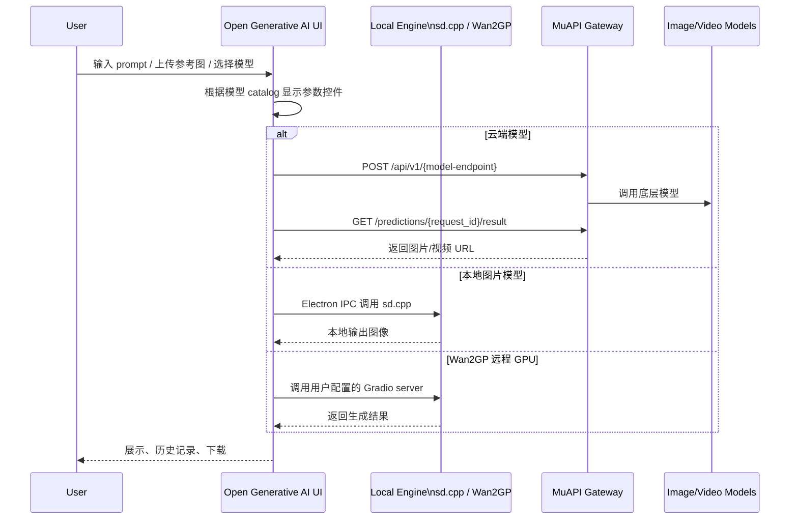
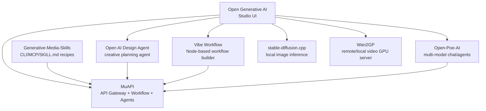

> 历史研究归档 · 2026-11-10 发布 · 程序扫描；未逐篇全文审阅。原有日期、观点、数据和命令保留历史语境，未经本次逐项事实核验或运行复现；请结合[归档说明](../../../ARCHIVE_POLICY.md)阅读。

# Open Generative AI 调研

> **一句话**：`Anil-matcha/Open-Generative-AI` 是一个面向 AI 图片、视频、口型同步、电影镜头控制的开源创意生成 Studio；它用 Next.js + Electron 做产品壳，以 MuAPI 作为主模型网关，并通过 `sd.cpp` 与 Wan2GP 补充本地/远程 GPU 推理能力。
> **研究日期**：2026-05-17
> **关联报告**：[多模态 Agent 与 Computer Use](R66_%E5%A4%9A%E6%A8%A1%E6%80%81Agent%E4%B8%8EComputerUse%E8%B0%83%E7%A0%94.md)、[LLM/Agent 经济学](../04-%E5%B7%A5%E7%A8%8B%E5%AE%9E%E8%B7%B5/R69_LLM_Agent%E7%BB%8F%E6%B5%8E%E5%AD%A6%E4%B8%8E%E5%95%86%E4%B8%9A%E5%86%B3%E7%AD%96.md)、[Agent 网关设计](../04-%E5%B7%A5%E7%A8%8B%E5%AE%9E%E8%B7%B5/R64_Agent%E7%BD%91%E5%85%B3%E8%AE%BE%E8%AE%A1_AI_Gateway_LLM_Gateway_MCP_Gateway%E4%B8%89%E5%B1%82%E6%8B%86%E8%A7%A3.md)、[推理部署工程指南](../04-%E5%B7%A5%E7%A8%8B%E5%AE%9E%E8%B7%B5/R58_LLM%E6%8E%A8%E7%90%86%E9%83%A8%E7%BD%B2%E5%B7%A5%E7%A8%8B%E6%8C%87%E5%8D%97_%E9%87%8F%E5%8C%96%E4%B8%8E%E6%8E%A8%E7%90%86%E5%BC%95%E6%93%8E.md)、[Agent 网页爬虫技术调研](R79_Agent%E7%BD%91%E9%A1%B5%E7%88%AC%E8%99%AB%E6%8A%80%E6%9C%AF%E8%B0%83%E7%A0%94.md)、[Obra Superpowers](../02-%E7%9F%A5%E8%AF%86%E7%AE%A1%E7%90%86%E4%B8%8E%E4%B8%8A%E4%B8%8B%E6%96%87/R80_%E5%A4%9A%E6%A8%A1%E6%80%81%E6%95%B0%E6%8D%AE%E8%BD%AC%E6%96%87%E6%9C%AC%E6%8A%80%E6%9C%AF%E5%85%A8%E6%99%AF%E8%B0%83%E7%A0%94.md)

---

## TL;DR 速查卡

| 维度 | 结论 |
|------|------|
| **项目定位** | 开源 AI 图片/视频/口型同步/电影镜头工作台，主打“开源替代 AI Video Platforms” |
| **实时热度** | GitHub API：14,533 stars / 2,525 forks / 12 open issues；创建于 2023-05-09，最近推送 2026-05-16 |
| **最新版本** | `package.json` 为 v1.0.11；GitHub Release 最新 v1.0.11，发布于 2026-05-11 |
| **技术栈** | Next.js 15 / React 19 / Electron 33 / Vite / Tailwind v3 / npm workspaces / MuAPI |
| **核心能力** | Image Studio、Video Studio、Lip Sync Studio、Cinema Studio、Workflow Studio、桌面端本地推理 |
| **模型来源** | 云端主要依赖 MuAPI；本地图片推理走 stable-diffusion.cpp；本地/远程视频推理走 Wan2GP Gradio server |
| **许可证状态** | README 声称 MIT，但 GitHub API `license=null` 且根目录 `LICENSE` 抓取 404；正式商用前需补查或要求作者补 LICENSE |
| **一句话建议** | 想快速研究“AI 创意工具产品壳”值得看；若要生产商用，必须先评估 MuAPI 依赖、许可证、内容安全和成本模型 |

---

## 定位透镜：纵横坐标

### 纵轴 · 演化脉络

Open Generative AI 的出现，背景是 AI 图片/视频平台从“单模型体验”走向“多模型创意工作台”。用户不再只想调用某个模型，而是想在一个界面里完成文生图、图生图、文生视频、图生视频、lip sync、镜头控制、工作流编排与历史管理。

关键转折有四个：

1. **从 Web Studio 到桌面应用**：通过 Electron 打包 macOS/Windows/Linux 安装包，降低非开发者使用门槛。
2. **从云 API 到混合推理**：早期价值主要是 MuAPI 模型聚合前端；近期 release 重点转向本地推理，包括 `sd.cpp`、Wan2GP、Metal GPU、Linux/Windows 下载修复。
3. **从单 Studio 到生态套件**：与 `Vibe-Workflow`、`Open-AI-Design-Agent`、`Open-Poe-AI`、`Generative-Media-Skills` 形成“Studio UI + Workflow + Agent + Skills”的创意 AI 生态。
4. **从人工 UI 到 Agent 自动化**：README 直接推荐 `Generative-Media-Skills`，让 Claude Code、Codex、Cursor 等 coding agent 从终端驱动 200+ 媒体模型。

**生命周期判断**：项目处于爆发上升期但工程边界仍在快速变化。证据是仓库 14.5k stars、近一天内仍有提交、最近一个月 release 密集；同时 release notes 与 issues 显示本地推理、子模块、Windows/Linux 打包、API key gating、upload proxy 安全等仍在持续修补。

### 横轴 · 竞争格局

| 层级 | 代表 | Open Generative AI 的位置 |
|------|------|---------------------------|
| 封闭创意平台 | Runway、Krea、Freepik、Pika、Veo/Sora 入口 | 用开源 UI + BYOK/API 网关替代封闭体验 |
| 节点式工作流 | ComfyUI、Krea Nodes、Weavy、FloraFauna | 通过 Vibe Workflow 补工作流层，但本仓库更偏 Studio UI |
| API 聚合网关 | fal.ai、Replicate、WaveSpeed、MuAPI | 强依赖 MuAPI，自己不是独立模型网关 |
| 本地推理 GUI | ComfyUI、A1111、Fooocus、sd.cpp webui、WanGP | 只做轻量本地入口，不是完整本地模型管理平台 |
| Agent 媒体自动化 | MuAPI MCP、Generative-Media-Skills | 通过兄弟项目提供 terminal/MCP/Skill 自动化能力 |

### 交叉判断

Open Generative AI 最准确的生态位是：**创意生成领域的开源产品壳与模型聚合工作台**。

它的价值不是“训练了新模型”，也不是“发明了新推理引擎”，而是把已有模型、API、工作流和本地推理后端组装成普通创作者能用的界面。这类项目的本质护城河来自三点：

1. **模型目录更新速度**：能否及时跟上 Sora、Veo、Kling、Seedance、Wan、Flux、Nano Banana 等新模型。
2. **产品流程细节**：上传历史、多图参考、智能参数控件、生成历史、下载、口型同步、镜头控制。
3. **生态粘性**：MuAPI、MCP、Agent Skills、Workflow、Design Agent 能否形成闭环。

---

## 它到底是什么

Open Generative AI 是一个多媒体生成 Studio，主要包含：

- **Image Studio**：50+ text-to-image、55+ image-to-image；上传参考图后自动切换模式。
- **Video Studio**：40+ text-to-video、60+ image-to-video。
- **Lip Sync Studio**：9 个口型同步模型，支持 portrait image + audio 和 video + audio。
- **Cinema Studio**：相机、镜头、焦段、光圈等电影摄影控制，转化为 prompt modifiers。
- **Workflow Studio**：节点式多步骤 AI pipeline，底层指向 Vibe Workflow。
- **Local Inference**：桌面端支持 `sd.cpp` 与 Wan2GP 两套本地/远程推理引擎。

它更像“CapCut/Canva/Krea/Runway 的开源壳”，而不是“ComfyUI 那种底层节点系统”。

---

## 架构拆解

README 给出的结构显示它是一个 Next.js monorepo：

```text
Open-Generative-AI/
├── app/                         # Next.js App Router
├── components/                  # Shell、API Key Modal 等外壳组件
├── packages/studio/             # 共享 React Studio 组件库
│   ├── models.js                # 200+ model definitions，单一事实源
│   ├── muapi.js                 # MuAPI client
│   └── components/              # Image/Video/LipSync/Cinema/Workflow Studio
├── electron/                    # 桌面端、本地推理、IPC、打包逻辑
├── packages/Vibe-Workflow/      # 子模块：工作流编辑器
├── packages/Open-Poe-AI/        # 子模块：agent/chat 能力
├── packages/Open-AI-Design-Agent/ # 子模块：设计 agent
└── package.json                 # workspaces + build scripts
```

### 数据流



### 技术栈判断

`package.json` 显示 Next.js `^15.0.0`、React `^19.0.0`、Electron `^33.4.11`、Vite `^5.4.0`、Tailwind `^3.4.0`，并通过 npm workspaces 复用 `studio`、`workflow-builder`、`ai-agent`、`design-agent`。这说明它不是纯静态 demo，而是一个带桌面打包和多 workspace 复用的产品型仓库。

---

## 生态关系图



这个生态的核心商业/技术中枢是 **MuAPI**：MuAPI 文档显示其提供 image/video/audio 生成、workflow、agents、storyboarding、n8n、ComfyUI、CLI、MCP；Pricing 文档显示按 credit/pay-as-you-go 扣费，每个响应包含 `cost.amount_usd` 与 `amount_credits`，也提供公开模型价格 API；MCP 文档显示 hosted MCP server 提供 19 个工具；Agent Skills 文档显示 `Generative-Media-Skills` 通过 shell scripts + `schema_data.json` 给 coding agent 提供媒体生成能力。

因此，Open Generative AI 的“open-source”主要体现在 UI/编排层；云端模型能力仍依赖 MuAPI 账号、计费与平台策略。

---

## 功能与能力边界

### 强项

1. **模型覆盖广**：README 宣称覆盖 200+ 模型，GitHub 页面显示类别包括 50+ T2I、55+ I2I、40+ T2V、60+ I2V、9 个 lip sync。
2. **桌面端降低门槛**：有 macOS/Windows/Linux release 包；非开发者可直接安装。
3. **本地推理开始成形**：`sd.cpp` 适合本地图片；Wan2GP 适合本地/远程 GPU 视频生成。
4. **创意工作流体验强**：多图参考、上传历史、生成历史、智能控件、Cinema 参数都是创作者真实需要的细节。
5. **Agent 扩展路径清晰**：兄弟项目提供 MCP 和 Skill recipes，可让 coding agent 驱动媒体生成。

### 边界与风险

1. **不是完全离线产品**：Hosted web 总是走云 API；桌面端只有部分本地模型不需要 API key。
2. **“self-hosted”需谨慎理解**：你能自托管 UI，但云模型仍走 MuAPI；只有 sd.cpp/Wan2GP 部分才是真正本地/自管推理。
3. **许可证不清晰**：README 写 MIT，但 GitHub API `license=null`，根目录 `LICENSE` 404。正式采用前必须确认许可证文件。
4. **内容安全/合规风险高**：项目 marketing 强调 no filters / unrestricted；企业或公开服务必须补内容审核、滥用防护和法律审查。
5. **工程快速变动**：Release notes 频繁修本地推理、平台打包、子模块、API key modal 等问题，说明成熟度仍在上升期。
6. **供应商集中风险**：MuAPI 是模型目录、计费、上传、生成、workflow、agent skills 的中枢；一旦价格/政策/API 变动，Open Generative AI 受影响很大。

---

## 安装与上手

### 路径 A：只体验产品

优先用 hosted version 或桌面安装包。README 提供 hosted version `https://muapi.ai/open-generative-ai`，GitHub releases 提供 Windows `.exe`、macOS `.dmg`、Linux `.AppImage/.deb`。注意 Windows installer 未签名，会触发 SmartScreen；macOS 未 notarized，需 Gatekeeper 放行。

### 路径 B：源码开发

```bash
git clone --recurse-submodules https://github.com/Anil-matcha/Open-Generative-AI.git
cd Open-Generative-AI
npm run setup
npm run electron:dev
```

如果忘记 `--recurse-submodules`，需要：

```bash
git submodule update --init --recursive
```

### 路径 C：本地图片推理 sanity test

桌面端安装 `sd.cpp` engine 后，可用 Dreamshaper 8 做 512×512 小图验证。README 给出的健康信号是 Apple Silicon 上应看到 Metal-backed VRAM，例如 `VRAM 1969.78MB, RAM 0.00MB`。如果 VRAM 是 0，说明掉到 CPU 路径。

### 路径 D：本地/远程视频推理

```bash
git clone https://github.com/deepbeepmeep/Wan2GP
cd Wan2GP
./install.sh
python wgp.py --listen --server-name 0.0.0.0
```

然后在桌面端 Settings → Local Models → Wan2GP server 填入 URL。适合有 NVIDIA/AMD GPU 的机器或局域网/云 GPU 盒子。

---

## 竞品与替代方案

| 方案 | 优点 | 缺点 | 适合场景 |
|------|------|------|----------|
| Open Generative AI | 产品壳完整、模型多、桌面端、本地推理入口 | 强依赖 MuAPI；许可证文件缺失；安全边界需自补 | 快速搭建创意生成 Studio / 学习产品实现 |
| ComfyUI | 节点生态强、本地推理强、可控性高 | 学习曲线陡，产品化 UI 弱 | 专业工作流、本地模型实验 |
| Runway/Krea/Freepik/Pika | 成熟 SaaS、体验稳定 | 封闭、订阅/积分、难自定义 | 直接生产创意资产，不想维护系统 |
| Vibe Workflow | 节点式 workflow layer，MIT | 独立热度较低，需与模型网关结合 | 自建节点式创意工作流 |
| MuAPI MCP / Skills | Agent 自动化强，直接给 coding agent 调媒体模型 | 依赖 MuAPI 账号与费用 | 自动化媒体 pipeline / Agent 工具化 |
| Wan2GP | 本地/远程视频生成强，低 VRAM 优化 | 安装复杂、硬件依赖强、issues 多 | GPU 玩家、离线/自管视频生成 |
| stable-diffusion.cpp | C/C++ 轻量、多后端、适合嵌入桌面 | 模型支持与 CLI 变化快，视频能力有限 | 本地图像生成、边缘/桌面端嵌入 |

---

## 避坑指南

| 坑 | 原因 | 解法 |
|----|------|------|
| 把它当“完全免费无限生成” | UI 开源不等于模型免费；MuAPI 按 generation/credit 收费 | 正式使用前查 MuAPI pricing API，并在 UI 前加成本确认 |
| 以为 self-hosted = 数据完全本地 | 云模型、上传文件、结果 URL 仍经过 MuAPI/CDN | 敏感数据只走本地 sd.cpp/Wan2GP；云端路径需合规审查 |
| 直接商用忽略许可证 | README 宣称 MIT，但无 LICENSE 文件、GitHub API 未识别 | fork 前要求作者补 LICENSE，或只做研究参考 |
| Windows/macOS 安装被拦截 | installer 未签名 / macOS 未 notarized | 个人研究可手动放行；企业分发必须重签名/重打包 |
| `npm install` 后直接跑失败 | 子模块和 workspace 包没 build | 使用 `git clone --recurse-submodules` + `npm run setup` |
| 本地模型下载 404 | HF 模型路径或上游 release 变动 | 用最新版；查 issues/release notes；本地保留模型缓存 |
| 8GB 机器跑 Z-Image 卡死 | README 明确提示 Z-Image 推荐 16GB RAM，小内存 Mac 可能 hang | 8GB 机器优先 SD 1.5 模型，例如 Dreamshaper/Anything |
| Wan2GP 视频仍要求 API key | 旧版本 upload/auth gate 没正确绕过本地模型 | 升级到 v1.0.11；确认选择的是 Wan2GP local model |
| 公开部署 upload proxy 有 SSRF 风险 | issue #162 指出 upload target 可被客户端影响 | 合并/验证安全 PR；公开服务必须加 allowlist 与 signed token |
| 内容安全缺位 | 项目主打 no filters/unrestricted，容易带来滥用风险 | 企业/公开服务加 moderation、审计、rate limit、abuse report |

---

## 成本与 ROI 速算

| 成本项 | 说明 |
|--------|------|
| UI 自托管 | Next.js/Electron 本身成本低，主要是开发和维护 |
| MuAPI generation | pay-as-you-go；价格按模型、时长、分辨率变化；响应体和 header 返回实际 cost |
| 本地图片推理 | 主要是本机算力/电费/模型存储；SD 1.5 约 2GB，SDXL 约 7GB |
| 本地视频推理 | GPU 要求高；Wan2GP 虽有低 VRAM 优化，但安装和运维成本明显高于云 API |
| 安全与合规 | 若公开服务，需要内容审核、上传安全、账号风控、日志审计 |

- **个人创作者**：价值是绕开封闭订阅体验、自己管理 key 与历史；ROI 取决于生成频率。
- **开发者/创业者**：适合作为“AI 创意产品壳”参考，节省 UI、模型 catalog、参数控件设计时间。
- **企业内部设计团队**：可做内部工具 PoC，但上线前要解决许可证、内容安全、数据出境、MuAPI SLA、费用上限。
- **本地模型玩家**：sd.cpp/Wan2GP 集成值得看，但如果目标是深度本地工作流，ComfyUI/WanGP 原生仍更强。

---

## 决策速查

### 值得用/研究

- 想快速体验多模型图片/视频生成 Studio。
- 想研究“开源 UI + 商业模型网关 + 本地推理”的产品架构。
- 想把媒体生成接入 Agent / MCP / CLI workflow。
- 需要一个可 fork 的创意工具前端，而不是从零写 Studio。

### 不建议直接用

- 要求完全离线、完全本地、无第三方 API。
- 要在企业合规环境处理敏感素材。
- 不能接受未签名安装包和许可证不清晰。
- 需要稳定 SLA，而不是快速迭代中的开源项目。
- 需要强内容安全、版权审核和滥用治理。

---

## 对本工作区的借鉴

### 1. 创意 Agent 产品栈三层范式

Open Generative AI 生态可抽象成：

```text
Studio UI（人操作）
  ↓
Workflow Builder（流程复用）
  ↓
Agent Skills / MCP（机器操作）
```

这与 [R68](../04-%E5%B7%A5%E7%A8%8B%E5%AE%9E%E8%B7%B5/R68_Agent%E4%BA%A7%E5%93%81%E6%A8%A1%E5%BC%8F%E4%B8%8EHITL%E8%AE%BE%E8%AE%A1.md) 的 Copilot/Workflow/Autopilot 产品模式呼应：同一个能力可以先做 UI 给人用，再做 workflow 给团队复用，最后做 Skill/MCP 给 Agent 调用。

### 2. 模型 catalog 是生成式应用的控制平面

`packages/studio/src/models.js` 被 README 称为 200+ model definitions 的 single source of truth。对多模型产品来说，模型能力、参数范围、输入类型、价格、endpoint、是否支持多图，是前端体验和后端路由的核心元数据。这可以补充 [R64](../04-%E5%B7%A5%E7%A8%8B%E5%AE%9E%E8%B7%B5/R64_Agent%E7%BD%91%E5%85%B3%E8%AE%BE%E8%AE%A1_AI_Gateway_LLM_Gateway_MCP_Gateway%E4%B8%89%E5%B1%82%E6%8B%86%E8%A7%A3.md)：LLM Gateway 之外，多媒体模型网关更需要 **Model Capability Registry**。

### 3. Self-hosted 需要分层声明

评价开源 AI 应用时，不能只看“self-hosted”标签，要逐层拆：UI self-hosted、workflow self-hosted、API gateway third-party、model inference local/remote/cloud、storage/CDN third-party。

### 4. 安全不能被创意自由营销遮蔽

项目 README 强调 no filters / no guardrails，这对个人创意探索是卖点，但对企业系统是红旗。结合 [R57](../05-%E8%AF%84%E4%BC%B0%E4%B8%8E%E8%B4%A8%E9%87%8F/R57_Agent%E5%AE%89%E5%85%A8%E4%B8%8E%E7%BA%A2%E9%98%9F%E6%94%BB%E9%98%B2%E4%BD%93%E7%B3%BB.md)，公开部署至少需要上传 URL allowlist / SSRF 防护、内容审核与滥用检测、生成成本限额、API key 最小权限与轮换、用户行为审计。

---

## 开放问题

1. **许可证文件缺失**：README 声称 MIT，但未找到根目录 LICENSE，GitHub API 未识别；需持续跟踪。
2. **实际模型数量与可用性**：README 称 200+，MuAPI 文档 pricing 示例显示模型 catalog total 142；两者口径可能不同，需 API 实测。
3. **本地推理稳定性**：issues 和 release notes 显示 Windows/Linux、本地 upload、HF 404、Wan2GP function name 都有坑；需实机验证。
4. **安全 PR 是否合并**：upload proxy SSRF 风险已有 issue/PR，但当前 API 抓取显示仍 open，需要跟踪。
5. **MuAPI 商业稳定性**：Open Generative AI 的核心能力很大程度绑定 MuAPI；需评估价格、SLA、地区、合规、退款、内容政策。
6. **Agent 自动化路线是否成熟**：Generative-Media-Skills 很有价值，但需要用真实任务评估 agent 是否能稳定完成 prompt→generate→edit→stitch。

---

## 来源清单

| 来源 | 日期 | 关键信息 |
|------|------|----------|
| [Anil-matcha/Open-Generative-AI GitHub](https://github.com/Anil-matcha/Open-Generative-AI) | 2026-05-17 | README、文件结构、stars/forks、features、architecture、release 入口 |
| [GitHub API: Open-Generative-AI](https://api.github.com/repos/Anil-matcha/open-generative-AI) | 2026-05-17 | 14,533 stars、2,525 forks、pushed_at、open issues、topics、license=null |
| [README raw](https://raw.githubusercontent.com/Anil-matcha/open-generative-AI/main/README.md) | 2026-05-17 | 功能、安装、架构、API pattern、本地推理、模型类别 |
| [Releases](https://github.com/Anil-matcha/Open-Generative-AI/releases) | 2026-05-17 | v1.0.11/v1.0.10/v1.0.9 等 release notes，本地推理与打包修复 |
| [Issues API](https://api.github.com/repos/Anil-matcha/Open-Generative-AI/issues) | 2026-05-17 | API key、本地推理、HF 404、upload proxy 安全、日志/模型路径等痛点 |
| [package.json raw](https://raw.githubusercontent.com/Anil-matcha/Open-Generative-AI/main/package.json) | 2026-05-17 | Next.js/Electron/Vite/React/workspaces/scripts/build 配置 |
| [.gitmodules raw](https://raw.githubusercontent.com/Anil-matcha/Open-Generative-AI/main/.gitmodules) | 2026-05-17 | Vibe Workflow、Open-Poe-AI、Open-AI-Design-Agent 子模块 |
| [MuAPI docs introduction](https://muapi.ai/docs/introduction) | 2026-05-17 | MuAPI 定位、workflow、agents、storyboarding、CLI/MCP/n8n/ComfyUI |
| [MuAPI pricing](https://muapi.ai/docs/pricing) | 2026-05-17 | credit 模型、per-request cost、pricing API、dynamic pricing |
| [MuAPI MCP docs](https://muapi.ai/docs/mcp) | 2026-05-17 | hosted MCP、stdio CLI、19 tools、async polling |
| [MuAPI Agent Skills](https://muapi.ai/docs/agent-skills) | 2026-05-17 | Generative-Media-Skills、schema-driven shell scripts、local file upload |
| [Vibe Workflow](https://github.com/SamurAIGPT/Vibe-Workflow) | 2026-05-17 | 节点式 workflow builder，297 stars，MIT，自托管 |
| [Generative-Media-Skills](https://github.com/SamurAIGPT/Generative-Media-Skills) | 2026-05-17 | 3.3k stars，Agent-native media skills，MCP/CLI/recipes |
| [Open AI Design Agent](https://github.com/Anil-matcha/Open-AI-Design-Agent) | 2026-05-17 | 设计 Agent，691 stars，creative planning agent |
| [Open-Poe-AI](https://github.com/Anil-matcha/Open-Poe-AI) | 2026-05-17 | multi-model chat/agent 子模块，236 stars，WIP |
| [stable-diffusion.cpp](https://github.com/leejet/stable-diffusion.cpp) | 2026-05-17 | 本地图片推理依赖，6k stars，C/C++，多后端 |
| [Wan2GP](https://github.com/deepbeepmeep/Wan2GP) | 2026-05-17 | 视频/图像本地 GPU 后端，5.7k stars，低 VRAM 优化 |
| [Anil Medium Profile](https://medium.com/@anilmatcha/) | 2026-05-17 | 作者创意 AI/API 文章列表、Open-Weavy 背景线索 |

**来源一致性**：GitHub README、release notes、package.json 与 MuAPI 文档在“MuAPI 作为主网关、桌面端本地推理、workspace 子模块”上相互印证。存在一个关键分歧：README 声称 MIT，但 GitHub API `license=null` 且 `LICENSE` 文件 404；本报告按“许可证声明未完全落地”处理。

**时效性声明**：以上信息获取于 2026-05-17。该项目更新很快，模型列表、安装方式、license 状态和安全 issue 可能快速变化。

---

## 锻造审视

### 新范式候选

> **创意 AI 三层产品栈**：Studio UI（人操作）→ Workflow Builder（流程复用）→ Agent Skills/MCP（机器操作）。同一底层模型能力应同时面向人、流程和 Agent 暴露，而不是只做一个网页入口。

### 是否值得固化为产物

| 候选产物 | 判断 | 理由 |
|----------|------|------|
| 多媒体模型 catalog schema 模板 | 值得候选 | 多模型应用都会遇到 endpoint、参数、价格、输入类型、能力标签管理问题 |
| `self-hosted` 分层检查表 | 值得加入术语/规则 | 可避免把“UI 自托管”误判为“全栈本地” |
| Open Generative AI 本地实测实验 | 暂不立即做 | 需要下载大安装包/模型，成本高；除非后续要做多媒体 Agent 原型 |
| Generative-Media-Skills 深度调研 | 值得后续单独成篇 | 与 R133（原稿交叉引用，本归档未解析） Skill 工程化和多模态 Agent 自动化强相关 |

### PSEV 映射

- **Profile**：先拆 self-hosted 的 UI/API/model/storage 层，识别真实依赖。
- **Strategy**：个人体验、产品参考、企业 PoC、本地推理四种路线分开决策。
- **Execute**：按 hosted → desktop → source → local inference 渐进验证。
- **Verify**：用成本、许可证、安全、模型可用性、生成稳定性做上线门槛。