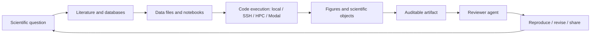

> 历史研究归档 · 2026-11-10 发布 · 程序扫描；未逐篇全文审阅。原有日期、观点、数据和命令保留历史语境，未经本次逐项事实核验或运行复现；请结合[归档说明](../../../ARCHIVE_POLICY.md)阅读。

# Claude Science：AI 制药科研工作台调研

> **一句话**：Claude Science 是 Anthropic 把 Claude 从通用问答和编码场景推进到生命科学研发流程的 AI workbench；它的核心价值不是“回答生物问题”，而是把文献、数据、代码、图表、远程计算、reviewer check 和可追溯 artifact 串成科研闭环。
> **研究日期**：2026-07-03
> **最后更新**：2026-07-14；新增 2026 年最新竞品格局、官方 beta 边界与面试口径。
> **增量说明**：Vault 已有 Claude Code、Coding Agent 横评、Loop Engineering 与多 Agent 工程治理报告；本报告在旧三合一速查基础上，把 Claude Science 独立拆开，补充 AI 制药视角、竞品横评、可 shadow 的实操路径和风险边界。

---

## 目录

- [TL;DR 速查卡](#tldr-速查卡)
- [它是什么，不是什么](#它是什么不是什么)
- [定位透镜](#定位透镜)
- [工作流架构](#工作流架构)
- [AI 制药关键概念](#ai-制药关键概念)
- [竞品与相邻方案](#竞品与相邻方案)
- [可实操体验路径](#可实操体验路径)
- [观察指标](#观察指标)
- [风险边界](#风险边界)
- [面试速查](#面试速查)
- [开放问题](#开放问题)
- [来源清单](#来源清单)
- [锻造审视](#锻造审视)

---

## TL;DR 速查卡

| 维度 | 结论 |
|---|---|
| 核心定位 | 面向科学研究，尤其生命科学的 AI workbench；重点是工具编排、可审计 artifact 和计算资源连接 |
| 不是啥 | 不是新发布的生命科学大模型；不是 AlphaFold 这类结构预测模型；不是可替代 wet lab 的自动科学家 |
| 关键能力 | 科研工具/数据库连接、代码执行、本地/SSH/HPC/Modal 计算、scientific artifacts、reviewer agent、provenance |
| AI 制药价值 | 把“假设 -> 数据 -> 分析 -> 图表 -> 报告 -> 复核 -> 复现”产品化，提升研发日常吞吐和审计质量 |
| 主要直接竞品 | GPT-Rosalind + Codex、Gemini for Science、Microsoft Discovery、Benchling AI、Biomni Lab、Edison Kosmos、OpenScience |
| 值得亲手体验 | 不一定要有 beta 权限；可以用公开数据 shadow 一次可复现科研 artifact 流程 |
| 最大风险 | 科学方法选错但结果看似合理；beta 尚无完整审计/合规控制；PHI、双用途生物风险、工具越权和 HPC/GPU 成本失控 |
| 推荐理解方式 | 把它看成“科研版 Claude Code + 领域连接器 + 可审计 notebook/report + reviewer agent” |

---

## 它是什么，不是什么

一句话结论：Claude Science 的本质是科研工作流产品，不是一个“生物问题回答模型”。

| 判断 | 内容 |
|---|---|
| 是什么 | 面向科学研究，尤其生命科学的 AI workbench；官方强调可整合常用科研工具和包、生成可审计产物，并提供灵活计算资源。 |
| 是什么 | 桌面 app + 浏览器入口，支持在本机、实验室 Linux 机器、HPC login node 或云 VM 上工作；计算可走本地 kernel、Slurm/SSH 或 Modal。 |
| 是什么 | 一个“通用协调 agent + 专家 skills/connectors + reviewer agent”的研发环境，覆盖 genomics、single-cell、proteomics、structural biology、cheminformatics 等任务。 |
| 不是什么 | 不是新模型。官方 FAQ 表述是它使用用户计划中已有 Claude 模型，新增的是科学工具、数据库连接和计算集成。 |
| 不是什么 | 不是 AlphaFold 这类专用结构预测系统。Claude Science 可以调用结构和化学工具，但自身定位是工作台和编排层。 |
| 不是什么 | 不是可替代实验、临床判断或监管审查的系统。生命科学结论仍需要实验验证、专家复核和合规治理。 |

说白了，普通聊天机器人回答“这个靶点有哪些论文”，Claude Science 想覆盖的是“检索论文 -> 读取数据 -> 写脚本分析 -> 生成图表 -> 写成报告 -> 保留证据链 -> 让 reviewer 检查”。差异不在于一句回答有多漂亮，而在于输出能不能被追溯和复现。

---

## 定位透镜

一句话结论：Claude Science 是 Anthropic 从通用 Agent 能力向“垂直科研操作系统”的迁移。

| 轴 | 判断 |
|---|---|
| 纵轴：演化脉络 | Anthropic 先在 Claude、Artifacts、Claude Code、MCP/Skills 等方向积累“模型 + 工具 + 产物 + 执行环境”的能力，再通过 Claude for Life Sciences、AI for Science Program 和 Claude Science beta 推到生命科学场景。 |
| 横轴：竞争格局 | Google Co-Scientist 更偏假设生成和多 Agent 科学辩论；AlphaFold/Isomorphic 更偏结构预测和药物设计模型；Microsoft Discovery 更偏企业 R&D 平台、知识图谱、Azure/HPC；Claude Science 更偏科学家日常工作台。 |
| 交叉判断 | 对 AI 制药公司，Claude Science 的威胁不一定是替代垂直药物发现模型，而是抢占科学家日常入口。入口一旦沉淀了文献、实验、分析、脚本、图表和组织知识，后续就能向更垂直的药研决策延伸。 |

它最值得关注的不是“有没有生物学专属 SOTA”，而是三个产品判断：

1. 科学家是否愿意把真实项目目录、脚本和数据分析放进去。
2. 生成结果是否能变成团队可审计、可复现、可分享的 artifact。
3. 它能否连接组织已有工具链，而不是要求科学家迁移到全新平台。

---

## 工作流架构

一句话结论：Claude Science 把科学研发拆成一条有证据链的执行管线，而不是一次性聊天。



| 层 | 作用 | 对产品设计的启发 |
|---|---|---|
| 问题层 | 把科学问题限定成可验证范围，例如“EGFR 抑制剂公开 IC50 数据清洗” | 垂直产品要避免泛泛问答，先帮助用户把问题变窄 |
| 证据层 | 文献、数据库、实验记录、公开数据集 | 每个结论应绑定来源和检索日期 |
| 执行层 | Python/R/Bash、结构工具、生信工具、化学工具、远程计算 | Agent 需要进入真实工具链，而不是只写建议 |
| 产物层 | 图表、结构视图、基因组 tracks、表格、manuscript draft | 科研输出不只是文本，还包括领域对象 |
| 复核层 | reviewer agent 检查引用、数字、图表、假设外推 | 生成和质控应分离，减少自证循环 |
| 复现层 | 环境、代码、参数、数据版本、计算日志 | 科学可信度来自可复现，而不是语言流畅 |

---

## AI 制药关键概念

一句话结论：Claude Science 对 AI 制药的启发集中在“科研操作链路”而不是“药物发现算法本身”。

| 概念 | Claude Science 里的形态 | AI 制药产品启发 |
|---|---|---|
| Provenance | artifact 记录代码、环境、自然语言说明和会话历史 | 靶点分析、化合物筛选、图表和报告必须能追到数据、脚本、参数和版本 |
| Reviewer agent | 后台检查错误引用、不可追溯数字、图表与代码不一致 | 生成 Agent 与质控 Agent 分离，适合做科学 QA |
| Scientific artifacts | 原生呈现蛋白结构、基因组 tracks、化学结构、图表和文稿 | 领域产品要输出科学对象，而不是只输出 Markdown |
| Skills/connectors | 通过 curated skills/connectors 接数据库、ELN、脚本和内部 API | 领域能力应插件化、分层加载，不应全部塞进系统 prompt |
| Compute orchestration | 本地 kernel、SSH/HPC、Modal GPU/CPU 弹性计算 | 从轻分析到大规模虚拟筛选，需要统一任务调度和预算控制 |
| Domain workflows | scRNA-seq QC、CRISPR screen design、protein structure prediction、cheminformatics | 产品模块可以围绕任务模板组织，而不是围绕聊天组织 |
| Data locality | 原始数据和计算可留在用户基础设施，模型交互仍有平台数据边界 | 企业落地要明确 raw data、prompt、artifact、日志和缓存的处理范围 |
| Biosecurity | Usage Policy 与 biorisk 研究对 CBRN/双用途风险设边界 | AI 制药产品必须内置用途分类、拦截、审计和人工复核 |

一个重要判断：AI 制药不是把 LLM 接上 PubMed 就结束。真正难的是把非结构化假设、半结构化实验记录、结构化 assay 数据、代码和模型预测结果统一成可追责的研发记录。

---

## 竞品与相邻方案

一句话结论：真正同场竞争的不是所有“AI for Science”，而是能否在一个环境里完成“科学问题 -> 证据/数据 -> 执行 -> 可追溯产物”；不同厂商分别押注模型、入口、数据、治理或自主性。

| 产品 | 直接程度 | 核心路线 | 相对 Claude Science 的最强点 | 当前边界 / 成熟度 |
|---|---|---|---|---|
| Claude Science | 基准产品 | 通用 Claude + 60+ 科研 skills/connectors + Python/R/Shell + local/SSH/HPC/Modal + artifact/reviewer | 自助门槛低、执行环境灵活、科研产物可追溯 | 2026-06-30 public beta；不是专用生命科学模型；企业治理仍缺口明显 |
| OpenAI GPT-Rosalind + Codex | 强直接 | 生命科学专用模型 + Life Sciences Research/NGS plugins + 原生 viewer | 专用生物推理模型、企业部署与公开 LifeSciBench | trusted-access research preview；访问范围受控，产品可用性低于 Claude |
| Google Gemini for Science | 强直接但为工具集合 | Hypothesis Generation + Computational Discovery + Literature Insights + Antigravity Science Skills | Co-Scientist 假设锦标赛、AlphaEvolve、Scholar/Colab/AlphaFold 等生态 | 多项能力处实验/逐步开放；不是一个单体工作台 |
| Microsoft Discovery | 强直接 | 企业多 Agent R&D 平台 + Bookshelf 知识图谱 + Azure HPC + 治理 | 企业治理、长周期 investigation、跨学科与 HPC 全栈 | 企业平台 2026-06-02 GA；本地 app 仍 preview；部署更重 |
| Benchling AI | 强直接且竞合 | 在 ELN/Notebook 内把结构化实验数据、AI agents、模型、MCP 和审计统一 | 控制实验记录、样本与结果这个 system of record，wet-lab 贴合度最高 | 对既有 Benchling 客户最有分发优势；代码/HPC 灵活性弱于 Claude |
| Biomni Lab / Biomni OSS | 强直接（生物医学） | 150 工具、59 数据库、105 软件的 biology-native agent workbench | 生物工具深度、开源基座、公开 benchmark 与生物学用户基础 | 领域较窄；商业版/开源版能力不同，仍需专家 QC 与权限隔离 |
| Edison Scientific / Kosmos | 强直接但更自主 | 长时间 autonomous investigation，文献、数据、假设分支、代码与报告 | 更接近“AI Scientist”，可嵌入组织知识与长时间推进研究 | 高接触企业产品；成本、跑偏和验证压力更高，不是轻量日常工作台 |
| OpenScience | 开源直接替代 | 本地、Apache 2.0、model-agnostic、BYOK、科研 skills/databases | 可读、可改、可用本地模型，避免单一模型锁定 | 2026 年新产品；独立评测、运维和企业支持仍待验证 |

相邻但不应混为同类：OpenAI Prism 只覆盖 LaTeX 写作与协作；Elicit/Consensus 强在文献综述；AlphaFold、BioNeMo、Boltz 等是被工作台调用的模型/基础设施；Lila 押注自主实验室；Scientist.com 是 CRO/CDMO 外包采购与执行入口。

推荐结论：面试中把直接竞品优先收敛为 GPT-Rosalind + Codex、Gemini for Science、Microsoft Discovery、Benchling AI、Biomni Lab 和 Edison Kosmos。Claude Science 的赌注是以更好的通用 Agent UX 和执行环境占住科学家的日常入口；但“连接器多”不是长期护城河，因为 MCP 同时降低了竞争对手的集成成本。

---

## 可实操体验路径

一句话结论：没有 beta 权限也能 shadow 它的核心价值；关键是做一次可复现科研 artifact，而不是问几个生物学问题。

### 路径 A：无 beta 权限的 shadow workflow

目标：用公开信息模拟“假设 -> 数据 -> 代码 -> 图表 -> artifact -> reviewer -> 复现”的最小闭环。

| 步骤 | 做法 | 产物 |
|---|---|---|
| 1. 选窄问题 | 例如“公开数据中 EGFR 抑制剂 IC50 分布是否能支持一个小型筛选假设” | `question.md` |
| 2. 建项目目录 | `sources.csv`、`data/`、`scripts/`、`figures/`、`artifact.md`、`review.md` | 可审计目录结构 |
| 3. 文献检索 | PubMed、Google Scholar、ChEMBL 或公开数据库，记录 query、URL、检索日期、纳入/排除理由 | `sources.csv` |
| 4. 小数据分析 | 准备公开 CSV 或手工小样例，清洗 SMILES、target、IC50、assay type，生成分布图 | `scripts/analysis.py`、`figures/ic50_hist.png` |
| 5. 写 artifact | 方法、数据来源、结果、图表、限制、下一步实验 | `artifact.md` |
| 6. reviewer check | 另起一个审查角色，逐条检查引用、数字、图表是否可追溯，结论是否过度外推 | `review.md` |
| 7. 复现 | 换目录或新环境重跑脚本，记录耗时和失败点 | `reproduce_log.md` |

建议目录：

```text
claude-science-shadow/
  question.md
  sources.csv
  data/
    compounds.csv
  scripts/
    analysis.py
  figures/
  artifact.md
  review.md
  reproduce_log.md
```

最小验收标准：

| 标准 | 合格线 |
|---|---|
| 证据可追溯 | artifact 中每个关键事实能追到 `sources.csv` 或代码输出 |
| 图表可复现 | 删除 `figures/` 后运行脚本能重新生成图 |
| reviewer 有效 | 至少指出 3 类问题：证据不足、指标口径、结论外推 |
| 成本可控 | 1-2 小时内完成，数据量小于 1000 行 |

### 路径 B：有 Claude Science beta 权限时

| 步骤 | 做法 | 观察点 |
|---|---|---|
| 1. 安装和启用 | 按官方文档确认 Team/Enterprise、系统支持和组织开关 | 启用门槛、权限边界、HIPAA/PHI 提示 |
| 2. 接本地项目 | 放入一个小型科研目录，包含数据、脚本和 notes | 是否能正确理解文件结构 |
| 3. 跑轻量任务 | scRNA-seq QC、结构说明、化合物属性筛选或文献证据整理选一项 | 是否能调用正确工具，是否解释参数 |
| 4. 生成 artifact | 让它输出图表、报告和可追溯说明 | artifact 的引用和代码是否绑定 |
| 5. 打开 reviewer | 让 reviewer agent 检查引用、数字和图表 | 能否发现真实问题，而非泛泛提醒 |
| 6. 试远程计算 | Modal/HPC/SSH 任一路径 | 任务提交、日志、失败恢复、成本提示 |

---

## 观察指标

一句话结论：评价 Claude Science 不应看“回答像不像专家”，而要看科研闭环质量。

| 维度 | 指标 | 为什么重要 |
|---|---|---|
| 证据质量 | 引用命中率、来源时效、纳入/排除理由完整度 | 生命科学结论必须绑定证据 |
| 可复现性 | 脚本重跑成功率、环境锁定、随机种子、外部数据库版本 | artifact 有记录不等于可复现 |
| 科学审查 | reviewer 抓错率、假设外推识别、指标口径一致性 | 降低“流畅但错误”的风险 |
| 工具执行 | 工具调用成功率、错误恢复、参数解释、日志完整性 | 科研工作台必须能跑真实工具 |
| 数据治理 | raw data、prompt、response、artifact、日志边界 | 药研数据和 IP 不能靠口头承诺治理 |
| 经济性 | 单任务 token、CPU/GPU/HPC 成本、远程作业耗时 | 技术可行但成本不可控就不可用 |

---

## 风险边界

一句话结论：Claude Science 越接近真实药研，越需要把科学错误、数据泄露、双用途风险和合规责任做成产品机制。

| 风险 | 边界判断 |
|---|---|
| 科学正确性 | Reviewer 只对照计划、产物和执行记录，不重跑分析，也不判断方法是否选对；它是记录一致性检查，不是同行评审或实验验证。 |
| 可复现性 | provenance 不等于可复现；依赖环境、随机种子、外部数据库版本、HPC 作业日志都要固定。 |
| 确定性执行 | Anthropic 的 VirBench 中，无确定性工具时不同 Agent 平均准确率为 16.9%-91.3%，同一提示重复运行会得到不同数据集；接入确定性检索层后全部超过 90%。创造性推理与标识符、坐标、过滤、数据库查询应分层。 |
| 隐私与 IP | 会话和 artifact 存在本机，但 prompt、completion 及读入上下文的内容会发送至 Anthropic；只能说“原始大数据与计算可留本地”，不能说“所有数据不出本地”。 |
| PHI / 医疗合规 | HIPAA 组织可开启 Claude Science，但 beta 使用不在 BAA 覆盖内，不应处理 PHI，也不能作为 GxP system of record。 |
| 双用途生物风险 | Usage Policy 禁止武器化生物/化学/放射/核风险相关协助；生命科学 Agent 必须有用途分类、拦截和审计。 |
| 企业治理 | 当前没有组织审计日志、Compliance API 无法导出/删除本地会话，组织不能限制成员本地 connector，也不能自动擦除离职设备数据。 |
| 工具与算力越权 | 远程 HPC 以用户身份在 sandbox 外运行；Modal 由用户直接付费且目前无产品级 spend ceiling。需要 least privilege、dry-run、审批、预算上限和作业回收。 |

---

## 面试速查

一句话结论：最有信号的答法是把 Claude Science 讲成“科研 harness 与工作流入口”，再用确定性、验证和治理指出它的真实天花板。

### 30 秒口径

> Claude Science 不是新的生物模型，而是 Anthropic 在 2026 年 6 月推出的科研工作台。它把 Claude、科学数据库、Python/R/Shell、本地或 HPC/云 GPU、领域模型、可追溯 artifact 和独立 Reviewer 串在一起，目标是把文献、数据分析、画图、写稿和复核从多个工具收进一条可执行流程。战略上，它是在把 Claude Code 的 harness 经验垂直化到科学场景。近期价值是减少工具切换和复现成本，长期成败则取决于 Reviewer 是否真能抓错、企业治理能否补齐，以及 AI 候选是否提高实验命中率，而不是只制造更多待验证内容。

### 面试中应主动讲的判断

1. **创新主要在 harness，不在新模型**：差异化来自连接器、执行环境、artifact、reviewer、权限和 UX 的组合。
2. **争夺的是科学家入口，不是替代 AlphaFold**：专用模型会成为它调用的工具；入口一旦沉淀组织知识和已验证 pipeline，才形成粘性。
3. **Provenance 降低验证成本，但不证明科学正确**：代码、环境和对话可追溯，不代表方法选择或生物解释正确。
4. **创造性推理必须和确定性执行分层**：假设可以开放探索，数据库检索、ID/坐标、过滤、计算和审计应尽量确定性。
5. **当前最大瓶颈可能是治理而非模型**：审计、PHI、连接器、HPC 权限、离职数据和算力预算都还不成熟。
6. **厂商案例是需求信号，不是 ROI 证明**：Manifold、Allen Institute、UCSF 的早期故事值得关注，但尚无 Claude Science 产品级独立横评。

### 建议追问

- 北极星指标是 time-to-first-result，还是 time-to-reproducible-and-expert-approved-result？
- Reviewer 在注入已知错误的 artifact 上，严重错误的 precision、recall 和漏报率是多少？
- “可复现”是否固定模型版本、数据库快照、随机种子和外部 API 版本？干净环境重跑成功率是多少？
- AI 候选进入湿实验后的命中率相对专家 baseline 提高多少？失败候选的实验成本是否计入 ROI？
- Claude Science 与 Benchling/LIMS/ELN 谁是 source of truth，产物如何进入已验证的组织流程？
- 如果底层模型能力被追平，它相对“通用 coding agent + Jupyter + BioMCP”自建组合的不可替代价值是什么？

---

## 开放问题

一句话结论：当前最大不确定性不再是“能不能跑”，而是科研正确性、独立效果证据、企业治理和总成本能否跨过生产门槛。

| 问题 | 当前状态 | 后续验证 |
|---|---|---|
| beta 稳定性 | 0.1.x 上线后连续修复会话与 Reviewer 卡住、用量异常等问题 | 用 3-5 个真实项目做重复运行、失败恢复和长会话测试 |
| 产品级科学效果 | 有 BioMysteryBench/VirBench 等模型与基础设施评测，但没有 Claude Science 端到端独立横评 | 与人工、Claude Code、自建 Jupyter+Agent 做盲测；至少比较正确率、复现率和专家时间 |
| 企业数据边界 | local-first 细节已公开，但 prompt/response 仍进 Anthropic，且本地数据不受部分组织控制 | 审查 DPA、retention、support access、data residency、MDM/EDR 和离职清除流程 |
| Modal/HPC 成本 | Modal 集成已公开，真实科研作业成本取决于任务 | 需要记录 CPU/GPU 小任务成本 |
| Reviewer 有效性 | 官方明确边界，但实际 precision/recall 未公开 | 构造带 citation、数字、漏步骤、方法选择等错误的 artifact，分严重度评测 |
| 与垂直药研平台关系 | 已确认既竞争又互补：Benchling/BioNeMo/Edison 等可作连接层也可做上层产品 | 观察数据入口、skill 复用和 system of record 最终归属 |

---

## 来源清单

Sources and freshness:

- [Anthropic - Claude Science, an AI workbench for scientists](https://www.anthropic.com/news/claude-science-ai-workbench) - retrieved 2026-07-03 - 官方发布、beta、skills/connectors、artifact、reviewer、compute。
- [Claude Science product page](https://claude.com/product/claude-science) - retrieved 2026-07-03 - 产品定位、运行方式、FAQ 和 provenance 表述。
- [Claude Docs - Enable Claude Science](https://claude.com/docs/claude-science/enable-claude-science) - retrieved 2026-07-03 - Team/Enterprise 启用、HIPAA/PHI 边界。
- [Anthropic - Claude for Life Sciences](https://www.anthropic.com/news/claude-for-life-sciences) - retrieved 2026-07-03 - life sciences connectors、Benchling、BioRender、PubMed、10x 等生态信号。
- [Modal - Claude Science compute integration](https://modal.com/blog/modal-integration-brings-scalable-compute-to-claude-science) - retrieved 2026-07-03 - Modal 弹性计算和 GPU/CPU 工作流。
- [Google Research - AI Co-Scientist](https://research.google/blog/accelerating-scientific-breakthroughs-with-an-ai-co-scientist/) - retrieved 2026-07-03 - Gemini 多 Agent 科学假设系统。
- [Google DeepMind - Co-Scientist](https://deepmind.google/blog/co-scientist-a-multi-agent-ai-partner-to-accelerate-research/) - retrieved 2026-07-03 - generate/debate/evolve、Elo tournament、CBRN safety。
- [Google DeepMind - AlphaFold](https://deepmind.google/science/alphafold/) - retrieved 2026-07-03 - AlphaFold 产品线和结构预测定位。
- [Nature - AlphaFold 3](https://www.nature.com/articles/s41586-024-07487-w) - retrieved 2026-07-03 - AF3 可预测蛋白、核酸、小分子等复合体结构。
- [Isomorphic Labs - Drug Design Engine](https://www.isomorphiclabs.com/articles/the-isomorphic-labs-drug-design-engine-unlocks-a-new-frontier) - retrieved 2026-07-03 - IsoDDE 药物设计能力主张。
- [Microsoft Azure - Microsoft Discovery](https://azure.microsoft.com/en-us/solutions/discovery) - retrieved 2026-07-03 - 企业 agentic R&D 平台、Discovery engine、Azure/HPC。
- [Microsoft Learn - Discovery Overview](https://learn.microsoft.com/en-us/rest/api/discovery/) - retrieved 2026-07-03 - 多 Agent、Bookshelf 知识图谱、HPC、RBAC。
- [Anthropic Usage Policy](https://www.anthropic.com/legal/aup) - retrieved 2026-07-03 - 生物/化学风险、高风险医疗使用和专家审核要求。
- [Anthropic - LLMs and biorisk](https://www.anthropic.com/research/biorisk) - retrieved 2026-07-03 - AI 生物风险、ASL-3、CBRN safeguard 立场。
- [Anthropic - How Claude Science works with your data](https://claude.com/docs/claude-science/how-claude-science-works-with-your-data) - retrieved 2026-07-14 - local-first、模型流量、本地数据与组织控制边界。
- [Anthropic - What's not available yet](https://claude.com/docs/claude-science/whats-not-available-yet) - retrieved 2026-07-14 - 审计日志、Compliance API、连接器、session 与 offboarding 缺口。
- [Anthropic - The reviewer](https://claude.com/docs/claude-science/the-reviewer) - retrieved 2026-07-14 - Reviewer 检查范围及“不重跑、不判断方法选择”的边界。
- [Anthropic - Paving the way for AI agents in biology](https://www.anthropic.com/research/agents-in-biology) - retrieved 2026-07-14 - VirBench、确定性检索层与重复性风险。
- [Anthropic - BioMysteryBench](https://www.anthropic.com/research/Evaluating-Claude-For-Bioinformatics-With-BioMysteryBench) - retrieved 2026-07-14 - 开放式生信任务、可靠性与困难任务上的脆弱成功路径。
- [OpenAI - GPT-Rosalind](https://openai.com/index/introducing-gpt-rosalind/) - retrieved 2026-07-14 - 生命科学专用模型、trusted access 和企业生态。
- [OpenAI - New capabilities for GPT-Rosalind](https://openai.com/index/introducing-new-capabilities-to-gpt-rosalind/) - retrieved 2026-07-14 - Codex Life Sciences plugins、NGS、viewer、artifact/provenance 与 LifeSciBench。
- [Google - Gemini for Science](https://blog.google/innovation-and-ai/technology/research/gemini-for-science-io-2026/) - retrieved 2026-07-14 - Hypothesis Generation、Computational Discovery、Literature Insights、Science Skills；这是工具集合而非单体工作台。
- [Nature - Accelerating scientific discovery with Co-Scientist](https://www.nature.com/articles/s41586-026-10644-y) - retrieved 2026-07-14 - 多 Agent 假设生成、湿实验验证与局限。
- [Microsoft - Discovery GA](https://azure.microsoft.com/en-us/blog/announcing-microsoft-discovery-general-availability-and-microsoft-discovery-app-preview/) - retrieved 2026-07-14 - 2026-06-02 GA、企业 R&D、治理、HPC 与本地 app preview。
- [Benchling - Introducing Benchling AI](https://www.benchling.com/blog/introducing-benchling-ai) - retrieved 2026-07-14 - ELN/Notebook、内部实验数据、agents、模型与 system-of-record 路线。
- [Benchling - AI Connectors](https://www.benchling.com/blog/benchling-launches-ai-connectors-to-power-data-ecosystem) - retrieved 2026-07-14 - MCP、Claude/ChatGPT 竞合与结构化实验数据连接。
- [Biomni](https://biomni.stanford.edu/) - retrieved 2026-07-14 - biology-native agent 环境、工具/数据库/软件规模与典型任务。
- [Edison Scientific - Kosmos](https://edisonscientific.com/) - retrieved 2026-07-14 - autonomous investigation、组织知识、on-prem 与 biopharma 路线。
- [OpenScience](https://www.openscience.sh/) - retrieved 2026-07-14 - Apache 2.0、本地、model-agnostic 科研 workbench。
- [OpenAI - Prism](https://openai.com/index/introducing-prism/) - retrieved 2026-07-14 - 免费 LaTeX-native 写作与协作，相邻而非完整科研执行竞品。
- [Nature - Which AI scientist suits your lab?](https://www.nature.com/articles/d41586-026-02091-6) - retrieved 2026-07-14 - 独立分类、采用信号与从可验证小任务开始的建议。

Consistency: 官方、Nature 与第三方集成方一致把 Claude Science 定位为工作台/编排层，而非新模型。竞品事实基本一致；Google 官方将 Gemini for Science 定义为一组工具和实验，而不是单一工作台。Claude 的案例提效与竞品 benchmark 多为厂商披露，证据等级低于独立盲测或同行评审。

Unverified: Claude Science 的端到端独立正确率、Reviewer precision/recall、长任务稳定性、真实项目总成本、药企生产环境 ROI；OpenAI 访问范围在不同官方页面中存在口径差异。

---

## 锻造审视

一句话结论：本轮已把“科研 artifact 审计链”在 Claude Science、GPT-Rosalind/Codex、Benchling AI、Biomni、OpenScience 与 Edison Kosmos 上交叉验证，并沉淀为 `PATTERN_LIBRARY.md` 的 P-027。

可复用模式：

1. 研究工具时不只看功能列表，而是还原它要求用户留下哪些证据链。
2. 对 AI 科研产品用同一张表审查：输入证据、执行环境、产物、复核、复现、数据边界。
3. 没有产品权限时，用 shadow workflow 复刻核心机制，优先验证可复现性而不是 UI。

入库依据：至少六类科研 Agent/workbench 都把证据、执行、产物和复核作为可信度核心；差异主要在复核是否真正重跑、环境是否可冻结、数据边界是否受组织治理。
