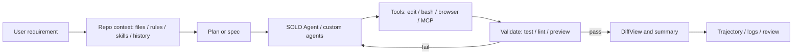

> 历史研究归档 · 2026-11-10 发布 · 程序扫描；未逐篇全文审阅。原有日期、观点、数据和命令保留历史语境，未经本次逐项事实核验或运行复现；请结合[归档说明](../../../ARCHIVE_POLICY.md)阅读。

# Trae：Coding Agent 产品线调研

> **一句话**：Trae 是字节系把 AI IDE、SOLO Agent、MCP、Skills、远程开发、企业工作台和开源 SWE Agent 框架组合起来的 Coding Agent 产品线；关键不是“会不会补全”，而是能不能稳定完成工程闭环。
> **研究日期**：2026-07-03
> **增量说明**：Vault 已有 R71 Coding Agent 横评、R133 Skills 框架、R142 Loop Engineering；本报告在旧三合一速查基础上，把 Trae 独立拆开，补充产品分层、关键概念、竞品对比、双线实操路径、隐私/benchmark 风险和评估清单。

---

## 目录

- [TL;DR 速查卡](#tldr-速查卡)
- [它是什么，不是什么](#它是什么不是什么)
- [定位透镜](#定位透镜)
- [产品分层](#产品分层)
- [关键概念地图](#关键概念地图)
- [Agent 工作流架构](#agent-工作流架构)
- [可实操体验路径](#可实操体验路径)
- [与主流 Coding Agent 对比](#与主流-coding-agent-对比)
- [评估指标](#评估指标)
- [隐私、benchmark 与企业采用风险](#隐私benchmark-与企业采用风险)
- [来源清单](#来源清单)
- [锻造审视](#锻造审视)

---

## TL;DR 速查卡

| 维度 | 结论 |
|---|---|
| 核心定位 | AI IDE + 长任务 Agent + MCP/Skills 扩展 + 开源 SWE Agent + 企业工作台 |
| 不是啥 | 不是单纯代码补全插件；TRAE IDE 也不等于开源 `bytedance/trae-agent` |
| 关键能力 | IDE/SOLO mode、SOLO Agent、Rules、Skills、MCP、Max mode、context compaction、Remote SSH/WSL、DiffView、trajectory |
| 最值得看 | Agent 是否能理解 repo、定位文件、最小修改、运行验证、自修失败、解释 diff、留下轨迹 |
| 开源线索 | `bytedance/trae-agent` 提供 CLI、文件编辑、bash、sequential thinking、trajectory、MCP、Docker、多模型 provider |
| 竞品坐标 | Cursor 强 IDE，Claude Code 强 CLI/长任务，Cline 强开源可审计，Copilot 强 GitHub 平台，Trae 走 IDE + Agent + 字节/火山生态 |
| 推荐实操 | 一条走 TRAE IDE 做真实小功能；一条走开源 Trae Agent 看 trajectory 和工具调用 |
| 最大风险 | 隐私/遥测透明度、工具越权、context compaction 遗忘约束、benchmark 误读、trajectory 泄露代码 |

---

## 它是什么，不是什么

一句话结论：Trae 应按产品 IDE、开源 Agent 框架和企业工作台三层看，不能把它简化成补全工具。

| 判断 | 内容 |
|---|---|
| 是什么 | TRAE IDE 是深度集成 AI 的开发工具，支持 IDE mode / SOLO mode、Remote SSH / WSL、MCP、Skills、Rules、Max mode 等能力。 |
| 是什么 | SOLO Agent 面向复杂项目开发，官方描述覆盖从需求迭代到架构重构，计划确认后可自动推进任务。 |
| 是什么 | Trae Agent 是 ByteDance 开源的软件工程 Agent，提供 CLI、文件编辑、bash、sequential thinking、trajectory recording、多模型 provider、MCP、Docker 执行等能力。 |
| 是什么 | TRAE Work / Enterprise 更像企业 AI-native workspace，涉及 SSO、席位、用量、模型、企业 agents、仓库访问控制等管理面。 |
| 不是什么 | 不是单纯代码补全插件。补全只是入口，核心卖点在 Agent 工作流。 |
| 不是什么 | 不是纯本地工具。官方隐私政策和第三方遥测争议都提示企业采用必须审计网络、数据和日志边界。 |
| 不是什么 | 不是 `bytedance/trae-agent` 的等价 UI。开源 repo 暴露研究友好的 agent loop，但 IDE 产品还有闭源 UI、账号、模型路由、遥测和商业层。 |

正确的研究姿势：不要只问“Trae 能不能写这个函数”，而要让它做一次小但真实的工程任务，看它如何找上下文、改文件、跑命令、处理失败和解释结果。

---

## 定位透镜

一句话结论：Trae 位于“AI IDE 入口”和“可评测 SWE Agent scaffold”之间，优势是产品整合速度，风险是透明度和企业信任边界。

| 轴 | 判断 |
|---|---|
| 纵轴：演化脉络 | 2025 年 Trae IDE 发布并快速迭代；Trae 2.0 / SOLO mode 强调端到端开发；2025-07 Trae Agent 论文与开源 repo 强调 SWE-bench Verified 结果；2026 文档侧出现 Work、Enterprise、Agent、Skills、MCP、hooks 等更平台化目录。 |
| 横轴：竞争格局 | Cursor 强 IDE 体验和代码索引；Claude Code 强 CLI、长任务、subagents/hooks/skills；Cline 强开源可审计、Plan/Act、人类审批；Copilot 强 GitHub 平台、PR/Issue 工作流和企业治理；Trae 走“IDE + SOLO Agent + MCP/Skills + 字节/火山/BytePlus 生态”。 |
| 交叉判断 | Trae 的高价值观察点是工程闭环质量：上下文召回是否准、修改是否最小、验证是否主动、失败是否自修、轨迹是否可审计。 |

---

## 产品分层

一句话结论：Trae 的产品线至少有三层，混在一起会误判能力边界。

| 层 | 组成 | 适合研究的问题 |
|---|---|---|
| TRAE IDE | IDE mode、SOLO mode、工具面板、DiffView、Rules、Skills、MCP、Remote SSH/WSL、模型切换 | 开发者日常是否顺手，Agent 是否能完成真实小任务 |
| Trae Agent 开源 | CLI、agent loop、工具调用、trajectory、Docker、MCP、多 provider、SWE-bench harness | 底层 Agent 如何规划、调用工具、记录轨迹和复现评测 |
| TRAE Work / Enterprise | 企业工作台、账号/席位、SSO、模型管理、仓库权限、企业 agents | 企业治理、成本、权限、数据边界和组织采用 |

一条实用判断：IDE 产品决定用户是否愿意每天打开；开源 Agent 决定研究者能否理解和复现实验；企业工作台决定大团队能否批准采用。

---

## 关键概念地图

一句话结论：Trae 的关键词都围绕一个目标：让 Agent 从“聊天生成代码”变成“有上下文、有工具、有流程、有留痕”的软件工程执行者。

| 概念 | 含义 | 应该怎么体验 |
|---|---|---|
| SOLO mode | AI 自主规划并执行从需求理解、代码生成、测试、预览到部署的流程 | 输入一个小需求，看它是否生成计划、拆任务、执行和验证 |
| SOLO Agent | 面向复杂项目开发的 Agent；可调用 custom agents，Plan mode 适合中小任务，Spec mode 适合系统级任务 | 用真实 repo 做 1 个 bugfix 和 1 个小 feature |
| Builder | 早期构建型 Agent / Builder with MCP；后续概念向 Agent 合并 | 把它作为历史/迁移概念，不要和最新 SOLO Agent 混淆 |
| Rules | 全局或项目规则，约束 AI 的代码风格、框架、交互方式 | 写规则要求“改前说明计划，改后跑测试” |
| Skills | 用 `SKILL.md` 封装 instructions、scripts、resources，按需加载 | 写一个项目技能，规定测试、lint、diff summary 流程 |
| MCP | Model Context Protocol；Trae agents 作为 MCP clients 调用外部工具 | 接 Playwright/Figma/内部 API，看工具调用稳定性 |
| Max mode | 更大上下文窗口和复杂工具调用能力 | 用多文件任务观察召回和成本/延迟 |
| Context Compaction | 长任务中压缩旧对话和工具输出以保留关键状态 | 连续 3-5 轮需求，看是否遗忘早期约束 |
| Remote SSH / WSL | 进入远程或 Linux 开发环境 | 在真实 dev box 跑测试，而不是只在本机 demo |
| DiffView | 展示受影响文件、变更行和 diff | 看修改是否最小、是否解释关键变更 |
| Trajectory | Trae Agent 记录 LLM 交互、steps、tool calls、results、metadata、errors | 用于调试、审计和评测，但也可能泄露代码 |
| SWE-bench | 真实 GitHub issue 修复 benchmark；Verified 是人工筛选子集 | 只代表特定 harness 下修 bug 能力，不等同日常开发体验 |

---

## Agent 工作流架构

一句话结论：Trae 的工程循环可以抽象成“上下文选择 -> 计划 -> 工具执行 -> 验证 -> 自修 -> 留痕”。



| 环节 | 好 Agent 的表现 | 常见失败 |
|---|---|---|
| 上下文选择 | 找到相关文件、测试、配置和约束 | 大 repo 召回错文件，忽略项目规则 |
| 计划 | 任务拆解清晰，能让人改计划 | 计划泛泛，执行时偏离 |
| 执行 | 最小修改，不乱重构 | 多改无关文件，破坏风格 |
| 验证 | 主动跑测试、lint、typecheck、预览 | 只说“建议你运行测试” |
| 自修 | 读错误日志，定位失败，局部修复 | 反复试错，越改越大 |
| 留痕 | diff、命令、失败点、未验证项清楚 | 最终总结和真实操作不一致 |

---

## 可实操体验路径

一句话结论：体验 Trae 要分两条线：IDE 产品流看用户工作闭环，开源 Trae Agent 流看 agent loop 和可审计轨迹。

### 路径 A：TRAE IDE 产品流

选一个小但真实的 repo，不要用空 demo。推荐 FastAPI、React/Vite 或一个带测试的小工具库。

| 步骤 | 动作 | 观察点 |
|---|---|---|
| 1. 打开 repo | 让 Trae 总结架构、启动命令、测试命令 | 是否正确识别 package、入口、测试 |
| 2. 写 Rules | 要求改代码前说明计划，改后跑测试并输出 diff summary | 是否持续遵守 |
| 3. 写 Skill | 用 `SKILL.md` 规定项目变更流程和验收清单 | 是否按需加载，是否减少重复提示 |
| 4. 小功能 | 增加一个 API 字段、前端筛选项或错误处理 | 是否定位相关文件，是否最小修改 |
| 5. 跑验证 | 要求运行 unit test、lint、typecheck | 是否读错误并自修 |
| 6. 接 MCP | 配 Playwright MCP 做页面冒烟测试，或 Figma MCP 做设计稿转代码 | 工具调用是否稳定，权限是否清楚 |
| 7. 用 Max mode | 跑一个跨多文件任务 | 上下文选择是否更准，延迟和成本是否可接受 |
| 8. 拉长任务 | 连续 3-5 轮追需求，观察 context compaction | 是否遗忘早期约束 |
| 9. 试 Remote SSH | 在远程 dev box 跑测试 | 环境兼容、命令权限、误操作风险 |
| 10. 复盘 | 要求列出改动、命令、失败点、未验证项 | 复盘是否和真实轨迹一致 |

推荐项目级 Skill 骨架：

```markdown
---
name: project-change
description: Use for any code change in this repository.
---

# Project Change Workflow

1. Read the relevant files and identify the smallest change.
2. State the plan before editing.
3. Modify only files required by the task.
4. Run the closest tests first, then broader checks when needed.
5. Summarize changed files, commands run, failures, and unverified items.
```

### 路径 B：开源 Trae Agent 流

这条线用来理解 Agent loop 和审计轨迹，不等于完整 IDE 体验。

| 步骤 | 动作 | 观察点 |
|---|---|---|
| 1. 克隆项目 | `git clone https://github.com/bytedance/trae-agent` | README、license、依赖、模型 provider |
| 2. 安装依赖 | 按 README 使用 `uv sync --all-extras` 等方式 | 本地环境是否顺滑 |
| 3. 配 provider | 复制并配置 `trae_config.yaml`，填 API key | 多 provider 是否好切换 |
| 4. 只读任务 | 让 Agent 总结一个 repo，不允许改文件 | 文件读取和上下文选择 |
| 5. 可写任务 | 修一个 failing test | edit/bash 工具调用和自修 |
| 6. 保存 trajectory | 使用 trajectory 文件记录 | 轨迹是否能解释决策 |
| 7. 看 JSON | 检查模型输入、工具调用、错误、token、最终结果 | 是否适合审计和 eval |
| 8. Docker mode | 隔离执行，避免污染宿主机 | 权限和安全边界 |
| 9. 加 MCP | 接 Playwright 或其他 MCP server | 扩展工具是否可控 |
| 10. 换模型 | 同任务换 provider/model | 成功率、成本、步数、错误类型 |

trajectory 是最值得看的产物。Coding Agent 的真实能力不在最终一句总结，而在中间轨迹：读了什么文件、为什么改、调用了什么命令、失败后怎么恢复。

---

## 与主流 Coding Agent 对比

一句话结论：不要只比“谁回答更好”，要比上下文、执行面、控制权、扩展性、审计和企业治理。

| 维度 | Trae | Cursor | Claude Code | Cline | GitHub Copilot |
|---|---|---|---|---|---|
| 主入口 | AI IDE / SOLO / Work | VS Code fork IDE | CLI + IDE + Web + Desktop | OSS IDE extension / CLI / SDK | GitHub + IDE + cloud agent |
| 上下文 | codebase embeddings/metadata、Max mode、compaction、Rules/Skills | codebase indexing/embeddings | CLAUDE.md、auto memory、subagents、skills/hooks | project structure、`.clinerules`、Plan/Act | GitHub code search RAG、repo instructions、PR/Issue context |
| 执行环境 | 本地 IDE、Remote SSH/WSL、MCP、开源 Agent Docker | 本地 IDE 为主 | 本地 shell、IDE、web/cloud、多 surface | 本地终端/IDE，审批式工具调用 | GitHub Actions ephemeral env、branch/PR |
| 自主性 | SOLO 更偏端到端 | Agent mode 偏 IDE 内协作 | 高自主 CLI / 多 agent | 默认每步审批，可 auto-approve | 后台工作，PR 交付 |
| 扩展性 | MCP + Skills + Rules + 企业 agents | MCP + rules + docs | MCP + Skills + Hooks + Subagents + Plugins | MCP + Plugins + SDK | MCP + custom agents + repo config |
| 审计 | 开源 Agent trajectory 强；IDE 产品需实测 | 依赖 IDE 历史/diff | 会话、命令、git、hooks 可组合 | diff/checkpoints/审批强 | PR commits + session logs 强 |
| 企业边界 | 遥测与数据出境需硬审计 | 索引上传与后端 prompt building 需评估 | Anthropic/云权限与工具权限治理 | 开源透明，provider 风险自担 | GitHub 企业策略、Actions、PR 审批成熟 |

推荐判断：Trae 的关键优势不是某个单点功能，而是把 IDE、Agent、MCP、Skills、远程开发和字节/火山生态放在同一产品线里。关键风险也因此放大：一旦数据边界、权限和遥测不清楚，企业采用会卡住。

---

## 评估指标

一句话结论：评估 Trae 要从“代码生成质量”升级到“工程循环质量”。

| 指标 | 观察方法 |
|---|---|
| 上下文命中率 | 给一个跨文件 bug，看它是否先读对文件和测试 |
| 修改最小性 | diff 是否只改必要位置，是否引入无关重构 |
| 验证主动性 | 是否主动运行 test/lint/typecheck/preview |
| 自修能力 | 测试失败后是否能读日志并局部修复 |
| 约束遵守 | Rules/Skills 中的流程是否持续生效 |
| 长任务记忆 | context compaction 后是否保留目标、限制和未完成项 |
| 工具安全 | bash/MCP/Remote SSH 是否有审批、allowlist、dry-run |
| 轨迹质量 | trajectory/logs 是否能支持复盘、审计、eval |
| 成本效率 | token、API 调用、wall time、CI 次数是否可接受 |
| 人类 review 成本 | 最终 PR 是否容易审查，解释是否和 diff 对齐 |

一个小型私有 eval 可以这样设计：

| 任务 | 合格标准 |
|---|---|
| 只读架构总结 | 正确找入口、测试命令、主要模块，不编造 |
| 单文件 bugfix | 通过目标测试，不改无关文件 |
| 多文件 feature | 更新实现和测试，解释行为变化 |
| 前端冒烟 | 用 Playwright MCP 打开页面并验证关键交互 |
| 长任务续航 | 第 5 轮仍记得第 1 轮约束 |
| 远程环境 | Remote SSH 上运行命令不误删、不污染生产资源 |

---

## 隐私、benchmark 与企业采用风险

一句话结论：Trae 的生产风险不在“会不会写代码”，而在数据边界、遥测透明度、benchmark 误读和工具越权。

| 风险 | 边界判断 |
|---|---|
| 隐私与遥测 | 官方隐私政策提到 codebase embeddings / metadata，Privacy Mode 文档有本地保留和不用于训练/分析的表述；第三方报道和抓包材料曾指出关闭 telemetry 后仍有连接。企业采用不能只看开关，要抓包、审计域名、审查 DPA。 |
| Benchmark 误读 | Trae Agent 论文称 SWE-bench Verified 75.20% Pass@1，但这是特定时间、harness、模型组合和 test-time scaling 设置；使用时必须复查 leaderboard、成本和轨迹。 |
| 成本边界 | Test-time scaling 本质是多次生成候选 patch、剪枝、测试、选择，提升上限但消耗更多 token、API 调用、时间和 CI 资源。 |
| 工具越权 | MCP、bash、Remote SSH、浏览器、Figma、数据库工具都可能扩大影响面；需要 allowlist、审批、secret redaction、最小权限。 |
| context compaction 遗忘 | 长任务压缩可能丢掉验收标准、风险提示和用户限制；应要求 Agent 维护显式任务状态。 |
| trajectory 泄露 | 轨迹可能包含 proprietary code、prompt、secret、错误日志和路径信息；应按敏感研发数据保存。 |
| 远程环境误操作 | Remote SSH 进入真实 dev box 后，误删、误部署、误改配置的风险高于本地 demo。 |

企业采用最低要求：

1. 可禁用/可审计遥测，能列出所有联网域名。
2. 私有仓库数据处理说明清楚，包括 embeddings、metadata、prompt、response、日志和留存时间。
3. MCP 和 shell 工具有最小权限、审批和审计。
4. secret redaction、trajectory 存储策略和网络 allowlist 可配置。
5. 有私有 eval，不只引用公开 benchmark。
6. 对 Remote SSH、生产资源和部署命令设置硬闸口。

---

## 来源清单

Sources and freshness:

- [TRAE 官网](https://www.trae.ai/) - retrieved 2026-07-03 - TRAE Work / TRAE IDE 产品定位。
- [TRAE docs - What is TRAE IDE](https://docs.trae.ai/ide/what-is-trae?_lang=en) - retrieved 2026-07-03 - AI IDE、Remote SSH / WSL、安全能力摘要。
- [TRAE docs - SOLO mode overview](https://docs.trae.ai/ide/solo-mode) - retrieved 2026-07-03 - SOLO mode 输入方式、计划执行、测试、预览和部署。
- [TRAE docs - SOLO Agent](https://docs.trae.ai/ide/solo-coder) - retrieved 2026-07-03 - SOLO Agent 面向复杂项目开发、Plan/Spec mode、custom agents。
- [TRAE docs - Model Context Protocol](https://docs.trae.ai/ide/model-context-protocol) - retrieved 2026-07-03 - MCP、transport、Agent 作为 MCP client。
- [TRAE docs - Skills](https://docs.trae.ai/ide/skills) - retrieved 2026-07-03 - `SKILL.md`、instructions/scripts/resources、按需加载。
- [TRAE docs - Rules](https://docs.trae.ai/ide/rules?_lang=en) - retrieved 2026-07-03 - 全局/项目规则和 AI 行为约束。
- [TRAE docs - Built-in models and custom models](https://docs.trae.ai/ide/models) - retrieved 2026-07-03 - 内置模型、自定义模型、provider 配置。
- [TRAE docs - MCP Playwright tutorial](https://docs.trae.ai/ide/tutorial-mcp-playwright) - retrieved 2026-07-03 - Playwright MCP 自动化 Web 测试流程。
- [TRAE docs - Max mode](https://docs.trae.ai/ide/max-mode) - retrieved 2026-07-03 - 大上下文和复杂工具调用。
- [TRAE docs - Remote SSH](https://docs.trae.ai/ide/ssh-remote?_lang=zh) - retrieved 2026-07-03 - 远程开发能力。
- [TRAE docs - Privacy mode](https://docs.trae.ai/ide/privacy-mode) - retrieved 2026-07-03 - Privacy Mode 声明。
- [TRAE Privacy Policy](https://www.trae.ai/privacy-policy) - retrieved 2026-07-03 - codebase embeddings / metadata 数据处理。
- [bytedance/trae-agent](https://github.com/bytedance/trae-agent) - retrieved 2026-07-03 - 开源 Agent、CLI、provider、MCP、Docker、license。
- [Trae Agent trajectory docs](https://github.com/bytedance/trae-agent/blob/main/docs/TRAJECTORY_RECORDING.md) - retrieved 2026-07-03 - 轨迹记录字段、审计与安全提示。
- [Trae Agent tools docs](https://github.com/bytedance/trae-agent/blob/main/docs/tools.md) - retrieved 2026-07-03 - 内置工具：edit、bash、sequential thinking、task_done、json edit。
- [Trae Agent arXiv](https://arxiv.org/html/2507.23370v1) - retrieved 2026-07-03 - 架构、patch generation/pruning/selection、SWE-bench 75.20% 自报结果。
- [SWE-bench official](https://www.swebench.com/) - retrieved 2026-07-03 - Verified 500 题、Resolved metric、leaderboard 口径。
- [The Register - Trae telemetry report](https://www.theregister.com/software/2025/07/28/bytedance-ai-ide-trae-telemetry-continues-even-after-opt-out/838532) - retrieved 2026-07-03 - 遥测争议与 ByteDance 更新说明。
- [segmentationf4u1t/trae_telemetry_research](https://github.com/segmentationf4u1t/trae_telemetry_research) - retrieved 2026-07-03 - 第三方抓包与复现材料。
- [Cursor Data Use](https://cursor.com/data-use) - retrieved 2026-07-03 - Cursor codebase indexing 与 embeddings 数据处理。
- [Claude Code overview](https://code.claude.com/docs/en/overview) - retrieved 2026-07-03 - Claude Code 能力、MCP、skills、hooks、subagents。
- [Cline GitHub](https://github.com/cline/cline) - retrieved 2026-07-03 - 开源、Plan/Act、MCP、SDK、CLI、审批模式。
- [GitHub Copilot cloud agent docs](https://docs.github.com/en/copilot/concepts/agents/cloud-agent/about-cloud-agent) - retrieved 2026-07-03 - GitHub cloud agent、PR 工作流、ephemeral env。
- [GitHub Copilot MCP docs](https://docs.github.com/en/copilot/concepts/context/mcp) - retrieved 2026-07-03 - Copilot MCP 能力边界。

Consistency: 产品功能以官方文档和 GitHub 为主，benchmark 以论文和 SWE-bench 官方口径为主；隐私争议来自官方政策与第三方抓包报道，结论应标注为“企业侧必须复测”。

Unverified: 2026 年最新 IDE 闭源产品行为、企业版数据驻留条款、Privacy Mode 实际网络请求、Max mode 成本和稳定性。

---

## 锻造审视

一句话结论：本报告沉淀的是“Coding Agent 工程循环评估表”，与 R71/R142 可形成互补，但暂不新增模式卡。

可复用模式：

1. 调研 Coding Agent 时，用同一套任务看上下文、计划、执行、验证、自修、留痕。
2. 产品体验和开源框架要分开评估：IDE 看日常体验，Agent repo 看可审计 loop。
3. 公开 benchmark 只能作为信号，不能替代私有 repo eval。

暂不入库原因：R71 已有 Coding Agent 横评主框架，R142 已有 Loop Engineering 框架；本报告的评估表先作为 Trae 附属方法保留，后续若用于 Cursor/Claude Code/Copilot 复测，再合并升级。

