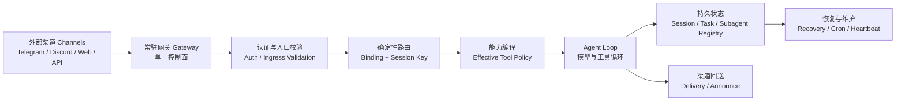
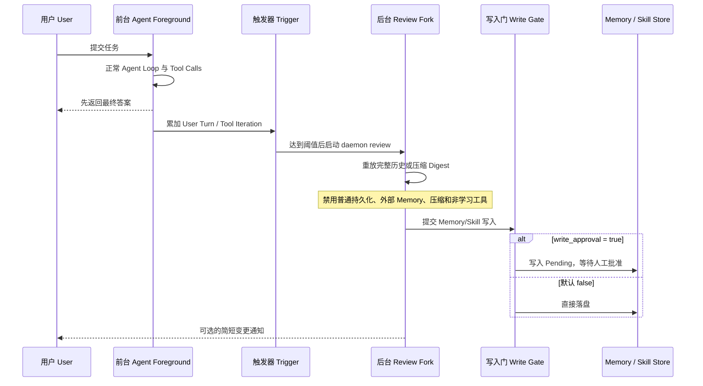
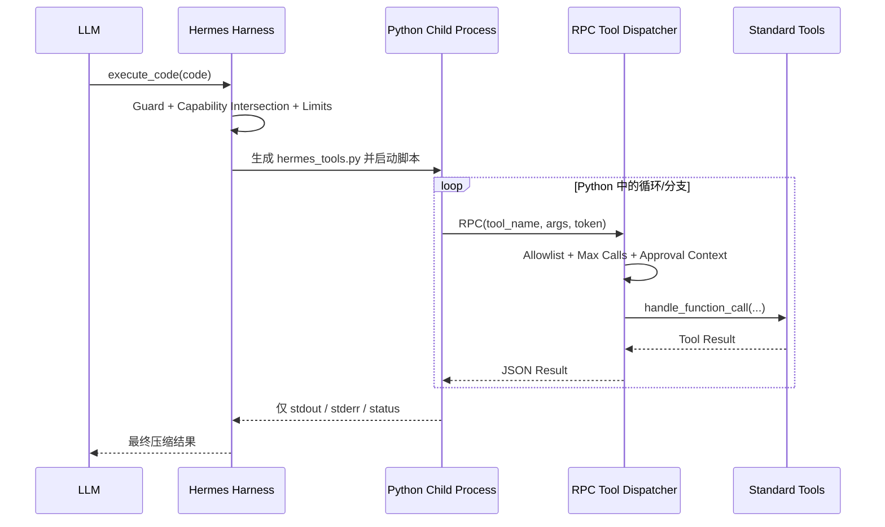

> 历史研究归档 · 2026-11-10 发布 · 发布审核状态：scan_only（发布前程序化隐私扫描）。原有日期、观点、数据和命令保留历史语境，未经本次逐项事实核验或运行复现；见[归档说明](../../../ARCHIVE_POLICY.md)。

# OpenClaw 与 Hermes 四大 Harness 亮点源码深拆：对比 Claude Code

> **一句话结论**：OpenClaw 最强的是常驻控制面和受控可恢复的多 Agent 生命周期，Hermes 最强的是隔离的 Memory/Skill 学习线和 Programmatic Tool Calling；Claude Code 仍在编码循环、Context、权限体验和 OS 级沙箱上更完整，但它的产品中心是“开发会话”，不是 OpenClaw 式 24x7 服务，也没有把 Hermes 式自主 Skill 改写与代码化工具编排做成同等激进的一等机制。

> **已有基础与本次增量**：R35/R41 已分别拆过 Hermes/OpenClaw，R148 已做八项目横评。本报告新增当前源码级调用链、恢复与可信边界、与 2026-07 当前 Claude Code 的重新校准、可迁移到 Crazy Harness 的设计，以及面试可直接复述的论证。旧资料中把 Hermes 描述成 OpenClaw “官方分支”的说法不成立，目前只能确认迁移兼容。

## 0. 30 秒先记住

**结论：四个高光分别回答“怎样常驻、怎样管住团队、怎样持续学习、怎样减少模型轮次”。**

| 项目 | 两个最强亮点 | 最短记忆句 |
|---|---|---|
| OpenClaw | Gateway-first 常驻控制面 | Agent Loop 只是执行器，Gateway 才是长期运行的系统主体 |
| OpenClaw | 能力编译 + 持久子 Agent 生命周期 | 先由 Runtime 决定能看见什么、能做什么，再让模型行动；崩溃后按持久事实恢复 |
| Hermes | Memory + Skill 隔离学习线 | 前台先交付，后台再蒸馏；事实进 Memory，流程进 Skill |
| Hermes | Programmatic Tool Calling, PTC | 让模型一次写出工具编排程序，中间结果不回灌 Context，只返回最终 stdout |

与 Claude Code 的差异可以压成四句：

1. Claude Code 以一次开发会话和仓库为中心，OpenClaw 以常驻 Gateway、外部渠道和稳定会话身份为中心。
2. Claude Code 当前也有 Agent Teams、持久任务列表、JSON Mailbox 和自动 Memory，不能再说它“没有 A2A 或记忆”。
3. Hermes 比 Claude Code 更主动地自写 Memory/Skill，但默认自由写入也更容易形成负进化。
4. Hermes PTC 用一次推理换一段确定性程序；Claude Code 的原生 Loop 则让模型在每个 Observation 后重新判断，更灵活但更耗轮次。

## 1. 定位透镜

**结论：三者不是同一层产品，先放对位置才有公平比较。**

### 1.1 纵向：从哪里长出来

| 系统 | 起点 | 当前成熟方向 | 主要优化目标 |
|---|---|---|---|
| Claude Code | 本地 Coding Agent | 会话恢复、Subagent/Teams、自动记忆、Hooks、远程入口 | 在仓库内更快、更稳地完成开发任务 |
| OpenClaw | 多渠道个人 Agent | 24x7 Gateway、渠道路由、节点、定时任务、受控委派 | 让 Agent 作为长期在线服务存在 |
| Hermes | 通用个人 Agent 与研究 Harness | 跨会话学习、Skill 生态、多后端、轨迹与批处理 | 让 Agent 在使用中积累事实和程序性能力 |

### 1.2 横向：把控制权放在哪里

| 设计问题 | Claude Code | OpenClaw | Hermes |
|---|---|---|---|
| 谁是产品主体 | 开发会话 | Gateway 控制面 | 可学习的个人 Agent |
| 谁决定入口路由 | 当前 Session/Teams 机制 | 配置化 Binding 和 Session Key | Gateway/Profile/Toolset |
| 谁决定工具能力 | Permission、Sandbox、Hook | 多层 Tool Policy 编译 | Toolset、Approval、Backend |
| 谁负责长期学习 | Auto Memory，模型按需写 Markdown | Memory/Skill/Plugin 生态，不是本次最强项 | 周期触发的后台 Review 主动写 Memory/Skill |
| 谁编排多工具步骤 | 模型逐轮 Tool Calling，或写 Bash 脚本 | Agent Loop/Tool Search/插件 | 模型可用 `execute_code` 编写工具调用程序 |

### 1.3 对 Crazy Harness 的判断

Crazy一跳 A2A 和 CompletionGate。下一步最值得吸收的不是增加更多 Agent，而 已有 EventLog、OperationLedger、编译式 Context、持久 Mailbox、受控是：

1. 把现有 Runtime 从“可运行 Demo”升级为有稳定进程身份、路由身份和重启恢复语义的 Resident Control Plane。
2. 把 Memory 蒸馏从主 Loop 拆成隔离的 Candidate Lane，写入默认受审，不让后台模型直接改变正式知识。
3. 把 PTC 作为可选优化分支，只用于确定性较强的 3+ 工具链，并先解决强沙箱和最小权限。

## 2. OpenClaw 亮点一：Gateway-first 常驻控制面

**结论：OpenClaw 不是“聊天机器人外面套了一个 WebSocket”，而是让 Gateway 拥有入口、身份、路由、运行服务、重启时机和生命周期。**

### 2.1 静态结构



### 2.2 启动调用链

OpenClaw 的 `startGatewayServer()` 不是简单 `listen()`：

1. 标准化状态目录并初始化网络运行时。
2. 读取配置快照、认证、Secrets、Control UI 和诊断配置。
3. 注册“重启前排空”检查，统计队列、待回复、正在执行的 Agent Run、Cron、后台 Exec 和 Gateway Root Work。
4. 启动 Early Runtime、事件订阅和 Runtime Services。
5. HTTP 绑定成功后，再根据 Sidecar 和 Post-Attach Ready 条件激活定时服务。

这意味着 Gateway 对“什么时候算已启动、什么时候允许重启、还有哪些工作没排空”拥有程序性定义。关键源码：

- [`startGatewayServer()` 与启动配置](https://github.com/openclaw/openclaw/blob/d9d3d4b9e33c7fb132727b4eace8772edf8937e1/src/gateway/server.impl.ts#L575-L670)
- [重启前统计所有活跃工作](https://github.com/openclaw/openclaw/blob/d9d3d4b9e33c7fb132727b4eace8772edf8937e1/src/gateway/server.impl.ts#L733-L743)
- [Early Runtime、订阅与 Runtime Services](https://github.com/openclaw/openclaw/blob/d9d3d4b9e33c7fb132727b4eace8772edf8937e1/src/gateway/server.impl.ts#L1461-L1541)
- [HTTP 绑定后按 Ready Gate 激活定时服务](https://github.com/openclaw/openclaw/blob/d9d3d4b9e33c7fb132727b4eace8772edf8937e1/src/gateway/server.impl.ts#L1997-L2034)

### 2.3 路由为什么是 Harness，而不是让 LLM 决定

入口消息先由程序根据 `channel/account/peer/parent/guild/team/role` 做分级匹配，构造稳定 `sessionKey`，最后才进入 Agent。匹配优先级包括精确 Peer、父 Peer、通配 Peer、Guild+Role、Guild、Team、Account、Channel、Default。

```text
Inbound Event
-> normalize identity
-> evaluate bindings by deterministic tiers
-> choose agentId
-> derive sessionKey/mainSessionKey
-> compile capability profile
-> call model
```

关键点是：同一个外部身份应稳定进入同一个 Agent/Session，这属于身份和隔离语义，不能交给概率模型。源码见 [`resolveAgentRoute()`](https://github.com/openclaw/openclaw/blob/d9d3d4b9e33c7fb132727b4eace8772edf8937e1/src/routing/resolve-route.ts#L612-L820)。

### 2.4 和 Claude Code 的本质差别

Claude Code 当前已经不只是单进程 CLI。它有恢复/分叉 Session、后台 Subagent、Agent Teams、远程入口和 CI 集成。但 Agent Team 仍从主开发 Session 派生：Team Config 在 Session 结束时删除，Task List 才继续持久化。OpenClaw 的 Gateway 从一开始就是 24x7 产品主体，外部渠道连接、路由身份、Cron、Hook、Node 和 Runtime 服务都由它持有。

| 维度 | OpenClaw Gateway | Claude Code Session/Teams |
|---|---|---|
| 稳定主体 | 常驻 Gateway | 开发 Session 与其派生 Team |
| 外部入口 | 多渠道、HTTP、WS、Hooks | CLI/IDE/Web/CI/远程入口，中心仍是开发任务 |
| 路由 | 模型调用前的确定性 Binding | Lead/用户按任务动态委派为主 |
| Session 身份 | 由 Channel/Account/Peer 等稳定派生 | 由开发 Session 和 Team 名称派生 |
| 后台服务 | Cron、Heartbeat、Channel、Node、恢复 | Session 内后台任务与产品服务 |
| 结束语义 | Gateway 长期存在，单 Run 结束 | Session 结束时 Team Config 清理 |

### 2.5 成本和失败模式

1. **攻击面更大**：多渠道、HTTP、Plugin、Node 和 Host Exec 都进入同一控制面。
2. **单进程故障域**：Subagent 共享 Gateway 进程资源，官方也把并发上限称为 safety valve。
3. **运维复杂度更高**：热加载、Sidecar、Channel、Secrets、恢复和排空都要有状态机。
4. **默认安全不能高估**：OpenClaw Sandbox 默认关闭；无 Sandbox 时 `host=auto` 解析到 Gateway，而且 Gateway/Node Exec 默认可为 `security=full, ask=off`，生产环境必须主动收紧。
5. **投递仍可能丢失**：官方文档明确 Subagent announce 是 best-effort，Gateway 重启时 pending announce 可能丢失。

### 2.6 Crazy 应该怎么学

最小吸收不是接十个聊天平台，而是增加四个可测试契约：

```text
IngressEnvelope = event_id + source + sender + conversation_key
RouteDecision   = agent_id + session_key + matched_by + policy_ref
RuntimeLease    = run_id + owner + heartbeat + restart_epoch
DrainGate       = active_queue + active_runs + active_effects == 0
```

准出实验：运行中杀死 Runtime，再启动后，同一 `event_id` 不重复生效，同一 `conversation_key` 回到同一 Session，未完成 Run 能恢复或明确终结，不能静默消失。

## 3. OpenClaw 亮点二：能力编译与持久子 Agent 生命周期

**结论：模型不是拿到一大包工具后自己守规矩，而是 Runtime 先把当前身份允许的能力编译成最小工具集；子 Agent 的运行、投递和恢复再由持久状态管理。**

### 3.1 能力编译, Capability Compilation

OpenClaw 的默认 Policy Pipeline 依次应用：

```text
Profile
-> Provider Profile
-> Global Allow/Deny
-> Provider-specific Global Policy
-> Agent Policy
-> Agent + Provider Policy
-> Group Policy
-> Sender Policy
-> Sandbox Policy
-> Subagent Policy
-> Inherited Policy
-> Effective Tools exposed to Model
```

这里有两个极强的工程点：

1. 每层都会过滤当前 Tool List，可产生审计事件，记录“哪一层删掉了什么”。
2. Capability Profile 必须来自 Server 验证过的 Session Metadata，明确禁止来自 Tool Call 或模型可控输入。

源码：

- [默认八层 Tool Policy Pipeline](https://github.com/openclaw/openclaw/blob/d9d3d4b9e33c7fb132727b4eace8772edf8937e1/src/agents/tool-policy-pipeline.ts#L56-L131)
- [逐层过滤与审计](https://github.com/openclaw/openclaw/blob/d9d3d4b9e33c7fb132727b4eace8772edf8937e1/src/agents/tool-policy-pipeline.ts#L134-L224)
- [能力身份只能来自 Server-verified Session Metadata](https://github.com/openclaw/openclaw/blob/d9d3d4b9e33c7fb132727b4eace8772edf8937e1/src/agents/embedded-agent-runner/effective-tool-policy.ts#L17-L23)
- [Sandbox/Subagent/Inherited 最终收窄](https://github.com/openclaw/openclaw/blob/d9d3d4b9e33c7fb132727b4eace8772edf8937e1/src/agents/embedded-agent-runner/effective-tool-policy.ts#L87-L106)

这就是我们一直说的：**Policy 不是 Prompt，能力边界应当在模型调用前成为事实。**

### 3.2 为什么需要独立 Subagent Registry

Transcript 只能回答“说过什么”，不能可靠回答：

- Run 是否仍活跃。
- 谁是 Requester/Controller/Child。
- 最终结果是否已经冻结。
- Completion 是否应该投递、投递几次、最后错误是什么。
- 重启后是否应该恢复、终结或重试投递。

OpenClaw 因此把 Subagent Run 存进共享 SQLite，热字段用类型化列保存，同时保留 `payload_json` 兼容演进。字段包括 Run/Session 关系、Task、Model、Workspace、Execution、Outcome、Frozen Result、Pending Delivery、Attempt Count 等。保存使用事务 UPSERT，并删除不在当前快照中的旧行。

源码：

- [SQLite Registry 的职责与类型化热字段](https://github.com/openclaw/openclaw/blob/d9d3d4b9e33c7fb132727b4eace8772edf8937e1/src/agents/subagent-registry.store.sqlite.ts#L1-L150)
- [旧 JSON 迁移与事务保存](https://github.com/openclaw/openclaw/blob/d9d3d4b9e33c7fb132727b4eace8772edf8937e1/src/agents/subagent-registry.store.sqlite.ts#L277-L326)

### 3.3 崩溃恢复如何工作

```mermaid
flowchart TD
    BOOT["Gateway 重启<br/>Gateway Restart"] --> LOAD["加载 SQLite Registry 与 Session Store"]
    LOAD --> TERM{"Run 已有终态？<br/>Terminal?"}
    TERM -- 是 --> SKIP["保持终态不可变<br/>Do Not Resume"]
    TERM -- 否 --> ABORT{"abortedLastRun = true?"}
    ABORT -- 否 --> IGNORE["不是恢复候选"]
    ABORT -- 是 --> STALE{"超过 stale window?"}
    STALE -- 是 --> FINAL["持久化失败终态<br/>Finalize Stale Run"]
    STALE -- 否 --> GATE{"恢复次数与 Tombstone Gate"]
    GATE -- 拒绝 --> WEDGE["标记 Wedged / 停止自动恢复"]
    GATE -- 允许 --> RESUME["注入合成 Resume Message"]
    RESUME --> OK{"Gateway 接受新 Run?"}
    OK -- 否 --> KEEP["保留 aborted 标记<br/>下次重启可重试"]
    OK -- 是 --> REMAP["旧 RunId 映射到新 RunId"]
    REMAP --> CLEAR["确认后才清 aborted 标记"]
```

关键细节：

1. 合成消息带原始 Task 和最后一个 Human Message，要求从中断处继续。
2. 调用 Gateway 时设置内部 Provenance、`deliver:false` 和 `suppressPromptPersistence:true`，防止恢复提示污染正常会话。
3. Registry 始终保存稳定的原始 Task，不保存“恢复提示包裹后的 Task”，防止多次重启形成 resume-of-resume 嵌套。
4. 只有 Gateway 接受恢复后才清 `abortedLastRun`；失败则保留，允许下一次启动继续尝试。
5. 终态不可变，陈旧 Run 被明确 Finalize，快速反复中断会被 Tombstone，避免无限自动拉起。

源码：

- [构造恢复消息与内部 Gateway 调用](https://github.com/openclaw/openclaw/blob/d9d3d4b9e33c7fb132727b4eace8772edf8937e1/src/agents/subagent-orphan-recovery.ts#L109-L216)
- [终态、Stale 和 Recovery Gate](https://github.com/openclaw/openclaw/blob/d9d3d4b9e33c7fb132727b4eace8772edf8937e1/src/agents/subagent-orphan-recovery.ts#L341-L428)
- [确认恢复后才清中断标记](https://github.com/openclaw/openclaw/blob/d9d3d4b9e33c7fb132727b4eace8772edf8937e1/src/agents/subagent-orphan-recovery.ts#L458-L500)

### 3.4 和 Claude Code Teams 的差别

Claude Code 当前 Agent Teams 已有：独立 Context、共享 Task List、每个 Agent 一个 JSON Mailbox、任意队友按名字直连、任务依赖自动解锁、Task List 跨恢复保留。它已经非常接近我们讨论的 Team 模式。

真正差异是：

| 维度 | OpenClaw | Claude Code |
|---|---|---|
| 能力身份 | Channel/Group/Sender/Sandbox/Subagent 多层编译 | Project Permission、Sandbox、Hook、Agent Tool Allowlist |
| 子 Agent 存活事实 | 独立 SQLite Run Registry | Session/Task/Team 本地状态 |
| 重启恢复 | 明确 `abortedLastRun`、Synthetic Resume、Tombstone | 文档支持 Session/Task Resume，但未公开等价的 Orphan Recovery 状态机 |
| Team 通信 | Subagent 默认沿 Announce Chain，部分工具受限 | Teammate 可直接互发 Message |
| 嵌套 | 默认受控两层和每父级 Children 上限 | 当前最多深度 5，末层失去 Agent Tool |
| 强沙箱 | Docker Sandbox 可配，但默认关闭 | Seatbelt/bubblewrap，启用后是更强的 OS 级边界 |

因此不能说 OpenClaw “全面优于” Claude Code。更准确的表达是：OpenClaw 的控制面生命周期与外部身份策略更强，Claude Code 的编码 Team 交互和 OS 级执行边界更成熟。

### 3.5 Crazy 应该怎么学

1. 把 `AgentCard`、Sender Identity、Assignment 和 Sandbox State 编译成 `CapabilityManifest`，模型只能看见 Manifest 允许的工具。
2. 增加 `SubagentRun` 实体，不把 Mailbox 或 Transcript 当作运行真相。
3. 恢复必须遵守：终态不可变、恢复有上限、先确认后清中断标记、失败可重试、快速重崩进入 Tombstone。
4. 对外部副作用仍用 OperationLedger 对账，恢复 Session 不代表可以重放所有 Tool。

## 4. Hermes 亮点一：Memory + Skill 隔离学习线

**结论：Hermes 真正高光的不是“会写 MEMORY.md”，而是把前台任务执行和后台知识蒸馏拆成两个生命周期，并把陈述性知识与程序性知识分开。**

### 4.1 Memory 和 Skill 的分工

| 存储 | 解决什么 | 加载方式 | 默认规模/形态 |
|---|---|---|---|
| `MEMORY.md` | 环境事实、约定、踩坑、项目状态 | Session 开始冻结注入 | 2,200 字符 |
| `USER.md` | 用户偏好、沟通方式、身份与习惯 | Session 开始冻结注入 | 1,375 字符 |
| `SKILL.md` | 多步骤流程、验证方法、操作约束 | 先看 Metadata，需要时 `skill_view` | 按需加载，可带引用文件 |
| Session History | 原始对话证据 | SQLite FTS5 按需搜索 | 不常驻 Context |

这对应一句话：**Memory 记“以后要知道什么”，Skill 记“以后要怎么做”。**

### 4.2 Frozen Snapshot 为什么巧妙

Hermes 同时维护两份状态：

```text
_system_prompt_snapshot = Session 开始时冻结，整场不变
live memory_entries      = 工具写入后立即落盘，Tool Result 可看见最新状态
```

它解决了 Prompt Cache 与即时持久化的冲突：新 Memory 马上耐崩溃，但不会让下一轮 System Prompt 前缀变化，从而破坏整场 Prefix Cache。代价是新写内容要到下一 Session 才自动出现在 Prompt。

此外，Memory 在冻结前做严格 Threat Scan。命中注入/外泄模式的原文仍留在磁盘供人检查，但进入 Prompt 的是 `[BLOCKED: ...]` 占位。连续三次整理失败后停止 Memory 重试，让用户回复优先，不让“保存记忆”拖死主任务。

源码：

- [Frozen Snapshot、双状态与缓存原因](https://github.com/NousResearch/hermes-agent/blob/226e8de827a669e8ffa7035b27d70c19e44b1208/tools/memory_tool.py#L1-L24)
- [Memory 有界、威胁扫描和重试上限](https://github.com/NousResearch/hermes-agent/blob/226e8de827a669e8ffa7035b27d70c19e44b1208/tools/memory_tool.py#L113-L205)
- [System Prompt 始终返回冻结快照](https://github.com/NousResearch/hermes-agent/blob/226e8de827a669e8ffa7035b27d70c19e44b1208/tools/memory_tool.py#L615-L626)

### 4.3 学习触发与后台 Fork

默认阈值为：Memory 每 10 个 User Turn 触发一次检查；Skill 按累计 Tool Iteration 达到 10 触发。阈值可配置，不是模型临时决定。



实现链：

1. `turn_context.py` 从历史恢复计数器，每轮累加 User Turn，到阈值置 `should_review_memory`。
2. 每次 Tool Iteration 累加 Skill 计数，Turn Finalize 时判断是否到阈值。
3. 最终答案交付后，`turn_finalizer.py` 才调用 `_spawn_background_review()`。
4. `run_agent.py` 创建名为 `bg-review` 的 daemon thread，并传播当前 Profile Context。
5. Review Fork 复用父 Agent Provider/Model；同模型复用 Warm Prompt Cache，不同模型只回放 Digest。
6. Review Fork 禁用外部 Memory Provider、Session DB/JSON 持久化、状态输出和 Context Compression，只允许 Memory/Skill 工具。
7. Fork 与父 Session 共用 ID 仅用于 Cache Parity，但 `_persist_disabled=True`，防止 Review Prompt 污染真实会话。

源码：

- [默认 Memory/Skill 阈值](https://github.com/NousResearch/hermes-agent/blob/226e8de827a669e8ffa7035b27d70c19e44b1208/agent/agent_init.py#L1356-L1375)
- [从历史恢复并触发 Memory Review](https://github.com/NousResearch/hermes-agent/blob/226e8de827a669e8ffa7035b27d70c19e44b1208/agent/turn_context.py#L278-L314)
- [用户答案交付后才触发后台 Review](https://github.com/NousResearch/hermes-agent/blob/226e8de827a669e8ffa7035b27d70c19e44b1208/agent/turn_finalizer.py#L484-L510)
- [创建 daemon review thread](https://github.com/NousResearch/hermes-agent/blob/226e8de827a669e8ffa7035b27d70c19e44b1208/run_agent.py#L1600-L1627)
- [后台 Fork 的缓存、持久化、压缩和 Tool 隔离](https://github.com/NousResearch/hermes-agent/blob/226e8de827a669e8ffa7035b27d70c19e44b1208/agent/background_review.py#L617-L848)

### 4.4 Skill 自改并非完全裸奔

Hermes 对后台 Skill Maintenance 还有几层程序性护栏：

- 后台不能改 External、Hub-installed、Bundled、Protected Built-in 或 Pinned Skill。
- 修改现有 Skill 前，当前 Review Turn 必须先 `skill_view` 精确读过目标文件。
- Delete 要满足额外的合并验证，不能随便把旧 Skill 删掉。
- 打开 `write_approval` 后，Skill 一律 Stage 到 Pending，人工看 Gist/Diff 后批准。

源码见 [后台 Skill Ownership 与 Read-before-write Guard](https://github.com/NousResearch/hermes-agent/blob/226e8de827a669e8ffa7035b27d70c19e44b1208/tools/skill_manager_tool.py#L297-L409) 和 [Write Approval 的决策矩阵](https://github.com/NousResearch/hermes-agent/blob/226e8de827a669e8ffa7035b27d70c19e44b1208/tools/write_approval.py#L253-L312)。

### 4.5 和 Claude Code Auto Memory/Skills 的差别

Claude Code 当前也有 Auto Memory：每个仓库一个 Memory 目录，`MEMORY.md` 前 200 行或 25KB 每场加载，Topic 文件按需读取，Claude 可在 Session 中自行读写。Skill 也采用 Metadata 先加载、正文和引用文件按需披露。

| 维度 | Hermes | Claude Code |
|---|---|---|
| Declarative Memory | `MEMORY.md` + `USER.md`，严格小容量 | Repo 级 `MEMORY.md` 索引 + Topic Files |
| Session 内一致性 | 冻结 Prompt Snapshot，写盘但下场才注入 | Session 中可读写 Topic/Memory Files |
| 自动触发 | 固定 User Turn / Tool Iteration 阈值 | 模型按未来价值自行决定何时记 |
| 学习执行线 | 单独后台 Fork，前台先交付 | 文档未公开同等周期 Review Fork |
| Procedural Learning | Agent 可自动 Create/Patch/Delete Skill | Skill 主要是用户/项目/插件资产，未公开周期性自动改写闭环 |
| 写入治理 | 可 Stage/Approve，但默认关闭 | Plain Markdown 可审计编辑，未公开 Candidate/Approval Gate |
| 风险 | 更强自进化，也更可能把误判写成能力 | 更保守、透明，但程序性学习较弱 |

### 4.6 最大问题：这还不是“可控自进化”

Hermes 默认 `memory.write_approval=false`、`skills.write_approval=false`，意味着后台模型判断“值得记住”后可以直接改变未来行为。它有 Ownership、Threat Scan、Read-before-write，却没有证明候选 Skill 在回归集上优于旧版本。

所以严格说：

```text
Hermes = 在线自修改 + 可选人工闸口
Crazy 目标 = 候选改动 + Eval/人审 + 版本晋升 + Rollback
```

阈值触发本身也较粗：第 10 个 User Turn 不一定比第 9 个更值得蒸馏；累计 10 次 Tool Iteration 也不等于产生了可复用流程。更成熟的触发信号应结合用户纠正、同类失败重复、明确成功证据和收益估计。

### 4.7 Crazy 应该怎么学

保留 Hermes 的四个好设计：前后台分离、Memory/Skill 分工、Frozen Snapshot、学习 Fork 能力隔离。修改两个默认值：

```text
Background Review 只能生成 MemoryCandidate / SkillCandidate
Candidate 默认不得进入 Active Store
Approve 条件 = Schema + Evidence + Scope + Conflict + Eval/Human Review
```

最小实验：同一任务集下比较 `baseline skill` 与 `candidate skill` 的完成率、错误率、Tool Calls、Tokens 和人工接管率；任何关键指标退化或安全样例失败都拒绝晋升。

## 5. Hermes 亮点二：Programmatic Tool Calling

**结论：PTC 把“模型逐步解释执行”改成“模型先写一个小程序，再由程序批量调工具”，用推理轮次换确定性控制流。**

### 5.1 一次调用里发生了什么



父进程动态生成 `hermes_tools.py`，只为允许的 Hermes Tool 生成 Python Stub。脚本调用 Stub 后，通过 Unix Domain Socket、Windows Loopback TCP 或远端 File RPC 回到父进程，仍经标准 `handle_function_call()` 执行。因此 Rate Limit、Tool Handler 和部分 Approval 逻辑仍可复用。

模型 Schema 明确建议：3 个以上 Tool Call、批量过滤、循环、条件分支时用 PTC；单次工具、需要模型观察完整结果再做复杂语义判断时用普通 Tool Calling。

源码：

- [PTC 架构与只回传 stdout](https://github.com/NousResearch/hermes-agent/blob/226e8de827a669e8ffa7035b27d70c19e44b1208/tools/code_execution_tool.py#L1-L76)
- [按有效能力生成 Tool Stub](https://github.com/NousResearch/hermes-agent/blob/226e8de827a669e8ffa7035b27d70c19e44b1208/tools/code_execution_tool.py#L269-L301)
- [RPC Token、Allowlist、Call Limit 和标准 Handler](https://github.com/NousResearch/hermes-agent/blob/226e8de827a669e8ffa7035b27d70c19e44b1208/tools/code_execution_tool.py#L487-L590)
- [Guard、Tool 集、Socket 和环境清洗](https://github.com/NousResearch/hermes-agent/blob/226e8de827a669e8ffa7035b27d70c19e44b1208/tools/code_execution_tool.py#L1115-L1293)
- [进程、超时、终止、Head+Tail 截断和 Secret Redaction](https://github.com/NousResearch/hermes-agent/blob/226e8de827a669e8ffa7035b27d70c19e44b1208/tools/code_execution_tool.py#L1335-L1541)
- [模型何时应使用 PTC 的动态 Schema](https://github.com/NousResearch/hermes-agent/blob/226e8de827a669e8ffa7035b27d70c19e44b1208/tools/code_execution_tool.py#L1802-L1888)

### 5.2 它到底省了什么

普通 Tool Calling：

```text
LLM -> search -> LLM -> read A -> LLM -> read B -> LLM -> filter -> final
```

PTC：

```text
LLM -> Python(search, loop read, filter, retry) -> stdout -> LLM final
```

它主要节省：

- 模型推理次数和网络往返。
- 中间 Tool Result 进入 Context 的 Token。
- 大量机械过滤、排序、循环对模型注意力的污染。

它不节省：

- 实际 Tool/API 调用次数。
- 外部服务费用。
- 脚本 CPU/IO 时间。
- 最后一次模型理解 stdout 的成本。

### 5.3 为什么它不是普通 Bash

Claude Code 也能让模型写 Bash/Python 脚本，但脚本通常只能调用本机 CLI 或外部 API。Hermes 的差异是提供一等 `hermes_tools` RPC Bridge：Python 程序可以直接调用 Harness 已注册的 `web_search/read_file/patch/terminal`，再回到统一 Handler、日志和部分审批路径。

这让 PTC 更接近“把 Tool Graph 编译成代码”，而不是“让模型绕过 Harness 随便开 Shell”。

### 5.4 和 Claude Code 原生 Loop 的取舍

| 场景 | Claude Code 式逐轮 Tool Calling | Hermes PTC |
|---|---|---|
| 每步需要语义判断 | 强，模型看完 Observation 再规划 | 弱，必须提前把判断写进代码 |
| 批量抓取/过滤 | 多轮且占 Context | 一次脚本内循环，最终只回传摘要 |
| 异常形态未知 | 模型可动态改计划 | 代码没覆盖就抛错，需下一轮修正 |
| 可审计控制流 | 分散在多轮 Trace | Python 控制流清晰，但中间语义不可见于模型 |
| 并行 | 模型可一次发多个独立 Tool Calls | 当前本地 RPC 无 Request ID，发送接收被 Lock 串行化 |
| 沙箱 | Seatbelt/bubblewrap 可形成 OS 级边界 | Local Project 模式主要是子进程和 Env Scrub，需另配 Docker 才强隔离 |

因此正确路由不是“PTC 永远更高级”，而是：

```text
确定性数据流 + 3 个以上工具 + 可程序化分支 -> PTC
每一步都需要模型重新解释新证据              -> Native Tool Loop
任务可独立、上下文很大                       -> Subagent
```

### 5.5 三个源码级风险

#### 风险一：Local Project 模式不是强沙箱

默认 `project` 模式用当前虚拟环境 Python 和 Session 工作目录启动普通子进程。虽然清洗 Secret Env、做 Approval Guard、限制 RPC Tool，并有超时和输出上限，但模型代码仍可直接 `import os/subprocess/socket`、读取工作目录或访问网络。Tool Allowlist 只约束 RPC Bridge，不自动约束 Python 本身。

所以“sandboxed child process”更准确应理解为受控子进程。要形成硬边界，应把 Terminal Backend 设为 Docker/远端 Sandbox，并避免 Host Bind 泄漏。

#### 风险二：能力交集为空时回退到全七种工具

Schema 构建阶段会按当前 Session 实际工具求交集；但 Runtime 中如果交集为空，`sandbox_tools` 会回退为全部七个 `SANDBOX_ALLOWED_TOOLS`。测试还明确要求 Empty/Non-overlap 时全量回退。

这可能是兼容旧调用方的有意设计，但从最小权限看是 Capability Monotonicity 违例：上游不给任何匹配能力，不应在下游扩大为全量能力。更糟的是，模型看到的 Dynamic Schema 可能列出零个内部工具，而执行时实际获得七个。

- [Runtime 空交集回退全量](https://github.com/NousResearch/hermes-agent/blob/226e8de827a669e8ffa7035b27d70c19e44b1208/tools/code_execution_tool.py#L1192-L1197)
- [Schema 使用真实交集](https://github.com/NousResearch/hermes-agent/blob/226e8de827a669e8ffa7035b27d70c19e44b1208/model_tools.py#L453-L464)
- [测试把空集与无交集回退全量写成预期](https://github.com/NousResearch/hermes-agent/blob/226e8de827a669e8ffa7035b27d70c19e44b1208/tests/tools/test_code_execution.py#L846-L889)

Crazy 若实现必须改成：`None = caller 未提供，按明确兼容策略处理；[] = 明确零权限，Fail Closed`。任何 Policy 层只能维持或收窄能力，不能扩大。

#### 风险三：文档与源码漂移

当前官方 Code Execution 文档仍写本地 PTC 仅 Linux/macOS、Windows 自动禁用；当前源码已加入 Windows Loopback TCP、`SANDBOX_AVAILABLE=True`，测试也写明 Windows 已支持。这是事实冲突，应以所部署 Commit 的测试为准，不能只背文档功能表。

### 5.6 Crazy 应该怎么学

PTC 不应进入第一版核心 Loop，建议作为优化层：

```text
ToolPlanClassifier
  -> native: semantic/adaptive/1-2 calls
  -> ptc: deterministic/3+ calls/bulk reduction

PTC Requirements
  -> strict capability intersection, fail closed
  -> OS/container sandbox by default
  -> no raw network unless granted
  -> per-call id + trace + timeout + output budget
  -> final stdout schema validation
  -> eval: success, tokens, model calls, latency, side effects
```

最小实验可选“读取 20 个构建日志，提取失败模块并排序”：Native Loop 与 PTC 各跑 20 次，比较任务正确率、模型调用数、输入 Token、总延迟和误写文件次数。没有量化收益前，不把 PTC 当默认路径。

## 6. 四大亮点总对比

**结论：OpenClaw 强在 Runtime 外壳，Hermes 强在认知演进和调用经济学，Claude Code 强在编码主循环与安全产品化。**

| 机制 | OpenClaw | Hermes | Claude Code | 我们该吸收什么 |
|---|---|---|---|---|
| 常驻控制面 | 最强，Gateway 是产品核心 | 有 Gateway/平台，但不是本次源码高光 | 可远程和 CI，仍以开发 Session 为中心 | 稳定 Ingress、Route、Lease、Drain、Recovery |
| 能力治理 | 多身份、多层 Policy，模型前过滤 | Toolset + Approval + Backend | Permission + Hook + Sandbox，体验成熟 | CapabilityManifest 必须由可信状态编译 |
| 多 Agent 生命周期 | SQLite Registry + Orphan Recovery | Delegate/Subagent + Gateway | Teams、Mailbox、Task List、Depth 5 | Run 实体、终态、恢复上限、Tombstone |
| 自动学习 | 有生态，但非本次最突出 | 周期后台 Fork 主动改 Memory/Skill | Auto Memory，Skill 自改较保守 | 隔离 Review Lane，但只产 Candidate |
| 多工具编排 | Native Loop、Tool Search、插件 | `execute_code` PTC 一等机制 | Native Tool Loop、并行 Tool、Bash/Python | Native/PTC/Subagent 三路分类 |
| 强沙箱 | Docker 可配，默认关闭 | Docker/远端可配，Local 默认较弱 | Seatbelt/bubblewrap，配置可强制 Fail Closed | 默认 Disposable Sandbox，不把子进程叫硬沙箱 |
| 默认治理风险 | Host Exec 默认需要主动收紧 | Memory/Skill Approval 默认关闭 | Sandbox 不可用默认会 Fail Open，企业可强制 | 所有关键 Gate 在生产 Profile 默认 Fail Closed |

## 7. 推荐吸收顺序

**结论：先学 OpenClaw 的“活着与恢复”，再学 Hermes 的“学习与优化”，不要反过来。**

### Phase A：Resident Control Plane

- 为 Runtime 增加稳定 Instance/Restart Epoch。
- Ingress Envelope 去重，Route Decision 落盘。
- SubagentRun/Assignment/Mailbox/Operation 分开建实体。
- 做 Kill-Restart 测试，验证 no lost task、no duplicate effect。

### Phase B：Capability Compilation

- 由 AgentCard、Assignment、Sender、Sandbox、Tool Policy 编译 CapabilityManifest。
- 模型只看到最终工具集。
- 每个被过滤工具保留 `removed_by` 审计来源。
- Capability 只能逐层收窄。

### Phase C：Isolated Learning Lane

- Trigger 先采用明确的用户纠正、重复失败和成功准出证据，不只看固定轮数。
- Review Fork 禁止普通 Tool 和 Session History 写入。
- 只生成 MemoryCandidate/SkillCandidate。
- Candidate 经 Eval/人审后版本晋升，可 Rollback。

### Phase D：Programmatic Tool Calling

- 只做一个确定性 Bulk Log Analysis 场景。
- Docker Sandbox、零权限 Fail Closed、RPC Request ID、结构化 Final Output。
- 与 Native Loop 做同任务消融实验。

## 8. 面试可直接说

**结论：高分回答不是列功能，而是讲“控制权、状态、可信事实和取舍”。**

### 8.1 90 秒回答

> 我深入看过 OpenClaw 和 Hermes 的当前源码。如果各选两个最强亮点，OpenClaw 是常驻 Gateway 和受控可恢复的 Subagent Runtime。它把渠道身份先确定性映射到 Agent 与 Session，再按 Profile、Provider、Agent、Group、Sender、Sandbox、Subagent 等层编译有效工具集，最后才调用模型。Subagent 还有独立 SQLite Run Registry；Gateway 重启后根据终态、aborted 标记、stale window 和 recovery tombstone 决定恢复或终结，而不是靠读聊天记录猜状态。
>
> Hermes 最强的是隔离学习线和 Programmatic Tool Calling。前台先完成用户任务，达到 User Turn 或 Tool Iteration 阈值后才 fork 后台 Agent，禁用会话持久化、压缩和普通工具，只整理 Memory 与 Skill。它比 Claude Code Auto Memory 更主动，但默认写入审批关闭，所以我会把它改成 Candidate、Eval、晋升和回滚。PTC 则让模型写 Python，在一次推理中通过 RPC 调多个 Harness Tool，只把 stdout 返回 Context，适合确定性批处理；但它的默认 Project 模式不是强沙箱，源码还有空权限交集回退全工具的问题，不能照搬。
>
> Claude Code 当前也有 Teams、Mailbox、持久 Task 和 Auto Memory。它的优势仍是编码循环、Context、权限体验和 Seatbelt/bubblewrap 沙箱。我的结论不是谁全面更强，而是分别吸收 OpenClaw 的控制面、Hermes 的学习线和 PTC，再用 Claude Code 的安全与 Context 标准约束实现。

### 8.2 高频追问

| 追问 | 高信号回答 |
|---|---|
| 为什么 Routing 不让 LLM 做？ | 身份、隔离和权限必须确定性；LLM 可以规划任务，不能决定自己是谁、能访问谁的数据 |
| Registry 和 EventLog 有什么区别？ | EventLog 记录发生过什么；Registry 是当前 Run/Delivery/Recovery 的物化事实，可由事件投影但不能只靠自然语言 Transcript |
| 为什么恢复不能直接重跑？ | Model Response 可复用，External Effect 可能已发生；要查 Ledger、幂等键或外部对账 |
| 为什么后台学习要隔离？ | 防止 Review Prompt 污染用户 Session、抢前台注意力、调用危险工具或触发递归学习 |
| Memory 和 Skill 为什么分开？ | Memory 是短小常驻事实，Skill 是长流程按需披露；混在一起会让 Context 膨胀且召回粒度错误 |
| PTC 为什么省 Token？ | 中间 Tool Result 在脚本内消费，不逐轮进入模型 Context，只返回最终归约结果 |
| PTC 为什么不总是更好？ | 它把中间语义判断冻结成代码，未知异常和开放式证据需要模型重新看 Observation |
| OpenClaw 比 Claude Code 强在哪？ | 24x7 多渠道控制面、外部身份路由和显式 Orphan Recovery；不是编码质量全面更强 |
| Claude Code 比两者强在哪？ | Coding Loop、Context Compaction、Hooks/Permissions、Agent Team 交互和 OS 级 Sandbox 的产品完成度 |
| 自进化如何防负提升？ | Agent 只提交 Candidate，Eval 决定方向，Version Gate 决定晋升，Rollback 保证可撤回，关键场景加人审 |

## 9. 反事实和开放问题

**结论：目前结论来自源码和官方契约，不等于同机 Benchmark 已证明净收益。**

1. OpenClaw Orphan Recovery 对长任务成功率的净提升尚未在统一故障注入集上量化。
2. Hermes Background Review 的 Memory Capture 与 Skill Capture 宣称有测试结果，但缺少我们可复现的公开任务集、统计置信度和长期负迁移率。
3. PTC 节省模型轮次的收益，需要与脚本失败率、Guard 误判、Sandbox 成本一起测，不能只算 Token。
4. OpenClaw、Hermes、Claude Code 对同一 CI/CD Disposable Dev Task 的横向实测尚未进行。
5. Claude Code 为闭源产品，本报告只能依据官方行为文档，无法像两套开源项目一样验证内部恢复实现。
6. Hermes 文档与源码在 Windows PTC 支持上冲突，部署判断必须锁定 Commit 和运行测试。

## 10. Sources and freshness

**结论：核心机制均以 2026-07-14 拉取的源码 Commit 和官方文档交叉验证；有冲突的地方已单列。**

### OpenClaw

- [OpenClaw GitHub](https://github.com/openclaw/openclaw) - retrieved 2026-07-14 - inspected commit `d9d3d4b9e33c7fb132727b4eace8772edf8937e1`.
- [Gateway Runbook](https://docs.openclaw.ai/gateway) - retrieved 2026-07-14 - always-on process, multiplexed control plane and auth.
- [Tools Overview](https://docs.openclaw.ai/tools) - retrieved 2026-07-14 - policy filters tools before model call.
- [Sub-agents](https://docs.openclaw.ai/tools/subagents) - retrieved 2026-07-14 - depth policy, concurrency, liveness and bounded recovery.
- [Sandbox vs Tool Policy vs Elevated](https://docs.openclaw.ai/gateway/sandbox-vs-tool-policy-vs-elevated) - retrieved 2026-07-14 - sandbox modes and trust boundaries.
- [Exec Tool](https://docs.openclaw.ai/tools/exec) - retrieved 2026-07-14 - sandbox off by default and host execution defaults.

### Hermes

- [Hermes Agent GitHub](https://github.com/NousResearch/hermes-agent) - retrieved 2026-07-14 - inspected commit `226e8de827a669e8ffa7035b27d70c19e44b1208`.
- [Persistent Memory](https://hermes-agent.nousresearch.com/docs/user-guide/features/memory/) - retrieved 2026-07-14 - bounded frozen memory, background review and write approval.
- [Skills System](https://hermes-agent.nousresearch.com/docs/user-guide/features/skills/) - retrieved 2026-07-14 - progressive disclosure, agent-managed skills and optional approval.
- [Code Execution](https://hermes-agent.nousresearch.com/docs/user-guide/features/code-execution/) - retrieved 2026-07-14 - PTC architecture, limits and intended routing.
- [Tools and Toolsets](https://hermes-agent.nousresearch.com/docs/user-guide/features/tools/) - retrieved 2026-07-14 - local/Docker/SSH/remote execution backends.

### Claude Code

- [How Claude Code Works](https://code.claude.com/docs/en/how-claude-code-works) - retrieved 2026-07-14 - Agent Loop and Context cleanup/compaction.
- [Agent Teams](https://code.claude.com/docs/en/agent-teams) - retrieved 2026-07-14 - Team Lead, Task List, JSON Mailbox and persistence semantics.
- [Subagents](https://code.claude.com/docs/en/sub-agents) - retrieved 2026-07-14 - isolated/fork context and current nesting depth.
- [Memory](https://code.claude.com/docs/en/memory) - retrieved 2026-07-14 - Auto Memory, repo scope and progressive topic files.
- [Sandboxing](https://code.claude.com/docs/en/sandboxing) - retrieved 2026-07-14 - Seatbelt/bubblewrap and fail-open/fail-closed settings.

Consistency: OpenClaw 核心机制源码与文档一致；Hermes Memory/Skill 基本一致；Hermes Windows PTC 支持存在文档与源码冲突；Claude Code 因闭源仅能验证公开契约。

Unverified: 三者同任务同模型 Benchmark、Background Review 长期正提升、PTC 的真实 Token/Latency 净收益、OpenClaw Orphan Recovery 在故障注入集上的成功率。

## 11. 设计审查

**设计审查：5/5 通过。**

1. 外部依赖已验证：官方文档可访问，两个开源仓库 Commit 已锁定并逐文件检查。
2. 性能数字：除源码注释中的历史数据外不作收益承诺，PTC 与学习效果明确标为待实测。
3. 异常路径：覆盖 Gateway 重启、Stale/Wedged、投递丢失、后台污染、Memory 错写、PTC 超时和权限扩大。
4. 阈值依据：Hermes 10 Turn/10 Iteration 仅标为当前默认配置，不写成最优值。
5. 需求边界：只深拆四个高光并对比 Claude Code，不扩展为全框架功能百科。
