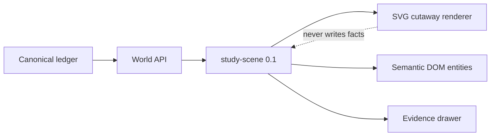

> 历史研究归档 · 2026-11-10 发布 · 发布审核状态：scan_only（发布前程序化隐私扫描）。原有日期、观点、数据和命令保留历史语境，未经本次逐项事实核验或运行复现；见[归档说明](../../../ARCHIVE_POLICY.md)。

# Agent Anthill 正交剖面视觉实验台与资产管线（2026-07-19）

> **一句话结论：** 第一张新界面应以账本 API 驱动的程序化 SVG/DOM 正交剖面实验台出现；PixiJS 8.19.0 WebGL 仍是后续生产候选，Phaser 4.2.1 只做同场景对照，AI 图只做概念，Pixelorama 做人工权威，Blender 必须通过一天时间盒才进入主线。

## 1. 在 R152 基础上的新增

**结论：R152 已完成方向和引擎选型，本报告把它收敛成可以立即执行、截图和计量的纵向切片。**

已有基础：

- [R152](R152_AgentAnthill%E5%8F%AF%E8%A7%86%E5%8C%96%E5%BC%95%E6%93%8E%E4%B8%8E%E5%B7%AE%E5%BC%82%E5%8C%96%E5%AE%9A%E4%BD%8D_2026-07-18.md) 已确定“事实优先于表演”、正交剖面主假设、PixiJS 候选、Phaser 对照、Blender/Pixelorama 离线边界；
- Agent Anthill `v0.7.0` 已有 44 事件合成展品、时间旅行、Evidence、Coverage、Compare 和语义 DOM；
- Phase 0 v2.2 已冻结四个场景包、八个机制问题、错误推断码、信息等价和可访问性门槛。

本次新增：

1. 选择独立 SVG/DOM Visual Lab 作为 VA0，不改生产 Canvas，也不先安装引擎；
2. 把协议中的 1-based 事件号与 API 的 0-based `ingest_seq` 显式区分；
3. 给出 PixiJS/Phaser 可复现同场景 benchmark manifest；
4. 把“小人动画”收敛为 AI 概念 → 人工权威母版 → 可重建派生资产；
5. 从 Pixelorama v1.1.10 源码确认 `--json` 是项目序列化，不是 Pixi atlas；
6. 给 Blender 设一天时间盒和量化停止条件；
7. 用三个小于 20 行的 Spike 验证 fixture、投影字段与 reduced-motion 浏览器边界。

## 2. 为什么先做独立 SVG 实验台

**结论：这是最快看到效果、又不污染事实基准的路径。**

| 方案 | 到首张截图 | 信息真实性 | 长期价值 | 决定 |
|---|---:|---|---|---|
| 单张概念图 | 最快 | 低，不能时间旅行或查证据 | 只适合风格沟通 | 不作为产品切片 |
| 改现有 Canvas | 中 | 可保留，但会改变当前 oracle | 继续放大布局/状态耦合 | 不在 Phase 0 做 |
| 直接上 PixiJS | 慢 | 取决于尚未冻结的 VisualModel | 长期正确，但把美术与引擎变量混在一起 | 放到 VA4/Phase 2 |
| 独立 SVG/DOM Lab | 快 | 直接读现有 world/event API | 场景合同可晋升或废弃 | **VA0 推荐** |

Visual Lab 必须显著标记：

- `PHASE 0 · EXPLORATION · NOT PRODUCTION`；
- `SYNTHETIC FIXTURE`；
- 房间是比喻，身份、状态、truth、游标和 Evidence 来自账本；
- 顺序轨道只表示时序，不冒充因果关系。

### 2.1 数据与渲染边界



`study-scene` 是 Phase 0 的有界实验合同，不宣称已经是正式 `VisualModel`。它是唯一读取 world projection 的映射层；SVG 只接收视觉场景，不拥有 Agent 状态。

### 2.2 游标编号陷阱

协议面向参与者使用第几个事件，API 使用 `ingest_seq`：

| 协议事件号 | API seq | 事实 |
|---:|---:|---|
| 17 | 16 | `decision.evaluated` |
| 25 | 24 | `error.raised` |
| 31 | 30 | `error.recovered` |
| 38 | 37 | `compaction.completed` |
| 44 | 43 | `run.completed` |

界面应同时显示 `EVENT #25 · INGEST SEQ 24`。只显示一个数字会让截图研究和 API 证据错位。

## 3. 引擎决定没有变化，但基准更严格

**结论：PixiJS 更匹配“薄渲染器”，Phaser 必须证明其框架重量值得承担。**

截至 2026-07-19，官方 registry/release 仍支持：

- `pixi.js@8.19.0`：MIT；WebGL/WebGL2 为官方推荐，WebGPU 仍为 experimental；
- `phaser@4.2.1`：MIT；Phaser 4 渲染器在 2026-04-10 才首次发布，4.2.1 发布于 2026-07-09。

| 维度 | PixiJS | Phaser 4 | Anthill 解释 |
|---|---|---|---|
| 抽象层 | retained-mode 2D renderer | Scene/Camera/Input/Tween/Physics 等完整游戏框架 | Anthill 已有 reducer/timeline/inspector，Pixi 重叠更少 |
| 状态侵入 | ticker/scene graph 可禁用或约束 | scene/timer/tween/registry 更容易成为第二事实源 | Phaser 所有这些组件均禁止拥有领域状态 |
| 可访问性 | opt-in DOM accessibility overlay | 未找到等价通用系统；DOMElement 是普通叠加 | 两边都以 Anthill semantic DOM 为权威 |
| 包结构 | 细粒度 ESM re-export | 标准 npm import 指向预打包 Webpack ESM | 最终结论必须来自同一生产 bundler 实测 |

官方完整 minified 分发物的同算法 gzip 早期信号是 Pixi 约 225 KB、Phaser 约 355 KB；Phaser 高约 57%。这是预警，不是应用 bundle 结论，因为 Pixi 还能 tree-shake，Phaser 也可做定制构建，而两者的额外工程成本必须一起计量。

### 3.1 同场景 benchmark 的硬边界

两边必须共享：

- 同一序列化 VisualModel、fixture、atlas、字体、viewport、DPR；
- 同一可见集合和 LOD；
- 同一外部逻辑时钟与 animation intents；
- 同一 semantic DOM、键盘顺序、Evidence route；
- 同一生产构建目标、Node/package manager/bundler 版本和 lockfile hash。

禁止的领域权威：engine registry、scene lifecycle、tween、timer、physics。

必测指标：truth/对象/Evidence parity、route bundle raw/gzip、首次可用帧、atlas decode/upload、外部 rAF p50/p95/p99、missed frames、Long Tasks、seek/select/resize/run-switch 延迟、heap 与稳定后斜率、WebGL draw/upload/bind 诊断、100 次 run switch、200 次 seek、静止状态非必要帧和 DOM mutation 为零。

性能与 Accessibility/HeapProfiler/WebGL hooks 必须分 pass；开启诊断本身会干扰性能，不能把 profiler-on 数字当正常运行数字。

仍沿用待校准的选择门槛：只有在两档硬件上 Phaser p95 都至少快 20%，或专属实现/维护投入低至少 30%，且 bundle/memory 都不高于 Pixi 15%，才考虑迁移。否则 Phaser 只作为公开 benchmark。

## 4. 小人动画的长期资产管线

**结论：AI 负责探索，人工源文件负责权威，运行时只消费可重建资产。**

```text
概念层
  brief.yaml + prompt.md + concept.png + provenance.json

人工权威层
  agent-worker.svg
  agent-worker.pxo
  agent-worker.blend        # 仅 Blender 小试通过后保留

派生层
  agent-worker.sheet.png
  agent-worker.project.json
  agent-worker.atlas.json
  agent-worker.manifest.json

运行层
  PixiJS / Phaser 消费同一 atlas 与 manifest
```

建议的基础动作是 `neutral / active / waiting / handoff / error / complete`。`unknown` 不是一个“猜测动作”，而是静态角色加斜线纹理。`selected`、truth 和 health 也应是独立 UI 层，避免动作组合爆炸。

“行走、思考、敲键盘”只有在事件合同明确支持时才出现。所有帧由回放逻辑时钟求值；`prefers-reduced-motion` 使用代表静态帧。

### 4.1 AI 图像边界

GPT Image 2 适合做 12 张风格概念和少量定稿候选，但官方仍提示重复角色一致性、精确布局和复杂构图可能失败，当前模型也不提供透明背景。因此生成图不能直接变成 runtime sprite。

按 2026-07-19 公开单价，12 张 1024² medium 加 2 张 high 的输出图像成本约 `$1.058`，输入另计。现有 `$50` 概念预算足够，真正瓶颈是人工筛选、重绘和动作一致性。

### 4.2 Pixelorama 源码结论

Pixelorama `v1.1.10`（MIT）支持 headless、spritesheet、JSON、帧区间、方向和分层导出。但源码的 `Export.gd` 调用的是 `JSON.stringify(project.serialize())`，所以 `--json` 输出项目数据，不是 Pixi atlas。

项目 JSON 包含 `pixelorama_version`、画布尺寸、tags、逐帧 duration、fps、license/user_data。自有转换器应：

1. 校验 Pixelorama 精确版本；
2. 固定帧排序和矩形计算；
3. 由 tag 的 from/to 生成 animations；
4. 保留逐帧时长；
5. 禁止 atlas rotation，使用 nearest sampling；
6. 增加 1–2 px padding/extrusion；
7. 输出 source/sheet/atlas/manifest 的 SHA-256。

### 4.3 Blender 只做限时对照

Blender 5.2 LTS 适合一个 rig 复用多个动作和方向，但首次建模、绑定和清理成本最高。Phase 0 最多投入一天；满足任一条件即退出：

- 8 小时无法完成可复用 rig 和六组清晰动作；
- 超过 20% 渲染帧需要 Pixelorama 重画；
- 总清理时间不低于直接 SVG/Pixelorama；
- 32–48 px 轮廓识别弱于 SVG；
- 固定环境不能重复导出稳定结果。

第三方 `.blend` 应使用 `--disable-autoexec`。如果以后公开使用 `bpy` 的导出脚本，要单独审查 GPL-compatible 许可边界。

## 5. 快速阶段与成本

**结论：先交 VA0 截图，再用真实耗时决定是否值得进入重资产管线。**

| 阶段 | 时间盒（初始预估，待实测） | 交付 |
|---|---:|---|
| VA0 | 4–8 工程小时 | SVG 角色/机器、账本游标、Evidence、浏览器截图 |
| VA1 | 2–4 小时 | 12 张 AI 概念、来源清单、一个轮廓方向 |
| VA2 | 1 工作日 | SVG/Pixelorama 母版、CLI 导出、atlas 转换 |
| VA3 | 最多 1 工作日 | Blender 同角色对照和真实人工耗时 |
| VA4 | 1–2 工作日 | 同一 atlas 接 PixiJS 与 Phaser 的最小 benchmark |

这些数字是计划值，不是产能事实。每个阶段结束都记录时间、动作、效果、证据和限制；所有前端阶段都附精确截图。

## 6. 当前验证与未知

**结论：VA0 本地可执行切片、真值边界和最终截图已经冻结；托管晋级、正式 VisualModel、引擎性能和美术产能仍待实测。**

本地 Spike（2026-07-19）：

- 44 事件 fixture 在 API seq 24/30/37/43 分别是 incident/recovery/compaction/terminal；
- 最终 projection 有 12 个实体，全部具备 ID、kind、name、zone、status、truth、event count 和 last-event route；
- Chromium 支持 SVG/clip-path；reduced-motion 最终达到零运行动画；前两次失败揭示 media override 必须位于等 specificity 的基础 animation 之后。
- 稳定 Chromium 契约 25/25 通过（独立进程墙钟 68.720 秒），精确 `@visual-lab-s0` 1/1 通过（Playwright 10.2 秒），受影响 Python/文档/验证控制面 58/58 通过；
- 最终浏览器内存截图为 1600×1000、249,107 bytes、SHA-256 `07154927e9ab15980ba4596b50b2e8f7766de78b20388420fa26687709e176cd`，12 区/12 实体、完整 run ID、实体标签零裁切；
- 真值复审已把 P0/P1 清零：展示失败不再伪造 run/ledger 无效，旧 seek 不能清掉新场景，旧 HEAD 不能污染后续 seek 的共享缓存；并加入 sibling cancellation 与浏览器 `no-store`。

仍待验证：

- hosted engineering S2、六个精确 Playwright 附件及 protected-main replay；
- 公开或敏感 run 的服务端最小化 scene endpoint、响应字节/字段上限和缓存响应策略；
- Pixelorama 固定 Linux 导出的字节级确定性；
- Blender 实际人工时间和 32–48 px 识别；
- Pixi/Phaser 应用级 bundle、两档硬件性能和内存；
- Safari、Firefox、NVDA、VoiceOver；
- AI 概念的真实清理时间。

## 7. 一手来源

引擎：

- [PixiJS 8.19.0 release](https://github.com/pixijs/pixijs/releases/tag/v8.19.0)
- [PixiJS renderer guidance](https://pixijs.com/8.x/guides/components/renderers)
- [PixiJS accessibility](https://pixijs.com/8.x/guides/components/accessibility)
- [PixiJS culler](https://pixijs.com/8.x/guides/components/application/culler-plugin)
- [Phaser 4.2.1 release](https://github.com/phaserjs/phaser/releases/tag/v4.2.1)
- [Phaser 4 changelog](https://github.com/phaserjs/phaser/blob/v4.2.1/changelog/v4/4.0/CHANGELOG-v4.0.0.md)
- [Phaser DOMElement](https://docs.phaser.io/api-documentation/4.0.0/class/gameobjects-domelement)
- [Chrome Accessibility protocol](https://chromedevtools.github.io/devtools-protocol/tot/Accessibility/)
- [W3C Long Tasks API](https://w3c.github.io/longtasks/)

资产：

- [Blender 5.2 LTS](https://www.blender.org/download/releases/5-2/)
- [Blender License](https://www.blender.org/about/license/)
- [Blender command-line render](https://docs.blender.org/manual/en/latest/advanced/command_line/render.html)
- [Blender scripting security](https://docs.blender.org/manual/en/latest/advanced/scripting/security.html)
- [Pixelorama v1.1.10](https://github.com/Orama-Interactive/Pixelorama/releases/tag/v1.1.10)
- [Pixelorama CLI](https://pixelorama.org/user_manual/cli/)
- [Pixelorama Export source](https://github.com/Orama-Interactive/Pixelorama/blob/v1.1.10/src/Autoload/Export.gd)
- [Pixelorama Project serialization](https://github.com/Orama-Interactive/Pixelorama/blob/v1.1.10/src/Classes/Project.gd)
- [GPT Image 2](https://developers.openai.com/api/docs/models/gpt-image-2)
- [OpenAI image generation guide](https://developers.openai.com/api/docs/guides/image-generation)
- [SVG 2 structures](https://www.w3.org/TR/SVG/latest/struct.html)
- [Media Queries 5 reduced motion](https://www.w3.org/TR/mediaqueries-5/)

检索日期均为 2026-07-19。Pixi Canvas 状态在官方 renderer guide 与 8.16 release post 之间仍有冲突，所以 Anthill 继续保留自己的 Canvas/semantic DOM 降级层。

## 8. Pattern Forge 判断

“AI 概念 → 人工权威母版 → 可重建派生资产”具有可复用潜力，但目前只有方案和一次项目内应用，没有 Pixelorama/Blender 真实耗时与跨项目证据。暂不写入 `PATTERN_LIBRARY.md`；完成 VA2/VA3 后再评估。
