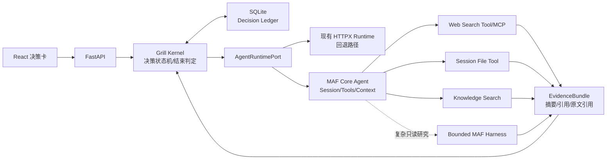

> 历史研究归档 · 2026-11-10 发布 · 发布审核状态：scan_only（发布前程序化隐私扫描）。原有日期、观点、数据和命令保留历史语境，未经本次逐项事实核验或运行复现；见[归档说明](../../../ARCHIVE_POLICY.md)。

# Grill UI 引入 Microsoft Agent Framework 架构选型（2026-07-22）

> **一句话结论：** 可以引入 MAF，但当前最优方案不是让 Harness 接管 Grill，而是保留确定性的决策账本与用户确认状态机，以 MAF Core Agent 作为可替换的 Tool/Context Runtime；Harness 只在需要联网或多步读文件时作为有预算、只读、可审计的研究子 Agent。

## 1. 在已有研究基础上的新增

**结论：R131 已完成通用 SDK 选型，本报告补上 MAF 1.12 与 Grill UI 的场景映射。**

已有基础：

- [R131](R131_Agent_SDK%E9%80%89%E5%9E%8B%E6%8C%87%E5%8D%97_2026Q2.md) 在 2026-05-21 记录 MAF v1.5.0，定位为 Azure/.NET 企业全栈继任者；
- [R121](../04-%E5%B7%A5%E7%A8%8B%E5%AE%9E%E8%B7%B5/R121_TencentDB_Agent_Memory%E7%AC%A6%E5%8F%B7%E5%8C%96%E4%B8%8A%E4%B8%8B%E6%96%87%E5%8E%8B%E7%BC%A9%E6%9C%BA%E5%88%B6%E6%B7%B1%E5%BA%A6%E6%8B%86%E8%A7%A3.md) 已形成工具轨迹 offload、三级压缩和 Token 水位线；
- [R151](R151_CrazyA2A%E9%80%9A%E7%94%A8AgentTeam%E5%B9%B3%E5%8F%B0%E5%8C%97%E6%9E%81%E6%98%9F%E4%B8%8E%E7%8E%8B%E7%89%8C%E9%9B%86%E6%88%90%E8%B7%AF%E7%BA%BF.md) / P-031 已提出“确定性内核 + 王牌适配器”，外部框架不能接管事实、权限和完成判定；
- Grill UI P0 已有 FastAPI + SQLite 决策账本、单问题卡片和结束确认。

本次新增：

1. MAF Python 已于 2026-07-21 发布 1.12.0，PyPI 标注 Production/Stable；
2. 2026-07 新增 Harness，包含工具循环、逐次历史持久化、上下文压缩、文件访问/记忆、工具审批、Web Search、Skill 与后台 Agent；
3. MAF Core 提供 Session、ContextProvider、Middleware、MCP、Workflow Checkpoint 与 HITL；
4. 自定义 OpenAI-compatible `base_url` 是官方支持路径，但 2026-06/07 仍出现非标准响应与 reasoning 解析兼容 issue；
5. Grill UI 应采用“确定性外环 + 受限 Agent 内环”，而不是把产品状态完全交给 SDK Session。

## 2. 定位透镜

**结论：MAF 正从企业 Agent SDK 快速长成 Harness 平台，但 Harness 的成熟度落后于 Core。**

### 纵轴：生命周期

| 层 | 当前阶段 | 依据 |
|---|---|---|
| MAF Core Agent / Workflow | 早期成熟 | 1.12.0、PyPI stable、Session/Context/MCP/HITL/Checkpoint 已形成正式文档 |
| MAF Harness | 快速上升早期 | 官方页面约 2026-07 才发布，功能齐但真实非 OpenAI provider 组合仍需验证 |
| Grill UI 手写状态机 | P0 已验证 | 单问题、用户确认、总结和真实 DeepSeek 调用已跑通 |

### 横轴：控制哲学

| 方案 | 框架替你管理 | 我们仍需管理 | 对 Grill 的匹配 |
|---|---|---|---|
| 手写 Loop | 几乎无 | Tool Loop、Context、审批、Tracing、压缩 | 控制强，继续扩展成本高 |
| MAF Core Agent | Tool Loop、Session、ContextProvider、Middleware、MCP | 决策状态机、持久化适配、工具安全 | **最高** |
| MAF Harness | 再加 Todo/Mode/Compaction/File/Web/Approval | 产品状态、租户隔离、审计与沙箱 | 适合作为研究子 Agent |
| LangGraph | 图、Checkpoint、HITL、恢复 | Tool/Prompt/Context 细节 | 分支复杂后更合适，现在偏重 |
| PydanticAI | Typed Tool/Output、DI、Provider 适配 | 持久化、复杂 HITL、Harness | Python 单 Agent 强备选 |

交叉判断：Grill 是“确定步骤中的局部开放探索”。主流程必须确定，搜索与文件阅读可以 Agentic。因此不能只选一个框架包办全部层次。

## 3. 推荐架构

**结论：SQLite 决策账本继续做唯一事实源，MAF 只通过 Port 提供受控能力。**

### 不交给 MAF 的职责

- 当前决策、决策历史、分歧和结束状态；
- “每轮只讨论一个待决事项”；
- 同意/不同意/补充信息的业务语义；
- 用户身份、附件权限和 API Key 隔离；
- 最终卡片 schema 与落库事务。

### 交给 MAF 的职责

- 模型 Tool Calling 循环与最大迭代数；
- Session/消息格式、ContextProvider 和 Middleware；
- Python Function Tool 与 MCP 适配；
- 工具调用 tracing、审批事件和取消/超时；
- 研究子 Agent 的压缩、文件记忆和只读循环。

## 4. 上下文管理不是“把历史全塞给 SDK”

**结论：SDK Session 是执行缓存，结构化账本才是权威上下文。**

建议四层 ContextProvider：

1. `RuntimePolicyProvider`：版本化 Grill 规则、工具权限、当前阶段；
2. `DecisionLedgerProvider`：已确认决策和未决冲突，始终注入；
3. `RecentTurnsProvider`：只保留最近 3～5 轮原文，数量是初始值，待实测；
4. `EvidenceProvider`：按当前问题检索相关网页、附件和知识库证据，注入摘要与引用。

原始工具输出不得长期留在主消息历史；保存到 `tool_runs`/对象存储，以 `evidence_id` 回溯。Token 达模型窗口 60% 时开始轻量压缩、80% 做历史 offload、95% 紧急裁剪，均为继承 [R121](../04-%E5%B7%A5%E7%A8%8B%E5%AE%9E%E8%B7%B5/R121_TencentDB_Agent_Memory%E7%AC%A6%E5%8F%B7%E5%8C%96%E4%B8%8A%E4%B8%8B%E6%96%87%E5%8E%8B%E7%BC%A9%E6%9C%BA%E5%88%B6%E6%B7%B1%E5%BA%A6%E6%8B%86%E8%A7%A3.md) 的初始阈值，必须按真实模型校准。

## 5. 工具边界

**结论：先接只读工具，任何副作用都必须经过独立批准。**

| 工具 | 首版策略 | 关键边界 |
|---|---|---|
| `web_search` | 自动，只读，最多 3 次/决策 | MAF hosted search 不保证 DeepSeek 可用，优先自建函数或可信 MCP；保留 URL/标题/时间 |
| `read_session_file` | 自动，只读 | 只读服务器上的会话附件目录；浏览器用户本地文件必须先上传 |
| `search_knowledge_base` | 自动，只读 | 按用户/知识库 ACL 过滤后再返回模型 |
| 写文件/执行 shell | P1 不开放 | Harness deny-list 不是安全边界；需要 OS/容器沙箱和显式审批 |
| 发消息/改业务数据 | 不开放 | 未来必须 approve/edit/reject，并做幂等键和审计 |

网页和文件内容全部视为不可信 Tool Output，不能改变 System Policy，也不能指示 Agent 调用更高权限工具。

## 6. 为什么不让 MAF Harness 直接接管 Grill

**结论：Harness 的默认自主性与 Grill 的逐项确认 UX 存在方向冲突。**

- Harness 默认提供 Todo、Plan/Execute、文件记忆、Web Search 和工具自动审批，容易在一次用户点击后做太多事；
- Grill 的停止条件是“用户同意结束卡”，不是 `todos_remaining()`；
- Harness 的压缩目标是维持长任务运行，不保证保留每项已确认决策的法律/产品语义；
- MAF 内建 CheckpointStorage 当前主要是 Memory/File/Cosmos，现有 SQLite 需要自定义适配或双写；
- MAF 1.12 发布节奏快，Python provider API 在 2026 年已有显著重构，必须通过 Adapter 隔离。

Harness 可以作为 `research_task`：禁用 todo/mode/file memory/auto approval，不给 shell，限定 3 次工具循环，只返回 `EvidenceBundle`，不直接写决策账本。

## 7. 分阶段迁移

**结论：先做可撤回 Spike，再决定是否替换现有 HTTPX Runtime。**

### Phase A · 兼容性 Spike（经验预估 2～3 人日）

- 固定 `agent-framework-core/openai==1.12.0`；
- 用现有 DeepSeek 配置跑 function tool、结构化输出、流式和多轮 session；
- 两个只读工具：假搜索、会话文件读取；
- 验证超时、取消、错误工具参数、并行工具和 3 次迭代上限；
- 与当前 Runtime 做同输入 A/B，不迁移 SQLite schema。

准出：30 个脚本用例中无越权路径、无重复副作用、卡片 schema 全部可解析；“30”是首轮样本量，不是统计充分性结论。

### Phase B · 生产纵向切片（经验预估 5～8 人日）

- `AgentRuntimePort` + `MafRuntimeAdapter`；
- `tool_runs/evidence` 审计表；
- 上传附件到 session sandbox；
- 一个真实 Web Search provider/MCP；
- SSE 展示“正在搜索/正在读文件”；
- Token/工具次数/墙钟时间三重预算。

### Phase C · 条件触发

只有出现决策修订图、资料冲突、异步知识入库、跨进程恢复时，才评估 MAF Workflow 或 LangGraph；P0/P1 不迁移主状态机。

## 8. 成本与失败方式

**结论：框架减少 Loop 代码，不会替我们承担安全、检索质量和模型兼容责任。**

- 每次搜索通常增加 1～3 次模型/工具往返，延迟和 Token 成本随工具轮次增加；
- DeepSeek/OpenAI-compatible 的 Tool Call delta、reasoning content 和 structured output 仍可能与 SDK 预期不一致；
- 本地文件在 Web 架构中实际位于服务器，必须先上传，不能让服务端读取用户电脑任意路径；
- 间接 Prompt Injection 可从网页/文件进入，MAF 官方明确要求应用自行做 allow-list、审批和输出校验；
- MAF 的高频发布意味着升级必须跑 contract test；每次小版本升级预留 0.5～1 人日回归是经验估计，待两次真实升级后校准；
- 若 MAF Adapter 不稳定，应能配置切回现有 HTTPX Runtime。

## 9. 明确建议

**结论：选 MAF，但选它的“积木”，暂不选它的“全权驾驶”。**

1. 采用 MAF Core Agent 作为首选 Spike；
2. 保留现有手写 Grill Kernel、SQLite 和 HTTPX fallback；
3. Harness 只做复杂只读研究子 Agent；
4. Web Search 用自建函数或可信 MCP，不依赖模型厂商 hosted search；
5. 会话附件先上传到隔离目录，再暴露最窄的 read/search 工具；
6. 两周内不要引入多 Agent，先验证一个 Agent + 两个工具 + 一个 ContextProvider。

## 10. 开放问题

- 内网 Infra 模型和 DeepSeek 是否都稳定支持多轮 Tool Calling？
- Web Search 选择 Bing/Brave/Tavily/自建代理还是企业现有服务？
- 附件是否只读文本/PDF/Office，最大尺寸和保留周期是什么？
- 工具执行进度是否需要 SSE，还是当前卡片等待态足够？
- MAF Session 是存序列化快照，还是完全由 SQLite ContextProvider 重建？建议后者先行。

## 11. Sources and freshness

- [Microsoft Agent Framework overview](https://learn.microsoft.com/en-us/agent-framework/overview/) — retrieved 2026-07-22 — Agent/Harness/Workflow、Session、Context、Middleware、MCP 的官方定位。
- [Agent Harnesses](https://learn.microsoft.com/en-us/agent-framework/agents/harness) — retrieved 2026-07-22 — Tool Loop、Compaction、File、Web、Approval、Skills 与 Loop 上限。
- [Conversations & Memory](https://learn.microsoft.com/en-us/agent-framework/agents/conversations/) — retrieved 2026-07-22 — Python Session 序列化与 ContextProvider。
- [OpenAI-compatible endpoints](https://learn.microsoft.com/en-us/agent-framework/integrations/openai-endpoints) — retrieved 2026-07-22 — `OpenAIChatCompletionClient(base_url=...)` 官方支持。
- [MCP tools](https://learn.microsoft.com/en-us/agent-framework/agents/tools/local-mcp-tools) — retrieved 2026-07-22 — Python stdio/HTTP/WebSocket MCP。
- [Workflow checkpoints](https://learn.microsoft.com/en-us/agent-framework/workflows/checkpoints) — retrieved 2026-07-22 — Memory/File/Cosmos storage 和 resume。
- [Workflow HITL](https://learn.microsoft.com/mt-mt/agent-framework/workflows/human-in-the-loop) — retrieved 2026-07-22 — 工具审批、请求响应和 checkpoint resume。
- [Agent Safety](https://learn.microsoft.com/en-us/agent-framework/agents/safety) — retrieved 2026-07-22 — Trust boundary、路径校验、审批和间接 Prompt Injection。
- [agent-framework PyPI](https://pypi.org/project/agent-framework/) — retrieved 2026-07-22 — v1.12.0、Python 3.10+、Production/Stable。
- [Custom endpoint response issue #6234](https://github.com/microsoft/agent-framework/issues/6234) — retrieved 2026-07-22 — 非标准 OpenAI-compatible 响应兼容风险。
- [Reasoning parsing issue #6979](https://github.com/microsoft/agent-framework/issues/6979) — retrieved 2026-07-22 — 第三方 provider 流式 reasoning 兼容风险。
- [R131](R131_Agent_SDK%E9%80%89%E5%9E%8B%E6%8C%87%E5%8D%97_2026Q2.md) — 2026-05-21 — 七大 SDK 横向比较与选型基线。

一致性：官方能力描述彼此一致；官方“支持 OpenAI-compatible”与 GitHub 近期兼容 issue 并不矛盾，前者是接口承诺，后者说明具体 provider 组合仍需 Spike。

未验证：当前 DeepSeek `deepseek-v4-pro` 在 MAF 1.12 下的 Tool Calling、流式 delta、Harness compaction 与 structured output 尚未本地实测。
