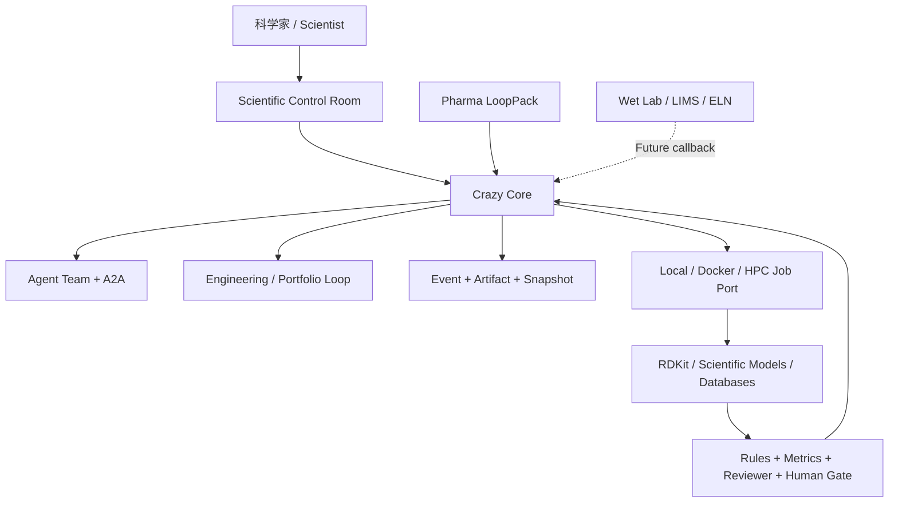

> 历史研究归档 · 2026-11-10 发布 · 程序扫描；未逐篇全文审阅。原有日期、观点、数据和命令保留历史语境，未经本次逐项事实核验或运行复现；请结合[归档说明](../../../ARCHIVE_POLICY.md)阅读。

# Crazy Scientific Harness 与 Anew Labs 差距及演进路线

> **一句话**：Crazy 不应复制 Anew 的科学基础模型，而应成为模型之上的 Scientific Harness；当前强项是持久控制与证据治理，主要缺口是科学 Schema、异构计算、领域 Judge、批量候选组合和科研人工审批。

> **增量说明**：R143 研究了 Claude Science 科研工作台，R151 定义了 Crazy 通用 Agent Team 北极星；本报告第一次把 Crazy 的 As-Built 与 Anew Labs 公开业务逐项映射，并冻结第一条真实制药学习纵切。

## 1. 企业事实与推断边界

**Anew 公开呈现的是模型栈、先进计算、高通量湿实验反馈和自有药物管线的组合。**

官网可核实：

- scNext 预测单细胞动态与扰动响应。
- AnewOmni 统一生成小分子、多肽和抗体结合物。
- AnewSampling 面向蛋白质-配体动态构象系综。
- AnewSynth 组合专家反应规则、路线生成和 RPF 评价 Agent。
- AnewMind 被官网描述为 Research Assistant，但内部编排细节没有公开。
- Pipeline 跨 Exploratory、Hit ID、Hit-to-Lead、Lead Optimization 和 IND Enabling。
- 后端招聘明确要求算法模块调用链、大规模任务调度、分布式计算和药研工作流探索。

待验证：

- 本地材料中的 AnewFEP 暂无当前官网独立页面佐证。
- 官网“将开源框架”的表述不等于所有模型已有稳定公开 API。
- 企业公开性能和实验结果未由 Crazy 独立复现。

## 2. Crazy 当前可迁移资产

**Crazy 已有 Scientific Harness 的控制面雏形，但还没有科学数据面。**

| Crazy 能力 | 科研映射 | 当前边界 |
|---|---|---|
| EventStore / Projection | 实验历史与当前项目状态 | 仍是本地 SQLite |
| Mailbox / Scheduler / Lease | 长作业待办、唤醒和恢复 | 未跨机器、无 HPC Broker |
| Canonical AgentLoop | 模型建议，工具和 Gate 产生事实 | 真实开放科研任务未验证 |
| Supervisor / Kernel / child Run | 多专业分工与结果晋升 | 主要是 Scripted Golden |
| Tool/Skill/MCP Harness | 科学模型和数据库能力端口 | 领域 Adapter 尚无 |
| Offload / Artifact Ref | 大结构、轨迹和表格的引用化 | 科学 Artifact 类型尚无 |
| Eval Campaign | 模型、策略和 Team 的受控比较 | 缺科学评测集和统计证据 |
| Checkpoint / Fork Restore | 可复现实验分支 | 不能撤销外部或湿实验副作用 |
| Engineering Loop EL1 | Candidate -> Run -> Evaluate -> Decide | 真实 child Run、Portfolio 尚未接通 |

关键判断：Crazy 不是从零开始。Event、Artifact、Snapshot、Maker/Checker、Gate 和可恢复外层循环，正是科研平台通常需要补的“可信运行骨架”。

## 3. 核心 Gap

**差距不是“少几个 Agent”，而是缺少从 Agent Run Ledger 到 Scientific Experiment Ledger 的跃迁。**

| 缺口 | 需要新增什么 | 是否改 Core |
|---|---|---|
| 科学对象 | Molecule、Protein、Dataset、Assay、Protocol、Evidence Schema | 放 Domain Pack |
| 科学制品 | SDF/PDB/mmCIF/AnnData/轨迹/Notebook 的类型、Hash、预览、保留策略 | Core 增 Artifact Port |
| 计算执行 | Docker、GPU、Slurm/K8s、Callback、Reconcile、Quota | Core 增 Job Runtime Port |
| 批量实验 | Candidate Portfolio、并行批次、淘汰、晋升、Pareto/约束 | 扩展 Engineering Loop |
| 科学评价 | 规则、指标、不确定性、适用域、重复实验、专家 Review | 放 LoopPack + Gate |
| 人工治理 | 预算、发布、合成/实验等不可逆动作的持久审批 | Core 增 Approval 协议 |
| 企业边界 | RBAC、Secrets、IP、审计、用途/生物安全 | 生产阶段建设 |
| 湿实验连接 | LIMS/ELN、批次回调、外部副作用对账 | 首个 MVP 不做 |

## 4. 目标定位

**Core 保持通用；Scientific Harness 管科学运行合同；Pharma LoopPack 管制药语义。**



最重要的接口：

- `LoopPack`：Contract、Candidate、Evaluator、Gate、View。
- `ScientificJob`：资源、环境、输入、超时、回调、幂等键。
- `ScientificArtifact`：类型、Hash、来源、预览、保留策略。
- `ExperimentEvaluation`：指标、误差、不确定性、适用域、证据。
- `ApprovalTask`：对不可逆动作进行持久人工决策。
- `PortfolioIteration`：一批候选的并行实验和选择。

## 5. 第一条真实纵切

**选择“分子候选批量初筛与证据评审”，不选择自动造药或湿实验。**

输入一组公开/教学 SMILES 和属性约束，使用 RDKit 产生可复现描述符及结构告警；Agent 负责合同解释、工具选择、冲突分析和报告，Deterministic Judge 负责硬指标，Scientist Gate 决定是否晋升。

推荐角色：

1. Protocol Agent：冻结问题、阈值来源和准出合同。
2. Property Agent：调用 RDKit 并解释结果。
3. Evidence Agent：检查输入、版本、缺失值和谱系。
4. Reviewer Agent：独立查找冲突、适用域和过度结论。
5. Deterministic Judge + Scientist Gate：掌握正式晋升权。

这条纵切会真实逼出批量调度、失败隔离、大 Artifact、证据引用、独立评价、人工审批和 UI 候选矩阵，同时不依赖 Anew 私有 API。

## 6. 实施顺序

**先完成通用 EL2，再做 Scientific Kernel 和 RDKit Golden。**

```text
Generic Engineering Loop EL2
-> ScientificJob / Artifact / Evaluation / Approval / Portfolio
-> RDKit Candidate Triage LoopPack
-> 候选矩阵、证据包、谱系 UI
-> Single vs Team Scientific Eval
-> 根据实测决定 Docker/HPC 和更多模型 Adapter
```

| 阶段 | 准出 |
|---|---|
| S1 EL2 | 两轮真实 child Run、Snapshot 继承、独立 Eval、崩溃恢复 |
| S2 Scientific Kernel | Fixture 批量运行、可恢复、可审计，Core 无 SMILES 等领域类型 |
| S3 Pharma Golden | RDKit 真实运行、Evidence Bundle 可复现、Maker 无法越过 Judge/Gate |
| S4 Compute Runtime | Docker/长作业 Callback/Unknown Reconcile 和资源预算可运行 |
| S5 Scientific Eval | 多 Trial 同题比较质量、成本、延迟与失败类型 |

## 7. 面试口径

> 我没有尝试复刻药物基础模型，而是把模型当作可替换能力端口。平台负责长任务调度、模型和工具调用链、数据与环境谱系、不可变科学制品、Maker/Checker 分离、独立评测和人工 Gate。Anew 公开岗位强调的算法模块接入、大规模调度和药研工作流，正好对应这层 Scientific Harness。第一版用 RDKit 做候选批量初筛，先证明控制面和证据链是真的，再逐步接 GPU/HPC 和更复杂模型。

## 8. 风险边界

- 计算预测不是实验事实，专家和湿实验仍是最终 Judge。
- 原始轨迹和结构不默认进入 Context，只传摘要、Schema 和 Artifact Ref。
- 无幂等键或无法对账的外部工具不能自动重试。
- Team 必须通过 Single-vs-Team 评测证明收益，否则保留更简单的 Single。
- 未完成安全评审前只使用公开教学数据，不放生产凭据和敏感生物数据。

## 9. 来源

- [Anew Research](https://anewbt.com/research/) - retrieved 2026-07-28
- [Anew Platform and Pipelines](https://anewbt.com/pipelines/) - retrieved 2026-07-28
- [Anew Careers](https://anewbt.com/careers/) - retrieved 2026-07-28
- [AnewOmni](https://anewbt.com/research/anewomni/) - retrieved 2026-07-28
- [AnewSampling](https://anewbt.com/research/anewsampling/) - retrieved 2026-07-28
- [AnewSynth](https://anewbt.com/research/anewsynth/) - retrieved 2026-07-28
- [scNext](https://anewbt.com/research/scnext/) - retrieved 2026-07-28
- [scPertBench](https://anewbt.com/research/scpertbench) - retrieved 2026-07-28
- Crazy `docs/CURRENT_PLATFORM_ARCHITECTURE_LEARNING_GUIDE.md`
- Crazy `docs/DURABLE_ENGINEERING_LOOP_DESIGN.md`
- [Claude Science：AI 制药科研工作台调研](R143_ClaudeScience_AI%E5%88%B6%E8%8D%AF%E7%A7%91%E7%A0%94%E5%B7%A5%E4%BD%9C%E5%8F%B0%E8%B0%83%E7%A0%94.md)
- `E:/ChromeDownload/AI制药业务基础拉齐攻略_面向Agent与平台工程师.md`

## 10. 设计审查

设计审查：5/5 通过。外部事实已核对官网；时间是工程预估而非承诺；长作业、Unknown Effect、大 Artifact 和审批异常已覆盖；评分阈值留给任务合同；基础模型、湿实验和生产合规明确不属于 MVP。
