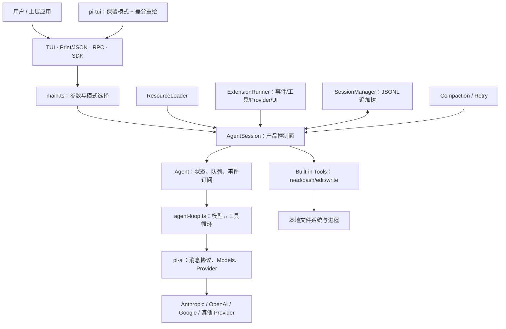
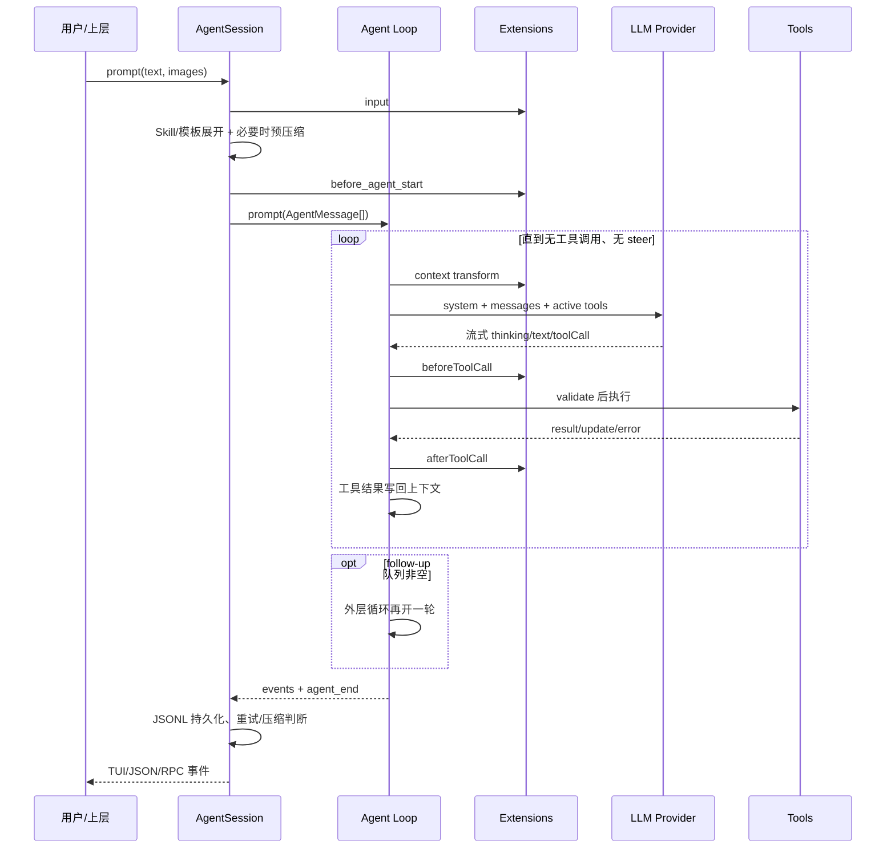
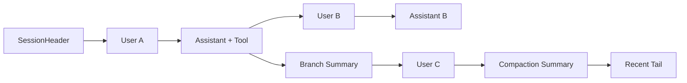

> 历史研究归档 · 2026-11-10 发布 · 程序扫描；未逐篇全文审阅。原有日期、观点、数据和命令保留历史语境，未经本次逐项事实核验或运行复现；请结合[归档说明](../../../ARCHIVE_POLICY.md)阅读。

# PI Agent 核心架构源码导读：从最小 Loop 到可自定义 Harness

> **一句话结论**：Pi 不是“功能少的 Claude Code”，而是一个把默认 Harness 压薄、把策略交给扩展的本地 Coding Agent；真正的架构中心不是 600 多行的 Agent Loop，而是负责把模型、工具、提示词、会话树、扩展和四种运行模式组合起来的 `AgentSession`。

> **已有基础与本次增量**：知识库里的 [R71](R71_Coding_Agent%E6%B7%B1%E5%BA%A6%E5%AF%B9%E6%AF%94_%E4%BA%94%E5%AE%B6%E6%A8%AA%E8%AF%84.md) 已横评五类 Coding Agent，[R148](R148_%E5%BC%80%E6%BA%90AgentHarness%E6%A8%AA%E8%AF%84_OpenClaw_Hermes%E4%B8%8E%E5%85%AD%E7%B1%BB%E9%AB%98%E5%85%89%E6%9C%BA%E5%88%B6.md) 已提出 Thin Harness 坐标，R83（原稿交叉引用，本归档未解析）/R91（原稿交叉引用，本归档未解析）/R92（原稿交叉引用，本归档未解析） 已拆 Claude Code 的 Loop、工具管线与权限。本报告在此基础上新增：Pi 当前源码快照、逐层调用链、会话/压缩/扩展机制、关键源码永久链接、风险与成本、三档学习路线，以及可复用模式 P-032。

## 0. 研究口径与结论可信度

**结论：本文以 2026-07-28 拉取的固定提交为主证据，官方文档和作者文章用于解释设计意图，竞品只用官方资料做横向校准。**

| 项目 | 快照 |
|---|---|
| 当前仓库 | [`earendil-works/pi`](https://github.com/earendil-works/pi)；旧 `badlogic/pi-mono` 已迁移 |
| 固定提交 | [`063fb963c5c33d099faa593d17e60e0a875430cd`](https://github.com/earendil-works/pi/commit/063fb963c5c33d099faa593d17e60e0a875430cd) |
| 拉取时间 | 2026-07-28，Asia/Shanghai |
| 包版本 | `@earendil-works/pi-coding-agent@0.82.1`，见 [`package.json` L2-L4](https://github.com/earendil-works/pi/blob/063fb963c5c33d099faa593d17e60e0a875430cd/packages/coding-agent/package.json#L2-L4) |
| 运行要求 | Node.js `>=22.19.0`，见 [`package.json` L98-L100](https://github.com/earendil-works/pi/blob/063fb963c5c33d099faa593d17e60e0a875430cd/packages/coding-agent/package.json#L98-L100) |
| 方法 | 静态源码走读、调用链追踪、原始行数统计、官方文档交叉验证 |
| 未做 | 未执行构建、测试和真实模型调用；性能、成功率、实际 Token 成本均为**待实测** |

项目在 2026-05-07 迁入 Earendil Works，`0.74.0` 是新 npm scope 的首个版本；配置与会话目录不变。这一点来自[官方迁移公告](https://pi.dev/news/2026/5/7/pi-has-a-new-home)，不是根据 GitHub 重定向猜测。

### 0.1 “minimal”不等于代码少

**结论：Pi 最小化的是默认能力与产品意见，不是工程实现；四个核心包当前已有约 8.8 万行源码和 8.0 万行测试。**

下表是本地对固定提交的原始行数统计，包含空行和注释，因此只用于量级判断：

| 包 | 生产 `.ts` 文件 / 行 | 测试 `.ts` 文件 / 行 | 主要职责 |
|---|---:|---:|---|
| `pi-ai` | 169 / 19,290 | 121 / 25,283 | Provider、模型、消息和流式协议 |
| `pi-agent-core` | 35 / 9,092 | 23 / 6,889 | 通用 Agent Loop 与状态封装 |
| `pi-tui` | 28 / 10,600 | 33 / 11,338 | 保留模式 TUI 与差分重绘 |
| `pi-coding-agent` | 178 / 49,420 | 194 / 36,892 | CLI、会话、工具、扩展、资源和运行模式 |

因此，把 Pi 类比成 mini-SWE-agent 的“百行研究基线”并不准确。它们都相信强模型可以配薄 Harness，但 Pi 为日常终端使用补齐了跨 Provider、恢复、扩展、TUI 和错误路径。

## 1. 先把 Pi 放对位置

**结论：Pi 位于“百行研究 Agent”和“功能一体化 Coding Agent”之间，核心主张是 Thin Core + Extension-owned Policy。**

作者 2025-11 的[设计复盘](https://mariozechner.at/posts/2025-11-30-pi-coding-agent/)把项目拆为 `pi-ai`、`pi-agent-core`、`pi-tui`、`pi-coding-agent` 四层，并明确“我不需要的就不内置”。当前[官网](https://pi.dev/)继续公开列出不内置的能力：MCP、Sub-agent、权限弹窗、Plan mode、内置 Todo、后台 Bash；需要时用 CLI、Skill、扩展、tmux 或容器补上。

| 参照物 | 默认哲学 | Pi 相对位置 |
|---|---|---|
| mini-SWE-agent | Bash-only、线性轨迹、约百行 Loop，优先评测与可复现 | Pi 更厚：有类型化工具、树会话、TUI、扩展和 Provider 层；仍保留薄核心思想。来源：[官方仓库](https://github.com/SWE-agent/mini-swe-agent) |
| Aider | Repo Map + Git 集成，把全仓符号图按相关性塞入上下文 | Pi 不内置 Repo Map，依赖模型用 `read/bash` 主动探索，或由 Skill/扩展补。来源：[Aider Repo Map](https://aider.chat/docs/repomap.html) |
| OpenCode | 权限、Sub-agent、LSP、MCP 等作为产品能力 | Pi 默认决策更少、可塑性更高，但要自行承担安全和集成成本。来源：[OpenCode Agents/Permissions](https://opencode.ai/docs/agents) |
| Claude Code | 闭源、功能和治理更完整、系统策略更强 | Pi 可读、可嵌入、可替换几乎每个接缝；默认安全边界明显更弱。 |

**我的推荐**：如果目标是学习 Agent Harness 或做高度个性化终端 Agent，优先读 Pi；如果目标是让普通团队开箱使用且需要默认权限治理、LSP、Sub-agent，Pi 不是最低总成本选择；如果目标是模型/Scaffold 消融实验，mini-SWE-agent 更干净。

## 2. 总体架构：四个包，两个控制面

**结论：Pi 的主路径是“交互适配器 → AgentSession 产品控制面 → Agent Loop 执行内核 → Provider 兼容层”，资源/扩展与会话树从两侧注入。**

### 2.1 `pi-ai`：把 Provider 差异压进统一数据平面

**结论：`pi-ai` 的价值不是一个万能抽象，而是固定 Harness 上层看到的 Message、Tool、Context 和流事件契约。**

- 基础消息只有 `user`、`assistant`、`toolResult`；Assistant 内容块可含 text、thinking、toolCall。见 [`types.ts` L323-L423](https://github.com/earendil-works/pi/blob/063fb963c5c33d099faa593d17e60e0a875430cd/packages/ai/src/types.ts#L323-L423)。
- 发给模型的 `Context` 统一为 `systemPrompt + messages + tools`。见 [`types.ts` L470-L481](https://github.com/earendil-works/pi/blob/063fb963c5c33d099faa593d17e60e0a875430cd/packages/ai/src/types.ts#L470-L481)。
- 流事件把 text、thinking、tool-call 分成 start/delta/end，使 TUI 能在 JSON 尚未完整时展示部分工具调用。见 [`types.ts` L483-L503](https://github.com/earendil-works/pi/blob/063fb963c5c33d099faa593d17e60e0a875430cd/packages/ai/src/types.ts#L483-L503)。
- `Models.stream()` 先补认证，再委托对应 Provider；Provider 可以按单一 API 或按 API 类型分派。见 [`models.ts` L455-L525](https://github.com/earendil-works/pi/blob/063fb963c5c33d099faa593d17e60e0a875430cd/packages/ai/src/models.ts#L455-L525) 与 [`models.ts` L533-L623](https://github.com/earendil-works/pi/blob/063fb963c5c33d099faa593d17e60e0a875430cd/packages/ai/src/models.ts#L533-L623)。
- 当前源码注册 38 个 Provider factory，但其中含地区变体、订阅入口和路由器，不能解读为 38 家独立模型厂商。见 [`providers/all.ts` L87-L126](https://github.com/earendil-works/pi/blob/063fb963c5c33d099faa593d17e60e0a875430cd/packages/ai/src/providers/all.ts#L87-L126)。

**边界**：作者自己也承认统一 API 会“泄漏”底层差异。跨 Provider handoff、reasoning 字段、缓存和认证刷新能被统一到一定程度，但新模型 API 的特殊语义仍要落进 Provider adapter，不会凭抽象自动消失。

### 2.2 `pi-agent-core`：小而完整的执行内核

**结论：Agent Loop 只回答一件事——何时请求模型、何时执行工具、何时把结果送回模型；它不拥有项目资源、会话文件、UI 或产品权限。**

源码有两层：

1. `agent-loop.ts` 是无 UI 的函数式循环，输入 context/config，输出事件流。
2. `agent.ts` 的 `Agent` 类在外面包状态、steer/follow-up 队列、订阅与取消。

Loop 的关键结构不是一个 while，而是两个：内层处理工具调用和 steer 消息，外层在本来要结束时再检查 follow-up。见 [`agent-loop.ts` L155-L275](https://github.com/earendil-works/pi/blob/063fb963c5c33d099faa593d17e60e0a875430cd/packages/agent/src/agent-loop.ts#L155-L275)。

几个容易漏掉的工程细节：

- 每次模型调用前先 `transformContext`，再把扩展消息 `convertToLlm`，最后构造统一 Context。见 [`agent-loop.ts` L281-L312](https://github.com/earendil-works/pi/blob/063fb963c5c33d099faa593d17e60e0a875430cd/packages/agent/src/agent-loop.ts#L281-L312)。
- 若输出因 token limit 截断，Pi **不会执行任何可能参数不完整的 tool call**，而是为每个调用返回错误让模型重发。见 [`agent-loop.ts` L374-L405](https://github.com/earendil-works/pi/blob/063fb963c5c33d099faa593d17e60e0a875430cd/packages/agent/src/agent-loop.ts#L374-L405)。这是值得保留的 fail-closed 设计。
- 工具默认并行；全局配置为 sequential，或该批任何工具声明 `executionMode: "sequential"` 时，整批串行。见 [`agent-loop.ts` L411-L425](https://github.com/earendil-works/pi/blob/063fb963c5c33d099faa593d17e60e0a875430cd/packages/agent/src/agent-loop.ts#L411-L425)。
- 并行批次先顺序做参数验证与 preflight，再并发执行；完成事件按真实完成顺序发出，但返回给模型的 Tool Result 保持原 tool-call 顺序。见 [`agent-loop.ts` L489-L554](https://github.com/earendil-works/pi/blob/063fb963c5c33d099faa593d17e60e0a875430cd/packages/agent/src/agent-loop.ts#L489-L554)。
- 异常不会抛穿 Loop：参数错误、工具异常、after hook 异常都会转成 Tool Result。见 [`agent-loop.ts` L600-L754](https://github.com/earendil-works/pi/blob/063fb963c5c33d099faa593d17e60e0a875430cd/packages/agent/src/agent-loop.ts#L600-L754)。

**风险**：Loop 没有内置 max steps；只要模型持续发工具调用就会继续。作者把这视为有意的简化，但在无人值守、按量计费或高副作用场景中，必须由扩展、外层预算或沙箱补上停止条件。

### 2.3 `AgentSession`：真正的产品控制面

**结论：如果只读 `agent-loop.ts`，只能理解 Pi 的约 30%；模型恢复、工具激活、提示词、扩展、压缩、重试和会话切换都在 `AgentSession`。**

CLI 文件开头就声明自己只把参数翻译成 SDK 选项，“SDK does the heavy lifting”。见 [`main.ts` L1-L5](https://github.com/earendil-works/pi/blob/063fb963c5c33d099faa593d17e60e0a875430cd/packages/coding-agent/src/main.ts#L1-L5)。`createAgentSession()` 完成模型/认证恢复、默认工具和核心对象组装，见 [`sdk.ts` L169-L251](https://github.com/earendil-works/pi/blob/063fb963c5c33d099faa593d17e60e0a875430cd/packages/coding-agent/src/core/sdk.ts#L169-L251) 与 [`sdk.ts` L294-L390](https://github.com/earendil-works/pi/blob/063fb963c5c33d099faa593d17e60e0a875430cd/packages/coding-agent/src/core/sdk.ts#L294-L390)。

一条用户输入在 `AgentSession.prompt()` 中依次经历：

1. 扩展命令短路；
2. `input` 扩展拦截；
3. `/skill:name` 和 Prompt Template 展开；
4. streaming 时进入 steer/follow-up 队列；
5. 模型和认证校验；
6. 必要时在新请求前压缩；
7. 构造用户消息；
8. `before_agent_start` 可加消息或换 system prompt；
9. 进入 Agent Loop。

对应源码是 [`agent-session.ts` L1114-L1265](https://github.com/earendil-works/pi/blob/063fb963c5c33d099faa593d17e60e0a875430cd/packages/coding-agent/src/core/agent-session.ts#L1114-L1265)。`/skill:name` 并非调用一个特殊 runtime，而是读取完整 `SKILL.md`，去掉 frontmatter 后包进 `<skill>` 标签作为用户内容，见 [`agent-session.ts` L1301-L1324](https://github.com/earendil-works/pi/blob/063fb963c5c33d099faa593d17e60e0a875430cd/packages/coding-agent/src/core/agent-session.ts#L1301-L1324)。这就是 Progressive Disclosure：平时只暴露技能目录，用到时才支付正文 Token。

### 2.4 P-032：能力一致的提示词编译

**结论：Pi 最值得借鉴的细节，是同一个 Active Tool Registry 同时决定“模型能调什么”和“System Prompt 告诉模型什么”。**

工具定义除了 schema/execute，还能提供 `promptSnippet` 与 `promptGuidelines`。刷新 Registry 时，Pi 从同一组 definition 生成可调用工具和提示片段，见 [`agent-session.ts` L2455-L2545](https://github.com/earendil-works/pi/blob/063fb963c5c33d099faa593d17e60e0a875430cd/packages/coding-agent/src/core/agent-session.ts#L2455-L2545)；构造 system prompt 时只收集当前有效工具的 snippet/guideline，见 [`agent-session.ts` L1021-L1055](https://github.com/earendil-works/pi/blob/063fb963c5c33d099faa593d17e60e0a875430cd/packages/coding-agent/src/core/agent-session.ts#L1021-L1055)。

这避免两种常见漂移：

- Prompt 说“可以用 bash”，实际 tools 数组没有 bash；
- 扩展新增了工具，但 Prompt 仍用旧行为约束。

`prepareNextTurn` 还允许每个回合后刷新 system prompt、tools、model 和 thinking level，使能力集在长任务中动态演化。这个模式是 R146（原稿交叉引用，本归档未解析） P-026 Prompt Runtime Contract 的可执行化实例，本次登记为 P-032。

### 2.5 `pi-tui`：薄业务，厚终端工程

**结论：TUI 与 Agent Loop 通过事件解耦，采用保留模式组件树和逐行差分重绘，而不是每帧清屏。**

`Component.render(width)` 返回终端行，`Container` 纵向组合组件，`TUI` 保存 `previousLines` 并比较新旧缓冲。入口见 [`tui.ts` L64-L70](https://github.com/earendil-works/pi/blob/063fb963c5c33d099faa593d17e60e0a875430cd/packages/tui/src/tui.ts#L64-L70)、[`tui.ts` L256-L300](https://github.com/earendil-works/pi/blob/063fb963c5c33d099faa593d17e60e0a875430cd/packages/tui/src/tui.ts#L256-L300)，差分计算主段见 [`tui.ts` L1262-L1454](https://github.com/earendil-works/pi/blob/063fb963c5c33d099faa593d17e60e0a875430cd/packages/tui/src/tui.ts#L1262-L1454)。

这层对 Harness 学习的启示是：事件协议足够稳定后，同一 `AgentSession` 可以被 TUI、Print/JSON、RPC、SDK 四种入口复用，而不用把业务状态塞进界面组件。

## 3. 工具子系统：少，但不是简单

**结论：Pi 默认只激活 `read/bash/edit/write`，安全边界却等同于本地用户；它优化的是上下文和编辑可靠性，不是权限隔离。**

### 3.1 默认工具与输出预算

| 工具 | 实现要点 | 源码 |
|---|---|---|
| `read` | 文本取 head，默认最多 2,000 行或 50KB；支持 offset/limit；图片识别与缩放 | [`read.ts` L203-L327](https://github.com/earendil-works/pi/blob/063fb963c5c33d099faa593d17e60e0a875430cd/packages/coding-agent/src/core/tools/read.ts#L203-L327) |
| `bash` | 在当前 cwd 启动系统 shell；timeout 可选且默认无超时；输出取 tail，截断时保存完整临时文件 | [`bash.ts` L316-L458](https://github.com/earendil-works/pi/blob/063fb963c5c33d099faa593d17e60e0a875430cd/packages/coding-agent/src/core/tools/bash.ts#L316-L458) |
| `edit` | `oldText` 必须在原文件唯一匹配；一次支持多个不重叠 replacement；保留 BOM/换行风格 | [`edit.ts` L33-L53](https://github.com/earendil-works/pi/blob/063fb963c5c33d099faa593d17e60e0a875430cd/packages/coding-agent/src/core/tools/edit.ts#L33-L53)、[`edit.ts` L308-L361](https://github.com/earendil-works/pi/blob/063fb963c5c33d099faa593d17e60e0a875430cd/packages/coding-agent/src/core/tools/edit.ts#L308-L361) |
| `write` | 整文件覆盖、自动建父目录 | [`write.ts` L181-L226](https://github.com/earendil-works/pi/blob/063fb963c5c33d099faa593d17e60e0a875430cd/packages/coding-agent/src/core/tools/write.ts#L181-L226) |

截断常量统一为 2,000 行 / 50KB，见 [`truncate.ts` L5-L8](https://github.com/earendil-works/pi/blob/063fb963c5c33d099faa593d17e60e0a875430cd/packages/coding-agent/src/core/tools/truncate.ts#L5-L8)。这是确定性的 Context Budget，不用另一次 LLM 摘要，成本低且可预测；代价是重要信息可能刚好落在被裁掉的中段。

### 3.2 并发写的一致性边界

**结论：`edit/write` 对同一真实路径会串行化，但 Bash 写文件不进入这个队列，跨工具副作用仍可能竞争。**

`withFileMutationQueue()` 以 realpath 为 key，把同一文件的写操作排队，不同文件仍可并行。见 [`file-mutation-queue.ts` L28-L60](https://github.com/earendil-works/pi/blob/063fb963c5c33d099faa593d17e60e0a875430cd/packages/coding-agent/src/core/tools/file-mutation-queue.ts#L28-L60)。这保护了两个并发 `edit/write`，但无法保护：

- `bash "sed -i ..."` 与 `edit` 同时改同一文件；
- 两个 Bash 命令争用数据库、Git index 或外部服务；
- 不同文件的改动存在业务顺序依赖。

因此，高副作用工具应声明 sequential，或在 Extension 的 `tool_call` hook 中做更强的资源锁。

### 3.3 安全事实

**结论：Project Trust 只决定是否加载项目本地配置/扩展，不限制模型获得的文件、进程、网络或凭据权限。**

- 路径解析明确支持相对、绝对和 `~`，没有把目标限制在 cwd 内。见 [`path-utils.ts` L45-L50](https://github.com/earendil-works/pi/blob/063fb963c5c33d099faa593d17e60e0a875430cd/packages/coding-agent/src/core/tools/path-utils.ts#L45-L50)。
- Bash 继承环境并启动本地 shell；可额外暴露 `PI_SESSION_ID/FILE`、Provider 和 Model。见 [`bash.ts` L84-L148](https://github.com/earendil-works/pi/blob/063fb963c5c33d099faa593d17e60e0a875430cd/packages/coding-agent/src/core/tools/bash.ts#L84-L148) 与 [`bash.ts` L158-L184](https://github.com/earendil-works/pi/blob/063fb963c5c33d099faa593d17e60e0a875430cd/packages/coding-agent/src/core/tools/bash.ts#L158-L184)。
- 官方[安全文档](https://pi.dev/docs/latest/security)明确：Pi 以启动用户权限运行；Project Trust 不是 sandbox；`AGENTS.md`/`CLAUDE.md` 即使项目未信任也会作为上下文加载；仓库文件和命令输出中的 Prompt Injection 属于预期的本地 Agent 风险。

**建议**：处理不可信仓库、无人值守任务或真实凭据时，把“Pi 进程或工具执行”放进容器、VM、micro-VM 或策略沙箱，只挂载必要目录和短期凭据。官方仓库推荐 OpenShell、Gondolin 或 Docker，见[仓库 Permissions & Containerization](https://github.com/earendil-works/pi#permissions--containerization)。

## 4. 会话与上下文：JSONL 树，而非聊天数组

**结论：Pi 把完整历史持久化为 append-only JSONL 树，再把当前叶子到根的路径投影成模型上下文。**

`SessionManager` 的注释直接定义了数据模型：每条 entry 有 `id/parentId`；leaf 指向当前分支末端；branch 只是把 leaf 移到旧节点，下一次 append 形成新子树。见 [`session-manager.ts` L845-L855](https://github.com/earendil-works/pi/blob/063fb963c5c33d099faa593d17e60e0a875430cd/packages/coding-agent/src/core/session-manager.ts#L845-L855)。

关键点：

- 文件一行一个 JSON，正常新增使用 append；创建/迁移时重写。见 [`session-manager.ts` L1015-L1044](https://github.com/earendil-works/pi/blob/063fb963c5c33d099faa593d17e60e0a875430cd/packages/coding-agent/src/core/session-manager.ts#L1015-L1044)。
- `getBranch()` 沿 `parentId` 从 leaf 走回根；`buildSessionContext()` 再处理 compaction 和 branch summary。见 [`session-manager.ts` L1257-L1285](https://github.com/earendil-works/pi/blob/063fb963c5c33d099faa593d17e60e0a875430cd/packages/coding-agent/src/core/session-manager.ts#L1257-L1285)。
- 最新 compaction 会替代更早历史，只保留 summary、`firstKeptEntryId` 之后的尾部以及后续消息。见 [`session-manager.ts` L411-L468](https://github.com/earendil-works/pi/blob/063fb963c5c33d099faa593d17e60e0a875430cd/packages/coding-agent/src/core/session-manager.ts#L411-L468)。
- `message_end` 事件是持久化边界；用户、Assistant、Tool Result 都在这里写 session。见 [`agent-session.ts` L595-L666](https://github.com/earendil-works/pi/blob/063fb963c5c33d099faa593d17e60e0a875430cd/packages/coding-agent/src/core/agent-session.ts#L595-L666)。

**优势**：分支不复制整段历史；轨迹、模型切换、thinking level、扩展状态都可回放；同一文件能保留多个探索路径。

**局限**：它是会话轨迹，不是持久任务状态机。Tool Result 已写入不等于外部副作用可幂等恢复；进程中断后无法仅凭 transcript 判定命令是否“执行成功但回执丢失”。这正是 [R148](R148_%E5%BC%80%E6%BA%90AgentHarness%E6%A8%AA%E8%AF%84_OpenClaw_Hermes%E4%B8%8E%E5%85%AD%E7%B1%BB%E9%AB%98%E5%85%89%E6%9C%BA%E5%88%B6.md) 的 Resident/Durable Harness 与 Pi 的边界。

### 4.1 Compaction：LLM 生成的上下文检查点

**结论：Pi 保留完整磁盘树，但模型只看到“摘要 + 最近尾部”；这解决窗口问题，不保证语义无损。**

默认参数：启用；预留 16,384 tokens；保留最近约 20,000 tokens。触发条件是 `contextTokens > contextWindow - reserveTokens`。见 [`compaction.ts` L126-L136](https://github.com/earendil-works/pi/blob/063fb963c5c33d099faa593d17e60e0a875430cd/packages/coding-agent/src/core/compaction/compaction.ts#L126-L136) 和[官方 Compaction 文档](https://pi.dev/docs/latest/compaction)。

流程是：向后找 cut point → 提取旧消息 → LLM 生成结构化摘要 → 记录已读/已改文件 → append CompactionEntry → 重建当前上下文。切点不会落在 Tool Result 上，避免结果和调用分离。见 [`compaction.ts` L710-L788](https://github.com/earendil-works/pi/blob/063fb963c5c33d099faa593d17e60e0a875430cd/packages/coding-agent/src/core/compaction/compaction.ts#L710-L788)。

**调用成本**：

- 普通压缩增加 1 次模型调用；
- 如果 cut point 切在一个超大 turn 内，历史摘要与 turn-prefix 摘要最多需要 2 次调用；
- transient error 会按同一 retry policy 重试，调用数继续增加；
- 摘要最大输出预算为 `min(0.8 × reserveTokens, model.maxTokens)`，默认 reserve 下上限约 13,107 tokens，但实际通常低于上限。源码见 [`compaction.ts` L622-L685](https://github.com/earendil-works/pi/blob/063fb963c5c33d099faa593d17e60e0a875430cd/packages/coding-agent/src/core/compaction/compaction.ts#L622-L685) 与 [`compaction.ts` L817-L918](https://github.com/earendil-works/pi/blob/063fb963c5c33d099faa593d17e60e0a875430cd/packages/coding-agent/src/core/compaction/compaction.ts#L817-L918)。

**失败边界**：错误摘要会成为后续模型的事实来源；“保留完整 JSONL”只支持人工回看，模型不会自动回到被摘要掉的原文。因此关键约束、文件路径和未完成事项应外部化到项目文件或确定性 Artifact，而不是只依赖 compaction。

## 5. 扩展系统：Pi 的策略平面

**结论：扩展不是小插件，而是进程内受信代码，可以改 Prompt、Context、Tool Call、Tool Result、Provider、Session 和 UI。**

### 5.1 资源如何进入 Session

`ResourceLoader` 汇总五类输入：Extensions、Skills、Prompt Templates、Themes、Context/System Prompt。全局和从文件系统根到 cwd 的 `AGENTS.md/CLAUDE.md` 按层级拼接，见 [`resource-loader.ts` L67-L123](https://github.com/earendil-works/pi/blob/063fb963c5c33d099faa593d17e60e0a875430cd/packages/coding-agent/src/core/resource-loader.ts#L67-L123)。项目 `.pi/SYSTEM.md` 可替换默认 system prompt，`.pi/APPEND_SYSTEM.md` 可追加，但项目版本受 trust gate；见 [`resource-loader.ts` L969-L994](https://github.com/earendil-works/pi/blob/063fb963c5c33d099faa593d17e60e0a875430cd/packages/coding-agent/src/core/resource-loader.ts#L969-L994)。

启动时先以“不信任项目”加载全局/CLI 扩展，让它们参与 `project_trust`；得到决定后才解析最终项目资源。见 [`resource-loader.ts` L333-L416](https://github.com/earendil-works/pi/blob/063fb963c5c33d099faa593d17e60e0a875430cd/packages/coding-agent/src/core/resource-loader.ts#L333-L416)。

### 5.2 可插入的接缝

**结论：Pi 的扩展面覆盖了执行前后和会话生命周期，足以实现权限门、定制压缩、Git checkpoint、Sub-agent 或 MCP，但这些能力不由核心保证。**

代表事件包括：

- 输入与 Prompt：`input`、`before_agent_start`、`context`；
- Provider：`before_provider_request`、`before_provider_headers`、`after_provider_response`；
- Tool：`tool_call`、`tool_result`、execution start/update/end；
- Session：start/switch/fork/tree/compact/shutdown；
- 模型与 UI：model/thinking selection、commands、shortcuts、widgets、custom renderers。

完整 API 定义集中在 [`extensions/types.ts` L1185-L1231](https://github.com/earendil-works/pi/blob/063fb963c5c33d099faa593d17e60e0a875430cd/packages/coding-agent/src/core/extensions/types.ts#L1185-L1231)。`ExtensionRunner` 把这些动作绑定到当前 Session，并在 reload/session replacement 后用 stale guard 防止旧扩展继续操作，见 [`runner.ts` L655-L784](https://github.com/earendil-works/pi/blob/063fb963c5c33d099faa593d17e60e0a875430cd/packages/coding-agent/src/core/extensions/runner.ts#L655-L784)。

### 5.3 扩展的信任边界

**结论：扩展拥有“改执行语义”的权力，安装包和加载路径必须按代码依赖审计。**

两个具体证据：

1. `tool_call` handler 可以直接修改已验证的 `event.input`；类型注释明确说明修改后**不会重新验证**。见 [`extensions/types.ts` L893-L902](https://github.com/earendil-works/pi/blob/063fb963c5c33d099faa593d17e60e0a875430cd/packages/coding-agent/src/core/extensions/types.ts#L893-L902)。
2. 多个扩展按加载顺序串行处理，同名工具/命令只报冲突诊断，优先级仍由加载顺序决定。见 [`resource-loader.ts` L573-L579](https://github.com/earendil-works/pi/blob/063fb963c5c33d099faa593d17e60e0a875430cd/packages/coding-agent/src/core/resource-loader.ts#L573-L579)。

因此，“自己加一个 Permission Extension”能改善误操作 UX，但不是强安全边界：扩展本身与 Pi 在同一进程、同一用户权限内。强边界仍要在 OS/Container 层。

## 6. 可靠性、成本与天花板

**结论：Pi 的可靠性重点是流式协议、错误转消息、可恢复会话和扩展可替换；它刻意不解决权限隔离、任务幂等和默认流程治理。**

| 维度 | 已做好的机制 | 天花板 / 代价 |
|---|---|---|
| 模型错误 | retryable error 指数退避；overflow 与普通 retry 分开 | 无全局任务预算；多次重试会增加调用与延迟。见 [`agent-session.ts` L2635-L2725](https://github.com/earendil-works/pi/blob/063fb963c5c33d099faa593d17e60e0a875430cd/packages/coding-agent/src/core/agent-session.ts#L2635-L2725) |
| Context overflow | 最多一次 compact-and-retry，防无限恢复循环 | 摘要可能失真；压缩本身还需模型调用。见 [`agent-session.ts` L1979-L2011](https://github.com/earendil-works/pi/blob/063fb963c5c33d099faa593d17e60e0a875430cd/packages/coding-agent/src/core/agent-session.ts#L1979-L2011) |
| Tool 错误 | 验证、pre-hook、execute、post-hook 全部错误消息化 | 默认并行使跨工具副作用仍可能竞争 |
| 历史 | JSONL append tree、分支、导出、迁移 | 不是外部副作用 ledger；session 可能保存敏感源码、命令输出和模型内容 |
| Context 成本 | Skill 按需展开；read/bash 确定性截断；紧凑默认 Prompt | 无内置 Repo Map/LSP；模型可能花更多轮次探索大型仓库 |
| 扩展 | 接缝广、可热重载、可替换 Provider/Tool/UI | 供应链和扩展冲突成本转移给用户；同进程代码可获得完整权限 |
| 安全 | Project Trust 防项目静默加载本地动态配置 | 官方明确不是 sandbox；Prompt Injection 与数据外传风险仍在 |
| 运维 | 本地 CLI、JSON/RPC/SDK 多入口 | 无常驻控制面、Durable Queue、Lease、幂等副作用或企业策略中心 |

### 6.1 一个常被忽略的经济判断

**结论：Pi 省下的是内置功能和常驻 Prompt 的成本，但会把一部分成本转成模型探索轮次、扩展维护和沙箱运维。**

- 对小中型仓库、强模型、熟练用户：四工具 + Bash 往往够用，Prompt 面小，维护简单。
- 对超大仓、弱模型或严格治理：缺少 Repo Map/LSP/权限/任务预算会提高 Token、等待和人工监督成本。
- 对团队分发：每个自定义 Extension 都要承担版本兼容、冲突、供应链、测试和文档成本。
- 对无人值守：必须额外建设 sandbox、网络/凭据隔离、运行预算、幂等和审计；这部分人力可能超过采用更“厚”产品的差价。

目前没有在同模型、同任务、同预算下得到 Pi vs OpenCode/Aider/Claude Code 的实测数据，因此本文不下“更省 Token”或“成功率更高”的结论。

## 7. 源码地图：从哪里读，读什么

**结论：按“组合根 → 产品控制面 → Loop → 数据平面 → 持久化/扩展”阅读，比按目录顺序效率高。**

| 顺序 | 源码位置 | 读完应回答的问题 |
|---:|---|---|
| 1 | [`coding-agent/src/core/sdk.ts` L169-L390](https://github.com/earendil-works/pi/blob/063fb963c5c33d099faa593d17e60e0a875430cd/packages/coding-agent/src/core/sdk.ts#L169-L390) | 一个 Session 需要组装哪些依赖？ |
| 2 | [`coding-agent/src/core/agent-session.ts` L1114-L1265](https://github.com/earendil-works/pi/blob/063fb963c5c33d099faa593d17e60e0a875430cd/packages/coding-agent/src/core/agent-session.ts#L1114-L1265) | 用户输入在进 Loop 前经历什么？ |
| 3 | [`agent/src/agent-loop.ts` L155-L275](https://github.com/earendil-works/pi/blob/063fb963c5c33d099faa593d17e60e0a875430cd/packages/agent/src/agent-loop.ts#L155-L275) | 内外两层循环各解决什么？ |
| 4 | [`agent/src/agent-loop.ts` L281-L425](https://github.com/earendil-works/pi/blob/063fb963c5c33d099faa593d17e60e0a875430cd/packages/agent/src/agent-loop.ts#L281-L425) | Context 怎样变成模型调用，工具何时执行？ |
| 5 | [`agent/src/types.ts` L379-L437](https://github.com/earendil-works/pi/blob/063fb963c5c33d099faa593d17e60e0a875430cd/packages/agent/src/types.ts#L379-L437) | Tool、Context、Event 的最小契约是什么？ |
| 6 | [`ai/src/types.ts` L323-L503](https://github.com/earendil-works/pi/blob/063fb963c5c33d099faa593d17e60e0a875430cd/packages/ai/src/types.ts#L323-L503) | Provider 之上的统一消息/流协议是什么？ |
| 7 | [`coding-agent/src/core/session-manager.ts` L845-L1044](https://github.com/earendil-works/pi/blob/063fb963c5c33d099faa593d17e60e0a875430cd/packages/coding-agent/src/core/session-manager.ts#L845-L1044) | JSONL 树如何追加和恢复？ |
| 8 | [`coding-agent/src/core/compaction/compaction.ts` L710-L918](https://github.com/earendil-works/pi/blob/063fb963c5c33d099faa593d17e60e0a875430cd/packages/coding-agent/src/core/compaction/compaction.ts#L710-L918) | 历史怎样被摘要并保留 recent tail？ |
| 9 | [`coding-agent/src/core/resource-loader.ts` L341-L491](https://github.com/earendil-works/pi/blob/063fb963c5c33d099faa593d17e60e0a875430cd/packages/coding-agent/src/core/resource-loader.ts#L341-L491) | Trust、包和项目资源怎样汇合？ |
| 10 | [`coding-agent/src/core/extensions/runner.ts` L830-L1008](https://github.com/earendil-works/pi/blob/063fb963c5c33d099faa593d17e60e0a875430cd/packages/coding-agent/src/core/extensions/runner.ts#L830-L1008) | 多个扩展怎样链式改消息、工具结果和 Context？ |
| 11 | [`coding-agent/src/core/system-prompt.ts` L74-L159](https://github.com/earendil-works/pi/blob/063fb963c5c33d099faa593d17e60e0a875430cd/packages/coding-agent/src/core/system-prompt.ts#L74-L159) | Active Tools、Skills、Context Files 怎样编译进 Prompt？ |
| 12 | [`tui/src/tui.ts` L1262-L1454](https://github.com/earendil-works/pi/blob/063fb963c5c33d099faa593d17e60e0a875430cd/packages/tui/src/tui.ts#L1262-L1454) | 流式事件怎样低闪烁地画到终端？ |

## 8. 三档学习路线

**结论：先追一条真实 Prompt，再扩到会话和 Extension；不要从 Provider 列表或 3,000 行 `AgentSession` 文件第一行硬啃。**

### 8.1 30 分钟：建立正确心智模型

1. 读 `sdk.ts` 的 `createAgentSession()`，画出依赖对象。
2. 读 `AgentSession.prompt()`，把九步预处理写在纸上。
3. 读 `runLoop()`，只盯两层 while、toolCalls、steer、follow-up。
4. 回答三个问题：谁保存状态？谁决定工具？谁真正调用 Provider？

完成标准：能不看图复述 `User → AgentSession → Agent Loop → pi-ai → Provider → Tool Result → SessionManager`。

### 8.2 2 小时：吃透一个完整 Turn

1. 沿 `message_start/update/end` 跟一次流式 Assistant。
2. 沿 `prepareToolCall → executePreparedToolCall → finalizeExecutedToolCall` 跟一次 `edit`。
3. 看并行批次为何“完成事件乱序、模型结果有序”。
4. 看 `message_end` 怎样写 JSONL。
5. 看 `prepareNextTurn` 怎样刷新 Prompt/Tools/Model。

完成标准：能解释截断 tool call 为什么 fail closed、两个 edit 为什么不会同时写同一路径、Bash 和 edit 为什么仍可能竞争。

### 8.3 半天：理解 Pi 的差异化

1. 读 ResourceLoader 的 trust 两阶段加载。
2. 选 `context`、`tool_call`、`session_before_compact` 三个扩展事件追到底。
3. 手工构造一棵 2 分支 session tree，算出当前 leaf 的模型上下文。
4. 用默认 reserve/keepRecent 参数模拟一次 compaction。
5. 对照 mini-SWE-agent、Aider Repo Map、OpenCode Permission，写出各自把复杂度放在哪里。

完成标准：能设计一个“只读规划 Extension”，并明确说明它为什么不是安全沙箱。

### 8.4 建议的三个小练习

**结论：最好的学习产物不是复刻 Pi，而是用它的接缝验证三个可迁移模式。**

1. **Turn Trace**：做一个 Extension，把 `turn_start/model_select/tool_call/tool_result/turn_end` 写成结构化日志；验证事件顺序和并发工具完成顺序。
2. **Budget Guard**：在 `tool_call`/`turn_end` 记录调用数、累计 Token/成本，超过阈值就 stop；验证 Pi 缺失的全局预算可以由哪一层补。
3. **Prompt/Tool Coherence Test**：动态关闭 bash，断言 system prompt 不再宣称 bash 可用、模型 tools 数组也没有 bash；这就是 P-032 的最小验收。

## 9. 可借鉴与不该照搬

**结论：最值得吸收的是清晰的接缝和能力一致性；最不该照搬的是把“同用户权限”当成所有生产场景的终局安全模型。**

### 建议吸收

- `AgentMessage → transformContext → convertToLlm → Message` 的双层消息模型；
- Active Tool Registry 同时编译 Tool Schema 与 Prompt 的 P-032；
- 截断 Tool Call fail closed；
- 并发执行、源顺序回填；
- append-only Session Tree + branch summary；
- 确定性 tool-output 截断与按需 Skill 展开；
- UI/JSON/RPC/SDK 统一消费事件协议；
- Context overflow 最多一次 compact-and-retry，防恢复死循环。

### 需要改造后吸收

- Extension hook 修改参数后应重新 schema validate；
- 工具并发应按资源/副作用分组，而不只是“批中有一个 sequential 就整批串行”；
- Session Event 之外增加 Tool Invocation/Effect Ledger、idempotency key 和 recovery state；
- Compaction 对关键约束使用确定性 Artifact 引用，不只靠 LLM 摘要；
- 默认提供预算、最大轮次和无人值守停止条件；
- 安全策略必须落在独立进程/容器/VM 与最小凭据，不依赖同进程 Extension。

### 不建议照搬

- 把缺少 Permission 解释成“安全问题无法完美解决，所以无需默认缓解”。完美隔离确实难，但误删防护、最小挂载、网络限制、短期凭据和审批仍能实质降低事故概率。
- 在大型企业仓库完全依赖模型用 Bash 自探索，却不测 Token、延迟、召回和失败率。
- 把 Session JSONL 当 Durable Workflow Log；它记录对话事实，但没有完整建模外部副作用的 exactly-once / at-least-once 语义。

## 10. 开放问题与下一步验证

**结论：静态源码已经足以确认机制，但 Pi 的效率、安全收益和长任务质量仍需同模型、同仓库、同预算实验。**

1. 在同一组真实 Issue 上，Pi、Aider、OpenCode 的成功率、模型轮次、输入/输出 Token、人工接管次数分别是多少？
2. Pi 的 Bash 主动探索在 10K、100K、1M LOC 仓库中的定位召回与 Repo Map/LSP 相差多少？
3. 连续 3 次以上 compaction 后，关键约束、未完成项和文件状态的保真率如何；P-032 + 外部 Artifact 能改善多少？
4. 默认并行工具在真实仓库里产生多少竞态；按路径/资源声明读写集能否在不显著降速的前提下降低冲突？
5. `tool_call` 扩展修改参数后不重新验证，在现有扩展生态中是否已造成兼容或安全事故？目前未找到可量化公开数据。
6. 把 Pi 放入 Gondolin/OpenShell/Docker 后，启动延迟、文件 I/O、调试体验和凭据管理的总成本是多少？

优先实验建议：先做 20 个中型真实 Issue 的 Pi vs Aider/OpenCode 对照，固定模型、thinking、最大花费和人工规则；没有这组数据前，不把“Prompt 小”直接等同于“总 Token 少”。

## 11. 最终判断

**结论：Pi 是学习“现代 Coding Agent 最小充分架构”的优质样本，也是高度可塑的个人 Harness；它不是默认完备的企业执行平台。**

我认为它最重要的贡献不是“四个工具就够了”，而是把 Harness 拆出了清晰边界：

1. `pi-ai` 管 Provider 差异；
2. `pi-agent-core` 管模型—工具循环；
3. `AgentSession` 管产品语义；
4. `SessionManager` 管可回放会话树；
5. `ResourceLoader + ExtensionRunner` 把策略移到用户可控制的平面；
6. TUI/JSON/RPC/SDK 只是同一事件内核的不同外壳。

它的优势是可读、可嵌入、可替换、默认 Prompt/工具面紧凑；天花板是安全、Durable Execution、企业治理和大型仓库自动上下文。用于个人、可信仓库、强模型、可观察终端工作流，它很有吸引力；用于不可信输入、无人值守高副作用或多人企业分发，必须把 sandbox、预算、审计和幂等作为一等组件补上。

## 12. 参考来源

**结论：源码永久链接是机制事实的最高优先级，官方文档用于当前使用语义，作者文章用于历史设计意图。**

- [Pi 当前官方仓库](https://github.com/earendil-works/pi)
- [Pi 官方文档](https://pi.dev/docs/latest)
- [Pi Security](https://pi.dev/docs/latest/security)
- [Pi Extensions](https://pi.dev/docs/latest/extensions)
- [Pi Compaction](https://pi.dev/docs/latest/compaction)
- [Pi Session File Format](https://pi.dev/docs/latest/session-format)
- [Pi 迁移 Earendil 公告](https://pi.dev/news/2026/5/7/pi-has-a-new-home)
- [Mario Zechner：What I learned building an opinionated and minimal coding agent](https://mariozechner.at/posts/2025-11-30-pi-coding-agent/)
- [mini-SWE-agent 官方仓库](https://github.com/SWE-agent/mini-swe-agent)
- [Aider Repository Map](https://aider.chat/docs/repomap.html)
- [OpenCode Agents / Permissions](https://opencode.ai/docs/agents)
