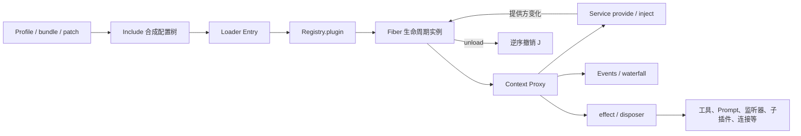
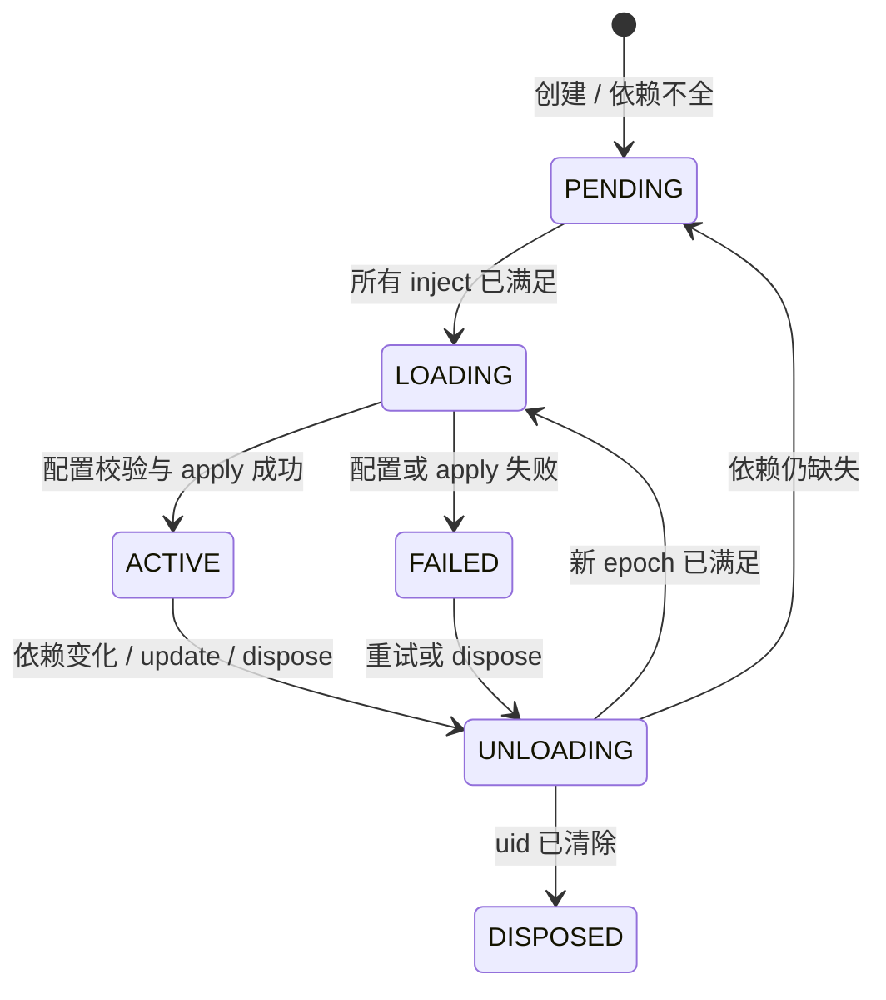
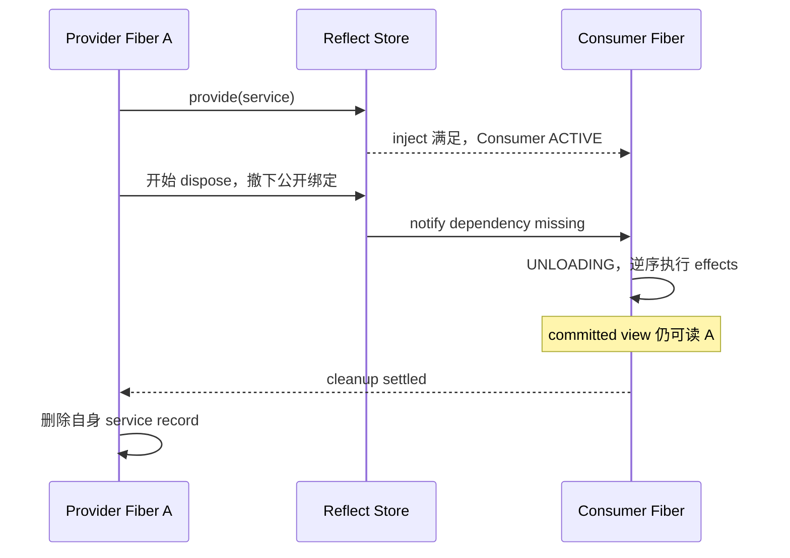

> 历史研究归档 · 2026-11-10 发布 · 程序扫描；未逐篇全文审阅。原有日期、观点、数据和命令保留历史语境，未经本次逐项事实核验或运行复现；请结合[归档说明](../../../ARCHIVE_POLICY.md)阅读。

# R164 · Cordis 时空可组合插件架构源码拆解

## 结论先行

Cordis 不是一个“根据配置 `import()` 插件”的薄加载器，而是一套**动态组件运行时**。它要同时解决两个经常被普通插件系统拆开处理的问题：

1. **时间可组合性（temporal composability）**：插件卸载时，能否把它安装的服务、监听器、工具、提示词、子插件和其他资源完整撤销。
2. **空间可组合性（spatial composability）**：插件能否声明自己需要什么服务，并在提供方出现、消失或被替换时自动激活、卸载和重新激活。

它的核心组合可以压缩成一句话：

> `Context` 是所有插件与环境交互的中介；`Fiber` 是一次插件挂载的生命周期实例；`effect/disposer` 记录“做了什么以及怎么撤销”；`inject` 记录“依赖什么”；Loader 再把配置树映射成 Fiber 树。

因此，在 DSH 中添加一个插件，不是在 agent loop 外面再包一层私有扩展机制，而是向同一棵 Cordis 树贡献服务、事件监听器或可逆注册。模型适配器、工具注册表、会话日志、agent loop、Web 应用和我们实现的长期记忆模块，原则上都处在同一个插件层级。

但它不是魔法事务，也不是安全沙箱。Cordis 只能撤销**经过 Context 且提供了正确 disposer 的副作用**；已经发出的网络请求、邮件、扣款、远端写入等外部 emission 不能自动回滚；同进程恶意插件也可以绕过 Proxy 直接访问 Node.js 能力。

## 一、版本与证据边界

### 1.1 本报告固定分析的实现

| 对象 | 固定版本 | 用途 |
|---|---|---|
| DeepSeek Harness | `b150a551b8d465e31e418e1b2eaf5e79bbb7d28e`，DSH `0.1.1-rc.2` | DSH 实际使用的 Cordis、Loader、Include、HMR 与 boot 路径 |
| DSH vendored Cordis core | `4.0.0-rc.7`，上游 Cordis `56b3d4f...` | 核心 `Context / Registry / Reflect / Fiber / Events` |
| DSH vendored Loader | `1.0.0-rc.5`，上游 Cordis `56b3d4f...` | 配置项、事务式 reconcile、作用域 |
| Cordis 论文 | `cordiverse/paper@bb8b29f...`，仓库标注 2026-08-26 draft | 理论模型、系统边界、比较与开放问题 |

DSH 没有直接从 npm 漂移安装 Cordis，而是把源码 vendor 到仓库、改名到 `@deepseek-ai/*` scope，并维护本地修改记录。这使 DSH 使用的框架层可审计、可打补丁、可固定版本。[DSH vendor 清单与本地修改](https://github.com/deepseek-ai/deepseek-harness/blob/b150a551b8d465e31e418e1b2eaf5e79bbb7d28e/vendor/README.md)

### 1.2 上游当前状态不是 DSH 当前实现

2026-08-27 核验时，Cordis 上游 `main` 为 `8cc9e33...`，core 版本为 `4.0.0-rc.8`；仓库 README 明确写着仍在活跃开发、API 尚不稳定。DSH 固定的是 `rc.7`，所以本报告不会用上游 `rc.8` 的代码替代 DSH 源码结论。[Cordis 官方仓库](https://github.com/cordiverse/cordis) · [DSH 固定的 core 源码](https://github.com/deepseek-ai/deepseek-harness/tree/b150a551b8d465e31e418e1b2eaf5e79bbb7d28e/vendor/cordis)

论文也是持续修订的预印本。它描述 Cordis v4 的抽象与实现方向；论文中的生产案例 Koishi 当时仍使用 Cordis v3，因此“4000+ 插件”是存在性和采用证据，不是对 v4 的受控性能验证。

## 二、Cordis 到底在解决什么

普通插件系统常见四个断点：

1. 插件安装了监听器、定时器和注册项，却没有统一卸载路径；热重载后产生重复监听或资源泄漏。
2. 插件 A 依赖插件 B，启动顺序靠配置列表或手写初始化流程；B 被替换后 A 仍持有失效引用。
3. 一个服务名只能有全局单例，很难让不同 agent、租户或 preset 使用不同实现。
4. 配置热更新只改了文件，没有定义局部更新失败后怎样恢复原来的运行树。

Cordis 把这些问题还原成两个正交维度：

| 维度 | 问题 | Cordis 机制 |
|---|---|---|
| 时间 | 组件离开后，如何撤销它留下的改变 | Revertible effect：每个 effect 带一个 disposer，运行时按所有权和逆序收集 |
| 空间 | 组件在哪里、何时能运行，它依赖谁 | Reactive coeffect：`inject` 声明需求，服务拓扑变化触发 Fiber 激活/卸载 |

论文把组件抽象为三元组：

- `d`：依赖集合，即组件要求的 coeffects；
- `p`：组件提供的服务绑定；
- `e`：组件执行时产生、并附带逆操作的 effect iterator。

实现里，这个抽象落到一条很具体的链：



## 三、核心对象：Context、Plugin、Fiber

### 3.1 Context：不是普通 DI 容器，而是带作用域的运行时中介

`new Context()` 会建立根上下文、根 Fiber，并安装四个内建服务：`reflect`、`registry`、`events`、`logger`。返回值本身是一个 JavaScript `Proxy`；普通的 `ctx.foo` 读取会进入服务解析器，而不是直接读取对象字段。[context.ts](https://github.com/deepseek-ai/deepseek-harness/blob/b150a551b8d465e31e418e1b2eaf5e79bbb7d28e/vendor/cordis/src/context.ts) · [reflect.ts](https://github.com/deepseek-ai/deepseek-harness/blob/b150a551b8d465e31e418e1b2eaf5e79bbb7d28e/vendor/cordis/src/reflect.ts)

Context 同时承担四种角色：

1. **服务目录**：`ctx.tools`、`ctx.llm`、`ctx.sessions` 等稳定 key 指向当前作用域解析出的实现。
2. **生命周期归属**：经由这个 `ctx` 注册的 effect，会归属于当前 `ctx.fiber`。
3. **事件总线入口**：`ctx.on/emit/waterfall/...` 都是内建 Events service 的 mixin。
4. **作用域视图**：`extend()` 用原型继承建立子上下文；`isolate()` 改变某个服务 key 的 realm；`intercept()`向下游携带该服务的策略元数据。

这解释了为什么 Cordis 强调“context paradigm”：插件对环境的 effect 和 coeffect 都应经过同一个上下文。只要插件绕开它直接写全局变量、操作未封装的宿主资源，Cordis 就失去追踪能力。

### 3.2 Plugin：只是声明；Fiber 才是一次运行实例

Registry 接受三种插件形态：

```ts
function plugin(ctx, config) {}

class Plugin {
  constructor(ctx, config) {}
}

const plugin = {
  apply(ctx, config) {},
}
```

三者都可以附带元数据：

- `name`：诊断名；
- `Config`：配置 schema；
- `inject`：必需服务；
- `provide`：声明提供的服务名；
- `intercept`：声明消费的拦截配置。

Registry 按插件 callback 维护共享 runtime record，但每次 `ctx.plugin(plugin, config)` 都创建一个新的 Fiber。因此“插件代码”和“插件实例”是分离的：同一个插件可以在不同 Context、不同配置或不同 isolation realm 下拥有多个 Fiber。[registry.ts](https://github.com/deepseek-ai/deepseek-harness/blob/b150a551b8d465e31e418e1b2eaf5e79bbb7d28e/vendor/cordis/src/registry.ts)

### 3.3 Fiber：插件树中的生命周期节点

Fiber 保存：

- 唯一 `uid`、父 Context、子 Context；
- raw config 和校验后的 config；
- `inject` 依赖表；
- 当前提交的服务实现快照 `store`；
- effect/disposer 列表；
- 当前状态、错误和正在执行的 load/unload task；
- 当前 dependency epoch。

在 DSH 固定实现中，状态枚举是：



父插件通过 `ctx.plugin(child)` 创建子 Fiber 时，Cordis 会把“dispose child”本身登记成父 Fiber 的 effect。因此父节点退出会递归拆掉子树，而不是要求每个插件自己记住全部子插件句柄。[fiber.ts](https://github.com/deepseek-ai/deepseek-harness/blob/b150a551b8d465e31e418e1b2eaf5e79bbb7d28e/vendor/cordis/src/fiber.ts)

## 四、时间可组合性：effect 为什么能自动卸载

### 4.1 Effect 的最小合同

`ctx.effect(setup)` 立即运行 `setup`。它可以返回：

- 一个 disposer；
- `Promise<disposer>`；
- 同步 generator，逐步 yield disposer；
- 异步 generator，逐步 yield disposer；
- `void`。

Fiber 把产生的 disposer 纳入当前 owner。显式调用返回的 dispose，或整个 Fiber 卸载，都会触发清理；重复 dispose 是幂等 no-op。一个 effect 内的多个 disposer 按 LIFO 逆序执行，Fiber 级 disposer 列表也按注册逆序启动。

需要特别注意：DSH 教程和源码都说明，多个**顶层异步 disposer 会逆序启动但并发等待**。如果清理必须严格串行，例如“先停止接收请求 → 等待 in-flight → flush → close DB”，应把这些步骤放进同一个 async disposer 内顺序 `await`，不能依赖多个独立 effect 的注册先后。[生命周期教程](https://github.com/deepseek-ai/deepseek-harness/blob/b150a551b8d465e31e418e1b2eaf5e79bbb7d28e/docs/cordis-tutorial/02-lifecycle-and-effects.zh.md)

### 4.2 为什么很多 DSH API 不需要手写 disposer

`ctx.on()`、`ctx.provide()`、`ctx.plugin()` 本身就在内部调用 `ctx.effect()`。DSH 的 `ctx.tools.register()` 和 `ctx.systemPrompt.section()` 也通过作用域 layer 把插入/删除配对成 Cordis effect。

因此插件里这段代码：

```ts
export const inject = ['tools', 'systemPrompt']

export function apply(ctx) {
  ctx.tools.register(myTool)
  ctx.systemPrompt.section(mySection)
  ctx.on('tools/result', observe)
}
```

不需要再维护三张 unregister 表。卸载 owner Fiber 时，工具、提示词片段和监听器都会消失。只有 Cordis 不知道的资源，例如原生 watcher、socket、临时目录或后台 worker，才需要显式 `ctx.effect(() => disposer)`。

### 4.3 “可逆”有前提，不等于数据库事务

论文所说的 inverse 是调用方提供的**单侧逆操作**，运行时负责组合它们，但不能证明这个 inverse 写对了。更不能自动撤销已经越过系统边界的 emission：

- 建立连接、打开文件描述符、启动子进程，可以通过 close/kill 逆转“占用关系”；
- 已经写到外部共享文件的字节、发到网络的包、发出的邮件、执行的扣款，通常不能恢复成没人观察过的状态；
- 这类操作只能延迟到 commit 后再发，或设计业务 compensation，例如退款、删除、反向事件。

所以准确表述是：**Cordis 为 Context 中介、disposer 正确、边界内独占的修改提供组合式回收；它不为任意外部副作用提供 ACID rollback。**

## 五、空间可组合性：inject 如何驱动动态依赖

### 5.1 不靠配置顺序，靠服务可用性

插件声明：

```ts
export const inject = ['llm', 'tools']
```

Registry 创建 Fiber 后，Reflect service 查询每个依赖当前可见且提供方处于 ACTIVE 的实现。任一缺失，Fiber 保持 PENDING；全部存在，Fiber 才进入 LOADING 并执行插件。Loader 中配置行可以并发启动，YAML 的先后不是依赖顺序。

PENDING 是合法状态，不一定打印错误，因为提供方可能稍后出现。这也是最常见的诊断陷阱：插件“什么都没做”时，先检查 Fiber state 和 `inject`，不要只找异常日志。

### 5.2 dependency epoch：为什么换提供方会重启消费方

Fiber `_refresh()` 会按 inject 顺序，把每个已解析服务的**提供方 Fiber uid**拼成 epoch：

```text
:providerUid1:providerUid2:...
```

只要服务缺失，epoch 变为 inactive；只要同一 key 换了另一个提供方，uid 也会变化。于是 Cordis 能区分：

- 依赖仍是同一组实现：不动；
- 某依赖消失：卸载消费方；
- 某依赖被新 Fiber 替换：先卸载旧运行，再用新依赖激活；
- 依赖恢复：从 PENDING 重新加载。

这比“启动时做一次 DI”多了一条持续维护依赖拓扑的运行时闭环。

### 5.3 committed view：提供方退出时为什么清理代码仍能读旧服务

服务提供方卸载时，`ctx.provide()` 的 disposer 不是立刻把所有引用抹掉，而是：

1. 从全局可解析 store 中撤下服务，让新读取和新激活看不到它；
2. 通知依赖它的 Fiber 转入 UNLOADING；
3. 等待这些消费方清理完成；
4. 最后删除提供方 Fiber 自己保存的实现记录。

消费方在激活时保存了一份 committed service view，所以它的 disposer 在清理过程中仍可以访问“自己当时绑定的旧实现”。这避免了最尴尬的生命周期悖论：服务已经不再对外提供，但消费方正需要它来注销订阅或关闭会话。



本次用真实 DSH Cordis 做了最小验证，得到：

```text
consumer-state-before-provider: PENDING
consumer-load:A
consumer-state-with-A: ACTIVE
consumer-cleanup-sees:A
consumer-state-after-A: PENDING
consumer-load:B
consumer-state-with-B: ACTIVE
```

这同时验证了等待提供方、依赖撤销、cleanup 读取 committed view 和新提供方恢复四条路径。

## 六、Context Proxy、isolate 与 intercept

### 6.1 Proxy 同时做依赖纪律和动态解析

插件读取 `ctx.foo` 时：

1. 若是 Context 自身属性或内建 mixin，正常返回；
2. 若是声明的 accessor，执行 accessor；
3. 否则沿当前 Fiber 和父 Context 的作用域查找 service implementation；
4. 插件未声明 inject 就访问服务，抛出 `cannot get property ... without inject`；
5. 声明了必需服务但当前 Fiber 不活跃，抛出 `cannot get required service ... in inactive context`。

它提供了一种合作式 capability discipline：插件在运行前公开声明所需能力，运行时代理进行检查。但恶意代码仍能直接 `import node:fs`，所以这不是 OS 级权限隔离。

### 6.2 isolate：同一个 key，在不同子树解析成不同实现

`ctx.isolate('shell')` 会为 `shell` 创建新的 symbol realm。其下的 provider 和 consumer 看到这份独立绑定，而父树或兄弟树仍解析自己的 `shell`。

DSH 用它实现 agent preset 或组合包级能力差异：同一个 `ctx.shell` 接口，不同 agent 可以绑定本地执行、远端沙箱或受限实现；消费方代码不需要知道具体提供者。

### 6.3 intercept：改变“怎样调用”，不改变“依赖是否满足”

`ctx.intercept(name, config)` 在派生 Context 中为某个服务携带附加元数据，服务可以据此应用路径白名单、只读策略、租户信息或审计标签。

它和 isolate 的职责不同：

| 机制 | 改变什么 | 是否改变提供方身份 | 是否通常触发 dependent reload |
|---|---|---:|---:|
| `isolate` | 这个子树解析哪一个 realm | 是 | 是 |
| `intercept` | 调用同一服务时附加什么策略 | 否 | 否 |

## 七、事件系统：扩展点也是 effect

Events service 保存监听器时，会把 unregister 注册到当前 Fiber。因此插件卸载后不会留下悬空监听器。[events.ts](https://github.com/deepseek-ai/deepseek-harness/blob/b150a551b8d465e31e418e1b2eaf5e79bbb7d28e/vendor/cordis/src/events.ts)

| 模式 | 行为 | 典型用途 |
|---|---|---|
| `emit` | 同步按序调用，不等待 Promise | 轻量通知、状态广播 |
| `parallel` | 并发调用并等待全部；失败汇总为 AggregateError | 独立观察者、并行 fan-out |
| `serial` | 顺序 await，首个 bail value 停止 | 有序处理、第一项有效结果 |
| `bail` | 同步按序，首个 bail value 停止 | 同步决策或快速查询 |
| `waterfall` | 监听器包裹 `next()`，可改写返回值或短路 | 请求构造、策略、审批、工具流水线 |

Waterfall 最容易误用。监听器只观察或标注时必须调用 `next()`；不调用不是“什么都不做”，而是**否决全部下游和默认行为**。DSH 的 `agent/pre-step`、`agent/request`、`llm/stream` 和工具执行 seam 都大量使用这一语义。

## 八、Loader：怎样从配置文件变成运行中的插件树

### 8.1 DSH 启动链

DSH `boot()` 的主线非常短：

```text
new Context()
  → provide(dshHomePath)
  → plugin(Loader)
  → mount root Include
  → Loader import 每个 Entry
  → Registry.plugin()
  → 等全部 Entry settle
  → 审计是否都已激活
```

任何启动失败都会先 dispose 部分 Context，再把最深层插件异常纳入启动错误。也就是说，boot 是少量宿主胶水，产品能力本身位于插件树中。[app-boot](https://github.com/deepseek-ai/deepseek-harness/blob/b150a551b8d465e31e418e1b2eaf5e79bbb7d28e/packages/boot/app-boot/src/index.ts)

### 8.2 Profile、bundle 和 patch 是组装层，不是另一套插件机制

运行树先从空列表开始，再依次应用：

1. profile 声明的 bundle patch；
2. profile 自己的 `cordis.patch.yml`；
3. home 级 patch；
4. 命令行 `--patch` overlay。

Patch 按稳定 `id` 覆盖条目或通过顶层 `- insert:` 插入新条目。最终结果仍是一份 Cordis Entry 列表，再由 Include/Loader 挂载。`web` 与 `headless` 不是两套内核，而是同一机制下选择了不同 bundle：`dsh-base + dsh-web-app` 或 `dsh-base + dsh-headless`。[DSH 架构](https://github.com/deepseek-ai/deepseek-harness/blob/b150a551b8d465e31e418e1b2eaf5e79bbb7d28e/docs/architecture.zh.md)

### 8.3 Entry 的更新策略

一个 Entry 主要包含 `id / name / config / group / disabled / inject / isolate / intercept`。Loader 对更新做分类：

- 仅 config/作用域元数据变化：在原 Fiber 上 patch Context，执行 `fiber.update()`；失败则恢复旧配置。
- `name / inject / group` 等身份变化：先导入候选模块，成功后卸载旧 Fiber，再启动新 Fiber；新启动失败则重新启动旧插件。
- group 更新：并发创建/更新候选项，聚合失败；失败时移除新增项并按旧配置重建。
- disabled：卸载当前 Fiber；以后条件恢复时可再次挂载。

这是一种**运行树 reconcile + rollback**，不是数据库隔离事务。更新过程中仍可能有服务短暂撤下、dependent reload 和异步清理窗口；rollback 也依赖旧插件仍能重新启动。[Entry 更新源码](https://github.com/deepseek-ai/deepseek-harness/blob/b150a551b8d465e31e418e1b2eaf5e79bbb7d28e/vendor/loader/src/config/entry.ts) · [Group 更新源码](https://github.com/deepseek-ai/deepseek-harness/blob/b150a551b8d465e31e418e1b2eaf5e79bbb7d28e/vendor/loader/src/config/group.ts)

### 8.4 Include 与配置持久化

Include 负责 YAML/JSON 配置树：

- 输入先 `structuredClone`，patch 不污染缓存原对象；
- 同一层前面插入的 row 会立即建立索引，后续 patch 可以继续定位它；
- 所有 child-tree mutation 进入串行 Promise queue，防止初始化与 HMR refresh 交错；
- 只有 `root.update(data)` 成功后，才把新文本和 parse data 设为 committed cache；
- 写配置时先写 `.tmp` 再 rename，Windows 的 `EACCES/EBUSY/EPERM` 有有界重试。

[Include 源码](https://github.com/deepseek-ai/deepseek-harness/blob/b150a551b8d465e31e418e1b2eaf5e79bbb7d28e/vendor/include/src/index.ts)

### 8.5 HMR 的实际边界

HMR 先分析模块依赖，识别受改动影响的插件 entry；再备份并清除 ESM load cache 和 CJS `require.cache`，重新 import 候选插件，最后替换 Fiber。import 或替换失败时，会恢复缓存并尝试重新注册旧插件。[HMR 源码](https://github.com/deepseek-ai/deepseek-harness/blob/b150a551b8d465e31e418e1b2eaf5e79bbb7d28e/vendor/hmr/src/index.ts)

论文将其描述为 transactional reload；工程上应理解为“有回滚路径的进程内热替换”：

- module cache 和 Cordis 注册项在边界内，可备份/重建；
- 外部 emission 不在回滚范围；
- disposer 写错或旧插件重启失败时，无法保证恢复；
- DSH 实现会记录部分清理错误并继续，不能把它宣称为强原子性。

## 九、Cordis 在 DSH 中怎样形成“没有特权内核”的产品架构

DSH 把稳定 key 当作 capability seam：

| DSH 能力 | Context key / event | 插件如何扩展 |
|---|---|---|
| 模型流 | `ctx.llm`、`llm/stream` | 注册模型适配器或包装流式请求 |
| 工具 | `ctx.tools`、`tools/*` | 注册工具、前后置策略、执行后端 |
| 会话事实 | `ctx.sessions`、`session/event` | 追加持久事件、回放和投影 |
| Prompt | `ctx.systemPrompt` | 注册有序 section、动态 context |
| Agent 运行 | `ctx.agents`、`agent/*` | inbox、步骤、请求、续跑、错误恢复 |
| 文件/进程/沙箱 | `ctx.fs / ctx.subprocess / ctx.sandbox` | 替换 provider 或通过 intercept 限权 |

这里“没有特权内核”不是说完全没有启动代码，而是指业务扩展不需要修改一个不可替换的 agent loop 单体。新增功能通常选择三种位置之一：

1. 提供或替换一个 Service；
2. 监听/包装一个事件 seam；
3. 向现有 Registry 注册工具、Prompt section、adapter 等 effect。

## 十、用长期记忆插件走一遍真实挂载链

本地复刻的 `@local/dsh-codex-memory` 正好展示了完整路径：

```ts
export const name = 'codex-memory'
export const inject = ['llm', 'systemPrompt', 'tools']

export function apply(ctx, config) {
  ctx.systemPrompt.section({ name: 'memory:summary', ... })
  ctx.tools.register(memorySearch)
  ctx.tools.register(memoryStatus)
  ctx.tools.register(memoryRemember)
  ctx.on('session/event', onTurnEnd)
  ctx.effect(() => async () => {
    // drain queued jobs, then close SQLite
  })
}
```

运行时链路是：

```text
patch 插入 codex-memory Entry
  → Loader import 包
  → Registry 读取 inject
  → 等 llm/systemPrompt/tools ACTIVE
  → 创建并激活 memory Fiber
  → 注册 3 个工具、2 个 Prompt section、1 个 session listener
  → turn/end 后异步提炼记忆
  → memory Fiber dispose
  → 监听器、工具、Prompt 逆序撤销，队列 drain，SQLite close
```

本次在 Node `24.19.0`、真实 DSH Cordis/LLM/SystemPrompt/ToolRuntime 上再次验证：

| 时点 | Memory tools | Prompt sections |
|---|---|---|
| 挂载后 | `memory_search / memory_status / memory_remember` | `memory:summary / tool:codex-memory` |
| `fiber.dispose()` 后 | 空 | 空 |

最终 Fiber state 为 `DISPOSED`。这证明“注册项跟随插件自动消失”是当前实现的可观察行为。

## 十一、与相邻架构的区别

| 架构 | 相似点 | Cordis 的增量 | 对方更强的地方 |
|---|---|---|---|
| Spring 等传统 DI | 接口/服务与实现解耦 | provider 运行时变化会驱动 consumer unload/reload；effect 统一回收 | 成熟编译期/容器生态、企业特性、静态装配工具 |
| React `useEffect` | setup/cleanup 配对，依赖变化时 cleanup 后重跑 | 面向任意后端插件与服务拓扑；依赖是动态 provider，不局限 UI commit | React 有完善 lint、渲染一致性和 UI 调度模型 |
| OSGi Declarative Services | 动态服务注册、组件依赖和激活/停用 | TypeScript 内更轻量；Context effect 把各种注册的 inverse 统一组合 | bundle/classloader/version/部署模型更成熟，隔离更强 |
| VS Code Extension API | manifest、activation、dispose/deactivate | 细粒度服务依赖变化可触发局部重组，而非只看扩展宿主生命周期 | 扩展宿主边界、Marketplace、权限与稳定贡献点更成熟 |
| 容器/Kubernetes | provider 变化、滚动替换、服务发现 | 同进程、细粒度、毫秒级组件和共享状态组合 | 进程/容器隔离、故障域和不可信代码边界远强于 Cordis |

React 官方也要求 Effect 的 cleanup 镜像 setup，并在依赖变化时先清旧 effect 再运行新 effect；Cordis 的相似之处非常明显。但 Cordis 把“依赖列表”从 UI 状态值提升为服务可用性拓扑，并允许插件树、事件、服务和 Loader 一起参与。[React useEffect](https://react.dev/reference/react/useEffect)

OSGi Declarative Services 是概念上最接近的成熟体系：组件声明 service references，服务可用性影响组件配置的 satisfied/active 状态。Cordis 的主要差异不是“别人没有动态服务”，而是用一套很小的 Context/Fiber/effect 机制，把 TypeScript 应用内的任意注册和清理都纳入同一生命周期。[OSGi Declarative Services Specification](https://docs.osgi.org/specification/osgi.cmpn/8.1.0/service.component.html)

## 十二、优势、成本与失败模式

### 12.1 真实优势

1. **局部可推理**：插件作者只声明依赖和每项 effect 的 cleanup，不需要维护全局启动/卸载序列。
2. **依赖驱动而非列表驱动**：配置顺序不承担架构语义。
3. **热替换粒度细**：单个 provider、consumer、工具或 Prompt section 可以局部变化。
4. **树状所有权清楚**：父 Fiber 能递归回收子插件。
5. **同一接口多作用域**：isolate 支持 per-agent/per-preset provider。
6. **配置是运行树的声明**：profile、bundle、overlay 最终都归一为 Entry/Fiber。

### 12.2 必须接受的复杂度

1. **隐式运行时语义**：一行 `ctx.tools.register()` 背后包含作用域、Fiber owner、effect 和 disposal；只读业务代码不一定看得出。
2. **PENDING 可能静默**：错误 inject 或依赖环会让插件永久不启动。
3. **动态 reload 有并发窗口**：异步 disposer、provider 切换和事件 dispatch 需要明确终止/排空策略。
4. **Proxy 有纪律但非隔离**：只能约束合作式代码。
5. **服务 key 的版本兼容仍开放**：当前主要依赖包命名和 peer dependency；独立插件可能发生接口漂移或 key collision。
6. **进程内状态默认不跨 reload**：要保留的状态必须放到更长寿命的服务或持久存储中。

### 12.3 常见失败模式

| 现象 | 根因 | 检查点 |
|---|---|---|
| 插件完全没日志 | Fiber PENDING | `inject` 是否有人提供；是否形成环 |
| 热重载后重复监听/工具 | 注册绕过 Context 或 disposer 漏写 | `fiber.getEffects()`；注册 API 是否 effect-aware |
| 卸载偶发报错 | cleanup 依赖的服务已提前销毁，或多个 async disposer 有顺序依赖 | 合并为一个顺序 async disposer；确认 committed view 使用范围 |
| 配置改了却没生效 | patch id/name 不匹配，或误把新 row 写成覆盖 | `dsh --profile <name> --patch <file> --dump-config`；新增必须 `- insert:` |
| 以为 intercept 是安全沙箱 | 插件可绕过 ctx 直接访问宿主 | 不可信插件放进进程/WASM/容器沙箱，通过 bridge 暴露衰减能力 |
| provider 更新导致大量 consumer 抖动 | 直接独占替换同一 key | 对稳定流量入口使用 broker service，后端 provider 向 broker 注册 |
| 两个服务互相 inject | 依赖环永远无法满足 | 拆成两个 core + 单向 integration plugins |

## 十三、我们怎样复用这套原理

### 13.1 选择正确扩展形态

1. **需要替换实现、独立生命周期或被多个消费者依赖**：定义 Service seam。
2. **只观察或包装现有流程**：使用 typed event；决策链用 waterfall。
3. **向现有能力集合加一项内容**：使用 registry，例如 tool、Prompt section、adapter。
4. **需要不同 agent 看到不同实现**：把 provider 与 consumer 放进同一个 isolate realm。
5. **只需给同一实现附加权限/策略**：使用 intercept，不复制 provider。

### 13.2 插件作者检查清单

- 必需服务全部放 `inject`；可选服务不要伪装成必需依赖。
- 所有监听器、工具、Prompt、adapter 都通过 effect-aware API 注册。
- watcher/socket/worker/临时资源用 `ctx.effect()` 包装，setup 与 cleanup 镜像。
- 严格顺序的异步清理放在同一个 disposer 内。
- cleanup 必须幂等，并能处理 setup 只完成一半的情况。
- 外部不可逆操作使用 commit/compensation，不声称由 Cordis rollback。
- waterfall 的观察者必须 `return next()`；短路要有明确决策语义。
- 插件内存状态若需跨 reload，存入更长寿命的 Service 或持久层。
- 不把 Proxy 注入检查当成恶意代码安全边界。

### 13.3 最小验证协议

每个新插件至少验证三组可观察行为：

1. **Mount/Unmount**：挂载后注册项出现；dispose 后全部消失。
2. **Dependency churn**：consumer 先 PENDING；provider 出现后 ACTIVE；provider 消失后 cleanup 并回到 PENDING；新 provider 出现后恢复。
3. **Update failure**：错误配置或新模块启动失败后，旧配置/旧插件能恢复，且无重复注册。

对于 DSH 配置，再增加：

```text
dsh --profile web --patch <patch.yml> --dump-config
```

它只能证明最终配置树正确，不能代替真实 mount/unmount 生命周期测试。

## 十四、架构判断

Cordis 最值得复用的不是某个 TypeScript API，而是 **Context-Mediated Reversible Lifecycle**：

> 让所有组件与环境的交互经过一个带 owner 的上下文；每个修改同时登记逆操作；每个依赖声明成为持续监测的激活条件；运行树变化时，只重组受影响的 Fiber。

这套范式特别适合 DSH/Crazy 一类需要在同一进程中动态更换工具、模型提供方、Prompt、记忆、策略和 agent preset 的 Harness。它不适合直接承担不可信第三方代码隔离、跨进程强一致事务或不可逆业务副作用；这些应由 sandbox、durable workflow、outbox/commit 与 compensation 机制补齐。

## Sources and freshness

- [Cordis 官方仓库](https://github.com/cordiverse/cordis) — 2026-08-27 核验；`main=8cc9e33...`、core `4.0.0-rc.8`，README 标注 API 不稳定。
- [A Programming Paradigm for Spatiotemporal Composability](https://github.com/cordiverse/paper/blob/bb8b29ff8398d88123d7c948b8ed8c978e13a4c0/paper.pdf) — 2026-08-27 读取；仓库标注 2026-08-26 draft，92 页预印本，仍在主动修订。
- [DSH vendor manifest](https://github.com/deepseek-ai/deepseek-harness/blob/b150a551b8d465e31e418e1b2eaf5e79bbb7d28e/vendor/README.md) — 固定提交；Cordis `4.0.0-rc.7`、Loader `1.0.0-rc.5` 及 DSH 本地修改边界。
- [Cordis core source](https://github.com/deepseek-ai/deepseek-harness/tree/b150a551b8d465e31e418e1b2eaf5e79bbb7d28e/vendor/cordis/src) — 固定提交；Context、Proxy、Registry、Fiber、effect、service 与 events。
- [Loader / Include / HMR source](https://github.com/deepseek-ai/deepseek-harness/tree/b150a551b8d465e31e418e1b2eaf5e79bbb7d28e/vendor) — 固定提交；Entry reconcile、配置 commit、cache rollback。
- [DSH architecture](https://github.com/deepseek-ai/deepseek-harness/blob/b150a551b8d465e31e418e1b2eaf5e79bbb7d28e/docs/architecture.zh.md) 与 [Cordis primer](https://github.com/deepseek-ai/deepseek-harness/blob/b150a551b8d465e31e418e1b2eaf5e79bbb7d28e/docs/cordis-primer.zh.md) — 固定提交；DSH 产品层映射和作者规则。
- [React useEffect](https://react.dev/reference/react/useEffect)、[Spring DI](https://docs.spring.io/spring-framework/reference/core/beans/dependencies/factory-collaborators.html)、[OSGi Declarative Services](https://docs.osgi.org/specification/osgi.cmpn/8.1.0/service.component.html)、[VS Code Extension Manifest](https://code.visualstudio.com/api/references/extension-manifest) — 2026-08-27 读取；仅用于横向定位，不替代 Cordis 源码证据。

**Unverified / open**：Cordis v4 相对其他架构的运行时 overhead 和开发效率尚无受控 benchmark；论文也将其列为 future work。上游 rc.8 及后续 API 可能继续变化。本文验证了 DSH 固定 rc.7 的核心生命周期与本地记忆插件卸载行为，但没有把当前用户正在运行的每一个 DSH 进程都归因到该提交，也没有做多进程、恶意插件或不可逆外部副作用的故障注入。
