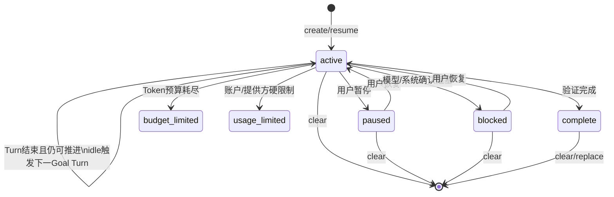
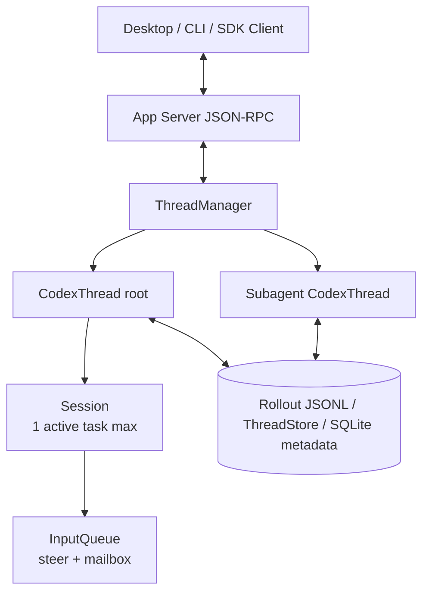
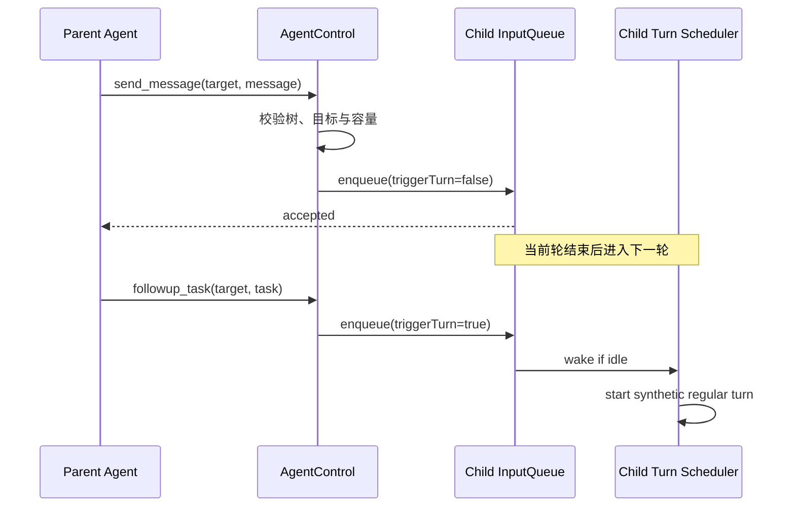
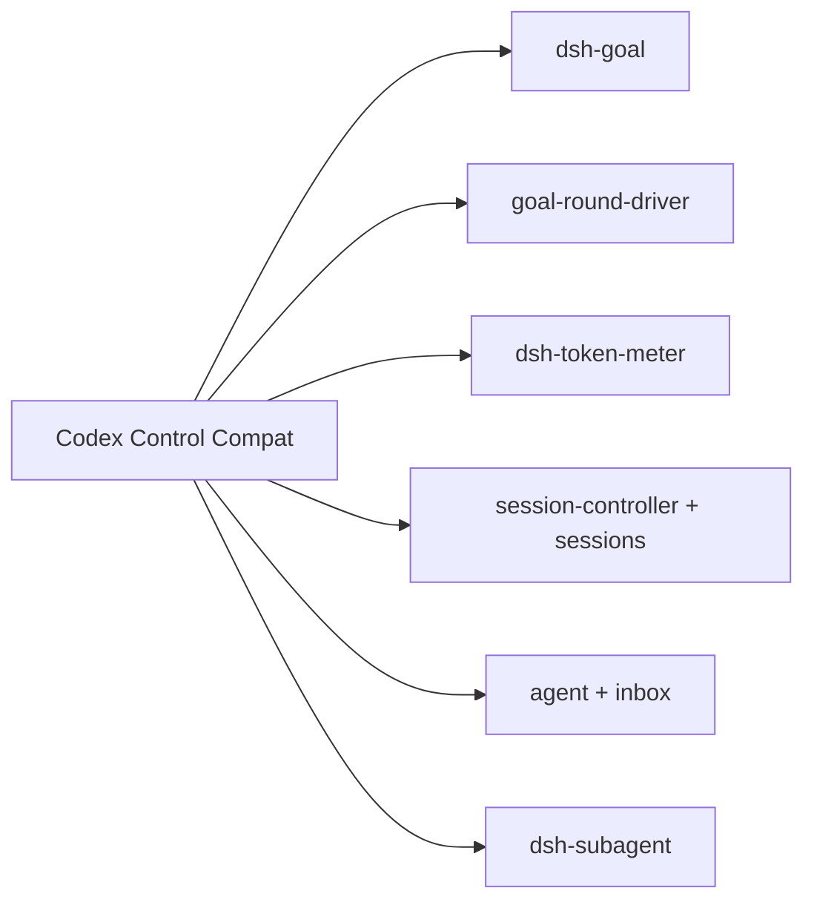

> 历史研究归档 · 2026-11-10 发布 · 程序扫描；未逐篇全文审阅。原有日期、观点、数据和命令保留历史语境，未经本次逐项事实核验或运行复现；请结合[归档说明](../../../ARCHIVE_POLICY.md)阅读。

# R165 · Codex Goal、会话、跨会话通信与 Subagent 源码拆解及 DSH 最简复刻

## 结论先行

这次调研最重要的结论不是“照着 Codex 重写三套系统”，而是：

1. **Codex 的 Goal 不是一段反复注入的 Prompt，而是每 Thread 一个持久状态机，加空闲续行调度、错误/预算状态迁移、Token/时间计量和并发栅栏。**
2. **Codex 的会话不是一个消息数组。** `ThreadManager → CodexThread → Session → Turn` 是实时执行面，Rollout/ThreadStore 是持久历史面，App Server 是面向客户端的控制面。
3. **“跨会话通信”不是共享上下文。** Codex 至少有三种不同机制：同一 Thread 的 steering、客户端对另一个持久 Thread 执行 read/resume/start，以及同一 Subagent 树内通过显式 Mailbox 传递的结构化消息。
4. **Codex 的 Subagent 本质上是子 Thread/Session。** 它有独立上下文、状态和持久历史，只是和根 Agent 共用一个树级 `AgentControl`、注册表、并发额度与部分计量。
5. **DSH 当前源码已经拥有这三条主干。** `dsh-goal + goal-round-driver`、事件溯源 Session + Agent Inbox、`dsh-subagent` + spawn/fork/provider/control 工具已经覆盖核心语义。最小落地不是新造引擎，而是补一个薄兼容插件和一个可选的 Goal 资源计量投影。

最简建议可压缩为一句话：

> 保留 DSH 的事件日志、Agent Registry、Inbox 和 SubagentRuntime，只增加 Codex 命名/状态适配、Goal Token/时间预算与根目标的子级用量聚合；不要复制 Codex 的 SQLite Goal 表，也不要另建第二套 Thread Runtime。

## 一、版本、开源边界与证据等级

### 1.1 本报告固定的源码版本

| 对象 | 固定提交 | 核验结果 |
|---|---|---|
| OpenAI Codex | `2b7c279735d0d096cf7b34fe98938f46792f4d4f` | 2026-09-01 实时核验的 `openai/codex` `main` |
| 前一 Codex 分析点 | `633ab199cfd724aa78013c006b27a2b3d049fc3b` | 到最新提交，本文涉及的 Goal/Session/Agent Control 核心文件无行为差异；仅协议 Thread 字段有两行新增 |
| DeepSeek Harness | `dd6322d604e00eec1ba5e0c8541159906a21094a` | 2026-09-01 实时核验的 `deepseek-ai/deepseek-harness` `master`，合并 DSH `0.1.2-alpha.3` 发布线 |
| 前一 DSH 分析点 | `b150a551b8d465e31e418e1b2eaf5e79bbb7d28e` | 旧结论仍可作演进对照，但当前 Session Controller、Subagent 控制面和文档已明显扩展 |

源码入口：

- [OpenAI Codex 官方仓库](https://github.com/openai/codex)
- [Codex 本报告固定提交](https://github.com/openai/codex/tree/2b7c279735d0d096cf7b34fe98938f46792f4d4f)
- [DeepSeek Harness 官方仓库](https://github.com/deepseek-ai/deepseek-harness)
- [DSH 本报告固定提交](https://github.com/deepseek-ai/deepseek-harness/tree/dd6322d604e00eec1ba5e0c8541159906a21094a)

### 1.2 哪些开源，哪些边界尚不能由源码证明

**已验证事实：** Codex CLI/Core、App Server、SDK 等关键部分公开，Goal、Thread/Session、Multi-Agent V2 的实现都可以在 `openai/codex` 中直接跟踪。[Codex Open Source](https://learn.chatgpt.com/docs/open-source)

**已验证事实：** App Server 公开了 `thread/start`、`thread/resume`、`thread/fork`、`thread/read`、`turn/start`、`turn/steer`、`thread/goal/*` 等 RPC，是构建桌面或其他富客户端的公开控制面。[Codex App Server](https://learn.chatgpt.com/docs/app-server)

**证据边界：** 当前 Codex 仓库中没有定位到桌面工具服务 `mcp__codex_app__send_message_to_thread`、`read_thread`、`wait_threads`、`handoff_thread` 的实际服务器实现；`send_message_to_thread` 只在动态工具注入和测试数据中出现。故本文把“桌面跨任务、跨主机编排”视为宿主层能力，不把它冒充成已从公开仓库还原的 Core 实现。

一句话结论：**Codex 的 Agent Runtime 与 App Server 足以源码分析和本地复刻；Codex Desktop 的完整任务编排宿主不是本报告已证明开源的部分。**

## 二、官方文档先建立产品语义

| 主题 | 官方文档 | 可确认的产品语义 |
|---|---|---|
| Goal | [Follow a goal](https://learn.chatgpt.com/use-cases/follow-goals) | 持久目标跨多轮推进，直到可验证停止条件；可暂停、恢复、清除 |
| 长任务 | [Long-running work](https://learn.chatgpt.com/docs/long-running-work) | Desktop/CLI 用 `/goal`，同一会话保持上下文并持续工作 |
| Subagent | [Subagents](https://learn.chatgpt.com/docs/agent-configuration/subagents) | 可并行启动专门 Agent，独立 Thread 工作，协调者收集结果；增加 Token 消耗 |
| 会话 API | [App Server](https://learn.chatgpt.com/docs/app-server) | Thread 生命周期、Turn 生命周期、steer、fork、事件流和 Goal RPC |
| 开源范围 | [Open Source](https://learn.chatgpt.com/docs/open-source) | CLI、SDK、App Server 等关键部分公开；不是所有产品层都公开 |

文档告诉我们“用户能做什么”，源码才回答“状态放在哪里、谁唤醒下一轮、消息什么时候入队、崩溃后剩下什么”。

## 三、Codex Goal 模式原理

### 3.1 数据模型：每个 Thread 一条持久 Goal

Codex 的 SQLite migration 为每个 Thread 建一条 Goal 记录，主要字段包括：

- `thread_id`：Goal 所属 Thread；
- `goal_id`：本次 Goal 身份；
- `objective`：完成目标；
- `status`：`active / paused / blocked / usage_limited / budget_limited / complete`；
- `token_budget / tokens_used`：Token 预算与已用量；
- `time_used_seconds`：累计运行时间；
- 更新时间等审计字段。

源码：[Goal migration](https://github.com/openai/codex/blob/2b7c279735d0d096cf7b34fe98938f46792f4d4f/codex-rs/state/goals_migrations/0001_thread_goals.sql) · [Goal state runtime](https://github.com/openai/codex/blob/2b7c279735d0d096cf7b34fe98938f46792f4d4f/codex-rs/state/src/runtime/goals.rs)

它不是通用任务列表：每个 Thread 只有一个当前 Goal，新的 Goal 会替换已完成 Goal，但未完成 Goal 会阻止模型直接创建另一个。

### 3.2 模型能做什么，用户/系统能做什么

模型侧只有三个工具：

- `get_goal`：读取状态、预算与剩余量；
- `create_goal`：只在用户明确要求时创建；
- `update_goal`：只能标为 `complete` 或 `blocked`。

模型不能自行 pause/resume，也不能把 Goal 标为 budget/usage limited；这些由用户或系统控制。`blocked` 还有模型可见的“三个连续 Goal Turn 出现同一阻塞条件”门槛，避免一遇到困难就停止。

源码：[Goal tool spec](https://github.com/openai/codex/blob/2b7c279735d0d096cf7b34fe98938f46792f4d4f/codex-rs/ext/goal/src/spec.rs) · [Goal tool implementation](https://github.com/openai/codex/blob/2b7c279735d0d096cf7b34fe98938f46792f4d4f/codex-rs/ext/goal/src/tool.rs)

这个权限拆分很重要：**模型负责声明完成或真正阻塞，控制面负责暂停、恢复和预算治理。**

### 3.3 自动续行：空闲钩子启动合成 Turn

Goal Extension 监听 Thread/Turn 生命周期：

1. `on_turn_start` 开始计量；Plan Mode 不计入 Goal；
2. Turn 中正常采样、工具调用和子 Agent 消耗会进入计量；
3. `on_turn_stop`、`on_turn_error` 根据结果更新 Goal；
4. Thread 进入 idle 时触发 `continue_if_idle()`；
5. Runtime 重新读取当前 Goal、检查状态/延期/并发锁；
6. 渲染 continuation Prompt；
7. 调用 `start_turn_if_idle(..., turn_trigger: "goal")` 启动下一轮。

源码：[Goal extension lifecycle](https://github.com/openai/codex/blob/2b7c279735d0d096cf7b34fe98938f46792f4d4f/codex-rs/ext/goal/src/extension.rs#L175) · [Goal continuation runtime](https://github.com/openai/codex/blob/2b7c279735d0d096cf7b34fe98938f46792f4d4f/codex-rs/ext/goal/src/runtime.rs#L399)



### 3.4 资源计量：不只是“轮数”

Codex 的 Goal 计量不是简单把每轮总 Token 相加：

- 计算 `uncached input + output`，缓存命中输入不重复计入；
- 根 Goal 汇总子 Agent 的 Token 用量；
- Plan Mode Token 排除；
- 状态更新和预算越界在数据库操作中原子完成；
- Goal 完成时可以向用户报告最终 Token 用量。

源码：[Goal accounting](https://github.com/openai/codex/blob/2b7c279735d0d096cf7b34fe98938f46792f4d4f/codex-rs/ext/goal/src/accounting.rs#L200)

### 3.5 Fork 与恢复

App Server 公开 `thread/goal/set|get|clear`。普通持久 Thread 可读写 Goal；parent-owned Multi-Agent V2 子线程只允许读取，不允许绕过父 Agent 改写 Goal。Thread fork 时可以复制 Goal，并通过 `deferGoalContinuation` 先让客户端显式发一轮，再恢复自动续行；ephemeral Thread 不支持 Goal。

源码：[App Server Goal processor](https://github.com/openai/codex/blob/2b7c279735d0d096cf7b34fe98938f46792f4d4f/codex-rs/app-server/src/request_processors/thread_goal_processor.rs) · [Fork Goal](https://github.com/openai/codex/blob/2b7c279735d0d096cf7b34fe98938f46792f4d4f/codex-rs/app-server/src/request_processors/thread_fork_goal.rs)

一句话结论：**Codex Goal 的核心不是“继续提示”，而是持久状态、空闲调度、资源计量和用户/模型权限分离组成的闭环。**

## 四、Codex 会话原理

### 4.1 四层模型

| 层 | 职责 | 关键事实 |
|---|---|---|
| `ThreadManager` | 管理当前进程中的所有 live/stored Thread | start、resume、fork、spawn subagent 的总入口 |
| `CodexThread` | 面向上层的双向 Thread 句柄 | 可 start、steer、interrupt、查询状态 |
| `Session` | 一个具体 Thread 的运行时 | 同一时刻最多一个 running task；持有状态、Active Turn、InputQueue、服务 |
| `Turn` | 一次用户或合成请求 | 内部可包含多次采样、工具调用、steering 和错误恢复 |

源码：[Session](https://github.com/openai/codex/blob/2b7c279735d0d096cf7b34fe98938f46792f4d4f/codex-rs/core/src/session/session.rs#L40) · [CodexThread](https://github.com/openai/codex/blob/2b7c279735d0d096cf7b34fe98938f46792f4d4f/codex-rs/core/src/codex_thread.rs#L206) · [ThreadManager](https://github.com/openai/codex/blob/2b7c279735d0d096cf7b34fe98938f46792f4d4f/codex-rs/core/src/thread_manager.rs#L224)



### 4.2 ThreadId、SessionId、TurnId 不应混用

- `ThreadId`：一个具体对话/子 Agent Thread 的持久身份；
- `SessionId`：当前 live Agent 树的根身份；根 Thread 通常以自身 ThreadId 作为 SessionId，子 Agent 共用根 SessionId；一个冷存储 Thread 被单独 resume 后会成为新 live 树的根；
- `TurnId`：一次请求循环的身份；
- `AgentPath`：Subagent 树中的可读路径，例如 `/root/worker`。

因此“同一个 Session”在 Codex Core 中更接近**同一棵实时 Agent 树**，而产品 UI 里的“会话/任务”通常对应 Thread。这个命名差异是跨会话设计最容易踩的坑。

### 4.3 持久化与恢复

Rollout/ThreadStore 保存可回放的历史和元数据；App Server 的语义为：

- `thread/read`：只读持久 Thread，不启动 Agent；
- `thread/resume`：从 Rollout 恢复一个可继续写入的 live Thread；
- `thread/fork`：复制或引用一个一致的历史边界，产生新 ThreadId；
- 正在运行的源 Thread 被 fork 时，会留下 interruption marker，避免继承一个看起来“正常完成”的半轮历史；
- 同一 paginated Thread 同时只允许一个 App Server 进程持有写租约，其他进程仍可只读。

这说明会话恢复的核心不是重新发送摘要，而是**从持久事件/历史边界重建运行时，并重新建立唯一写入者**。

一句话结论：**Codex 会话由“实时单线程执行状态 + 可回放持久历史 + App Server 控制协议”三部分组成，缺一部分都不能安全 resume/fork。**

## 五、跨会话通信机制

“跨会话通信”必须拆成四类，否则会把不同一致性语义混在一起。

### 5.1 同一 Thread 内：steer，不是跨会话

`turn/steer` 把用户输入追加到当前 active regular Turn。它不会创建新 Turn，也不会把内容送给另一个 Thread。它适合纠偏当前工作，不适合后台 Agent 的后续任务队列。

### 5.2 两个独立根 Thread：由客户端编排

公开 App Server 没有“一个根 Thread 直接调用另一个根 Thread 内存对象”的通用原语。最小客户端流程是：

1. `thread/read` 查看目标；
2. 必要时 `thread/resume`；
3. `turn/start` 给目标发新请求；
4. 订阅目标的 Turn/Item 事件，或之后再次 read。

这里消息的 authority 是客户端，两个 Thread 不共享上下文；源 Thread 如需知道结果，客户端必须显式把摘要或引用送回来。

### 5.3 同一 Subagent 树：结构化 Mailbox

Codex Multi-Agent V2 的 `InputQueue` 是 Session 级队列：

- 内部用 `VecDeque` 保持投递顺序；
- `watch::Sender` 通知等待者有新 Mailbox/Steer 活动；
- `InterAgentCommunication` 带 sender、receiver、内容、是否触发新 Turn；
- `send_message` 使用 `QueueOnly`，只排队，不强制唤醒 idle 子 Agent；
- `followup_task` 使用 `TriggerTurn`，排队并在目标 idle 时启动合成 Turn；
- 当前轮无法安全接收时，queue-only 消息会延后到下一 Turn；
- `wait` 等待 Mailbox 或 Steering 活动，设有上下限和超时，但不把消息正文直接作为 wait 返回值。

源码：[InputQueue](https://github.com/openai/codex/blob/2b7c279735d0d096cf7b34fe98938f46792f4d4f/codex-rs/core/src/session/input_queue.rs#L78) · [Message tools](https://github.com/openai/codex/blob/2b7c279735d0d096cf7b34fe98938f46792f4d4f/codex-rs/core/src/tools/handlers/multi_agents_v2/message_tool.rs) · [Wait tool](https://github.com/openai/codex/blob/2b7c279735d0d096cf7b34fe98938f46792f4d4f/codex-rs/core/src/tools/handlers/multi_agents_v2/wait.rs)



### 5.4 Desktop 跨任务工具：公开 Core 之外的宿主编排

Codex Desktop 当前可见的 `create_thread/read_thread/send_message_to_thread/wait_threads/handoff_thread` 比 App Server 单机原语更高层，还包含项目、Host、UI、通知和 handoff 语义。公开仓库证明了其底层 Thread/Turn/App Server 原语，但未证明这组 `codex_app` 工具服务的完整实现。

**待验证：** 跨 Host 投递是否使用中心服务、Host 间 RPC、持久命令队列或其他租约协议。没有源码/正式架构说明前，不应猜测。

一句话结论：**Codex 不存在一个万能“跨会话共享记忆总线”；它使用 steer、客户端 Thread RPC 和 Agent 树 Mailbox 三种显式通道，Desktop 再在上层组织它们。**

## 六、Codex 调用 Subagent 的原理

### 6.1 Subagent 就是子 Thread

`spawn_agent` 的主链路为：

1. 解析 `fork_turns = none | all | N`、role、模型和 reasoning override；
2. 计算子级 depth 与 `AgentPath`；
3. 在根级 `AgentRegistry` 原子预留并发/总量槽位；
4. 构造 `SessionSource::SubAgent(ThreadSpawn { parent_thread_id, depth, agent_path, ... })`；
5. fresh spawn 创建空历史 Thread，fork spawn 从父 Thread 截取全部或最近 N 个已完成 Turn；
6. 继承或覆盖模型、推理等级、工具/权限/工作区配置；
7. 启动子 Thread，并把初始任务作为结构化通信送入；
8. Completion Watcher 监听子 Thread 终态，把完成/失败摘要作为消息送回父 Agent；
9. 子 Agent 的完整中间历史留在自己的 Thread，不塞进父 Agent Context。

源码：[Multi-Agent V2 spawn tool](https://github.com/openai/codex/blob/2b7c279735d0d096cf7b34fe98938f46792f4d4f/codex-rs/core/src/tools/handlers/multi_agents_v2/spawn.rs#L93) · [Spawn control](https://github.com/openai/codex/blob/2b7c279735d0d096cf7b34fe98938f46792f4d4f/codex-rs/core/src/agent/control/spawn.rs#L586)

### 6.2 根级 AgentControl

一棵 Agent 树只创建一个 `AgentControl`，根与所有子 Agent 共享：

- 树内 Thread Registry；
- ThreadId ↔ AgentPath 映射；
- 并发/驻留/总线程限制；
- 根服务等级与 rollout budget；
- send、interrupt、status、list、completion watcher；
- 持久 parent-child edge 的恢复。

源码：[AgentControl](https://github.com/openai/codex/blob/2b7c279735d0d096cf7b34fe98938f46792f4d4f/codex-rs/core/src/agent/control.rs#L111) · [AgentRegistry](https://github.com/openai/codex/blob/2b7c279735d0d096cf7b34fe98938f46792f4d4f/codex-rs/core/src/agent/registry.rs#L96)

这使 Subagent 是“独立执行、共享控制”，而不是“共享上下文、各自输出”。

### 6.3 Fresh、Fork 与上下文污染

- `fork_turns=none`：子 Agent 看不到父历史，初始 Prompt 必须自足，成本最低；
- `fork_turns=all`：复制完整相关历史，最省重新解释，但 Token/KV 成本和污染风险最高；
- `fork_turns=N`：只取最近 N 个完成 Turn，是成本与上下文的折中；
- 子 Agent 配置继承不等于权限自动授予；实际工具、沙箱和审批仍需按子 Thread 配置校验。

官方文档强调 Subagent 能降低主线程上下文污染，但会增加总 Token；源码显示这是通过**把中间轨迹留在子 Thread，只回传摘要**实现的，而不是免费压缩。

一句话结论：**Codex Subagent 是一棵受根控制器管理的 Thread 树，隔离历史、共享控制额度，通过 Mailbox 和完成通知交换有限信息。**

## 七、如何从零最简复刻

如果没有 DSH，可用四个模块完成最小可用版，不需要先做分布式系统。

### 7.1 最小数据结构

```text
ThreadStore
  thread(id, root_id, parent_id, status, history_ref)
  append_event(thread_id, type, payload)
  read/resume/fork(thread_id)

ThreadRuntime
  one active turn max
  queue: FIFO<Input>
  status: idle | running | stopped

GoalController
  goal(thread_id, objective, status, round_budget, rounds_used, revision)
  on_idle -> enqueue synthetic goal turn

AgentTreeController
  root_id -> children registry
  spawn / send(queueOnly|triggerTurn) / interrupt / list / wait
```

### 7.2 最小一致性规则

1. 每个 Thread 同时最多一个 active Turn；
2. 所有模型可见输入先记录或进入可恢复 Inbox，再交给执行器；
3. Goal 更新携带 revision/CAS，避免 pause 和续行竞态；
4. idle 续行启动前再次读取 Goal，而不是相信旧内存；
5. spawn 先预留槽位，失败自动归还；
6. 子 Agent 结果只回传摘要/引用，不合并全部历史；
7. `send` 与 `wake` 分开，避免每条消息都打断当前工作；
8. fork 只从完成 Turn 边界截取，进行中 Turn 显式标 interrupted；
9. 所有循环都有 Turn/时间/Token 上限；
10. MVP 只保证单进程单写者，跨进程延后到有真实需求时再加 lease/outbox。

### 7.3 预计代码量

在已有单 Agent Loop 和持久事件日志的项目中，最小控制层通常只需要：

- Goal 状态与空闲驱动：约 200–350 行；
- Thread Registry/Resume/Fork façade：约 150–250 行；
- Mailbox + send/followup/wait：约 150–250 行；
- Subagent spawn/list/completion watcher：约 250–400 行；
- 聚焦测试：约 300–500 行。

这不是对 Codex 生产实现体量的估计，而是实现本报告最小语义的工程预算。若没有现成 Agent Loop/Store，实际成本会大幅增加。

## 八、DSH 当前能力映射

### 8.1 Goal：已经具备更保守的事件溯源实现

DSH `dd6322d6` 当前由四个插件组成 Goal 子系统：

- `dsh-goal`：每 Session 一个持久 Goal，`create/edit/pause/resume/complete/block/clear`；
- `dsh-goal-round-driver`：Agent idle 时启动下一 Goal Round；
- `dsh-tool-goal`：模型工具；
- `dsh-command-goal`：用户 `/goal` 命令。

Goal 全量快照记录为 `goal/change` Session Event，用 `{ id, revision }` 做 CAS。持久 phase 为 `active/paused/blocked/complete`；自动续行权限 `armed/disarmed` 只存在于进程内。任何 resume、fork 或进程重启后，即使 Goal 仍为 active，也先处于 disarmed，必须用户显式 resume 才重新运行。

源码：[DSH Goal](https://github.com/deepseek-ai/deepseek-harness/blob/dd6322d604e00eec1ba5e0c8541159906a21094a/packages/goal/goal/src/index.ts) · [Goal Round Driver](https://github.com/deepseek-ai/deepseek-harness/blob/dd6322d604e00eec1ba5e0c8541159906a21094a/packages/goal/goal-round-driver/src/index.ts)

这个设计比 Codex 更保守：恢复后不会悄悄继续；代价是没有 Codex 的 Token/时间预算与 `usage_limited/budget_limited` 独立状态。

### 8.2 Session/跨会话：已有事件日志、冷恢复和控制面

DSH Session 是只追加事件日志；`deriveMessages()` 从事件派生模型历史，SessionStore 提供 create/flush/fork。Agent Registry 提供 create/resume/live lookup，Agent Inbox 提供 `followup/steer/inject` 与 FIFO 投递。

当前 `dsh-api-session-controller` 已覆盖：

- list/search/history/follow：冷读，不激活 Agent；
- prompt/model/rename：需要时恢复普通冷 Session；
- fork/create：创建新 Agent；
- queue update/cancel：只操作 live Agent；
- Subagent Session 使用专用 address/transport，普通 Session resolver 明确拒绝越权路由。

源码：[DSH Session](https://github.com/deepseek-ai/deepseek-harness/blob/dd6322d604e00eec1ba5e0c8541159906a21094a/packages/core/session/src/index.ts) · [Agent Registry/handle](https://github.com/deepseek-ai/deepseek-harness/blob/dd6322d604e00eec1ba5e0c8541159906a21094a/packages/core/agent/src/index.ts) · [Session Controller](https://github.com/deepseek-ai/deepseek-harness/tree/dd6322d604e00eec1ba5e0c8541159906a21094a/packages/api/session-controller)

### 8.3 Subagent：不仅已有，而且 provider 面更宽

DSH `dsh-subagent` 支持：

- one-shot 与 continuable 两种生命周期；
- in-process fresh spawn；
- in-process completed-turn fork；
- ACP、Codex App Server、Claude Code、DSH SDK 等外部 provider；
- `send_message / interrupt_agent / list_agents` 父到子控制；
- `report` 子到父上报；
- 持久 descriptor、冷恢复、parent lineage、depth、模型/推理路由；
- 浏览器通过 direct-parent address 查看子 Session 和继续投递。

源码：[DSH Subagent service](https://github.com/deepseek-ai/deepseek-harness/blob/dd6322d604e00eec1ba5e0c8541159906a21094a/packages/subagent/subagent/src/index.ts) · [Continuable manager](https://github.com/deepseek-ai/deepseek-harness/blob/dd6322d604e00eec1ba5e0c8541159906a21094a/packages/subagent/subagent/src/continuation.ts) · [Control tools](https://github.com/deepseek-ai/deepseek-harness/tree/dd6322d604e00eec1ba5e0c8541159906a21094a/packages/subagent/tool-subagent-control)

当前已知限制也写得很清楚：Activation/ownership graph 只在单进程内；崩溃可能丢失已接受但尚未写入子 Session 日志的 Prompt；Report 没有持久 Mailbox；同一持久库上的多进程继续执行需要 Mailbox + lease 协议。

## 九、Codex 与 DSH 的关键差异

| 维度 | Codex | DSH 当前 | 最小决策 |
|---|---|---|---|
| Goal 持久化 | SQLite 独立 Goal 表 | Session `goal/change` 事件 | 保留 DSH 事件溯源 |
| Goal 自动恢复 | active Goal 可按 Runtime 规则续行，fork 可延期 | resume/fork 后强制 disarmed | 保留 DSH 更安全默认，兼容层显式 resume |
| Goal 预算 | Token + 时间计量，含子 Agent 用量 | Round 上限 | 复用 `dsh-token-meter`，补 Goal usage projection |
| Goal 状态 | 6 状态 | 4 phase + activation | API façade 映射，不污染核心 phase |
| 会话历史 | Rollout/ThreadStore | 事件溯源 Session | 无需重做 |
| 同会话输入 | start/steer/InputQueue | followup/steer/inject/Inbox | 一一映射 |
| 根 Thread 控制 | App Server Thread RPC | Session Controller | 无需重做 |
| Subagent | 子 Codex Thread，共享 AgentControl | 子 Agent/Session，共享 SubagentRuntime | 无需重做 |
| Fresh/Fork | `fork_turns=none/all/N` | spawn 或 completed-turn fork provider | 先用现有两个 provider；N-turn 不是 MVP 必需 |
| 父子消息 | QueueOnly / TriggerTurn | FIFO followup；当前不 steering | 增加 `wake` 参数只在真实需求出现时 |
| 子到父 | Completion watcher 消息 | settlement notice + report | 已覆盖 |
| 跨进程 | App Server 单写者；Desktop 跨 Host 细节未证实 | 明确未支持 continuable 多进程协调 | MVP 保持单进程，后续 outbox+lease |

## 十、在 DSH 中的最简复刻方案

### 10.1 不新增三套 Runtime，只新增一个兼容插件

建议插件名（概念名）：`@deepseek-ai/dsh-codex-control-compat`。它只做 façade，不拥有 Session、Goal 或 Subagent 状态。



兼容插件只提供：

1. Codex 风格 `get_goal/create_goal/update_goal` 工具 schema 与状态映射；
2. 可选 `thread_control` façade：read/resume/fork/send/wait，内部调用 Session Controller/Agent；
3. Codex 风格 `spawn_agent/send_message/followup_task/interrupt_agent/list_agents/wait_agent` 命名适配；
4. 把 API 回执统一成稳定、可测试的 JSON，不复制实际执行逻辑。

### 10.2 只新增一个真正的能力：Goal Usage Projection

复用现有 `dsh-token-meter` 的 `tokenUsage` 投影，在 Goal create 时记录基线，在每个 Goal Round/普通相关 Turn 结束时计算差值，并追加一个新的 Goal usage 事件或 Goal 变更快照。最小字段：

```ts
type GoalUsage = {
  uncachedInputTokens: number
  outputTokens: number
  elapsedSeconds: number
  descendantTokens: number
}
```

第一版可不实现金额预算、跨模型价格换算和跨进程聚合。子 Agent 用量聚合可根据持久 parent lineage 在 settlement 时回写根 Goal；若不能证明归属，宁可不计并标 `incomplete`，不要猜。

### 10.3 不应做的事情

- 不增加第二张 Goal SQLite 表；
- 不增加另一套 Thread/Session 类；
- 不把 Subagent 中间 transcript 合并进父 Context；
- 不默认让 resume/fork 后 Goal 自动运行；
- 不宣称跨进程恰好一次消息；
- 不先做 Redis/Kafka/分布式锁；
- 不为了兼容 Codex 状态名改写 DSH 已稳定的 Goal 核心 phase。

### 10.4 验收用例

| 编号 | 场景 | 必须观察到的结果 |
|---|---|---|
| G1 | 创建 Goal 后 Agent idle | 驱动一轮，Round+1，revision 不变或按定义推进 |
| G2 | Goal pause 与 idle 同时发生 | 不启动陈旧 continuation |
| G3 | Session restart/resume | Goal 仍在，但 activation 为 disarmed |
| G4 | Goal 达 Round/Token 上限 | 停止续行，持久 blocker/预算视图可读 |
| S1 | cold Session read | 不启动 Agent |
| S2 | cold Session send | 只恢复一次，并发请求去重 |
| S3 | fork 进行中 Turn | 子历史不包含伪完成的半轮 |
| A1 | fresh spawn | 子级无父 transcript，继承 cwd/路由 |
| A2 | fork spawn | 只包含父级已完成 Turn |
| A3 | send_message 给 running child | 当前轮不被重定向，消息进入下一 FIFO Turn |
| A4 | child completion | 父级只收到结算摘要，子完整历史仍独立 |
| A5 | 非父/非祖先控制 child | 明确拒绝 |
| C1 | 插件卸载 | façade 工具和监听器由 Cordis disposer 完整撤销 |

## 十一、成本、风险与采用顺序

### 11.1 Token 与运行成本

- Goal 每个自动 Round 都产生一次完整模型请求；长期 Goal 必须有 Round/Token/时间上限；
- fork Subagent 复制历史，首轮成本随前缀增长；fresh spawn 成本低但需要自足 Prompt；
- 并行 Subagent 降低主 Context 污染，但增加总请求数和总 Token；
- 子 Agent 只回摘要能降低父 Context 成本，但摘要错误仍需通过 Thread 引用复核。

### 11.2 失败模式

- idle hook 与 pause/edit 竞态导致陈旧续行；用 revision + 调度前复查解决；
- 接受消息后进程崩溃导致 Inbox/Turn 边界不一致；需要明确“accepted”到底是内存入队、日志提交还是已开始执行；
- fork 截在开放 Turn 内导致历史语义损坏；只允许 completed-turn boundary 或 interruption marker；
- 子 Agent 无限递归；用根级总量、并发和深度限制；
- Goal 把错误持续自动化；用 blocked 阈值、资源预算、人工 pause 和恢复后 disarmed；
- 跨进程双写；MVP 单写者，扩展时再加 lease、durable outbox/inbox 和幂等 message id。

### 11.3 推荐采用顺序

1. **先启用现有 DSH 能力，不写新代码：** Goal 四件套 + Session persistence/projection/controller + in-process spawn/fork + control/report；
2. **再做 Codex façade：** 只统一工具名、回执和状态映射；
3. **再补 Goal Usage：** 复用 token-meter，并聚合可证明的子级用量；
4. **真实使用后再决定：** 是否需要 N-turn fork、durable report mailbox、跨进程 lease；
5. **不要提前做：** 跨 Host handoff 与分布式任务总线，除非 DSH 已有多 Host 产品需求。

一句话结论：**对当前 DSH，最小可交付物应是一层兼容与计量补丁，而不是复刻 Codex Core。**

## 十二、已验证、推断与待验证清单

### 已验证事实

- Codex Goal、Session、Subagent 核心实现均在固定提交公开源码中；
- Goal 是持久状态机，idle 时启动 synthetic Goal Turn；
- 根 Goal 汇总子 Agent Token，Plan Mode 排除；
- Multi-Agent V2 Subagent 是子 Thread，和根共享树级 AgentControl；
- `send_message` 与 `followup_task` 的差异是是否触发 Turn；
- DSH 当前已具备事件溯源 Goal、Goal Round Driver、Session 冷恢复、Inbox、spawn/fork Subagent 和控制工具；
- DSH 当前 continuable Subagent 仍是单进程协调，不保证跨进程恰好一次消息。

### 基于证据的推断

- 对当前 DSH，新增独立 Goal/Session/Subagent Runtime 会增加状态分叉和维护成本，且没有当前需求证据；
- 使用 façade + projection 能在最小 Diff 下得到最接近 Codex 的用户体验；
- DSH 的 resume 后 disarmed 默认比自动复活更适合本地插件生态与可控实验。

### 待验证

- Codex Desktop 的 `codex_app` 跨任务、跨 Host 工具服务的真实实现与持久投递语义；
- Codex Desktop 是否对 `send_message_to_thread` 额外提供 exactly-once、租约或中心队列；
- DSH 实际用户 profile 当前是否已经完整挂载 Goal/Subagent 控制插件；源码存在不等于正在运行；
- 在真实模型、长 Goal 与多子 Agent负载下，DSH token-meter 基线与子级聚合的误差/成本。

## 参考资料

- [OpenAI Codex: Follow a goal](https://learn.chatgpt.com/use-cases/follow-goals)
- [OpenAI Codex: Long-running work](https://learn.chatgpt.com/docs/long-running-work)
- [OpenAI Codex: Subagents](https://learn.chatgpt.com/docs/agent-configuration/subagents)
- [OpenAI Codex: App Server](https://learn.chatgpt.com/docs/app-server)
- [OpenAI Codex: Open Source](https://learn.chatgpt.com/docs/open-source)
- [OpenAI Codex source @ 2b7c2797](https://github.com/openai/codex/tree/2b7c279735d0d096cf7b34fe98938f46792f4d4f)
- [DeepSeek Harness source @ dd6322d6](https://github.com/deepseek-ai/deepseek-harness/tree/dd6322d604e00eec1ba5e0c8541159906a21094a)
- [R161 Codex 长期记忆源码拆解](../02-%E7%9F%A5%E8%AF%86%E7%AE%A1%E7%90%86%E4%B8%8E%E4%B8%8A%E4%B8%8B%E6%96%87/R161_Codex%E5%BC%80%E6%BA%90%E8%BE%B9%E7%95%8C%E4%B8%8E%E9%95%BF%E6%9C%9F%E8%AE%B0%E5%BF%86%E6%BA%90%E7%A0%81%E6%8B%86%E8%A7%A3_2026-08-25.md)
- [R164 Cordis 插件架构源码拆解](R164_Cordis%E6%97%B6%E7%A9%BA%E5%8F%AF%E7%BB%84%E5%90%88%E6%8F%92%E4%BB%B6%E6%9E%B6%E6%9E%84%E6%BA%90%E7%A0%81%E6%8B%86%E8%A7%A3_2026-08-27.md)

