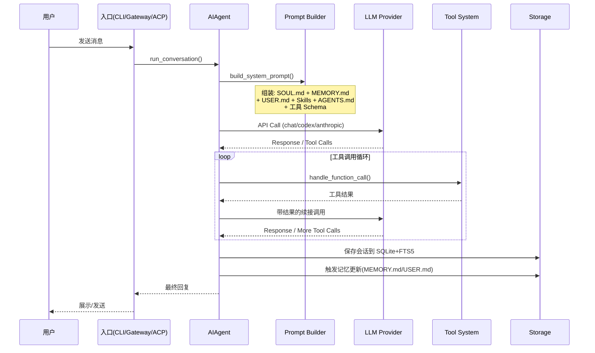
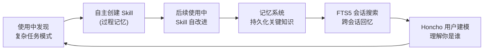
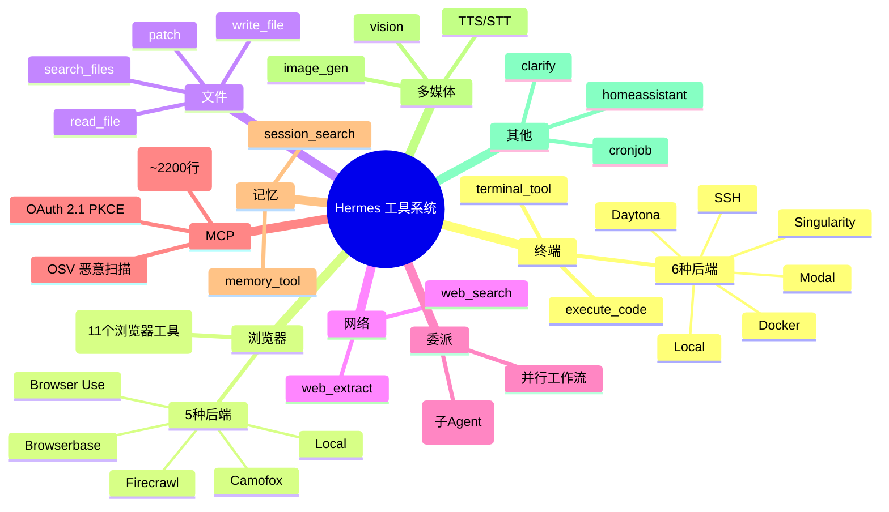
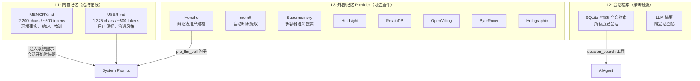
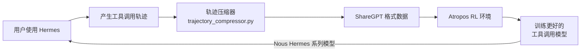
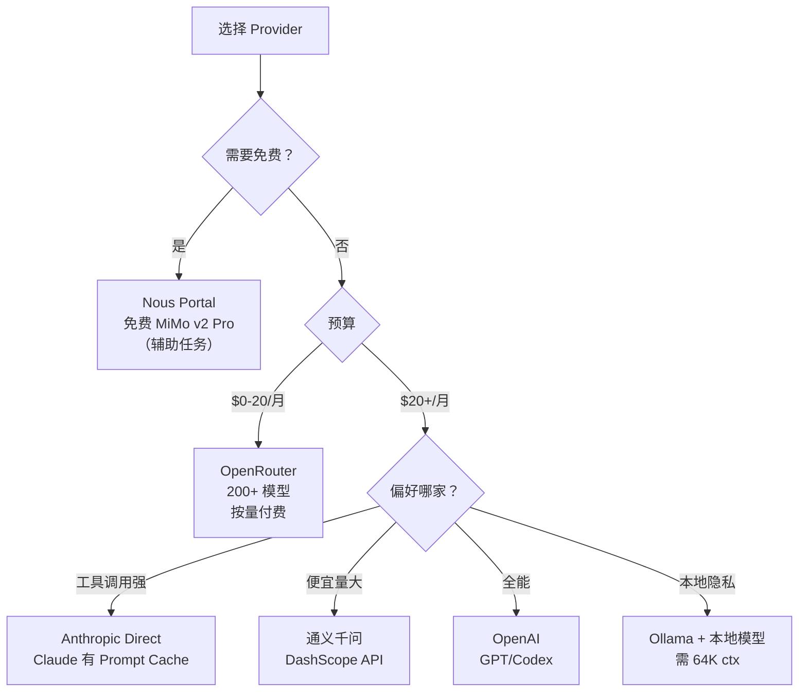

> 历史研究归档 · 2026-11-10 发布 · 发布审核状态：scan_only（发布前程序化隐私扫描）。原有日期、观点、数据和命令保留历史语境，未经本次逐项事实核验或运行复现；见[归档说明](../../../ARCHIVE_POLICY.md)。

# Hermes Agent 开源自学习 AI 智能体深度研究报告

> **一句话概括**：Hermes Agent 是 Nous Research 开源的自学习 AI 智能体（62.8K⭐），它用"闭环学习循环"（自主创建/改进 Skill + 持久化记忆 + 用户建模）解决了 AI Agent 不能跨会话积累能力的根本问题，同时提供 47 个工具、15+ 通信平台、6 种终端后端、MCP 集成和 RL 训练闭环，是当前开源社区最完整的"个人 AI 操作系统"级项目。
>
> **研究日期**：2026-04-12
>
> **增量价值**：在 [Agent架构深度研究报告](../01-%E7%90%86%E8%AE%BA%E4%B8%8E%E6%9E%B6%E6%9E%84/R03_Agent%E6%9E%B6%E6%9E%84%E6%B7%B1%E5%BA%A6%E7%A0%94%E7%A9%B6.md)、Agent-Skills与LLM-Wiki生态调研报告（原稿交叉引用，本归档未解析）、[Skill自迭代机制深度研究报告](../03-%E5%AE%9E%E9%AA%8C%E9%AA%8C%E8%AF%81/R28_Skill%E8%87%AA%E8%BF%AD%E4%BB%A3%E6%9C%BA%E5%88%B6%E6%B7%B1%E5%BA%A6%E7%A0%94%E7%A9%B6.md) 基础上，新增了：(1) Hermes 的完整架构拆解和设计哲学分析；(2) 其 Skill 闭环学习机制与已知 GEPA/gskill 范式的深度对比；(3) 多平台 Gateway 架构的工程实践；(4) 落地最佳实践与实例
>
> **关联报告**：[Agent架构深度研究报告](../01-%E7%90%86%E8%AE%BA%E4%B8%8E%E6%9E%B6%E6%9E%84/R03_Agent%E6%9E%B6%E6%9E%84%E6%B7%B1%E5%BA%A6%E7%A0%94%E7%A9%B6.md)、Agent-Skills与LLM-Wiki生态调研报告（原稿交叉引用，本归档未解析）、[Skill自迭代机制深度研究报告](../03-%E5%AE%9E%E9%AA%8C%E9%AA%8C%E8%AF%81/R28_Skill%E8%87%AA%E8%BF%AD%E4%BB%A3%E6%9C%BA%E5%88%B6%E6%B7%B1%E5%BA%A6%E7%A0%94%E7%A9%B6.md)、[Agent部署上线方案全景调研报告](../04-%E5%B7%A5%E7%A8%8B%E5%AE%9E%E8%B7%B5/R04_Agent%E9%83%A8%E7%BD%B2%E4%B8%8A%E7%BA%BF%E6%96%B9%E6%A1%88%E5%85%A8%E6%99%AF.md)、[Anthropic官方Skill-Creator设计哲学研究报告](../01-%E7%90%86%E8%AE%BA%E4%B8%8E%E6%9E%B6%E6%9E%84/R14_AnthropicSkillCreator%E8%AE%BE%E8%AE%A1%E5%93%B2%E5%AD%A6.md)

---

## 目录

1. [背景与动机](#1-背景与动机)
2. [核心发现](#2-核心发现)
3. [项目全景画像](#3-项目全景画像)
4. [架构深度拆解](#4-架构深度拆解)
5. [六大核心子系统详解](#5-六大核心子系统详解)
6. [与已有知识的交叉引用](#6-与已有知识的交叉引用)
7. [落地最佳实践](#7-落地最佳实践)
8. [实战实例](#8-实战实例)
9. [局限性与风险评估](#9-局限性与风险评估)
10. [开放问题与后续计划](#10-开放问题与后续计划)

---

## 1. 背景与动机

### 1.1 为什么关注 Hermes Agent？

截图中那条小红书引发了本次调研：Hermes Agent 在短短 6 周内从 OpenClaw 改名后飙升至 62.8K⭐（截至 2026-04-12），8.4K Forks，397 位贡献者，8 个版本迭代（v0.1→v0.8）。这个增长速度远超同类开源 Agent 项目。

更重要的是，它不是又一个"LLM Wrapper"——它试图解决一个真正的结构性问题：**AI Agent 不能跨会话积累能力**。每次新会话都是"失忆"状态，上次学到的工作流、发现的环境特性、用户偏好全部丢失。Hermes 用"闭环学习循环"来回答这个问题。

### 1.2 OpenClaw → Hermes 的迁移

Hermes 的前身是 **OpenClaw**（一个社区驱动的 Claude Code 替代品）。2026 年 3 月底，项目被 Nous Research 收购并更名为 Hermes Agent，提供了完整的迁移工具（`hermes claw migrate`）。这解释了截图中"卸载 OpenClaw！新王登基"的说法。

Nous Research 是 Hermes、Nomos 和 Psyche 等开源模型的发布方，有模型训练的深厚背景——这一点在 Hermes Agent 的 RL 训练集成（Atropos）中有直接体现。

📌 **来源清单**：
- [GitHub NousResearch/hermes-agent](https://github.com/NousResearch/hermes-agent) — 2026-04-12 — 62.8K⭐
- [官方文档](https://hermes-agent.nousresearch.com/docs/) — 2026-04-12
- [v0.8.0 Release Notes](https://github.com/NousResearch/hermes-agent/releases/tag/v2026.4.8) — 2026-04-08，209 个 PR
- 模型训练知识 — 截止日期未知 — 仅作背景参考

⚖️ 来源一致性：多源高度一致
📅 时效性声明：以上信息获取于 2026-04-12

---

## 2. 核心发现

- ✅ **闭环学习循环是核心创新**：Hermes 是唯一内置"学习循环"的开源 Agent——自主创建 Skill → 使用中改进 → 持久化记忆 → FTS5 跨会话检索 → Honcho 用户建模，形成真正的能力积累
- ✅ **"个人 AI 操作系统"级架构**：47 个工具 + 20 个工具集 + 6 种终端后端 + 15+ 通信平台 + MCP 集成 + 插件系统 + Cron 调度器 + ACP IDE 集成，不是一个 Agent 框架而是一个完整的 Agent OS
- ✅ **模型无关、部署灵活**：支持 18+ Provider（Nous Portal / OpenRouter / OpenAI / Anthropic / 通义千问 / DeepSeek / MiniMax / Kimi / GLM / HuggingFace / GitHub Copilot 等），最低 $5 VPS 即可运行，支持 Modal/Daytona 无服务器化
- ✅ **Skill 生态 = agentskills.io 开放标准**：Skills 兼容 agentskills.io 社区标准，Skills Hub 提供搜索、安装、社区贡献，与我们研究的 SKILL.md 格式（P6 范式）深度对齐
- ✅ **RL 训练闭环是差异化护城河**：内置 Atropos RL 环境、轨迹压缩、批量轨迹生成能力，模型训练方为 Agent 设计的"数据飞轮"——用户使用 Agent 产生轨迹 → 训练更好的工具调用模型 → Agent 更强

---

## 3. 项目全景画像

### 3.1 事实卡片

| 维度 | 数据 |
|------|------|
| **名称** | Hermes Agent ☤ |
| **组织** | [Nous Research](https://nousresearch.com/) |
| **GitHub** | [NousResearch/hermes-agent](https://github.com/NousResearch/hermes-agent) |
| **Stars / Forks** | 62.8K / 8.4K（2026-04-12） |
| **语言** | Python 94.2% |
| **许可** | MIT |
| **版本** | v0.8.0 (2026.4.8)，8 个 Release |
| **代码量** | run_agent.py ~9,200 行，cli.py ~8,500 行，gateway/run.py ~7,500 行 |
| **测试** | 3,000+ Pytest 用例 |
| **贡献者** | 397 人（核心：@teknium1 179 PRs in v0.8） |
| **前身** | OpenClaw（已提供迁移工具） |
| **安装平台** | Linux / macOS / WSL2 / Android (Termux) |

### 3.2 版本演进速度

```
v0.1 (2026.2.25) → v0.2 → v0.3 (3.17) → v0.4 → v0.5 (3.28) → v0.6 (3.30) → v0.7 (4.3) → v0.8 (4.8)
```

**6 周内 8 个版本**，v0.8 单版本合入 209 个 PR、解决 82 个 Issue。这种迭代速度表明项目正处于高速成长期。

---

## 4. 架构深度拆解

### 4.1 系统总览

```mermaid
graph TB
    subgraph "入口层 Entry Points"
        CLI["CLI<br/>cli.py ~8,500行"]
        GW["Gateway<br/>gateway/run.py ~7,500行"]
        ACP["ACP Adapter<br/>VS Code / Zed / JetBrains"]
        BATCH["Batch Runner<br/>轨迹批量生成"]
        API["API Server"]
    end

    subgraph "核心引擎 AIAgent"
        AGENT["AIAgent<br/>run_agent.py ~9,200行"]
        PB["Prompt Builder<br/>系统提示装配"]
        PR["Provider Resolution<br/>18+ Provider"]
        TD["Tool Dispatch<br/>model_tools.py"]
        CC["Context Compressor<br/>上下文压缩"]
        PC["Prompt Caching<br/>Anthropic 缓存"]
    end

    subgraph "工具层 Tool Backends"
        TERM["Terminal<br/>6 后端: Local/Docker/SSH/<br/>Daytona/Modal/Singularity"]
        BROWSER["Browser<br/>5 后端: Local/Browserbase/<br/>Browser Use/Firecrawl/Camofox"]
        WEB["Web Search/Extract"]
        MCP_T["MCP Client<br/>~2,200行"]
        FILE["File Tools"]
        DELEGATE["Delegation<br/>Subagent 并行"]
        EXEC["execute_code<br/>沙盒执行"]
    end

    subgraph "持久化层"
        SQLITE["SQLite + FTS5<br/>会话存储"]
        MEM["Memory<br/>MEMORY.md + USER.md"]
        SKILLS["Skills<br/>过程记忆"]
        CRON["Cron Scheduler<br/>定时任务"]
    end

    subgraph "通信平台 Gateway Adapters"
        TG["Telegram"]
        DC["Discord"]
        SLACK["Slack"]
        WA["WhatsApp"]
        SIG["Signal"]
        MTX["Matrix"]
        FS["飞书 Feishu"]
        WC["WeCom 企微"]
        EMAIL["Email"]
        HA["Home Assistant"]
        MORE["+ DingTalk/SMS/<br/>Mattermost/BlueBubbles/Webhook"]
    end

    CLI --> AGENT
    GW --> AGENT
    ACP --> AGENT
    BATCH --> AGENT
    API --> AGENT

    AGENT --> PB
    AGENT --> PR
    AGENT --> TD
    AGENT --> CC
    AGENT --> PC

    TD --> TERM
    TD --> BROWSER
    TD --> WEB
    TD --> MCP_T
    TD --> FILE
    TD --> DELEGATE
    TD --> EXEC

    AGENT --> SQLITE
    AGENT --> MEM
    AGENT --> SKILLS
    AGENT --> CRON

    GW --> TG
    GW --> DC
    GW --> SLACK
    GW --> WA
    GW --> SIG
    GW --> MTX
    GW --> FS
    GW --> WC
    GW --> EMAIL
    GW --> HA
    GW --> MORE
```



### 4.2 设计原则（来自官方文档）

| 原则 | 含义 |
|------|------|
| **Prompt 稳定性** | 系统提示在会话内不变，除非用户显式 /model 切换，保护前缀缓存 |
| **可观测执行** | 每个工具调用对用户可见（CLI spinner + Gateway 聊天消息） |
| **可中断** | API 调用和工具执行可随时取消（新消息覆盖 / Ctrl+C） |
| **平台无关核心** | 一个 AIAgent 类服务所有入口点，平台差异只在入口层 |
| **松耦合** | MCP、插件、记忆 Provider、RL 环境用注册模式 + check_fn 门控 |
| **Profile 隔离** | 每个 profile 独立 HERMES_HOME、配置、记忆、会话、Gateway PID |

说白了，Hermes 的架构哲学是 **"一个 Agent 核心 + N 个入口 + M 个后端"** 的星型拓扑。这与 [Agent架构深度研究报告](../01-%E7%90%86%E8%AE%BA%E4%B8%8E%E6%9E%B6%E6%9E%84/R03_Agent%E6%9E%B6%E6%9E%84%E6%B7%B1%E5%BA%A6%E7%A0%94%E7%A9%B6.md) 中提到的 Anthropic"简单可组合模式"（P5）高度一致——不搞复杂的多 Agent 框架，而是把一个 Agent 做到极致。

### 4.3 数据流



---

## 5. 六大核心子系统详解

### 5.1 闭环学习循环（核心创新）

这是 Hermes 最独特的子系统，也是"self-improving"名号的来源。闭环由四个组件构成：



核心机制：

| 组件 | 机制 | 数据 |
|------|------|------|
| **自主 Skill 创建** | 完成复杂任务后，Agent 自发将工作流固化为 Skill 文件 | `~/.hermes/skills/` |
| **Skill 自改进** | 使用 Skill 过程中发现不足，Agent 自主修订 Skill 内容 | Skill 版本迭代 |
| **持久记忆** | MEMORY.md（~800 tokens 环境知识）+ USER.md（~500 tokens 用户偏好），带定期 nudge | `~/.hermes/memories/` |
| **会话检索** | SQLite FTS5 全文检索 + LLM 摘要，可回忆数周前的对话 | `state.db` |
| **用户建模** | Honcho 辩证法用户建模，构建深化的用户认知 | 插件化 |
| **记忆安全** | 注入/渗出模式扫描，阻止 prompt injection 进入记忆 | 硬编码规则 |

**与 [Skill自迭代机制深度研究报告](../03-%E5%AE%9E%E9%AA%8C%E9%AA%8C%E8%AF%81/R28_Skill%E8%87%AA%E8%BF%AD%E4%BB%A3%E6%9C%BA%E5%88%B6%E6%B7%B1%E5%BA%A6%E7%A0%94%E7%A9%B6.md) 的关系**：Hermes 的 Skill 自改进属于 **L1 运行时自修正**（类似 Reflexion），而不是 L3 进化搜索（如 GEPA/gskill）。其优势是零额外成本（使用即改进），劣势是缺少系统性评估——改进可能是渐进式的"微调"而非"突变+优胜劣汰"。

### 5.2 Skill 系统

Hermes 的 Skill 系统兼容 [agentskills.io](https://agentskills.io/) 开放标准，支持三种来源：

| 来源 | 说明 | 安装方式 |
|------|------|---------|
| **Bundled Skills** | 内置技能，始终可用 | 自动 |
| **Optional Skills** | 官方可选技能，需手动启用 | `hermes skills install official/xxx` |
| **Community Skills** | Skills Hub / skills.sh / .well-known/skills | `hermes skills install` / `hermes skills search` |

v0.8.0 新增的 Skills 包括：popular-web-designs（54 个网站设计系统）、p5js creative coding、manim-video、llm-wiki（Karpathy 的 LLM Wiki）、gitnexus-explorer 等。

**Skill 搜索和发现**是一个亮点：
```bash
hermes skills search kubernetes              # 搜 Skills Hub
hermes skills search react --source skills-sh   # 搜 skills.sh 目录
hermes skills search https://mintlify.com/docs --source well-known  # .well-known 发现
```

**与 Agent-Skills与LLM-Wiki生态调研报告（原稿交叉引用，本归档未解析） 的关系**：Hermes 实际上是 agentskills.io 的**主要消费者和推动者**。#1 报告中调研的 agent-skills（12K⭐）生态，现在通过 Hermes（62.8K⭐）获得了一个量级更大的分发渠道。

### 5.3 工具系统（47 个工具 + 20 个工具集）



工具注册采用**导入时自注册**模式（`tools/registry.py`），每个工具文件在导入时调用 `registry.register()`。这是一种简洁的设计——添加新工具只需在 `model_tools.py` 的 `_discover_tools()` 列表中加一行 import。

**终端后端的多样性**特别值得注意：

| 后端 | 适用场景 | 成本 |
|------|---------|------|
| Local | 本机开发 | 免费 |
| Docker | 沙盒隔离 | 免费（本机） |
| SSH | 远程服务器 | VPS 费用 |
| Daytona | 无服务器持久化 | 按用量 |
| Modal | 无服务器 GPU | 按用量(闲时$0) |
| Singularity | HPC 容器 | 依赖设施 |

### 5.4 Gateway 消息网关（15+ 平台）

这是 Hermes 的"触达层"——一个长运行进程同时服务 15+ 平台：

| 平台 | 成熟度 | 特色功能 |
|------|--------|---------|
| Telegram | Tier 1 | 内联按钮审批、Emoji 反馈、群组 Topics 绑定 |
| Discord | Tier 1 | 原生斜杠命令、频道控制、语音频道 |
| Slack | Tier 1 | 线程上下文保留、mrkdwn 格式 |
| Matrix | Tier 1(v0.8) | E2EE、反应、已读回执 |
| WhatsApp | Tier 2 | Baileys 集成 |
| Signal | Tier 2 | 完整 MEDIA tag |
| **飞书 Feishu** | Tier 2 | 互动卡片审批按钮(v0.8 新增) |
| **企业微信 WeCom** | Tier 2 | 回调模式适配器(新增) |
| Email | Tier 2 | SMTP/IMAP |
| Home Assistant | Tier 2 | 智能家居控制 |
| DingTalk | Tier 3 | 基本消息 |
| SMS | Tier 3 | Twilio |
| Mattermost | Tier 3 | 文件附件 |
| Webhooks | Core | 通用 HTTP 钩子 |

**飞书集成**（截图中提到的主题）在 v0.8.0 中得到了增强——添加了互动卡片审批按钮和重连/ACL 修复。

### 5.5 记忆系统

Hermes 的记忆分三层：



设计亮点：
- **冻结快照模式**：记忆在会话开始时注入系统提示，会话内不变——保护前缀缓存
- **字符上限**强制记忆精炼（类似人类的"工作记忆"有限容量）
- **安全扫描**：所有记忆条目在接受前扫描 prompt injection / credential exfiltration 模式
- **8 个外部 Provider 插件**可选增强——Honcho 的辩证法用户建模最为独特

### 5.6 RL 训练闭环

这是 Hermes 区别于所有其他开源 Agent 的战略级子系统：



说白了：Nous Research 作为模型训练方自己做 Agent——每个用户使用 Hermes 的过程都是在为下一代 Hermes 模型提供训练数据。这是一个经典的**数据飞轮**，Claude Code / Cursor 等商业产品也在做同样的事，但 Hermes 是开源领域第一个公开这个闭环的。

---

## 6. 与已有知识的交叉引用

| 新发现 | 与已有知识的关系 | 来源 |
|--------|----------------|------|
| Hermes 的"闭环学习循环" | **补充** P13（执行轨迹反思>标量反馈）——Hermes 是 L1 层（运行时自修正）的极致实践，但缺少 L3 层（进化搜索） | [Skill自迭代机制深度研究报告](../03-%E5%AE%9E%E9%AA%8C%E9%AA%8C%E8%AF%81/R28_Skill%E8%87%AA%E8%BF%AD%E4%BB%A3%E6%9C%BA%E5%88%B6%E6%B7%B1%E5%BA%A6%E7%A0%94%E7%A9%B6.md) |
| Skill 兼容 agentskills.io 标准 | **验证** P6（SKILL.md = 通用能力注入格式）——62.8K⭐的 Agent 采用这个标准，极大增强了 P6 的信心 | Agent-Skills与LLM-Wiki生态调研报告（原稿交叉引用，本归档未解析） |
| "一个 Agent + N 入口" 而非多 Agent | **一致** P5（简单可组合模式>复杂框架）——与 Anthropic 观点完全对齐 | [Agent架构深度研究报告](../01-%E7%90%86%E8%AE%BA%E4%B8%8E%E6%9E%B6%E6%9E%84/R03_Agent%E6%9E%B6%E6%9E%84%E6%B7%B1%E5%BA%A6%E7%A0%94%E7%A9%B6.md) |
| MEMORY.md + USER.md 冻结快照 | **一致** P3（分层上下文）——内置记忆是"常驻"层，会话搜索是"按需"层 | Claude-Code源码上下文策略实验报告（原稿交叉引用，本归档未解析） |
| 记忆安全扫描 | **补充** P15（硬骨架+软血肉）——记忆注入是系统边界，需硬编码规则保障 | [指令遵守验证与长期漂移检测研究报告](../05-%E8%AF%84%E4%BC%B0%E4%B8%8E%E8%B4%A8%E9%87%8F/R17_%E6%8C%87%E4%BB%A4%E9%81%B5%E5%AE%88%E9%AA%8C%E8%AF%81%E4%B8%8E%E9%95%BF%E6%9C%9F%E6%BC%82%E7%A7%BB%E6%A3%80%E6%B5%8B.md) |
| 记忆字符上限强制精炼 | **补充** P4（不塞更多，选更准）——用容量约束倒逼信息质量 | [大型多仓代码库上下文方案研究](../02-%E7%9F%A5%E8%AF%86%E7%AE%A1%E7%90%86%E4%B8%8E%E4%B8%8A%E4%B8%8B%E6%96%87/R08_%E5%A4%A7%E5%9E%8B%E5%A4%9A%E4%BB%93%E4%BB%A3%E7%A0%81%E5%BA%93%E4%B8%8A%E4%B8%8B%E6%96%87%E6%96%B9%E6%A1%88.md) |
| Gateway 15+ 平台适配 | **验证并远超** #4 L4-L5 方案——Hermes 直接跳到了"全平台覆盖" | [Agent部署上线方案全景调研报告](../04-%E5%B7%A5%E7%A8%8B%E5%AE%9E%E8%B7%B5/R04_Agent%E9%83%A8%E7%BD%B2%E4%B8%8A%E7%BA%BF%E6%96%B9%E6%A1%88%E5%85%A8%E6%99%AF.md) |
| Prompt 稳定性原则 | **一致** Anthropic Prompt Caching 策略——不变的前缀 = 缓存命中 | Claude-Code源码上下文策略实验报告（原稿交叉引用，本归档未解析） |
| Karpathy LLM Wiki Skill 内置 | **验证** P1（让知识适配 LLM）——Wiki 法已进入主流 Agent 的 Skill 生态 | [大规模知识库检索方案调研](../02-%E7%9F%A5%E8%AF%86%E7%AE%A1%E7%90%86%E4%B8%8E%E4%B8%8A%E4%B8%8B%E6%96%87/R09_%E5%A4%A7%E8%A7%84%E6%A8%A1%E7%9F%A5%E8%AF%86%E5%BA%93%E6%A3%80%E7%B4%A2%E6%96%B9%E6%A1%88.md) |
| RL 数据飞轮 | **新增**——此前研究未覆盖"模型训练方自己做 Agent"这一战略模式 | 无前序报告 |

---

## 7. 落地最佳实践

### 7.1 安装与首次配置（WSL2 环境）

由于 Hermes 不支持原生 Windows，推荐 WSL2 路径：

```bash
# 1. 确保 WSL2 已安装
wsl --install

# 2. 在 WSL2 中一键安装 Hermes
curl -fsSL https://raw.githubusercontent.com/NousResearch/hermes-agent/main/scripts/install.sh | bash
source ~/.bashrc

# 3. 配置 Provider（以通义千问为例）
hermes model  # 选择 "Alibaba Cloud" → 输入 DASHSCOPE_API_KEY

# 4. 或配置自定义 OpenAI 兼容端点
hermes model  # 选择 "Custom Endpoint" → 输入 base_url 和 key

# 5. 启动对话
hermes
```

**最低模型要求**：64K tokens 上下文（大多数主流模型满足）。

### 7.2 Provider 选型决策树



### 7.3 安全配置最佳实践

```yaml
# ~/.hermes/config.yaml — 安全相关

# 1. 使用 Docker 后端隔离终端
terminal:
  backend: docker
  # 或 SSH 到远程服务器
  # backend: ssh
  # ssh_host: myserver.com

# 2. 命令审批（默认开启）
# 危险命令需要用户确认：rm -rf, sudo, git push --force 等
# 可自定义 allowlist 永久放行安全命令

# 3. Gateway 授权
# 仅允许特定用户与 Bot 对话
gateway:
  telegram:
    allowed_users: ["your_telegram_id"]
```

### 7.4 Skill 创建最佳实践

根据 Hermes 的 Skill 系统和 [Anthropic官方Skill-Creator设计哲学研究报告](../01-%E7%90%86%E8%AE%BA%E4%B8%8E%E6%9E%B6%E6%9E%84/R14_AnthropicSkillCreator%E8%AE%BE%E8%AE%A1%E5%93%B2%E5%AD%A6.md) 的 P10 范式：

```markdown
# ~/.hermes/skills/my-custom-skill/SKILL.md

## Description
当用户需要 [具体场景] 时使用此 Skill。
不适用于 [排除场景]。

## Why this approach works
解释 WHY 而非堆砌 MUST——告诉 Agent 这样做的原因，
它自然会在类似情境中泛化应用。

## Workflow
1. 先做 X（因为 Y 原因）
2. 然后做 Z（避免 W 陷阱）
3. 最后验证 Q

## Examples
<example>
输入: ...
期望行为: ...
</example>
```

关键原则（与 P10 范式对齐）：
- Description 要"有攻击性"——明确声明领地和排除范围
- 解释 Why > 堆砌 MUST
- 提供示例而非抽象规则

### 7.5 记忆管理最佳实践

| 做 | 不做 |
|-----|------|
| 存环境事实：OS、工具、项目结构 | 存显而易见的信息 |
| 存用户偏好：沟通风格、格式偏好 | 存大段代码或日志 |
| 存教训：发现的 workaround、配置技巧 | 存可以 web search 到的通用知识 |
| 定期合并相关条目（记忆超 80% 时） | 让记忆自然膨胀到满 |

记忆条目的好范例：
```
# 紧凑、信息密集
User runs macOS 14 Sonoma, uses Homebrew, has Docker Desktop. Shell: zsh. Editor: VS Code with Vim keybindings.

# 不好：太啰嗦
On January 5th, 2026, the user asked me to look at their project which is located at ~/code/api...
```

---

## 8. 实战实例

### 实例 1：接入飞书（小红书截图的场景）

```bash
# 1. 安装 Hermes（WSL2）
curl -fsSL https://raw.githubusercontent.com/NousResearch/hermes-agent/main/scripts/install.sh | bash
source ~/.bashrc

# 2. 配置 LLM Provider
hermes model
# 选择你喜欢的 Provider，比如通义千问或 OpenRouter

# 3. 配置飞书 Gateway
hermes gateway setup
# 选择 "Feishu" → 按提示输入：
#   - App ID
#   - App Secret
#   - Verification Token (可选)
#   - 允许的用户列表

# 4. 启动 Gateway
hermes gateway start

# 现在你可以在飞书中直接与 Hermes 对话了
# 支持：文本消息、互动卡片审批、语音转写
```

飞书配置参考（`~/.hermes/config.yaml`）：

```yaml
gateway:
  feishu:
    app_id: "cli_xxxxx"
    app_secret: "xxxxx"
    allowed_users: ["user_id_1", "user_id_2"]
```

### 实例 2：定时自动化（每天早报）

```
# 在 Hermes 对话中直接说：
❯ 每天早上 9 点，检查 Hacker News 上的 AI 新闻，
  生成中文摘要，发到我的 Telegram。
```

Hermes 会自动：
1. 创建一个 Cron Job（存储在 `jobs.json`）
2. 每天 9:00 触发，启动一个新的 AIAgent 实例
3. 使用 web_search + web_extract 工具抓取 HN
4. 生成摘要
5. 通过 Gateway 发送到 Telegram

### 实例 3：MCP 扩展（接入 GitHub）

```yaml
# ~/.hermes/config.yaml
mcp_servers:
  github:
    command: npx
    args: ["-y", "@modelcontextprotocol/server-github"]
    env:
      GITHUB_PERSONAL_ACCESS_TOKEN: "ghp_xxx"
  
  filesystem:
    command: npx
    args: ["-y", "@modelcontextprotocol/server-filesystem", "/path/to/workspace"]
```

然后在对话中：
```
❯ 列出我 GitHub 上最近创建的 Issue，然后为每个 Issue 生成修复方案
```

### 实例 4：Skill 自动创建（闭环学习演示）

```
# 第一次：手动完成一个复杂任务
❯ 帮我把这个 Python 项目的所有函数添加 Google 风格的 docstring

# Hermes 完成任务后，可能会自主：
# "我注意到这个工作流可以复用。已创建 Skill: python-docstring-generator"

# 第二次：自动使用 Skill
❯ 帮另一个项目也加上 docstring

# Hermes 会加载之前创建的 Skill，更高效地完成
# 如果发现新的边界情况，会自动更新 Skill
```

### 实例 5：Docker 隔离 + 远程工作环境

```bash
# 设置 Docker 后端（安全隔离）
hermes config set terminal.backend docker

# 或设置 Modal 无服务器后端（闲时不计费）
hermes config set terminal.backend modal

# 对话中：
❯ 克隆 https://github.com/xxx/yyy 并运行测试套件

# Agent 会在隔离容器中执行，不影响宿主机
```

---

## 9. 局限性与风险评估

### 9.1 当前局限

| 局限 | 影响 | 缓解建议 |
|------|------|---------|
| **不支持原生 Windows** | 必须 WSL2，增加入门门槛 | 可以考虑 Docker Desktop 方案 |
| **单 Agent 架构** | 无内置多 Agent 协作编排 | 通过 delegate_tool 实现有限并行 |
| **Skill 自改进缺系统性评估** | L1 运行时修正可能引入退化 | 结合 skill-evaluator 做版本对比 |
| **记忆容量有限** | 总共 ~1,300 tokens 内置记忆 | 使用外部 Memory Provider 扩展 |
| **核心代码高度集中** | run_agent.py 9,200 行，技术债务风险 | 开源社区正在逐步重构 |
| **迭代过快** | 6 周 8 版本，API 稳定性待观察 | 锁定特定版本使用 |

### 9.2 安全风险

| 风险 | 等级 | 缓解措施 |
|------|------|---------|
| 终端命令执行 | 🔴 高 | 命令审批 + Docker 隔离 + Allowlist |
| 记忆 Prompt Injection | 🟡 中 | 内置安全扫描（已实现） |
| MCP 扩展供应链 | 🟡 中 | OSV 恶意扫描（v0.8 新增） |
| 凭证泄露 | 🟡 中 | 凭证泄漏防护 + 日志脱敏（v0.8 新增） |
| Gateway 未授权访问 | 🟡 中 | DM Pairing + Allowlist |

### 9.3 成本维度估算

| 场景 | 月成本估算 | 说明 |
|------|-----------|------|
| 个人轻度使用 | $0-5 | Nous Portal 免费层 + $5 VPS |
| 个人重度使用 | $20-50 | OpenRouter 按量 + $5 VPS |
| 团队使用 | $50-200 | Anthropic/OpenAI 直连 + Docker 隔离 |
| Modal 无服务器 | 按量 ~$0.01/min | 闲时 $0，适合间歇使用 |

---

## 10. 开放问题与后续计划

| # | 问题 | 优先级 | 行动建议 |
|---|------|--------|---------|
| 1 | Hermes Skill 自改进 vs GEPA L3 进化的实际效果对比 | 🔴 高 | 设计对比实验：在同一任务上比较 Hermes L1 自改进 vs 07_skill_self_iteration L3 进化 |
| 2 | 在 WSL2 上实际部署 Hermes + 飞书 Gateway 的 E2E 验证 | 🟡 中 | 实操建立完整的飞书接入通道 |
| 3 | Hermes 的 agentskills.io 标准与我们的 SKILL.md 格式的兼容性 | 🟡 中 | 模拟将 knowledge-base-organizer Skill 发布到 Skills Hub |
| 4 | Hermes RL 数据飞轮对模型训练的实际影响量化 | 🟢 低 | 追踪 Nous Hermes 系列模型的后续发展 |
| 5 | Hermes 的插件系统（Memory Provider + Context Engine）为我们自研工具提供的复用机会 | 🟡 中 | 评估将 analyze_kb.py 封装为 Hermes Context Engine 插件的可行性 |

---

## 📌 来源清单

- [GitHub NousResearch/hermes-agent](https://github.com/NousResearch/hermes-agent) — 2026-04-12 — 62.8K⭐，8.4K Forks
- [Hermes Agent 官方文档](https://hermes-agent.nousresearch.com/docs/) — 2026-04-12 — 完整架构文档
- [v0.8.0 Release Notes](https://github.com/NousResearch/hermes-agent/releases/tag/v2026.4.8) — 2026-04-08 — 209 PRs, 82 Issues
- [Architecture 开发者文档](https://hermes-agent.nousresearch.com/docs/developer-guide/architecture) — 2026-04-12 — 目录结构+设计原则
- [Memory System 文档](https://hermes-agent.nousresearch.com/docs/user-guide/features/memory) — 2026-04-12 — 记忆机制详解
- 模型训练知识 — 截止日期未知 — 仅作背景参考

⚖️ 来源一致性：多源高度一致（官方 GitHub + 官方文档 + Release Notes 互相验证）
📅 时效性声明：以上信息获取于 2026-04-12
