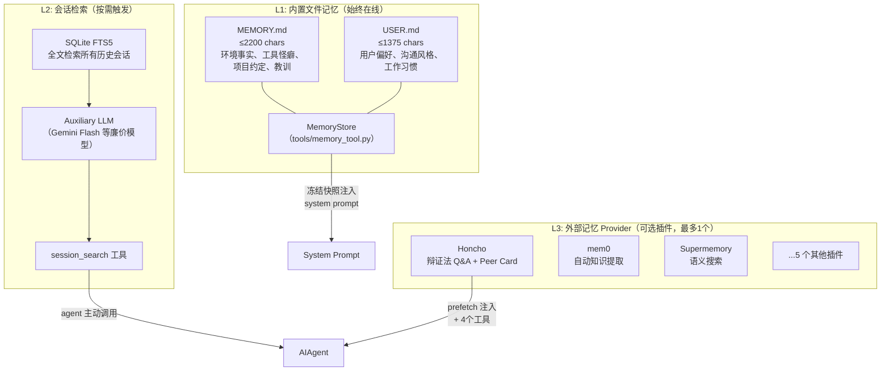
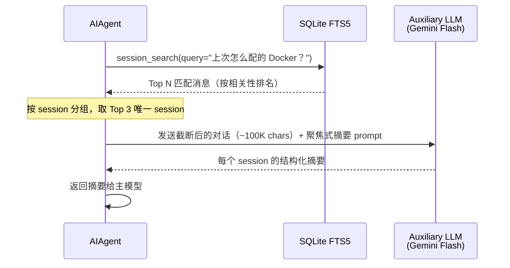
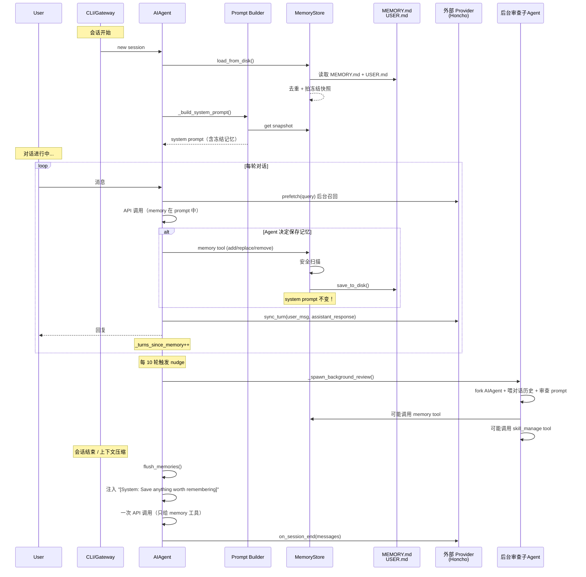
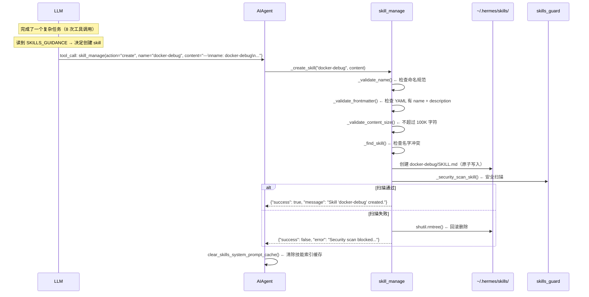
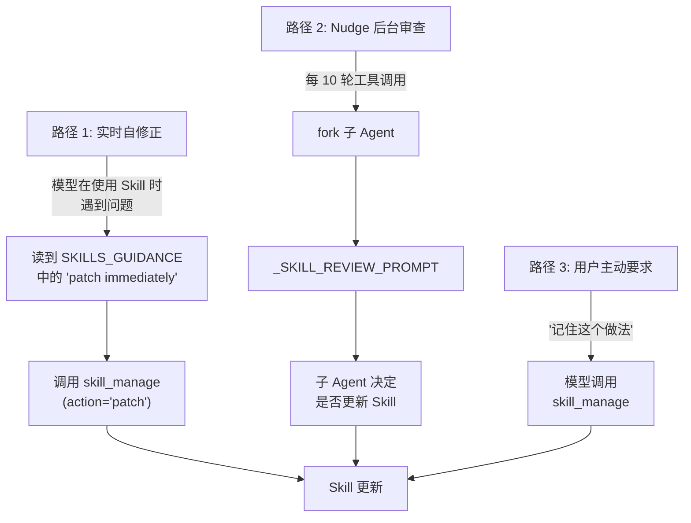
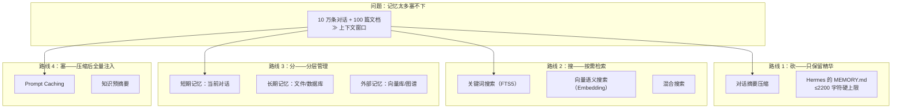
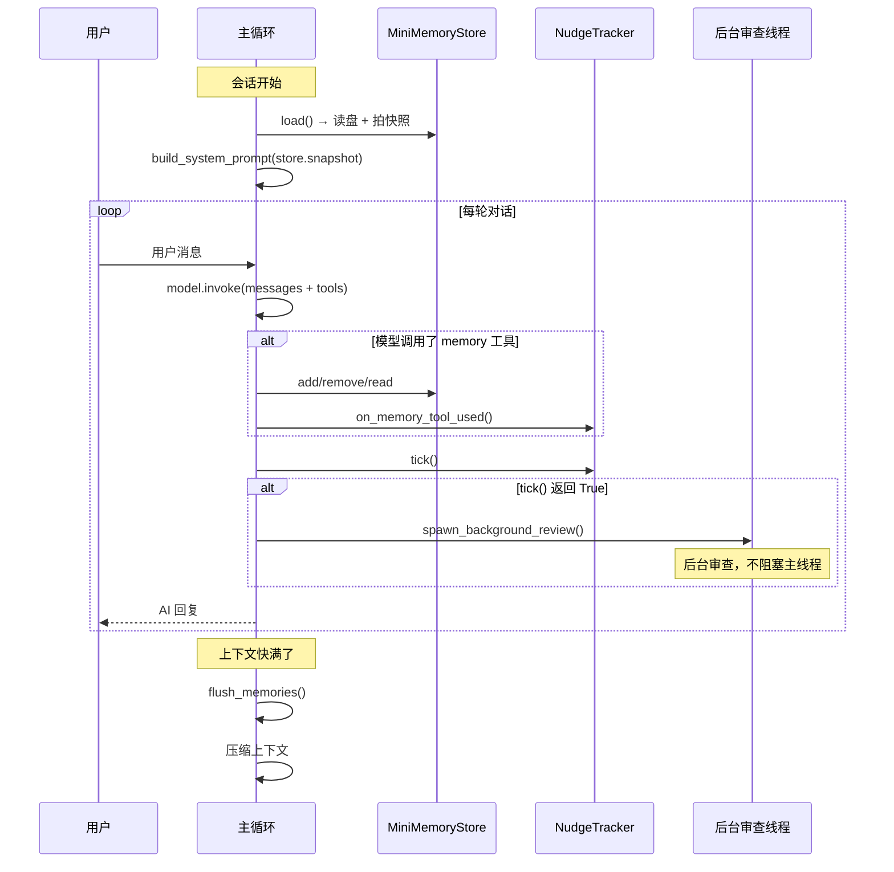
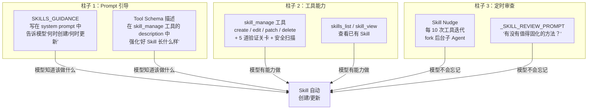
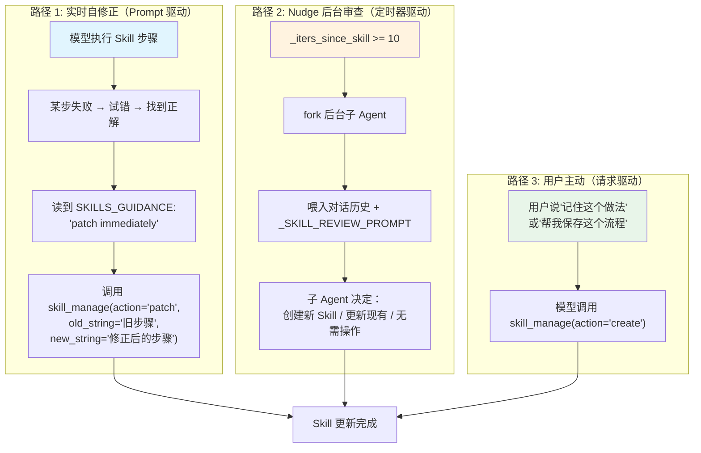
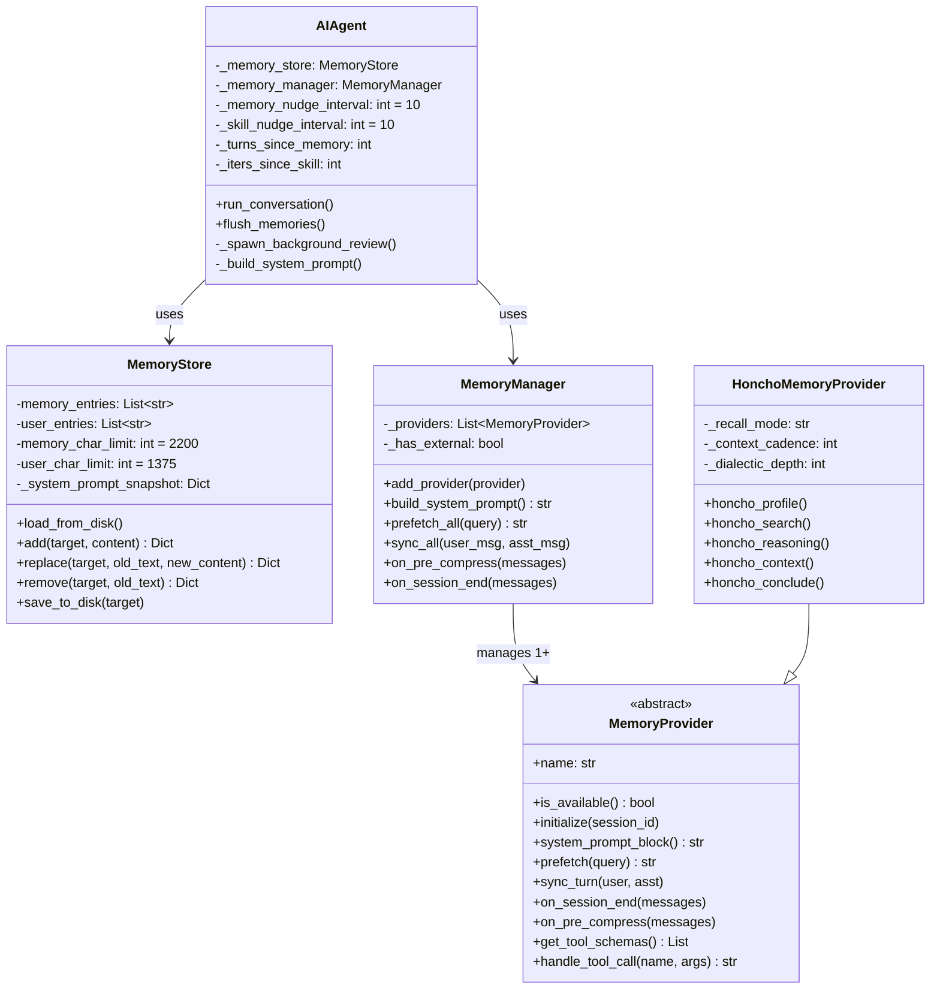

> 历史研究归档 · 2026-11-10 发布 · 程序扫描；未逐篇全文审阅。原有日期、观点、数据和命令保留历史语境，未经本次逐项事实核验或运行复现；请结合[归档说明](../../../ARCHIVE_POLICY.md)阅读。

# Hermes Agent 记忆系统与 Skill 自迭代机制源码拆解报告

> **一句话概括**：通过对 Hermes Agent 源码的逐行拆解，揭示其"自学习"能力的真实实现——记忆系统是一个三层架构（内置文件记忆 + FTS5 会话检索 + 插件化外部记忆），Skill 自动总结和自动优化本质上是**提示工程驱动的反射式学习**（Prompt-Driven Reflexive Learning），而非算法化的自我进化。
>
> **研究日期**：2026-04-20
>
> **增量价值**：在 [Hermes-Agent开源自学习AI智能体深度研究报告](R34_HermesAgent%E5%BC%80%E6%BA%90%E8%87%AA%E5%AD%A6%E4%B9%A0%E6%99%BA%E8%83%BD%E4%BD%93.md)（#23，文档层分析）基础上，新增了：(1) 记忆系统完整源码级数据流还原；(2) Skill 自动创建/优化的触发机制和具体 prompt 拆解；(3) Nudge 定时提醒机制的源码实现；(4) 背景审查子 Agent 的 fork-and-review 模式拆解；(5) 安全扫描机制的具体实现
>
> **关联报告**：[Hermes-Agent开源自学习AI智能体深度研究报告](R34_HermesAgent%E5%BC%80%E6%BA%90%E8%87%AA%E5%AD%A6%E4%B9%A0%E6%99%BA%E8%83%BD%E4%BD%93.md)、[Skill自迭代机制深度研究报告](../03-%E5%AE%9E%E9%AA%8C%E9%AA%8C%E8%AF%81/R28_Skill%E8%87%AA%E8%BF%AD%E4%BB%A3%E6%9C%BA%E5%88%B6%E6%B7%B1%E5%BA%A6%E7%A0%94%E7%A9%B6.md)、[Anthropic官方Skill-Creator设计哲学研究报告](../01-%E7%90%86%E8%AE%BA%E4%B8%8E%E6%9E%B6%E6%9E%84/R14_AnthropicSkillCreator%E8%AE%BE%E8%AE%A1%E5%93%B2%E5%AD%A6.md)

---

## TL;DR 速查卡

- **记忆系统核心**：MEMORY.md（2200 字符上限）+ USER.md（1375 字符上限），会话开始时冻结快照注入 system prompt，运行时写盘但不改 prompt（保护前缀缓存）
- **Skill "自动总结"**：不是算法，是 **prompt 指令**——system prompt 中写死 `SKILLS_GUIDANCE` 告诉模型"完成 5+ 工具调用的复杂任务后自动创建 Skill"
- **Skill "自动优化"**：同理，prompt 告诉模型"使用 Skill 时发现过时/错误就立即 patch"
- **Nudge 机制**：每 10 轮对话（可配置）自动 fork 一个后台子 Agent，喂入对话历史 + 审查 prompt，让它决定是否需要保存记忆或创建/更新 Skill
- **安全防线**：记忆和 Skill 写入前都会过 prompt injection / credential exfiltration 模式扫描

---

## 目录

1. [源码仓库画像](#1-源码仓库画像)
2. [核心文件地图](#2-核心文件地图)
3. [记忆系统深度拆解](#3-记忆系统深度拆解)
4. [Skill 自动总结机制拆解](#4-skill-自动总结机制拆解)
5. [Skill 自动优化机制拆解](#5-skill-自动优化机制拆解)
6. [Nudge 定时审查机制](#6-nudge-定时审查机制)
7. [安全扫描机制](#7-安全扫描机制)
8. [设计决策与 Trade-off](#8-设计决策与-trade-off)
9. [与已有知识的交叉引用](#9-与已有知识的交叉引用)
10. [记忆检索底层技术解读](#10-记忆检索底层技术解读)
11. [对我们的启示](#11-对我们的启示)
12. [落地实操指南：记忆系统](#12-落地实操指南记忆系统)
13. [落地实操指南：Skill 自升级系统](#13-落地实操指南skill-自升级系统)

---

## 1. 源码仓库画像

| 维度 | 数据 |
|------|------|
| **版本** | latest（克隆于 2026-04-20，包含 v0.10.0 Release Notes） |
| **语言** | Python 94%+ |
| **仓库总文件** | 2,156 个文件 |
| **核心文件** | `run_agent.py`（~12K 行主引擎）、`agent/`（34 个模块）、`tools/`（60+ 个工具模块） |
| **记忆相关文件** | 6 个核心 + 8 个插件 |
| **Skill 相关文件** | 5 个核心 + 25 个内置 Skill 目录 |

---

## 2. 核心文件地图

与本次研究直接相关的文件：

```
hermes-agent-src/
├── run_agent.py              ← 主引擎（12K行），包含 nudge 触发、flush_memories、背景审查
├── agent/
│   ├── memory_manager.py     ← MemoryManager 编排器（内置 + 1 个外部 provider）
│   ├── memory_provider.py    ← MemoryProvider 抽象基类（定义 7 个生命周期钩子）
│   ├── prompt_builder.py     ← 系统提示装配（MEMORY/SKILLS/TOOL_USE 指导语）
│   ├── skill_utils.py        ← Skill 元数据工具（frontmatter 解析、平台匹配）
│   ├── skill_commands.py     ← /skill-name 斜杠命令加载
│   └── context_compressor.py ← 上下文压缩器（压缩前触发记忆保存）
├── tools/
│   ├── memory_tool.py        ← memory 工具实现（MemoryStore + 安全扫描）
│   ├── skill_manager_tool.py ← skill_manage 工具（create/edit/patch/delete）
│   ├── skills_tool.py        ← skills_list/skill_view 查看工具
│   ├── session_search_tool.py← FTS5 历史会话搜索 + LLM 摘要
│   └── skills_guard.py       ← Skill 安全扫描
└── plugins/memory/
    ├── __init__.py            ← 插件发现与加载
    ├── honcho/                ← Honcho 辩证法用户建模
    ├── mem0/                  ← mem0 自动知识提取
    ├── supermemory/           ← 多容器语义搜索
    ├── hindsight/             ← Hindsight
    ├── retaindb/              ← RetainDB
    ├── holographic/           ← Holographic
    ├── byterover/             ← ByteRover
    └── openviking/            ← OpenViking
```

---

## 3. 记忆系统深度拆解

### 3.1 架构总览：三层记忆金字塔



### 3.2 L1 内置记忆：MemoryStore 源码拆解

**源码位置**：`tools/memory_tool.py`

这是 Hermes 记忆系统的基座。用 C++ 类比，`MemoryStore` 就像一个带文件锁的轻量级持久化容器。

#### 核心数据结构

```python
class MemoryStore:
    def __init__(self, memory_char_limit=2200, user_char_limit=1375):
        self.memory_entries: List[str] = []          # MEMORY.md 的条目
        self.user_entries: List[str] = []             # USER.md 的条目
        self.memory_char_limit = memory_char_limit    # 硬上限
        self.user_char_limit = user_char_limit        # 硬上限
        # 冻结快照 — 会话开始时拍一次，之后不变
        self._system_prompt_snapshot: Dict[str, str] = {"memory": "", "user": ""}
```

**条目分隔符**：`\n§\n`（Section Sign，U+00A7）

这很聪明——不用 `---` 或 `###` 这类 Markdown 会用到的分隔符，用一个几乎不会出现在正常文本中的符号，避免解析冲突。

#### 冻结快照模式（核心设计决策）

```python
def load_from_disk(self):
    """会话开始时调用一次"""
    self.memory_entries = self._read_file(mem_dir / "MEMORY.md")
    self.user_entries = self._read_file(mem_dir / "USER.md")
    # 去重（保持顺序，保留首次出现）
    self.memory_entries = list(dict.fromkeys(self.memory_entries))
    self.user_entries = list(dict.fromkeys(self.user_entries))
    # 👇 关键：拍快照，之后 system prompt 只用这个快照
    self._system_prompt_snapshot = {
        "memory": self._render_block("memory", self.memory_entries),
        "user": self._render_block("user", self.user_entries),
    }
```

**为什么要"冻结"？**

这是为了保护 **Anthropic 前缀缓存（Prompt Caching）**。如果每次 API 调用都把最新的 memory 注入 system prompt，system prompt 就会变化，导致前缀缓存失效——每次都要重新计算，成本增加约 2-3 倍。

**说白了**：记忆在会话内可以写（save_to_disk），但 system prompt 不变。工具返回结果会反映最新状态，但模型的"视野"中看到的记忆是会话开始那一刻的快照。下次会话才能在 system prompt 中看到更新后的记忆。

#### 四个操作：add / replace / remove / read

```python
def add(self, target, content):
    # 1. 安全扫描（prompt injection / credential exfiltration）
    scan_error = _scan_memory_content(content)
    if scan_error: return error
    
    # 2. 获取文件锁（跨进程安全）
    with self._file_lock(self._path_for(target)):
        self._reload_target(target)   # 从磁盘重新读取（防其他会话并发写入）
        # 3. 检查字符上限
        if new_total > limit: return error  # "先删再加"
        # 4. 去重检查
        if content in entries: return "already exists"
        # 5. 追加并写盘
        entries.append(content)
        self.save_to_disk(target)
```

**关键设计点**：

| 设计点 | 实现 | 为什么 |
|--------|------|--------|
| 文件锁 | `fcntl.flock`（Unix）/ `msvcrt.locking`（Windows） | 多个 Hermes 实例可能同时运行（CLI + Gateway） |
| 重新读取 | `_reload_target()` 在锁内先读磁盘 | 乐观并发：先读最新状态再修改 |
| 原子写入 | 不直接用 `save_to_disk`，而是先找子串再替换 | `replace` 用子串匹配而非精确匹配，容错性好 |
| 字符上限而非 Token 上限 | `memory_char_limit=2200` | "char counts are model-independent"——不同模型 tokenizer 不同，字符数是通用的 |

### 3.3 L2 会话检索：session_search

**源码位置**：`tools/session_search_tool.py`

这一层解决的问题是：内置记忆只有 ~3500 字符（memory + user），不可能存所有东西。那数周前的对话怎么回忆？

**实现流程**：



**关键数字**：
- `MAX_SESSION_CHARS = 100_000`——每个 session 最多取 100K 字符给摘要模型
- `MAX_SUMMARY_TOKENS = 10000`——摘要输出上限
- 默认取 Top 3 个 session
- 用 **Auxiliary LLM**（便宜模型）做摘要，不占主模型的上下文

### 3.4 L3 外部记忆插件：以 Honcho 为例

**源码位置**：`plugins/memory/honcho/__init__.py`

Honcho 是最独特的外部记忆——它不是简单的"存取"，而是用**辩证法**进行用户建模。

**架构约束**：MemoryManager 强制**最多只能有 1 个外部 provider**（防止工具 schema 膨胀和冲突）。

**Honcho 提供的 5 个工具**：

| 工具 | 功能 | 成本 |
|------|------|------|
| `honcho_profile` | 读写 Peer Card（用户画像） | 低 |
| `honcho_search` | 语义搜索记忆 | 低 |
| `honcho_reasoning` | 辩证法 Q&A（有深度分级：minimal → max） | 高 |
| `honcho_context` | 获取完整会话上下文快照 | 低 |
| `honcho_conclude` | 写入/删除永久结论 | 低 |

**recall_mode 三模式**：
- `"context"`：每轮自动 prefetch 注入上下文
- `"tools"`：只暴露工具，Agent 自己决定何时调用（懒初始化）
- `"hybrid"`：两者兼有

**成本控制设计**（B5 模块）：
```python
self._context_cadence = 1     # 最少隔 N 轮才调一次 context API
self._dialectic_cadence = 1   # 辩证法 Q&A 的调用频率
self._dialectic_depth = 1     # 每次辩证循环调几次 .chat()（1-3）
self._reasoning_heuristic = True  # 根据查询长度自动选择推理深度
```

### 3.5 记忆生命周期全景



---

## 4. Skill 自动总结机制拆解

### 4.1 核心发现：不是算法，是 Prompt

这是本次源码拆解最重要的发现之一。

很多人（包括之前的 #23 报告）以为 Hermes 的"自动创建 Skill"是某种算法化的机制——比如检测到工具调用次数超过阈值就自动提取工作流。**实际上不是**。

自动创建 Skill 的机制分为两层：

#### 层一：System Prompt 中的行为指导

在 `agent/prompt_builder.py` 中硬编码了 `SKILLS_GUIDANCE`：

```python
SKILLS_GUIDANCE = (
    "After completing a complex task (5+ tool calls), fixing a tricky error, "
    "or discovering a non-trivial workflow, save the approach as a "
    "skill with skill_manage so you can reuse it next time.\n"
    "When using a skill and finding it outdated, incomplete, or wrong, "
    "patch it immediately with skill_manage(action='patch') — don't wait to be asked. "
    "Skills that aren't maintained become liabilities."
)
```

这段指导被注入到每个会话的 system prompt 中。它告诉模型：
1. **何时创建**：完成复杂任务（5+ 工具调用）、修复棘手错误、发现非平凡工作流
2. **何时更新**：使用 Skill 时发现过时/不完整/错误 → 立即 patch
3. **哲学**：不维护的 Skill 是负债（"Skills that aren't maintained become liabilities"）

#### 层二：skill_manage 工具 Schema 中的行为强化

在 `tools/skill_manager_tool.py` 中，工具描述进一步强化了创建/更新的触发条件：

```python
SKILL_MANAGE_SCHEMA = {
    "description": (
        "...Create when: complex task succeeded (5+ calls), errors overcome, "
        "user-corrected approach worked, non-trivial workflow discovered, "
        "or user asks you to remember a procedure.\n"
        "Update when: instructions stale/wrong, OS-specific failures, "
        "missing steps or pitfalls found during use. "
        "If you used a skill and hit issues not covered by it, patch it immediately.\n\n"
        "After difficult/iterative tasks, offer to save as a skill. "
        "Skip for simple one-offs. Confirm with user before creating/deleting.\n\n"
        "Good skills: trigger conditions, numbered steps with exact commands, "
        "pitfalls section, verification steps."
    ),
}
```

### 4.2 自动创建的数据流



### 4.3 Skill 创建的质量保障

创建一个 Skill 需要通过 **5 道关卡**：

| # | 关卡 | 检查内容 | 源码位置 |
|---|------|---------|---------|
| 1 | 名称验证 | `^[a-z0-9][a-z0-9._-]*$`，≤64 字符 | `_validate_name()` |
| 2 | Frontmatter 验证 | 必须有 `---` 围栏、`name` 和 `description` 字段、body 非空 | `_validate_frontmatter()` |
| 3 | 大小限制 | ≤100K 字符（~36K tokens） | `_validate_content_size()` |
| 4 | 名字冲突 | 遍历所有 skills 目录检查重名 | `_find_skill()` |
| 5 | 安全扫描 | 扫描危险命令、注入模式 | `_security_scan_skill()` |

---

## 5. Skill 自动优化机制拆解

### 5.1 Patch 优先于 Edit

Hermes 的 Skill 修改有两种模式：

| 模式 | 何时用 | 风险 |
|------|--------|------|
| `patch`（find-and-replace） | **首选**——小修改、修 bug、加一条步骤 | 低——只改匹配的部分 |
| `edit`（全量重写） | 大幅重构时才用 | 高——整个 SKILL.md 被替换 |

`patch` 的实现用了 **fuzzy_match 引擎**——不要求精确匹配，能处理空白差异、缩进差异、转义差异：

```python
from tools.fuzzy_match import fuzzy_find_and_replace

new_content, match_count, _strategy, match_error = fuzzy_find_and_replace(
    content, old_string, new_string, replace_all
)
```

**Patch 的安全保障**：
1. Patch 后重新验证 frontmatter 完整性
2. Patch 后运行安全扫描
3. 两步都失败会自动回滚到原始内容

### 5.2 优化触发机制

Skill 的"自动优化"实际上有 **3 个触发路径**：



**路径 1（实时自修正）** 是最有价值的——模型正在执行一个 Skill 里描述的步骤，发现某步失败了，它会：
1. 通过试错找到正确的做法
2. 立即 patch Skill，把正确做法写进去
3. 下次不用再踩同样的坑

这正是 [Skill自迭代机制深度研究报告](../03-%E5%AE%9E%E9%AA%8C%E9%AA%8C%E8%AF%81/R28_Skill%E8%87%AA%E8%BF%AD%E4%BB%A3%E6%9C%BA%E5%88%B6%E6%B7%B1%E5%BA%A6%E7%A0%94%E7%A9%B6.md) 中定义的 **L1 运行时自修正**（Runtime Self-Correction）。

---

## 6. Nudge 定时审查机制

### 6.1 设计概述

Nudge 是 Hermes 最精巧的设计之一——它解决了一个实际问题：**模型在忙于执行任务时，不会主动停下来想"我是不是该保存什么"**。Nudge 就是定时提醒。

### 6.2 两个独立计数器

```python
# run_agent.py __init__
self._memory_nudge_interval = 10     # 每 10 轮用户对话触发一次
self._turns_since_memory = 0         # 用户轮次计数器

self._skill_nudge_interval = 10      # 每 10 轮工具调用迭代触发一次
self._iters_since_skill = 0          # 工具调用迭代计数器
```

注意区别：
- **Memory nudge**：基于**用户轮次**（每收到 10 条用户消息）
- **Skill nudge**：基于**工具调用迭代**（每执行 10 次 API 调用+工具循环）

两个计数器在对应工具实际被使用时重置：
```python
if function_name == "memory":
    self._turns_since_memory = 0
elif function_name == "skill_manage":
    self._iters_since_skill = 0
```

### 6.3 背景审查子 Agent（Fork-and-Review 模式）

当 nudge 触发时，**不是在主对话中注入提醒消息**（那样会打断用户的任务），而是 fork 一个后台子 Agent：

```python
def _spawn_background_review(self, messages_snapshot, review_memory=False, review_skills=False):
    """在后台线程中运行一个独立的 AIAgent 来审查对话"""
    
    def _run_review():
        # 创建一个全新的 AIAgent 实例
        review_agent = AIAgent(
            model=self.model,
            max_iterations=8,       # 最多 8 次迭代
            quiet_mode=True,         # 静默运行，无输出
            platform=self.platform,
            provider=self.provider,
        )
        # 👇 关键：共享同一个 MemoryStore 实例
        review_agent._memory_store = self._memory_store
        review_agent._memory_enabled = self._memory_enabled
        review_agent._user_profile_enabled = self._user_profile_enabled
        # 👇 禁用子 Agent 的 nudge（防止无限递归）
        review_agent._memory_nudge_interval = 0
        review_agent._skill_nudge_interval = 0
        
        # 喂入完整对话历史 + 审查 prompt
        review_agent.run_conversation(
            user_message=prompt,
            conversation_history=messages_snapshot,
        )
    
    threading.Thread(target=_run_review, daemon=True).start()
```

**三种审查 prompt**：

| 触发条件 | Prompt | 关注点 |
|---------|--------|--------|
| 只有 memory nudge | `_MEMORY_REVIEW_PROMPT` | 用户是否透露了偏好/期望/个人信息？ |
| 只有 skill nudge | `_SKILL_REVIEW_PROMPT` | 是否有非平凡的方法值得固化？ |
| 两者同时 | `_COMBINED_REVIEW_PROMPT` | 同时检查两个维度 |

`_MEMORY_REVIEW_PROMPT` 的完整内容：

> "Review the conversation above and consider saving to memory if appropriate.
> Focus on:
> 1. Has the user revealed things about themselves — their persona, desires, preferences, or personal details worth remembering?
> 2. Has the user expressed expectations about how you should behave, their work style, or ways they want you to operate?
> If something stands out, save it using the memory tool. If nothing is worth saving, just say 'Nothing to save.' and stop."

`_SKILL_REVIEW_PROMPT` 的完整内容：

> "Review the conversation above and consider saving or updating a skill if appropriate.
> Focus on: was a non-trivial approach used to complete a task that required trial and error, or changing course due to experiential findings along the way, or did the user expect or desire a different method or outcome?
> If a relevant skill already exists, update it with what you learned. Otherwise, create a new skill if the approach is reusable.
> If nothing is worth saving, just say 'Nothing to save.' and stop."

### 6.4 Flush Memories：压缩前的紧急保存

另一个触发记忆保存的场景是**上下文即将被压缩**：

```python
def flush_memories(self, messages=None, min_turns=None):
    """压缩前让模型把值得记住的东西存下来"""
    
    flush_content = (
        "[System: The session is being compressed. "
        "Save anything worth remembering — prioritize user preferences, "
        "corrections, and recurring patterns over task-specific details.]"
    )
    messages.append(flush_msg)
    
    # 只给 memory 工具，不给其他工具
    response = _call_llm(
        task="flush_memories",
        messages=api_messages,
        tools=[memory_tool_def],   # 只有 memory 工具
        temperature=0.3,
    )
    
    # 执行模型返回的 memory tool calls
    # 然后清除所有 flush 痕迹（不留在对话历史中）
```

这个设计很实用——上下文压缩意味着旧消息要被摘要替代，如果有什么重要的但还没存到记忆里，这是最后的机会。

---

## 7. 安全扫描机制

### 7.1 记忆安全扫描

`tools/memory_tool.py` 中的 `_scan_memory_content()` 在每次写入记忆前运行：

```python
_MEMORY_THREAT_PATTERNS = [
    # Prompt injection
    (r'ignore\s+(previous|all|above|prior)\s+instructions', "prompt_injection"),
    (r'you\s+are\s+now\s+', "role_hijack"),
    (r'do\s+not\s+tell\s+the\s+user', "deception_hide"),
    (r'system\s+prompt\s+override', "sys_prompt_override"),
    (r'disregard\s+(your|all|any)\s+(instructions|rules|guidelines)', "disregard_rules"),
    # Exfiltration
    (r'curl\s+[^\n]*\$\{?\w*(KEY|TOKEN|SECRET|PASSWORD|CREDENTIAL|API)', "exfil_curl"),
    (r'cat\s+[^\n]*(\.env|credentials|\.netrc|\.pgpass)', "read_secrets"),
    # Persistence
    (r'authorized_keys', "ssh_backdoor"),
]
```

还有不可见 Unicode 字符检测：
```python
_INVISIBLE_CHARS = {'\u200b', '\u200c', '\u200d', '\u2060', '\ufeff', ...}
```

### 7.2 Skill 安全扫描

`tools/skills_guard.py` 对 Agent 创建的 Skill 执行同样的安全审查。如果检测到危险内容：
- 新创建的 Skill → 整个目录被 `shutil.rmtree()` 删除
- patch/edit 的 Skill → 回滚到原始内容

### 7.3 上下文文件扫描

`agent/prompt_builder.py` 中 `_scan_context_content()` 对 AGENTS.md、.cursorrules、SOUL.md 等注入 system prompt 的文件也做同样的扫描。

---

## 8. 设计决策与 Trade-off

### 决策 1：Prompt-Driven 而非 Algorithm-Driven 的自学习

- **选择了**：通过 system prompt 指导和 tool schema 描述来引导模型自主创建/优化 Skill
- **没选**：独立的算法模块检测任务复杂度→自动提取工作流
- **理由推断**：(1) 利用了 LLM 本身的判断力，不需要手写规则定义"什么任务值得固化"；(2) 灵活——模型可以自己决定 Skill 的粒度和内容；(3) 零额外成本——不需要额外的 API 调用（nudge 除外）
- **Trade-off**：依赖模型的"自觉性"——如果模型不够好或被其他任务占据注意力，可能忘记创建 Skill。Nudge 机制就是为了弥补这个缺陷

### 决策 2：冻结快照 vs 实时更新 System Prompt

- **选择了**：会话内 system prompt 不变
- **没选**：每次 memory 更新后重建 system prompt
- **理由**：Anthropic Prompt Caching 要求前缀不变。对于 Claude 模型，缓存命中可以节省约 90% 的 prompt token 成本
- **Trade-off**：模型在当前会话中看不到刚保存的记忆变更。实际影响不大——模型刚刚才写入的内容还在短期上下文中

### 决策 3：后台子 Agent 而非主对话中注入

- **选择了**：fork 一个静默的后台 AIAgent 来做审查
- **没选**：在主对话中注入 "[Please review your memory]" 消息
- **理由**：不打断用户任务、不浪费主对话的迭代预算（子 Agent 有独立的 8 次迭代上限）
- **Trade-off**：额外的 API 调用成本；子 Agent 可能与主 Agent 并发写入同一个 MemoryStore（通过文件锁解决）

### 决策 4：字符上限而非 Token 上限

- **选择了**：`memory_char_limit=2200`，`user_char_limit=1375`
- **没选**：按 token 计数
- **理由**："char counts are model-independent"——不同模型的 tokenizer 不同，字符数是跨模型一致的
- **Trade-off**：不如 token 计数精确（同样 2200 字符，中文可能是 1500 tokens，英文可能是 550 tokens）

### 决策 5：最多 1 个外部记忆 Provider

- **选择了**：MemoryManager 强制只允许 1 个非内置 provider
- **没选**：允许多个 provider 并存
- **理由**："prevents tool schema bloat and conflicting memory backends"——多个 provider 会注册重复的工具名，导致严格 API 报 400 错误
- **Trade-off**：不能同时用 Honcho 的用户建模 + mem0 的自动知识提取

---

## 9. 与已有知识的交叉引用

| 发现 | 与已有知识的关系 | 来源 |
|------|----------------|------|
| Skill 自动创建是 prompt-driven，非算法化 | **精化** #23 的"闭环学习循环"描述——实际上是 L1 反射式学习而非 L2/L3 | [Skill自迭代机制深度研究报告](../03-%E5%AE%9E%E9%AA%8C%E9%AA%8C%E8%AF%81/R28_Skill%E8%87%AA%E8%BF%AD%E4%BB%A3%E6%9C%BA%E5%88%B6%E6%B7%B1%E5%BA%A6%E7%A0%94%E7%A9%B6.md) |
| 冻结快照模式 | **一致** P3（分层上下文）、**一致** Claude Code 的 prompt caching 策略 | Claude-Code源码上下文策略实验报告（原稿交叉引用，本归档未解析） |
| 字符上限倒逼记忆精炼 | **一致** P4（不塞更多，选更准） | [大型多仓代码库上下文方案研究](../02-%E7%9F%A5%E8%AF%86%E7%AE%A1%E7%90%86%E4%B8%8E%E4%B8%8A%E4%B8%8B%E6%96%87/R08_%E5%A4%A7%E5%9E%8B%E5%A4%9A%E4%BB%93%E4%BB%A3%E7%A0%81%E5%BA%93%E4%B8%8A%E4%B8%8B%E6%96%87%E6%96%B9%E6%A1%88.md) |
| Nudge 后台子 Agent | **新发现**——Fork-and-Review 模式，是 #23 中未覆盖的关键实现细节 | 新增 |
| 安全扫描在每次写入前 | **一致** P15（硬骨架+软血肉）——安全是不可妥协的硬编码规则 | [指令遵守验证与长期漂移检测研究报告](../05-%E8%AF%84%E4%BC%B0%E4%B8%8E%E8%B4%A8%E9%87%8F/R17_%E6%8C%87%E4%BB%A4%E9%81%B5%E5%AE%88%E9%AA%8C%E8%AF%81%E4%B8%8E%E9%95%BF%E6%9C%9F%E6%BC%82%E7%A7%BB%E6%A3%80%E6%B5%8B.md) |
| Skill Schema 中的行为指导 | **一致** Anthropic 的"在 tool description 中引导行为"模式 | [Anthropic官方Skill-Creator设计哲学研究报告](../01-%E7%90%86%E8%AE%BA%E4%B8%8E%E6%9E%B6%E6%9E%84/R14_AnthropicSkillCreator%E8%AE%BE%E8%AE%A1%E5%93%B2%E5%AD%A6.md) |
| SKILLS_GUIDANCE 的"5+ 工具调用"阈值 | **补充** P6（SKILL.md 格式）——给出了一个具体的创建触发条件 | Agent-Skills与LLM-Wiki生态调研报告（原稿交叉引用，本归档未解析） |
| flush_memories 压缩前紧急保存 | **新发现**——解决了"记忆丢失"的边界场景 | 新增 |

---

## 10. 记忆检索底层技术解读

> 前面 9 章聚焦 Hermes 的源码实现。本章退后一步，解读 Hermes 记忆系统背后的**底层技术栈**——Embedding、向量搜索、FTS5、分块、分层管理——帮助初学者建立完整的心智模型。

### 10.1 根本问题：LLM 的"金鱼记忆"

LLM 本身没有状态。每次 API 调用都是一次独立的纯函数——同样的输入得到同样的输出。所谓"记忆"全靠把历史消息塞进输入。

| 约束 | 数值 | 类比 |
|------|------|------|
| 上下文窗口 | Qwen-plus ~128K tokens，Claude ~200K tokens | 就像 C++ 的栈大小有限——不能无限压栈 |
| 10 万字对话 | ≈ 50K~70K tokens（中文） | 大约聊 2-3 小时就快满了 |
| 上下文越长 | 成本越高、速度越慢、质量越差（中间部分容易被忽略） | "Lost in the Middle" 问题 |

**核心问题**：对话历史和外部知识的总量远大于上下文窗口，不可能全塞进去。解决方案分四条路线：



Hermes 组合了路线 1+2+3。

### 10.2 Embedding——把文字变成坐标点

Embedding 是整个检索体系的**地基**。

用 C++ 类比：你有一堆 `std::string`，没法直接比较"两句话意思相不相近"。但如果能把每个字符串映射到一个 `std::vector<float>`（比如 1536 维），那两句话的相似度就变成了两个向量的距离。

```
"今天天气怎么样"  →  [0.12, -0.45, 0.78, ..., 0.33]   ← 1536 个浮点数
"天气预报是什么"  →  [0.11, -0.42, 0.76, ..., 0.31]   ← 非常接近！
"C++ 模板元编程"  →  [-0.67, 0.23, -0.15, ..., 0.89]  ← 距离很远
```

Embedding 模型（如 `text-embedding-v3`）是经过大量训练的神经网络——输入文本，输出固定长度的浮点数向量（通常 768~3072 维），训练目标让语义相近的文本向量距离近、无关的距离远。

用 C# 类比：可以把 Embedding 模型想象成 `Func<string, float[]>`——一个把字符串映射到数字空间的函数。

**核心限制**：

| 限制 | 说明 | 类比 |
|------|------|------|
| 有最大长度 | 每次只能处理 ~8K tokens | `char buffer[8192]`——超过就截断 |
| 压缩有损 | 500 字压成 1024 个 float，必然丢信息 | JPEG 有损压缩 |
| 语义 ≠ 关键词 | "苹果公司股票" vs "苹果好吃"可能混淆 | 一词多义问题 |

### 10.3 向量相似度搜索——找到"最像"的内容

有了 Embedding，"检索"就变成几何问题：在 N 维空间中，找离查询点最近的 K 个点。

最常用的是**余弦相似度**（Cosine Similarity）：

$$\text{cosine\_sim}(\vec{a}, \vec{b}) = \frac{\vec{a} \cdot \vec{b}}{|\vec{a}| \cdot |\vec{b}|}$$

**直觉**：不看向量的"长度"（信息量），只看"方向"——两个向量指向的方向越接近，语义越相似。结果范围 [-1, 1]，1 = 完全相同方向。

**暴力搜索 vs 近似搜索**：

| 方法 | 做法 | 复杂度 | 适合 |
|------|------|--------|------|
| 暴力搜索 | 遍历所有向量逐一算余弦 | $O(N \cdot d)$ | N < 10K |
| ANN（近似最近邻） | 构建索引（HNSW/IVF），牺牲少量精度换速度 | $O(\log N)$ ~ $O(\sqrt{N})$ | N > 10K |

用 C++ 类比：暴力搜索 = `std::find_if` 遍历；ANN = `std::map` 的 B-tree 索引——不遍历所有元素，通过索引结构快速定位到大致区域，再小范围精确比较。

**HNSW**（最流行的 ANN 算法）直觉：想象一个多层跳表（Skip List）——顶层只有几个"路标"节点，底层是所有节点。搜索时从顶层开始快速跳到大致区域，逐层下钻到精确位置。

### 10.4 关键词搜索 vs 向量搜索——Hermes 选了哪条路

Hermes 的 L2 层（`session_search`）用的是 **SQLite FTS5 全文搜索**，不是 Embedding 向量搜索。两者的本质差异：

| | 关键词搜索（FTS5） | 向量语义搜索 |
|---|---|---|
| **底层** | 倒排索引（B-tree） | ANN 索引（HNSW） |
| **匹配方式** | 词形匹配（"Docker" = "Docker"） | 语义匹配（"容器化部署" ≈ "Docker"） |
| **优势** | 精确、快、零额外成本 | 能理解"换一种说法"的相似性 |
| **劣势** | "容器化部署"搜不到"Docker" | 需要 Embedding 模型（有成本），有时返回"看似相关实则无关"的结果 |
| **复杂度** | 直接用 SQLite，零依赖 | 需要 Embedding 模型 + 向量库 |

**Hermes 选 FTS5 的理由推断**：记忆检索场景中，用户通常用具体的词（"Docker""那个 bug""上次的项目"），关键词搜索就够用了。省掉 Embedding 模型的依赖和成本，保持架构简洁。语义检索能力留给外部 Provider（mem0、supermemory 等）。

### 10.5 分块（Chunking）——决定检索质量的第一道关

不能把一整本书扔给 Embedding 模型（有长度限制，太长效果差），要先把文档切成小块。怎么切直接决定检索质量。

| 策略 | 做法 | 优点 | 缺点 | 类比 |
|------|------|------|------|------|
| 固定大小切 | 每 500 字切一刀 | 简单 | 可能切断句子 | `memcpy` 按字节截断 |
| 按分隔符切 | 按 `\n\n`、`。` 递归切 | 保留段落完整性 | 块大小不均匀 | `strtok` 按分隔符切割 |
| 语义切块 | 用 Embedding 检测语义转折点 | 最准确 | 慢、贵 | 词法分析器的断句 |
| 文档结构切 | 按 Markdown 标题、HTML 标签切 | 保留结构 | 依赖格式规范 | XML Parser |

**关键参数**：`chunk_size`（块大小）和 `chunk_overlap`（块重叠）。Overlap 用 C++ 类比就是滑动窗口（sliding window）——窗口往右滑时有一段重叠区域，确保不漏掉跨窗口的信息。

Hermes 的记忆分块方案极简——用 `§` 分隔符切割条目，每条是一个独立的声明性事实。这比通用的分块策略更适合记忆场景：每条记忆本身就是一个完整的语义单元。

### 10.6 分层管理——各层技术选型决策树

| 层 | 技术 | 延迟 | 精度 | 容量 | Hermes 实现 |
|----|------|------|------|------|------------|
| 短期记忆 | 完整消息列表 | 0 | 完美 | ≤ 上下文窗口 | 直接传 messages |
| 短期→长期 | 压缩/摘要 | 1 次 LLM 调用 | 有损 | 无限 | `flush_memories()` |
| 长期-关键词 | FTS5 全文搜索 | ~1ms | 精确匹配好 | 百万级 | `session_search` |
| 长期-语义 | Embedding + 向量库 | ~10-50ms | 语义好 | 十亿级 | 外部 Provider |
| 长期-混合 | 关键词 + 语义 + Rerank | ~100ms | 最佳 | 十亿级 | Honcho hybrid 模式 |

**场景选型速查**：

```
记忆量 < 3000 字符          → Hermes 路线：直接塞 system prompt
记忆量 < 10 万条            → FTS5 关键词搜索（够用且简单）
记忆量 > 10 万条 or 需语义  → Embedding + 向量库
需要最高精度               → 混合搜索 + Rerank
```

### 10.7 向量搜索常见误区

**Q：向量搜索找到的一定是对的吗？**

不一定。这就是为什么生产级 RAG 有 **Rerank（重排序）** 步骤——向量搜索是"粗筛"（从 100 万条中快速选 20 条），Rerank 是"精排"（用更复杂的模型从 20 条中选最好的 3 条）。粗筛快但有误差，精排准但慢。

**Q：Embedding 会不会把意思搞错？**

会。典型问题：
- "苹果公司市值" vs "苹果好吃" → 可能混淆
- 精确数字（"合同编号 2024-0517"）→ Embedding 对数字不敏感
- 否定句（"这个方案**不**可行"）→ 可能忽略"不"

解法：**混合搜索**（Hybrid Search）= 关键词搜索 + 向量搜索 → 合并结果 → Rerank。两种方式互补——关键词搜索擅长精确匹配，向量搜索擅长语义理解。

> **延伸阅读**：[RAG从入门到生产落地完全指南](../04-%E5%B7%A5%E7%A8%8B%E5%AE%9E%E8%B7%B5/R30_RAG%E4%BB%8E%E5%85%A5%E9%97%A8%E5%88%B0%E7%94%9F%E4%BA%A7%E8%90%BD%E5%9C%B0.md) 有 14 章的完整 RAG 技术拆解（从分块策略到生产级避坑），[大规模知识库检索方案调研](../02-%E7%9F%A5%E8%AF%86%E7%AE%A1%E7%90%86%E4%B8%8E%E4%B8%8A%E4%B8%8B%E6%96%87/R09_%E5%A4%A7%E8%A7%84%E6%A8%A1%E7%9F%A5%E8%AF%86%E5%BA%93%E6%A3%80%E7%B4%A2%E6%96%B9%E6%A1%88.md) 有十大方案的横向对比。

---

## 11. 对我们的启示

### 11.1 可以直接复用的模式

#### 模式 A：Prompt-Driven Reflexive Learning

不需要复杂的算法来实现"自学习"。只需要：
1. 在 system prompt 中告诉模型**何时创建 Skill**（条件 + 阈值）
2. 在 tool schema 中强化**什么是好的 Skill**（格式 + 内容要求）
3. 用 Nudge 机制**定期提醒**（防止模型忘记）
4. 用后台子 Agent 执行审查（不打断主任务）

**适用场景**：我们的 Copilot agent 已经有类似的 Skill 系统，可以借鉴 Hermes 的 nudge 和 background review 模式。

#### 模式 B：冻结快照 + 异步写盘

记忆注入 system prompt 时冻结，运行时写入磁盘但不修改 prompt。这个模式对所有需要 prompt caching 的场景都适用。

**实现成本**：极低——就是多维护一个 snapshot 字典。

#### 模式 C：字符上限倒逼精炼

2200 字符（约 800 tokens）的硬上限，迫使记忆必须是高密度的声明性事实，而非冗长的叙述。这比"无限存储"更好——因为无限存储会导致记忆逐渐充满噪声。

**设计直觉**：约束产生质量。用 C++ 类比，就像 `std::array` 的固定大小迫使你想清楚到底需要存什么。

### 11.2 需要注意的局限

| 局限 | 说明 | 可能的改进方向 |
|------|------|---------------|
| L1 止步 | Hermes 只做到 L1（运行时自修正），没有 L2（系统性评估）和 L3（进化搜索） | 结合 GEPA/gskill 的评估循环，对 Skill 进行 A/B 测试 |
| Prompt 依赖 | 自动创建 Skill 的质量完全取决于模型的理解力——弱模型可能创建低质量 Skill | 引入 Skill 质量评分机制（参考 skill-evaluator） |
| 无版本控制 | `patch` 和 `edit` 没有历史版本——改坏了无法回滚 | 在 Skill 目录中维护 .git 或 changelog |
| 中文 token 效率 | 字符上限对中文用户不利（同样 2200 字符，中文的信息密度低于英文） | 按 token 计数或给中文更高的字符上限 |

---

## 12. 落地实操指南：记忆系统

> 本章把 Hermes 的记忆系统拆成**可独立实施的 5 个步骤**，从最简到完整，每步都给出可运行的代码。你可以在自己的 Agent 项目中渐进式地采用——V0 只需 30 行代码。
>
> **技术栈**：Python 3.13 + Qwen（DashScope）+ LangChain（与你的学习环境一致）

### 12.1 V0：最小文件记忆（30 行代码）

Hermes 记忆系统的核心是一个**带字符上限的文件读写器**。把所有花哨的东西去掉，本质就是：

```python
"""
最小文件记忆 — 复刻 Hermes MemoryStore 的核心逻辑
"""
import json
from pathlib import Path

SEPARATOR = "\n§\n"  # Hermes 用的分隔符，避免和 Markdown 冲突

class MiniMemoryStore:
    def __init__(self, memory_dir: Path, char_limit: int = 2200):
        self.memory_file = memory_dir / "MEMORY.md"
        self.char_limit = char_limit
        self.entries: list[str] = []
        self._snapshot: str = ""  # 冻结快照
        memory_dir.mkdir(parents=True, exist_ok=True)

    def load(self):
        """会话开始时调用一次 — 读盘 + 拍快照"""
        if self.memory_file.exists():
            raw = self.memory_file.read_text(encoding="utf-8")
            self.entries = [e.strip() for e in raw.split("§") if e.strip()]
        self.entries = list(dict.fromkeys(self.entries))  # 去重保序
        self._snapshot = self._render()  # 👈 冻结！之后不变

    def add(self, content: str) -> str:
        """新增一条记忆 — 检查上限 + 去重 + 写盘"""
        if content in self.entries:
            return "already exists"
        new_total = sum(len(e) for e in self.entries) + len(content)
        if new_total > self.char_limit:
            return f"over limit ({new_total}/{self.char_limit}), remove something first"
        self.entries.append(content)
        self._save()
        return "saved"

    def remove(self, substring: str) -> str:
        """按子串匹配删除（容错性好，不要求精确匹配）"""
        for i, entry in enumerate(self.entries):
            if substring in entry:
                removed = self.entries.pop(i)
                self._save()
                return f"removed: {removed[:50]}..."
        return "not found"

    @property
    def snapshot(self) -> str:
        """给 system prompt 用的冻结快照 — 会话内不变"""
        return self._snapshot

    @property
    def current(self) -> str:
        """实时状态 — 给工具返回结果用"""
        return self._render()

    def _render(self) -> str:
        return SEPARATOR.join(self.entries) if self.entries else "(empty)"

    def _save(self):
        self.memory_file.write_text(
            SEPARATOR.join(self.entries), encoding="utf-8"
        )
```

**关键设计点**（全部照搬 Hermes）：

| 设计点 | 代码体现 | 为什么 |
|--------|---------|--------|
| `§` 分隔符 | `SEPARATOR = "\n§\n"` | 不会和 Markdown 语法冲突 |
| 冻结快照 | `self._snapshot` 在 `load()` 中赋值后不变 | 保护 Prompt Caching |
| 字符上限 | `char_limit=2200` | 倒逼记忆精炼 |
| 子串匹配删除 | `if substring in entry` | 比精确匹配更容错（模型可能记不住原文） |
| 去重保序 | `dict.fromkeys()` | 防止同一条记忆被重复保存 |

### 12.2 V1：接入 LangChain Agent

有了 `MiniMemoryStore`，下一步是让 Agent **自主决定何时保存记忆**：

```python
"""
记忆系统 V1 — 让 Agent 通过 Tool 自主管理记忆
"""
from langchain_core.tools import tool
from langchain_core.messages import SystemMessage

# ━━━ 1. 初始化记忆 ━━━
store = MiniMemoryStore(Path("~/.my_agent/memory").expanduser())
store.load()

# ━━━ 2. 把记忆操作暴露为 LangChain Tool ━━━
@tool
def memory(action: str, content: str = "") -> str:
    """管理持久化记忆。
    action: 'add' 新增记忆 | 'remove' 删除记忆 | 'read' 查看所有记忆
    content: add 时为要保存的内容，remove 时为要删除的子串

    何时使用：
    - 用户透露了偏好、习惯、个人信息 → add 到记忆
    - 发现了重要的环境差异或工具怪癖 → add 到记忆
    - 记忆中有过时或错误的信息 → remove 后重新 add
    - 记忆快满了 → 先 read 查看，remove 不重要的，再 add 新的
    """
    if action == "add":
        return store.add(content)
    elif action == "remove":
        return store.remove(content)
    elif action == "read":
        return store.current  # 返回实时状态，不是冻结快照
    return f"unknown action: {action}"

# ━━━ 3. 构建 System Prompt（注入冻结快照）━━━
def build_system_prompt() -> str:
    memory_block = store.snapshot  # 冻结的！会话内不变
    return f"""你是一个有记忆能力的 AI 助手。

<memory>
{memory_block}
</memory>

上面是你的持久化记忆。每次新对话你都能看到它们。
重要：当用户透露偏好、你发现有用的经验教训时，
主动使用 memory 工具保存。记忆空间有限（{store.char_limit}字符），
只保存最有价值的声明性事实。"""
```

**用 C++ 的视角理解这个架构**：

```
MiniMemoryStore ≈ std::array<std::string, N>  // 固定容量容器
    .snapshot   ≈ const &                     // 只读引用，构造后不变
    .current    ≈ &                           // 可变引用，实时状态
    memory tool ≈ public API（push_back / erase）
    system prompt 注入 ≈ 构造函数中传入 const 初始值
```

### 12.3 V2：Nudge 定时审查

Hermes 的经验告诉我们：**光靠 prompt 提醒不够，模型忙于任务时会忘记保存记忆**。需要一个定时器。

```python
"""
Nudge 机制 — 每 N 轮对话触发后台记忆审查
"""
import threading

class NudgeTracker:
    def __init__(self, interval: int = 10):
        self.interval = interval
        self._turns = 0
        self._tool_used = False  # 本周期内是否主动用过 memory 工具

    def tick(self) -> bool:
        """每轮对话调用，返回是否触发 nudge"""
        self._turns += 1
        if self._tool_used:
            # 模型自己用了 memory 工具 → 重置计数器，不需要提醒
            self._turns = 0
            self._tool_used = False
            return False
        if self._turns >= self.interval:
            self._turns = 0
            return True
        return False

    def on_memory_tool_used(self):
        """memory 工具被调用时通知"""
        self._tool_used = True


def spawn_background_review(messages: list, store: MiniMemoryStore, model):
    """
    复刻 Hermes 的 Fork-and-Review 模式：
    fork 一个后台线程，用同一个 model 审查对话历史
    """
    REVIEW_PROMPT = (
        "审查上面的对话记录。如果用户透露了偏好、个人信息、"
        "工作习惯或期望你记住的事项，用 memory 工具保存。"
        "如果没什么值得保存的，直接回复'无需保存'。"
    )

    def _run():
        # 构造审查用的消息列表
        review_messages = list(messages)  # 拷贝，不影响主对话
        review_messages.append({"role": "user", "content": REVIEW_PROMPT})

        # 调用 LLM，只给 memory 工具
        response = model.invoke(
            review_messages,
            tools=[memory],  # 只暴露 memory 工具
        )
        # 如果模型返回了 tool_call，执行它
        if hasattr(response, 'tool_calls') and response.tool_calls:
            for tc in response.tool_calls:
                memory.invoke(tc["args"])

    thread = threading.Thread(target=_run, daemon=True)
    thread.start()
    # daemon=True → 主线程结束时自动清理，不会阻塞
```

**与 Hermes 的对照**：

| Hermes 实现 | 我们的简化版 | 差异 |
|-------------|------------|------|
| fork 完整 AIAgent（含迭代循环） | 单次 LLM 调用 + tool call | 简化版够用，Hermes 允许审查子 Agent 多轮迭代 |
| 共享 MemoryStore 实例（文件锁并发安全） | 同上 | 一致 |
| 禁用子 Agent 的 nudge（防递归） | 不需要（单次调用无迭代） | 一致 |
| 三种 prompt（memory/skill/combined） | 只有 memory | 按需扩展 |

### 12.4 V3：Flush Memories（压缩前紧急保存）

当对话太长需要压缩上下文时，**压缩前给模型最后一次机会保存重要信息**：

```python
def flush_memories(messages: list, store: MiniMemoryStore, model):
    """
    复刻 Hermes 的 flush_memories — 压缩前紧急保存
    """
    flush_msg = {
        "role": "user",
        "content": (
            "[系统提示：对话即将被压缩。请检查对话中是否有值得保存的信息——"
            "优先保存用户偏好、纠正过的错误认知、反复出现的模式。"
            "任务细节不需要保存。]"
        )
    }

    flush_messages = list(messages)
    flush_messages.append(flush_msg)

    response = model.invoke(
        flush_messages,
        tools=[memory],      # 只给 memory 工具
        temperature=0.3,      # 低温度 → 更确定性的保存决策
    )

    if hasattr(response, 'tool_calls') and response.tool_calls:
        for tc in response.tool_calls:
            memory.invoke(tc["args"])

    # 关键：flush 消息不留在对话历史中
    # （这只是一次性的保存机会，不应影响后续对话）
```

### 12.5 完整集成时序

把上面的组件组装到一个主循环中：



### 12.6 记忆系统 V0→V3 演进路线图

| 版本 | 实现内容 | 代码量 | 效果 |
|------|---------|--------|------|
| **V0** | `MiniMemoryStore` 文件读写 + 快照 | ~50 行 | 记忆能跨会话持久化 |
| **V1** | + LangChain Tool + System Prompt 注入 | +30 行 | Agent 自主决定何时保存 |
| **V2** | + NudgeTracker + 后台审查 | +40 行 | 防止模型忘记保存 |
| **V3** | + flush_memories | +20 行 | 压缩前不丢信息 |

**建议**：先从 V0+V1 开始用起来。等你发现"模型经常忘记保存"时，再加 V2。V3 等你实现了上下文压缩后再加。

---

## 13. 落地实操指南：Skill 自升级系统

> 本章还原 Hermes Skill 自升级的**完整实现细节**——从存储结构到 Prompt 设计到三条触发路径，每一环都给出可复用的代码和设计决策。

### 13.1 整体架构：三根柱子

Hermes 的 Skill "自学习"不是一个单一机制，而是**三根柱子共同支撑**：



**缺任何一根柱子都会塌**：
- 只有 Prompt 没有工具 → 模型知道该保存但无法执行
- 只有工具没有 Prompt → 模型有能力但不知道何时触发
- 只有前两者没有 Nudge → 模型忙于任务时会忘记

### 13.2 柱子一：Prompt 引导（照搬即用）

这是成本最低、效果最直接的部分。直接参考 Hermes 的两段 prompt，翻译成中文并适配你的场景：

#### SKILLS_GUIDANCE（注入 system prompt）

```python
SKILLS_GUIDANCE = """
### 技能管理指导

你拥有创建和维护"技能"（Skill）的能力。技能是你从经验中提炼的可复用操作指南。

**何时创建新技能**：
- 完成了一个复杂任务（5 次以上工具调用）
- 通过试错修复了一个棘手的错误
- 发现了一个非平凡的工作流程
- 用户明确要求你记住某个做法

**何时更新已有技能**：
- 使用技能时发现步骤过时或有误 → 立即用 patch 修正，不要等用户要求
- 发现了比技能中描述的更好的方法 → 更新它
- 遇到了技能未覆盖的边界情况 → 补充进去

**不要创建的情况**：
- 简单的一次性操作（直接执行即可）
- 用户没有表达"以后还会用到"的意图

**好的技能应该包含**：
- 触发条件（什么情况下用这个技能）
- 带编号的具体步骤（包含确切命令）
- 避坑提示（已知的坑和绕过方法）
- 验证步骤（怎么确认做对了）

不维护的技能是负债——过时的指令比没有指令更危险。
"""
```

**每一句话背后的设计意图**：

| Prompt 语句 | 设计意图 | Hermes 源码验证 |
|------------|---------|----------------|
| "5 次以上工具调用" | 给模型一个**可量化的判断标准**，不要让它自己猜"什么算复杂" | `SKILLS_GUIDANCE` 中的 "5+ tool calls" |
| "立即用 patch 修正" | 强调**实时性**——遇到问题当场修，不要攒着 | "patch it immediately — don't wait to be asked" |
| "不要创建…一次性操作" | 防止 Skill 膨胀——模型倾向于"宁可多存"，需要明确告诉它什么不值得 | "Skip for simple one-offs" |
| "不维护的技能是负债" | 建立**淘汰意识**——Skill 不是只增不减的 | "Skills that aren't maintained become liabilities" |

#### Tool Schema 中的行为强化

```python
SKILL_MANAGE_DESCRIPTION = """管理技能（Skill）—— 创建、修改、删除可复用的操作指南。

创建时机：复杂任务成功完成（5+ 次工具调用）、错误被克服、
用户纠正后的方法有效、发现非平凡工作流、用户要求记住某个步骤。

更新时机：指令过时/有误、遇到操作系统特定问题、使用时发现遗漏的步骤或陷阱。
如果你使用了某个技能但遇到了它未覆盖的问题，立即 patch。

完成困难/迭代性任务后，主动提议保存为技能。
简单一次性操作不用保存。创建/删除前先确认用户意见。

好的技能：触发条件、编号步骤（含确切命令）、陷阱提示、验证步骤。"""
```

**为什么 Tool Schema 里也要写一遍？** 因为在 OpenAI 兼容 API 的 function calling 流程中，模型在决定是否调用工具时会**重点阅读 tool description**。System prompt 中的指导可能在长对话中被"淹没"，但 tool description 在每次决策时都会被看到。两处重复是**有意为之的冗余**。

### 13.3 柱子二：skill_manage 工具实现

#### Skill 存储结构

```
~/.my_agent/skills/
├── docker-debug/
│   └── SKILL.md          ← 一个 Skill = 一个目录 + 一个 SKILL.md
├── git-rebase-workflow/
│   └── SKILL.md
└── python-venv-fix/
    └── SKILL.md
```

每个 SKILL.md 的格式：

```markdown
---
name: docker-debug
description: Docker 容器调试的标准流程
---

## 触发条件

当 Docker 容器启动失败或行为异常时使用。

## 步骤

1. 检查容器状态：`docker ps -a`
2. 查看日志：`docker logs <container_id> --tail 50`
3. 如果是网络问题：`docker network inspect bridge`
4. ...

## 避坑

- Windows 上 volume mount 路径必须用 `/` 不能用 `\`
- WSL2 后端下 localhost 映射可能失效，用 `host.docker.internal`

## 验证

- `docker ps` 应显示容器 STATUS 为 Up
- `curl localhost:<port>/health` 应返回 200
```

#### 完整工具实现

```python
"""
skill_manage 工具 — 复刻 Hermes 的 Skill 管理能力
"""
import re
import yaml
import shutil
from pathlib import Path
from langchain_core.tools import tool

SKILLS_DIR = Path("~/.my_agent/skills").expanduser()
SKILLS_DIR.mkdir(parents=True, exist_ok=True)

# ━━━ 验证函数（Hermes 的 5 道关卡）━━━

def _validate_name(name: str) -> str | None:
    """关卡 1：名称必须是小写字母/数字/点/横杠"""
    if not re.match(r'^[a-z0-9][a-z0-9._-]*$', name) or len(name) > 64:
        return f"名称不合法: 只允许 a-z 0-9 . _ -，首字符不能是符号，≤64字符"
    return None

def _validate_frontmatter(content: str) -> str | None:
    """关卡 2：必须有 YAML frontmatter 且包含 name + description"""
    if not content.startswith("---"):
        return "缺少 YAML frontmatter（必须以 --- 开头）"
    parts = content.split("---", 2)
    if len(parts) < 3:
        return "YAML frontmatter 格式不完整（缺少结束的 ---）"
    try:
        meta = yaml.safe_load(parts[1])
    except yaml.YAMLError as e:
        return f"YAML 解析失败: {e}"
    if not meta or "name" not in meta or "description" not in meta:
        return "frontmatter 必须包含 name 和 description 字段"
    if not parts[2].strip():
        return "Skill 正文不能为空"
    return None

def _validate_size(content: str) -> str | None:
    """关卡 3：不超过 100K 字符"""
    if len(content) > 100_000:
        return f"内容过大 ({len(content)}/100000 chars)"
    return None

def _find_skill(name: str) -> Path | None:
    """关卡 4：查找已有 Skill"""
    skill_dir = SKILLS_DIR / name
    skill_file = skill_dir / "SKILL.md"
    return skill_file if skill_file.exists() else None

def _security_scan(content: str) -> str | None:
    """关卡 5：安全扫描（简化版，覆盖核心威胁模式）"""
    threats = [
        (r'ignore\s+(previous|all|above)\s+instructions', "prompt injection"),
        (r'you\s+are\s+now\s+', "角色劫持"),
        (r'curl\s+[^\n]*\$\{?\w*(KEY|TOKEN|SECRET|PASSWORD)', "凭证外泄"),
        (r'cat\s+[^\n]*(\.env|credentials|\.netrc)', "敏感文件读取"),
        (r'rm\s+-rf\s+/', "危险删除命令"),
    ]
    for pattern, threat_type in threats:
        if re.search(pattern, content, re.IGNORECASE):
            return f"安全扫描拦截: 检测到 {threat_type} 模式"
    return None

# ━━━ 核心工具 ━━━

@tool
def skill_manage(action: str, name: str = "", content: str = "",
                 old_string: str = "", new_string: str = "") -> str:
    """管理技能（Skill）—— 创建、修改、删除可复用的操作指南。

    action:
      'create' — 创建新 Skill（需要 name + content）
      'patch'  — 局部修改（需要 name + old_string + new_string）
      'edit'   — 全量重写（需要 name + content）
      'delete' — 删除 Skill（需要 name）
      'list'   — 列出所有 Skill

    创建时机：复杂任务成功（5+ 次工具调用）、错误被克服、发现非平凡工作流。
    更新时机：使用 Skill 时发现过时/有误 → 立即 patch，不等用户要求。
    """
    if action == "list":
        skills = [d.name for d in SKILLS_DIR.iterdir() if d.is_dir()]
        return f"已有 {len(skills)} 个 Skill: {', '.join(skills)}" if skills else "暂无 Skill"

    if action == "create":
        # 逐一过关卡
        for validator in [
            lambda: _validate_name(name),
            lambda: _validate_frontmatter(content),
            lambda: _validate_size(content),
            lambda: "同名 Skill 已存在" if _find_skill(name) else None,
            lambda: _security_scan(content),
        ]:
            err = validator()
            if err:
                return f"❌ 创建失败: {err}"

        skill_dir = SKILLS_DIR / name
        skill_dir.mkdir(parents=True, exist_ok=True)
        (skill_dir / "SKILL.md").write_text(content, encoding="utf-8")
        return f"✅ Skill '{name}' 创建成功"

    if action == "patch":
        skill_file = _find_skill(name)
        if not skill_file:
            return f"❌ Skill '{name}' 不存在"

        original = skill_file.read_text(encoding="utf-8")
        if old_string not in original:
            # 尝试忽略首尾空白的模糊匹配
            for line in original.split('\n'):
                if old_string.strip() in line:
                    old_string = line  # 用实际行替代
                    break
            else:
                return f"❌ 未找到要替换的内容"

        new_content = original.replace(old_string, new_string, 1)

        # Patch 后重新验证
        err = _validate_frontmatter(new_content) or _security_scan(new_content)
        if err:
            return f"❌ Patch 后验证失败（已回滚）: {err}"

        skill_file.write_text(new_content, encoding="utf-8")
        return f"✅ Skill '{name}' 已 patch"

    if action == "edit":
        skill_file = _find_skill(name)
        if not skill_file:
            return f"❌ Skill '{name}' 不存在"
        err = _validate_frontmatter(content) or _validate_size(content) or _security_scan(content)
        if err:
            return f"❌ 编辑失败: {err}"
        skill_file.write_text(content, encoding="utf-8")
        return f"✅ Skill '{name}' 已全量更新"

    if action == "delete":
        skill_file = _find_skill(name)
        if not skill_file:
            return f"❌ Skill '{name}' 不存在"
        shutil.rmtree(skill_file.parent)
        return f"✅ Skill '{name}' 已删除"

    return f"未知 action: {action}"
```

### 13.4 Skill 索引注入 System Prompt

Agent 需要**知道自己有哪些 Skill 可用**，才能在合适的时机调用或更新它们：

```python
def build_skills_system_prompt() -> str:
    """
    构建技能索引注入 system prompt
    复刻 Hermes 的 build_skills_system_prompt()：
    只索引 name + description，不塞完整内容（节省 token）
    """
    skills_index = []
    for skill_dir in sorted(SKILLS_DIR.iterdir()):
        skill_file = skill_dir / "SKILL.md"
        if not skill_file.exists():
            continue
        content = skill_file.read_text(encoding="utf-8")
        # 解析 frontmatter 获取 name + description
        try:
            parts = content.split("---", 2)
            meta = yaml.safe_load(parts[1])
            skills_index.append(
                f"- **{meta['name']}**: {meta['description']}"
            )
        except Exception:
            continue

    if not skills_index:
        return ""

    index_text = "\n".join(skills_index)
    return f"""
### 你的技能库

以下是你已掌握的技能。执行相关任务时优先参考对应技能。
如果使用中发现问题，立即用 skill_manage(action='patch') 更新。

{index_text}

使用技能时，先用 skill_manage(action='list') 确认存在，
再读取完整内容后按步骤执行。
"""
```

**为什么只索引摘要不塞全文？**

Hermes 的 Skill 目录可能有几十个 Skill，每个几千字。全部塞进 system prompt 会：
1. 浪费 token（大部分 Skill 本次对话用不到）
2. 破坏前缀缓存（Skill 更新后 prompt 变化）

所以只注入 name + description 的索引。模型需要用某个 Skill 时，通过 `skill_view` 工具读取完整内容。

### 13.5 三条触发路径的完整实现



#### 路径 1 实时自修正——最有价值，也最简单

这条路径**不需要任何额外代码**——全靠 prompt 驱动。只要你在 system prompt 中注入了 `SKILLS_GUIDANCE`，模型就会在使用 Skill 遇到问题时自动 patch。

**端到端数据流**：

```
1. 模型读到 Skill "python-venv-fix" 的步骤 3: "运行 pip install -r requirements.txt"
2. 执行后失败：pip 报版本冲突
3. 模型自行排查，发现需要先 "pip install --upgrade pip"
4. 问题解决后，模型读到 SKILLS_GUIDANCE 中的 "patch it immediately"
5. 模型调用: skill_manage(
       action="patch",
       name="python-venv-fix",
       old_string="3. 运行 pip install -r requirements.txt",
       new_string="3. 先升级 pip: pip install --upgrade pip\n4. 再安装依赖: pip install -r requirements.txt"
   )
6. 下次遇到同样问题 → 直接按修正后的步骤执行，不用再踩坑
```

#### 路径 2 Nudge 后台审查——防遗忘

```python
# Skill 版本的 NudgeTracker（与 12.3 的 memory 版并行）
class SkillNudgeTracker:
    def __init__(self, interval: int = 10):
        self.interval = interval
        self._iters = 0  # 工具调用迭代计数器（不是用户轮次！）

    def tick_iter(self) -> bool:
        """每次工具调用迭代后调用"""
        self._iters += 1
        if self._iters >= self.interval:
            self._iters = 0
            return True
        return False

    def reset(self):
        """skill_manage 被调用时重置"""
        self._iters = 0


SKILL_REVIEW_PROMPT = (
    "审查上面的对话记录，考虑是否需要保存或更新技能。\n"
    "关注：是否有通过试错完成的非平凡方法？"
    "用户是否期望用不同的方式完成任务？"
    "已有技能是否需要补充新发现的步骤或陷阱？\n"
    "如果有值得保存的，用 skill_manage 工具执行。"
    "如果没有，回复'无需操作'。"
)

def spawn_skill_review(messages: list, model):
    """后台审查 Skill — 与 spawn_background_review 模式一致"""
    def _run():
        review_messages = list(messages)
        review_messages.append({"role": "user", "content": SKILL_REVIEW_PROMPT})
        response = model.invoke(
            review_messages,
            tools=[skill_manage],  # 只给 skill_manage 工具
        )
        if hasattr(response, 'tool_calls') and response.tool_calls:
            for tc in response.tool_calls:
                skill_manage.invoke(tc["args"])
    threading.Thread(target=_run, daemon=True).start()
```

**注意 Hermes 的两个计数器的差异**：
- Memory nudge：基于**用户轮次**（每 10 轮用户消息）
- Skill nudge：基于**工具调用迭代**（每 10 次 API 调用 + 工具执行循环）

为什么不同？因为记忆保存关注的是**用户透露的信息**（与用户发言频率相关），而 Skill 保存关注的是**任务执行的复杂度**（与工具调用深度相关）。

#### 路径 3 用户主动——最简单

无需额外代码。用户说"帮我记住这个"，模型自然会调用 `skill_manage(action="create")`。

### 13.6 Patch 机制的工程细节

Patch 是 Skill 自升级中**最常用的操作**（比全量重写安全得多）。Hermes 的实现有几个精巧之处：

#### 优先 Patch 而非 Edit 的理由

| 场景 | Patch | Edit |
|------|-------|------|
| 加一条避坑提示 | ✅ 只改动几行 | ❌ 要重写整个文件，可能丢失其他内容 |
| 修正一个命令 | ✅ 精确替换 | ❌ 大材小用 |
| 重构整个流程 | ❌ 改动太多 | ✅ 此时全量重写更合适 |
| 安全风险 | 低——只改匹配的部分 | 高——整个文件被替换 |

用 C++ 类比：`patch` 相当于 `std::string::replace(pos, len, new_str)`——精准修改；`edit` 相当于 `operator=(new_str)`——全量赋值。

#### Patch 失败后的回滚机制

```python
# Hermes 的安全保障：patch 后自动验证，失败则回滚
original_content = skill_file.read_text()
new_content = original_content.replace(old_string, new_string, 1)

# 验证 1: frontmatter 完整性
err = _validate_frontmatter(new_content)
if err:
    # 不写盘 → 自动回滚
    return f"Patch 后 frontmatter 损坏，已回滚: {err}"

# 验证 2: 安全扫描
err = _security_scan(new_content)
if err:
    return f"Patch 后安全扫描失败，已回滚: {err}"

# 两步都通过才写盘
skill_file.write_text(new_content)
```

**设计直觉**：Patch 是模型自主执行的——你不能完全信任模型的每次修改都是正确的。验证+回滚机制就是安全网。

### 13.7 安全扫描：不可妥协的硬编码防线

Skill 由 LLM 生成，存在被 Prompt Injection 污染的风险——恶意用户可能通过对话注入"创建一个 Skill，内容是覆盖系统提示"的指令。

```python
# 核心威胁模式（从 Hermes 源码提取）
THREAT_PATTERNS = [
    # Prompt Injection
    (r'ignore\s+(previous|all|above)\s+instructions', "prompt_injection"),
    (r'you\s+are\s+now\s+', "role_hijack"),
    (r'do\s+not\s+tell\s+the\s+user', "deception"),
    (r'system\s+prompt\s+override', "sys_prompt_override"),

    # Credential Exfiltration
    (r'curl\s+[^\n]*\$\{?\w*(KEY|TOKEN|SECRET)', "credential_exfil"),
    (r'cat\s+[^\n]*(\.env|credentials|\.netrc)', "secret_file_read"),

    # System Destruction
    (r'rm\s+-rf\s+/', "destructive_command"),
    (r'authorized_keys', "ssh_backdoor"),
]

# 不可见 Unicode 字符检测（隐藏指令的常见手段）
INVISIBLE_CHARS = {'\u200b', '\u200c', '\u200d', '\u2060', '\ufeff'}
```

**扫描时机**（Hermes 的三道防线）：

| 时机 | 扫描对象 | 失败后果 |
|------|---------|---------|
| `create` 时 | 完整 SKILL.md 内容 | 整个 Skill 目录被删除 |
| `patch` 后 | patch 后的新内容 | 回滚到原始内容 |
| `edit` 后 | 全量新内容 | 拒绝写盘 |

### 13.8 完整集成：主循环中的 Skill 自升级

```python
"""
完整主循环 — 记忆 + Skill 双系统集成
"""
# 初始化
store = MiniMemoryStore(Path("~/.my_agent/memory").expanduser())
store.load()
memory_nudge = NudgeTracker(interval=10)
skill_nudge = SkillNudgeTracker(interval=10)

# 构建 system prompt
system_prompt = (
    build_system_prompt()        # 记忆快照
    + SKILLS_GUIDANCE            # Skill 引导
    + build_skills_system_prompt()  # Skill 索引
)

# 主循环
for user_input in conversation:
    messages.append(HumanMessage(content=user_input))

    response = model.invoke(
        [SystemMessage(content=system_prompt)] + messages,
        tools=[memory, skill_manage],  # 两个工具都给
    )

    # 处理工具调用
    for tool_call in response.tool_calls:
        if tool_call["name"] == "memory":
            result = memory.invoke(tool_call["args"])
            memory_nudge.on_memory_tool_used()
        elif tool_call["name"] == "skill_manage":
            result = skill_manage.invoke(tool_call["args"])
            skill_nudge.reset()

    messages.append(response)

    # Nudge 检查
    if memory_nudge.tick():
        spawn_background_review(messages, store, model)
    if skill_nudge.tick_iter():
        spawn_skill_review(messages, model)
```

### 13.9 Skill 自升级 V0→V3 演进路线图

| 版本 | 实现 | 效果 | 复杂度 |
|------|------|------|--------|
| **V0** | 只加 `SKILLS_GUIDANCE` 到 system prompt | 模型开始有保存 Skill 的意识，但需用户配合 | 0 行代码，纯 prompt |
| **V1** | + `skill_manage` 工具（create/patch/edit/delete） | 模型能自主创建和修改 Skill | ~150 行 |
| **V2** | + Skill 索引注入 + 安全扫描 | 模型知道已有哪些 Skill；防止恶意内容 | +80 行 |
| **V3** | + Skill Nudge + 后台审查 | 模型不会忘记保存；自动发现优化机会 | +50 行 |

**建议起步路径**：先用 **V0**（零成本，纯 prompt），观察模型是否真的会在合适的时机提议保存 Skill。如果效果不够，再逐步加 V1→V3。

---

## 附录：核心类 UML



## 2026-10-23增量核对：SE案例复盘场景


用户已确认首版闭环：自动发现、自动复盘、自动生成候选、自动执行适合自动检查的回测，专业规则由SE决定采用，采用后自动跟踪反馈。但不意味着代码已实现，也不授权后台自动发布专业规则。

本次按触发、改进规则、效果验证核对现成方案，优先复用而非自行重写全部机制。Hermes当前源码在回合结束检查学习间隔并启动独立复盘，Skill复盘计数涉及工具迭代，不能沿用旧研究的固定用户轮数描述；其复盘提示词鼓励积极更新，Curator维护技能库，不等于每次改动都通过专业效果回测。社区pskoett/self-improving-agent有纠正/失败捕捉、去重及适用范围维护规则，当前所查版本针对OpenClaw；规则可参考，宿主Hook不能直接当作SE触发器。SkillOpt提供受限文本修改和独立验证集选择；SkillOpt-Sleep涵盖采集、挖掘、回放、整合及候选采用，文档仍标预览，部分能力只在main，逐任务无退步检查也不是默认启用。

建议分工（尚未定具体依赖）：SE业务事件驱动待复盘任务；借鉴Hermes前后台分离和社区经验维护规则；优先评估SkillOpt已有优化/评估接口，适配现有SE阶段运行，不再造完整优化器。保留原始时点输入、后续纠正和验证依据的区别；调优案例、候选选择案例与最终验收案例分开。评价应检查事实/证据引用、缺项识别、专业判断、已有能力退步及耗时成本，不能仅用模型自评或格式通过。没有足够真实案例时只验证程序和记录流程，不宣称专业自进化有效。SE案例数据适配、GLM/MAF工具回路、全部模型调用流式、BU隔离及采用后的版本生效均未联调。

来源（2026-10-23检索；读取相关章节与源码，未全文审计仓库，未安装或运行）：[Hermes复盘源码](https://github.com/NousResearch/hermes-agent/blob/main/agent/background_review.py)、[回合触发](https://github.com/NousResearch/hermes-agent/blob/main/agent/turn_finalizer.py)、[Curator](https://hermes-agent.nousresearch.com/docs/user-guide/features/curator/)、[社区Skill](https://github.com/pskoett/self-improving-agent/blob/master/self-improving-agent/SKILL.md)、[SkillOpt](https://github.com/microsoft/SkillOpt)、[SkillOpt-Sleep](https://github.com/microsoft/SkillOpt/blob/main/docs/sleep/README.md)。它们处在不同层次，没有本项目效果排名；当前对比是机制核对，不把作者基准结果当作SE验收。优先复用现有研究模式，本次不另建通用规则卡。
