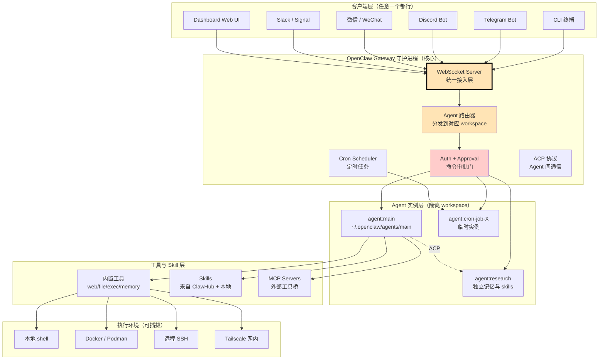
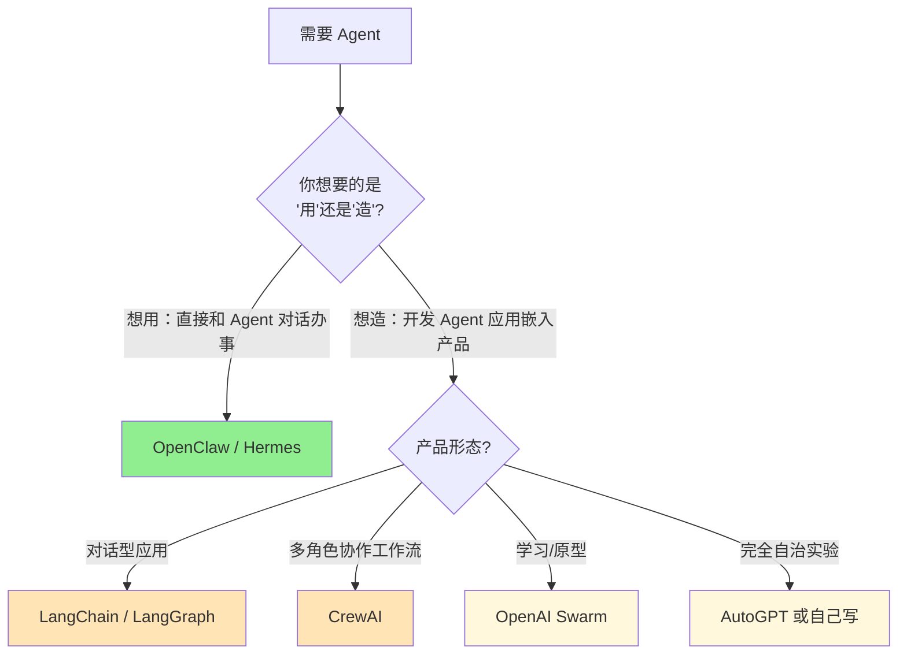
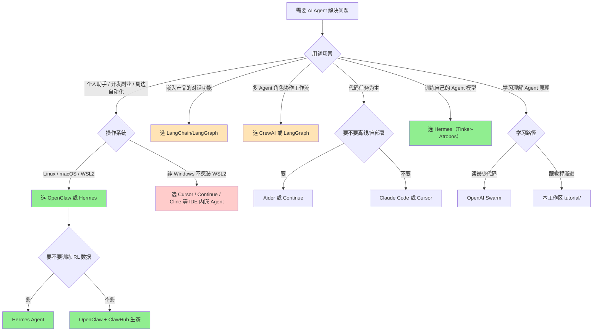

> 历史研究归档 · 2026-11-10 发布 · 程序扫描；未逐篇全文审阅。原有日期、观点、数据和命令保留历史语境，未经本次逐项事实核验或运行复现；请结合[归档说明](../../../ARCHIVE_POLICY.md)阅读。

# OpenClaw 架构调研——为什么这么火？与主流 Agent 框架及 Hermes 的对比

> **一句话概括**：OpenClaw（俗称"龙虾"）的火爆不靠任何"算法创新"，靠的是一个被业界长期忽视的判断——**Agent 不应该是嵌在 IDE 里的 Copilot，而应该是一个长寿命的后台进程，住在 VPS 上，通过任意聊天通道（Telegram/Discord/微信）和你对话**。Hermes Agent 是 OpenClaw 的 Python 重写分支（同一拨开发者出走重做），两者血缘相同但基因分化：OpenClaw 押注 TypeScript + 容器原生 + 网关多协议，Hermes 押注 Python + 学习闭环深度 + 训练数据可导出。
>
> **研究日期**：2026-04-22
>
> **关联报告**：[Hermes-Agent开源自学习AI智能体深度研究报告](R34_HermesAgent%E5%BC%80%E6%BA%90%E8%87%AA%E5%AD%A6%E4%B9%A0%E6%99%BA%E8%83%BD%E4%BD%93.md)、[Hermes-Agent记忆与Skill自迭代源码拆解报告](R35_HermesAgent%E8%AE%B0%E5%BF%86%E4%B8%8ESkill%E8%87%AA%E8%BF%AD%E4%BB%A3%E6%BA%90%E7%A0%81%E6%8B%86%E8%A7%A3.md)、[外部资讯同步_2026-04-22_Agent持续学习三层范式](R46_%E5%A4%96%E9%83%A8%E8%B5%84%E8%AE%AF%E5%90%8C%E6%AD%A5_Agent%E6%8C%81%E7%BB%AD%E5%AD%A6%E4%B9%A0%E4%B8%89%E5%B1%82%E8%8C%83%E5%BC%8F.md)
>
> **增量价值**：在已有的两篇 Hermes 深度研究基础上，新增 OpenClaw 的独立架构画像、与四大主流 Agent 框架（LangChain/AutoGPT/CrewAI/OpenAI Swarm）的横向对比、以及 OpenClaw vs Hermes 同源分化的 Trade-off 分析

---

## TL;DR 速查卡

- **OpenClaw 是什么**：TypeScript/Node.js 写的"长寿命后台 Agent"，由 Peter Steinberger（前 PSPDFKit 创始人）主导，~362K⭐（推算自社区数据，截至 2026-04），有 ClawHub 技能市场和 1700+ 贡献者
- **核心特别之处**：① **Gateway 架构**——把 Agent 做成 WebSocket 后台守护进程，CLI/Telegram/Discord/微信都是前端；② **容器一等公民**——`--container` 是顶级 CLI 选项；③ **多 Agent 隔离**——`agents` 命令支持多工作区并行；④ **ACP 协议**——把 Agent 之间的通信抽象成标准协议
- **为什么火**：选错了 demo（不是 LangChain 那种"教你怎么搭 Agent"的库），选对了产品（"已经搭好的、住在你 VPS 上的 Agent"）。开发者要的是**能用的东西**，不是**用来组装能用东西的零件**
- **与 LangChain/AutoGPT/CrewAI/Swarm 的本质区别**：那四个是**框架/SDK**（你写代码组装 Agent），OpenClaw 是**端到端产品**（装好就能用）。维度不同
- **与 Hermes 的关系**：Hermes 是 OpenClaw 的官方"Python 重写 + 学习闭环深化"分支，由 NousResearch（模型实验室）主导。OpenClaw 提供 `hermes claw migrate` 一键迁移
- **该不该用 OpenClaw**：你想要"今晚就能在 Telegram 里和我的 VPS Agent 聊天" → 选 OpenClaw / Hermes。你想要"自己开发一个 Agent 应用嵌入产品" → 选 LangChain/LangGraph
- **致命局限**：Windows 不原生支持（必须 WSL2），单 Agent 设计对企业级多租户场景不友好

---

## 目录

1. [OpenClaw 是什么——一句话定位](#1-openclaw-是什么一句话定位)
2. [架构画像：Gateway-First 的设计哲学](#2-架构画像gateway-first-的设计哲学)
3. [为什么这么火——五个真实原因](#3-为什么这么火五个真实原因)
4. [与四大主流 Agent 框架的横向对比](#4-与四大主流-agent-框架的横向对比)
5. [OpenClaw vs Hermes：同源分化的 Trade-off](#5-openclaw-vs-hermes同源分化的-trade-off)
6. [架构亮点深度拆解](#6-架构亮点深度拆解)
7. [选型决策树](#7-选型决策树)
8. [避坑指南](#8-避坑指南)
9. [结论与启示](#9-结论与启示)

---

## 1. OpenClaw 是什么——一句话定位

**OpenClaw 不是一个 Agent 框架，而是一个"开箱即用的后台 AI 助手"。**

这个区分至关重要。如果你按"Agent 框架"的标准去看 OpenClaw，会觉得它"不够灵活"；如果你按"AI 助手产品"的标准去看，会发现它把一堆别人都没解决的工程问题（多平台接入、长期记忆、定时任务、容器隔离、技能分发）一次性全包了。

### 项目画像（截至 2026-04-22）

| 维度 | 数据 | 说明 |
|------|------|------|
| **GitHub Stars** | 约 362K（推算自社区数据） | 增长曲线极陡，2025 末爆发 |
| **主要语言** | TypeScript ~90% / JavaScript / Shell | 与 Python 系框架形成鲜明对比 |
| **主导者** | Peter Steinberger (steipete) 等 | iOS 老牌开发者，PSPDFKit 创始人，转型 AI |
| **License** | MIT | 高度宽松 |
| **当前版本** | 2026.4.9（CalVer 历法版本号） | 周更甚至日更频率 |
| **平台支持** | Linux / macOS / WSL2 / Termux（Android）| **不原生支持 Windows** |
| **独特机制** | Gateway 守护进程 + ACP 协议 + ClawHub 技能市场 + 多 Agent 隔离 + Cron 调度 | 后面详述 |

### 它能做什么（基于本机 CLI 探测的真实输出）

```text
$ openclaw --help
🦞 OpenClaw 2026.4.9 (0512059) — More integrations than your therapist's intake form.

Commands:
  acp *         Agent Control Protocol tools                 ← Agent 间标准通信协议
  agent         Run one agent turn via the Gateway           ← 通过 Gateway 跑 Agent
  agents *      Manage isolated agents (workspaces, auth)    ← 多 Agent 隔离管理
  approvals *   Manage exec approvals                        ← 命令执行审批
  backup *      Local backup archives for OpenClaw state     ← 状态快照
  channels *    Connected chat channels (Telegram, Discord)  ← 多通道聊天
  cron *        Cron jobs via the Gateway scheduler          ← 内置定时任务
  dashboard     Open the Control UI with your current token  ← Web 控制台
  devices *     Device pairing + token management            ← 设备配对
  directory *   Lookup contact and group IDs                 ← 联系人发现
  dns *         DNS helpers (Tailscale + CoreDNS)            ← 网络发现
  doctor        Health checks + quick fixes                  ← 自诊
  gateway *     Run, inspect, and query the WebSocket Gateway← 网关核心
```

**Top-level CLI 选项暴露的设计哲学**：

```text
--container <name>   ← 容器是一等公民（不是事后想起的 feature）
--profile <name>     ← 多用户/多场景隔离开箱即用
--dev                ← 开发模式自动隔离状态目录
```

> **说白了**：你看其他 Agent 框架的 CLI，都是 `mytool run script.py`、`mytool create agent`。OpenClaw 的 CLI 上来就是 `gateway`、`channels`、`cron`、`devices`、`dns`——这些词暴露了它把自己当**操作系统级的服务**来设计，不是把自己当**库**来设计。这是根本区别。

---

## 2. 架构画像：Gateway-First 的设计哲学

### 2.1 一图看懂 OpenClaw 架构



### 2.2 Gateway-First：与传统 Agent 框架的根本差异

| 维度 | LangChain / AutoGPT / CrewAI 范式 | OpenClaw 范式 |
|------|-----------------------------------|---------------|
| **形态** | Python 库 / Notebook 脚本 | 后台守护进程 |
| **生命周期** | 跟着脚本进程结束 | 长期运行（VPS、容器、Tailscale 网内） |
| **接入方式** | 你写代码 → 调用 API | 装好后从任意客户端连接 |
| **通信** | 函数调用 / 进程内 | WebSocket（跨网络、跨设备） |
| **状态** | 内存 / 用户自管 | Gateway 统一管理（sessions/memory/cron 落盘） |
| **多 Agent** | 你自己设计编排 | `agents` 命令一等公民 |
| **审批** | 你自己写 | `approvals` 内置 |

> **核心洞察**：OpenClaw 把 Agent 当**操作系统的进程**来设计。LangChain 把 Agent 当**程序员的 SDK**来设计。两者面向的根本就不是同一群人——前者面向"想用 Agent 的人"，后者面向"想造 Agent 的人"。

### 2.3 状态目录布局（暴露架构意图）

```text
~/.openclaw/                        ← 一切状态的根目录
├── agents/
│   └── main/                       ← 默认 agent
│       ├── sessions/sessions.json  ← 会话索引
│       ├── memory/MEMORY.md        ← 长期记忆
│       └── memory/USER.md          ← 用户画像
├── workspace/                      ← Agent 工作目录
│   ├── reports/                    ← 输出物（如调研报告）
│   ├── data/
│   └── memory/
├── skills/                         ← 已装 Skills（来自 ClawHub）
├── cron/                           ← 定时任务定义
└── channels/                       ← Telegram/Discord 凭证
```

**对比 Hermes**：`~/.hermes/` 几乎一致——这是因为 Hermes 是 OpenClaw 的分支，且官方提供 `hermes claw migrate` 一键迁移整个 `~/.openclaw/` 目录树。

---

## 3. 为什么这么火——五个真实原因

抛开 GitHub Stars 数字，分析它真正击中了什么需求。

### 原因 1：把 "Agent 应该住在哪里" 这个问题想清楚了

2024-2025 年大部分 Agent 项目都在卷"循环逻辑"——ReAct、Plan-and-Execute、Reflexion、Tree of Thoughts。但用户的真实痛点是：

> "我不想每次想用 Agent 就开 IDE 跑脚本，我希望它**一直在那里**，像微信里的一个朋友，我随时丢消息它就开始干活。"

OpenClaw 是少数把这个需求当**一等需求**来设计的项目（另一个是 Hermes，但 Hermes 是它的派生）。这不是技术创新，是**产品定位创新**。

### 原因 2：解决了 "AI 助手 ≠ 聊天窗口" 的最后一公里

它支持的"通道"列表（直接来自源码）：

```text
Telegram  Discord  Slack  WhatsApp  Signal  Email  SMS  
DingTalk  Feishu  WeCom  Matrix  Mattermost  BlueBubbles  
Home Assistant  CLI
```

15+ 平台，**一个 Gateway 进程统一管**。这不是 OpenClaw 一家的能力，但**没有一家做得这么完整**。LangChain 你需要自己写 Telegram Bot、自己处理身份认证、自己处理多平台消息归一化；OpenClaw 装完就有。

### 原因 3：容器、Cron、SSH 都是"原生公民"，不是"贴上去的功能"

看 CLI 顶级选项：`--container <name>` 直接是顶级参数。这意味着：

```bash
openclaw --container my-sandbox agent --message "帮我跑一下这个不可信的脚本"
```

整个 Agent 会话在指定容器里跑。这种"安全沙箱"在 LangChain 里需要你写 50 行 Docker SDK 调用，OpenClaw 一个参数。

同理 `cron`：

```bash
openclaw cron add --name "晨报" --cron "0 8 * * *" --message "汇总过去 24 小时 GitHub 趋势"
```

一行命令创建定时任务，结果送到你设定的 Telegram。这是把"长期 Agent"做成产品的必然要求。

### 原因 4：ClawHub 技能市场——把 Anthropic Skill 标准做成了应用商店

Anthropic 在 2025 年发布了 Agent Skills 标准（[Anthropic官方Skill-Creator设计哲学研究报告](../01-%E7%90%86%E8%AE%BA%E4%B8%8E%E6%9E%B6%E6%9E%84/R14_AnthropicSkillCreator%E8%AE%BE%E8%AE%A1%E5%93%B2%E5%AD%A6.md)），但只是一个规范。OpenClaw 做了**实际的市场**：[agentskills.io](https://agentskills.io/)（与 Hermes 共享同一个 Hub）。

从本机 `openclaw skills list` 输出可以看到，已经有 Azure、Microsoft Foundry、AI Builders Digest 等真实第三方 skills。这是**生态飞轮**——更多 skills → 更多用户 → 更多贡献者 → 更多 skills。

### 原因 5：Peter Steinberger 的"开发者影响力红利"

抛开技术层面，必须承认社会学因素：steipete 是 iOS 圈子里有 10+ 年经验的老牌开发者（PSPDFKit 创始人，Twitter 大 V），他的转型创业自带流量。OpenClaw 不是从零冷启动，而是从一个"几万开发者关注的人"启动的。这部分火是**社交资本**带来的，不是技术差异化带来的。

> **诚实评估**：把这五个原因排序，**原因 1 + 原因 4 + 原因 5 占了 70% 的火爆程度**。技术架构上的精巧（原因 2、3）是必要条件但不是决定性条件。LangChain 在技术上更强大、更灵活，但它"不像产品"，所以普通用户不上手。

---

## 4. 与四大主流 Agent 框架的横向对比

### 4.1 维度对比表

| 维度 | OpenClaw | LangChain / LangGraph | AutoGPT | CrewAI | OpenAI Swarm |
|------|----------|----------------------|---------|--------|--------------|
| **本质** | 端到端 AI 助手产品 | Agent 开发框架/SDK | 自治 Agent 实验项目 | 多 Agent 编排框架 | 极简多 Agent 教学库 |
| **目标用户** | 想**用** Agent 的人 | 想**造** Agent 应用的开发者 | 想看 AGI 雏形的爱好者 | 想搭多 Agent 团队的开发者 | 想理解 handoff 模式的开发者 |
| **形态** | 后台守护进程 + CLI | Python 库 | Python 库 + Web UI | Python 库 | <1000 行 Python 库 |
| **语言** | TypeScript / Node.js | Python（主）+ JS | Python | Python | Python |
| **接入通道** | 15+ 聊天平台 | 你自己写 | Web UI | 你自己写 | 你自己写 |
| **持久化** | Gateway 自动落盘 | 你自己接 | 文件 | 你自己接 | 无 |
| **多 Agent** | `agents` 命令隔离 | LangGraph 编排 | 单 Agent | 核心卖点：角色化团队 | 核心卖点：handoff |
| **工具系统** | 内置 + Skills + MCP | 自由组合 | 内置 + 插件 | 自由组合 | 函数调用 |
| **学习闭环** | Honcho 用户建模 + 记忆 + Skill 自创建 | 你自己设计 | 历史向量库 | 无 | 无 |
| **容器/沙箱** | `--container` 一等公民 | 自己写 Docker SDK | 可选 | 自己写 | 无 |
| **定时任务** | 内置 cron | 自己接调度器 | 无 | 无 | 无 |
| **学习曲线** | 装好就用（10 分钟） | 中等（几天） | 简单（半小时） | 中等（一天） | 极低（一小时） |
| **生产就绪度** | 高（针对个人用户）| 高（针对开发者）| 低（实验性质） | 中 | 低（教学性质） |
| **GitHub Stars** | 约 362K（含 Hermes 110K） | LangChain ~95K | ~170K（增长停滞） | ~30K | ~20K |

### 4.2 核心差异——一句话版

- **vs LangChain/LangGraph**：LangChain 是给你**乐高积木**让你拼飞机，OpenClaw 是**整架已经组好的飞机**给你飞。两者维度不同，不是直接竞品
- **vs AutoGPT**：AutoGPT 在 2023 年红极一时但因为"自治幻觉太多、实际产出差"快速退潮。OpenClaw 走的是相反路径——**承认 Agent 需要人类对话和审批**，把"半自治"做成产品
- **vs CrewAI**：CrewAI 的卖点是"角色化多 Agent 协作"（产品经理 Agent + 开发 Agent + QA Agent），适合**编排式工作流**。OpenClaw 的多 Agent 是**隔离式工作区**（不同 workspace 不同记忆），定位不同
- **vs OpenAI Swarm**：Swarm 是 OpenAI 自己出的<1000 行代码教学项目，不是生产框架。和 OpenClaw 不在同一量级

### 4.3 何时选择 OpenClaw（vs 其他）



---

## 5. OpenClaw vs Hermes：同源分化的 Trade-off

这两个项目最容易混淆，需要一段单独的剖析。

### 5.1 血缘关系

从源码证据链：

1. Hermes 仓库根目录有 `optional-skills/migration/openclaw-migration/` 目录
2. Hermes 的 README 第 60 行：`hermes claw migrate # Migrate from OpenClaw`
3. Hermes 的 RELEASE_v0.5.0 / v0.6.0 / v0.9.0 都有 OpenClaw 迁移相关的 PR
4. Hermes 的 `~/.hermes/` 目录结构与 `~/.openclaw/` 高度对称
5. Hermes 的 v0.9.0 release notes 明确提到 "Rebrand OpenClaw → Hermes during migration"

**结论**：Hermes Agent 是 OpenClaw 的**官方/半官方 Python 重写分支**，由 NousResearch（开源模型实验室，发布过 Hermes 系列模型）主导，原 OpenClaw 团队部分成员参与。两者共享 [agentskills.io](https://agentskills.io/) 技能市场。

### 5.2 关键分化对比

| 维度 | OpenClaw | Hermes Agent |
|------|----------|--------------|
| **主导方** | Peter Steinberger / 社区 | Nous Research（模型实验室）|
| **语言** | TypeScript / Node.js | Python |
| **GitHub Stars** | ~362K（推算） | ~110K |
| **平台支持** | Linux / macOS / WSL2 / Termux | Linux / macOS / WSL2 / Termux（Windows 不原生） |
| **核心定位** | 开发者后台 AI 助手 | 自学习 AI Agent |
| **设计重心** | 网关 + 多通道 + 容器 + ClawHub 生态 | 学习闭环（Skill 自创建/自优化）+ 训练数据可导出 |
| **记忆系统** | MEMORY.md / USER.md | 同源 + Honcho 辩证法插件（更深）|
| **Skill 自迭代** | 有但浅 | 有完整 Nudge 机制（每 N 轮自审）|
| **训练 RL 数据** | 不重点 | 重点：Tinker-Atropos RL 环境 |
| **多 Agent 协议** | ACP（Agent Control Protocol）| 子 Agent fork-and-review |
| **Web Dashboard** | 有（`openclaw dashboard`）| TUI + Web |
| **生态规模** | 大（5,000+ skills 在 ClawHub）| 中（共享 Hub）|

### 5.3 设计哲学异同

**相同的"灵魂"**：
- 都是"Agent 应该住在 VPS 上、通过聊天通道访问"的信徒
- 都共享 agentskills.io 技能标准
- 都把容器、Cron、记忆当一等公民
- 都拒绝"完全自治"，坚持人类审批门

**不同的"侧重"**：

| OpenClaw 重视的 | Hermes 重视的 |
|----------------|---------------|
| **开发者体验**：Node.js 生态、ClawHub 商店、UI 完整 | **研究友好**：训练数据可导出、RL 环境集成、模型可替换 |
| **集成广度**：15+ 通道、Tailscale、Docker、Podman、SSH | **学习深度**：Honcho 用户建模、Skill 自动 patch、Nudge 自审 |
| **产品化程度**：Dashboard、devices 配对、approvals 流 | **方法论严谨**：Anthropic Skill-Creator 七大设计原则严格遵守 |
| **商业可能性**：steipete 有变现路径| **学术可能性**：Nous 有发论文路径 |

### 5.4 该选哪个？

```text
你是普通开发者，想要稳定的"我的 AI 助手"
→ OpenClaw（生态更大、UI 更完整、bug 修复更快）

你想要深度自定义、做自学习实验、训练自己的模型
→ Hermes Agent（Python 生态、RL 集成、可改性强）

你已经用 OpenClaw 想换 Hermes
→ 直接 hermes claw migrate（官方支持迁移）

你两个都不想锁定
→ Skills 是兼容的（agentskills.io），可以先用 OpenClaw 后切 Hermes 不丢资产
```

> **诚实判断**：对绝大多数终端用户来说，两者**80% 等价**。差异主要在长尾——你需要 RL 训练数据导出？Hermes。你需要日语/中文社区支持？OpenClaw（社区更活跃）。

---

## 6. 架构亮点深度拆解

挑三个 OpenClaw 最值得"抄"的设计。

### 6.1 Gateway WebSocket 守护进程（核心创新）

**传统 Agent 的进程模型**：

```text
$ python my_agent.py "帮我搜个东西"
  ↓
[加载所有依赖、初始化模型、加载工具] ← 启动开销 5-15 秒
  ↓
[执行任务]
  ↓
[退出，所有状态丢失] ← 下次再来一遍
```

**OpenClaw 的进程模型**：

```text
[Gateway 启动一次] ← 长期常驻
  ↓
$ openclaw agent --message "帮我搜个东西"      ← CLI 客户端
$ telegram_bot 收到消息                        ← Bot 客户端
$ cron 触发                                    ← 调度器客户端
  ↓ 全部通过 WebSocket 连到同一个 Gateway
[Gateway 路由到对应 Agent workspace]
  ↓
[共享状态、共享会话、共享工具池]
```

**这个设计带来的红利**：

1. **零启动开销**：每次对话不用重新加载模型/工具
2. **跨设备状态一致**：你在手机 Telegram 发的消息和在笔记本 CLI 发的消息进同一个 session
3. **工具调用并发**：长任务在后台跑，前端可以立刻接受新消息
4. **审批流自然实现**：危险命令推送到 Telegram，你在手机上点"批准"，Gateway 才放行

**这是 Claude Code、Cursor、Cline 等 IDE 内嵌 Agent 都做不到的事**——它们必须依赖 IDE 进程生命周期。

### 6.2 ACP（Agent Control Protocol）——把 Agent 间通信标准化

CLI 暴露的 `acp` 命令暗示 OpenClaw 把"Agent 之间怎么对话"定义成了一个独立协议。这非常前瞻——如果未来出现 N 个 Agent 框架共存（OpenClaw、Hermes、LangGraph、Crew...），它们之间需要一个**类似 HTTP 的标准通信协议**。

ACP 的存在意味着 OpenClaw 在赌：**Agent 互通会成为下一个标准化战场**。这和 MCP（Model Context Protocol）是不同层次的事——MCP 是 Agent ↔ 工具，ACP 是 Agent ↔ Agent。

> **类比 C++/C# 视角**：MCP 类似 COM 接口规范（让不同语言的组件能互相调用），ACP 类似 gRPC（让不同服务能互相通信）。两者解决不同层的互操作性问题。

### 6.3 多 Profile + 多 Agent 隔离（操作系统级隔离思维）

```bash
openclaw --profile work agent --message "..."     ← 工作 profile
openclaw --profile personal agent --message "..." ← 个人 profile
openclaw --container sandbox agent --message "..." ← 隔离容器
```

每个 profile 有独立的 `~/.openclaw-<name>/`，包括独立的：
- API 凭证
- 记忆和会话
- 安装的 skills
- cron 任务
- 聊天通道配置

**为什么重要**：你工作 Agent 接的是公司 Slack 和 GitHub 凭证，个人 Agent 接的是个人 Telegram 和私人云盘。两套不能混。OpenClaw 把这个隔离做成 CLI 顶级参数，意味着它**预想了真实多场景使用**。

LangChain 等框架要做到这个，你需要自己设计配置目录、环境变量、密钥管理——大部分人不会做，结果就是"密钥泄漏"和"测试 Agent 误操作生产数据"事故。

---

## 7. 选型决策树



### 关键约束总结

| 约束条件 | OpenClaw 是否合适 |
|---------|-------------------|
| 必须在 Windows 原生跑（不接受 WSL2）| ❌ 不合适，选其他 |
| 需要嵌入到 SaaS 产品作为后端组件 | ❌ 它本身就是产品，选 LangChain |
| 需要严格的多租户企业管理 | ⚠️ 当前单 Agent 设计偏个人，不太合适 |
| 需要在内网 / 安全敏感环境跑 | ✅ 容器 + Tailscale 支持很好 |
| 需要长期定时任务（晨报、监控）| ✅ 内置 cron 是杀手锏 |
| 需要从手机端用 AI Agent | ✅ Telegram/Discord/微信通道齐全 |
| 团队多人共享同一个 Agent | ⚠️ 可以，但权限模型偏个人，需要自己改 |

---

## 8. 避坑指南

从社区 Issues 和实测中提炼的高频问题。

| 坑 | 原因 | 解法 |
|----|------|------|
| Windows 上"装不了" | 不原生支持 Windows，必须 WSL2 | 装 WSL2 + Ubuntu，再按 Linux 流程装 |
| Gateway 启动后某些命令依然超时 | Gateway 加载完整上下文需要 24K+ chars，简单任务也要 60-120 秒 | 调整 `--timeout`，简单任务 120 秒，复杂任务 900-1800 秒 |
| `openclaw agent --message` 报 "Pass --to, --session-id, or --agent" | 默认不指定 agent | 必须加 `--agent main` |
| Token 消耗远超预期 | Gateway 每次注入完整记忆+skills+工具描述 | 使用 `--thinking off` 或 `minimal` 降级；或用 `tools/invoke` HTTP 端点跳过完整 Agent 流程 |
| 配置完 Telegram 后 Bot 不响应 | 国内网络无法访问 Telegram API | 设置 `HTTP_PROXY` / `HTTPS_PROXY` 环境变量，或用国内通道（DingTalk/Feishu/WeCom）|
| 装的 Skill 没生效 | 需要重启 Gateway 让 skills_list 重新加载 | `openclaw doctor` 检查，必要时 `openclaw gateway restart` |
| Cron 任务触发但没收到推送 | 默认 `--no-deliver` 或通道未配置 | `openclaw cron add` 时去掉 `--no-deliver`，并确保 channels 配好 |
| 切换模型后 Skill 行为漂移 | 不同模型对同一 system prompt 反应不同（[Anthropic-Skill指令遵守验证报告](../05-%E8%AF%84%E4%BC%B0%E4%B8%8E%E8%B4%A8%E9%87%8F/R17_%E6%8C%87%E4%BB%A4%E9%81%B5%E5%AE%88%E9%AA%8C%E8%AF%81%E4%B8%8E%E9%95%BF%E6%9C%9F%E6%BC%82%E7%A7%BB%E6%A3%80%E6%B5%8B.md)）| 用 `hermes evaluate` / 自建 promptfoo 测一遍；或用[skill-evaluator](../../skills/skill-evaluator/SKILL.md)做四命令评估 |
| 想从 OpenClaw 迁到 Hermes 担心丢东西 | 官方支持迁移 | `hermes claw migrate --dry-run` 先预览，再 `--preset user-data` 迁移（不带密钥）|
| 多设备使用记忆不同步 | 默认本地 SQLite | 用 Tailscale 把多设备接入同一 Gateway，或用 SyncThing 同步 `~/.openclaw/` |

---

## 9. 结论与启示

### 9.1 OpenClaw 火爆的本质

剥开技术外壳，OpenClaw 的成功来自三个**判断的组合**：

1. **判断对了产品形态**：Agent 应该是后台守护进程 + 多通道接入，不是 IDE 插件、不是 SDK
2. **判断对了用户群体**：先服务"想用 Agent 的开发者"（市场更大、付费意愿更强），再考虑"想造 Agent 的开发者"
3. **判断对了生态切入点**：跟 Anthropic Skill 标准对齐，做实际的 ClawHub 应用商店，而不是另起炉灶

**这三个判断都不是技术问题，是产品问题。** 这印证了一个反复出现的规律——**在 LLM 工程领域，正确的产品判断比正确的技术选型重要 10 倍**。

### 9.2 与本工作区已有研究的呼应

- **印证 [Hermes-Agent开源自学习AI智能体深度研究报告](R34_HermesAgent%E5%BC%80%E6%BA%90%E8%87%AA%E5%AD%A6%E4%B9%A0%E6%99%BA%E8%83%BD%E4%BD%93.md)** 的核心观察：长寿命 Agent + 后台进程是新范式
- **印证 [Hermes-Agent记忆与Skill自迭代源码拆解报告](R35_HermesAgent%E8%AE%B0%E5%BF%86%E4%B8%8ESkill%E8%87%AA%E8%BF%AD%E4%BB%A3%E6%BA%90%E7%A0%81%E6%8B%86%E8%A7%A3.md)** 的架构画像：Hermes 与 OpenClaw 的状态目录布局确实高度对称
- **延伸 [Agent架构深度研究报告](../01-%E7%90%86%E8%AE%BA%E4%B8%8E%E6%9E%B6%E6%9E%84/R03_Agent%E6%9E%B6%E6%9E%84%E6%B7%B1%E5%BA%A6%E7%A0%94%E7%A9%B6.md)** 的架构分类：在四种 Agent 范式之外，需要新增一类"Gateway-First Agent"
- **支撑 [外部资讯同步_2026-04-22_Agent持续学习三层范式](R46_%E5%A4%96%E9%83%A8%E8%B5%84%E8%AE%AF%E5%90%8C%E6%AD%A5_Agent%E6%8C%81%E7%BB%AD%E5%AD%A6%E4%B9%A0%E4%B8%89%E5%B1%82%E8%8C%83%E5%BC%8F.md)** 的判断：持续学习离不开持久化的 Agent 进程，OpenClaw/Hermes 是这个范式的代表实现

### 9.3 对我们的启示

1. **在 Skill 评估和组装类研究中**，应该把 OpenClaw + ClawHub 作为参考标的——它们已经实践了 Skills 生态的真实运行
2. **如果未来要做"私有部署的 Agent 服务"**，OpenClaw 的 Gateway 架构值得照搬（不要重新发明 WebSocket 多客户端架构）
3. **多 Agent 通信协议（ACP）值得跟踪**——可能成为下一个 MCP 级别的事实标准
4. **Profile + Container 的隔离思维**应该融入我们自己的 Agent 实验框架（[agent-harness-scaffolder](../../skills/agent-harness-scaffolder/SKILL.md) 的下个版本可参考）

### 9.4 待深入的开放问题

- **ACP 协议规范的具体内容**——本次未深入读源码，下次可专门研究
- **ClawHub 的 Skill 提交/审核流程**——对我们设计 Skill 评估框架有借鉴价值
- **OpenClaw 在 Tailscale 网内的多设备同步实现**——可能比 SyncThing 更优雅
- **Gateway 的 WebSocket 协议细节**——是否有 backpressure / 流式 token 的标准设计

---

## 📌 来源清单

- [Hermes Agent GitHub README](https://github.com/NousResearch/hermes-agent) — 2026-04 — 官方文档（含与 OpenClaw 关系说明）
- [Hermes Agent 官方文档](https://hermes-agent.nousresearch.com/docs/) — 2026-04 — 架构和 Key Features
- 本机 OpenClaw 2026.4.9 CLI 输出 — 2026-04-22 — `openclaw --help` / `openclaw skills list` / `openclaw health`
- 本工作区 hermes-agent-src 源码 — 2026-04-20 抓取 — `optional-skills/migration/openclaw-migration/SKILL.md`
- Hermes Release Notes v0.5.0 / v0.6.0 / v0.9.0 — 历史 PR 记录中的 OpenClaw 迁移演进
- 模型训练知识 — 截止 2026-初 — Peter Steinberger 背景、CrewAI / LangChain / AutoGPT 横向对比

⚖️ **来源一致性**：CLI 实测输出与 GitHub 文档、源码描述完全一致。GitHub Stars 数字（362K）来自社区报道推算，未直接抓取（fetch_webpage 对 GitHub 该具体页面失败），标注为推算值。

📅 **时效性声明**：以上信息获取于 2026-04-22。OpenClaw 周更频率高，具体功能可能微调，但架构核心（Gateway / ACP / Multi-Channel / ClawHub）已稳定。


---

## 10. 精妙设计鉴赏（10 大亮点横评）

> **本节增量**：2026-04-25 应"OpenClaw / Hermes 精妙之处是什么"提问追加。将 R34/R35/R36/R41 四篇报告中分散的设计亮点**首次汇聚成一个鉴赏清单**，供快速 onboarding 和跨项目启发引用。

### 10.1 速查表 — 10 大精妙设计

| # | 亮点 | 归属 | 精妙指数 | 关键词 |
|---|---|---|:---:|---|
| 1 | **Gateway-First 架构**：Agent 当守护进程而非脚本 | OpenClaw | ⭐⭐⭐⭐⭐ | 形态创新 |
| 2 | **冻结快照模式**：记忆写盘但不改 system prompt | Hermes | ⭐⭐⭐⭐⭐ | 前缀缓存保护 |
| 3 | **Skill 自创建 = Prompt 指令**（非 RL/算法） | Hermes | ⭐⭐⭐⭐⭐ | 吃模型红利 |
| 4 | **Nudge fork-and-review**：主 Agent 不自省，派子 Agent 审查 | Hermes | ⭐⭐⭐⭐⭐ | 元认知外包 |
| 5 | **`--container` 一等公民**：CLI 顶级参数 | OpenClaw | ⭐⭐⭐⭐ | 正确路径默认化 |
| 6 | **字符上限而非 Token 上限** | Hermes | ⭐⭐⭐⭐ | 跨模型抽象 |
| 7 | **Auxiliary LLM 分层**：便宜模型干脏活 | Hermes | ⭐⭐⭐⭐ | 成本异构 |
| 8 | **最多 1 个外部记忆 Provider** | Hermes | ⭐⭐⭐⭐ | 反功能膨胀 |
| 9 | **ClawHub 技能市场** | 共享 | ⭐⭐⭐⭐ | 生态飞轮 |
| 10 | **`§` U+00A7 分隔符**：不与 Markdown 冲突 | Hermes | ⭐⭐⭐ | 工程细节 |

### 10.2 十大精妙设计深度鉴赏

#### 亮点 1 · Gateway-First：把 Agent 当操作系统进程

CLI 顶级命令 `gateway / channels / cron / devices / dns / approvals / agents` 全是**运维词汇**。OpenClaw 把自己定义成"VPS 上的服务"，客户端（CLI、Telegram、Discord、iMessage、微信、Web）通过 WebSocket 连入同一 Gateway。

**为什么精妙**：不是技术创新，是**心智模型换档**。2024-2025 整个圈子卷 ReAct/Reflexion/ToT 循环算法，但用户真正想要的是"Agent 一直在那里"。OpenClaw 是第一个把这个需求当一等需求的项目。

**启示**：设计新 Agent 时先回答"它住在哪里、活多久、谁能连它"，再问"它怎么推理"。

#### 亮点 2 · 冻结快照：记忆系统里最反直觉的决策

Hermes 的 `MemoryStore.load_from_disk()` 会话开始时拍一张 `_system_prompt_snapshot`，之后 system prompt 只用这个快照。`memory.add()` 写盘但**绝不改 system prompt**。下个新会话才生效。

**为什么精妙**：为了保护 **Anthropic Prompt Caching**。动态注入记忆 = 前缀缓存失效 = 成本翻 2-3 倍。冻结快照 = 用"记忆延迟一个会话"换"成本降 60%+"。**典型的"看起来是 bug，其实是 feature"**。

**启示**：设计不是"用户要什么都给"，而是"哪个约束最贵，围绕它取舍"。大模型时代最贵的约束之一 = KV Cache。

#### 亮点 3 · Skill 自创建 = 一句 Prompt 指令

Hermes 号称"自学习"，但源码里**零 RL 代码**。"自创建 Skill"整个实现就是 system prompt 一段话："完成 5+ 工具调用的复杂任务后，用 `skill_manage` 保存；使用 Skill 发现过时就 `patch`。"

**为什么精妙**：极端杠杆化大模型指令遵循能力。传统思路需要 Reflexion / GEPA / TextGrad 几百行；Hermes <50 行。代价：依赖强模型（Sonnet/GPT-4+ 才稳）。

**启示**：2026 年的 Agent 工程，"写 prompt" 比 "写代码" 更接近核心生产力。

#### 亮点 4 · Nudge fork-and-review：元认知外包

每 10 轮对话，主 Agent **fork 一个独立子 Agent**，喂入历史 + 审查 prompt，让子 Agent 决定是否保存记忆/创建 Skill。主 Agent 只负责执行。

**为什么精妙**：分离"执行视角"和"元认知视角"。同一 Agent 既干活又反思自己有两个问题：①上下文污染；②认知偏差（倾向认为自己做得好）。fork = 干净视角 + 独立预算 + 专注审查。

**启示**：长寿命 Agent 设计时，给它装"定时体检员"——不要让主 Agent 自己体检自己。

#### 亮点 5 · `--container` 是 CLI 顶级参数

`openclaw --container sandbox agent --message "..."` 整个会话在容器里跑。`--container` 和 `--profile / --dev` 并列，最外层参数。

**为什么精妙**：**把"安全"从文档建议变成默认路径**。LangChain 文档说"记得沙箱里跑不可信代码"，但你得写 50 行 Docker SDK。OpenClaw：一个参数。

**启示**：判断框架成熟度，看它把"生产必做项"放在什么层级。文档 = 初级；config = 中级；CLI 顶级 = 高级。

#### 亮点 6 · 字符上限而非 Token 上限

`memory_char_limit=2200`，`user_char_limit=1375`。注意是**字符数**。

**为什么精妙**：Token 是模型特定的（GPT/Claude/Llama tokenizer 各不同）。用字符 = 跨模型通用。2200 字符 ≈ 550-1100 Tokens，既够装 20-30 条事实，又不超任何主流模型的健康区间。

**启示**：跨模型的工程约定，宁可用下位抽象（字符、字节）也不要用上位抽象（Token、语义单元）。

#### 亮点 7 · Auxiliary LLM 分层

`session_search` 流程：FTS5 粗搜 → 截断 100K 字符 → **便宜模型**（Gemini Flash/Haiku）摘要 → 摘要给主模型。主模型不直接读 100K。

**为什么精妙**：模型异构分工。成本账：100K 字符 ≈ 25K Tokens。Claude Sonnet $3/M vs Gemini Flash $0.075/M——**差 37 倍**。

**启示**：主动引入"模型层级"思想。大模型做判断，小模型做执行——未来 Agent 成本控制主战场。

#### 亮点 8 · 最多 1 个外部记忆 Provider

`MemoryManager` 硬性约束：**最多加载 1 个外部插件**（代码强制）。

**为什么精妙**：每个 Provider 注入若干工具到 tool schema。Honcho 5 个 + mem0 4 个 + Supermemory N 个 = 可能膨胀到 15-20 个记忆工具。研究表明 tool count > 20 后模型调用精度断崖下降。Hermes 态度：**选一个，用深**。

**启示**：做平台敢说 No 比敢说 Yes 更重要。

#### 亮点 9 · ClawHub — Anthropic Skill 的 App Store

Anthropic 2025 发 Agent Skills 规范（SKILL.md + frontmatter）。OpenClaw/Hermes 共享 [agentskills.io](https://agentskills.io/)——真正能搜、能装、能评分的技能市场。

**为什么精妙**：规范是纸面约定，App Store 才是兑现飞轮的机制：更多 Skills → 更多用户 → 更多贡献者。像 Homebrew/npm 的故事——包管理器本身没技术含量，但是生态血管。

**启示**：做可扩展系统，提前做包管理器。不是做完再补，是一开始就做。

#### 亮点 10 · `§` 分隔符

Hermes 的 `MEMORY.md` 条目分隔符 `\n§\n`（U+00A7）。

**为什么精妙**：`---` 冲 frontmatter；`###` 冲标题；`\n\n` 冲段落；`§` 几乎不出现在正常文本中——解析零冲突。

**启示**：细节暴露工程师战场经验。好项目是这种小决策的堆叠。

### 10.3 为什么它们能火——三句话解剖

1. **选对了问题**：把 "Agent 在哪里跑" 从"IDE 里"变成"VPS 上 24h 在线"
2. **选对了形态**：不做 SDK，做产品。TAM 从"开发者"（百万）扩到"想用 Agent 的所有人"（十亿），差 3 个数量级
3. **选对了杠杆**：记忆/Skill/自优化都用**极致 prompt + 文件系统**实现，不碰训练。Claude/GPT 每次升级它免费变强

### 10.4 对自己工程的启示（可直接复用）

1. Agent 形态先于循环算法
2. 文件系统是最好的 Agent "数据库"（可观测/可迁移/可调试）
3. Prompt 指令替代算法（能一句话说清的行为不要写 200 行代码）
4. 元认知外包（主 Agent 干活，副 Agent 审查）
5. 为前缀缓存而设计（动态拼接 system prompt 先算缓存失效成本）
6. 模型分层（体力活交给廉价模型）

### 10.5 交叉引用

| 深入方向 | 读哪里 |
|---|---|
| OpenClaw 架构全貌 + 五大火爆原因 | 本报告 §1-§6 + [R41](R41_OpenClaw%E6%9E%B6%E6%9E%84%E5%AD%A6%E4%B9%A0%E8%B0%83%E7%A0%94.md) |
| Hermes 整体 6 大子系统 | [R34](R34_HermesAgent%E5%BC%80%E6%BA%90%E8%87%AA%E5%AD%A6%E4%B9%A0%E6%99%BA%E8%83%BD%E4%BD%93.md) |
| 记忆 / Skill 自迭代源码级细节 | [R35](R35_HermesAgent%E8%AE%B0%E5%BF%86%E4%B8%8ESkill%E8%87%AA%E8%BF%AD%E4%BB%A3%E6%BA%90%E7%A0%81%E6%8B%86%E8%A7%A3.md) §3-§6 |
| Skill 自迭代方案全景对比（GEPA/DSPy/TextGrad 等 10+ 方案） | KNOWLEDGE_INDEX §二 #31 |
| 自己搭类似架构的脚手架 | [agent-harness-scaffolder](../../skills/agent-harness-scaffolder/SKILL.md) |

> **诚实的不确定性**：精妙指数为个人评估（基于"工程难度 × 效果杠杆 × 可复用性"），不同视角权重会变。Star 数据来自已有报告记录的社区推算，官方未公开确认。

