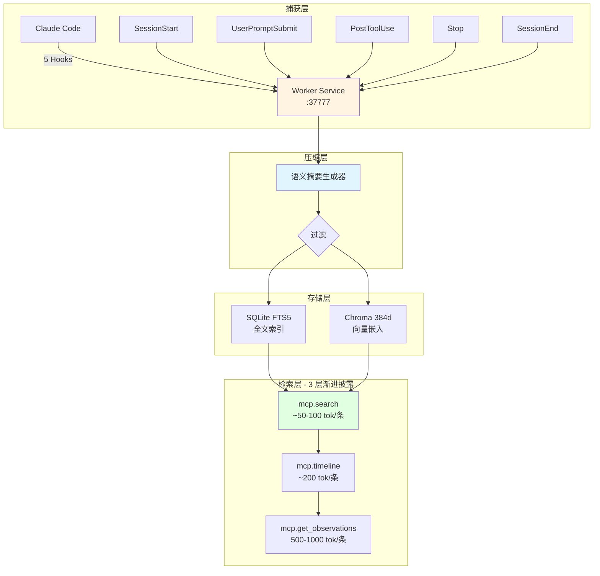

> 历史研究归档 · 2026-11-10 发布 · 程序扫描；未逐篇全文审阅。原有日期、观点、数据和命令保留历史语境，未经本次逐项事实核验或运行复现；请结合[归档说明](../../../ARCHIVE_POLICY.md)阅读。

> **一句话概括**：首次从龙虾工作区同步 4.19-4.21 外部资讯，提炼出一个龙虾未点破的结构性洞察——**Karpathy/社区正从"错误级→会话级→实验级"三个时间尺度，把 Agent 持续学习闭环产品化**，本报告对比其与本工作区已有实践的异同并给出借鉴路径。
> 
> **本报告在以下报告基础上做增量**：Agent-Skills 与 LLM-Wiki 生态（#1）、Hermes Agent 记忆与 Skill 自迭代（#28）、钩子详解（#12）。
> 
> **信息来源**：龙虾 reports/ 下 8 篇被判定为高增量的文件（已登记到 `sessions/sync-log/external-sources-read.md`），未额外联网，token 预算 <15K。

---

## TL;DR 速查卡

- 🔥 **核心洞察（增量）**：社区已在**三个时间尺度**并行产品化 Agent 持续学习——错误级（AGENTS.md Section 11，分钟级）、会话级（claude-mem，会话级）、实验级（Karpathy autoresearch，天级）。这是一条隐藏的分层架构，龙虾分日报告中未被点破。
- 🧭 **战略信号**：Karpathy 新仓 `autoresearch`（74K⭐，4 月 20 日突然公开）标志从"LLM 辅助编码"到"AI 自主研究"的范式转移，且已有**可验证战绩**——nanochat 训练时间 2.02h→1.65h（-18%），AI 改 AI 训练代码。
- 🏛 **标准化信号**：`agents-md` 48h 235⭐ + Linux Foundation 托管，Karpathy 四原则被制度化为跨 9+ 工具标准（Claude/Codex/Cursor/Gemini/Aider/Copilot/Windsurf/Devin/Amp）。
- 💾 **工具信号**：`claude-mem` 单周 +12K⭐，用 5 Hook + SQLite FTS5 + Chroma + 3 层渐进披露，达到 10× token 节省——与本工作区 Hermes 记忆研究结论一致但实现路径不同。
- 🎯 **本工作区启示**：我们 `copilot-instructions.md` 的"自省机制"和 Section 11 同源但更重；`sessions/` 日志与 claude-mem 的 observations 同源但粒度不同。值得借鉴的是**"错误即学习条目"的自动写入机制**。

---

## 目录

- [一、autoresearch + agents-md：Karpathy 范式的制度化](#一autoresearch--agents-mdkarpathy-范式的制度化)
- [二、claude-mem：Claude Code 会话记忆的产品化架构](#二claude-memclaude-code-会话记忆的产品化架构)
- [三、分层洞察：Agent 持续学习的三个时间尺度](#三分层洞察agent-持续学习的三个时间尺度)
- [四、与本工作区已有实践的交叉验证](#四与本工作区已有实践的交叉验证)
- [五、可借鉴的落地动作（不固化，先观察）](#五可借鉴的落地动作不固化先观察)
- [附录 A：本次同步扫描但未吸收的项目（速查）](#附录-a本次同步扫描但未吸收的项目速查)

---

## 一、autoresearch + agents-md：Karpathy 范式的制度化

### 1.1 autoresearch 是什么，为什么重要

**事实**（来自龙虾 `2026-04-20-karpathy-deep-research.md` + `2026-04-21-karpathy-deep-research.md`）：

- 仓库 `github.com/karpathy/autoresearch`，2026-04-20 01:01 UTC 公开，24h 内 74K⭐（私有开发约 3 周）
- 描述（截断）："AI agents running research on s..."
- 已在 nanochat leaderboard 上留下**可验证战绩**：
  - Rank 5（2026-03-09）：autoresearch round 1，val_bpb 0.71808 / CORE 0.2690 / 训练 1.80h
  - Rank 6（2026-03-14）：autoresearch round 2，val_bpb 0.71800 / 训练 1.65h
  - 对比人类 baseline（Rank 4）训练 2.02h，autoresearch 将时间压缩到 1.65h（**-18%**）

**为什么这是信号而非噪声**：
1. 这是 Karpathy **首个功能性命名**的项目（nanoGPT/llm.c 是教学性，autoresearch 是功能性）——暗示他从"教你怎么做"转向"直接帮你做"
2. 这是公开可验证的**AI Agent 自主改进 AI 训练代码**案例（非 demo、非论文、有 leaderboard 数据）
3. 与其 4 月 11 日 HN 讨论的 "AI Psychosis" 话题时间相邻——可能是工程化回应（用系统化研究流程约束 LLM 的不一致性）

**本工作区视角的二次解读**：
> 我们这个知识库本身就是**人类运营的半自动 autoresearch**——用户+AI 在知识索引+报告+会话日志组成的闭环里做研究。autoresearch 的公开意味着这个模式有了"全自动"的产品化参考实现，值得持续追踪其 README 公开后的架构细节。

### 1.2 agents-md：Karpathy 四原则的跨工具标准

**事实**（来自龙虾 `2026-04-21-agents-md-standardization.md` + `2026-04-21-karpathy-deep-research.md`）：

- 仓库 `TheRealSeanDonahoe/agents-md`，2026-04-19 发布，48h 内 235⭐
- **Linux Foundation / Agentic AI Foundation 托管**（OpenAI Codex、Cursor、Google Amp/Jules、Factory.ai 参与）
- 官网声称 **60K+ 开源项目采用**
- 跨工具兼容方案：`AGENTS.md` 为源文件，通过符号链接生成 `CLAUDE.md` / `GEMINI.md` 等（"One source of truth. Stop maintaining three."）

**Karpathy 四原则的完整表述**（龙虾已交叉验证两个独立项目引用一致）：

| # | 原则 | 对应的失效模式 | 根因推测 |
|---|------|---------------|---------|
| 1 | **Don't be sycophantic**（不要谄媚） | "You're absolutely right!" 后撤销正确代码 | RLHF 的 helpfulness reward 副作用 |
| 2 | **Minimal diff**（最小修改） | 200 行解决 50 行能解决的问题 | 训练语料中教程偏好"完整架构" |
| 3 | **Traceability**（可追溯） | 修 typo 顺手格式化整个文件 | 注意力机制的局部优化倾向 |
| 4 | **Verify first**（验证优先） | 声称完成但代码无法运行 | next-token 预测目标 ≠ 代码执行正确性 |

**Section 11 — Project Learnings**（关键创新）：

> "Starts empty. Every time the agent gets something wrong, one line gets added. The agent itself adds the line when you correct it — you don't babysit the file. This is the section that compounds. Boris Cherny runs his team's version at around 100 learnings accumulated over months. His file is a trained reflex, not a manifesto."

**与 Karpathy LLM Wiki 模式对比**：

| 维度 | LLM Wiki | Section 11 |
|------|----------|------------|
| 触发条件 | 用户主动请求知识编译 | **错误发生时自动累积** |
| 内容形式 | 结构化 Markdown 章节 | 单行学习条目 |
| 更新频率 | 会话/天级 | **错误级（分钟）** |
| 规模 | 83+ wiki 页（llm-atomic-wiki 验证） | ~100 条（Boris Cherny 团队数月累积） |
| 人类参与 | 审查+修正 | **仅修正，Agent 自写入** |

**本工作区视角**：
- 我们的 `copilot-instructions.md` + `sessions/` 日志是**更重的 LLM Wiki 变体**——结构化 + 人工审阅 + 全局规则
- Section 11 是**更轻的学习累积**——错误驱动、Agent 自写、单行条目
- 两者**不是替代关系而是互补关系**：结构化规则管理"应该这样做"（主动），错误条目管理"别再这样错"（被动）

### 1.3 两者的战略关系

```
autoresearch (任务层)    = "AI 自主研究"  —— 还未 READMEd，战绩先行
     ↑
     │ 使用
     │
agents-md (配置层)       = "跨工具四原则标准" —— Linux Foundation 背书
     ↑
     │ 提供
     │
Karpathy 四原则 (理论层) = "LLM 编码失效模式"
```

**意义**：Karpathy 的理论 → 通过 agents-md 被工程化为可部署配置 → autoresearch 作为首个"吃自己狗粮"的功能性产品落地。三层对齐后，生态进入可复制阶段。

---

## 二、claude-mem：Claude Code 会话记忆的产品化架构

**事实**（来自龙虾 `github-trending/2026-04-21.md` + `deep-research/2026-04-21-github-deep-research.md`）：

- `thedotmack/claude-mem`，TypeScript，单周 +12,472⭐（本周总 64,298⭐）
- 定位：Claude Code 持久记忆插件（跨会话上下文）

### 2.1 核心架构



### 2.2 为什么它的数字好看

| 层级 | 设计 | Token 效率 |
|------|------|-----------|
| 捕获 | 5 生命周期 Hook | 100% 工具使用可追溯 |
| 压缩 | 自动语义摘要 | **~10× 节省** |
| 存储 | SQLite + Chroma 混合 | 毫秒级检索 |
| 披露 | 3 层渐进 | **~10× 节省**（总体 ~100× 对比全量上下文） |
| 隐私 | `<private>` 标签前置过滤 | Hook 层即剔除，不入库 |

**关键设计决策**：压缩 + 渐进披露是**两个独立的 10× 乘数**，组合起来才能覆盖长会话的 token 成本。单独任一都不够。

### 2.3 对比本工作区已有结论

| 维度 | Hermes（我们 #28 报告的拆解对象） | claude-mem | 本工作区 `sessions/` |
|------|---------|-----------|-------------------|
| 时间尺度 | 会话内压缩 | 跨会话持久化 | 跨会话但人工编排 |
| 触发 | Token 阈值（瀑布压缩） | 5 个生命周期 Hook | 人类提议+AI 执行 |
| 存储 | 单文件 state | SQLite+Chroma | Markdown 文件树 |
| 检索 | 状态重放 | 3 层渐进披露 MCP 工具 | Obsidian Wikilink+Graph |
| 语义索引 | ❌ 无 | ✅ Chroma 向量 | ❌ 无（依赖文件名+前文） |
| 压缩 | ✅ Anthropic 瀑布式 | ✅ 语义摘要 | ❌ 无（原文保留） |

**诚实评估**：
- 我们的 `sessions/` 优于 claude-mem 的点：**结构化程度更高**（frontmatter + wikilink + 模板），适合人类反复阅读
- claude-mem 优于我们的点：**自动化程度更高**（Hook 触发 vs 人工记录）+ **语义检索**（Chroma）
- 互补路径：如果未来会话日志数量超过 50 条，可考虑给 `sessions/` 加一层向量索引（Chroma 或 lancedb），保持 Markdown 为真相源，向量为检索加速层

---

## 三、分层洞察：Agent 持续学习的三个时间尺度

**本报告的核心增量**——龙虾分日报告未点破这层结构：

```
时间尺度       产品化参考                    核心机制                     学习单元
─────────────────────────────────────────────────────────────────────────────
错误级（分钟）  AGENTS.md Section 11         "出错即追加单行"             单条学习条目
  ↓
会话级（小时）  claude-mem                   "Hook 捕获 + 语义压缩"       Observation 摘要
  ↓
实验级（天）    Karpathy autoresearch        "多轮 AI 改 AI"              代码 diff + 指标提升
```

**为什么这是一个"层"而不是三个"点"**：

1. **学习周期构成闭环**：错误级的条目累积到一定量 → 暴露模式 → 触发会话级记忆沉淀 → 会话级记忆多次后 → 暴露系统性问题 → 触发实验级的自改代码
2. **每层学习单元的大小正好匹配其时间尺度**：单行条目（秒级可写）、Observation 摘要（会话结束时可生成）、代码+指标对（一次实验周期）
3. **下层是上层的训练数据**：实验级的自改代码，需要会话级记忆提供 context；会话级记忆，需要错误级条目提供触发信号

**对本工作区的意义**：
- 我们现在只在"会话级"有系统（sessions/ 日志）和"天级以上"有系统（reports/ 知识沉淀）
- **错误级是明显的缺口**——我们依赖人工在 `copilot-instructions.md` 里事后总结规则，没有自动的"错误→条目"通道
- **实验级我们有雏形**——`experiments/07_skill_self_iteration.py` 是本工作区的 autoresearch 原型，但尚未形成常规闭环

---

## 四、与本工作区已有实践的交叉验证

| 外部发现 | 本工作区对应 | 一致/矛盾/增量 |
|---------|------------|---------------|
| Karpathy 四原则（谄媚/最小修改/可追溯/验证优先） | `copilot-instructions.md` 的"实事求是"/"最小改动"/"温和而坚定" | ✅ 一致，命名不同但理念同源 |
| agents-md Section 11（错误条目自动累积） | `copilot-instructions.md` 的"自省机制"（人工维护） | ⚠️ 方向一致但层级不同，我们缺"自动写入"通道 |
| agents-md 跨工具符号链接（AGENTS.md↔CLAUDE.md） | 本工作区目前只绑定 Copilot | 💡 若未来用 Claude Code/Cursor，此为标准落地方式 |
| claude-mem 5 Hook + 3 层披露 | `sessions/` 人工记录 | ⚠️ 互补关系，非替代；向量化是未来升级选项 |
| autoresearch AI 改 AI | `experiments/07_skill_self_iteration.py` | ✅ 方向一致，我们比 Karpathy 早半年做过 MVP，但未常态化 |
| LLM Wiki 生态（llm-atomic-wiki 三阶段架构：raw→atoms→wiki） | 本工作区是 "raw→reports→KNOWLEDGE_INDEX" 类似三阶段 | ✅ 结构同构，atoms 层我们隐含在 reports §二摘要里，可更显式 |

**关键结论**：**本工作区在多个点上与外部生态同步甚至领先**（如 autoresearch 方向早半年探索），但在**自动化层级**上落后（还依赖人工）。

---

## 五、可借鉴的落地动作（不固化，先观察）

> **原则**：第一次同步不急着改本工作区结构。先观察 2-3 次同步的模式稳定性，再决定是否落地。以下仅列"候选动作"。

### 候选 A：建立"错误条目"自动累积通道（低成本）

- 仿照 Section 11，在 `copilot-instructions.md` 末尾加一个 `## Project Learnings`（或新建 `learnings.md`），规则：
  - 每次用户纠正 AI 的实际错误时，AI **自动追加一行**（格式：`YYYY-MM-DD | 错误场景 | 正确做法`）
  - 不放到会话日志里（会话日志太重，错误条目应更轻量）
  - 满 50 条后批量审视，把稳定模式上升为 instructions 规则
- **成本**：极低，只需在行为规范里加一条规则
- **收益**：补齐"错误级"缺口，与现有"会话级"和"天级"形成完整三层

### 候选 B：autoresearch 持续追踪

- 本账本登记 karpathy/autoresearch 仓库为**长期追踪对象**
- 下次同步（>2026-04-22）时，主动查看龙虾是否抓到 autoresearch 的 README 公开/架构解读
- 一旦公开，做一次深度 Dissect，可能成为我们"AI 自主研究"方向的标杆

### 候选 C：评估 claude-mem 本地部署（中成本）

- 如果未来本工作区会话量增长到让 Obsidian 检索体验变差，评估给 `sessions/` 加 Chroma 向量索引层
- **先搁置**：当前 9 篇会话日志远未到瓶颈

### Skill 化建议（本次同步流程本身）

**判断**：本流程**值得固化为 Skill**，但**不是现在**。理由：

- ✅ 满足"连续 3 次重复"的固化标准雏形——这是第一次，下次（~一周后）再做一次，第三次时固化最稳妥
- ✅ 天然 PSEV 结构：
  - **P** Profile：账本扫描 + 增量判断
  - **S** Strategy：分档（🟢深调/🟡速记/⚪跳过）
  - **E** Execute：生成报告 + 更新索引 + 记账
  - **V** Verify：下次同步时验证本次"已吸收"标记是否正确
- ⚠️ 先观察 2-3 次同步的节奏和分档标准是否稳定，避免过早抽象

**先以"候选 Skill"形式登记**，下次同步时评估是否落地。

---

## 附录 A：本次同步扫描但未吸收的项目（速查）

| 项目/话题 | 来源 | 不吸收的原因 |
|----------|------|-------------|
| Claude Opus 4.7 发布 | ai-news/2026-04-20 | 新闻类，仅记入 KNOWLEDGE_INDEX §四"工具清单"作为时间戳 |
| Claude Design 发布 | ai-news/2026-04-20 | 设计工具，与 Agent 核心无关 |
| Codex 通用化 + OpenAI Agents SDK 升级 | ai-news/2026-04-20 | 值得未来单独调研，暂记入 KNOWLEDGE_INDEX §三"未深入课题" |
| 腾讯 HY-SOAR 扩散模型自校正 | deep-research/2026-04-20-github | 扩散模型后训练，超出 Agent 研究范围 |
| LIDARLearn 3D 点云统一库 | github-trending/2026-04-20 | 3D 视觉领域，无关 |
| ERNIE-Image 百度文生图 | github-trending/2026-04-20 | 文生图，无关 |
| design-extract MCP | github-trending/2026-04-20 | 前端设计系统，与我们 Agent 研究关联弱 |
| multica Agent 团队协作平台 | deep-research/2026-04-21-github | 值得关注但偏产品层，本次不深挖；记入 §三"未深入课题" |
| cognee 图+向量混合记忆 | deep-research/2026-04-21-github | 可追加到 [大规模知识库检索方案调研](../02-%E7%9F%A5%E8%AF%86%E7%AE%A1%E7%90%86%E4%B8%8E%E4%B8%8A%E4%B8%8B%E6%96%87/R09_%E5%A4%A7%E8%A7%84%E6%A8%A1%E7%9F%A5%E8%AF%86%E5%BA%93%E6%A3%80%E7%B4%A2%E6%96%B9%E6%A1%88.md) 的未来补章，本次不深挖 |
| CVE-MCP / MacMind / TRELLIS / Gemini on Mac | 各 github-trending & ai-news | 与 Agent 核心研究方向无关 |

---

## 同步元数据

- **源工作区**：`F:\AI2025\龙虾\reports`
- **同步区间**：2026-04-19 ~ 2026-04-21
- **扫描文件数**：13（8 高增量 full + 5 skim）
- **产出 token 估算**：~6500（报告本体）+ ~500（索引更新）= **~7K**
- **节约策略**：未额外联网搜索，直接基于龙虾已有深度研究做"跨工作区综合"
- **账本**：`sessions/sync-log/external-sources-read.md`
