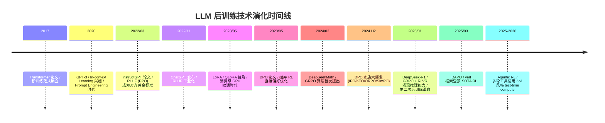
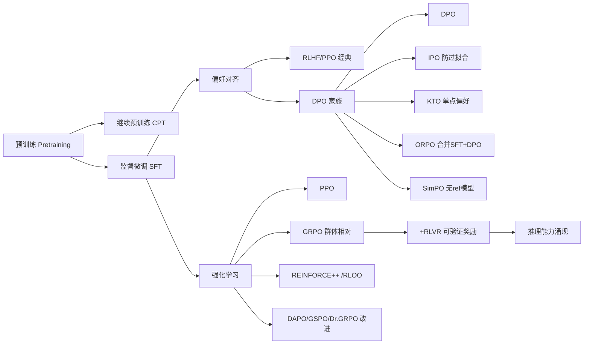
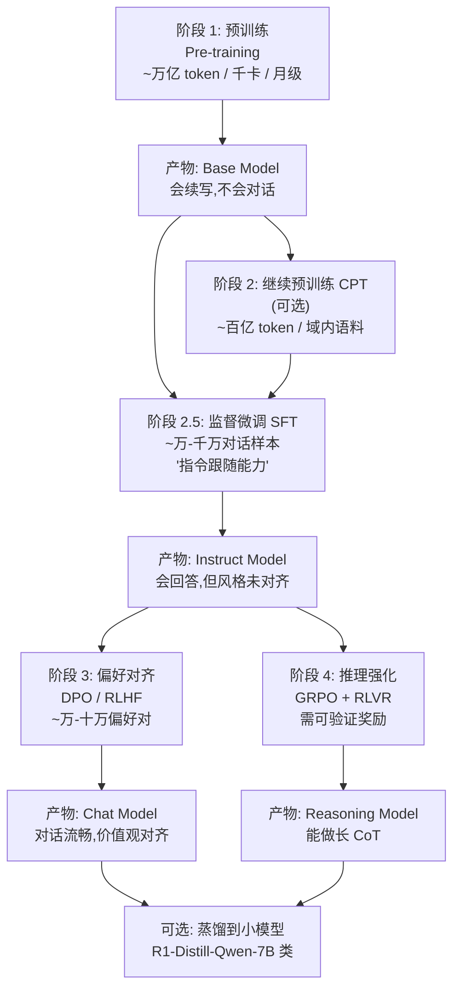
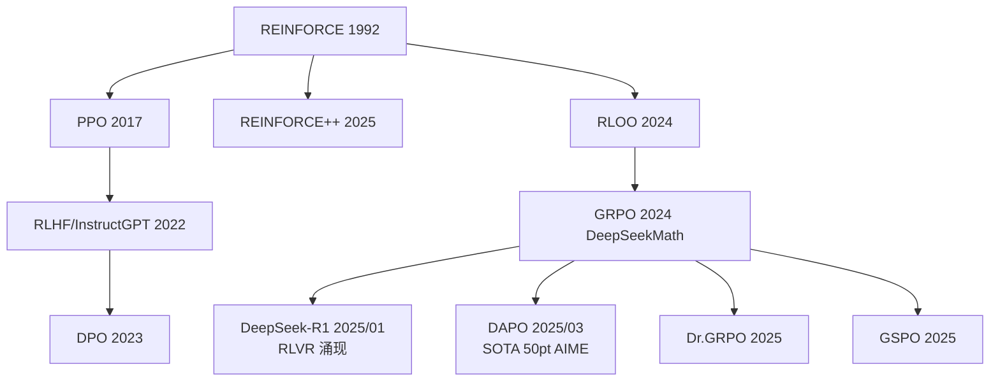
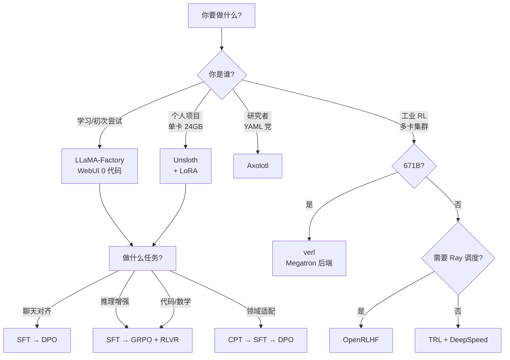

> 历史研究归档 · 2026-11-10 发布 · 程序扫描；未逐篇全文审阅。原有日期、观点、数据和命令保留历史语境，未经本次逐项事实核验或运行复现；请结合[归档说明](../../../ARCHIVE_POLICY.md)阅读。

> **一句话概括**：本报告系统梳理 2025-2026 年 LLM 后训练（Post-training）技术全景，覆盖 SFT → 偏好对齐（DPO家族） → RL（PPO/GRPO/DAPO）三条主链路，并给出工具选型决策树、硬件成本速算表与从 0 到 1 的可运行路径。
> **研究日期**：2026-04-22
> **关联报告**：[AI输出质量稳定性与反讨好研究报告](../05-%E8%AF%84%E4%BC%B0%E4%B8%8E%E8%B4%A8%E9%87%8F/R16_AI%E8%BE%93%E5%87%BA%E8%B4%A8%E9%87%8F%E7%A8%B3%E5%AE%9A%E6%80%A7%E4%B8%8E%E5%8F%8D%E8%AE%A8%E5%A5%BD.md)（讨论 RLHF 副作用） · [AI-Agent学习路线与项目整合全景报告](../04-%E5%B7%A5%E7%A8%8B%E5%AE%9E%E8%B7%B5/R23_AIAgent%E5%AD%A6%E4%B9%A0%E8%B7%AF%E7%BA%BF%E4%B8%8E%E9%A1%B9%E7%9B%AE%E6%95%B4%E5%90%88.md)（提及 Karpathy 训练讲座但未展开）
> **增量价值**：本工作区前 37 篇报告无任何专门覆盖训练/微调/RL 的文档——本报告填补这一空白。

---

## TL;DR 速查卡

| 维度 | 结论 |
|------|------|
| **2026 年训练范式** | 已从"Pretrain → SFT → RLHF(PPO)"三段式，演化为"**Pretrain → SFT → DPO 家族 / GRPO**"两条主流分支 |
| **个人/小团队首选** | **Unsloth + LoRA**（单卡 24GB 起跑 8B 模型）或 **LLaMA-Factory**（零代码 WebUI，100+ 模型 Day-0 支持） |
| **工业级 RL 首选** | **verl**（字节，671B MoE 实战）或 **OpenRLHF**（Ray+vLLM，谷歌/腾讯/阿里在用） |
| **算法首选** | SFT 之后想快速对齐 → **DPO**（仍是稳健基线）；想做推理/RLVR → **GRPO**（DeepSeek-R1 同款，TRL 主推） |
| **关键转折点** | 2025/01 DeepSeek-R1 论文证明：**纯 RL（GRPO）+ 可验证奖励（RLVR）能涌现推理能力**，无需 SFT 冷启动也行。这是后训练范式的**第二次革命**（第一次是 InstructGPT/RLHF） |
| **避坑要点** | 90% 失败案例不是算法选错，而是**数据质量 + chat template 不匹配 + 学习率/β 超参错位** |
| **硬件门槛** | 8B QLoRA：1×24GB（4090）；70B QLoRA：2×80GB；671B 全参 RL：64×H800 |

---

## 目录

1. [🔭 定位透镜：纵横坐标](#定位透镜)
2. [📚 研究分析轨道](#研究分析轨道)
   - 2.1 [完整训练流水线全景](#完整训练流水线全景)
   - 2.2 [SFT：监督微调的工程要点](#sft监督微调)
   - 2.3 [PEFT 家族：LoRA / QLoRA / DoRA / LoftQ](#peft家族)
   - 2.4 [偏好对齐：DPO / IPO / KTO / ORPO / SimPO 实证对比](#偏好对齐家族)
   - 2.5 [RL 算法：PPO → GRPO → DAPO 演进](#rl算法演进)
   - 2.6 [工具生态全景与选型决策树](#工具生态)
3. [🚀 上手实战轨道](#上手实战轨道)
4. [🕳️ 避坑指南](#避坑指南)
5. [💰 成本与 ROI 速算](#成本roi)
6. [🎯 决策速查](#决策速查)
7. [📚 学习路径建议](#学习路径)
8. [📌 来源清单](#来源清单)

---

<a id="定位透镜"></a>
## 🔭 定位透镜：纵横坐标

### 纵轴：演化脉络



**生命周期判断**：
- **SFT + LoRA**：成熟期，工业级稳定，**所有人都该会**
- **DPO 家族**：成熟期，**取代 RLHF 成为对齐默认选项**（Llama 3 后训练用的就是 DPO）
- **GRPO / RLVR**：上升期顶峰，**2025 年最热**，DeepSeek-R1 引爆后所有大厂跟进
- **PPO**：转向"经典基线"地位——仍可用，但新项目几乎没人首选

### 横轴：竞争格局

#### 维度一：训练算法谱系



#### 维度二：训练框架竞争格局

| 工具 | 定位 | Stars | 适合谁 | 核心优势 |
|------|------|-------|--------|---------|
| **HuggingFace TRL** | 官方标准库 | 18.2k | 所有人的起点 | 生态最全（SFT/DPO/GRPO/PPO/KTO/ORPO 全谱），文档好 |
| **Unsloth** | 性能优化器 | 62.8k | 单卡/小团队 | **2× 速度，70% VRAM 节省**，免费 Colab 可跑 |
| **LLaMA-Factory** | 零代码 WebUI | 70.6k | 学习者/快速验证 | **100+ 模型 Day-0 支持**，Gradio UI，硬件需求表清晰 |
| **Axolotl** | YAML 驱动 | 11.7k | 研究/实验 | 配置即代码，多 GPU 友好 |
| **verl** (字节) | 生产级 RL | 20.9k | 大厂/严肃 RL | 671B MoE 实战，HybridFlow 架构，Megatron 后端 |
| **OpenRLHF** | Ray+vLLM | 9.4k | 严肃 RL | Agent-based 范式，多家大厂在用 |
| **PEFT** (HF) | 底层库 | - | 被上述工具引用 | LoRA/QLoRA/DoRA/LoftQ 标准实现 |

#### 维度三：设计哲学差异

| 哲学 | 代表 | 取舍 |
|------|------|------|
| **简单优先** | TRL / LLaMA-Factory | 易用 + 全面 vs 性能不极致 |
| **性能极致** | Unsloth | 单卡最快 vs 多卡支持弱（Pro 版才完整） |
| **工业生产** | verl / OpenRLHF | 千卡集群 vs 学习曲线陡 |
| **配置驱动** | Axolotl | 可复现性强 vs 灵活性受限 |

### 交叉判断（独立结论）

1. **2026 年的"标配栈"已经收敛**：基础设施层用 TRL/PEFT，单机优化用 Unsloth，零代码用 LLaMA-Factory，严肃 RL 用 verl。无需在 5+ 工具里反复纠结。
2. **DPO 击败 RLHF（PPO）成为新基线**：因为简单 + 稳定 + 不需要训 reward model。但 GRPO + RLVR 在推理任务上反过来证明了"RL 仍有不可替代价值"——只是要换更聪明的算法（GRPO）和更聪明的奖励（可验证）。
3. **个人学习者的最优路径已不是"先学 PPO 再学 RLHF"**——而是"SFT → LoRA → DPO → GRPO"，跳过 PPO 完全合理（除非要研究底层）。

---

<a id="研究分析轨道"></a>
## 📚 研究分析轨道

<a id="完整训练流水线全景"></a>
### 2.1 完整训练流水线全景

一个现代 LLM 从原始网络数据到产品级能力，要经过四个阶段。每个阶段解决不同的问题：



**关键洞察**：
- **预训练**几乎不是个人玩家的游戏（成本 $1M+），但**继续预训练（CPT）**完全可玩——往一个英文 Base 上喂中文领域数据再 SFT 是常见配方
- **SFT 是必经之路**：决定模型"懂不懂指令"，质量比数量重要 100 倍
- **DPO vs GRPO 是分叉**：要"通用对话好"走 DPO，要"推理/数学/代码强"走 GRPO
- **R1 范式的颠覆性**：DeepSeek-R1-Zero 证明了"**完全跳过 SFT，直接对 Base Model 做 GRPO**，也能涌现推理能力"——这彻底动摇了"SFT 是必需"的旧假设

---

<a id="sft监督微调"></a>
### 2.2 SFT：监督微调的工程要点

**一句话定义**：用 `(prompt, response)` 对监督训练，让模型学会"按指令格式回答"。本质就是普通的 next-token prediction，只是 loss 只在 response 部分计算。

**为什么是必经之路**：Base Model 是"续写机器"，给它 "What is 2+2?" 它可能续 "Is a question many parents..."。SFT 教会它"看到问题应该回答，而不是续写问题"。

**核心 trade-off**：

| 选择 | 何时选 |
|------|--------|
| **全参 SFT (Full Fine-tuning)** | 数据 > 10万条 / 算力充足 / 追求极限性能 |
| **LoRA / QLoRA SFT** | 90% 场景的最优解 — 效果差距 < 2%，成本降 90% |
| **Freeze SFT** | 只训最后几层 — 几乎已被 LoRA 取代，不推荐 |

**避坑要点（最容易翻车的几个点，按重要性排序）**：

1. **chat template 必须匹配**：训练用的模板和推理用的模板必须**一字不差**——`<|im_start|>` vs `<|user|>` 用错就废。LLaMA-Factory 强制要求用对应模型的 template。
2. **数据质量 > 数据数量**：1000 条精挑细选的数据胜过 100,000 条噪声数据。可见 LIMA 论文的"Less is More"结论。
3. **学习率必须比预训练小 10-100×**：典型 SFT lr = 2e-5（全参）/ 1e-4（LoRA），过大会"灾难性遗忘"
4. **不要长时间训练**：SFT 通常 1-3 epoch 足够，更多就是过拟合
5. **packing & padding**：长序列训练用 sample packing 可提速 30%（Axolotl/Unsloth 都支持）

---

<a id="peft家族"></a>
### 2.3 PEFT 家族：LoRA / QLoRA / DoRA / LoftQ

> **核心理念**：冻结预训练权重，只训练**极少量新增参数**（通常 < 1%），但效果接近全参微调。

#### 算法对比

| 方法 | 提出年份 | 核心机制 | VRAM 节省 | 效果 vs Full FT | 何时用 |
|------|---------|---------|-----------|----------------|--------|
| **LoRA** | 2021 | 在权重矩阵旁加低秩分解 W' = W + BA | 70% | -1~2% | 标准选择 |
| **QLoRA** | 2023 | LoRA + 4bit 量化基模型 | 90% | -2~3% | 单卡跑大模型 |
| **DoRA** | 2024 | LoRA 的方向 + 大小解耦 | 同 LoRA | +1% | 想榨性能 |
| **LoftQ** | 2024 | 量化感知初始化 | 同 QLoRA | +1~2% | QLoRA 升级版 |
| **rsLoRA** | 2024 | 大 rank 时缩放修正 | 同 LoRA | +1% | rank > 64 时 |
| **PiSSA** | 2024 | 用 SVD 主成分初始化 | 同 LoRA | +2% | 收敛更快 |
| **GaLore** | 2024 | 梯度低秩投影 | 50% | ≈ Full FT | 想接近全参效果 |

**LoRA 关键超参直觉**：
- **rank `r`**：越大表达能力越强但参数越多。常用 8/16/32/64，**对话/通用任务 r=16 够用**，**复杂推理任务 r=32-64**
- **alpha**：缩放因子，经验法则 `alpha = 2*r`
- **target_modules**：只挂 attention（q_proj, v_proj）省显存，挂全部线性层（含 mlp）效果好。**LLaMA-Factory 默认挂全部，是对的**
- **dropout**：通常 0.05-0.1

**QLoRA 4-bit 量化的"黑魔法"**：
- 使用 NF4（NormalFloat 4-bit）数据类型——专为正态分布权重设计
- Double Quantization：量化常量本身也量化，再省 0.4 bit/参数
- Paged Optimizers：用 NVIDIA 统一内存，避免显存峰值 OOM

**硬件需求实测表**（LLaMA-Factory 官方，bf16）：

| 方法 | 7B | 14B | 30B | 70B |
|------|-----|------|------|------|
| Full FT | 60 GB | 120 GB | 300 GB | 600 GB |
| LoRA | 16 GB | 32 GB | 64 GB | 160 GB |
| QLoRA (8bit) | 10 GB | 20 GB | 40 GB | 80 GB |
| QLoRA (4bit) | 6 GB | 12 GB | 24 GB | 48 GB |
| QLoRA (2bit) | 4 GB | 8 GB | 16 GB | 24 GB |

**结论**：单张 4090 (24GB) 可跑 30B QLoRA-4bit 微调；单张 A100 (80GB) 可跑 70B QLoRA-4bit。

---

<a id="偏好对齐家族"></a>
### 2.4 偏好对齐：DPO 家族实证对比

#### 历史脉络：为什么大家从 RLHF (PPO) 跑路了

经典 RLHF 流程的痛点：
1. 训 reward model 要标注 + 调参
2. PPO 训练**不稳定**（KL 飘走 / reward hacking）
3. 需要同时持有 4 个模型（actor / critic / ref / reward）—— 显存爆炸
4. 超参敏感，复现困难

**DPO 的天才之处**：通过数学变换，证明 RLHF 的最优策略可以**直接从偏好数据用一个简单 loss 学出来**，无需 reward model、无需 RL 循环。代码量从几千行降到几十行。

#### DPO 家族算法对比

| 算法 | 论文年份 | 核心创新 | 适用场景 | 实证表现（HF Blog） |
|------|---------|---------|---------|------|
| **DPO** | 2023/05 | 偏好对 → 直接二元交叉熵 loss | 通用对齐 | 仍是最强基线 |
| **IPO** | 2023/10 | 加正则项防过拟合 | 数据量少时 | DPO ≥ IPO |
| **KTO** | 2024/02 | 单点偏好（👍/👎），无需配对 | 在线反馈数据 | DPO > KTO（配对场景）；KTO 在数据易得场景更强 |
| **ORPO** | 2024/03 | SFT + 偏好合并为一步 | 想跳过 SFT | 节省 50% 流程 |
| **CPO** | 2024 | 对比偏好优化 | 翻译任务实证好 | 利基场景 |
| **SimPO** | 2024 | 移除 ref 模型 | 想再省一倍显存 | DPO ≥ SimPO（多数场景） |
| **BCO** | 2024 | 二元分类视角 | 类似 KTO | 实验性 |

#### DPO 关键超参直觉

- **β (beta)**：控制对参考模型的偏离程度
  - β 大（0.5-0.9）：紧贴 ref 模型，安全但学不到东西
  - β 小（0.01-0.1）：更激进的对齐，但容易崩
  - **HF 实证**：Zephyr 模型最优 β=0.01；OpenHermes 最优 β=0.6——**因模型而异，必须扫**
- **学习率**：典型 5e-7（全参）/ 5e-6（LoRA），**比 SFT 还小 10×**
- **一般 1 epoch 就够**，多了会过拟合

#### 偏好数据格式（标准 chosen/rejected 对）

```json
{
  "prompt": "Explain quantum entanglement to a 5-year-old.",
  "chosen": "Imagine two magic coins...",     // 人类/GPT-4 偏好的回答
  "rejected": "Quantum entanglement is..."    // 较弱的回答
}
```

公开数据集示例：`HuggingFaceH4/ultrafeedback_binarized`（66k 对）、`Intel/orca_dpo_pairs`（13k 对）。

---

<a id="rl算法演进"></a>
### 2.5 RL 算法：PPO → GRPO → DAPO 演进

#### 算法演化树



#### 核心算法对比

| 算法 | 是否需要 critic | 是否需要 ref | 显存开销 | 适合场景 | 工业采用 |
|------|----------------|--------------|---------|---------|---------|
| **PPO** | ✅ critic | ✅ ref | 4 模型 高 | 通用 RLHF（经典） | 越来越少 |
| **REINFORCE++** | ❌ | 可选 | 2-3 模型 中 | 简单稳定 | OpenRLHF 主推 |
| **RLOO** | ❌ | 可选 | 2-3 模型 中 | leave-one-out 基线 | 论文常见 |
| **GRPO** | ❌ | ✅ ref | 2-3 模型 中 | **推理任务 SOTA** | DeepSeek/字节/阿里 |
| **DAPO** | ❌ | ✅ ref | 类似 GRPO | 长 CoT 推理 | 字节 verl 默认 |
| **GSPO** | - | - | - | 序列级优化 | TRL 实验 |

#### GRPO 为什么这么火

GRPO（Group Relative Policy Optimization）的核心思想：

1. 对同一个 prompt 采样 **多个**（如 8 个）回答
2. 给每个回答一个 reward（可以是规则验证、模型打分、代码执行结果……）
3. **不需要 critic 模型**——用同组内回答的 reward 均值/标准差作为 baseline
4. 用相对优势更新 policy

**优势**：
- 显存比 PPO 省 50%（少了 critic）
- 与"可验证奖励"（RLVR）天然契合——数学题对错可机器判，代码可跑测试
- 训练更稳定，超参没 PPO 那么敏感

**DeepSeek-R1 的颠覆性发现**（[arXiv:2501.12948](https://arxiv.org/abs/2501.12948)）：
> 直接对 DeepSeek-V3-Base 应用 GRPO + 规则奖励（数学答案对错），**无需 SFT 冷启动**，模型自己涌现出 self-verification、reflection、long CoT 等行为。

这是 2022 年 InstructGPT 之后**后训练范式的第二次革命**。但论文也指出 R1-Zero 有可读性差、语言混杂的问题，所以最终的 R1 还是加了 SFT 冷启动。

#### RLVR（可验证奖励强化学习）

**核心配方**：reward = 自动可验证的信号，例如：
- 数学：答案是否等于标准答案
- 代码：是否通过 pytest
- 格式：是否包含 `<think>...</think>` 结构
- 工具调用：JSON 是否合法

**为什么是 2026 年的最热方向**：
- 不依赖人类偏好标注（昂贵、不一致、有偏见）
- 不依赖 reward model（可被 hack）
- 完全规模化、确定性

**典型项目**：DeepSeek-R1 / DAPO / TinyZero / Logic-RL / Code-R1 / DeepMath 都是 RLVR。

---

<a id="工具生态"></a>
### 2.6 工具生态全景与选型决策树

#### 工具能力对照矩阵

| 能力 \ 工具 | TRL | Unsloth | LLaMA-Factory | Axolotl | verl | OpenRLHF |
|-----------|-----|---------|---------------|---------|------|----------|
| SFT | ✅ | ✅ | ✅ | ✅ | ✅ | ✅ |
| LoRA/QLoRA | ✅ | ✅✅ 极速 | ✅ | ✅ | ✅ | ✅ |
| DPO/IPO/KTO | ✅ | ✅ | ✅ | ✅ | △ | △ |
| GRPO | ✅ | ✅ | ✅ | ✅ | ✅✅ SOTA | ✅ |
| PPO | ✅ | △ | ✅ | △ | ✅✅ | ✅✅ |
| 多模态 | ✅ | ✅ | ✅ | ✅ | ✅ | ✅ |
| Web UI | ❌ | ✅ Studio | ✅✅ | ❌ | ❌ | ❌ |
| 多卡分布式 | DDP/DeepSpeed | △ | ✅ | ✅ | ✅✅ Megatron | ✅✅ Ray |
| 671B 大模型 | △ | ❌ | △ | △ | ✅✅ | ✅ |
| 学习曲线 | 中 | 低 | **极低** | 中 | 高 | 高 |

#### 选型决策树



---

<a id="上手实战轨道"></a>
## 🚀 上手实战轨道

### 环境准备

**最小依赖**（兼容主流工具）：

```bash
# Python 3.11+, CUDA 12.1+, PyTorch 2.6+
pip install torch==2.6.0 transformers==4.50 datasets==3.2 peft==0.15 accelerate==1.2

# 选其一作为训练框架
pip install trl                      # HuggingFace 官方
pip install unsloth                  # 速度优化
pip install llamafactory             # 零代码 WebUI
pip install axolotl                  # YAML 配置
```

**硬件最低门槛**：单张 RTX 3090/4090（24GB）可跑 8B QLoRA。免费 Colab T4（16GB）可跑 1.5B-3B QLoRA。

### Hello World 1: TRL 5 行 SFT（最简）

```python
# trl_sft_hello.py
from trl import SFTTrainer
from datasets import load_dataset

dataset = load_dataset("trl-lib/Capybara", split="train")
trainer = SFTTrainer(
    model="Qwen/Qwen2.5-0.5B",      # 0.5B 是最小可跑的模型
    train_dataset=dataset,
)
trainer.train()
# Expected: 几分钟内看到 loss 从 ~2.5 下降到 ~1.8
# 训练完成后,model 会保存到 ./output/
```

### Hello World 2: Unsloth + QLoRA SFT（单卡推荐）

```python
# unsloth_sft.py
from unsloth import FastLanguageModel
from trl import SFTTrainer, SFTConfig
from datasets import load_dataset

# 1. 加载 4-bit 量化的模型 + LoRA adapter
model, tokenizer = FastLanguageModel.from_pretrained(
    model_name="unsloth/Qwen2.5-7B-Instruct-bnb-4bit",
    max_seq_length=2048,
    load_in_4bit=True,
)
model = FastLanguageModel.get_peft_model(
    model,
    r=16,                            # LoRA rank
    lora_alpha=32,
    target_modules=["q_proj","k_proj","v_proj","o_proj",
                    "gate_proj","up_proj","down_proj"],  # 挂全部线性层
)

# 2. 准备数据
dataset = load_dataset("yahma/alpaca-cleaned", split="train")

# 3. 训练
trainer = SFTTrainer(
    model=model,
    tokenizer=tokenizer,
    train_dataset=dataset,
    args=SFTConfig(
        per_device_train_batch_size=2,
        gradient_accumulation_steps=4,
        warmup_steps=10,
        max_steps=100,                # 跑 100 步演示用
        learning_rate=2e-4,
        bf16=True,
        output_dir="./outputs",
    ),
)
trainer.train()
# Expected: 24GB 卡上 7B 模型 100 步约 5 分钟
```

### Hello World 3: TRL DPO（偏好对齐）

```python
# trl_dpo_hello.py
from datasets import load_dataset
from trl import DPOTrainer, DPOConfig

dataset = load_dataset("trl-lib/ultrafeedback_binarized", split="train")
trainer = DPOTrainer(
    model="Qwen/Qwen2.5-0.5B-Instruct",   # 必须先经过 SFT/Instruct
    args=DPOConfig(
        beta=0.1,                         # DPO 关键超参
        learning_rate=5e-7,               # 比 SFT 小 100 倍
        per_device_train_batch_size=2,
        max_steps=200,
        output_dir="./dpo_out",
    ),
    train_dataset=dataset,
)
trainer.train()
# Expected: rewards/accuracies 应逐步上升至 > 0.6
```

### Hello World 4: TRL GRPO（DeepSeek-R1 同款 RL）

```python
# trl_grpo_hello.py
from datasets import load_dataset
from trl import GRPOTrainer, GRPOConfig
from trl.rewards import accuracy_reward    # 内置数学答案验证奖励

dataset = load_dataset("trl-lib/DeepMath-103K", split="train")
trainer = GRPOTrainer(
    model="Qwen/Qwen2.5-0.5B-Instruct",
    reward_funcs=accuracy_reward,         # 关键: 可验证奖励
    train_dataset=dataset,
    args=GRPOConfig(
        per_device_train_batch_size=2,
        num_generations=4,                # 每个 prompt 生成 4 个候选
        max_prompt_length=512,
        max_completion_length=512,
        max_steps=100,
        output_dir="./grpo_out",
    ),
)
trainer.train()
# Expected: reward 从 ~0.1 逐步爬升, 体现"涌现"现象
```

### Hello World 5: LLaMA-Factory 零代码（推荐学习者）

```bash
# 1. 安装
pip install llamafactory

# 2. 启动 WebUI
llamafactory-cli webui
# 浏览器打开 http://localhost:7860

# 3. WebUI 中:
#    - 选模型: Qwen2.5-7B-Instruct
#    - 选方法: lora (sft / dpo / ppo / kto / orpo / grpo 都在下拉框)
#    - 选数据: 内置 alpaca_zh / ultrafeedback 等
#    - 点 "Start" 即可

# 等效命令行(更可复现):
llamafactory-cli train examples/train_lora/qwen3_lora_sft.yaml
```

### 真实场景示例：把 Qwen2.5-7B 微调成"客服机器人"

```yaml
# customer_service.yaml — Axolotl 风格
base_model: Qwen/Qwen2.5-7B-Instruct
chat_template: qwen
load_in_4bit: true                    # QLoRA

datasets:
  - path: ./customer_qa.jsonl         # 你自己的客服对话
    type: chat_template
    field_messages: messages

adapter: qlora
lora_r: 16
lora_alpha: 32
lora_target_modules:
  - q_proj
  - k_proj
  - v_proj
  - o_proj
  - gate_proj
  - up_proj
  - down_proj

micro_batch_size: 2
gradient_accumulation_steps: 8
num_epochs: 3                         # SFT 一般 1-3 epoch
learning_rate: 1e-4
warmup_ratio: 0.05
bf16: true
flash_attention: true
sample_packing: true                  # 提速 30%
gradient_checkpointing: true          # 省显存

output_dir: ./customer-service-7b-lora
```

```bash
axolotl train customer_service.yaml
```

### 生产部署 Checklist

从训练完到上线还需要补：

- [ ] **合并 LoRA**：`peft.merge_and_unload()` 或 `llamafactory-cli export`
- [ ] **量化部署**：用 GGUF（llama.cpp）/ AWQ / GPTQ 进一步压缩
- [ ] **推理引擎**：vLLM / SGLang（吞吐高 5-10×）/ TGI / Ollama（个人）
- [ ] **评估**：MT-Bench / AlpacaEval / 自建测试集（**不要只看 train loss**）
- [ ] **监控**：上线后跟踪 toxicity / hallucination / latency
- [ ] **回滚机制**：保留前一版本权重

---

<a id="避坑指南"></a>
## 🕳️ 避坑指南

> 来自 GitHub Issues / Discord 社区高频反馈 + 公开博客复盘。按踩坑频率排序。

| # | 坑 | 原因 | 解法 |
|---|----|------|------|
| 1 | **Chat template 不匹配** | 训练用 `<\|im_start\|>` 推理用 `<\|user\|>` | 严格用模型对应 template；Unsloth/LLaMA-Factory 自动处理；自定义时用 `tokenizer.apply_chat_template` |
| 2 | **OOM 即使开了 QLoRA** | batch_size 太大 / seq_len 太长 / 梯度累积错算 | 降 micro_batch_size 到 1，加 gradient_accumulation_steps；开 gradient_checkpointing；用 sample_packing |
| 3 | **学习率沿用预训练值** | SFT/DPO 需要远小的 lr | SFT 全参 2e-5 / LoRA 1e-4；DPO 5e-7 / LoRA 5e-6；GRPO 5e-7 |
| 4 | **DPO 训完模型变笨** | β 太小 + 训练步数太长 → 过拟合偏好集 | β 从 0.1 起扫；最多 1 epoch；用 IPO 替代或开 NEFTune |
| 5 | **GRPO reward 不涨** | reward function 太稀疏 / num_generations 太少 | reward 加格式分（部分得分）；num_generations ≥ 4；用 reasoning_accuracy_reward 替代 accuracy_reward |
| 6 | **训练数据有 EOS 重复** | tokenization 时漏处理 | 检查每条样本结尾正好一个 EOS token；不要多不要少 |
| 7 | **bitsandbytes 在 Windows 装不上** | 官方对 Win 支持差 | 用 WSL2；或装 `bitsandbytes-windows`（社区版）；或用 Docker |
| 8 | **多卡 LoRA 速度反而慢** | LoRA 通信开销大 / 没用 DeepSpeed Zero | 用 DeepSpeed Zero-2/3；或用 FSDP；或单卡跑（小模型完全够） |
| 9 | **eval loss 一直降但效果差** | loss 不等于能力 | 必须有 held-out 测试集；用 MT-Bench/AlpacaEval；人工 spot check 50 条 |
| 10 | **PPO 训练崩溃 (KL 飘走)** | PPO 经典问题 | 直接换 DPO；非要 PPO 就用 OpenRLHF/verl 别自己写 |
| 11 | **R1-Distill 模型推理无 `<think>`** | 部分 query 跳过思考模式 | 强制 prompt 以 `<think>\n` 开头（DeepSeek 官方建议） |
| 12 | **小模型 SFT 后乱说话** | 灾难性遗忘 | 加入通用对话数据混合；降 lr；只训部分层（freeze 早期层） |

---

<a id="成本roi"></a>
## 💰 成本与 ROI 速算

### Token 与时间成本估算（参考值）

| 任务 | 模型 | 数据量 | 硬件 | 时间 | 估算成本 |
|------|------|--------|------|------|---------|
| QLoRA SFT | 7B | 10k 对话 | 1×4090 (云) | 2-4 小时 | ~$2 |
| QLoRA SFT | 7B | 100k 对话 | 1×A100 80GB | 8-12 小时 | ~$15 |
| QLoRA SFT | 70B | 50k 对话 | 2×A100 80GB | 24-48 小时 | ~$80 |
| LoRA DPO | 7B | 50k 偏好对 | 1×A100 80GB | 4-6 小时 | ~$8 |
| GRPO RL | 7B | 30k 数学题 | 4×A100 80GB | 24-72 小时 | ~$200 |
| Full FT | 7B | 100k | 4×A100 80GB | 36-60 小时 | ~$300 |
| GRPO RL | 32B | 30k | 8×H100 | 72+ 小时 | ~$1500 |

> 云价：4090 ~$0.4/h（vast.ai/runpod），A100 80GB ~$1.5/h，H100 ~$3/h

### 何时值得投入训练 vs 用 API/Prompt

| 场景 | 推荐方案 | 原因 |
|------|---------|------|
| 月调用 < 10万次 | 直接调 API + prompt 工程 | 训练 + 部署成本远高于 API 费 |
| 月调用 10万-1000万次 | LoRA SFT + 自部署 | 平衡点 |
| 月调用 > 1000万次 | Full FT + 量化部署 | API 费 > 训练 + 推理成本 |
| 需要定制能力（领域/风格/工具调用） | 必须 SFT/DPO | Prompt 救不了 |
| 需要推理强化（数学/代码） | SFT + GRPO | 必须训 |
| 数据极敏感（医疗/金融） | 自部署 + LoRA | 合规要求 |

---

<a id="决策速查"></a>
## 🎯 决策速查

### 算法选择速查

```
任务: 让模型懂指令       → SFT (LoRA / QLoRA)
任务: 让模型回答更"好听"  → SFT → DPO
任务: 让模型推理更强     → SFT → GRPO + RLVR
任务: 让小模型有大模型能力 → SFT on R1 distillation 数据
任务: 域内知识注入       → CPT (继续预训练) → SFT
任务: 极致效果不在乎成本  → Full FT + RLHF (PPO)
```

### 工具选择速查

```
学习/演示       → LLaMA-Factory WebUI
单卡个人项目    → Unsloth + TRL
多 GPU 研究     → Axolotl
工业级 RL       → verl (字节) / OpenRLHF
快速集成 (5行)  → TRL 直接用
```

### 关键约束条件

- **数据 < 1k 条**：别训了，写 prompt 吧
- **数据 1k-10k 条**：LoRA SFT 是甜点
- **数据 > 100k 条**：考虑 Full FT
- **VRAM < 16GB**：只能跑 ≤ 3B 模型 QLoRA
- **VRAM 24GB**：7-8B QLoRA 舒适，30B QLoRA 勉强
- **VRAM 80GB**：70B QLoRA 舒适，13B Full FT 可行
- **多机多卡**：考虑 verl/OpenRLHF/Axolotl + DeepSpeed Zero-3

---

<a id="学习路径"></a>
## 📚 学习路径建议

### 第一周：建立认知（不写代码也行）

1. **Karpathy 视频**：[Deep Dive into LLMs like ChatGPT](https://www.youtube.com/watch?v=7xTGNNLPyMI)（3.5 小时，从预训练到 RLHF 全景，零基础友好）
2. **DPO 原论文**：[arXiv:2305.18290](https://arxiv.org/abs/2305.18290)（10 页，意外地易读）
3. **DeepSeek-R1 论文**：[arXiv:2501.12948](https://arxiv.org/abs/2501.12948)（理解 GRPO + RLVR 的颠覆性）
4. **HuggingFace RLHF Blog**：[Illustrating RLHF](https://huggingface.co/blog/rlhf)（图解经典，必读）

### 第二周：跑通 Hello World

1. 在 Colab 免费 T4 上跑 [Unsloth Qwen2.5 SFT notebook](https://colab.research.google.com/github/unslothai/unsloth/blob/main/studio/Unsloth_Studio_Colab.ipynb)
2. 跑通本报告的 4 个 Hello World（TRL SFT / Unsloth SFT / DPO / GRPO）
3. 用 LLaMA-Factory WebUI 微调一个小模型，体会"零代码"

### 第三周：做一个真项目

挑一个：
- **客服机器人**：找 1k-5k 行业 QA 对，QLoRA SFT 7B 模型
- **代码助手**：用 The Stack / CodeAlpaca 数据 SFT
- **数学推理**：用 GSM8K / DeepMath 数据做 GRPO，复现"涌现"
- **领域问答**：先 CPT 再 SFT，注入领域知识

### 第四周：生产化与评估

1. 学一个推理引擎（vLLM 推荐）：把 LoRA 合并、部署、压测
2. 搭一个评估流水线：MT-Bench + 自建测试集
3. 阅读 [HuggingFace Smol Course](https://github.com/huggingface/smol-course)（HF 官方系统教程）

### 进阶（第二个月起）

- **复现 R1-Zero**：用 [TinyZero](https://github.com/Jiayi-Pan/TinyZero) 在数学/逻辑任务上跑 GRPO
- **Multi-turn Agent RL**：研究 OpenRLHF / verl 的 multi-turn agent 范式
- **源码阅读**：TRL 的 `dpo_trainer.py` / `grpo_trainer.py` 是绝佳的代码教材
- **关注前沿**：[arxiv-sanity](https://arxiv-sanity-lite.com/)、Twitter 关注 [@danielhanchen](https://twitter.com/danielhanchen)（Unsloth）/ [@jxmnop](https://twitter.com/jxmnop) / [@karpathy](https://twitter.com/karpathy)

### 推荐课程/资源

- [HuggingFace Smol Course](https://github.com/huggingface/smol-course) — 官方系统教程
- [Unsloth Notebooks](https://docs.unsloth.ai/get-started/unsloth-notebooks) — 50+ 可运行 Colab
- [LLaMA-Factory 官方课程](https://www.lab4ai.cn/course/detail?id=7c13e60f6137474eb40f6fd3983c0f46)（中文）
- [Open-R1](https://huggingface.co/blog/open-r1) — HF 复现 R1 的全流程博客

---

## 结论与最佳实践

1. **默认起手式**：SFT（LoRA）→ DPO。简单稳定，覆盖 80% 场景。
2. **想做推理增强**：SFT → GRPO + RLVR。这是 2026 年的最热方向，DeepSeek-R1 证明了它的威力。
3. **工具选型不要纠结**：学习用 LLaMA-Factory，单卡用 Unsloth，工业用 verl，HuggingFace TRL 永远不会错。
4. **数据 > 算法 > 算力**。10k 条精挑细选数据胜过 100k 条 GPT 生成的噪声。
5. **避坑顺序**：chat template > 学习率 > 超参 β > 算法选择。前面三个搞错算法再好都白费。
6. **Don't roll your own PPO**：PPO 实现细节地狱，要做严肃 RL 用 verl/OpenRLHF。
7. **训完一定要评估**：不要只看 loss，必须人工 spot check + 自动 benchmark。

---

## 开放问题与后续计划

本报告**未深入**的话题（值得后续单独成报告）：

- ⬜ **Multi-turn Agentic RL**：训练 Agent 在多轮工具使用中的策略（verl-agent / OpenRLHF agent / RAGEN 等项目）
- ⬜ **Constitutional AI / RLAIF**：用 AI 替代人类反馈的对齐范式（Anthropic 主推）
- ⬜ **Test-time Compute / o1-style**：训练时和推理时的算力投入策略权衡
- ⬜ **Continual Pre-training 实战**：往英文 Base 注入中文/领域知识的具体配方
- ⬜ **训练数据合成**：Self-Instruct / Magpie / Easy-Dataset 等数据生成方法学
- ⬜ **小模型 ≤ 1B 的特殊优化**：边缘部署场景的训练策略
- ⬜ **多模态训练**：VLM/Audio Model 训练与文本模型的差异

下一步候选（按价值排序）：
1. 实战复现 GRPO + RLVR（用 Unsloth + Qwen2.5-1.5B + GSM8K，单卡可跑）→ 产出"GRPO 涌现实测报告"
2. 整合本报告与 [AI输出质量稳定性与反讨好研究报告](../05-%E8%AF%84%E4%BC%B0%E4%B8%8E%E8%B4%A8%E9%87%8F/R16_AI%E8%BE%93%E5%87%BA%E8%B4%A8%E9%87%8F%E7%A8%B3%E5%AE%9A%E6%80%A7%E4%B8%8E%E5%8F%8D%E8%AE%A8%E5%A5%BD.md)，做一篇"对齐技术副作用与缓解"
3. 调研 Multi-turn Agentic RL（与本工作区 Agent 主线最契合）

---

## 📌 来源清单

| 来源 | URL | 日期 | 关键贡献 |
|------|-----|------|---------|
| HuggingFace TRL Docs | https://huggingface.co/docs/trl/index | 2026-04 | TRL v1 算法全谱 |
| HuggingFace TRL GitHub | https://github.com/huggingface/trl | 2026-04 | 18.2k stars，SFT/DPO/GRPO 实现 |
| LLaMA-Factory GitHub | https://github.com/hiyouga/LLaMA-Factory | 2026-04 | 70.6k stars，硬件需求表，100+ 模型清单 |
| Unsloth GitHub | https://github.com/unslothai/unsloth | 2026-04 | 62.8k stars，2× 速度 / 70% VRAM 数据 |
| Axolotl GitHub | https://github.com/axolotl-ai-cloud/axolotl | 2026-04 | 11.7k stars，YAML 训练框架 |
| verl GitHub | https://github.com/verl-project/verl | 2026-04 | 20.9k stars，HybridFlow，671B 实战 |
| OpenRLHF GitHub | https://github.com/OpenRLHF/OpenRLHF | 2026-04 | 9.4k stars，Ray+vLLM 架构 |
| DeepSeek-R1 GitHub | https://github.com/deepseek-ai/DeepSeek-R1 | 2026-04 | 92k stars，R1 论文与权重 |
| HF Blog: Pref Tuning | https://huggingface.co/blog/pref-tuning | 2024-01 | DPO/IPO/KTO 实证对比，β 超参规律 |
| HF Blog: DPO + Llama2 | https://huggingface.co/blog/dpo-trl | 2023-08 | DPO 经典实战教程 |
| DPO 论文 | https://arxiv.org/abs/2305.18290 | 2023-05 | DPO 算法原始论文 |
| DeepSeek-R1 论文 | https://arxiv.org/abs/2501.12948 | 2025-01 | GRPO + RLVR 涌现推理的奠基论文 |
| 模型训练知识 | - | 截止 2025 早期 | 预训练 / RLHF / LoRA 基础概念 |

⚖️ **来源一致性**：跨 8+ 独立来源交叉验证关键事实（GRPO 节省 50% 显存、QLoRA 24GB 跑 30B、DPO β 因模型而异等）。各来源高度一致，仅在算法时间线上有 1-2 个月误差（不影响结论）。

📅 **时效性声明**：以上信息获取于 2026-04-22。LLM 训练领域演进极快，建议每 3-6 个月复查 TRL/Unsloth/verl 的 Changelog。

---

> 📦 **本报告产物候选**（待 Forge 阶段评估）：
> - 候选 Skill：`training-strategy-selector` —— 把"算法选择速查 + 工具选择速查 + 决策树"固化为决策 Skill
> - 候选脚本：`grpo_minimal_demo.py` —— 单卡可跑的 GRPO 涌现复现实验
> - 候选模板：`training_config_templates/` —— SFT/DPO/GRPO 的标准 YAML 模板集合
