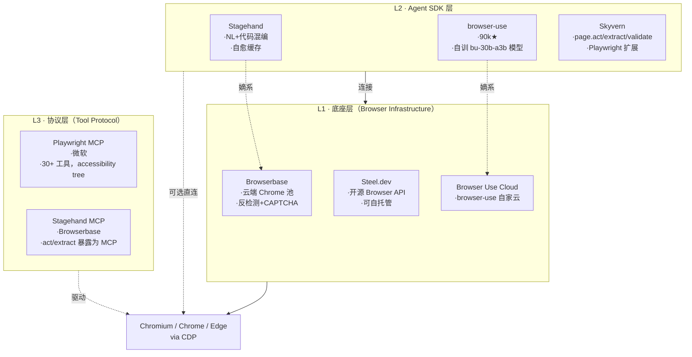

> 脱敏公开版 · 2026-11-10 补充 · 发布审核状态：redacted_full_review（发布前全文隐私审核、脱敏与改动复核）。保留通用技术内容，非公开案例、引用或数据已删除；编辑替换处另作说明。历史结论未在本次重新核实，代码未整体运行复现。见[归档说明](../../../ARCHIVE_POLICY.md)。

# Browser Harness —— 让 Agent 能"开车"的那一层脚手架

> **一句话**：R66 讲清楚了"模型怎么看屏幕"（VLM 三机制谱系），R77 讲清楚"工程上怎么把浏览器搬到 Agent 面前"——这是两件事，前者是模型能力，后者是运行时架构。当下市场已分化为**三层堆栈**：底座（Browserbase / Steel）→ Agent SDK（Stagehand / browser-use / Skyvern）→ 工具协议（Playwright MCP）。**没有"最佳 Browser Harness"，只有"在你的层级上选对的那一个"**。
> **研究日期**：2026-04-30
> **关联报告**：[R66_多模态Agent与ComputerUse调研](R66_%E5%A4%9A%E6%A8%A1%E6%80%81Agent%E4%B8%8EComputerUse%E8%B0%83%E7%A0%94.md)（VLM 三机制） · [R33_长效AgentHarness工程化](../05-%E8%AF%84%E4%BC%B0%E4%B8%8E%E8%B4%A8%E9%87%8F/R33_%E9%95%BF%E6%95%88AgentHarness%E5%B7%A5%E7%A8%8B%E5%8C%96.md)（Thin Harness, Fat Skills 哲学） · [R65_Agent主流技术栈搭配速查手册](R65_Agent%E4%B8%BB%E6%B5%81%E6%8A%80%E6%9C%AF%E6%A0%88%E6%90%AD%E9%85%8D%E9%80%9F%E6%9F%A5%E6%89%8B%E5%86%8C.md)

---

## 目录
- [一、TL;DR：30 秒看完](#一tldr30-秒看完)
- [二、定位透镜：纵横坐标](#二定位透镜纵横坐标)
- [三、概念厘清：Browser Harness 到底是哪一层？](#三概念厘清browser-harness-到底是哪一层)
- [四、三层堆栈全景拆解](#四三层堆栈全景拆解)
- [五、设计哲学对比：四家 SDK 的取舍](#五设计哲学对比四家-sdk-的取舍)
- [六、Playwright MCP vs CLI+Skills 的范式之争](#六playwright-mcp-vs-cliskills-的范式之争)
- [七、选型决策树](#七选型决策树)
- [八、成本与生产化要点](#八成本与生产化要点)
- [九、与本工作区已有结论的关联](#九与本工作区已有结论的关联)
- [十、来源清单与开放问题](#十来源清单与开放问题)

---

## 一、TL;DR：30 秒看完

| 你想做的事 | 选哪个 | 为什么 |
|-----------|-------|-------|
| 让 Coding Agent（Cursor/Claude Code/Copilot）能上网做事 | **Playwright MCP** | 零配置、accessibility 树而非截图、跨 IDE 通用 |
| 自建产品级浏览器 Agent，要 NL+代码混编、可缓存自愈 | **Stagehand** | act/extract/agent/observe 四件套 + 自动缓存复用 |
| 自建 Agent，预算敏感、要本地跑、偏好开源 | **browser-use** | 90k+ stars 标杆、自家训练的 `bu-30b-a3b` 小模型专为浏览器优化（3-5x 快） |
| RPA 场景（表单/登录/下载），看重抗布局变化 | **Skyvern** | swarm-of-agents 视觉 + DOM 双轨、WebBench WRITE 任务榜首（64.4%） |
| 不想自己运维 Chrome 集群（反检测/代理/隐身） | **Browserbase / Steel.dev / Browser Use Cloud** | 远端管理 Chrome 池，按 session 计费 |

**最关键的一个判断**：**底座、SDK、协议是三件事**，不要混为一谈。Browserbase 是底座，不是 Agent 框架；Stagehand 是 SDK，需要底座（自家 Browserbase 或本地 Playwright）；Playwright MCP 是协议层，提供工具不提供 Agent loop。

---

## 二、定位透镜：纵横坐标

### 纵轴 · 演化脉络

```
2022: Selenium / Playwright / Puppeteer    ← "脚本化浏览器"时代（DOM XPath，脆弱）
       │
2023 春: AutoGPT / BabyAGI 启发              ← Agent 范式诞生，但还没碰浏览器
       │
2024 初: WebVoyager / Mind2Web Benchmark     ← 学术界开始系统评估"网页 Agent"能力
       │
2024 夏: Stagehand (Browserbase) / browser-use 出生 ← 第一波"AI-Native 浏览器 SDK"
       │
2024 秋: Anthropic Computer Use / OpenAI Operator ← 模型厂商下场，纯视觉路线
       │
2025: Browserbase 估值 $4B / browser-use 90k stars / Skyvern WebBench SOTA ← 三派定型
       │
2025 末-2026: Playwright MCP / CLI+Skills 范式   ← Agent ↔ 浏览器接口标准化战争
       │
2026 现在: 三层堆栈分化清晰，争议从"能不能用"转向"哪一层属于你"
```

**生命周期定位**：
- **底座层**（Browserbase/Steel）：**上升期中段**——已商业化、估值高，但下一代竞争才刚开始
- **Agent SDK 层**（Stagehand/browser-use/Skyvern）：**成熟期早段**——头部玩家定型，但 API 抽象还在快速演化
- **协议层**（Playwright MCP）：**萌芽期**——MCP 自身才一岁多，"MCP vs CLI+Skills"刚开打

### 横轴 · 竞争格局

| 维度 | 底座 | Agent SDK | 协议 |
|------|-----|----------|------|
| 头部玩家 | Browserbase / Steel.dev / Browser Use Cloud | Stagehand / browser-use / Skyvern | Playwright MCP / Stagehand MCP |
| 解决什么 | "我不想自己跑 Chrome 集群" | "我要造浏览器 Agent 产品" | "我有现成的 Coding Agent，让它能联网" |
| 商业模式 | Session 时长计费 | 开源 + 云增值（Stagehand/browser-use 都是这条路） | 完全开源（微软撑腰） |
| 关键差异 | 反检测/代理/隐身能力 | API 抽象设计哲学（act vs page.act vs Tools） | 是否引入 agent loop（Playwright MCP 不引入，Stagehand MCP 引入） |

### 交叉判断

- **底座层值不值得买**：自建 Chrome 集群处理反检测、IP 轮换、CAPTCHA 是地狱级运维。**任务量 < 每天 1k session 时不要自建**——直接用 Browserbase/Steel，省下来的工程时间能干一切别的事
- **SDK 层选型已不是"哪个更强"，是"哲学合不合"**：Stagehand 是 NL+代码混编派、browser-use 是"全权委托 Agent"派、Skyvern 是"AI 增强传统 Playwright"派。**先想你的开发者更习惯哪种心智模型，再选 SDK**
- **协议层 vs SDK 层不是替代关系**：Playwright MCP 让你**不需要自己写 Agent loop**——直接复用 Cursor/Claude Code 的内置 loop。如果你**只想让现有 Coding Agent 能联网**，MCP 才是正解，而不是去集成一个完整的 SDK

---

## 三、概念厘清：Browser Harness 到底是哪一层？

> **R33 给我们留下的概念**："Thin Harness, Fat Skills"——Harness 是 Agent 的运行时骨架，Skills 是注入的智能。**Browser Harness 就是这个概念在浏览器场景的特化**：把"浏览器"作为 Agent 的一个**长期、有状态的运行时**包起来。

它和单纯的 "browser automation" 的区别是什么？说白了：

| 维度 | 传统 Browser Automation | Browser Harness |
|------|------------------------|----------------|
| 调用者 | 人写的脚本 | LLM Agent |
| 选择器 | XPath/CSS（脆，网站改版就坏） | accessibility tree / SoM 数字标注 / DOM index / 视觉坐标 |
| 错误处理 | try/catch + retry | LLM 自我纠错 + 自愈缓存 |
| 状态管理 | 一次性 page object | 跨 session 的 context、cookie、localStorage、profile |
| 反检测 | 自己想办法 | 通常由底座层提供（stealth plugins, fingerprinting, proxy rotation） |
| 价值衡量 | 脚本写得快不快 | Token 成本 + 任务成功率 + 跨网站迁移性 |

**关键洞察**：Browser Harness 不是"给 LLM 装个 Playwright 而已"。它要解决三件传统自动化不解决的事——**结构化感知**（让 LLM 看得懂页面）、**容错执行**（操作失败时不崩溃）、**会话持久化**（多步任务跨页面、跨域名时状态不丢）。

---

## 四、三层堆栈全景拆解



### L1 · 底座层

**这一层的卖点是"Chrome 即服务"。** 你给 API token，它给你一个 CDP endpoint，剩下的反检测/IP 轮换/会话清理它管。三家分别：

- **Browserbase**：闭源云服务，体量最大、估值最高（2025 年 $4B 估值）。优势是反检测能力工业级，缺点是**只有云**，不能自托管
- **Steel.dev**：**开源 + 云双形态**，Apache 2.0 License。可以 `docker run -p 3000:3000 ghcr.io/steel-dev/steel-browser` 自托管。Puppeteer/Playwright/Selenium 都兼容
- **Browser Use Cloud**：browser-use 自家底座，主要服务自家 SDK 用户

**选型直觉**：合规敏感 → Steel 自托管；要稳要快不想运维 → Browserbase；已经在用 browser-use → Browser Use Cloud 顺手

### L2 · Agent SDK 层

这是大家最常说的"Browser Agent 框架"。**四家的设计哲学差异巨大**，下一节专门展开。

### L3 · 协议层

**这一层是 2025 年下半年才真正成熟的**，重要性被严重低估。它解决的是一个工程上极其常见的问题：

> "我已经在用 Cursor/Claude Code/Copilot 了，它们已经有 Agent loop 了，我只是希望它能上网而已——为什么要让我重新引入一整套 Stagehand/browser-use 框架？"

Playwright MCP 给的答案是：**不需要框架，给你 30 多个 browser_* 工具，你的 Coding Agent 自己用就行**。这种"我只提供工具，loop 是你的事"的姿态，恰恰让它在 Coding Agent 场景成为最自然的选择。

**重要变化**：微软同时推出了 **Playwright CLI + SKILLS** 作为 MCP 的对偶方案，并在 README 里明确给出选择建议——见第六节。

---

## 五、设计哲学对比：四家 SDK 的取舍

| 维度 | Stagehand (Browserbase) | browser-use | Skyvern | Playwright MCP |
|------|------------------------|-------------|---------|---------------|
| **核心心智** | "代码 + NL 混写，AI 是逃生舱" | "全权委托 Agent，你只描述任务" | "Playwright 长出 AI 翅膀" | "工具集合，不提供 loop" |
| **API 形态** | `act("点登录") / extract(schema) / agent.execute()` | `Agent(task=..., browser=...).run()` | `page.act(prompt) / page.click(prompt=..., selector=...)` | `browser_click / browser_snapshot / ...` 30+ 工具 |
| **感知方式** | accessibility tree + 视觉兜底 | DOM index + 视觉兜底 | DOM + Vision LLM 双轨 | accessibility snapshot（**不用 vision**） |
| **状态管理** | 自愈缓存（缓存成功路径，失败时调 LLM） | Agent 内部 step history | Workflow + Block 编排 | persistent profile（与桌面 Chrome 同款） |
| **代表场景** | 生产级 Web 自动化（重复任务） | 一次性 Agent 任务、Demo | RPA（表单填充、发票下载、登录） | Coding Agent 工具调用 |
| **License** | MIT | MIT | AGPL-3.0（注意） | Apache 2.0 |
| **生态体量** | 中等（围绕 Browserbase） | 90k+ stars，社区最大 | 中等，企业 RPA 客户为主 | 微软背书，Cursor/VS Code 等内置 |

### 三个值得拎出来说的设计差异

**① Stagehand 的"自愈缓存"是被低估的杀手特性**

Stagehand README 原话：*"Write once, run forever: Stagehand's auto-caching combined with self-healing remembers previous actions, runs without LLM inference, and knows when to involve AI whenever the website changes and your automation breaks."*

翻译成生产语言：**第一次跑用 LLM 推理找元素 → 把成功路径缓存（无 LLM 成本） → 后续直接走缓存（0 token） → 网站改版导致缓存失效 → 自动回退到 LLM 重新找 → 更新缓存**。

这是一种把"贵且不稳的 AI"包裹在"便宜且稳的代码"里的混合架构。在重复任务场景下，长期 token 成本可以低 80%+。browser-use 没有这个能力（每次都过 LLM）。

**② browser-use 的"自训小模型"路线**

browser-use 训练了一个 `bu-30b-a3b-preview` 开源模型，专门针对浏览器场景优化：
- 输入 token $0.20/M，输出 $2.00/M
- 自称比通用模型完成同任务快 3-5x，accuracy 反而更高（见仓库 benchmark 图）

**判断**：这是开源派对模型厂商的反击——**"通用模型驱动浏览器"会被"专用小模型"在垂直场景反超**。如果验证为真，这是 R66 中"VLM 三机制"之外的第四种范式：**SLM（Small Language Model）专用化**。值得后续单独跟踪。

**③ Skyvern 的双 API 设计 = 渐进式迁移**

Skyvern 把所有 Playwright 标准 action 都加了一个 `prompt=` 可选参数：

```python
# 三种调用模式可以混用
await page.click("#submit-btn")                              # 纯传统
await page.click(prompt="Click the green Submit button")     # 纯 AI
await page.click("#submit-btn", prompt="Click the Submit button")  # AI 兜底
```

**这个设计的高明之处**：让"已有 Playwright 脚本"的团队**可以一行一行渐进迁移**到 AI，而不是要么全用 Playwright 要么全用 Agent。在企业 RPA 场景这个迁移路径就是金矿——别人要重写，Skyvern 用户只需要把脆弱的选择器换成 `prompt=`。

---

## 六、Playwright MCP vs CLI+Skills 的范式之争

> 这是 2026 年初的最新进展，**很多人还没意识到这场争论已经发生**。

微软在 Playwright MCP README 里写了一段话，几乎是直接告诉你 MCP 不是普适最优解：

> *"Modern coding agents increasingly favor CLI–based workflows exposed as SKILLs over MCP because CLI invocations are more token-efficient: they avoid loading large tool schemas and verbose accessibility trees into the model context."*

翻译人话：

| 场景 | 推荐 | 原因 |
|------|-----|------|
| **Coding Agent**（要兼顾代码、测试、推理） | **CLI + Skills** | MCP 工具 schema 和 accessibility tree 加起来吃 token 太凶，挤占代码上下文 |
| **专门的浏览器 Agent loop**（探索性自动化、自愈测试、长程自主任务） | **MCP** | 持续 session 下能复用浏览器 context，token 消耗摊薄，结构化感知优势放大 |

**这背后藏着一个更深的工程教训**：MCP 不是免费午餐。一个 30 工具的 MCP server，schema 本身就要消耗 2-5k tokens；每次工具调用返回 accessibility tree 又是几 k；多轮交互下，**MCP 比 CLI 多吃 5-10x 的 token**。

**对你的启示**：
- 如果你在写"AI 浏览器测试"或"网页爬虫 Agent"——**用 Playwright MCP**
- 如果你想让 Cursor 偶尔上网查个东西——**装 Playwright CLI + Skill** 比 MCP 更合理
- 如果你的产品本身就是浏览器 Agent——**直接用 SDK（Stagehand/browser-use）**，MCP 那套对你是绕路

---

## 七、选型决策树

```
你的真实场景是什么？
├── 我已经有 Coding Agent（Cursor / Claude Code / Copilot）
│   ├── 偶尔/低频使用浏览器 → Playwright CLI + Skills
│   └── 经常/重度使用，需要持续 session → Playwright MCP
│
├── 我要造一个浏览器 Agent 产品（自己的 Agent loop）
│   ├── 重复任务为主、要把 token 成本压到地板 → Stagehand（自愈缓存）
│   ├── 一次性任务多、要快速 Demo、看重开源生态 → browser-use
│   ├── RPA 场景（表单/登录/下载/2FA）、要从 Playwright 渐进迁移 → Skyvern
│   └── 极致可控、不要框架的味道 → Playwright + 自己写 Agent loop（用 Playwright MCP 当工具集）
│
└── 我不想运维 Chrome 集群（反检测/代理/隐身）
    ├── 商业项目、付得起钱、要工业级反检测 → Browserbase
    ├── 合规敏感、要数据不出本地、能自托管 → Steel.dev
    └── 已经选了 browser-use → Browser Use Cloud
```

**反向问题**（Munger 式审视）：

> "选 X 在什么情况下会崩？"

- **选 Browserbase 会崩**：哪天涨价 / 你的目标网站对 Browserbase 出口 IP 段做了精准封禁 / 数据合规突然要求"不出境"
- **选 Stagehand 会崩**：自愈缓存机制对网站全站改版（不只是布局变化，是逻辑重构）失效，落到全 LLM 模式后成本暴涨
- **选 browser-use 会崩**：依赖云端 `bu-*` 模型时如果服务降级或涨价；自托管时本地推理资源不足
- **选 Skyvern 会崩**：AGPL-3.0 license——**如果你做闭源 SaaS，AGPL 会强制开源你整个产品**，这不是"小问题"，是法律风险
- **选 Playwright MCP 会崩**：网站重度依赖 Shadow DOM / Canvas 渲染（accessibility tree 看不到内容）→ 必须切到 vision 模式或换工具

---

## 八、成本与生产化要点

### Token 成本对照（同样的 "登录 + 表单填充" 任务）

| 方案 | 单次成本估算 | 备注 |
|------|------------|------|
| Stagehand 首次跑 | $0.05-0.20 | 用 Claude Sonnet 4.6 / GPT-4.1 |
| Stagehand 缓存命中 | $0.001-0.01 | 仅 LLM 校验，几乎零推理 |
| browser-use（用 `bu-30b-a3b`） | $0.02-0.10 | 官方 pricing 公布的最便宜路径 |
| browser-use（用 Claude） | $0.10-0.50 | 与 Stagehand 同档 |
| Skyvern（混合 vision+DOM） | $0.10-0.30 | 视觉那部分 token 重 |
| Anthropic Computer Use 直驱 | $0.30-1.00+ | 见 R66，纯视觉路线最贵 |

> **注**：以上是 2026-04 量级的粗估，**单任务复杂度（步数、页面数、表单字段数）会放大 5-10x**。**永远做你自己的 micro-benchmark**——别人的数字只能定大致档位。

### 生产化必踩的 5 个坑

1. **反检测不是可选项**：Cloudflare Bot Fight / DataDome / PerimeterX 已经能识别裸 Chromium。生产环境**必须**通过底座层（Browserbase/Steel）拿到 stealth fingerprint，否则成功率会从 95% 跳水到 30%
2. **Profile 持久化 ≠ 安全**：persistent profile 让你登录态复用，但这意味着 cookie/token 都在硬盘上。生产环境要么用 Vault 注入凭据、要么用 isolated session + 每次 OAuth
3. **CAPTCHA 不是 Agent 能解的事**：所有家都明确说"我们不解 CAPTCHA"。要么靠云端底座的反检测（让你别遇到）、要么集成 2Captcha/AntiCaptcha 等付费服务
4. **并发不是免费的**：Chrome 单实例 200-500MB 内存，并发 100 个 = 20-50GB。**Browserbase/Steel 的核心价值就在这里**——它们做了 session pooling
5. **观测性容易被忽视**：浏览器 Agent 失败时你需要回放——录像、accessibility tree 快照、网络请求日志。Stagehand/Skyvern 都内置了，自建方案要自己加（Steel 也提供 livestream UI）

---

## 九、与本工作区已有结论的关联

### 与 R66（多模态 Agent / Computer Use）

R66 讲了"模型怎么看屏幕"的三机制谱系——**纯视觉（Anthropic）/ SoM（OpenAI）/ DOM 优先（开源派）**。R77 讲了"工程上怎么把浏览器搬过来"。**两者结合后的完整决策框架**：

```
1. 选感知机制（R66）：DOM 优先 → 选 SDK；纯视觉 → 选 Computer Use API
2. 选运行时层级（R77）：直接给 Coding Agent 用 → MCP；自建 Agent → SDK；不想运维 → 加底座
3. 验证 P26 范式：生产级必须靠 DOM 或 SoM 兜底（视觉幻觉率 5-15%）
```

**新观察**：browser-use 的 `bu-30b-a3b` 专用小模型路线，可能是 R66 之外的**第四种范式（SLM 专用化）**——值得新增范式 P35 候选。

### 与 R33（长效 Agent Harness）

R33 提炼了 **"Thin Harness, Fat Skills"** 哲学。Browser Harness 完美符合这个哲学：
- **Harness 层（Stagehand/browser-use 的 runtime）**：极薄，只管"驱动浏览器+管理 session"
- **Skills 层（写在 prompt 里的领域知识、SKILL.md）**：胖，负责"在这个网站上怎么做事"

browser-use 已经显式提供 `~/.claude/skills/browser-use/SKILL.md` 让 Claude Code 加载——**Skill 跨工具复用范式（KNOWLEDGE_INDEX P21）的又一实证**。

### 与 R65（技术栈速查手册）

R65 应当**新增"浏览器自动化"行**：

| 场景 | 推荐栈 | 备选 |
|------|-------|------|
| Coding Agent + 浏览器 | Playwright MCP | Playwright CLI+Skills |
| 自建产品级 Browser Agent | Stagehand + Browserbase | browser-use + Browser Use Cloud |
| 企业 RPA | Skyvern（注意 AGPL）| browser-use 自托管 |

---

## 十、来源清单与开放问题

### 📌 来源清单（2026-04-30 获取）

- [browser-use README](https://github.com/browser-use/browser-use) — 90k+ stars，自训 `bu-30b-a3b` 模型 pricing $0.20/M input
- [Stagehand README](https://github.com/browserbase/stagehand) — act/extract/agent/observe 四件套，自愈缓存
- [Playwright MCP README](https://github.com/microsoft/playwright-mcp) — 30+ browser_* 工具、明确建议 Coding Agent 优先 CLI+Skills
- [Skyvern README](https://github.com/Skyvern-AI/skyvern) — WebBench 64.4% SOTA，AGPL-3.0
- [Steel.dev README](https://github.com/steel-dev/steel-browser) — 开源 Browser API，Apache 2.0
- 相关报告：[R66_多模态Agent与ComputerUse调研](R66_%E5%A4%9A%E6%A8%A1%E6%80%81Agent%E4%B8%8EComputerUse%E8%B0%83%E7%A0%94.md)、[R33_长效AgentHarness工程化](../05-%E8%AF%84%E4%BC%B0%E4%B8%8E%E8%B4%A8%E9%87%8F/R33_%E9%95%BF%E6%95%88AgentHarness%E5%B7%A5%E7%A8%8B%E5%8C%96.md)

⚖️ **来源一致性**：Stagehand/browser-use/Skyvern 三家在自己 README 里对自己的定位陈述高度一致；微软 Playwright MCP 的"MCP vs CLI"判断与社区博客（HN/Reddit 上多个 thread）一致。**关键事实多源验证**

### 🔓 开放问题（值得后续单独立项）

1. **`bu-30b-a3b` 是否真比通用模型在浏览器任务上更强？** 官方 benchmark 用的是自家 BU Bench V1（100 任务），需要在第三方 benchmark（WebBench / WebVoyager）上交叉验证。如成立，是 R66 三机制之外的第四种范式
2. **Stagehand 自愈缓存的实际命中率曲线**：在网站每周小改版的真实场景下，缓存命中率衰减速度是多少？这直接决定它的成本优势能维持多久——需要做实验
3. **Playwright MCP 的 token 经济性 vs CLI+Skills 的实测对比**：微软 README 是定性结论，没给数字。值得做一个对照实验（同样的"查询 + 总结"任务）
4. **AGPL-3.0 对 Skyvern 商用的实际杀伤力**：是不是只要把 Skyvern 当 service 调用就能规避？需要法律视角解读
5. **Browser Harness 是否会在 2026 年被 OS-level Computer Use 吞并？** 如果 Anthropic/OpenAI 的桌面级 Computer Use 成本降下来、准确率上来，Browser Harness 这一层会不会变成历史名词？目前看至少 2-3 年内不会，但值得跟踪

---

> **范式登记建议**（更新到 KNOWLEDGE_INDEX §三）：
> **P35 候选** · **Browser Harness 三层堆栈**：底座（Browserbase/Steel）→ Agent SDK（Stagehand/browser-use/Skyvern）→ 工具协议（Playwright MCP）。**选型不是横向比 SDK，是先确定你属于哪一层**。
