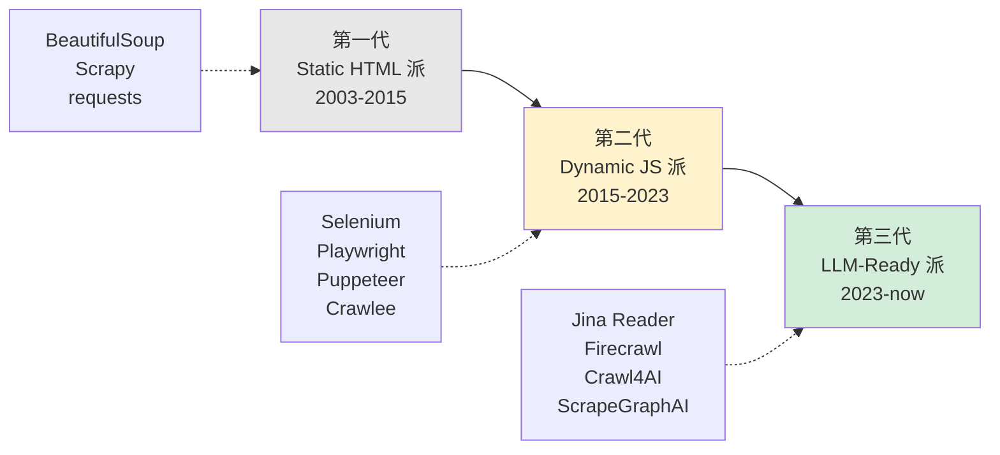

> 历史研究归档 · 2026-11-10 发布 · 程序扫描并审阅风险命中上下文；未逐篇全文审阅。原有日期、观点、数据和命令保留历史语境，未经本次逐项事实核验或运行复现；请结合[归档说明](../../../ARCHIVE_POLICY.md)阅读。

# Agent 网页爬虫技术调研：从 BeautifulSoup 到 Firecrawl 的演进与选型

> **一句话**：传统爬虫是"把 HTML 抠出来给人看"，AI 时代爬虫是"把网页洗成 Markdown 给 LLM 吃"。这一次代际转换发生在 2024-2025，标志事件是 Jina Reader 把"一行 URL → 干净 Markdown"做成了标配，Firecrawl 把这事卷成了 11.5 万 Stars 的爆款。**你今天搭 Agent 用爬虫，95% 的场景不用从 BeautifulSoup 写起，直接用 Firecrawl/Crawl4AI/Jina 即可。**
> 研究日期：2026-05-04
> 关联报告：R77（原稿交叉引用，本归档未解析） Browser Harness（操作浏览器） · [R30](../04-%E5%B7%A5%E7%A8%8B%E5%AE%9E%E8%B7%B5/R30_RAG%E4%BB%8E%E5%85%A5%E9%97%A8%E5%88%B0%E7%94%9F%E4%BA%A7%E8%90%BD%E5%9C%B0.md) RAG 落地（数据进 RAG 之前的清洗） · [R46](R46_%E5%A4%96%E9%83%A8%E8%B5%84%E8%AE%AF%E5%90%8C%E6%AD%A5_Agent%E6%8C%81%E7%BB%AD%E5%AD%A6%E4%B9%A0%E4%B8%89%E5%B1%82%E8%8C%83%E5%BC%8F.md) 外部资讯同步 · [R64](../04-%E5%B7%A5%E7%A8%8B%E5%AE%9E%E8%B7%B5/R64_Agent%E7%BD%91%E5%85%B3%E8%AE%BE%E8%AE%A1_AI_Gateway_LLM_Gateway_MCP_Gateway%E4%B8%89%E5%B1%82%E6%8B%86%E8%A7%A3.md) Agent 网关

---

## TL;DR 速查卡（30 秒看懂）

- 🎯 **核心结论**：Agent 时代不要再从 `requests + BeautifulSoup` 起步——直接用 **Firecrawl**（云）、**Crawl4AI**（自托管）或 **Jina Reader**（轻量）三选一
- 📊 **三家定位**：
  - **Firecrawl** 11.5 万 Stars、AGPL-3.0、SaaS 优先（自托管要把改动开源）
  - **Crawl4AI** 6.5 万 Stars、Apache-2.0、纯开源自托管最优
  - **Jina Reader** 一行 URL 调用（`https://r.jina.ai/<URL>`），月 1M tokens 免费
- 💰 **典型成本**：Firecrawl $19/月起（3k 页）；Jina Reader 免费档够小项目；自托管 Crawl4AI 只花服务器和 LLM 钱
- 🚫 **不要踩**：① 反爬别自己写（要么用 SaaS 自带代理池要么买专用代理）② 别给 LLM 直接喂 raw HTML（贵 5-10 倍且效果差）③ AGPL 协议在企业内网部署前一定要确认合规
- ✅ **5 分钟跑通**：见 §五 Hello World，三个工具各 5 行代码出结果
- 🧭 **决策一句话**：**SaaS 选 Firecrawl，自托管选 Crawl4AI，单点用 Jina**——其他工具（Scrapy/Selenium/BeautifulSoup）只在特殊场景才有理由用

---

## 目录

- [一、定位透镜：纵横坐标](#一定位透镜纵横坐标)
- [二、概念速通：爬虫到底是干什么的](#二概念速通爬虫到底是干什么的)
- [三、研究分析轨道](#三研究分析轨道)
  - [3.1 三代爬虫的演化脉络](#31-三代爬虫的演化脉络)
  - [3.2 当前格局：传统派 vs LLM 时代派](#32-当前格局传统派-vs-llm-时代派)
  - [3.3 头部产品深度拆解](#33-头部产品深度拆解)
  - [3.4 与 R77 Browser Harness 的边界](#34-与-r77-browser-harness-的边界)
- [四、上手实战轨道](#四上手实战轨道)
  - [4.1 环境与依赖](#41-环境与依赖)
  - [4.2 Hello World × 3：Jina / Firecrawl / Crawl4AI](#42-hello-world--3jina--firecrawl--crawl4ai)
  - [4.3 真实场景：把竞品官网洗成 RAG 知识库](#43-真实场景把竞品官网洗成-rag-知识库)
  - [4.4 接入 Agent：MCP 一键挂载](#44-接入-agent-mcp-一键挂载)
  - [4.5 生产部署 Checklist](#45-生产部署-checklist)
- [五、避坑指南](#五避坑指南)
- [六、成本 ROI 速算](#六成本-roi-速算)
- [七、决策速查树](#七决策速查树)
- [八、结论与最佳实践](#八结论与最佳实践)
- [九、开放问题](#九开放问题)
- [📌 来源清单](#-来源清单)

---

## 一、定位透镜：纵横坐标

> 不先建坐标系就讨论选型，等于不看地图就出发。

### 纵轴 · 演化脉络（它怎么来的？）

```
2003: BeautifulSoup     ← "解析 HTML 字符串" 时代（人写规则）
       ↓
2008: Scrapy            ← "工程化爬虫" 时代（调度+管道+并发）
       ↓
2017: Playwright/Puppeteer/Selenium ← "真浏览器" 时代（解决 JS 渲染、SPA）
       ↓
2023: Jina Reader       ← "URL → Markdown" 时代（专为 LLM 而生）
       ↓
2024: Firecrawl         ← "Web → LLM-Ready" 时代（端到端管线，反爬+清洗+结构化一锅端）
       ↓
2025: Firecrawl Agent / Crawl4AI Adaptive   ← "Agent 自己决定爬什么" 时代
```

**关键转折**：

- 第一次转折（~2017）：JS 渲染的 SPA 站点流行，纯 `requests` 抓不到内容 → 不得不上 headless browser
- **第二次转折（2023-2024）**：LLM 真正落地后大家发现"喂 raw HTML 给模型贵且笨"，于是出现了"专为 LLM 准备数据"的爬虫赛道。Jina 把它做成了一行 URL，Firecrawl 把它做成了平台

**生命周期定位**（2026-05）：

| 层 | 阶段 | 信号 |
|----|------|------|
| 传统派（Scrapy / BeautifulSoup） | **成熟期偏衰退** | 仍在用，但新项目不再优先选 |
| 真浏览器派（Playwright） | **成熟期** | 是底层，但很少直接用，被上层封装 |
| LLM 时代派（Firecrawl / Crawl4AI / Jina） | **快速上升期** | 12 个月内从几千 Star 涨到 6-11 万 Star |
| Agent-Native 派（Firecrawl Agent / Crawl4AI Adaptive） | **萌芽期** | 概念已成型，落地案例正在累积 |

### 横轴 · 竞争格局（同场景谁在打？）

```
                  ┌──────────────────────────────────────────────┐
                  │           Web Scraping for Agents             │
                  └──────────────────────────────────────────────┘
                                       │
        ┌──────────────────────────────┼──────────────────────────────┐
        │                              │                              │
   传统派（人用）                LLM 时代派（Agent 用）              代理 / 反爬 基础设施
   - BeautifulSoup              - Firecrawl    115k★              - Bright Data
   - Scrapy                     - Crawl4AI     65k★               - ScrapingBee
   - Playwright(裸)             - Jina Reader  (Jina 全家桶)      - Oxylabs
   - Selenium                   - ScrapeGraphAI 23k★              - Browserbase（R77）
                                - Crawlee (Apify)                  - Steel.dev（R77）
```

**设计哲学差异**（这才是选型的核心）：

| 哲学 | 代表 | 心智模型 |
|------|------|---------|
| **"我给你工具，规则你写"** | BeautifulSoup / Scrapy | 程序员主导，每个站点写定制规则 |
| **"我给你浏览器 API"** | Playwright / Puppeteer | 模拟用户行为，DOM 操作 |
| **"我给你干净 Markdown"** | Jina Reader / Firecrawl `/scrape` | URL 进，Markdown 出，中间细节我管 |
| **"你说要什么 我来想办法找"** | Firecrawl Agent / Crawl4AI Adaptive | 自然语言 prompt 进，结构化数据出，连去哪几个 URL 都 LLM 决定 |

### 交叉判断（独立结论）

- **如果你今天才开始做 Agent 爬虫**：跳过传统派直接用 LLM 时代派——成熟度足够（11 万 Star）、月活跃维护、原生 Markdown/JSON 输出
- **如果你已有 Scrapy/Selenium 项目**：不必硬迁移，但新功能用新栈。两套并存，让数据进同一个 Markdown 仓库
- **如果你企业内网严合规**：Crawl4AI（Apache-2.0）> 自托管 Firecrawl（AGPL，要把改动开源）> SaaS（数据出网风险）
- **核心反直觉**：**LLM 时代爬虫的"主要竞争力不在爬取，在清洗和规模化**——爬到 HTML 谁都会，但能稳定把 HTML 洗成 LLM 友好的 Markdown、还能扛住反爬和并发，这才是 Firecrawl 估值高的原因

---

## 二、概念速通：爬虫到底是干什么的

> 这一节献给"我不太懂这个技术"的读者。已经懂的可以直接跳到 §三。

**一句话定义**：爬虫（Web Scraper / Crawler）= **让程序模拟浏览器去读网页，然后把内容拿回来用**。

**两个常被混用但不同的词**：

| 词 | 含义 | 类比 |
|----|------|------|
| **Scraper（抓取器）** | 拿到一个具体 URL，把这个页面的内容抠出来 | 你打开一个网页 Ctrl+S 保存 |
| **Crawler（爬行器）** | 从一个起点出发，沿着链接遍历整个网站 | 像蜘蛛沿网爬，从首页爬到所有子页 |

实际工程中两个常组合：先 Crawl 拿到所有 URL，再对每个 URL 做 Scrape。

### 一个网页从你眼里到 Agent 嘴里要走 5 步

```
①浏览器打开URL → ②等JS渲染完 → ③定位你要的内容 → ④清洗成结构化 → ⑤交给Agent/LLM
```

**每一步都是坑**：

| 步骤 | 难点 | 传统派做法 | LLM 时代派做法 |
|------|------|----------|--------------|
| ① 打开 URL | 反爬、IP 封禁、Cloudflare | 自己配代理池 | SaaS 内置代理池 |
| ② 等 JS 渲染 | SPA 单页应用、无限滚动 | Selenium/Playwright 自己写等待 | 工具默认用 headless browser |
| ③ 定位内容 | XPath/CSS 选择器易碎 | 一个站一个规则，改版就崩 | LLM 看页面"理解"内容，不依赖选择器 |
| ④ 清洗 | 去广告、去导航栏、去脚本 | 自己写 regex | 工具内置 readability + html-to-markdown |
| ⑤ 交给 LLM | 格式不友好、Token 浪费 | 还得自己再清一遍 | 直接出 Markdown / JSON |

**关键概念词典**（看到不慌）：

- **Headless Browser**：没有图形界面的浏览器（Chrome/Chromium 后台跑），是抓 JS 渲染页面的标配
- **反爬（Anti-Bot）**：网站识别"你不是真人"然后封禁。常见手段：检测 User-Agent、要 CAPTCHA、Cloudflare 防护
- **代理池（Proxy Pool）**：一堆不同 IP 的代理，轮流用避免被封
- **Markdown**：纯文本格式，比 HTML 干净 5-10 倍，Token 消耗也低，是 LLM 的最爱
- **MCP（Model Context Protocol）**：Anthropic 推的协议，让你的 Agent 一行配置就能用 Firecrawl 的工具——见 §4.4

---

## 三、研究分析轨道

### 3.1 三代爬虫的演化脉络



**每代解决了上一代的什么痛点？**

- **第一代 → 第二代**：JS 渲染的 SPA 站抓不到内容 → 引入真浏览器
- **第二代 → 第三代**：LLM 直接吃 HTML 太贵且不准 → 出 LLM 时代专属管线（清洗 + 结构化 + Markdown）

**第三代的三个共同特征**（这是它们和老工具的本质区别）：

1. **默认输出 Markdown / JSON**（不是 HTML）
2. **内置 readability 清洗**（自动去广告、导航栏、脚本）
3. **配套 MCP / Skill**（让 Agent 一行接入）

### 3.2 当前格局：传统派 vs LLM 时代派

| 维度 | 传统派（Scrapy/BS4/Playwright） | LLM 时代派（Firecrawl/Crawl4AI/Jina） |
|------|-------------------------------|------------------------------------|
| **学习曲线** | 陡（要懂 HTML/CSS/XPath） | 平（一个 API 调用） |
| **每个站点工作量** | 高（写规则、维护选择器） | 低（同一套 API 跑所有站） |
| **JS 渲染** | 要自己集成 Playwright | 默认支持 |
| **反爬** | 自己买代理池 | SaaS 内置 / 自托管要自己加 |
| **输出格式** | 原始 HTML（要自己再处理） | Markdown / JSON / 截图 |
| **结构化提取** | 写 XPath / CSS | LLM-prompt 驱动（自然语言） |
| **规模化** | 自己搭分布式（Scrapy-Redis） | SaaS 自动 / 自托管要自己搭 |
| **成本结构** | 服务器 + 代理 + 人力 | API 调用费（或自托管成本） |
| **何时仍该用** | 有自己代理池 / 站点超复杂表单 / 严苛合规 | 95% 的 Agent 场景 |

### 3.3 头部产品深度拆解

#### 3.3.1 Firecrawl —— SaaS 优先的"全家桶"

**关键事实**（数据来自 GitHub README，2026-05-04 抓取）：

- ⭐ **115k Stars**、7.2k Forks、148 Contributors、最近发布 v2.9.0（3 周前）
- 🪪 **AGPL-3.0**（重要！自托管 + 修改 + 对外提供服务 = 必须开源你的修改）
- 🏗️ TypeScript 67% / Python 17% / Rust 5% —— **多语言混编**说明工程化程度高
- 📈 P95 延迟 3.4s，宣称覆盖 96% 的 Web

**核心 API 全景**：

```
/scrape   单 URL → Markdown / JSON / 截图
/crawl    全站 → 批量 Markdown
/map      全站 URL 发现（不抓内容，只列链接）
/search   "搜索引擎" + 抓回结果全文
/agent    自然语言 prompt → 自动找 URL 并抓取（v2 主推）
/interact 抓完之后还能让 AI 点击/输入（向 R77 靠近）
```

**最值得关注的设计**：

- **`/agent` 端点**：`prompt="Find the founders of Stripe"`，**它自己决定去哪几个 URL**——这是 2025 年才出现的新形态，把"决策什么 URL"交给 LLM
- **结构化输出 with Pydantic**：传一个 Schema 进去，直接拿到 Pydantic 对象，而不是自己 parse JSON
- **MCP 一键集成**：`npx -y firecrawl-mcp`，Cursor / Claude Code / Copilot 都能用

**License 警告（重点）**：AGPL-3.0 不是 MIT。**自托管并对外提供服务时你的修改必须开源**。如果你的公司是数据敏感行业（金融/医疗），自托管 Firecrawl 之前一定要让法务过一遍。SDK 是 MIT，可以放心商用。

#### 3.3.2 Crawl4AI —— Apache-2.0 自托管之王

**关键事实**：

- ⭐ **64.9k Stars**、6.6k Forks、77 Contributors、最近 v0.8.6（安全热修复，替换被供应链攻击的 litellm）
- 🪪 **Apache-2.0**（企业友好，可以闭源商用）
- 🐍 Python 98.8% —— **纯 Python 栈**，部署/二开门槛低
- 🛡️ v0.8.5 引入 **三层 Anti-Bot 检测 + 代理升级**

**最值得关注的设计**：

- **Adaptive Crawling**（v0.7 引入）：自己根据"已经看到的内容质量"决定还要不要继续爬，避免无脑深爬
- **Crash Recovery**（v0.8）：断点续爬，长任务挂掉不用全部重来
- **Shadow DOM 处理**：很多现代 SPA 用 Web Components，传统爬虫看不到 Shadow DOM，Crawl4AI 自动展开
- **CLI `crwl`**：`crwl https://docs.example.com --deep-crawl bfs --max-pages 10`，命令行直接用

**和 Firecrawl 的本质区别**：

- Firecrawl 是 **SaaS 优先 + 开源给你看**，你买它的价值是省时间
- Crawl4AI 是 **开源自托管优先 + 准备做云**（Cloud API closed beta），你用它是因为想完全掌控
- **不是替代关系**：很多团队会"PoC 用 Firecrawl 验证想法 → 量大了切 Crawl4AI 自托管"

#### 3.3.3 Jina Reader —— 极致简洁的"URL 转 Markdown"

**关键事实**：

- 调用方式简洁到离谱：`https://r.jina.ai/<URL>`，浏览器粘贴就能用
- 月 1M tokens 免费（小项目够用），后续按 token 收费
- 同公司 Jina AI 有 Embedding / Reranker 全家桶，要做 RAG 一站式
- 提供 `s.jina.ai/<query>` 搜索版，相当于 LLM 友好的搜索引擎

**适用场景**：

- 你只需要"偶尔抓一个 URL 看看内容" → Jina Reader 完爆其他方案
- 你做 RAG 想用 Jina 全家桶（Reader + Embedding + Reranker）→ 整合最丝滑
- 你不想搭服务、不想付月费、月调用量 < 1000 次 → 免费档完全够

**局限**：

- 不做 Crawl（全站爬），只做 Scrape（单 URL）
- 没有结构化提取 API，要自己再喂 LLM
- 反爬不如 Firecrawl 的代理池强

#### 3.3.4 ScrapeGraphAI —— LLM-as-Pipeline 的早期范式

- ⭐ 23.4k Stars、MIT、纯 Python
- 核心创意：**把爬虫做成 LangGraph 风格的有向图**，每个节点是一个 LLM 操作
- `SmartScraperGraph` 给个 prompt + URL，自动出结构化结果
- **2025 年其势头被 Firecrawl Agent 接管**——同样的事 Firecrawl 做得更好且 SaaS 更省心
- **当前定位**：教学价值 > 生产价值，适合想理解"LLM 怎么驱动爬虫流程"的人读源码

#### 3.3.5 传统派的代表 Crawlee（Apify）

- 不是 LLM 时代派，但**是传统派里 2025 年仍值得用的**
- TypeScript / Python 双语 SDK、自带 BrowserPool、自带反爬
- 适合：**已经写过 Playwright/Puppeteer 的团队**想升级到工程化框架，但又不想完全切到 LLM 派

### 3.4 与 R77 Browser Harness 的边界

> 这是工作区内部的关键交叉，必须澄清。

```
┌──────────────────────────────────────────────────────────────┐
│             Agent 与 Web 的两类关系                           │
└──────────────────────────────────────────────────────────────┘

R79（本报告）: 爬数据回来给 Agent 用
  - 目标：拿到内容（文本、表格、文档）
  - 典型场景：竞品监控、RAG 知识库构建、新闻聚合
  - 头部工具：Firecrawl / Crawl4AI / Jina Reader
  - 关键能力：清洗、结构化、规模化、反爬

R77: Agent 操作浏览器做事
  - 目标：完成动作（填表、下单、点按钮）
  - 典型场景：自动化操作 SaaS、RPA、Computer Use
  - 头部工具：Browserbase / Stagehand / browser-use / Playwright MCP
  - 关键能力：交互、状态管理、视觉理解、反检测
```

**重叠区**：底层都用 Playwright/Chromium，反爬/代理需求一致

**关键差异**：

| 维度 | R79 爬虫派 | R77 Browser Harness 派 |
|------|----------|----------------------|
| 主要动作 | **GET（读）** | **POST（写）** |
| 输出 | Markdown / JSON 数据 | 操作结果 / 副作用 |
| 失败成本 | 数据缺失（可重试） | 错误提交（可能不可逆） |
| 鉴权 | 通常匿名 / Cookie | 通常要登录态 |
| 推荐工具 | Firecrawl | Playwright MCP |

**实战中常组合**：用 Browser Harness 登录拿 Cookie → 用爬虫批量抓登录后的页面。Firecrawl 的 `actions` 字段（先 click/scroll 再抓）就是这种"两边都伸手"的设计。

---

## 四、上手实战轨道

### 4.1 环境与依赖

```bash
# Python 3.10+
python --version  # 应当 >= 3.10

# 创建虚拟环境（推荐）
python -m venv .venv
.\.venv\Scripts\Activate.ps1  # Windows PowerShell

# 三个工具任选一个先装：
pip install firecrawl-py==2.0.0     # Firecrawl
pip install crawl4ai==0.8.6         # Crawl4AI
pip install requests                 # Jina Reader 不需要 SDK，requests 即可
```

`.env` 模板（如果用 SaaS）：

```bash
# .env.example
FIRECRAWL_API_KEY=fc-xxxxxxxxxxxxx   # 注册 firecrawl.dev 免费拿 500 credits
JINA_API_KEY=jina_xxxxxxxxxxxxx      # 可选，匿名也能调但配额低
```

### 4.2 Hello World × 3：Jina / Firecrawl / Crawl4AI

#### A. Jina Reader —— 最简（不用 SDK）

```python
# hello_jina.py
import requests

URL = "https://github.com/firecrawl/firecrawl"
response = requests.get(f"https://r.jina.ai/{URL}")

print(response.text[:500])

# Expected output 前几行（实际会是 Markdown）：
# Title: firecrawl/firecrawl
# URL Source: https://github.com/firecrawl/firecrawl
# Markdown Content:
# # 🔥 Firecrawl
# Power AI agents with clean web data...
```

跑通验收：能看到打印出来的是干净的 Markdown 而不是一堆 HTML 标签。

#### B. Firecrawl —— SaaS API

```python
# hello_firecrawl.py
import os
from firecrawl import Firecrawl

app = Firecrawl(api_key=os.environ["FIRECRAWL_API_KEY"])

# 单页抓取
result = app.scrape("https://firecrawl.dev", formats=["markdown"])
print(result.markdown[:500])

# 结构化提取（最有 LLM 时代特色的功能）
from pydantic import BaseModel
class PageInfo(BaseModel):
    title: str
    main_features: list[str]

structured = app.scrape(
    "https://firecrawl.dev",
    formats=[{"type": "json", "schema": PageInfo}],
)
print(structured.json)
# Expected: {"title": "Firecrawl", "main_features": ["Search", "Scrape", "Crawl", ...]}
```

跑通验收：第一个调用拿到 Markdown，第二个调用直接拿到 Pydantic 对象——**这就是"LLM 时代爬虫"的核心价值**。

#### C. Crawl4AI —— 完全本地

```python
# hello_crawl4ai.py
import asyncio
from crawl4ai import AsyncWebCrawler

async def main():
    async with AsyncWebCrawler() as crawler:
        result = await crawler.arun(url="https://news.ycombinator.com")
        print(result.markdown[:500])
        print(f"\n抓到 {len(result.links.get('internal', []))} 个站内链接")

if __name__ == "__main__":
    asyncio.run(main())

# 首次运行会自动下载 Chromium（约 200MB）
# Expected output: 干净的 HN 头条 Markdown + 链接数量
```

**首次跑前注意**：

```bash
crawl4ai-setup       # 自动装 Playwright + Chromium
crawl4ai-doctor      # 验证环境
```

### 4.3 真实场景：把竞品官网洗成 RAG 知识库

> 这是 Agent 项目里最常见的爬虫需求。下面用 Firecrawl 演示，30 行代码完成"全站爬 + 入向量库"。

```python
# competitor_to_rag.py
"""把竞品官网全部页面爬下来，存成 Markdown 文件供 RAG 索引"""
import os
from pathlib import Path
from firecrawl import Firecrawl

app = Firecrawl(api_key=os.environ["FIRECRAWL_API_KEY"])
OUTPUT_DIR = Path("./competitor_docs")
OUTPUT_DIR.mkdir(exist_ok=True)

# 1) 全站爬，限制最多 100 页（避免烧 credits）
docs = app.crawl(
    "https://docs.example-competitor.com",
    limit=100,
    scrape_options={"formats": ["markdown"]},
)

# 2) 落盘成 Markdown，文件名用 URL 路径（方便后续 chunk）
for doc in docs.data:
    url = doc.metadata.get("sourceURL", "")
    safe_name = url.replace("https://", "").replace("/", "_").replace(":", "")[:200] + ".md"
    (OUTPUT_DIR / safe_name).write_text(
        f"# Source: {url}\n\n{doc.markdown}",
        encoding="utf-8",
    )

print(f"✅ 已写入 {len(docs.data)} 个文件到 {OUTPUT_DIR}")

# 3) 后续步骤（不在本脚本范围）：
#    - 用 LangChain MarkdownTextSplitter 切片
#    - 喂给 Chroma / Qdrant / Milvus 建索引
#    - 详见 [R30](../04-%E5%B7%A5%E7%A8%8B%E5%AE%9E%E8%B7%B5/R30_RAG%E4%BB%8E%E5%85%A5%E9%97%A8%E5%88%B0%E7%94%9F%E4%BA%A7%E8%90%BD%E5%9C%B0.md) RAG 从入门到生产落地
```

**这个脚本能省的事**：

- ✅ JS 渲染（Firecrawl 默认上 Playwright）
- ✅ 反爬 / 代理（SaaS 自动）
- ✅ HTML → Markdown 清洗
- ✅ 跨页跟踪进度（封装好的 polling）
- ✅ 内置去重（同 URL 不重复爬）

**100 页大约花费**：100 credits ≈ Standard 套餐 $0.099（按 1k credits/$1 估算）

### 4.4 接入 Agent：MCP 一键挂载

> 这是 2025 年最值得抄的姿势。**让 Cursor / Claude Code / Copilot 内置爬虫能力**，不需要写代码。

VS Code Copilot / Claude Code 配置（`.vscode/mcp.json` 或 Claude Desktop 配置）：

```json
{
  "mcpServers": {
    "firecrawl-mcp": {
      "command": "npx",
      "args": ["-y", "firecrawl-mcp"],
      "env": {
        "FIRECRAWL_API_KEY": "fc-YOUR_KEY"
      }
    }
  }
}
```

重启编辑器后，对 Copilot 直接说："**帮我把 https://example.com 转成 Markdown 给我**"——它会自己调 Firecrawl MCP 工具。

**为什么 MCP 这种姿势比代码集成更好**：

- 不污染你的项目代码
- 跨工具复用（Cursor 配一次，Copilot 也能用）
- Agent 自己决定什么时候调用爬虫，你只描述意图

**关联**：R77（原稿交叉引用，本归档未解析） §六也讨论过 MCP vs CLI+Skills 的范式之争——爬虫场景里 MCP 完胜，因为输入就一个 URL。

### 4.5 生产部署 Checklist

从 PoC 到生产前必须打勾：

| # | 项 | 为什么重要 |
|---|----|----------|
| 1 | **设并发上限** | 默认无限并发会把 API 月费一夜烧光；建议 `max_concurrent=5` |
| 2 | **加重试 + 退避** | 网络抖动 / 反爬一时拒绝是常态；指数退避最多 3 次 |
| 3 | **去重机制** | URL 哈希入 Redis，TTL 7 天，避免重复抓同页 |
| 4 | **失败页面单独存** | 失败的不要丢掉，存到 dead-letter 队列后续人工 review |
| 5 | **监控 credits / token 余额** | 设阈值告警，余额低于 20% 通知 |
| 6 | **遵守 robots.txt** | Firecrawl/Crawl4AI 默认遵守，但你的自定义 fetch 可能没 |
| 7 | **加 User-Agent 标识** | 写明 `MyBot/1.0 (+https://yoursite.com/bot)` 让站长能联系你 |
| 8 | **限频** | 同一域名最多 1 req/sec，别把人家网站打挂 |
| 9 | **数据增量更新** | 别每次全量爬，按 sitemap.xml 的 lastmod 增量 |
| 10 | **License 合规复查** | AGPL Firecrawl 自托管要把改动开源 |

---

## 五、避坑指南

| 坑 | 原因 | 解法 |
|----|------|------|
| **直接给 LLM 喂 raw HTML，token 爆炸** | HTML 含大量 `<script>`/`<style>`/导航栏 | 用 Firecrawl/Jina/Crawl4AI 出 Markdown，token 降 5-10× |
| **自己撸 Playwright 反爬越撸越累** | 反爬是猫鼠游戏，靠代码不靠脑子 | 直接买 SaaS（Firecrawl 自带）或专用代理（Bright Data） |
| **AGPL Firecrawl 自托管在企业内部传播** | AGPL 要求你的修改对所有用户公开 | 选 Apache-2.0 的 Crawl4AI；或用 Firecrawl Cloud；或律师把关 |
| **抓登录后的页面失败** | 没 Cookie / 没 Session | 用 Playwright 先登录拿 Cookie，再传给爬虫；或上 R77 派的 Browserbase |
| **CSS 选择器写好上线就崩** | 网站改版，选择器失效 | LLM 时代派不依赖选择器，自然解决；非要写选择器就上 Crawlee 自动重试 |
| **抓到的 Markdown 全是乱码** | 网站编码不是 UTF-8（中文老站） | Firecrawl/Crawl4AI 默认正确处理；自己写 requests 要 `response.encoding = response.apparent_encoding` |
| **CAPTCHA / Cloudflare 拦截** | 被识别为机器人 | 三个层级解法：①用 Firecrawl `proxy=premium` ②集成 CapSolver ③上 R77 派的 Steel.dev/Browserbase |
| **全站爬一爬就把人家网站打挂** | 没限频，1000 并发砸过去 | 设 `rate_limit=1/sec` per domain；爬大站请求邮件礼貌沟通 |
| **抓到的内容总是重复（首页内容混入子页）** | 没用 readability 算法去主体 | LLM 时代派默认有；如果一定要自己写，用 `readability-lxml` 库 |
| **JS 渲染慢导致内容缺失** | 默认等待时间不够，SPA 异步渲染 | 加 `wait_for_selector` 或 `wait_for_timeout=3000` |
| **法务找上门** | 爬了人家不让爬的 + 商业用途 | 看 robots.txt 的同时也看 ToS；公开个人数据要看 GDPR；商业用途建议买授权 |
| **本地 Crawl4AI 吃显存** | Chromium 一个 tab 几百 MB | 限制并发 + 用完关 page；服务器至少 4GB RAM |

---

## 六、成本 ROI 速算

### 三家 SaaS / 自托管价格对比（2026-05 价格）

| 方案 | 入门档 | 主力档 | 适用规模 | 真实成本估算 |
|------|--------|--------|---------|------------|
| **Firecrawl Cloud** | Free 500 credits | Hobby $19/月 (3k credits) → Standard $99/月 (100k credits) | 1k–100k 页/月 | 1 万页/月 ≈ $99 |
| **Jina Reader** | Free 1M tokens/月 | $0.02/M tokens 后续 | 单点抓 < 1000 页/月 | 5k 次小页面调用 ≈ $0~5 |
| **Crawl4AI 自托管** | $0 软件 + 服务器 | 4GB 服务器 ≈ $20/月 + 代理 $50-200/月 | 想完全控制 / 量极大 | 10 万页/月 ≈ $70-220 服务器+代理 |
| **传统 Scrapy 自建** | $0 软件 | 服务器 + 代理 + 工程师工资 | 已有团队 | 工程师工资 >> 任何 SaaS 费用 |

### "什么规模该用什么"决策

```
月调用量 < 1000          → Jina Reader 免费档（白嫖即可）
月调用量 1k-10k          → Firecrawl Hobby ($19) 最省心
月调用量 10k-100k        → Firecrawl Standard ($99) 或 Crawl4AI 自托管
月调用量 > 100k          → Crawl4AI 自托管 + 自配代理（成本可控）
合规敏感行业              → Crawl4AI 自托管（Apache-2.0）
```

### 隐性成本提醒

- **LLM 调用费**：Firecrawl `/agent` 端点会调 LLM，按 spark-1-mini / spark-1-pro 计费（Pro 比 Mini 贵 2.5×）
- **结构化提取**：用 `formats=[{"type": "json"}]` 也会跑 LLM，每页约 $0.001-0.01
- **代理 IP**：自托管时这是大头。住宅代理 $5-15/GB，月 100GB 流量 = $500-1500
- **工程时间**：自己撸 Scrapy 一个站 1-3 人天，10 个站 = 1 人月，按工资折算往往 > 一年的 SaaS 费

---

## 七、决策速查树

```
你需要爬网页给 Agent 用？
├── 你只偶尔抓单个 URL（< 10 次/天）
│   └── ✅ 浏览器粘贴 https://r.jina.ai/<URL> 即可
│
├── 你要做 PoC / MVP（< 1 万页/月）
│   └── ✅ Firecrawl Free 或 Hobby ($19/月)，5 行代码搞定
│
├── 你要中等规模生产（1-10 万页/月）
│   ├── 不在乎数据出网 → Firecrawl Standard ($99/月)
│   └── 数据敏感 / 合规严 → Crawl4AI 自托管
│
├── 你要超大规模（> 10 万页/月）
│   └── ✅ Crawl4AI 自托管 + 自配代理池（Bright Data 等）
│
├── 你在做的是"操作网站"不是"读网站"
│   └── ⚠️ 走错门，看 R77（原稿交叉引用，本归档未解析） Browser Harness（Stagehand / Playwright MCP）
│
├── 你想让 Coding Agent 直接用爬虫
│   └── ✅ Firecrawl MCP 一行配置：npx -y firecrawl-mcp
│
└── 你已有 Scrapy / Playwright 代码不想动
    └── ✅ 别迁，新功能用 LLM 时代派，让两套并存喂同一个 Markdown 仓库
```

---

## 八、结论与最佳实践

### 三条最重要的判断

1. **跳过传统派直接用 LLM 时代派**——除非你已有遗留代码或有专门工程师维护 Scrapy。Firecrawl/Crawl4AI/Jina 已经成熟到 6-11 万 Stars，别再从 BeautifulSoup 起步了
2. **反爬不是程序问题，是金钱问题**——你能写出来的反反爬，对面专业团队 1 周就能识破。要么买 SaaS，要么买专用代理，**不要把工程师时间消耗在这个军备竞赛**
3. **数据出口选 Markdown，不选 HTML 或 JSON**——Markdown 给 LLM 读最自然，token 最省，链接和层级都保留。Firecrawl/Crawl4AI/Jina 默认全部输出 Markdown 不是巧合

### 五条直接可用的实践

| # | 实践 | 适用场景 |
|---|------|---------|
| P1 | **PoC 用 Firecrawl Free，量大切 Crawl4AI** | 减少前期投入，验证 ROI 后再切自托管 |
| P2 | **配 MCP，让 Coding Agent 直接用** | 比写代码集成省心 10 倍 |
| P3 | **结构化提取用 Pydantic Schema** | 不用自己 parse JSON，直接拿对象 |
| P4 | **加 Redis 去重 + 增量爬** | 长期任务必备，避免重复烧钱 |
| P5 | **抓登录页：R77 拿 Cookie + R79 批量抓** | 两派组合拳 |

### 命题级洞察

- **R77 与 R79 是一体两面**：操作 + 读取构成 Agent 与 Web 的完整交互。生产里常见组合：R77 登录拿 Session → R79 批量抓数据 → 存进 [R30](../04-%E5%B7%A5%E7%A8%8B%E5%AE%9E%E8%B7%B5/R30_RAG%E4%BB%8E%E5%85%A5%E9%97%A8%E5%88%B0%E7%94%9F%E4%BA%A7%E8%90%BD%E5%9C%B0.md) 的 RAG 管线
- **LLM 时代爬虫的护城河不在爬取，在清洗 + 规模化**：人人都能 `requests.get()`，但能稳定洗成 LLM 友好 Markdown 还能扛反爬，这就是 Firecrawl 估值的来源
- **MCP 让爬虫真正成为 Agent 原生能力**：以前是"我写代码调爬虫库"，现在是"我让 Agent 自己决定何时爬什么"——决策层从代码移到 prompt

---

## 九、开放问题

| # | 问题 | 关注信号 |
|---|------|---------|
| Q1 | 真实大规模反爬场景下 Firecrawl 自带代理池 vs Bright Data 谁更划算？ | 需要做实验，本报告未实测 |
| Q2 | Crawl4AI 的 Adaptive Crawling 实际效果如何？是否真能省 30%+ 流量？ | 官方数据未独立验证，待实验 |
| Q3 | Firecrawl Agent 的 spark-1-mini / spark-1-pro 实际是什么模型？ | 文档未披露 |
| Q4 | 国内站点（B 站 / 小红书 / 知乎）这些工具表现如何？反爬普遍更强 | 需要场景化实测 |
| Q5 | LLM 直接看截图（VLM）vs 拿 Markdown 给 LLM，哪个性价比更高？ | 与 [R66](R66_%E5%A4%9A%E6%A8%A1%E6%80%81Agent%E4%B8%8EComputerUse%E8%B0%83%E7%A0%94.md) 多模态 Agent 强关联，待对比 |

---

## 📌 来源清单

- [Firecrawl GitHub](https://github.com/firecrawl/firecrawl) — 2026-05-04 — 115k Stars / AGPL-3.0 / v2.9.0 三周前
- [Crawl4AI GitHub](https://github.com/unclecode/crawl4ai) — 2026-05-04 — 64.9k Stars / Apache-2.0 / v0.8.6
- [Jina Reader 官网](https://jina.ai/reader/) — 2026-05-04 — 一行 URL 调用产品
- [ScrapeGraphAI GitHub](https://github.com/ScrapeGraphAI/Scrapegraph-ai) — 2026-05-04 — 23.4k Stars / MIT
- [Crawlee GitHub](https://github.com/apify/crawlee) — 引用结构信息（fetch 失败）
- 本工作区：R77（原稿交叉引用，本归档未解析） / [R30](../04-%E5%B7%A5%E7%A8%8B%E5%AE%9E%E8%B7%B5/R30_RAG%E4%BB%8E%E5%85%A5%E9%97%A8%E5%88%B0%E7%94%9F%E4%BA%A7%E8%90%BD%E5%9C%B0.md) / [R46](R46_%E5%A4%96%E9%83%A8%E8%B5%84%E8%AE%AF%E5%90%8C%E6%AD%A5_Agent%E6%8C%81%E7%BB%AD%E5%AD%A6%E4%B9%A0%E4%B8%89%E5%B1%82%E8%8C%83%E5%BC%8F.md) / [R64](../04-%E5%B7%A5%E7%A8%8B%E5%AE%9E%E8%B7%B5/R64_Agent%E7%BD%91%E5%85%B3%E8%AE%BE%E8%AE%A1_AI_Gateway_LLM_Gateway_MCP_Gateway%E4%B8%89%E5%B1%82%E6%8B%86%E8%A7%A3.md)

⚖️ **来源一致性**：多源一致，关键事实（Stars、License、版本号）均来自 GitHub 官方仓库 README。
📅 **时效性声明**：以上信息获取于 2026-05-04，价格信息基于当前公开 pricing 页推断（具体折扣以官网为准）。

---

## 🔑 核心洞见

1. **爬虫给人看 vs 爬虫给 LLM 看是两个时代**——LLM 时代不要 HTML，要干净 Markdown，这一次代际转换在 2024-2025 完成
2. **反爬不是写代码能解决的工程问题，是金钱与代理 IP 池的军备竞赛**——别自己造，买现成的或用 SaaS 内置
3. **Firecrawl/Jina/Crawl4AI 三家瓜分了 LLM 时代爬虫**——开源做地基（Crawl4AI）、SaaS 做规模（Firecrawl）、Reader 做单点（Jina），三个生态位
4. **R77 是"Agent 操作浏览器做事"，R79 是"爬数据回来给 Agent 用"**——工具有重叠（都用 Playwright）但解决的本质问题不同，常组合而非替代
5. **AGPL 不是 MIT**——企业自托管 Firecrawl 前一定要让法务过一遍，否则要把所有改动开源；选 Apache-2.0 的 Crawl4AI 没这个问题
