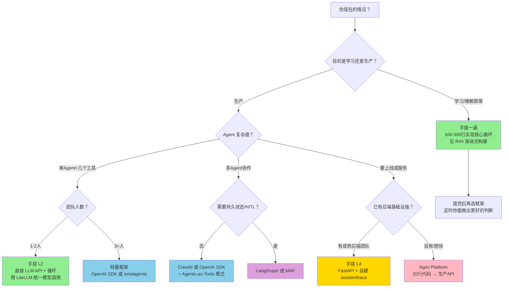

> 历史研究归档 · 2026-11-10 发布 · 程序扫描；未逐篇全文审阅。原有日期、观点、数据和命令保留历史语境，未经本次逐项事实核验或运行复现；请结合[归档说明](../../../ARCHIVE_POLICY.md)阅读。

# 2026 Agent 框架最新格局与"手搓 vs 框架"决策分析

> **一句话概括**：R45 确立的"三派九家"格局 3 周后已松动——Code Agent 派（smolagents）和 Agent Platform 派（Agno）作为新势力入场，而"手搓 vs 框架"的决策本质不是二选一，而是一个关于**你在哪个抽象层工作**的问题。
>
> **研究日期**：2026-05-08
>
> **增量价值**：在 [R45](R45_%E7%8E%B0%E4%BB%A3%E6%99%BA%E8%83%BD%E4%BD%93%E7%BC%96%E6%8E%92%E6%A1%86%E6%9E%B6%E6%B7%B1%E5%BA%A6%E8%B0%83%E7%A0%94.md) 基础上补充 4 个 R45 未覆盖的框架（smolagents / Agno / Mastra / DSPy），重新审视框架版图分类，并专门回答"手搓还是用框架"这个工程决策问题。
>
> **关联报告**：[R45](R45_%E7%8E%B0%E4%BB%A3%E6%99%BA%E8%83%BD%E4%BD%93%E7%BC%96%E6%8E%92%E6%A1%86%E6%9E%B6%E6%B7%B1%E5%BA%A6%E8%B0%83%E7%A0%94.md)（现代智能体编排框架深度调研）、[R29](../04-%E5%B7%A5%E7%A8%8B%E5%AE%9E%E8%B7%B5/R29_SDKvsIDEvsCLI%E4%B8%89%E7%A7%8DAgent%E5%BC%80%E5%8F%91%E6%A8%A1%E5%BC%8F.md)（SDK vs IDE vs CLI 三种模式）、[R44](../04-%E5%B7%A5%E7%A8%8B%E5%AE%9E%E8%B7%B5/R44_%E6%B8%90%E8%BF%9B%E5%BC%8FAgent%E6%9E%84%E5%BB%BA%E5%AE%9E%E6%88%98.md)（渐进式 Agent 构建实战）

---

## 目录

1. [定位透镜：纵横坐标](#1-定位透镜纵横坐标)
2. [R45 之后的增量：新入场的玩家](#2-r45-之后的增量新入场的玩家)
3. [重绘版图：从"三派"到"四层"](#3-重绘版图从三派到四层)
4. [手搓 vs 框架：核心决策分析](#4-手搓-vs-框架核心决策分析)
5. [决策树：你该走哪条路](#5-决策树你该走哪条路)
6. [结论与最佳实践](#6-结论与最佳实践)
7. [开放问题](#7-开放问题)

---

## 1. 定位透镜：纵横坐标

### 纵轴 · 演化脉络

Agent 框架的演化经历了四个清晰阶段：

```
2023 H1    探索期     AutoGPT/BabyAGI（"让 GPT 自己跑"的概念验证）
   │                  → 结论：纯自主循环不可靠，需要结构化编排
   ▼
2023 H2    胶水期     LangChain 统治（万能胶水，什么都能接）
   │                  → 结论：过度抽象 = 调试地狱，"LangChain 太重"成社区共识
   ▼
2024-25    分化期     三派分裂——图编排/角色编排/轻量SDK 各走各路
   │                  CrewAI 独立、OpenAI SDK 发布、Pydantic AI 崛起
   ▼
2026       平台期     框架不够了，需要 Runtime/Platform 层
                      Agno 三层架构、Deep Agents Harness、smolagents code-first
```

**关键转折点**：2025 年下半年，社区共识从"选哪个框架写 Agent 逻辑"转向"怎么把 Agent 跑成生产服务"——这不是框架层能解决的问题，于是 Platform 层（Agno）和 Harness 层（Deep Agents）应运而生。

**生命周期定位**：
- LangGraph：**成熟期**（29K⭐，事实标准，但增长放缓）
- CrewAI：**上升期后段**（48K⭐ 最高，但"声量大 vs 生产采用"存在落差）
- smolagents：**上升期前段**（HuggingFace 背书，Code Agent 理念新颖，社区快速增长）
- Agno：**上升期前段**（从 Phidata 重命名转型，定位从"AI Assistant SDK"升级为"Agent Platform"）
- Mastra：**萌芽期**（TypeScript 生态中最有潜力的选手，但成熟度待验证）

### 横轴 · 竞争格局

现在的竞争格局不再是"谁的功能多"，而是**"在哪个抽象层竞争"**：

| 抽象层 | 解决什么问题 | 代表 |
|--------|-------------|------|
| **L1 · 模型调用层** | 统一模型 API，路由/fallback | LiteLLM、OpenRouter |
| **L2 · Agent 逻辑层** | 编写 Agent 的推理/工具/记忆逻辑 | LangGraph、CrewAI、OpenAI SDK、Pydantic AI、smolagents |
| **L3 · 编排/协作层** | 多 Agent 协作、状态传递 | LangGraph、MAF、Google ADK |
| **L4 · 运行时/平台层** | 把 Agent 跑成服务（API/session/trace/RBAC） | **Agno**、LangServe、Deep Agents |

**关键洞察**：R45 的分析集中在 L2-L3，但 2026 年的竞争焦点正在向 L4 迁移。因为 L2 层的问题已经有足够好的解决方案了——选哪个都能跑通；但"跑通 demo"到"上生产"之间的鸿沟，才是真正的痛点。

### 交叉判断

- **LangGraph 的地位依然稳固**，但它的护城河不在"图编排"本身（这个谁都能学），而在于 **LangSmith + LangGraph Cloud + Deep Agents 的垂直整合生态**
- **smolagents 代表了一个真正不同的设计哲学**——"Agent 写代码而非调工具"，这不是换个 API 的事，是对"Agent 怎么和世界交互"的根本重思
- **Agno 不是 L2 层的竞争者**——它明确说"用任何框架构建 Agent，用 Agno 跑成服务"，甚至支持直接跑 Claude Agent SDK 和 LangGraph 的 Agent
- **"手搓"在 L2 层依然是合理选择**，但在 L3/L4 层手搓的 ROI 越来越低

---

## 2. R45 之后的增量：新入场的玩家

### 2.1 smolagents（Hugging Face）— Code Agent 新范式

| 维度 | 数据 |
|------|------|
| 出品 | Hugging Face |
| 许可 | Apache 2.0 |
| 核心代码量 | ~1,000 行（agents.py） |
| 模型支持 | 所有 HF 推理提供商 + LiteLLM 100+ 模型 + 本地 transformers |
| 协议支持 | MCP、LangChain Tools 导入 |

**设计哲学**：Agent 的 action 不应该是"选哪个工具 + 填什么参数"（tool-calling 范式），而应该是**直接写 Python 代码**。

```python
# smolagents 的 CodeAgent 写出的 action 是这样的：
requests_to_search = ["gulf of mexico", "greenland", "tariffs"]
for request in requests_to_search:
    print(f"Results for {request}:", web_search(request))
```

这比 tool-calling 范式**减少 30% 的 LLM 调用步数**（论文实证：Executable Code Actions Elicit Better LLM Agents, 2024）。

**核心差异化**：
- **Code-first**：LLM 直接写 Python 执行，而非输出 JSON tool call
- **极简**：核心逻辑 1000 行，"用哪个抽象就看那行代码"
- **Hub 集成**：Agent 可以 `push_to_hub()` 分享，`from_hub()` 加载
- **沙箱执行**：E2B / Docker / Pyodide 多种隔离方案

**适合场景**：数据分析、批量处理、需要循环/条件/变量的复杂操作。当你的 Agent 需要"对 10 个 URL 分别爬取然后汇总"时，写代码比写 10 次 tool call 高效得多。

**局限**：代码执行的安全性是硬伤——必须沙箱化，增加了部署复杂度。

---

### 2.2 Agno（前身 Phidata）— Agent Platform 层

| 维度 | 数据 |
|------|------|
| 前身 | Phidata（AI Assistants with memory/knowledge/tools） |
| 当前定位 | Agent Platform（Build + Run + Manage） |
| 架构 | 3 层：SDK → Runtime → Control Plane |
| 许可 | SDK + Runtime 开源；Control Plane 闭源 |
| 协议支持 | AG-UI、A2A、OpenTelemetry |
| 接口 | Slack、Telegram、WhatsApp、Discord |

**设计哲学**：不和 LangGraph/CrewAI 在"怎么写 Agent 逻辑"上竞争，而是解决**"写完 Agent 之后怎么把它跑成一个生产服务"**的问题。

```python
# 20 行代码 → FastAPI 后端 + 50+ 端点 + session/trace/RBAC
from agno.os import AgentOS
from agno.agent import Agent

agent = Agent(name="Assistant", model="openai:gpt-5.4", tools=[...])
agent_os = AgentOS(agents=[agent], tracing=True, db=SqliteDb(db_file="agno.db"))
app = agent_os.get_app()
```

**关键能力**：
- **框架无关**：同一个 AgentOS 可以跑 Agno 原生 Agent + Claude Agent SDK + LangGraph + DSPy
- **生产就绪**：50+ API 端点、SSE/WebSocket、session 持久化、cron 调度、RBAC
- **Human Approval**：内置工具级审批流（`confirm=["write", "delete", "shell"]`）
- **可观测性**：原生 OpenTelemetry tracing

**适合场景**：你已经有了一个能跑的 Agent 原型，现在需要把它变成一个能让团队/用户使用的服务。Agno 填的是"Agent demo → Agent 产品"之间那个巨大的工程鸿沟。

**局限**：Control Plane (AgentOS UI) 是闭源的，虽然免费但有 vendor lock-in 风险。

---

### 2.3 Mastra — TypeScript 生态的 Agent 框架

| 维度 | 数据 |
|------|------|
| 语言 | TypeScript |
| 定位 | "The TypeScript framework for AI-powered applications and agents" |
| 核心能力 | Agents + Workflows + RAG + Tools + Eval |
| 生态 | Vercel/Next.js 生态天然集成 |

R45 的分析几乎全是 Python 框架——但如果你的团队是 TypeScript 栈（Next.js/React/Node.js），Mastra 是目前最正统的选择。它对标的是 "LangGraph for TypeScript"，但 API 设计更贴合 TS 开发者习惯。

**局限**：成熟度明显不如 Python 生态的选手，企业案例少。

---

### 2.4 DSPy（Stanford NLP）— "编程而非 Prompting"

| 维度 | 数据 |
|------|------|
| 出品 | Stanford NLP Group |
| 理念 | "Programming—not prompting—foundation models" |
| 核心机制 | Signatures + Modules + Optimizers |

DSPy 不是传统意义上的"Agent 框架"——它解决的是**"怎么让 LLM 调用的质量可优化、可复现"**的问题。传统方式是手工写 Prompt；DSPy 的方式是定义输入/输出签名，然后用 Optimizer 自动搜索最佳 Prompt。

**与 Agent 框架的关系**：DSPy 可以作为 Agent 框架的**底层引擎**——你用 LangGraph 编排流程，但每个节点里面的 LLM 调用用 DSPy 来优化。两者不互斥。

**适合场景**：当你的 Agent 中某个环节的 Prompt 质量不稳定、需要系统化优化时。

---

## 3. 重绘版图：从"三派"到"四层"

R45 的"三派九家"分类（图编排派 / 角色编排派 / 轻量 SDK 派）依然有效描述 L2 层的竞争，但已经不足以描述 2026 年 5 月的完整图景。更准确的分类：

```
┌─────────────────────────────────────────────────────────┐
│  L4 · Agent Platform 层（"跑成服务"）                     │
│  Agno · LangGraph Cloud · Deep Agents                   │
├─────────────────────────────────────────────────────────┤
│  L3 · 编排协作层（"多 Agent 协调"）                       │
│  LangGraph · MAF · Google ADK · A2A 协议                │
├─────────────────────────────────────────────────────────┤
│  L2 · Agent 逻辑层（"写 Agent"）                         │
│  ┌──────────┐ ┌──────────┐ ┌──────────┐ ┌──────────┐  │
│  │图编排派   │ │角色编排派 │ │轻量SDK派  │ │Code派    │  │
│  │LangGraph │ │CrewAI    │ │OpenAI SDK│ │smolagents│  │
│  │MAF       │ │          │ │PydanticAI│ │          │  │
│  └──────────┘ └──────────┘ └──────────┘ └──────────┘  │
├─────────────────────────────────────────────────────────┤
│  L1 · 模型调用层（"统一调 LLM"）                         │
│  LiteLLM · OpenRouter · 各家官方 SDK                     │
├─────────────────────────────────────────────────────────┤
│  L0 · Prompt 优化层（"让调用更准"）                       │
│  DSPy · Promptfoo                                       │
└─────────────────────────────────────────────────────────┘
```

**新增的 Code Agent 派**（smolagents）和之前三派的本质区别：

| 派系 | Agent 如何执行 action |
|------|---------------------|
| 图编排派 | 按状态图调函数 |
| 角色编排派 | 角色协商后分配任务 |
| 轻量 SDK 派 | LLM 选工具 → 调用工具函数 |
| **Code 派** | **LLM 直接写 Python 代码执行** |

---

## 4. 手搓 vs 框架：核心决策分析

### 4.1 先搞清楚"手搓"到底搓的是什么

"手搓 Agent"不是一件事，是**在不同抽象层手搓不同的东西**：

| 你要手搓的层 | 典型工作量 | 框架替代品 | 手搓是否合理？ |
|-------------|-----------|-----------|--------------|
| L1：LLM 调用封装 | 1-2 天 | LiteLLM | ❌ **不合理**——纯重复造轮子，没有任何价值 |
| L2：Agent 推理循环 | 3-7 天 | OpenAI SDK / smolagents | ✅ **合理**——核心逻辑 100-300 行，完全可控 |
| L3：多 Agent 编排 | 1-3 周 | LangGraph / CrewAI | ⚠️ **看情况**——简单编排可以搓，复杂状态管理不值得 |
| L4：生产运行时 | 1-3 月 | Agno / 自建 FastAPI | ⚠️ **看情况**——如果已有成熟后端团队，搓可能更灵活 |

### 4.2 手搓的真实优势

1. **完全理解 = 完全可控**
   - 出了 bug 你知道问题在哪一行
   - 不存在"框架升级后行为变了"的风险
   - 不需要学框架的"正确用法"——代码就是文档

2. **没有抽象税**
   - 框架为了通用性必须引入抽象层（State、Node、Edge、Checkpoint...）
   - 这些抽象在**你用不到的场景下**是纯粹的认知负担
   - 简单场景下，一个 `while True` 循环比 StateGraph 清晰 10 倍

3. **精确贴合需求**
   - 你的 Agent 可能只需要"调 LLM → 解析 tool call → 执行 → 回传"这一个循环
   - 100 行代码搞定，不需要引入 29K⭐ 的 LangGraph

4. **依赖最小化**
   - 不受框架 breaking change 影响
   - 部署时不需要拉一堆 transitive dependencies
   - 安全审计范围小

5. **学习价值**
   - 对于理解 Agent 原理，手搓一遍比用 10 遍框架更有效
   - 知道底层怎么跑的人，用框架时能做出更好的架构决策

### 4.3 手搓的真实代价

1. **累积复杂度是指数增长的**
   - 第 1 个功能（基本循环）：100 行，很爽
   - 第 5 个功能（+工具 +记忆 +错误重试）：500 行，还行
   - 第 10 个功能（+多 Agent +状态持久化 +human-in-the-loop +流式输出）：3000+ 行，开始后悔
   - 关键拐点：**当你开始自己实现 checkpoint/replay 时**，你实际上是在重写 LangGraph

2. **看不见的 edge case**
   - LLM 返回格式不对怎么办？重试几次？用什么策略？
   - 工具调用超时怎么办？
   - 并发请求下状态怎么隔离？
   - 这些都不难，但**每一个都需要你自己想到并处理**——框架帮你想过了

3. **团队协作成本**
   - 你的 100 行代码，只有你看得懂
   - 框架是**共享词汇表**——"这是一个 LangGraph 的 conditional edge"，新人能查文档
   - 自研代码的文档由你负责维护（你会维护吗？）

4. **生态割裂**
   - 框架通常配套可观测性工具（LangSmith、Logfire）
   - 手搓代码的 trace 和 debug 全靠 print 或自建

### 4.4 核心判断框架

**不是"手搓 vs 框架"，而是"你在哪个阶段"**：

```
                    手搓最优区              框架最优区
                   ◄──────────►          ◄──────────────►
                   
复杂度     ●─────────────────────────────────────────────────●
           │                    │                            │
         单Agent             多Agent                    生产级系统
         几个工具             有状态交互                  需要持久化/监控/HITL
         跑通验证             协作编排                    团队维护
           │                    │                            │
最优选     │   直接 API         │    轻量框架                │   重型框架/平台
           │   + while 循环     │    (OpenAI SDK/            │   (LangGraph/Agno)
           │                    │     smolagents)            │
```

### 4.5 实话实说：框架的"隐性成本"

框架不是免费的。选择框架时你在用以下东西交换：

| 你获得的 | 你付出的 |
|---------|---------|
| 开箱即用的能力 | 学习曲线（LangGraph 至少 1-2 周） |
| 社区支持 | vendor lock-in（用深了就迁移不动了） |
| 最佳实践内置 | 框架的"观点"可能和你的需求冲突 |
| 持续维护更新 | 被迫跟进 breaking changes |
| 可观测性工具 | 付费生态的引力（LangSmith、Logfire） |

---

## 5. 决策树：你该走哪条路



### 速查决策表

| 你的情况 | 推荐路径 | 理由 |
|---------|---------|------|
| **第一次做 Agent，想理解原理** | 手搓 | 框架会遮蔽本质。先裸写 ReAct 循环，再看框架如何封装 |
| **PoC/验证想法，1-2 周要出结果** | smolagents 或 OpenAI SDK | 最快路径，概念面积最小 |
| **已验证可行，要给团队用** | Agno 或 LangGraph + LangServe | 需要 session/auth/trace 这些生产件 |
| **TypeScript 全栈团队** | Mastra | Python 框架对 TS 团队是额外负担 |
| **需要精细控制每一步** | LangGraph 或手搓 | 角色编排类框架控制粒度不够 |
| **数据处理/批量操作为主** | smolagents CodeAgent | 写代码比反复 tool call 高效 |
| **已有大量 Prompt 需要优化** | DSPy + 任意框架 | DSPy 解决的是"Prompt 质量"，和编排框架正交 |

---

## 6. 结论与最佳实践

### 6.1 核心结论

1. **"手搓 vs 框架"是伪二元对立**。真正的问题是：你需要在哪些层自己控制，哪些层愿意交出去。推荐做法：**L1 不搓（用 LiteLLM）、L2 可搓可不搓（看复杂度）、L3-L4 看团队规模和项目阶段**。

2. **Anthropic 的 P5 原则（"简单可组合 > 复杂框架"）依然正确**，但它说的是 L2 层。在 L4 层，"简单"的定义变了——20 行 Agno 代码获得 50+ 生产端点，比自己搓 FastAPI 更"简单"。

3. **2026 年的真正新趋势不是"又一个新框架"，而是层次分离**：
   - 模型调用层（LiteLLM）已经解耦了
   - Agent 逻辑层有足够多的选择
   - **运行时/平台层是当下最大的未满足需求**——Agno 在填这个空

4. **smolagents 的 Code Agent 范式值得关注但不宜 all-in**。它在数据分析/批量处理场景下比 tool-calling 好用 30%+，但代码执行的安全性问题让它在面向用户的场景中需要额外基础设施（沙箱）。

### 6.2 如果让我今天从零开始

```
第 1 天：手搓一个 100 行的 ReAct 循环（理解本质）
第 2 天：改用 smolagents 对比体验（Code Agent vs Tool Call 的手感差异）
第 3-5 天：用 LangGraph 做一个有状态的多步任务（理解图编排的 why）
第 6-7 天：用 Agno 把上面的 Agent 包成 API 服务（理解 Platform 层的价值）

结论：哪一层让你觉得"这个我自己写更好"，就手搓那一层。
      哪一层让你觉得"这个别人已经想清楚了"，就用框架。
```

### 6.3 框架选型速查（R45 更新版）

| 需求特征 | 首选 | 次选 |
|---------|------|------|
| 最快上手 | OpenAI Agents SDK | smolagents |
| 类型安全/Python 老手 | Pydantic AI | — |
| 精细状态控制 | LangGraph | MAF |
| 快速 Demo/角色扮演 | CrewAI | — |
| 数据分析/批量处理 | smolagents CodeAgent | — |
| TypeScript 团队 | Mastra | — |
| 跑成生产服务 | Agno | LangGraph Cloud |
| Prompt 质量优化 | DSPy（和其他框架组合使用） | — |
| .NET/Azure | MAF | Semantic Kernel |

---

## 7. 开放问题

1. **smolagents 的 code execution 安全性**在企业场景下是否能被沙箱完全解决？还是这个范式天然不适合 B2C？
2. **Agno 的 Control Plane 闭源**会不会导致未来 vendor lock-in？开源 Runtime 层够不够自给自足？
3. **MCP + A2A + AG-UI 三大协议**正在统一 Agent 间通信标准——这会不会让"框架选择"变得不重要（因为任何框架写的 Agent 都能互通）？
4. **DSPy 的自动 Prompt 优化**如果足够成熟，是否会让"手工写 Prompt"本身变成技术债？

---

## 信息来源

📌 来源清单：
- [smolagents GitHub README](https://github.com/huggingface/smolagents) — 2026-05-08 — 核心设计哲学、Code Agent 机制、基准对比
- [Agno 官方文档](https://docs.agno.com/introduction) — 2026-05-08 — 三层架构、功能清单、示例代码
- [Agno GitHub README](https://github.com/agno-agi/agno) — 2026-05-08 — AgentOS 集成示例、多框架支持
- [awesome-langchain](https://github.com/kyrolabs/awesome-langchain) — 2026-05-08 — Mastra、DSPy、TensorZero 等框架确认
- [R45](R45_%E7%8E%B0%E4%BB%A3%E6%99%BA%E8%83%BD%E4%BD%93%E7%BC%96%E6%8E%92%E6%A1%86%E6%9E%B6%E6%B7%B1%E5%BA%A6%E8%B0%83%E7%A0%94.md) 现代智能体编排框架深度调研 — 2026-04-14 — LangGraph/CrewAI/OpenAI SDK/Google ADK/Pydantic AI/MAF 数据

⚖️ 来源一致性：一致（各框架官方自述 + 社区列表交叉验证）
📅 时效性声明：以上信息获取于 2026-05-08
