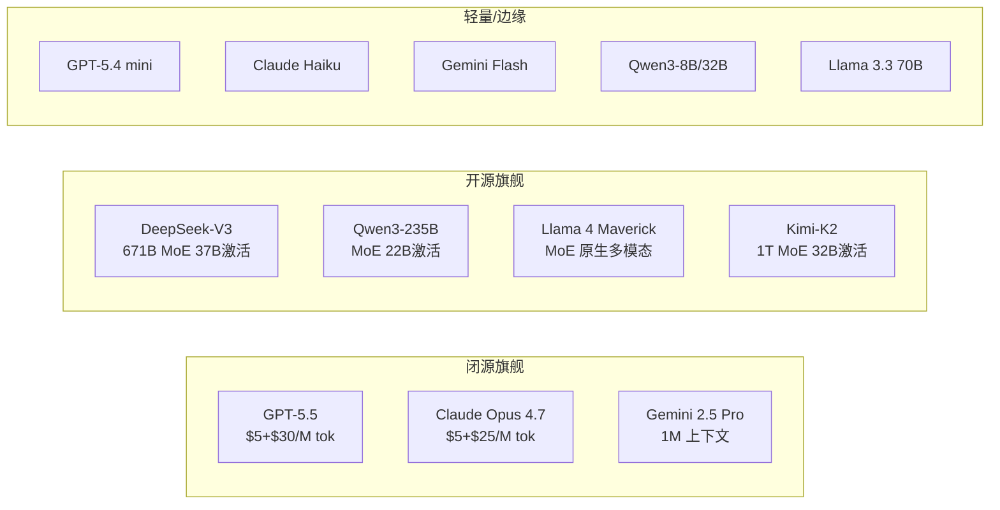

> 历史研究归档 · 2026-11-10 发布 · 程序扫描；未逐篇全文审阅。原有日期、观点、数据和命令保留历史语境，未经本次逐项事实核验或运行复现；请结合[归档说明](../../../ARCHIVE_POLICY.md)阅读。

# 2026 主流 LLM 大模型横评

> **一句话概括**：截至 2026 年 5 月，LLM 市场形成"闭源三强（GPT-5.5 / Claude Opus 4.7 / Gemini 2.5 Pro）+ 开源三杰（DeepSeek-V3 / Qwen3 / Llama 4）+ 黑马搅局者（Kimi-K2）"的格局。闭源模型在编码和 Agent 任务上仍领先，但开源模型的性价比优势在快速收窄差距。
> 研究日期：2026-05-10
> 关联报告：[R65](R65_Agent%E4%B8%BB%E6%B5%81%E6%8A%80%E6%9C%AF%E6%A0%88%E6%90%AD%E9%85%8D%E9%80%9F%E6%9F%A5%E6%89%8B%E5%86%8C.md) 技术栈速查 · [R67](../01-%E7%90%86%E8%AE%BA%E4%B8%8E%E6%9E%B6%E6%9E%84/R67_Reasoning%E6%A8%A1%E5%9E%8B%E4%B8%93%E9%A2%98_o1_R1_Thinking.md) Reasoning 模型 · [R69](../04-%E5%B7%A5%E7%A8%8B%E5%AE%9E%E8%B7%B5/R69_LLM_Agent%E7%BB%8F%E6%B5%8E%E5%AD%A6%E4%B8%8E%E5%95%86%E4%B8%9A%E5%86%B3%E7%AD%96.md) LLM 经济学 · [R62](../01-%E7%90%86%E8%AE%BA%E4%B8%8E%E6%9E%B6%E6%9E%84/R62_LLM%E9%A2%84%E8%AE%AD%E7%BB%83%E5%85%A8%E6%99%AF_%E4%BB%8E%E6%95%B0%E6%8D%AE%E5%88%B0ScalingLaw.md) 预训练全景 · [R58](../04-%E5%B7%A5%E7%A8%8B%E5%AE%9E%E8%B7%B5/R58_LLM%E6%8E%A8%E7%90%86%E9%83%A8%E7%BD%B2%E5%B7%A5%E7%A8%8B%E6%8C%87%E5%8D%97_%E9%87%8F%E5%8C%96%E4%B8%8E%E6%8E%A8%E7%90%86%E5%BC%95%E6%93%8E.md) 推理部署

---

## 目录

- [定位透镜：纵横坐标](#定位透镜纵横坐标)
- [一、闭源旗舰模型](#一闭源旗舰模型)
  - [1.1 OpenAI GPT-5.x 系列](#11-openai-gpt-5x-系列)
  - [1.2 Anthropic Claude 4.x 系列](#12-anthropic-claude-4x-系列)
  - [1.3 Google Gemini 2.5 系列](#13-google-gemini-25-系列)
- [二、开源旗舰模型](#二开源旗舰模型)
  - [2.1 DeepSeek-V3 / R1](#21-deepseek-v3--r1)
  - [2.2 Qwen3 系列](#22-qwen3-系列)
  - [2.3 Meta Llama 4](#23-meta-llama-4)
  - [2.4 Kimi-K2（Moonshot AI）](#24-kimi-k2moonshot-ai)
- [三、核心维度对比总表](#三核心维度对比总表)
- [四、选型决策树](#四选型决策树)
- [五、定价对比](#五定价对比)
- [六、结论与建议](#六结论与建议)
- [七、开放问题](#七开放问题)
- [来源清单](#来源清单)

---

## 定位透镜：纵横坐标

### 纵轴 · 演化脉络

LLM 的竞争已经走过了三个阶段：

1. **参数竞赛期**（2022-2023）：GPT-3 175B → GPT-4，核心叙事是"更大=更强"
2. **效率觉醒期**（2024）：DeepSeek-V3 用 $5.6M 训出 GPT-4o 级别模型，Llama 3 过训练小模型；核心叙事变成"聪明地训，而不只是堆参数"
3. **Agent/推理分化期**（2025-2026，当前阶段）：模型分化为**通用旗舰**（GPT-5.5 / Claude Opus 4.7）和**推理专精**（o3 / DeepSeek-R1）两条路线，同时 MoE 架构成为开源模型的标配（DeepSeek-V3 671B MoE / Qwen3-235B MoE / Kimi-K2 1T MoE）

**当前生命周期定位**：市场处于**成熟上升期**。闭源和开源的性能差距从 2024 年的"代差"缩小到 2026 年的"几个百分点"。真正的竞争焦点已经从"谁的 MMLU 分高"转向"谁在真实编码/Agent 场景下更可靠"。

### 横轴 · 竞争格局



**设计哲学差异**：
- **OpenAI**：全栈封闭生态，模型+工具+平台一体化，追求"一个模型干所有事"
- **Anthropic**：安全优先 + 编码/Agent 深耕，定位"开发者的最佳工作伙伴"
- **Google**：长上下文 + 多模态 + 搜索集成，利用基础设施优势
- **DeepSeek**：工程创新驱动降本，FP8 训练 + MoE 架构，公开度最高
- **阿里 Qwen**：中文生态最强，多尺寸覆盖，最近从思考模式切到"混合思考"
- **Meta Llama**：开源标杆，强调"在你自己的条件上构建"，推动开源生态
- **Moonshot Kimi**：Agent 能力优先，MoE 规模最大（1T），用 Muon 优化器训练

### 交叉判断

闭源模型在 2026 年仍保持着**编码 Agent 和复杂推理**上的明确优势，但这个优势正在以大约 6 个月一个身位的速度被开源追赶。对于大多数应用场景，选择已经不是"闭源还是开源"的二元问题，而是**"对这个具体场景，性能差距是否值得价格差距"**。

---

## 一、闭源旗舰模型

### 1.1 OpenAI GPT-5.x 系列

**最新模型**：GPT-5.5（2026 年 5 月发布）、GPT-5.4、GPT-5.4 mini

| 维度 | 详情 |
|------|------|
| **核心定位** | 全能旗舰，编码 + 专业知识工作 |
| **上下文窗口** | 270K（标准），更长上下文价格更高 |
| **特色能力** | 内置 Web 搜索、代码执行容器、Realtime 语音、图像生成（GPT-image-2） |
| **定价** | GPT-5.5: $5/$30 per M tok; GPT-5.4: $2.5/$15; GPT-5.4 mini: $0.75/$4.5 |
| **Prompt Caching** | 缓存输入 90% 折扣（GPT-5.5 缓存 $0.50/M） |

**优势**：
- 生态最完整——API + ChatGPT + Codex + 图像 + 语音 + 搜索一站式
- GPT-5.4 mini 在性价比上极具竞争力（$0.75/$4.5），适合编码和子 Agent
- Batch API 50% 折扣，大规模批处理最省钱
- Realtime 语音模型（GPT-Realtime-2）和实时翻译是独有能力

**劣势**：
- 完全闭源，无法自部署，数据驻留受限
- GPT-5.5 输出定价 $30/M tok 是所有旗舰中最贵的
- 模型版本迭代快但向后兼容性时有问题
- 对中文的支持不如 Qwen/DeepSeek 原生

### 1.2 Anthropic Claude 4.x 系列

**最新模型**：Claude Opus 4.7（2026-04-16）、Sonnet 4.6、Haiku

| 维度 | 详情 |
|------|------|
| **核心定位** | 编码 + Agent + 企业工作流的深度专精 |
| **上下文窗口** | 1M tokens（Opus 4.7） |
| **特色能力** | 自适应思考（adaptive thinking）、Claude Code（后台长任务）、Computer Use |
| **定价** | Opus 4.7: $5/$25 per M tok; Prompt Caching 省 90%、Batch 省 50% |
| **渠道** | 原生 API + AWS Bedrock + GCP Vertex AI + Microsoft Foundry |

**优势**：
- **编码能力当前最强**——CursorBench 70%（vs Opus 4.6 的 58%），SWE-bench 领先
- Agent 任务可靠性最高——循环抵抗（loop resistance）、工具错误率最低
- 自适应思考：根据问题复杂度自动调节推理深度，简单问题快速回答
- Claude Code 支持后台长任务异步执行，适合 CI/CD 场景
- 1M 上下文窗口，长文档处理能力强
- "反讨好"——会主动挑战用户假设，不盲目同意（多家客户反馈确认）

**劣势**：
- 闭源，无法自部署
- Opus 级别定价不低（$5/$25），高频调用成本需关注
- 中文能力虽在持续改善但仍不如 Qwen/DeepSeek 原生
- 区域可用性受限（某些地区 API 不可用）

### 1.3 Google Gemini 2.5 系列

**最新模型**：Gemini 2.5 Pro、Gemini 2.5 Flash

| 维度 | 详情 |
|------|------|
| **核心定位** | 超长上下文 + 原生多模态 + Google 生态集成 |
| **上下文窗口** | 1M tokens（Pro），2M tokens（实验版） |
| **特色能力** | 原生多模态（文本/图像/视频/音频）、Google 搜索 Grounding、代码执行 |
| **定价** | 相对激进，Flash 版本极低价 |

**优势**：
- **上下文窗口最大**——2M tokens 实验版在长文档分析场景无对手
- 原生多模态最成熟——视频理解、音频转录能力领先
- Google 搜索 Grounding 直接接入搜索引擎
- Flash 版本性价比极高，适合高吞吐场景
- 与 Google Cloud 深度集成（Vertex AI）

**劣势**：
- 编码能力相对 Claude Opus / GPT-5.5 略逊一筹
- Agent/工具调用的可靠性不如 Claude
- API 的稳定性和一致性时有波动
- 企业级支持和 SLA 不如 OpenAI / Anthropic 成熟

---

## 二、开源旗舰模型

### 2.1 DeepSeek-V3 / R1

**DeepSeek-V3**（2024-12 发布，GitHub 103K stars）

| 维度 | 详情 |
|------|------|
| **架构** | 671B 总参数 MoE，37B 激活，128K 上下文 |
| **训练成本** | 仅 $5.6M（2.788M H800 GPU hours），业界最低 |
| **核心创新** | FP8 混合精度训练、无辅助损失负载均衡、多 Token 预测（MTP） |
| **许可** | MIT（代码）+ 商用友好 Model License |

**DeepSeek-R1**（推理专精模型）
- 开源推理模型标杆，o1/o3 的开源替代
- 长 CoT 推理链，在数学和竞赛编程上表现突出
- R1 的推理能力通过蒸馏注入到 V3 中

**优势**：
- **训练效率世界纪录**——$5.6M 训出 GPT-4o 级别，证明工程创新可追回算力差距
- 开源公开度最高——训练细节、架构创新全部公开
- MMLU 88.5、MATH-500 90.2、LiveCodeBench 40.5——开源模型顶级
- 中文能力强（C-Eval 86.5、C-SimpleQA 64.8）
- MoE 37B 激活 → 推理成本低，API 定价极具竞争力

**劣势**：
- 本地部署仍需多卡/多机（671B 总参数，FP8 需 ~350GB 显存）
- Agent 工具调用的可靠性和格式遵循不如闭源旗舰
- 社区虽大但企业级支持有限
- 长上下文场景（>64K）实际表现衰减较明显

### 2.2 Qwen3 系列

**最新模型**：Qwen3-235B-A22B（MoE）、Qwen3-72B/32B/8B/1.5B 等多尺寸

| 维度 | 详情 |
|------|------|
| **架构** | MoE（235B 总参 / 22B 激活）+ Dense 多尺寸 |
| **核心创新** | "混合思考"模式——在思考和非思考模式间无缝切换 |
| **生态** | 92 语言翻译（Qwen-MT）、图像生成（Qwen-Image 20B）、安全护栏（Qwen3Guard） |

**优势**：
- **中文 Tokenizer 最优**——中文场景下 token 效率比其他模型高 30-50%
- 多尺寸覆盖最全——从 1.5B（手机端）到 235B（服务器端），一套架构统一
- "混合思考"实用——同一模型能在需要深度推理时自动启用思考链
- GSPO 训练算法解决了长时间 RL 训练的崩溃问题
- 阿里云生态支持强，国内部署便利

**劣势**：
- 235B MoE 的基座模型未开源（截至 Kimi-K2 研究时）
- 英文场景下与 DeepSeek-V3 / Llama 4 相比无明显优势
- MoE 版本的部署复杂度和推理框架兼容性仍在完善中
- 社区活跃度和国际影响力不如 Llama 和 DeepSeek

### 2.3 Meta Llama 4

**最新模型**：Llama 4 Maverick、Llama 4 Scout

| 维度 | 详情 |
|------|------|
| **Maverick** | MoE，原生多模态（文本+图像），10M token 上下文 |
| **Scout** | MoE，单 H100 可跑，10M 上下文，长文档分析 |
| **定价**（API 估算） | $0.19-$0.49 / M tokens（3:1 混合） |

**Benchmark 数据**（官方）：

| 指标 | Maverick | Scout |
|------|----------|-------|
| MMLU Pro | 80.5 | 74.3 |
| GPQA Diamond | 69.8 | 57.2 |
| LiveCodeBench | 43.4 | 32.8 |
| MMMU（多模态） | 73.4 | 69.4 |
| DocVQA | 94.4 | 94.4 |

**优势**：
- **10M token 上下文**——开源模型中最长，整本书级别的文档处理
- **原生多模态**——early fusion 预训练，图像理解不是后接的，是骨子里的
- Scout 单 H100 可跑——部署门槛大幅降低
- 开源生态最庞大——社区支持、微调工具、部署框架最成熟
- 商用友好许可

**劣势**：
- 编码能力（LiveCodeBench 43.4）不如 DeepSeek-V3（40.5 非推理 vs 51.6 Codeforces 竞赛）和 Kimi-K2（53.7）
- 10M 上下文的实际有效检索精度衰减需验证（MTOB 分数 50-54 范围，不算高）
- MoE 架构的 Maverick 部署仍需多卡
- Llama 4 的推理/数学能力相比 DeepSeek-R1 有差距

### 2.4 Kimi-K2（Moonshot AI）

**最新模型**：Kimi-K2-Instruct / Kimi-K2-Base（2025 年 7 月发布）

| 维度 | 详情 |
|------|------|
| **架构** | 1T 总参数 MoE，32B 激活，384 个专家选 8，128K 上下文 |
| **训练** | 15.5T tokens，Muon 优化器（首次大规模使用），零训练不稳定 |
| **许可** | Modified MIT License，商用友好 |

**优势**：
- **Agent/工具调用能力开源 SOTA**——τ-bench retail 70.6、SWE-bench Verified 65.8%（单次 pass@1）
- 编码能力开源最强——LiveCodeBench v6 53.7（远超 DeepSeek-V3 的 37.6 和 Llama 4 的 43.4）
- MoE 规模最大（1T），但激活仅 32B，推理效率好
- Muon 优化器首次在这个规模验证可行，是训练方法论的突破
- 数学推理强——AIME 2024 avg@64 69.6，MATH-500 97.4

**劣势**：
- 模型较新（2025-07），社区生态和微调工具还在建设中
- 1T 总参数的部署显存需求大
- **非长思考模型**（reflex-grade），复杂推理场景可能不如 o3 / R1
- 中国公司背景，某些海外市场的合规和可用性受限
- 文档和教程相比 Llama/DeepSeek 还不够丰富

---

## 三、核心维度对比总表

| 维度 | GPT-5.5 | Claude Opus 4.7 | Gemini 2.5 Pro | DeepSeek-V3 | Qwen3-235B | Llama 4 Maverick | Kimi-K2 |
|------|---------|-----------------|----------------|-------------|-----------|-----------------|---------|
| **开闭源** | 闭源 | 闭源 | 闭源 | 开源 | 开源 | 开源 | 开源 |
| **架构** | 未公开 | 未公开 | 未公开 | 671B MoE/37B | 235B MoE/22B | MoE 多模态 | 1T MoE/32B |
| **上下文** | 270K | 1M | 1M-2M | 128K | 128K | 10M | 128K |
| **编码** | ★★★★★ | ★★★★★ | ★★★★ | ★★★★☆ | ★★★★ | ★★★★ | ★★★★★ |
| **推理/数学** | ★★★★★ | ★★★★★ | ★★★★☆ | ★★★★★ | ★★★★☆ | ★★★★ | ★★★★★ |
| **Agent/工具** | ★★★★★ | ★★★★★ | ★★★★ | ★★★★ | ★★★★ | ★★★☆ | ★★★★★ |
| **多模态** | ★★★★★ | ★★★★ | ★★★★★ | ★★★ | ★★★★ | ★★★★★ | ★★★ |
| **中文** | ★★★☆ | ★★★☆ | ★★★☆ | ★★★★★ | ★★★★★ | ★★★☆ | ★★★★★ |
| **自部署** | ❌ | ❌ | ❌ | ✅ | ✅ | ✅ | ✅ |
| **成本** | 高 | 高 | 中 | 低 | 低 | 极低 | 低 |

> ★ 评级基于 benchmark 数据 + 社区反馈 + 实际使用报告的综合判断，不是精确排序。相邻星级差距可能在具体任务上互有胜负。

---

## 四、选型决策树

```
你的核心需求是什么？
├── 编码 / Agent 自动化
│   ├── 预算充足，要最强 → Claude Opus 4.7（编码+Agent当前最强）
│   ├── 要性价比 → GPT-5.4 mini 或 Kimi-K2 API
│   └── 必须自部署 → Kimi-K2（开源编码SOTA）或 DeepSeek-V3
│
├── 长文档处理 / 知识库
│   ├── 超长上下文（>500K）→ Gemini 2.5 Pro（1M-2M）或 Llama 4（10M）
│   └── 中等长度 + 精度优先 → Claude Opus 4.7（1M，检索精度高）
│
├── 中文场景
│   ├── API 调用 → DeepSeek API（最便宜）或 Qwen API
│   └── 自部署 → Qwen3-72B（单机可跑）或 DeepSeek-V3（多机）
│
├── 多模态（图像/视频/音频）
│   ├── 闭源 → Gemini 2.5 Pro（最全面）或 GPT-5.5（图像生成强）
│   └── 开源 → Llama 4 Maverick（原生 early fusion 多模态）
│
├── 数学 / 竞赛推理
│   ├── 最强推理 → o3 / GPT-5.5（推理模式）
│   ├── 开源推理 → DeepSeek-R1
│   └── 非推理但数学强 → Kimi-K2（MATH-500 97.4）
│
├── 边缘部署 / 端侧
│   ├── 手机/IoT → Qwen3-1.5B / Llama 3.2 1B-3B
│   └── 单 GPU → Llama 4 Scout / Qwen3-8B-32B
│
└── 成本敏感的大规模场景
    ├── 闭源 → GPT-5.4 mini（$0.75/$4.5）+ Batch API 再省 50%
    ├── 开源自部署 → Llama 4 Scout 单 H100（~$0.19/M tok）
    └── 中国区 → DeepSeek API（全球最低 API 价格之一）
```

---

## 五、定价对比

> 截至 2026-05-10，单位：USD / 1M tokens

| 模型 | 输入 | 缓存输入 | 输出 | 备注 |
|------|------|---------|------|------|
| **GPT-5.5** | $5.00 | $0.50 | $30.00 | 旗舰，输出最贵 |
| **GPT-5.4** | $2.50 | $0.25 | $15.00 | 中档 |
| **GPT-5.4 mini** | $0.75 | $0.075 | $4.50 | 性价比之选 |
| **Claude Opus 4.7** | $5.00 | $0.50 | $25.00 | Prompt Cache 省 90% |
| **Claude Sonnet 4.6** | ~$3.00 | - | ~$15.00 | 待验证 |
| **Gemini 2.5 Pro** | ~$1.25-$2.50 | - | ~$5-$10 | Google 定价激进 |
| **Gemini 2.5 Flash** | <$0.50 | - | <$2.00 | 高吞吐场景最低 |
| **DeepSeek-V3 API** | ~$0.27 | ~$0.07 | ~$1.10 | 极致性价比 |
| **Llama 4 Maverick** | $0.19-$0.49 | - | 同左 | 自部署估算（3:1 混合） |
| **Kimi-K2 API** | 待验证 | - | 待验证 | Moonshot 平台 |

**成本洞察**：
- 闭源旗舰输入价格趋同（$5/M tok），差异主要在**输出价格**（GPT-5.5 $30 vs Claude $25）
- Prompt Caching 是闭源降本的第一刀——命中率高的场景可省 80-90%
- 自部署开源模型的 TCO 取决于硬件利用率，单纯看 API 价格不完整
- DeepSeek API 的价格大约是闭源旗舰的 **1/20 到 1/50**，是成本敏感场景的首选

---

## 六、结论与建议

### 明确推荐

1. **日常开发 / Coding Agent**：Claude Opus 4.7 是当前编码任务的最佳选择。如果预算有限，GPT-5.4 mini 是性价比替代。开源阵营首选 Kimi-K2。

2. **中文 NLP / 国内业务**：Qwen3 或 DeepSeek-V3。Qwen 的 Tokenizer 效率优势在中文场景下直接转化为成本优势。

3. **长文档/知识库场景**：Gemini 2.5 Pro 的 1M-2M 上下文无对手。开源方案看 Llama 4 的 10M 上下文（但需验证检索精度）。

4. **多模态应用**：Gemini 2.5 Pro（闭源最全面）或 Llama 4 Maverick（开源原生多模态）。

5. **预算极度敏感**：DeepSeek API 或 Llama 4 Scout 自部署。前者省运维，后者省 API 费。

### 天花板与风险

- **闭源模型的天花板**：数据驻留、vendor lock-in、定价权完全在厂商手里。一年内已经看到多次涨价。
- **开源模型的天花板**：Agent/工具调用的可靠性仍有差距，格式遵循和指令跟随不如闭源稳定。
- **共同风险**：模型能力"够用"之后，竞争将转向基础设施（推理成本、延迟）和生态（工具链、开发者体验），而非模型本身的智力上限。

---

## 七、开放问题

1. **GPT-5.5 vs Claude Opus 4.7 的实际编码 PK**：两者都声称"最强编码"，但 benchmark 口径不同。需要用统一的实际项目（如 SWE-bench Verified）做头对头比较。
2. **Llama 4 10M 上下文的实际效果**：官方 MTOB 分数 50-54，在实际 RAG/检索场景下表现如何需验证。
3. **Kimi-K2 的成熟度**：模型新、社区小，在生产环境中的稳定性和长期支持待观察。
4. **推理模型（o3/R1/Qwen3-thinking）的独立赛道**：本报告侧重通用模型，推理专精模型需要单独横评。
5. **下一代竞争焦点**：2026 下半年可能看到 DeepSeek-V4、Llama 5、Claude 5 等新一代模型，当前格局可能快速变化。
6. **Gemini 2.5 的实际定价和可用性**：Google 定价策略频繁调整，需关注最新版本。

---

## 来源清单

| 来源 | URL | 日期 | 关键摘要 |
|------|-----|------|---------|
| Anthropic Opus 4.7 发布页 | [anthropic.com/claude/opus](https://www.anthropic.com/claude/opus) | 2026-04-16 | Opus 4.7 定价、benchmark、客户评价 |
| OpenAI API 定价页 | [openai.com/api/pricing](https://openai.com/api/pricing/) | 2026-05-10 | GPT-5.5/5.4/5.4 mini 定价 |
| OpenAI 新闻页 | [openai.com/index](https://openai.com/index/) | 2026-05-08 | GPT-5.5 Instant、Codex、Realtime-2 发布 |
| Meta Llama 官网 | [llama.com](https://www.llama.com/) | 2026-05-10 | Llama 4 Maverick/Scout benchmark 和定价 |
| DeepSeek-V3 GitHub | [github.com/deepseek-ai/DeepSeek-V3](https://github.com/deepseek-ai/DeepSeek-V3) | 2024-12 | 103K stars，架构和 benchmark 详情 |
| Kimi-K2 GitHub | [github.com/MoonshotAI/Kimi-K2](https://github.com/MoonshotAI/Kimi-K2) | 2025-07 | 10.7K stars，1T MoE 架构和评测 |
| Qwen 博客 | [qwenlm.github.io/blog](https://qwenlm.github.io/blog/) | 2025-09 | Qwen3Guard、Qwen-Image、GSPO |
| Awesome-LLM GitHub | [github.com/Hannibal046/Awesome-LLM](https://github.com/Hannibal046/Awesome-LLM) | 持续更新 | LLM 生态总览 |
| 工作区已有报告 | [R62](../01-%E7%90%86%E8%AE%BA%E4%B8%8E%E6%9E%B6%E6%9E%84/R62_LLM%E9%A2%84%E8%AE%AD%E7%BB%83%E5%85%A8%E6%99%AF_%E4%BB%8E%E6%95%B0%E6%8D%AE%E5%88%B0ScalingLaw.md) [R65](R65_Agent%E4%B8%BB%E6%B5%81%E6%8A%80%E6%9C%AF%E6%A0%88%E6%90%AD%E9%85%8D%E9%80%9F%E6%9F%A5%E6%89%8B%E5%86%8C.md) [R67](../01-%E7%90%86%E8%AE%BA%E4%B8%8E%E6%9E%B6%E6%9E%84/R67_Reasoning%E6%A8%A1%E5%9E%8B%E4%B8%93%E9%A2%98_o1_R1_Thinking.md) [R69](../04-%E5%B7%A5%E7%A8%8B%E5%AE%9E%E8%B7%B5/R69_LLM_Agent%E7%BB%8F%E6%B5%8E%E5%AD%A6%E4%B8%8E%E5%95%86%E4%B8%9A%E5%86%B3%E7%AD%96.md) | 多日期 | 预训练/技术栈/推理/经济学 |

⚖️ **来源一致性**：多源基本一致。闭源模型定价以官方页面为准。Benchmark 数据以各厂商官方发布为主，未做独立复现（标注"待验证"）。

📅 **时效性声明**：以上信息获取于 2026-05-10。LLM 领域更新极快，报告中的 benchmark 分数和定价可能在数周内发生变化。

---

*本报告在 [R65](R65_Agent%E4%B8%BB%E6%B5%81%E6%8A%80%E6%9C%AF%E6%A0%88%E6%90%AD%E9%85%8D%E9%80%9F%E6%9F%A5%E6%89%8B%E5%86%8C.md) Agent 技术栈速查手册、[R67](../01-%E7%90%86%E8%AE%BA%E4%B8%8E%E6%9E%B6%E6%9E%84/R67_Reasoning%E6%A8%A1%E5%9E%8B%E4%B8%93%E9%A2%98_o1_R1_Thinking.md) Reasoning 模型专题、[R69](../04-%E5%B7%A5%E7%A8%8B%E5%AE%9E%E8%B7%B5/R69_LLM_Agent%E7%BB%8F%E6%B5%8E%E5%AD%A6%E4%B8%8E%E5%95%86%E4%B8%9A%E5%86%B3%E7%AD%96.md) LLM 经济学 基础上，新增了 2026 年最新模型的系统性横评。*
