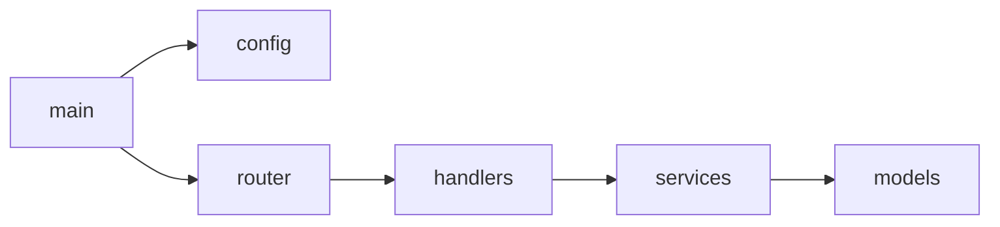

> 历史研究归档 · 2026-11-10 发布 · 程序扫描；未逐篇全文审阅。原有日期、观点、数据和命令保留历史语境，未经本次逐项事实核验或运行复现；请结合[归档说明](../../../ARCHIVE_POLICY.md)阅读。

# Source Code Dissector Skill

> 给定一个代码仓库，系统性地完成 画像 → 结构映射 → 核心识别 → 架构还原 → 设计决策提炼 → 范式映射，输出可直接引用的架构分析报告。

### Overview

源码拆解是研究工作中的"Dissect 阶段"标准化流程。本 Skill 将对 Claude Code、Hermes Agent、Anthropic Skill-Creator 等多个项目的拆解实践中反复出现的流程固化为可复用 Skill。

核心理念：**Talk is cheap, show me the code.** 白皮书和博客只是起点，源码才是真相。但源码也需要方法才能高效穿透——不是从第一行读到最后一行，而是先全局再重点，先结构再细节。

实验依据：本工作区实验链 01-06 验证了"Repo Map → 依赖图 → PageRank 核心识别 → 分层解析"管道的有效性（参见 Claude-Code源码上下文策略实验报告（原稿交叉引用，本归档未解析））。

## 1. 触发条件

当用户提出以下类型的请求时激活此 Skill：
- "帮我分析 XX 项目的源码/架构"
- "XX 框架内部是怎么实现的？"
- "拆解一下这个开源项目"
- 给出 GitHub URL，期望理解内部架构
- 任何需要"打开黑盒看齿轮"的请求

## 2. 执行流程

### Phase 1: 仓库画像（Repository Profile）

在深入任何代码之前，先建立全局认知。这一步决定了后续分析的策略。

#### 需要收集的信息

| 维度 | 数据 | 获取方式 |
|------|------|---------|
| **规模** | 文件数量、代码行数、语言分布 | `cloc` 或目录扫描 |
| **活跃度** | Stars、Forks、最近提交日期、贡献者数量 | GitHub API / README |
| **架构** | 目录结构（1-2 层）、入口文件 | `tree` / `ls` |
| **技术栈** | 语言、框架、依赖 | package.json / requirements.txt / go.mod 等 |
| **文档** | README 质量、是否有架构文档、API 文档 | 浏览 docs/ 目录 |
| **上下文** | 该项目解决什么问题？用户/场景是谁？ | README + 官方介绍 |

输出：一段话的**仓库名片**——"XX 是一个用 TypeScript 编写的 YY，约 N 万行代码，M 个核心贡献者，主要解决 ZZ 问题"。

### Phase 2: 结构映射（Structure Mapping）

生成仓库的"地图"，建立全局空间感。

#### 执行步骤

1. **Directory Map**：生成 2-3 层目录结构，标注每个顶级目录的职责
2. **入口追踪**：从 `main` / `index` / `entry` 入口文件出发，追踪初始化和启动流程
3. **依赖图**：分析 import/require 关系，画出模块间依赖图（Mermaid `graph`）



#### 产物

- Directory Map（标注型目录树）
- 依赖关系图（Mermaid）
- 入口到核心模块的调用链

### Phase 3: 核心识别（Core Identification）

不是所有代码都值得读。识别 Top 10-20 个核心文件，集中精力。

#### 核心文件识别方法

按优先级使用以下信号（来自实验验证）：

1. **被依赖次数（Fan-in）**：被最多文件 import 的 = 基础设施
2. **PageRank**：考虑传递依赖的重要性排序（优于简单引用计数，P4 范式）
3. **文件大小**：异常大的文件通常是核心逻辑或 God Object
4. **命名信号**：core / engine / manager / service / utils 等命名暗示
5. **变更频率**：git log 中被修改最多的文件 = 活跃热点

#### 产物

```markdown
### 核心文件 Top 10

| # | 文件路径 | 行数 | 被依赖数 | 职责推断 |
|---|---------|------|---------|---------|
| 1 | src/engine.ts | 800 | 23 | 核心调度引擎 |
| ... |
```

### Phase 4: 架构还原（Architecture Reconstruction）

对核心文件进行深度阅读，还原系统的真实架构。

#### 关注点

- **数据流**：请求/数据从哪里进来 → 经过什么处理 → 最终到哪里
- **控制流**：谁决定执行什么？状态机？事件驱动？管道？
- **核心抽象**：定义了哪些关键概念/类型？为什么这样抽象？
- **扩展机制**：怎么添加新功能？插件？钩子？继承？

#### 输出

用 Mermaid 画两张图：
1. **架构图**（`graph TB`）：模块/层级关系
2. **核心流程序列图**（`sequenceDiagram`）：一个典型请求的完整生命周期

### Phase 5: 设计决策提炼（Design Decision Extraction）

这是从"看代码"到"理解为什么"的跃迁——也是区分源码分析和源码阅读的关键。

#### 每个设计决策的记录格式

```markdown
### 决策 N：[选择了什么]

- **上下文**：面对什么问题？有哪些约束？
- **方案选择**：选了 A，没选 B 和 C
- **理由推断**：为什么选 A？（从代码结构、注释、PR/Issue 中推断）
- **Trade-off**：选 A 的代价是什么？什么场景下 B 可能更好？
```

重点识别以下类型的决策：
- 架构风格选择（单体 vs 微服务、同步 vs 异步）
- 核心数据结构选择
- 错误处理策略
- 并发/状态管理方式
- 可扩展性设计

### Phase 6: 范式映射（Pattern Mapping）

将发现的设计决策与已知范式做交叉映射。

#### 检查清单

检索 KNOWLEDGE_INDEX.md §三"核心范式"表，对每个已确立范式检查：
- 这个项目是否体现了该范式？
- 如何体现的？（具体代码位置）
- 是否有变体或创新？
- 是否发现了新范式？

#### 产物

```markdown
### 范式映射

| 已知范式 | 在本项目中的体现 | 变体/创新 |
|---------|----------------|----------|
| P5 简单可组合 > 复杂框架 | src/tools/ 每个工具独立文件 | 无 |
| P3 分层上下文 | context/ 三层结构 | 新增了 L0 常驻缓存层 |
| 新发现 | ... | 提议为 P-New |
```

## 3. 输出格式

完整拆解报告遵循以下结构（视深度需求可裁剪）：

```markdown
# [项目名] 源码架构拆解

> 一句话：XX 是一个 YY，核心创新在于 ZZ
> 规模：N 文件 / M 行 / K Stars
> 语言：XX | 框架：YY

## 仓库画像
## 架构图（Mermaid）
## 核心文件清单
## 关键设计决策（Top 5）
## 范式映射
## 创新点与局限
## 对我们的启示
```

## 4. 深度调节

不是每次都需要完整的六阶段分析。根据用户需求调节：

| 深度 | 执行到 | 适用场景 | 预期耗时 |
|------|-------|---------|---------|
| **快扫** | Phase 1-2 | "这个项目大概是做什么的" | 5-10 分钟 |
| **标准** | Phase 1-5 | "帮我理解这个项目的架构" | 30-60 分钟 |
| **深度** | Phase 1-6 + 报告 | "深度拆解，提炼最佳实践" | 1-2 小时 |

如果用户没指定深度，默认**标准**模式。

## 5. 与现有工具的集成

本 Skill 可以利用工作区已有的实验脚本加速：

| 阶段 | 可用工具 | 路径 |
|------|---------|------|
| Phase 1-2 | 01_repo_map.py | experiments/01_repo_map.py |
| Phase 2 | 02_dependency_graph.py | experiments/02b_dependency_graph_fixed.py |
| Phase 3 | 03_smart_context.py | experiments/03_smart_context.py |
| Phase 4 | 04_retrieval_test.py | experiments/04_retrieval_test.py |

这些脚本提供了 Python 实现的 Repo Map 生成、依赖图构建、PageRank 核心识别等能力，可在需要精确量化数据时调用。
