> 脱敏公开版 · 2026-11-10 补充 · 发布审核状态：redacted_full_review（发布前全文隐私审核、脱敏与改动复核）。保留通用技术内容，非公开案例、引用或数据已删除；编辑替换处另作说明。历史结论未在本次重新核实，代码未整体运行复现。见[归档说明](../../../ARCHIVE_POLICY.md)。

# Tech Proposal Writer

> 给定一个项目的需求描述或背景信息，按照技术方案书结构，生成一份覆盖"为什么做 → 怎么做 → 怎么保障 → 怎么落地"全链路的技术方案书。

## 这个 Skill 解决什么问题

技术方案书是项目立项评审的核心交付物，但大多数工程师写方案有三个通病：
- **结构残缺**：只写了架构和功能，安全/可观测/降级/并发这些"不写也能上线但出事就炸"的部分全部缺位
- **粒度失衡**：架构写 3 页，功能写 1 行；或者功能写得巨细但没有架构全景
- **追溯断裂**：方案设计和业务需求之间没有连接线，评审方无法判断"这个方案解决了原始痛点吗"

本 Skill 将技术方案书的通用结构和写作规范组织为执行流程，确保产出的方案书不漏关键章节、粒度均匀、需求可追溯。

## 设计原则

以下原则解释了方案书各部分**为什么这样组织**，而不只是规定"必须写什么"：

1. **Why → How → Safeguard → When**：读者的心智模型是先理解动机，再看全景，再钻细节，再看风险兜底，最后看计划。章节顺序服从这个阅读流。
2. **原始需求前置**：每个功能模块先贴业务方原话再写方案，建立从"用户要什么"到"系统做什么"的追溯链。不是冗余，是防止技术自嗨。
3. **表格驱动结构化信息**：技术选型、外部集成、监控指标、工作量估算这类结构化数据用表格而非段落——信息密度更高，横向对比更直观，不容易漏项。
4. **每个功能模块配时序图**：多角色多系统的交互顺序用文字描述极易混乱，时序图是这个场景下信息密度最高的表达形式。
5. **异常路径和正常路径同等权重**：不处理异常的方案是 demo 级方案。每个功能模块都必须回答"如果这步失败了怎么办"。
6. **先场景后方案**：写高可用/并发时先识别压力场景（"并发从哪来"），再给针对性设计。比直接列技术方案清晰得多。
7. **因地制宜**：本 Skill 规定的是**结构骨架和写法格式**，不是具体内容。架构层数、技术选型领域、降级场景、监控指标等**必须根据项目实际情况确定**——不要因为示例文档里有"知识层""Skill 体系""向量检索降级"就照搬到一个没有这些组件的项目里。硬加不存在的层/组件比漏写更有害，因为它暴露的不是遗忘而是不理解。
8. **活文档而非一次性产物**：技术方案书不是写完就归档的文档。从首版生成到开发完成，方案书会经历 10-20 次迭代（需求澄清→PM 评审→开发对齐→版本演进）。Skill 必须覆盖生成后的维护演进流程，而非只管初次生成。
9. **引用不重复**：同一技术细节（如性能优化、异常处理）可能在多个模块中出现。详细方案写一次，其他位置用"详见 §X.Y.Z"引用。这不是偷懒，而是确保修改时只改一处——重复内容是一致性 Bug 的温床。
10. **具体值可追溯**：端口号、模型名、阈值、超时时间等参数必须写具体值，并标注来源（实测/预估/经验值/待校准）。写"适当的超时时间"不如写"超时 3s（基于 P99 延迟 1.2s 的实测数据取 2.5 倍）"。

---

## 行文规范（逐词级标准）

> 以下规范用于控制方案书的行文质量、信息密度和专业观感。不是"建议"而是"标准"。

### 章节编号与标题格式

- 一级标题用 `#` 级 Markdown 标题，**不加中文序号**（不写「一、」「二、」），章节名称和英文副标题严格按空白模板：
  - `# 更改记录/History`
  - `# 项目概述`
  - `# 系统架构/System Architecture`
  - `# 概念设计/Specific Concept`
  - `# 系统可靠性与安全 / System Reliability and Safety`
  - `# 未决事项 / Open Issues`
  - `# 实施规划 / Implementation Plan`
  - `# 资源与成本预估 / Resource and Cost`
- 二级标题用 `##`，不加数字前缀：`## 项目背景`、`## 技术架构`、`## 核心技术方案`
- 三级标题用 `###`：`### 技术选型`、`### 核心运行机制`
- 功能模块标题用 `###` + 序号：`### 3.1 需求创建和查询`、`### 3.2 需求受理`
- 当功能模块超过 5 个时，**按领域分组**：用 `##` 二级标题做分组，组内各模块用 `###` 三级标题。分组不超过 3-5 个，每组 2-5 个模块。**分组优先按业务流程阶段**（如需求收集→受理→分类→澄清→评估→追踪），其次按系统模块（如智能体/知识管理/交互）——业务链路分组让评审方更容易对照"问题→方案"，系统模块分组适合业务流程不清晰的基础设施类项目
- 每个功能模块下的子标题固定：`#### 原始需求` + `#### 详细技术方案`（或 `#### 技术方案`）
- **复杂模块拆解**：单个功能模块如果包含 3+ 个独立子流程（如"知识问答"含意图识别/检索/缓存/回复/双语等），用 `#### a. 子流程名` 字母标签拆分，每个子流程保持 `##### 原始需求` + `##### 详细技术方案` 结构。在子流程之前用一句话概述整体流程串联关系
- **AI 决策模块写法**（适用于分类/评估/审核/路由/推荐等核心逻辑由 Prompt + 规则驱动的模块）：当模块的关键实现不是传统代码流程而是**提示词契约 + 业务规则**时，在该模块的 `#### 详细技术方案` 中采用以下四段式结构，直接写入正文（不放附录）：
  1. **角色定义**：模型在该模块中扮演什么角色、边界是什么（如"分类器""评估员""路由决策器"）
  2. **执行步骤**：模型接收什么输入、按什么顺序处理、每步的判断依据
  3. **规则边界**：哪些判断由规则硬编码（优先级高于模型），哪些交给模型推理；规则与模型的优先级关系必须显式声明
  4. **输出契约**：模型输出的 JSON Schema / 字段定义 / 枚举值 / 置信度要求；校验失败时的重试与降级策略
  这四段取代常规的"触发 → 处理 → 输出"编号步骤。时序图仍然需要，但 participant 中**区分同一模型的不同角色**（如 `大模型（意图识别）` vs `大模型（回答生成）`）
- 方案书首页必须有 `# 更改记录/History` 表

### 架构描述句式模板

架构章节的写法遵循"**总述一段 → 编号逐层展开**"的结构：

**总述段**：一句话说清架构分几层、叫什么名字：
> "系统采用 N 层架构设计，自上而下分别为**A层、B层、C层...**。各层职责清晰，XX层通过统一的 YY 访问 ZZ，不直接依赖底层实现细节。"

**逐层展开**：编号列表，每层用 **加粗层名+冒号** 开头，后跟职责和关键组件。**层数和层名根据项目实际架构确定**，不必凑到某个固定数量：
```
1. **XX层：**涵盖 XX、YY 等角色/组件，在各流程节点中承担不同职责。
2. **YY层：**用户通过 XX 发起请求，经 YY 完成 ZZ 后路由至下一层。
3. **ZZ层：**系统核心，基于 XX 框架构建。
   1. 主流程包含 XX → YY → ZZ 的子模块
   2. ......
```

**关键**：每层描述不能只给名字，必须说清"这一层做什么、关键组件是什么、与上下层的关系"。
### 分层架构总览图（Mermaid flowchart）

技术架构章节必须附一张**分层架构总览图**，用 Mermaid flowchart 绘制。**层数、层名、组件内容均根据项目实际架构确定**——不要为了"看起来完整"而硬加与项目无关的层。

> **飞书渲染**：方案书上传飞书后，所有 Mermaid 图（架构图、时序图、流程图）均可通过飞书的**文本绘图小组件**（输入 `/文本绘图` 插入）直接渲染为可视化图表，无需手动画图。

下方是一个六层+两侧栏的 Agent 项目示例，仅供参考画法格式：

```mermaid
flowchart TD
    subgraph 角色层
        R1[角色A] --- R2[角色B] --- R3[角色C]
    end
    subgraph 交互入口层
        E1[入口1] --- E2[入口2]
    end
    subgraph 核心业务层
        M1[模块A] --- M2[模块B] --- M3[模块C] --- M4[模块D]
    end
    subgraph 平台能力层
        T1[工具A] --- T2[工具B] --- T3[工具C] --- T4[工具D]
    end
    subgraph 知识层
        K1[向量库] --- K2[文档库]
    end
    subgraph 基础设施层
        I1[数据库] --- I2[K3S部署] --- I3[模型服务] --- I4[Skill Hub]
    end

    角色层 -->|通过| 交互入口层
    交互入口层 -->|网关| 核心业务层
    核心业务层 --> 平台能力层
    平台能力层 --> 知识层
    知识层 --> 基础设施层

    subgraph 安全与策略层
        S1[PII/DLP] --- S2[注入防御] --- S3[策略即代码]
    end
    subgraph 可观测性与运维层
        O1[Traces] --- O2[Metrics] --- O3[Logs] --- O4[告警]
    end
```



**绘制规则**：
- 用 `subgraph 层名` 表示每个架构层，层内组件用节点 `[组件名]` 表示
- 层与层之间用 `-->` 箭头连接，可在箭头上标注通信方式（如 `-->|REST API|`）
- 贯穿性关注点（如安全、可观测性）用独立的 subgraph 表示；**如果项目没有，不要硬加**
- **层数根据项目实际情况确定**：简单项目可能只有 3 层（前端→后端→数据库），复杂 Agent 项目可能 6-8 层。不要为了"像示例文档"而生造不存在的层
- 每层的组件用 `---`（无箭头连线）并排，层间用 `-->`（有向箭头）表示调用方向

### Mermaid 图用语抽象规范

> 技术方案书的读者包括**技术人员、PM、项目经理和管理层**。Mermaid 图是全文中可读性最高的部分——它很可能是非技术读者唯一认真看的内容。因此图中用语必须对所有读者友好。

**核心原则：图中用业务语言，正文用技术语言。**

以下对照仅说明公共技术名称与功能角色的表达差异，不表示这些技术在任何实际项目中组合使用。

| 正文（技术语言） | 图中（业务语言） | 为什么 |
|:---|:---|:---|
| Qwen3-Next | 大模型 | 具体模型名只对技术团队有意义 |
| bge-reranker-v2-m3 | 结果重排序 | 读者关心的是"做什么"不是"用什么做" |
| Qwen3-Embedding-8B | 语义向量化 | 向量化是动作，模型名是实现细节 |
| Milvus | 知识库 | 数据库产品名不影响理解流程 |
| Kokoro TTS | 语音合成 | 功能角色比产品名更直观 |
| FSMN-VAD / Silero VAD | 人声检测 | 技术组件名不影响流程理解 |
| FunASR Paraformer | 语音识别 | 同上 |
| httpx AsyncClient | （不出现） | 实现细节不属于图 |
| asyncio.Semaphore(5) | （不出现） | 同上 |
| cosine > threshold | 匹配度 > 阈值 | 图中可保留关键数值但用业务含义包裹 |

**命名规则**：
1. **participant / 节点名用功能角色**：`大模型（意图识别）`、`大模型（回答生成）`、`语义向量化`、`知识库`——同一技术不同用途时用括号区分角色
2. **箭头标注用动作/数据**：`-->|实时音频流|`、`-->|语义向量|`、`-->|目标知识库|`——描述传输的是什么，不是用什么传
3. **subgraph 名用层级/区域**：`接入层`、`处理层`、`智能层`——不写 `FastAPI 层`、`Milvus 层`
4. **条件分支用业务语义**：`{匹配度 > 0.92?}`、`{语言检测}`——不写 `{cosine_score > HIGH_CONFIDENCE_THRESHOLD?}`
5. **具体数值谨慎使用**：图中的数值只保留对理解流程有直接帮助的（如阈值分界点 `0.92`、终端数量 `×20`），代码级参数（`Semaphore(5)`、`ThreadPoolExecutor(4)`）不出现在图中
6. **端口号视场景决定**：面向开发团队的架构图可以带端口（如 `:8848`），面向管理层的流程图不带

**示例对比**：

```

❌ 差：E -->|httpx POST /v1/embeddings| M
✅ 好：E -->|语义向量| M

❌ 差：{rerank_score > HIGH_CONFIDENCE_THRESHOLD?}
✅ 好：{匹配度 > 0.92?}
```

**对应关系写在正文里**：具体模型名、API 地址、配置参数等技术细节全部在正文的技术选型表、外部系统集成表、详细技术方案文字中给出，图不重复。读者看图理解流程，看正文了解细节。
### 技术选型表写法

技术选型表固定**四列**，列头为：

```markdown
| 技术领域 | 选型 | 选型理由 | 选型维度 |
```

- **技术领域**：用加粗标识，如 `**智能体框架**`、`**模型选型**`、`**记忆与数据库**`
- **选型**：具体技术名称 + 型号（如模型名称及版本、`K3S + Docker`）
- **选型理由**：一句话说明为什么选它（如"原生支持 Tool Use、多轮对话，兼容本地模型"）
- **选型维度**：用 `→` 连接的评判标准链，说明按什么标准评判的（如"控制流建模能力 → 状态持久化 → HITL 支持 → 工具集成 → 可观测性 → 社区成熟度 → 云绑定程度"）
- 同一领域有多个子选型时，领域列用合并行，每个子选型独占一行

**覆盖范围**（根据项目实际技术栈选取，不必全列，也不限于此列表）：
核心框架/运行时、模型选型（大模型+Embedding+OCR等，AI 项目适用）、数据存储（按实际使用的存储类型列出）、Skill/插件管理（Agent 项目适用）、可观测性平台、安全策略、API网关与流量治理、部署

### 功能模块的叙事结构

每个功能模块严格按以下结构书写：

**原始需求段**：
- 小标题 `#### 原始需求`
- 如有需求表格/截图引用，直接嵌入
- 紧跟 `**当前痛点与希望实现功能**：`（原话，不是转述）
- 用分开的 bullet list 列出痛点和希望实现的功能，格式为：
  ```
  - **痛点**：XXX；YYY；ZZZ
  - **希望实现**：AAA；BBB；CCC
  ```

**详细技术方案段**：
- 小标题 `#### 详细技术方案`
- 用**编号递进**展开，每步用 **加粗关键词+冒号** 开头。**步骤名称根据功能实际流程确定**，以下是 Agent 项目的示例（非 AI 项目替换为对应的业务流程步骤）：
  ```
  1. **触发机制：**
     1. XXX
  2. **输入解析与处理：**
     1. 系统接收到 XX 后，进行 YY 处理
  3. **分支A处理**：
     1. 根据 XX 条件，执行 YY
  4. **分支B处理**：
     1. ......
  5. **异常/降级处理：**
     1. ......
  6. **结果输出与通知：**
     1. ......
  ```
- **关键格式**：
  - 一级步骤用阿拉伯编号（1. 2. 3.），加粗关键词
  - 子步骤缩进一级（1. 2. 3.），不加粗
  - 分支处理用不同编号段区分（如"3. **针对查询需求**"和"4. **针对创建需求**"）
  - 低置信度/异常处理单独成一个编号段（如"5. **低置信度处理：**"）

**时序图段**：
- 每个功能模块结尾必须附一张 `sequenceDiagram`
- participant 命名用中文功能角色（可加英文别名），**不用具体产品/模型名**（如用 `大模型（意图识别）` 而非 `Qwen3-Next`）。同一技术不同用途用括号区分角色
- **角色根据项目实际参与方确定**
- 用 `rect rgb(...)` 色块区分不同处理分支
- 用 `alt / else` 表示条件分支
- 用 `loop` 表示重复交互
- 用 `opt` 表示可选步骤
- 用 `note over` 标注阶段说明
- 箭头标注描述传输的**数据/动作**（如 `语义向量`、`目标知识库`），不描述技术实现（如 `httpx POST`）

### 写作用词规范

1. **主语**：用"系统""本方案""本系统""智能体"，不用"我们""笔者""本人"
2. **动作动词**：
   - 描述层级："涵盖""覆盖""贯穿"
   - 描述流转："经 XX 完成 YY 后路由至 ZZ""触发""流转为"
   - 描述构建："基于 XX 构建""采用 XX 架构设计"
   - 描述加载："按需加载""动态加载"
   - 描述解耦："实现 XX 与 YY 解耦，调整 XX 只需更新 YY 无需改代码"
   - 描述保障："确保""满足""防止""避免""阻断"
3. **描述并发/高可用时**：先用加粗段"**本系统的并发压力主要来自 N 类场景：**"编号列出场景，然后"**针对上述场景，本系统采用针对性设计：**"逐一用加粗要点展开
4. **描述降级策略**：每条格式为"XX 时，智能体将 YY，通过 ZZ 通知对应负责人处理，不阻塞其他流程"
5. **描述数据安全**：每个子项独立成段，用 **加粗子项名+冒号** 开头，后跟一段完整的描述（而非 bullet list）
6. **禁用**：不用"赋能""闭环""拉通""打通""击穿"等互联网黑话；不用"一定程度上""较好地"等模糊修饰；不用"等等"代替具体列举

### 审计标注约定

方案书中对不确定项使用以下 inline 标注，让评审方一眼看到哪些结论还不牢靠：

- **❓ [待验证]**：技术假设尚未通过实测确认（如性能数值、API 能力、模型效果、中文分词质量）。需在开发早期通过 Spike 或测试脚本验证
- **⚠️ [待PM确认 Qx]**：产品决策依赖 PM 确认（如超时时长、兜底行为、交互方式）。当前方案按假设设计，PM 确认后更新

**双轨追踪**：inline 标注写在正文对应位置，同时在"未决事项"章节维护**汇总表**（待验证技术假设清单 + 待 PM 确认决策清单），一个编号对一个条目。验证完成后：更新汇总表状态 🔲→✅，同时删除正文中的 inline 标注。

### 交叉引用规范

- **引用格式**：`§X.Y.Z` 或 `§X.Y.Za`（带字母子流程的），如"详见 §3.1.2c（知识库检索）"
- **引用原则**：同一技术细节只在一处写完整方案，其他位置用"详见 §X.Y.Z"引用。绝不复制粘贴
- **引用维护**：每次章节重编号/重组后，**必须全文搜索** `§` 前缀，逐一更新所有引用。这是最容易遗漏的高频错误

### 具体参数标注规范

方案中的关键参数（端口、超时、阈值、模型名、并发数等）必须写具体值，并标注来源：

参数来源可分为实测值、预估值、经验初始值、外部约束及可配置参数。实测需注明测试条件；预估或初始值需明确标记，不能当作验证结果。

下表数值均为虚构的教学示例，不是测试结果、内部环境参数或推荐默认值。

| 参数类型 | 标注方式 | 示例 |
|:---|:---|:---|
| 实测值 | 写数值并注明测试条件与记录来源 | `250ms（虚构格式示例；实际填写时应引用测试记录）` |
| 预估值 | 明确标“预估”并列出估算构成 | `~900ms（虚构预估示例：阶段 A 300ms + 阶段 B 600ms）` |
| 经验初始值 | 明确标“初始值”，记录后续校准依据 | `阈值 0.80（虚构初始值示例；需按实际分数分布校准）` |
| 外部约束 | 注明所依据的接口规格或标准 | `采样率按所接接口的规格填写，并链接对应条款` |
| 可配置参数 | 注明配置位置与确认状态 | `30s（虚构配置示例：REQUEST_TIMEOUT_SECONDS，待确认）` |

### 表格规范总表

方案书中出现的所有标准表格，列头固定如下，不可随意增减列或改名：

| 表格名称 | 固定列头 | 出现位置 |
|:---|:---|:---|
| 更改记录 | `版本/Version \| 作者/Author \| 主要变更内容/Change Contents \| 重要参与者` | # 更改记录/History |
| 定义和缩略语 | `缩写 \| 英文 \| 中文` | # 项目概述 § 定义和缩略语 |
| 技术选型 | `技术领域 \| 选型 \| 选型理由 \| 选型维度` | # 系统架构 § 技术选型 |
| 记忆系统 | `记忆层 \| 存储介质 \| 内容 \| 生命周期 \| 作用` | # 系统架构 § 记忆系统 |
| 外部系统集成 | `系统 \| 集成方式 \| 用途` | # 系统架构 § 外部系统集成 |
| 人机协作机制 | `节点 \| AI 自动执行 \| 人工确认/复核 \| 人工介入条件` | # 系统可靠性与安全 § 人机协作 |
| 组件部署 | `组件 \| 部署位置 \| 资源规格 \| 备注` | # 系统可靠性与安全 § 部署方式 |
| 基础设施监控 | `监控对象 \| 关键指标 \| 告警阈值 \| 采集工具` | # 系统可靠性与安全 § 可观测性 |
| 工作量估计 | `事项 \| 具体内容 \| 开发预估工作量/天 \| 阶段` | # 实施规划 § 工作量估计 |
| Token 成本估算 | `节点 \| 环节 \| Token 消耗（估算）` | # 资源与成本预估 § 算力与硬件 |

---

## 执行流程

### Phase 0：信息收集

开始写方案之前，必须搞清楚以下输入。如果用户没有提供，主动追问：

| 必需输入 | 问什么 | 没有就无法继续 |
|:---|:---|:---:|
| **项目背景** | 解决什么问题？当前方案（如有）哪里不行？ | 是 |
| **目标用户和角色** | 谁用这个系统？有几种角色？各自做什么？ | 是 |
| **核心功能清单** | 系统需要做哪些事？（粗粒度即可） | 是 |
| **技术约束** | 技术栈偏好？部署环境？是否有合规要求？ | 否（可推断） |
| **已有资料** | 需求文档？业务流程图？前序调研？ | 否（有更好） |

**简化规则**：如果用户给了一份需求文档（飞书链接、PRD 等），先读完提取上述信息，不必逐项追问。

### Phase 1：生成方案书

按以下五大板块 + 附录结构生成完整的方案书。每个板块下方是该板块**必须包含的内容要素**、**具体写法**和**质量标杆**。

封面和正文之间必须先放 **更改记录/History** 表：

```markdown
| 版本/Version | 作者/Author | 主要变更内容/Change Contents | 重要参与者 |
|:---:|:---:|:---|:---|
| 01 | {{作者}} | Create | {{参与者}} |
```

---

#### 板块一：项目概述（WHY + WHAT）

对应章节 `# 项目概述`。回答"为什么做、做什么、不做什么"。

**必须包含**：

1. **§ 项目背景**（`## 项目背景`）
   - 回答三个问题：当前痛点是什么？为什么现在要做？如果不做会怎样？
   - 痛点用具体数据或场景说明，不空泛描述
   - 写法示例："当前 XX 流程由人工完成，平均每条耗时 Y 小时，且 Z% 的场景需要反复沟通才能明确需求"

2. **§ 目的和范围**（`## 目的和范围/Purpose and Scope`）
   - 此章节包含建设目标和适用范围两部分
   - 建设目标按阶段分开写，用 **加粗阶段名+括号** 开头：
     ```
     **短期（Phase 1）规划**：完成覆盖 XX、YY、ZZ 全流程基建。同时在 AA、BB 中实现自动化运转，
     仅需在关键节点确认结果，全面提高 XX 效率，节约人力。

     **长期（Phase 2）规划**：持续提升 Agent 能力和准确性，完善知识库和 Skill，实现全周期由
     Agent 接管，支持在线进化。
     ```
   - 每个目标尽量量化（"提升效率 X%""降低耗时从 Y 小时到 Z 分钟"）

   **§ 适用范围**（`### 适用范围/Scope`，嵌套在"目的和范围"下）
   - 一句话说清覆盖什么业务、什么组织
   - 明确写出 Scope Out（不做什么）

3. **§ 定义和缩略语**（`### 定义和缩略语 / Definitions and Abbreviations`）
   - 用表格列出方案中的所有非通用术语
   - 列头：`缩写 | 英文 | 中文`
   - 示例：`RME | Requirements Management Engineer | 需求管理工程师`

4. **§ 参考文件**（`### 参考文件/Reference`）（如有前序文档）

**质量标杆**：读完项目概述后，一个完全不了解项目的人应该能用一句话说出"这个系统是给谁用的、解决什么问题的"。

---

#### 板块二：系统架构（HOW 宏观）

对应章节 `# 系统架构/System Architecture`。回答"系统长什么样、技术栈怎么选的、运行时怎么工作"。

**必须包含**：

1. **§ 技术架构**（`## 技术架构`）
   - 按照上面"架构描述句式模板"的总述+逐层展开结构书写
   - 架构图（Mermaid flowchart）——放在逐层描述之后
   - 层间通信方式

2. **§ 核心技术方案**（`## 核心技术方案`）

   **§ 技术选型**（`### 技术选型`）
   - 按上面"技术选型表写法"规范输出四列表格
   - 需覆盖：核心框架、模型选型、记忆与数据库（分子项）、Skill管理、可观测性、安全策略、API网关、部署

   **§ 核心运行机制**（`### 核心运行机制`）
   - 先一句话总述系统的运行模式
   - 然后按编号展开运行流程的每个阶段。**阶段划分根据项目实际确定**，以下是常见维度（按需选取，不要硬套）：
     - **事件接入/请求入口**：什么触发系统运行？如何路由？
     - **核心处理流程**：从接收输入到产出结果的主链路
     - **状态管理与流转**：如何管理运行状态、如何持久化、异常恢复
     - **人机协同循环**：（适用于 AI/Agent 项目）LLM 推理 → 工具调用 → 人类反馈 → 结果确认
     - **弹性伸缩**：部署与扩缩容策略
   - **必须附一张完整的系统运行流程图**（Mermaid flowchart，飞书文本绘图小组件可直接渲染）

   **§ Skill/插件体系设计**（`### Skill/插件体系设计`）（Agent 项目适用，标 `[按需]`）
   - Skill 是什么、怎么定义
   - Skill 的完整列表（覆盖哪些业务节点）
   - Skill 文件格式示例（给出一个完整的 SKILL.md 样例，含 YAML frontmatter + 执行步骤 + 规则注入 + 输出要求）
   - Skill 的版本管理与发布机制

   **§ 状态管理**（`### 状态管理`）
   - 状态字段存储在哪、作为什么的唯一依据
   - 状态枚举与流转图（用 Mermaid stateDiagram 或 flowchart LR 绘制）：
     ```mermaid
     stateDiagram-v2
         [*] --> 状态A
         状态A --> 状态B
         状态B --> 状态C
         状态C --> 终态
         状态B --> 异常挂起
         异常挂起 --> 状态B: 恢复
     ```
   - 阶段流转触发机制：描述"状态写入 → 事件驱动"模式，强调各阶段完全解耦
   - 中断恢复：智能体执行中断时如何根据 ID 恢复进度

   **§ 记忆/上下文系统**（`### 记忆/上下文系统`）（AI 项目适用，标 `[按需]`）
   - 用五列表格描述各层记忆，列头：`记忆层 | 存储介质 | 内容 | 生命周期 | 作用`
   - Agent 冷启动时的上下文构建流程（编号列表）
   - 上下文压缩策略（摘要压缩 + 滑动窗口 + 分阶段压缩）
   - 状态切换时的记忆处理规则（什么写入持久层、什么过期、新阶段读什么）

   **§ 外部系统集成**（`### 外部系统集成`）
   - 先一句话概述集成方式（如"系统通过 XX 的事件订阅机制接收外部触发，统一经接入层适配后转发"）
   - 三列表格，列头：`系统 | 集成方式 | 用途`

**质量标杆**：一个新加入团队的工程师，看完架构章节后应该能画出系统的数据流草图。

---

#### 板块三：概念设计（HOW 微观）

对应章节 `# 概念设计/Specific Concept`。这是方案书篇幅最大的章节。

每个功能模块采用**统一的三段式结构**：

```
概念设计/Specific Concept
├── 3.1 分组A（如：智能体）          ← ## 二级标题（模块 >5 个时分组）
│   ├── 3.1.1 模块1                  ← ### 三级标题
│   │   ├── 原始需求                 ← #### 四级标题
│   │   ├── 详细技术方案             ← #### 四级标题
│   │   └── 时序图
│   ├── 3.1.2 复杂模块2             ← ### 三级标题
│   │   ├── 原始需求 + 整体流程概述
│   │   ├── a. 子流程A              ← #### 字母标签（3+ 子流程时拆分）
│   │   │   ├── 原始需求             ← ##### 五级标题
│   │   │   └── 详细技术方案
│   │   ├── b. 子流程B
│   │   └── 综合时序图
│   └── 3.1.N 性能（汇总索引）       ← 性能散布 3+ 模块时
├── 3.2 分组B（如：知识管理）
└── 3.3 分组C（如：交互）
```

**对每个功能模块**：

1. **原始需求**
   - 如有需求表格或截图，直接引用嵌入
   - 先用引用块（`>`）写一句话需求概述（业务方原话或提炼）
   - 紧跟 `**需求分析**`，用两组 bullet list 说明：
     ```
     **需求分析**：
     - **业务问题**：当前 XX 流程存在 YY 问题；ZZ 能力缺失导致...
     - **目标能力**：实现 AA；支持 BB；满足 CC
     ```
   - 保留业务方原始语言在引用块中，需求分析用技术语言重新组织
   - 如果功能有版本范围差异，标注 `**版本规划**：V1.0 做 XX，V2.0 扩展 YY`

2. **详细技术方案**按编号递进展开：
   - 每步用 `N. **加粗关键词+冒号**` 开头
   - 子步骤缩进为 `1. 2. 3.` 不加粗
   - 分支处理用独立编号段区分（如"3. **针对查询需求**"、"4. **针对创建需求**"）
   - 低置信度/异常处理单独成编号段
   - 结论写回+通知+状态流转作为最后一个编号段
   - 每步说清三件事："**做什么** → **调什么 API/工具** → **输出什么/写到哪**"

3. **时序图**
   - 每个功能模块结尾必附 Mermaid sequenceDiagram
   - 按上面"时序图段"规范使用 participant、rect、alt/else、loop、opt、note over
   - **Mermaid 代码块规范**：
     - ` ```mermaid ` 和 ` ``` ` 各占独立行，代码块内**不留多余空行**（多余空行会导致部分渲染器报错）
     - 用 `rect rgb(r,g,b,a)` 半透明色块区分不同处理分支（如正常路径用浅蓝、异常路径用浅红）
     - participant 用中文名称（可加英文别名）
     - **飞书兼容**：飞书原生支持 Mermaid 渲染（通过 `/文本绘图` 插入）。**绝不将 Mermaid 转为 ASCII art**——ASCII art 在飞书中不可维护且信息密度低
   - **复杂模块的子流程**可共享一张综合时序图，避免 8 个子流程画 8 张图

4. 所有功能模块写完后附 **§ 交互设计**（`## 交互设计`）：
   - **交互界面**：支持哪些输入方式（文字/语音/表单等），每种的场景和处理方式
   - **反馈机制**：
     - AI 输出质量反馈（如 👍/👎 按钮），反馈数据记录用途
     - 人工介入通道：各节点如何触发人工接管（如发送"转人工"指令）

5. **性能索引章节**（推荐为最后一个分组/模块）：
   - 当性能优化点散布在 3 个以上功能模块中时，**新增一个"性能"章节**做汇总索引
   - 用表格列出所有优化手段，每行包含：`# | 优化手段 | 降低的延迟/作用 | 详见章节`
   - 分两组：**延迟优化**（面向用户体验的响应速度）和 **并发与资源保护**（面向系统稳定性）
   - 详细方案留在各模块，此处只做索引——避免修改一处忘记同步另一处的问题

**质量标杆**：评审方能对照"原始需求 → 技术方案"逐条验证，每个痛点都能找到对应的解决措施。

---

#### 板块四：系统可靠性与安全（SAFEGUARD）

对应章节 `# 系统可靠性与安全 / System Reliability and Safety`。生产级系统必备。

**必须包含**：

1. **§ 数据安全**（`## 数据安全`）
   - 每个子项独立成段，用 **加粗子项名+冒号** 开头，后跟一整段描述（不是 bullet list）。**子项根据项目实际安全需求选取**，以下为常见子项及写法示例：
     - **数据脱敏：** 系统在 XX 过程中，对 YY 等敏感信息进行自动识别与脱敏处理。脱敏规则在 ZZ 环节执行，确保原始敏感信息不出现在 AA 中。
     - **数据隔离：** 基于 XX 实现多维度权限隔离。不同角色仅能查看和操作其职责范围内的数据。
     - **身份认证：** 系统所有接入流量统一走 XX 认证。
     - **凭证管理：** 外部系统 API 调用通过统一凭证管理，凭证按最小权限原则申请，支持周期性轮换，不在代码和日志中出现。
     - **审计日志：** 内容包括：操作时间、操作人身份、操作类型、目标资源、操作结果。审计日志独立存储，与业务日志物理隔离。

2. **§ 智能体风险控制**（`## 智能体风险控制`）（AI 项目适用）

   **§ 人机协作机制**（`### 人机协作机制`）
   - 先一段话说明为什么需要人机协作（如"AI 判断结果会直接影响 XX，一旦偏差可能导致 YY"）
   - 四列表格，列头：`节点 | AI 自动执行 | 人工确认/复核 | 人工介入条件`

   **§ AI 输出质量控制**（`### AI 输出质量控制`）
   - 分三个子段，各用 **加粗标题+冒号** 开头：
     - **幻觉控制：** 关键判断要求同时输出置信度；评估报告要求标注数据来源（如"基于向量检索匹配到 N 条历史记录"）；确定性逻辑由规则引擎直接计算
     - **提示词注入防御：** 用户输入与 System Prompt 严格分离；对用户输入预处理过滤注入特征；Skill 定义中约束输出范围
     - **输出校验：** 结构化结果统一通过 JSON Schema 强校验（字段完整性+类型+枚举+边界）；校验失败自动重试一次（带错误信息反馈）；二次失败标记"待人工复核"

   **§ 系统降级策略**（`### 系统降级策略`）
   - 逐一列出**本项目实际可能遇到的**异常场景 + 降级方案，每条为完整句子
   - **场景根据项目架构确定**，不要照搬示例。以下为不同项目类型常见的降级场景参考：
     - AI/Agent 项目：模型推理超时、向量检索不可用、AI 判断置信度过低、Skill 执行失败
     - 后端服务项目：数据库连接池耗尽、缓存失效、第三方 API 超时、消息队列积压
     - 数据管线项目：上游数据源断流、ETL 处理超时、存储写满
   - 每条降级方案的写法格式："XX 时，系统将 YY，通过 ZZ 通知对应负责人处理，不阻塞其他流程"
   - 最后一句："降级动作均有明确的日志与告警，运维可据此及时介入。"

3. **§ 部署方式**（`## 部署方式`）
   - 先一句话说明部署方案（如"系统采用全私有化部署方案，所有组件运行于公司内网"）
   - 四列表格，列头：`组件 | 部署位置 | 资源规格 | 备注`
   - 部署方案优势一句话说明

4. **§ 高可用与并发保障**（`## 高可用与并发保障`）
   - **先列场景**：用加粗段 `**本系统的并发压力主要来自 N 类场景：**`，编号列出**本项目实际的并发来源**
   - **再逐一设计**：用加粗段 `**针对上述场景，本系统采用针对性设计：**`，每个设计用 **加粗要点+冒号** 开头
   - **要点根据上面列出的场景确定**，不要复制无关设计。常见设计维度（按需选取）：异步/并发处理、批处理策略、外部 API 限流保护、数据库连接池/读写分离、缓存策略、会话/租户隔离、水平扩缩容

5. **§ 可观测性与运维**（`## 可观测性与运维`）
   - 总述一句："系统按两个层次建立可观测性体系：基础设施监控覆盖 XX 的运行状态；智能体监控覆盖 YY 的全过程追踪。"

   **基础设施监控**：
   - 四列表格，列头：`监控对象 | 关键指标 | 告警阈值 | 采集工具`

   **智能体/业务监控**：
   - 分三类可观测信号展开，各用 **加粗信号名+括号说明** 开头。**具体监控内容根据项目实际确定**：
     - **Traces（调用链追踪）**：描述链路结构和关键 Span 标识
     - **Metrics（指标）**：逐项列出本项目需要监控的核心指标（如：请求延迟分布 P50/P95/P99、错误率、队列深度；AI 项目还需加 Token 消耗、工具调用成功率等）
     - **Log Events（结构化事件日志）**：记录什么事件、按需开关控制
   - 后端推荐一句话说明

**质量标杆**：运维工程师看完后能知道“系统出问题时在哪看日志、看什么指标、系统会自动做什么降级”。

---

#### 未决事项 / Open Issues

对应章节 `# 未决事项 / Open Issues`。集中列出当前方案中尚未确定的决策点，比在正文中写"待定"更好——评审方一目了然地看到哪些问题还没解决。

格式：编号列表，每条写清“**问题是什么** → **影响什么** → **预计何时解决**”。
**双轨汇总表**（配合审计标注使用）：

1. **待验证技术假设清单**：汇总正文中所有 ❓ [待验证] 标注，表格列头 `# | 假设 | 影响章节 | 验证方式 | 优先级 | 状态`
2. **待 PM 确认决策清单**：汇总正文中所有 ⚠️ [待PM确认] 标注，表格列头 `# | 决策项 | 影响章节 | 当前假设 | 状态`

这两张表是方案生命周期中**持续维护**的，每次确认/验证后更新状态并删除对应的 inline 标注。
---

#### 板块五：实施规划（WHEN）

对应章节 `# 实施规划 / Implementation Plan`。落地路线图。

**必须包含**：

1. **§ 工作量估计**（`## 工作量估计 / Workload`）
   - 按阶段（冷启动/热循环，或 P0/P1/P2，或 V1/V2/V3）拆分，每个阶段单独一个子标题
   - 每个阶段一张工作量表格，**四列**，列头固定为：
     ```markdown
     | 事项 | 具体内容 | 开发预估工作量/天 | 阶段 |
     ```
   - **事项列**用加粗标识，同一事项下多项开发内容共用事项名（首行写事项名，后续行留空）
   - **具体内容列**粒度到具体功能/子系统（如"飞书 Webhook 接入与事件路由"，不是"后端开发"）
   - 最后一行汇总

2. **§ 验收标准**
   - 列出各阶段/模块的验收条件

**质量标杆**：决策者看完后能回答"多久上线、分几步走"。

---

#### 板块六：资源与成本预估（HOW MUCH）

对应章节 `# 资源与成本预估 / Resource and Cost`。独立于实施规划，单独成章。

**必须包含**：

1. **§ 人力资源**（`## 人力资源 / Human resource`）
   - 列出各角色/岗位的人数和投入周期（由项目经理确定）

2. **§ 算力与硬件**（`## 算力与硬件 / Token and hardware`）（AI 项目适用）
   - 以下所有数据均为项目启动前的预估值，仅用于资源申请的量级参考
   - 用表格列出 Token 成本估算，**三列**，列头：`节点 | 环节 | Token 消耗（估算）`
   - 环节列给出拆解（如"System Prompt 2k + Skill 2k + 用户对话提取 3k + 去重检索 2k + 写入确认 1k"）
   - 最后一行汇总单条/日均/月度总成本
   - 基础设施月度运行成本（如服务器、GPU 等硬件成本）

**质量标杆**：决策者看完后能回答"投多少人、花多少钱"。

---

#### 附录（按需）

- **A. 数据字典**：系统核心实体的字段定义
- **B. 接口定义**：关键 API 的请求/响应格式
- **C. 详细规则文档**：业务规则、评分标准等过长的内容放附录，正文引用即可

---

### Phase 2：自检与交付

方案书写完后，逐项核对以下清单，任何一项缺失都必须补上：

```
结构完整性
─────────────────────────────────────────────
□ 更改记录/History 表存在？
□ 章节标题严格按空白模板（无中文序号、含英文副标题）？
□ 全部标准章节都有独立章节（项目概述/系统架构/概念设计/系统可靠性与安全/未决事项/实施规划/资源与成本预估）？
□ 术语表覆盖了所有非通用缩写？

内容质量
─────────────────────────────────────────────
□ 项目背景有具体痛点和数据，不是空泛描述？
□ "目的和范围"按阶段分开写建设目标，每个目标有量化指标？
□ 每个技术选型都填了"选型理由"和"选型维度"两列？
□ 技术选型的"选型维度"列用 → 连接了评判标准链？
□ 有完整的分层架构描述（总述一段 + 编号逐层展开 + 架构图）？
□ 核心运行机制有完整的系统运行流程图（Mermaid flowchart）？
□ 状态管理有状态枚举 + 流转图 + 触发机制描述？

概念设计质量
─────────────────────────────────────────────
□ 每个功能模块都保留了原始需求原话和"当前痛点与希望实现功能"？
□ 每个功能模块的详细技术方案用编号递进（N. **加粗关键词+冒号**）展开？
□ 每步说清了"做什么 → 调什么 API/工具 → 输出什么/写到哪"三件事？
□ 每个功能模块有低置信度/异常处理的编号段？
□ 每个功能模块结尾有 Mermaid sequenceDiagram？
□ 时序图用了 participant 中文名、rect 色块、alt/else 分支？
□ 有交互设计章节（输入方式 + 反馈机制）？
□ 功能模块 >5 个时按领域分组（## 分组标题 + ### 模块标题）？
□ 复杂模块（3+ 子流程）用字母标签拆分（#### a. / b. / c.）？
□ 性能优化点散布 3+ 模块时有汇总索引章节？
□ AI 决策模块（分类/评估/路由等）是否用了四段式（角色定义/执行步骤/规则边界/输出契约）？（AI 项目适用）
□ 规则与模型的优先级关系是否显式声明（哪些硬编码、哪些交给模型）？（AI 项目适用）
□ 模型输出契约是否包含 Schema/枚举/置信度要求 + 校验失败降级？（AI 项目适用）
□ 同一模型在不同模块中的角色是否区分命名（如「大模型（意图识别）」vs「大模型（回答生成）」）？（AI 项目适用）
□ 提示词契约/业务规则是否写在正文对应模块内（而非只放附录）？（AI 项目适用）

非功能需求质量
─────────────────────────────────────────────
□ 数据安全的子项根据项目实际选取，且每项都是独立成段的完整描述？
□ 人机协作用了四列表格（节点 | AI自动 | 人工确认 | 介入条件）？（AI 项目适用）
□ AI 输出质量控制覆盖了幻觉/注入/校验三个维度？（AI 项目适用）
□ 降级策略针对的是本项目实际的异常场景，不是照搬模板？
□ 高可用先列了本项目实际的并发场景，再逐一给了针对性设计？
□ 可观测性分了基础设施监控（表格）和业务监控（Traces/Metrics/Logs）？

实施规划与资源质量
─────────────────────────────────────────────
□ 工作量表有四列（事项 | 具体内容 | 开发预估工作量/天 | 阶段）？
□ 具体内容粒度到具体功能/子系统，不是笼统的"后端开发"？
□ 资源与成本预估独立成章（不是实施规划的子节）？
□ 有 Token/成本估算（AI 项目）？
□ 文档中"后续补充/待定"不超过 3 处？

行文规范
─────────────────────────────────────────────
□ 主语用"系统/本方案/智能体"，不用"我们/笔者"？
□ 无互联网黑话（赋能/闭环/拉通/打通/击穿）？
□ 无模糊修饰（大约/差不多/较好/一定程度上）？
□ 表格列头与"表格规范总表"中的固定列头完全一致？

审计与追溯
─────────────────────────────────────────────
□ 不确定的技术假设标注了 ❓ [待验证] 并加入"待验证技术假设清单"？
□ 待 PM 确认的产品决策标注了 ⚠️ [待PM确认 Qx] 并加入"待 PM 确认决策清单"？
□ 关键参数（端口/超时/阈值/模型名/并发数）都写了具体值且标注了来源？
□ 交叉引用使用 §X.Y.Z 格式且指向正确章节？
□ 没有同一内容在两处重复描述（应改为引用）？
□ Mermaid 代码块内无多余空行、未被转为 ASCII art？

因地制宜
─────────────────────────────────────────────
□ 架构层数和层名是根据项目实际确定的，不是照搬示例？
□ 没有出现项目中不存在的组件/层/技术（如非 AI 项目写了"向量检索""Skill 加载""模型推理"）？
□ 降级场景是本项目实际可能遇到的，不是复制 Agent 项目的场景？
□ 并发设计要点是针对本项目实际压力来源的，不是套用通用条目？
□ 标为 [按需] 的章节，确实根据项目需要做了取舍判断？
```

---

### Phase 3：维护与演进

> 方案书不是写完就归档的交付物。从首版到开发完成，方案书会经历 10-20 次迭代。以下规则确保方案书在整个生命周期中保持准确、可追溯。

#### 3.1 更改记录纪律

- **每次编辑 = 一条更改记录**。不允许"改了但不记"——更改记录是评审方理解方案演进的唯一线索
- 版本号顺序递增（01, 02, 03...），每条写清**改了什么、为什么改**
- 更改记录的"主要变更内容"列要具体到章节和改动点，不写笼统的"优化方案"
- 批量修改时可合并为一条版本记录，但内容列用分号或编号列出所有改动

#### 3.2 PM 评审反馈回写

评审会议或飞书评论产生的反馈，按以下流程处理：

1. **收集**：将所有反馈点编号记录（D1、D2... 设计层面 / Q1、Q2... 产品决策）
2. **分析**：区分"事实修正"（立即改）vs"设计决策"（需讨论后改）vs"待确认"（标 ⚠️）
3. **批量回写**：一次性将所有反馈点回写到方案对应章节 + 更新待验证/待确认清单 + 新增更改记录
4. **同步**：如果方案需要同步到飞书/Wiki，回写完立即同步

#### 3.3 代码→方案对齐

开发过程中方案与代码会产生偏差。每个 Sprint 或里程碑完成后，执行一次系统对齐：

1. **Gap 分析**：逐章节对比方案描述与代码实现，列出差异项（每项标注"方案需更新"或"代码需调整"）
2. **回写方案**：将代码中的实际实现（模型名、参数、接口签名、数据结构）同步到方案文档
3. **交叉引用检查**：全文搜索 `§` 确认所有引用仍指向正确章节
4. **更新更改记录**：新增版本条目，说明"代码对齐"

**常见偏差类型**（按经验排序）：
- 模型名变更（测试阶段频繁切换模型是常态）
- 阈值/参数值调整（预估值 vs 实测值）
- 新增了方案未覆盖的功能（如方案没写但开发时发现必须做的）
- 接口签名变化（返回值结构、字段名）
- 章节间一致性（同一 Schema 在多处描述但只改了一处）

#### 3.4 章节重组安全规则

当需要重组章节结构（合并/拆分/重编号）时：

1. **重组前**：记录当前所有交叉引用（搜索 `§` 和所有 `详见` `参见` `见` 关键词）
2. **重组中**：建立旧编号→新编号映射表
3. **重组后**：逐一更新所有交叉引用（包括正文、待验证清单、PM 确认清单、时序图注释）
4. **验证**：全文搜索旧编号格式，确认无遗留

#### 3.5 飞书/Wiki 同步规则（如适用）

- **本地 Markdown 是唯一 Source of Truth**，飞书是只读发布渠道
- 同步使用 `--mode overwrite`（覆盖模式）时，**提醒用户飞书文档上的评论会丢失**
- 重要评论应转录到本地 Markdown 中（如 `> **[PM 评论]** xxx` 格式），确保覆盖后不丢失
- 同步频率：重大版本变更后立即同步，不积攒多个版本

---

## 裁剪规则

不是所有项目都需要写满所有章节。按项目类型裁剪：

| 项目类型 | 必须保留 | 可裁剪 |
|:---|:---|:---|
| AI 智能体项目 | 全部章节 | 无 |
| 传统后端服务 | 全部章节 | Skill 体系、记忆系统、AI 风险控制 |
| 前端/轻量工具 | 项目概述、概念设计、实施规划 | 系统架构大部分（保留技术选型）、系统可靠性大部分（保留部署） |
| 数据管线/ETL | 全部章节 | Skill 体系、记忆系统、交互设计 |

裁剪时，被裁剪的章节写一行"本项目不适用，原因：XXX"即可，不要默默删掉——让评审方知道你有意识地判断过，而不是忘了写。

**因地制宜原则**：即使是"必须保留"的章节，其**具体内容也要根据项目实际确定**。例如：
- 数据安全子项：不是每个项目都需要"数据脱敏"——如果系统不处理敏感数据，就不要硬写脱敏方案
- 降级策略：列出的异常场景必须是本项目架构中**实际存在的依赖**的故障模式，不是通用场景清单
- 架构图层数：3 层架构的项目画 3 层就好，不要为了"看起来完整"凑到 8 层
- 技术选型覆盖范围：只列项目实际用到的技术领域，没有 AI 模型就不要写模型选型行

## 写作风格约束

1. **表格优先**：能用表格呈现的结构化信息不要用段落。技术选型、外部集成、监控指标、工作量、人机协作矩阵，全用表格。
2. **图表自解释**：Mermaid 图需要独立就能看懂，不依赖正文上下文。所有 Mermaid 图上传飞书后通过**文本绘图小组件**（`/文本绘图`）渲染。
3. **先结论后展开**：每个章节的第一段就给出该章节的核心结论或总体描述。想快速通读的人看每章第一段就够了。
4. **数据说话**：性能指标给数字、成本给估算、工作量给人天。"大约""差不多""较好"这类模糊词在方案书中不可接受。
5. **异常路径显式写**：不能假设一切顺利。每个功能模块的"如果失败怎么办"必须写出来，即使只是一句"转人工处理"。

## 参考资料

- 模板文件：`wiki/templates/技术方案书模板.md`（可直接复制填写的模板，含占位符和写作指引）
- 分析报告：`reports/04-工程实践/技术方案书合格模板提炼.md`（模板来源的详细拆解）
