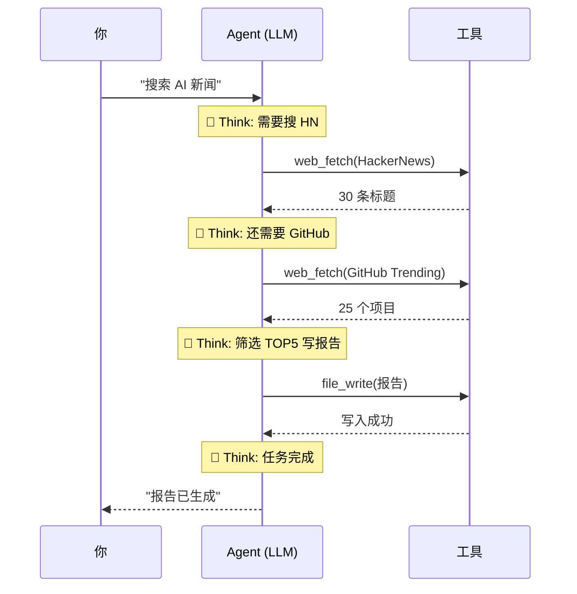

> 历史研究归档 · 2026-11-10 发布 · 程序扫描；未逐篇全文审阅。原有日期、观点、数据和命令保留历史语境，未经本次逐项事实核验或运行复现；请结合[归档说明](../../ARCHIVE_POLICY.md)阅读。

# Chapter 2: Agent 的本质 — 一个循环

> 📍 前置：完成 Chapter 1（跑通了你的第一个 Agent）
> 🎯 完成本章后你能：解释 Agent 和普通 LLM 调用的本质区别；画出 ReAct 循环图；理解为什么 Agent 能"自主"做事
> ⏱️ 预计时间：20 分钟阅读 + 10 分钟思考

---

## 为什么要理解这个？（WHY）

上一章你跑通了一个 Agent。你输入"搜索 AI 新闻"，它自动去搜了 HackerNews 和 GitHub Trending，筛选了 TOP 5，还写了一份报告。

但你可能心里有个问号：**它到底是怎么做到的？**

你以前也调过 ChatGPT API，那不就是"发一条消息，拿一个回复"吗？为什么你的 Agent 能做**一连串**的事情——搜索、阅读、筛选、生成、保存？

这一章回答这个问题。答案出奇地简单，简单到你可能会想"就这？"——但这个简单的东西就是整个 Agent 领域的基石。

---

## 核心概念（WHAT）

### 普通 LLM 调用 vs Agent：一张图说清楚

**普通 LLM 调用**——一个来回：

```
你: "帮我搜 AI 新闻"
  │
  ▼
LLM: "好的，以下是一些 AI 新闻..."  ← 它在编，因为它没法上网
  │
  ▼
结束。
```

你得到了一段话。但 LLM 没有上网搜任何东西——它是在用训练数据里的记忆"编"一个回答。

**Agent**——一个循环：

```
你: "搜索 AI 新闻"
  │
  ▼
┌─────────────────────────────────────────────┐
│  Agent 循环（一直转，直到任务完成）              │
│                                              │
│  🧠 思考: "用户要 AI 新闻，我需要搜网页"        │
│      │                                       │
│      ▼                                       │
│  🔧 行动: 调用 web_fetch 访问 HackerNews       │
│      │                                       │
│      ▼                                       │
│  👁️ 观察: "我拿到了 30 条标题和链接"            │
│      │                                       │
│      ▼                                       │
│  🧠 思考: "还需要看 GitHub Trending"            │
│      │                                       │
│      ▼                                       │
│  🔧 行动: 调用 web_fetch 访问 GitHub Trending   │
│      │                                       │
│      ▼                                       │
│  👁️ 观察: "又拿到了 25 个项目"                  │
│      │                                       │
│      ▼                                       │
│  🧠 思考: "信息够了，筛选 TOP 5 并写报告"       │
│      │                                       │
│      ▼                                       │
│  🔧 行动: 调用 file_write 保存报告              │
│      │                                       │
│      ▼                                       │
│  🧠 思考: "任务完成了"                          │
│      │                                       │
│      ▼                                       │
│  ✅ 停止                                      │
└─────────────────────────────────────────────┘
```

**区别就这一个字：循环（Loop）。**

普通 LLM 调用是"一问一答"。Agent 是"一问**多**答"——每次回答之后，它**看到**工具执行的结果，然后决定下一步做什么。

### 这个循环有个学名：ReAct

2022 年，Yao et al. 发表了一篇论文叫 **ReAct: Synergizing Reasoning and Acting in Language Models**，给这个循环起了个正式名字：

```
Re                  Act
推理 (Reasoning)  +  行动 (Acting)

= ReAct 循环
```

三步走：

| 步骤 | 英文 | 做什么 | 你的 Agent 例子 |
|------|------|-------|----------------|
| 1 | **Think** | LLM 推理：现在该做什么？ | "需要搜 HackerNews" |
| 2 | **Act** | 调用工具执行 | `web_fetch("https://news.ycombinator.com/")` |
| 3 | **Observe** | 把结果返回给 LLM | "拿到了 30 条标题..." |

然后回到步骤 1，直到 LLM 认为任务完成。

就这样。**整个 Agent 领域 90% 的系统都是这个循环的变体。** Claude Code 五十万行代码，核心就是这个循环——只是加了很多工程化的"配件"（压缩、并发、安全、缓存……我们后面都会学到）。

### 一个类比：厨师做菜

普通 LLM 调用就像**背菜谱**：你问"麻婆豆腐怎么做"，它从记忆里搬出一段文字。它不会真的切豆腐。

Agent 就像**真正的厨师**在做菜：
1. 看菜谱（Think：需要豆腐、肉末、豆瓣酱）
2. 打开冰箱拿食材（Act：调用工具）
3. 看到冰箱里没有肉末（Observe：工具返回结果）
4. 决定用鸡肉替代（Think：根据新信息调整计划）
5. 继续做菜……
6. 尝一口（Observe）→ 加点盐（Act）→ 再尝（Observe）→ OK，出锅（Stop）

**关键点**：厨师能根据实际情况**动态调整**。菜太咸了就少放盐，冰箱没肉就换鸡肉。这就是 Agent 和普通程序的根本区别——**它的执行路径不是写死的，是根据环境反馈实时决定的**。

### 终止条件：循环不能无限转

Agent 循环怎么知道该停了？三种情况：

| 终止信号 | 什么意思 | 例子 |
|---------|---------|------|
| **模型主动停止** | LLM 回复了一段文字但没有调用工具 → 它认为完成了 | "以上就是今天的 AI 新闻速报" |
| **硬限制** | 达到了预设的最大轮次/Token 上限 | `max_turns: 15` |
| **外部中断** | 用户按了 Ctrl+C 或触发了安全规则 | 成本超标自动停止 |

Claude Code 的源码里（`query.ts`），终止逻辑长这样（伪代码）：

```
while (true) {
    response = call_model()
    
    if response.stop_reason == 'end_turn':
        break  // 模型说"我说完了"
    
    if response.stop_reason == 'tool_use':
        execute_tools()
        continue  // 还要继续
    
    if turns > max_turns:
        break  // 安全网
}
```

### 一个可能让你意外的设计：错误也是信息

如果工具执行出错了怎么办？比如 Agent 想读一个不存在的文件。

**普通程序的做法**：抛异常、崩溃、或者返回错误码让调用者处理。

**Agent 的做法**：把错误信息原样返回给 LLM，当作一次"观察"。

```
🧠 思考: "读取 config.yaml 看看配置"
🔧 行动: file_read("config.yaml")
👁️ 观察: "Error: file not found: config.yaml"
🧠 思考: "文件不存在，可能叫别的名字，搜一下"     ← LLM 自动调整策略！
🔧 行动: bash("find . -name '*.yaml'")
👁️ 观察: "./config/settings.yaml"
🧠 思考: "找到了，读这个"
🔧 行动: file_read("./config/settings.yaml")
👁️ 观察: "内容是..."
```

Claude Code 的源码注释里有一行：**"Model learns from errors and adapts"**——错误不是异常，错误是信息。这是 Agent 设计里最反直觉但最重要的原则之一。

---

## Agentic 光谱：不是非黑即白

Anthropic（Claude 的开发商）提出了一个重要观点：Agent 不是一个二元分类（"是 Agent"或"不是 Agent"），而是一个**光谱**：

```
简单 ◄──────────────────────────────────────────────► 复杂

单次 LLM 调用    带工具的 LLM     预定义工作流      自主 Agent
    │                │               │               │
 "翻译这段话"    "搜一下天气"    "先搜再总结再发邮件"  "帮我完成这个需求"
    │                │               │               │
  1次调用          1-2次调用       固定N步           不定步
    │                │               │               │
  无循环           微循环           编排循环          自主循环
```

你在 Chapter 1 跑通的 Agent 大概在"预定义工作流"到"自主 Agent"之间——SKILL.md 定义了大致步骤，但 Agent 在每一步内有自主决策空间。

**Anthropic 的关键建议**：

> "最成功的实现不是使用复杂框架或专门的库。相反，它们都是用简单的、可组合的模式构建的。"

说白了：**别急着用框架。** 先理解循环，理解了循环，所有框架都是在这个循环上面加的"壳"。

---

## 回顾 Chapter 1：现在你能看到循环了吗？

回想 Chapter 1 你的 Agent 做的事：



每一次 `Agent→Tool→Agent` 就是一轮 ReAct。你的 Agent 大概跑了 3-4 轮循环。

---

## 检查点

1. **用自己的话解释：Agent 和普通 LLM 调用的本质区别是什么？**（一个词就够）
2. **ReAct 的三步是什么？**
3. **如果 Agent 调用工具出错了，会发生什么？为什么这个设计很重要？**
4. **什么决定了 Agent 循环什么时候停下来？**

> 如果你能回答这 4 个问题，你已经掌握了 Agent 的核心概念。真的。后面所有东西——多 Agent、上下文工程、Skill 系统——都是在这个循环上面加的"配件"。

---

## 深入阅读（IF）

| 想了解的 | 去看 |
|---------|------|
| Claude Code 循环的完整源码分析 | [Agent架构深度研究报告](../reports/01-%E7%90%86%E8%AE%BA%E4%B8%8E%E6%9E%B6%E6%9E%84/R03_Agent%E6%9E%B6%E6%9E%84%E6%B7%B1%E5%BA%A6%E7%A0%94%E7%A9%B6.md) §2.3 + §3.2 |
| ReAct 循环的 Python 实现（80 行） | [从零构建Agent-基于Claude-Code源码的渐进式学习路线](../reports/01-%E7%90%86%E8%AE%BA%E4%B8%8E%E6%9E%B6%E6%9E%84/R24_%E4%BB%8E%E9%9B%B6%E6%9E%84%E5%BB%BAAgent%E6%B8%90%E8%BF%9B%E5%BC%8F%E5%AD%A6%E4%B9%A0%E8%B7%AF%E7%BA%BF.md) Iter 1 |
| Anthropic 五大 Workflow 模式的完整解读 | [Agent架构深度研究报告](../reports/01-%E7%90%86%E8%AE%BA%E4%B8%8E%E6%9E%B6%E6%9E%84/R03_Agent%E6%9E%B6%E6%9E%84%E6%B7%B1%E5%BA%A6%E7%A0%94%E7%A9%B6.md) §2.2 |
| L0-L6 架构复杂度递进 | [钩子详解与Agent层级对比](../reports/01-%E7%90%86%E8%AE%BA%E4%B8%8E%E6%9E%B6%E6%9E%84/R12_%E9%92%A9%E5%AD%90%E8%AF%A6%E8%A7%A3%E4%B8%8EAgent%E5%B1%82%E7%BA%A7%E5%AF%B9%E6%AF%94.md) |

---

> **下一章预告**：你现在知道了 Agent 的核心是一个 Think→Act→Observe 循环。但"Act"能做什么？Agent 的能力边界在哪？Chapter 3 拆解 Agent 的"五件武器"——五种基本的组合模式，所有复杂 Agent 系统都是这些模式的排列组合。
