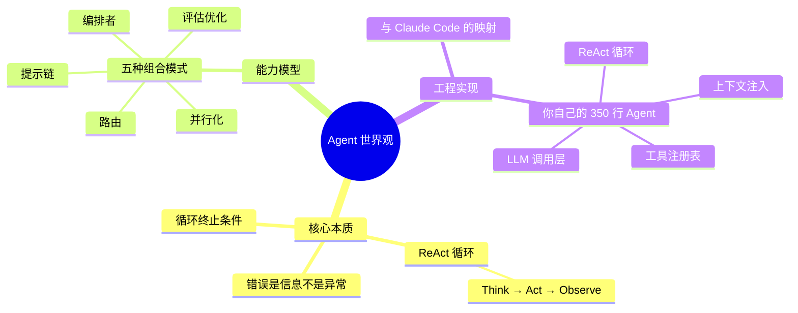

> 历史研究归档 · 2026-11-10 发布 · 发布审核状态：scan_only（发布前程序化隐私扫描）。原有日期、观点、数据和命令保留历史语境，未经本次逐项事实核验或运行复现；见[归档说明](../../ARCHIVE_POLICY.md)。

# Chapter 4: 从零搭一个 Agent

> 📍 前置：完成 Chapter 2-3（理解 ReAct 循环和五种模式）
> 🎯 完成本章后你能：用 Python 从零实现一个能调用工具的 Agent；理解 Claude Code 源码的核心结构；知道框架为你做了什么
> ⏱️ 预计时间：15 分钟阅读 + 45 分钟编码

---

## 为什么要自己写？（WHY）

Chapter 1 你用 OpenClaw 跑通了一个 Agent。Chapter 2-3 你理解了循环和模式。

但你心里可能有一个隐约的不安：**"OpenClaw 替我做了什么？如果没有它，我能自己写一个吗？"**

这种不安很正常，也很重要。fast.ai 的教学法不是"只会用框架就行"——它是"先用框架跑通完整游戏，然后把框架拆开，看里面到底只有几个零件"。

这一章就做这件事。你会写 4 段代码，从 30 行到 350 行，一步步搭出一个能用的 Agent。每段代码都能直接运行、产生结果。

**关键认知**：当你亲手写完这 4 段代码后，Agent 对你来说就不再是任何框架的黑盒。你看到 LangChain、CrewAI、OpenClaw 的时候，会想"哦，这不就是把我的 `agent_loop()` 包装了一下嘛"——这种底气，是理解带来的。

---

## 准备工作

你需要：
- Python 3.10+
- 一个 OpenAI 兼容的 API Key（通义千问即可）
- 安装 openai 库

```powershell
pip install openai
```

配置环境变量（PowerShell）：

```powershell
$env:OPENAI_API_KEY = "EXAMPLE_API_KEY"
$env:OPENAI_BASE_URL = "https://dashscope.aliyuncs.com/compatible-mode/v1"
```

---

## 第一步：增强型 LLM — 30 行（HOW）

这还不是 Agent。只是一次 LLM 调用。但它是一切的起点。

```python
"""
Step 1: 增强型 LLM — 单次调用（30 行）
这是 Agent 的第零层：你 → LLM → 回答。没有工具，没有循环。
"""
import openai

client = openai.OpenAI()  # 自动读取 OPENAI_API_KEY 和 OPENAI_BASE_URL

def ask_llm(user_message: str, system_prompt: str = "你是一个有用的助手。") -> str:
    """最简单的 LLM 调用：一问一答"""
    response = client.chat.completions.create(
        model="qwen3.5-plus",
        messages=[
            {"role": "system", "content": system_prompt},
            {"role": "user", "content": user_message},
        ],
    )
    return response.choices[0].message.content

# 试一试
answer = ask_llm("帮我写一个 Python 的快速排序")
print(answer)
```

把这段代码保存为 `step1_llm.py`，运行它。你会得到一段快速排序的代码。

**但注意**：你让它"帮我写快速排序"它可以写——因为这在它的训练数据里。如果你让它"读我的 README.md 文件"，它会**编一个**——因为它没法读你的文件。

这就是为什么需要 Agent：**让 LLM 不只能"说"，还能"做"**。

---

## 第二步：加上循环和工具 — 80 行

现在我们加上 Chapter 2 学的 ReAct 循环。目标：LLM 能调用 `bash` 工具执行命令，然后根据结果继续思考。

```python
"""
Step 2: 最小 Agent — ReAct 循环（80 行）
从这里开始，它是一个真正的 Agent 了。
核心：while True → call_model → execute_tools → loop_or_stop

对应 Claude Code 源码：query.ts 的 queryLoop()
"""
import json
import subprocess
import openai

client = openai.OpenAI()

# 告诉 LLM 它能用什么工具
TOOLS = [
    {
        "type": "function",
        "function": {
            "name": "bash",
            "description": "执行 shell 命令并返回输出",
            "parameters": {
                "type": "object",
                "properties": {
                    "command": {"type": "string", "description": "要执行的命令"}
                },
                "required": ["command"],
            },
        },
    }
]

def execute_tool(name: str, args: dict) -> str:
    """执行工具，返回结果字符串"""
    if name == "bash":
        try:
            result = subprocess.run(
                args["command"], shell=True, capture_output=True, text=True, timeout=30
            )
            output = result.stdout + result.stderr
            return output[:5000] if output else "(空输出)"
        except subprocess.TimeoutExpired:
            return "错误：命令超时（30秒）"
        except Exception as e:
            return f"错误：{e}"
    return f"错误：未知工具 '{name}'"


def agent_loop(user_message: str, max_turns: int = 10) -> str:
    """
    核心 Agent 循环 — 对应 Claude Code 的 queryLoop()

    关键设计：错误不抛异常，而是作为结果返回给 LLM。
    LLM 看到错误后会调整策略。"错误是信息，不是异常。"
    """
    messages = [
        {"role": "system", "content": "你是一个有用的编程助手。使用 bash 工具执行命令来帮助用户。"},
        {"role": "user", "content": user_message},
    ]

    for turn in range(max_turns):
        # === Step 1: 调用模型 ===
        response = client.chat.completions.create(
            model="qwen3.5-plus",
            messages=messages,
            tools=TOOLS,
        )
        msg = response.choices[0].message
        messages.append(msg)  # 把回复加入对话历史

        # === Step 2: 模型没有调用工具 → 它认为完成了 ===
        if not msg.tool_calls:
            return msg.content

        # === Step 3: 执行所有工具调用 ===
        for tool_call in msg.tool_calls:
            args = json.loads(tool_call.function.arguments)
            result = execute_tool(tool_call.function.name, args)

            # 把结果返回给模型（它下一轮能看到）
            messages.append({
                "role": "tool",
                "tool_call_id": tool_call.id,
                "content": result,
            })

        # Step 4: 继续循环 — 模型看到工具结果后决定下一步

    return "达到最大轮次，任务未完成。"


# ━━━ 试一试 ━━━
result = agent_loop("列出当前目录的 Python 文件，并统计每个文件的行数")
print(result)
```

保存为 `step2_agent.py`，运行它。你会看到 Agent：

1. 先执行 `ls *.py` 或 `dir *.py` 列出文件
2. 看到结果后，对每个文件执行行数统计
3. 汇总结果告诉你

**你刚才写的 `agent_loop()` 函数——就是 Agent 的全部核心。** 80 行。Claude Code 的 `queryLoop()` 本质上做的是同样的事，只是加了 5 万行的"工程化配件"。

### 对照 Claude Code

| 你写的 | Claude Code 对应 | 差距 |
|--------|-----------------|------|
| `agent_loop()` | `queryLoop()` in `query.ts` | 你是同步的，它是 async generator |
| `messages` 列表 | `State.messages` | 你直接用列表，它有类型系统和压缩 |
| `max_turns` | 多种终止条件 | 你只有一个退出条件，它有成本、用户中断等 |
| 错误返回给 LLM | 同样 | ✅ 一致！这是关键设计 |

---

## 第三步：可插拔的工具系统 — 200 行

Step 2 的问题：只有一个 `bash` 工具，硬编码在 `execute_tool` 里。真实 Agent 要有多种工具、能动态注册。

```python
"""
Step 3: 可插拔的工具系统（200 行）
进化：工具从硬编码变成可插拔的注册表。
对应 Claude Code：Tool.ts + tools.ts
"""
import json
import subprocess
import os
from dataclasses import dataclass
from typing import Callable
import openai

client = openai.OpenAI()

# ━━━ Part 1: 工具接口（对应 Tool.ts）━━━

@dataclass
class Tool:
    """工具的统一定义。Claude Code 的 Tool 类型有 ~30 个字段，我们只保留核心 4 个。"""
    name: str
    description: str
    parameters: dict        # JSON Schema
    execute: Callable        # 入参 dict → 返回 str
    is_read_only: bool = True


# ━━━ Part 2: 具体工具实现（对应 tools/ 目录）━━━

def _bash(args: dict) -> str:
    try:
        r = subprocess.run(args["command"], shell=True, capture_output=True, text=True, timeout=30)
        out = (r.stdout + r.stderr).strip()
        return out[:10000] if out else "(空输出)"
    except subprocess.TimeoutExpired:
        return "错误：超时"
    except Exception as e:
        return f"错误：{e}"

def _file_read(args: dict) -> str:
    try:
        path = args["file_path"]
        if not os.path.exists(path):
            return f"错误：文件不存在 {path}"
        with open(path, "r", encoding="utf-8", errors="replace") as f:
            content = f.read()
        if len(content) > 20000:
            content = content[:20000] + f"\n\n... (截断，总计 {len(content)} 字符)"
        return content
    except Exception as e:
        return f"错误：{e}"

def _file_write(args: dict) -> str:
    try:
        path = args["file_path"]
        content = args["content"]
        os.makedirs(os.path.dirname(path) or ".", exist_ok=True)
        with open(path, "w", encoding="utf-8") as f:
            f.write(content)
        return f"成功写入 {len(content)} 字符到 {path}"
    except Exception as e:
        return f"错误：{e}"


# ━━━ Part 3: 工具注册表（对应 tools.ts）━━━

class ToolRegistry:
    def __init__(self):
        self._tools: dict[str, Tool] = {}

    def register(self, tool: Tool):
        self._tools[tool.name] = tool

    def get(self, name: str) -> Tool | None:
        return self._tools.get(name)

    def to_openai_format(self) -> list[dict]:
        return [
            {
                "type": "function",
                "function": {
                    "name": t.name,
                    "description": t.description,
                    "parameters": t.parameters,
                },
            }
            for t in self._tools.values()
        ]


# 注册工具
registry = ToolRegistry()

registry.register(Tool(
    name="bash",
    description="执行 shell 命令",
    parameters={
        "type": "object",
        "properties": {"command": {"type": "string"}},
        "required": ["command"],
    },
    execute=_bash,
    is_read_only=False,
))

registry.register(Tool(
    name="file_read",
    description="读取文件内容",
    parameters={
        "type": "object",
        "properties": {"file_path": {"type": "string"}},
        "required": ["file_path"],
    },
    execute=_file_read,
    is_read_only=True,
))

registry.register(Tool(
    name="file_write",
    description="写入文件",
    parameters={
        "type": "object",
        "properties": {
            "file_path": {"type": "string"},
            "content": {"type": "string"},
        },
        "required": ["file_path", "content"],
    },
    execute=_file_write,
    is_read_only=False,
))


# ━━━ Part 4: Agent 循环（使用注册表）━━━

def agent_loop(user_message: str, max_turns: int = 15) -> str:
    messages = [
        {"role": "system", "content": "你是一个有用的编程助手。使用工具帮助用户完成任务。"},
        {"role": "user", "content": user_message},
    ]

    for turn in range(max_turns):
        response = client.chat.completions.create(
            model="qwen3.5-plus",
            messages=messages,
            tools=registry.to_openai_format(),
        )
        msg = response.choices[0].message
        messages.append(msg)

        if not msg.tool_calls:
            return msg.content

        for tc in msg.tool_calls:
            tool = registry.get(tc.function.name)
            if tool is None:
                result = f"错误：未知工具 '{tc.function.name}'"
            else:
                args = json.loads(tc.function.arguments)
                result = tool.execute(args)

            messages.append({
                "role": "tool",
                "tool_call_id": tc.id,
                "content": result,
            })

    return "达到最大轮次。"


# ━━━ 试一试 ━━━
result = agent_loop("读取 README.md 的内容，然后搜索当前目录中所有包含 'import' 的 Python 文件")
print(result)
```

**关键进化**：
- 新增工具只需 `registry.register()`，循环代码零修改
- 每个工具有 `is_read_only` 标记——这是后续权限系统和并发控制的基础
- 工具接口统一：`name + description + parameters + execute`

---

## 第四步：加上上下文感知 — 350 行

Step 3 的 Agent 是"无知的"——不知道自己在什么项目里、git 状态如何。我们给它加上环境感知。

在 Step 3 的代码基础上，**只修改 system prompt 构建部分**：

```python
# ━━━ Part 5: 上下文构建（对应 context.ts）━━━

def build_system_context() -> str:
    """
    收集环境信息，注入到 system prompt。
    对应 Claude Code 的 getSystemContext() + getUserContext()
    """
    parts = ["你是一个有用的编程助手。使用工具帮助用户完成任务。\n"]

    # 1. 当前工作目录
    cwd = os.getcwd()
    parts.append(f"当前工作目录: {cwd}")

    # 2. 目录结构（简版 repo map）
    try:
        entries = []
        for item in sorted(os.listdir(cwd)):
            if item.startswith('.'):
                continue
            if os.path.isdir(item):
                entries.append(f"  {item}/")
            else:
                entries.append(f"  {item}")
        if entries:
            parts.append("项目结构:\n" + "\n".join(entries[:30]))
    except Exception:
        pass

    # 3. Git 状态（如果是 git 仓库）
    try:
        branch = subprocess.run(
            "git branch --show-current", shell=True,
            capture_output=True, text=True, timeout=5
        ).stdout.strip()
        if branch:
            status = subprocess.run(
                "git status --short", shell=True,
                capture_output=True, text=True, timeout=5
            ).stdout.strip()
            parts.append(f"Git 分支: {branch}")
            if status:
                parts.append(f"Git 状态:\n{status[:500]}")
    except Exception:
        pass

    # 4. 项目记忆文件（类似 CLAUDE.md）
    for memory_file in ["AGENTS.md", "CLAUDE.md", "README.md"]:
        if os.path.exists(memory_file):
            try:
                with open(memory_file, "r", encoding="utf-8") as f:
                    content = f.read()[:3000]
                parts.append(f"\n--- {memory_file} ---\n{content}")
            except Exception:
                pass

    return "\n\n".join(parts)
```

然后修改 `agent_loop()` 的 system prompt：

```python
def agent_loop(user_message: str, max_turns: int = 15) -> str:
    system_prompt = build_system_context()  # ← 改这一行
    messages = [
        {"role": "system", "content": system_prompt},
        {"role": "user", "content": user_message},
    ]
    # ... 后面不变 ...
```

**试一试**：进入你的某个项目目录，运行 Agent，然后问它"这个项目是做什么的？"——它现在能回答了，因为它读了你的项目结构和 README.md。

---

## 你写完了什么？

花一分钟回顾你刚才做的 4 步：

```
Step 1 (30行)   → 一次 LLM 调用 ← 增强型 LLM
      ↓ 加循环
Step 2 (80行)   → ReAct 循环 + bash 工具 ← 最小 Agent ✅
      ↓ 加注册表
Step 3 (200行)  → 可插拔工具系统 ← 有了框架的雏形
      ↓ 加上下文
Step 4 (350行)  → 环境感知 Agent ← 知道自己在哪、项目是什么
```

这 350 行代码，覆盖了 Claude Code 五层架构中的三层核心：

| Claude Code 的层 | 你实现的 | 你跳过的（后续螺旋会覆盖） |
|-----------------|---------|--------------------------|
| 接口层 | ✅ OpenAI API 调用 | 流式调用、多模型切换 |
| 工具/服务层 | ✅ 4 个工具 + 注册表 | MCP 协议、Hook 系统、40+ 工具 |
| Agent 循环层 | ✅ ReAct 循环 | 并发分区、压缩、成本控制 |
| 状态层 | ✅ 基本上下文注入 | React 状态管理、会话持久化 |
| UI 层 | ❌ 未实现 | REPL、流式渲染、快捷键 |

**你现在对 Agent 的理解层次**：
- ✅ 知道 Agent 是什么（循环 + 工具）
- ✅ 知道 Agent 能做什么（五种模式）
- ✅ 亲手写过一个（350 行，能跑）
- ✅ 知道 OpenClaw / Claude Code 替你做了什么（那些你跳过的部分）

---

## 三种构建方式全景：手搓 → SDK → 框架

你刚完成了"手搓方式"。但真实世界不止这一条路。Agent 的构建方式有三种，理解它们的本质差异比选哪个更重要：

```
┌─────────────────────────────────────────────────────────┐
│            Agent 构建的三条路                              │
│                                                          │
│  方式一：手搓 Python        你刚做完的 ← 理解本质          │
│  ┌──────────────┐                                       │
│  │ 完全控制       │  适合：学习、极简场景、特殊需求          │
│  │ 自己管循环     │  代价：所有工程化都要自己写              │
│  │ 自己管工具     │  代表：你的 350 行 Agent               │
│  └──────────────┘                                       │
│           ↓ 当你需要"开箱即用的工具链"                      │
│  方式二：Agent SDK                                       │
│  ┌──────────────┐                                       │
│  │ SDK 管循环    │  适合：快速获得生产能力（自带 10+工具）    │
│  │ SDK 管工具    │  代价：绑定特定模型供应商               │
│  │ 你管 Prompt   │  代表：Claude Agent SDK、OpenAI SDK    │
│  └──────────────┘                                       │
│           ↓ 当你需要"多 Agent + 持久状态 + 复杂工作流"       │
│  方式三：编排框架                                          │
│  ┌──────────────┐                                       │
│  │ 框架管编排    │  适合：多 Agent、HITL、检查点恢复        │
│  │ 框架管状态    │  代价：学习曲线 + 框架绑定              │
│  │ 你管业务逻辑  │  代表：LangGraph、CrewAI、Google ADK    │
│  └──────────────┘                                       │
└─────────────────────────────────────────────────────────┘
```

### 方式二速览：用 Claude Agent SDK 构建

Claude Agent SDK 是 Claude Code 的"库化"版本——内置了 Read/Write/Edit/Bash/WebSearch 等 10+ 工具，你只需要写 Prompt：

```python
"""
方式二：用 Claude Agent SDK — 同样的"分析项目"任务
注意对比：你的 350 行 vs SDK 的 ~10 行
"""
from claude_code_sdk import query

# 一行搞定——SDK 内部帮你管了 ReAct 循环、工具注册、上下文
async for event in query(
    prompt="分析当前项目结构，列出核心模块和它们的依赖关系",
    options={
        "max_turns": 15,
        "system_prompt": "你是一个代码分析专家。",
    }
):
    if event.type == "text":
        print(event.text, end="", flush=True)
```

**你的 350 行做的事，SDK 大约 10 行就够了。** 区别在于：SDK 内部帮你实现了 ToolRegistry、ReAct 循环、Compaction、权限检查——正是你在 Step 2-4 手写的那些。

### 方式三速览：用 LangGraph 图编排

当任务需要多 Agent 协作、持久化状态、人工审批（HITL）时，图编排框架更合适。核心心智模型：**把 Agent 工作流想象成地铁线路图**——State 是乘客（数据），Node 是车站（处理），Edge 是轨道（路由条件）。

```python
"""
方式三：用 LangGraph — Orchestrator-Workers 编排
"""
from langgraph.graph import StateGraph, END
from typing import TypedDict, Annotated
import operator

class ResearchState(TypedDict):
    topic: str
    sub_tasks: list[str]
    results: Annotated[list[str], operator.add]  # 多个 Worker 的结果自动合并
    final_report: str

def planner(state: ResearchState) -> dict:
    """Boss 节点：分解任务"""
    # LLM 分解 state["topic"] 为子任务
    return {"sub_tasks": ["调研框架A", "调研框架B", "调研框架C"]}

def researcher(state: ResearchState) -> dict:
    """Worker 节点：执行单个调研"""
    # LLM 执行 state["sub_tasks"] 中的下一个任务
    return {"results": ["框架A的分析结果..."]}

def synthesizer(state: ResearchState) -> dict:
    """综合节点：汇总所有结果"""
    return {"final_report": "综合分析报告..."}

# 构建图
graph = StateGraph(ResearchState)
graph.add_node("plan", planner)
graph.add_node("research", researcher)
graph.add_node("synthesize", synthesizer)

graph.set_entry_point("plan")
graph.add_edge("plan", "research")
graph.add_edge("research", "synthesize")
graph.add_edge("synthesize", END)

app = graph.compile()
```

LangGraph 的核心优势不是"又一个 Agent 框架"——而是**检查点（Checkpoint）和人工干预（HITL）是一等公民**。状态可以持久化到数据库，任何节点都可以暂停等待人工审批后继续。Ch10 会深入讲多 Agent 编排。

### 选哪条路？决策树

```
你的场景是...
├── 学习/理解 Agent 原理？
│   └── 手搓（你刚做完的）← 建立底气后再用框架
│
├── 单 Agent + 代码/文件任务？
│   └── Claude Agent SDK 或 OpenAI SDK（开箱即用，10行搞定）
│
├── 需要多 Agent 协作 + 持久状态 + HITL？
│   └── LangGraph（事实标准，29K⭐，37K下游依赖）
│
├── 角色扮演 + 简单编排？
│   └── CrewAI（直觉好，15分钟上手）
│
└── 不确定？
    └── 从手搓开始（Ch4），遇到瓶颈再选框架（Ch10 会详细讲选型）
```

> 📌 本工作区的研究结论（P5 范式）：**简单可组合 > 复杂框架**。但这条规则有边界——当你需要多 Agent + 持久状态 + HITL 时，框架的价值 > 自建成本。LangGraph 在这个场景下的投入产出比最高。详见 [现代智能体编排框架深度调研报告](../reports/06-%E5%B7%A5%E5%85%B7%E4%B8%8E%E7%94%9F%E6%80%81/R45_%E7%8E%B0%E4%BB%A3%E6%99%BA%E8%83%BD%E4%BD%93%E7%BC%96%E6%8E%92%E6%A1%86%E6%9E%B6%E6%B7%B1%E5%BA%A6%E8%B0%83%E7%A0%94.md) 和 [LangChain与LangGraph从入门到实战完全指南](../reports/04-%E5%B7%A5%E7%A8%8B%E5%AE%9E%E8%B7%B5/R26_LangChain%E4%B8%8ELangGraph%E5%85%A5%E9%97%A8%E5%88%B0%E5%AE%9E%E6%88%98.md)。

### 继续深造：8 次渐进迭代

如果你对手搓方式意犹未尽，[渐进式Agent构建实战指南](../reports/04-%E5%B7%A5%E7%A8%8B%E5%AE%9E%E8%B7%B5/R44_%E6%B8%90%E8%BF%9B%E5%BC%8FAgent%E6%9E%84%E5%BB%BA%E5%AE%9E%E6%88%98.md) 提供了完整的 8 次迭代路线（Iter 0→Iter 7），每步全部使用 Qwen API 可直接运行：

| 迭代 | 新增能力 | 行数 | 你在本章完成的 |
|------|---------|------|:---:|
| Iter 0 | 增强型 LLM | 30 | ✅ Step 1 |
| Iter 1 | ReAct 循环 | 80 | ✅ Step 2 |
| Iter 2 | 可插拔工具 | 200 | ✅ Step 3 |
| Iter 3 | 上下文管理 | 350 | ✅ Step 4 |
| Iter 4 | **流式输出** | 450 | → Ch5-Ch11 覆盖 |
| Iter 5 | **安全与权限** | 600 | → Ch9 |
| Iter 6 | **对话压缩** | 750 | → Ch9 |
| Iter 7 | **多 Agent 编排** | 1000 | → Ch10 |

---

## 螺旋 1 总结：你建立的世界观

恭喜，你完成了螺旋 1——**"先玩、再懂、再造"**。你现在拥有的认知框架：



### 螺旋 2 预告

螺旋 1 你建立了世界观。但你的 Agent 还有很多问题：

| 问题 | 对应章节 |
|------|---------|
| Agent 只能处理短对话——大项目上下文放不下怎么办？ | Ch5 上下文工程 |
| Agent 每次启动都失忆——怎么给它长期记忆？ | Ch6 知识管理 |
| 你写的指令 Agent 老不听——怎么写好 Skill？ | Ch7 Skill 工程化 |
| 怎么知道 Agent 变好了还是变差了？ | Ch8 评估与质量 |

这些问题会在螺旋 2 逐个解决。但关键是——你现在有了底气。因为你知道 Agent 的核心只是一个循环，所有"高级"问题都是在这个循环上面加配件。

---

## 检查点

1. **不看代码，画出你的 Agent 的数据流**：用户输入 → ? →? → ? → 输出
2. **如果你要加一个新工具（比如 HTTP 请求），需要改几行代码？改哪里？**
3. **`build_system_context()` 做的事情对应 Claude Code 的什么概念？**
4. **你写的 Agent 和 OpenClaw 的核心区别在哪？**（提示：功能上差不多，工程化差很多）

---

## 深入阅读（IF）

| 想了解的                                | 去看                                    |
| ----------------------------------- | ------------------------------------- |
| 完整 8 次迭代（Iter 0-7: 流式、安全、压缩、多Agent） | [渐进式Agent构建实战指南](../reports/04-%E5%B7%A5%E7%A8%8B%E5%AE%9E%E8%B7%B5/R44_%E6%B8%90%E8%BF%9B%E5%BC%8FAgent%E6%9E%84%E5%BB%BA%E5%AE%9E%E6%88%98.md) |
| Claude Code 源码的架构总览和核心循环            | [Agent架构深度研究报告](../reports/01-%E7%90%86%E8%AE%BA%E4%B8%8E%E6%9E%B6%E6%9E%84/R03_Agent%E6%9E%B6%E6%9E%84%E6%B7%B1%E5%BA%A6%E7%A0%94%E7%A9%B6.md) §3                  |
| 实验数据：Repo Map 的压缩效果                 | Claude-Code源码上下文策略实验报告（原稿交叉引用，本归档未解析）            |
| Agent 开发需要哪些 Python 知识？             | [Agent开发Python知识清单](../reports/01-%E7%90%86%E8%AE%BA%E4%B8%8E%E6%9E%B6%E6%9E%84/R02_Agent%E5%BC%80%E5%8F%91Python%E7%9F%A5%E8%AF%86%E6%B8%85%E5%8D%95.md)                 |
| Claude Agent SDK 完整教程（API/Hooks/权限/子Agent） | [Claude-Agent-SDK从入门到实战完全指南](../reports/04-%E5%B7%A5%E7%A8%8B%E5%AE%9E%E8%B7%B5/R27_ClaudeAgentSDK%E5%85%A5%E9%97%A8%E5%88%B0%E5%AE%9E%E6%88%98.md) |
| LangGraph 从入门到实战（7 个可运行示例）      | [LangChain与LangGraph从入门到实战完全指南](../reports/04-%E5%B7%A5%E7%A8%8B%E5%AE%9E%E8%B7%B5/R26_LangChain%E4%B8%8ELangGraph%E5%85%A5%E9%97%A8%E5%88%B0%E5%AE%9E%E6%88%98.md) |
| 9 大编排框架全景对比 + 选型决策树             | [现代智能体编排框架深度调研报告](../reports/06-%E5%B7%A5%E5%85%B7%E4%B8%8E%E7%94%9F%E6%80%81/R45_%E7%8E%B0%E4%BB%A3%E6%99%BA%E8%83%BD%E4%BD%93%E7%BC%96%E6%8E%92%E6%A1%86%E6%9E%B6%E6%B7%B1%E5%BA%A6%E8%B0%83%E7%A0%94.md) |
| 从零构建 Agent 的 Claude Code 源码映射      | [从零构建Agent-基于Claude-Code源码的渐进式学习路线](../reports/01-%E7%90%86%E8%AE%BA%E4%B8%8E%E6%9E%B6%E6%9E%84/R24_%E4%BB%8E%E9%9B%B6%E6%9E%84%E5%BB%BAAgent%E6%B8%90%E8%BF%9B%E5%BC%8F%E5%AD%A6%E4%B9%A0%E8%B7%AF%E7%BA%BF.md) |

---

> **螺旋 2 入口**：当你准备好了，进入 Chapter 5——上下文工程。你会发现，"给 Agent 好的上下文"比"换一个更强的模型"重要 10 倍。
