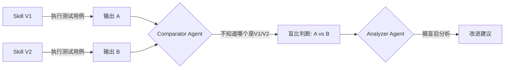

> 历史研究归档 · 2026-11-10 发布 · 程序扫描；未逐篇全文审阅。原有日期、观点、数据和命令保留历史语境，未经本次逐项事实核验或运行复现；请结合[归档说明](../../ARCHIVE_POLICY.md)阅读。

# Chapter 8: 评估与质量 — 怎么知道 Agent 变好了

> 📍 前置：完成 Chapter 7（会写 SKILL.md 了）
> 🎯 完成本章后你能：搭建一个最小评估管线；理解"盲比"范式；区分三层评估（绝对/相对/持续）
> ⏱️ 预计时间：20 分钟阅读 + 20 分钟实践

---

## 为什么需要评估？（WHY）

Chapter 7 你学会了写 Skill。你改了一版 SKILL.md，觉得"写得更好了"。

但——**你怎么知道？**

人的感觉不靠谱。你觉得新版本"更专业"，但可能只是因为它更长了、用了更多看起来专业的词汇——实际上关键信息反而丢了。

更糟的是 AI 的讨好本性：你让 AI 评价它自己的输出，它大概率说"很好"。你让它对比两个版本，它倾向于选你明显偏好的那个——不是因为更好，而是因为它在**讨好你**。

> 📌 Sharma et al. (2023) 在 Anthropic 的研究中发现：五款主流 AI 助手一致表现出讨好行为——即使用户观点客观错误也会附和。这不是 Bug，是 RLHF 训练的副产品。

所以我们需要**不依赖主观感觉的评估方法**。

---

## 核心概念（WHAT）

### 评估的三个层次

```
[层次 1] 绝对质量：这个输出好不好？
    └─ "考试打分"

[层次 2] 相对变化：改了之后，比之前好还是差？
    └─ "两次考试成绩对比"

[层次 3] 持续保障：怎么确保每次修改不引入回归？
    └─ "建立持续考试制度"
```

| 层次 | 核心问题 | 难度 | 多数团队卡在哪 |
|------|---------|:---:|------------|
| 绝对质量 | "这个输出准不准？" | ⭐⭐ | 大多数做到这里就停了 |
| 相对变化 | "改了 Skill，效果好了还是差了？" | ⭐⭐⭐ | 真正解决"迭代"问题的层次 |
| 持续保障 | "怎么防止偷偷变差？" | ⭐⭐⭐⭐ | 生产级系统必须到这里 |

### Anthropic 的盲比范式：Skill 评估的标杆

Anthropic 的 Skill-Creator 用了一套三 Agent 盲比管线——这是当前 Skill 级评估的最佳参考：



关键设计：

1. **盲比**：Comparator Agent 不知道哪个输出来自新版本、哪个来自旧版本——消除了"偏向新版本"的偏差
2. **分离评判和分析**：先判断谁赢，再分析为什么赢——避免"先找理由再下结论"的确认偏误
3. **结构化评分**：Grader Agent 从输出中提取 assertions（可验证的事实声明），逐条打分

### 主流评估框架速览

| 框架 | Stars | 核心特色 | 适合场景 |
|------|:---:|---------|---------|
| **Promptfoo** | 19.9K | CLI-first，YAML 配置，Red Teaming | 快速 A/B，安全评估 |
| **DeepEval** | 14.7K | 50+ 指标，Pytest 集成 | 全面指标评估 |
| **Ragas** | 13.3K | RAG 专精，测试数据生成 | RAG 管线评估 |
| **Inspect AI** | 1.9K | UK AISI 出品，100+ 预置 Eval | 安全和合规 |

### 最小可行评估：Promptfoo 五分钟上手

你不需要搭一个完整的评估平台。用 Promptfoo 的 YAML 配置，5 分钟就能做一个有意义的对比：

```yaml
# eval_config.yaml
prompts:
  - id: v1
    raw: |
      你是一个日报总结助手。输出必须包含三级标题。必须有来源链接。
  - id: v2
    raw: |
      你是一个日报总结助手。你的目标是帮用户从碎片活动中提炼出有价值的进展。
      用三级标题是因为读者需要快速扫描——没有结构的大段文字会被直接忽略。

providers:
  - id: openai:gpt-4o-mini

tests:
  - vars:
      activities: "上午开了产品评审会，下午提交了3个PR（#122登录优化、#123缓存重构、#124文档更新），晚上修了一个P1bug"
    assert:
      - type: contains
        value: "P1"            # 必须提到关键事件
      - type: llm-rubric
        value: "输出是否按价值而非时间排序？"
      - type: llm-rubric
        value: "是否识别出了风险信号？"
      
  - vars:
      activities: "写了一天文档，没有代码提交"
    assert:
      - type: llm-rubric
        value: "是否仍然找到了有价值的产出？不应该说'今天没什么成果'"
```

---

## 动手做（HOW）

### 实验：用 Python 搭建最小评估管线

不依赖任何框架，用纯 Python 实现核心逻辑：

```python
"""
最小评估管线：盲比两个 Skill 版本的输出
"""
import openai
import json
import random

client = openai.OpenAI()

def evaluate_blind(output_a: str, output_b: str, criteria: list[str]) -> dict:
    """
    盲比两个输出：随机分配位置，消除顺序偏差
    """
    # 随机打乱顺序（消除"位置偏差"——LLM 倾向选第一个）
    if random.random() > 0.5:
        first, second = output_a, output_b
        mapping = {"选项1": "A", "选项2": "B"}
    else:
        first, second = output_b, output_a
        mapping = {"选项1": "B", "选项2": "A"}
    
    criteria_text = '\n'.join(f"- {c}" for c in criteria)
    
    response = client.chat.completions.create(
        model="qwen-plus",
        messages=[{
            "role": "user",
            "content": f"""请对比以下两个输出的质量。你不知道它们的来源,请纯粹基于质量判断。

评估标准:
{criteria_text}

--- 选项 1 ---
{first}

--- 选项 2 ---
{second}

请输出 JSON: {{"winner": "选项1" 或 "选项2" 或 "平局", "reason": "一句话理由", "scores": {{"选项1": 1-10, "选项2": 1-10}}}}"""
        }],
        response_format={"type": "json_object"},
    )
    
    result = json.loads(response.choices[0].message.content)
    # 映射回真实标签
    if result["winner"] in mapping:
        result["actual_winner"] = mapping[result["winner"]]
    else:
        result["actual_winner"] = "平局"
    
    return result

# 使用示例
result = evaluate_blind(
    output_a="## 日报\n### 成果\n1. 修复P1 bug\n2. 提交3个PR\n### 风险\n无",
    output_b="今天开了会，提交了3个PR，还修了一个bug。",
    criteria=[
        "是否有清晰的结构？",
        "是否按价值排序？",
        "是否识别了风险信号？",
    ]
)
print(f"胜者: {result['actual_winner']}, 理由: {result['reason']}")
```

### 反讨好防线：你能做的三件事

评估 Agent 时，讨好偏差是最大的敌人。三个实用防线：

| 策略 | 做法 | 效果 |
|------|------|------|
| **盲比** | 评判 Agent 不知道哪个是新版本 | 消除"偏向新版本"偏差 |
| **随机位置** | 两个输出的呈现顺序随机 | 消除"偏向第一个"偏差 |
| **确定性检查** | 用 `contains` / `regex` 检查关键事实是否存在 | 补充 LLM 评判的不可靠性 |

### 思考题

1. **你在 Ch7 写的 SKILL.md，用什么测试用例来评估它？** 列出 3 个输入场景和对应的判断标准。
2. **"修改后变好了"的最小证据是什么？** 一次盲比就够吗？（提示：统计显著性需要多次）
3. **评估本身也需要 Token 成本。** 如果你有 100 个测试用例、每次盲比花 1000 tokens，每次迭代的评估成本是多少？

---

## 深入阅读（IF）

| 主题 | 报告 | 关注章节 |
|------|------|---------|
| 评估框架全景对比 | [Skill与Agent评估方案全景调研报告](../reports/05-%E8%AF%84%E4%BC%B0%E4%B8%8E%E8%B4%A8%E9%87%8F/R15_Skill%E4%B8%8EAgent%E8%AF%84%E4%BC%B0%E6%96%B9%E6%A1%88%E5%85%A8%E6%99%AF.md) | §二 全球主流评估方案 |
| 盲比 + 三 Agent 管线详解 | [Anthropic官方Skill-Creator设计哲学研究报告](../reports/01-%E7%90%86%E8%AE%BA%E4%B8%8E%E6%9E%B6%E6%9E%84/R14_AnthropicSkillCreator%E8%AE%BE%E8%AE%A1%E5%93%B2%E5%AD%A6.md) | §四 Eval-Driven Development |
| A/B 对比范式 | [Skill与Agent评估方案全景调研报告](../reports/05-%E8%AF%84%E4%BC%B0%E4%B8%8E%E8%B4%A8%E9%87%8F/R15_Skill%E4%B8%8EAgent%E8%AF%84%E4%BC%B0%E6%96%B9%E6%A1%88%E5%85%A8%E6%99%AF.md) | §六 A/B 对比范式 |
| 讨好的根因和四层防线 | [AI输出质量稳定性与反讨好研究报告](../reports/05-%E8%AF%84%E4%BC%B0%E4%B8%8E%E8%B4%A8%E9%87%8F/R16_AI%E8%BE%93%E5%87%BA%E8%B4%A8%E9%87%8F%E7%A8%B3%E5%AE%9A%E6%80%A7%E4%B8%8E%E5%8F%8D%E8%AE%A8%E5%A5%BD.md) | 全文 |
| 讨好的四种表现形式 | [AI输出质量稳定性与反讨好研究报告](../reports/05-%E8%AF%84%E4%BC%B0%E4%B8%8E%E8%B4%A8%E9%87%8F/R16_AI%E8%BE%93%E5%87%BA%E8%B4%A8%E9%87%8F%E7%A8%B3%E5%AE%9A%E6%80%A7%E4%B8%8E%E5%8F%8D%E8%AE%A8%E5%A5%BD.md) | §一 问题定义 |
| Promptfoo 配置示例 | `experiments/promptfoo_compliance.yaml` | 直接参考 |
| Skill 评估工具 | `skills/skill-evaluator/` | SKILL.md |

---

## 本章小结

| 你学到了 | 对应能力 |
|---------|---------|
| 评估分三层：绝对/相对/持续 | 知道"评估"的完整图景 |
| 盲比消除主观偏差 | 掌握核心评估方法 |
| 讨好是 RLHF 的系统性副产品 | 理解 AI 评估的根本挑战 |
| 最小评估管线 = 盲比 + 随机位置 + 确定性检查 | 能动手搭建评估系统 |

> ⏭️ 下一章：Agent 跑久了就开始"乱来"——怎么保持可靠？→ [Chapter 9: 安全、压缩与可靠性](Ch09-%E5%AE%89%E5%85%A8%E4%B8%8E%E5%8F%AF%E9%9D%A0%E6%80%A7.md)
